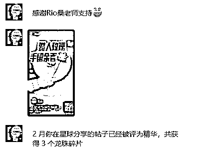
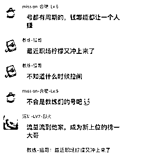
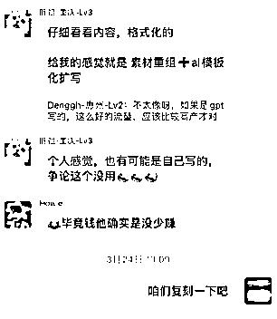
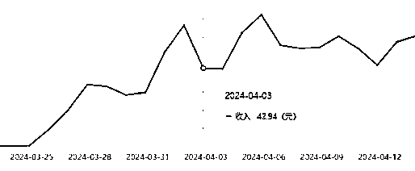
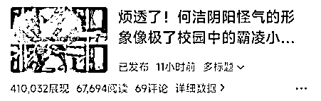

# 站撸流实战：把“职场柠檬”式的爆款号做成全自动生产线

> 原文：[`www.yuque.com/for_lazy/zhoubao/bzd62vg76vg4772g`](https://www.yuque.com/for_lazy/zhoubao/bzd62vg76vg4772g)

## 如何像素级复刻职场柠檬，做一套能自己跑的 AI 爆文系统

作者： Rio

日期：2024-05-07

大家好，我是 RIO

AI 武器研究所的一员，我们团队主攻能赚钱的 RPA 自动化工具，会定期开源工具和拆解背后的变现逻辑。

今天的主题是公众号爆文怎么写，这是我第二次航海的复盘总结。

上一次航海我写过一篇《纯数据流打法》，现在已被加精。

纯数据流，理科生如何攻坚“公众号爆文写作”？---2024 春季 RPA 工具发布会

很高兴，遗憾的是那套打法现在有点过时了。

当时我多少有点秀操作的味道，讲得比较发散，其实只点到了一部分。

这次航海，我尝试把零散的方法串成一条能变现的线，在实战中迭代出了更强的玩法。

慢慢说给你听。

这次教练给我们指了几个方向，其中就提到职场人情世故很吃香，比如“职场柠檬”。

话题里还聊到格式化、素材重组、AI 模块化扩写。

我觉得这条路我能走。

说做就做，这次的目标就是复刻“职场柠檬”。

注意，复刻不是洗稿，是像素级拆解风格，然后用同样的配方写出新内容。

就像厨师尝一口原味，再炒出一样味道的菜。

一个月猛干下来，终于撸到了一张门票。

下面按步骤拆开讲，尽量做到喂饭级别。

之前很多文章都在强调公众号要日更。

我的理解是，这根本不是坚持的问题。

公众号拼的是原创的续航耐力。

所以想做就要做好做一辈子的准备。

**做一辈子等于写到死**。

写到死意味着退休了、忙工作了、放假了、病了，都不能断更。

不能断就意味着写文章不能太费劲。

不费劲就意味着不能全靠手写。

要能吃到老，文章就得能产生收益。

要产生收益，文章质量就不能差。

要保证质量，素材必须源源不断。

源源不断的前提是不踩红线。

不踩红线就不能靠洗稿。

总结一下，就是要做一条细水长流、一辈子能跑的号。

我的解法是：**AI 原创全自动文章生成流水线**

全程交给 RPA 自动完成，机器负责定向抓取素材、批量 AI 写作、格式化排版、批量入库草稿箱。

人只需要动一下手指，在微信公众平台上定好发布时间就行。

当然，文章的灵魂还是要人来把关。

只要电脑开着、素材源还在、人脑还在思考，就能站着撸一辈子。

这就是“站撸流打法”。

单篇质量或许比不上纯手搓，但论持久力和产量，手搓根本没法比。

最近“燕子职场 30”每天更五百篇，一分钟一篇，该爆的照样爆，平台也拿他没办法。

他用的思路基本就是这套。只不过他们靠重复洗同一篇文章的办法，可能走不远。

那有没有**不洗稿也能同样爆**的路子？

在特别看重原创和算法的赛道里也能稳定出量的办法？

我们开始拆解。

详细教程和大量实操短视频我都放飞书里了，建议用 WIFI 看。

[`ovumyiw67u1.feishu.cn/wiki/MYdQwzDwmifs5bk9c1rcxuzknNc?from=from_copylink`](https://ovumyiw67u1.feishu.cn/wiki/MYdQwzDwmifs5bk9c1rcxuzknNc?from=from_copylink)

* * *

评论区：

啊喂王默 : 牛，技术流

芝马开门 : 干货满满啊~~~

芝马开门 : 老大 666

阿船 : 非常全面，保姆级教学。有个地方看不太懂“关于去 AI 味，稿子丢给算法跑一下”，这一步应该如何抄作业

Rio : 独家算法去 AI 特征，专门针对各大平台识别算法，才能搞到流量。算法非售品，这里仅做介绍

Rio : 纯纯理科生

水深无形 : 请问如何加到技术大牛的微信？

Rio : Rio0235

* * *