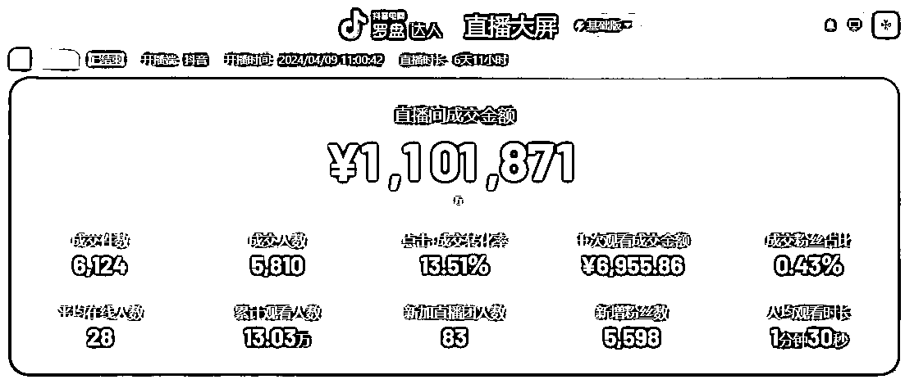
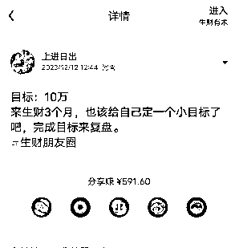

# 从电商零基础到单场 GMV 破百万，我只用了半年

## 从负债小白到单场 110 万 GMV 的逆袭实录

作者： 上进日出

日期：2024-05-08

**半年前我还在电商行业一窍不通，做了 13 年线下实体，又经历了两次创业的挫败。去年 9 月入了赚钱大门，10 月正式踏入短视频带货的赛道，一路摸爬滚打到今年 4 月，终于迎来单场 GMV 突破百万，并且拿下抖音 LV0 周榜第三。**

**这篇复盘没什么高深的干货，也不是什么天才选手的速成秘籍。就是一个普通人的真实走路历程，给自己做个阶段性总结，也让大家大概知道我现在在做什么。**

**在我看来，短视频带货的本质就八个字：数量积累到拐点就爆发。**

各位圈友大家好，我是上进日出。看到这张成绩单的第一反应是什么？爽吧？我当时看到的时候也懵了。明明才入行半年，还是个彻头彻尾的新手，感觉像中了大奖一样手忙脚乱。肯定有人会说运气好，但我更愿意说自己是借了贵人的东风。感谢一路出现的贵人，也感谢所有给予帮助的人。随后有位贵人点醒我：“别在小成就上满足”，我立刻停下来做复盘。

**为了让大家更好理解，我把整个经历拆成五个部分来聊**

**一、负债之路**

两次创业下来，皆因虚荣心作祟而一败涂地

**二、初入视频号**

难度超出预期，连剪辑都让人头大。这把年纪了，真的还能行吗？

**三、短视频+直播带货的第一次试水**

一个没有任何经验的新手，如何在一周内把一个单品推到 1000 单？

**四、单场 110 万 GMV 的实现逻辑**

想靠短视频直播把一个产品打爆，背后要准备哪些动作？

**五、双频共振的制胜法则**

短视频已经爆了，但直播经验为零的小白，该怎么播才能把结果放大？

详细内容请移步飞书查看：

[`vitp3qxqy72.feishu.cn/wiki/DTCfwRZFiim1CukHKJucowtxnpw?from=from_copylink`](https://vitp3qxqy72.feishu.cn/wiki/DTCfwRZFiim1CukHKJucowtxnpw?from=from_copylink)

* * *

评论区：

脑力界之王 : 励志爽文

冰冰 : 感受到一个倔犟的，不达目的不罢休的奋斗中的男人[强][强]超有魅力

向你学习

上进日出 : 感谢，见笑了[捂脸]

上进日出 : 谢谢您，互相学习[握手]

星星 : 先赞后看，大哥威武[憨笑]

上进日出 : [捂脸]见笑了

锦辉 : 大哥，写得真好[强]

上进日出 : 谢谢，多多指点[微笑]

* * *