# 被问一问封号后整理的避坑清单：回答怎么才不会被限流

> 原文：[`www.yuque.com/for_lazy/zhoubao/shlho3kho1saebxe`](https://www.yuque.com/for_lazy/zhoubao/shlho3kho1saebxe)

## 最近试着把问一问的流量往公众号引，结果账号直接被封，所以把问一问的回答规范整理出来：问一问 · 回答指引

作者： congshan

日期：2024-05-09

大家好，我是山歌，也叫 congshan。之前做过头部培训机构全国 Top Sales 及销售负责人，后来转行做财税近五年，累计服务过 1000+ 家小微企业。现在主攻零基础老板创业必备知识的付费赛道，会持续输出实用的财税干货。有感兴趣的话题欢迎在评论区提，有用的话也麻烦点赞转发给需要的朋友。

重点在文末，被判定违规封号的高风险行为一定要看完。

# 问一问 · 回答指引

问一问更青睐原创且真诚的内容，真实的经历和体验对别人更有价值；独到的见解和个人观点更容易让人记住。纯搬运、纯 AIGC 生成的内容不被认可，可能被拒更会触发处罚。

### 1. 遵循下面这些做法，回答更容易被分发：

##### ✅ 真实分享，更易引发共鸣

说自己的亲身经历、真实体验、个人看法或直接答疑，把生活里看到的感受传递出来，让人产生共鸣，真正帮到别人。

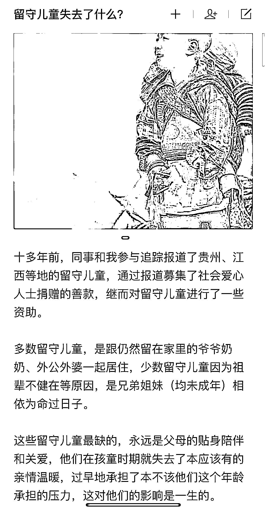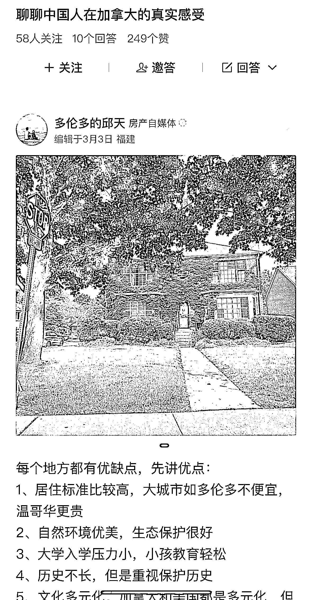

✓ 正例：基于个人真实经历的分享，对他人有启发性

##### ✅ 干货为主，贴近实际

信息完整、实用性强，从真实经验出发输出可操作的方法，步骤清晰能落地，对提问者有实质帮助。

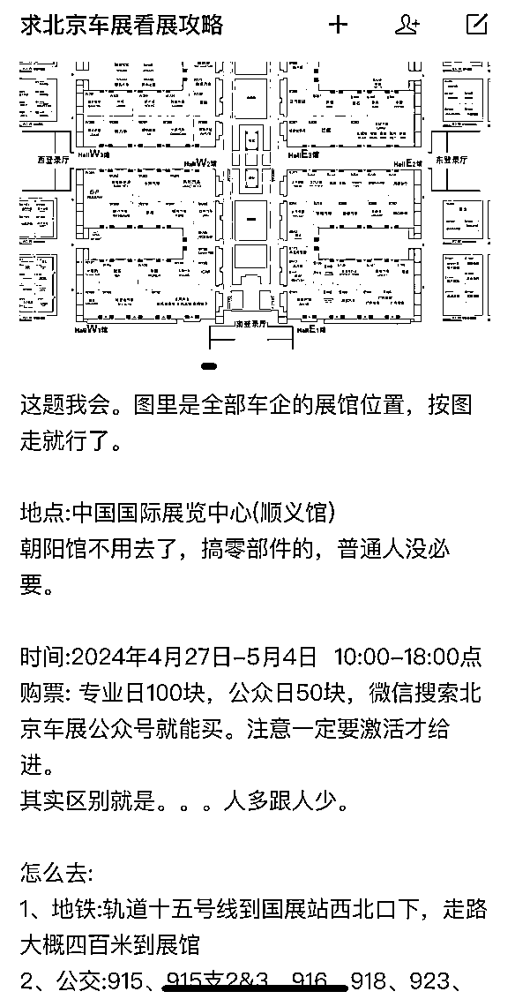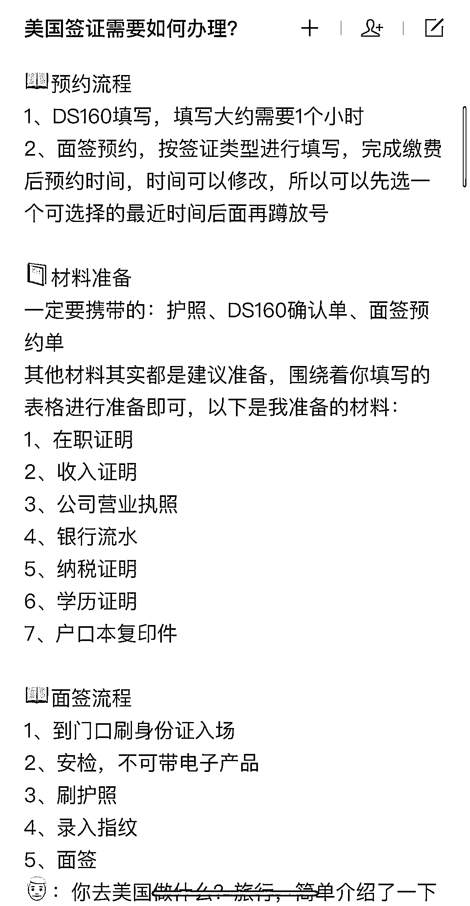

✓ 正例：步骤清晰可执行，实用价值高

##### ✅ 专业扎实，有深度

内容详实专业，输出硬核干货，适当引用可信数据和案例，用通俗易懂的方式讲透，提供信息增量或少见的专业视角。聚焦少数领域持续输出，更容易建立信任。

**理想汽车全系降价，MEGA 直降 3 万，如何解读？**

**超级猩猩如何实现差异化并冲击传统健身房？**

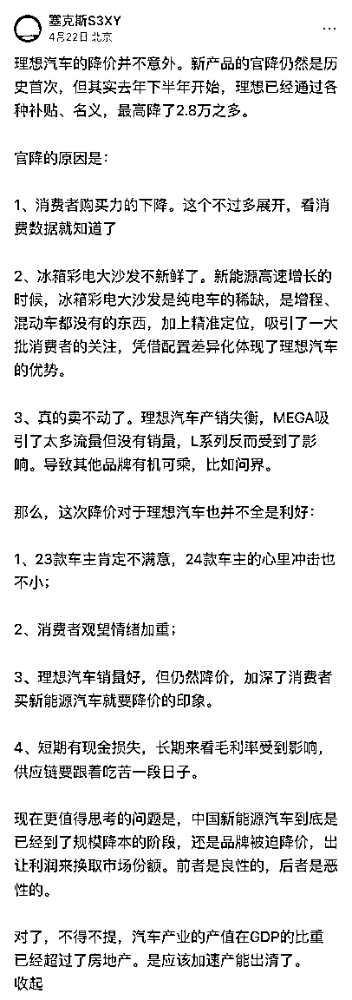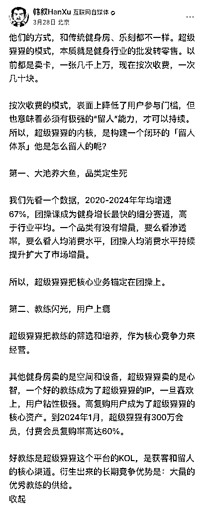

✓ 内容专业详实，阅读后有收获感

##### ✅图文结合，配图越多越好

✓ 问一问支持插入图片和视频，鼓励图文并茂，多图更佳

✓ 多媒体内容在推荐流和搜索场景里更容易获得展示和流量

✓ 文字与图片互相补充，与主题强相关，共同传递完整信息

✓ 图片建议清晰美观，比例优选 3:4

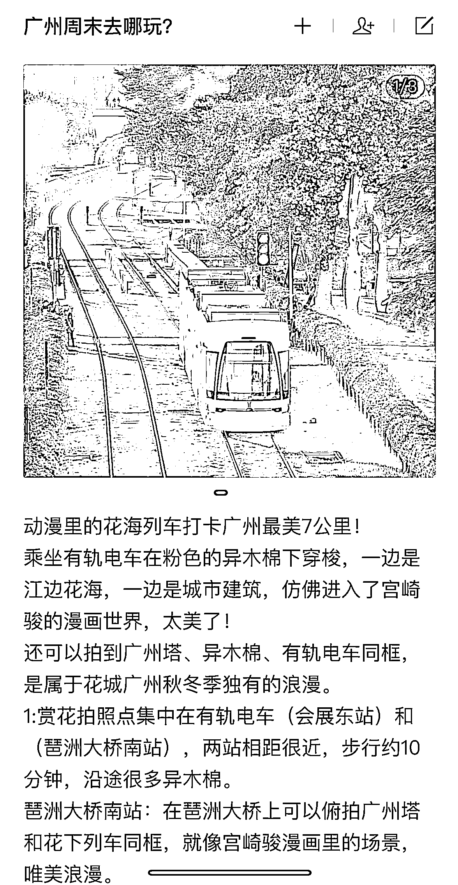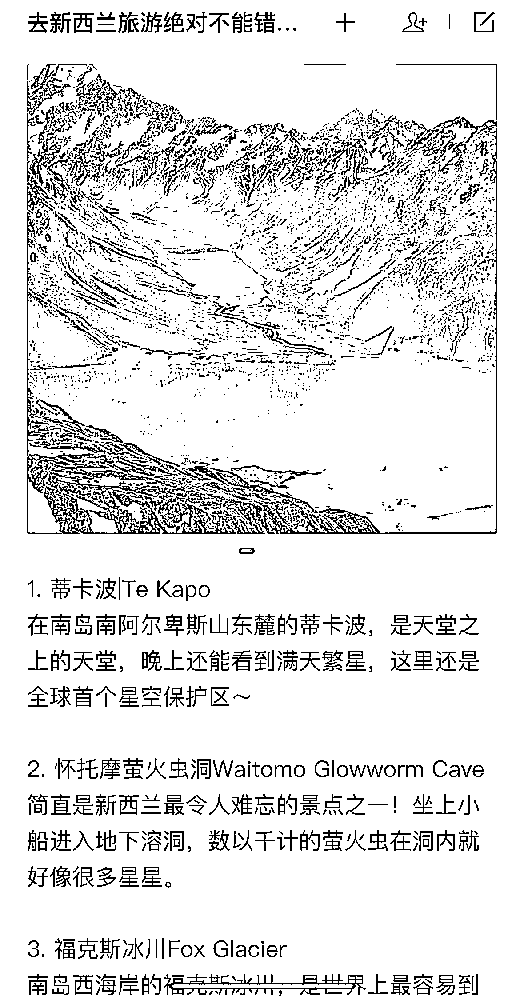

✓ 配图多且清晰美观，与正文形成互补

##### ✅ 观点先行，直奔主题

去掉没信息量的铺垫和前言，开门见山亮明态度，用户更喜欢。

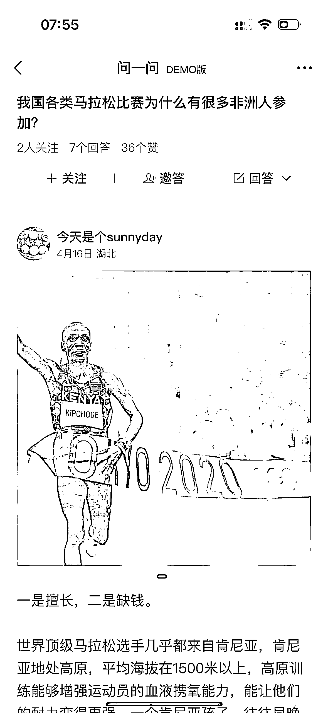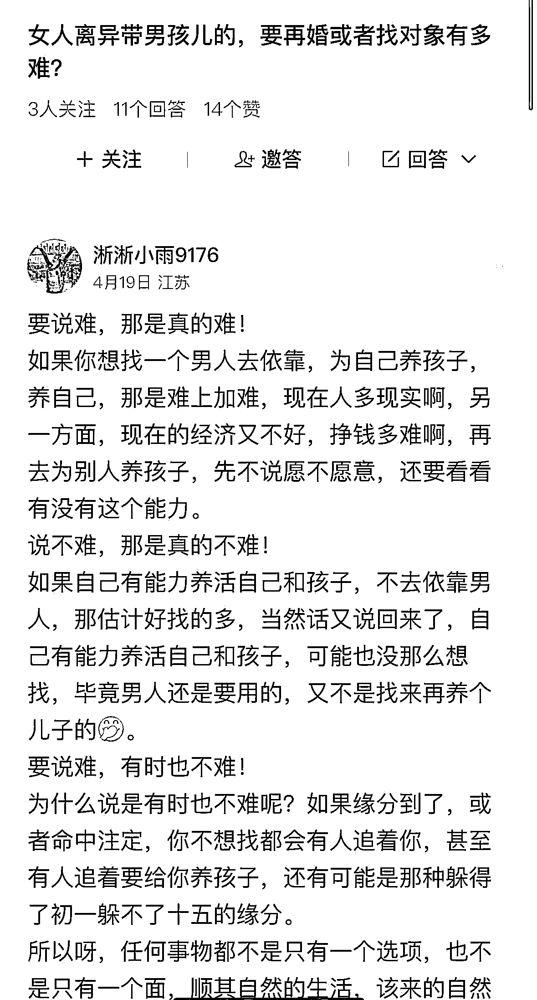

✓ 开头即表明立场

❌ 绕弯子、回避核心，啰嗦冗长

##### ✅ 分段清晰，阅读顺畅

建议多用短句少用长句，每 3-4 行就分一个段落，用空行隔开大段文字，提升阅读体验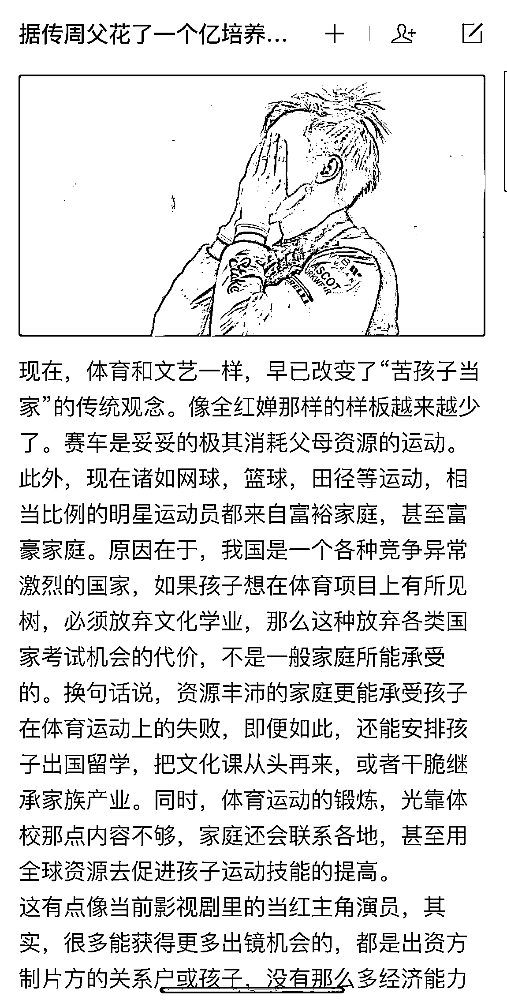

✓ 排版合理，阅读轻松

❌ 排版混乱，阅读费力

### 2. 以下类型的回答请尽量避开，可能会不被推荐、被驳回甚至导致账号受罚：

❌ AIGC 生成、低质搬运抄袭：明显是机器直接产出的水文，或直接复制他人内容

❌ 恶意引流、不当营销：为吸流在正文、昵称、个性签名里布置诱导关注或过度营销信息

❌ 造谣诽谤、侮辱谩骂：传播明显常识性错误或有害谣言，侵害他人权益，或拉踩引战、攻击贬损、恶意歧视特定群体

❌ 答非所问、离题太远：内容与问题无关，或全是空话套话、无意义图案表情，无法理解也无助于解决问题

❌ 重复发布：多次发布文本、图片、视频相同或高度相似的内容

❌ 含水印素材：回答中的图片视频带有第三方平台水印，影响观感且存在不可控引流风险

* * *

评论区：

暂无评论

* * *