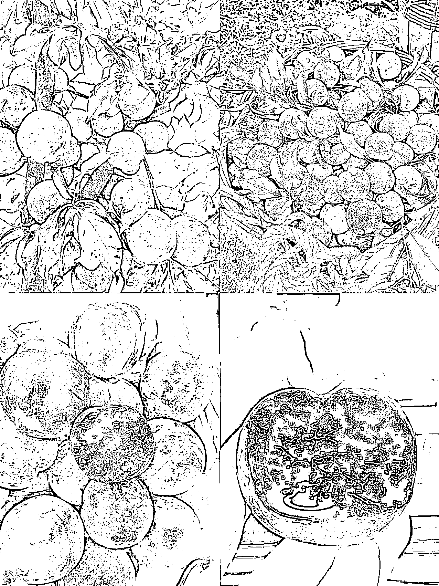
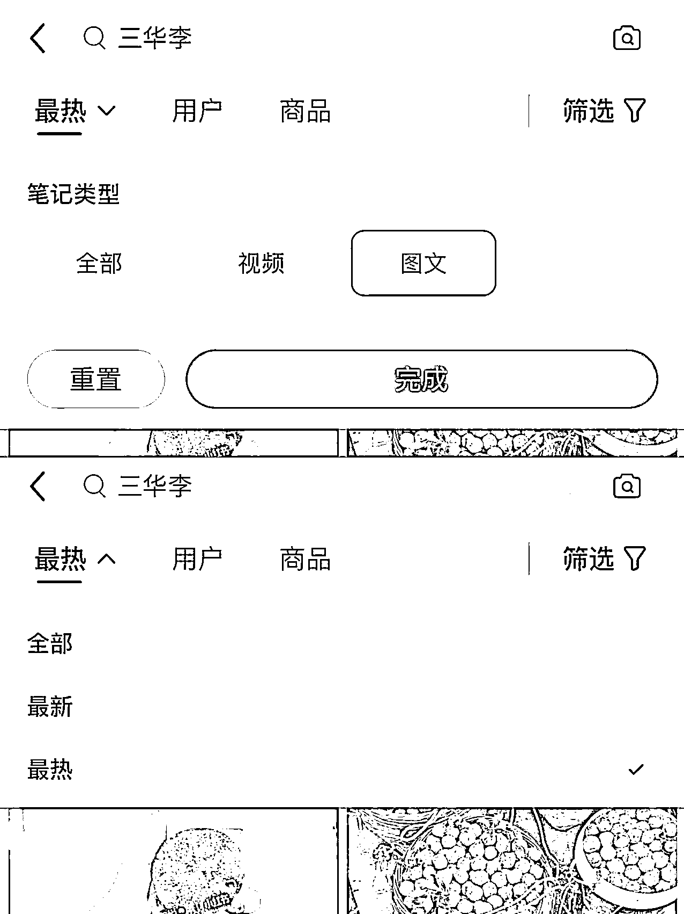
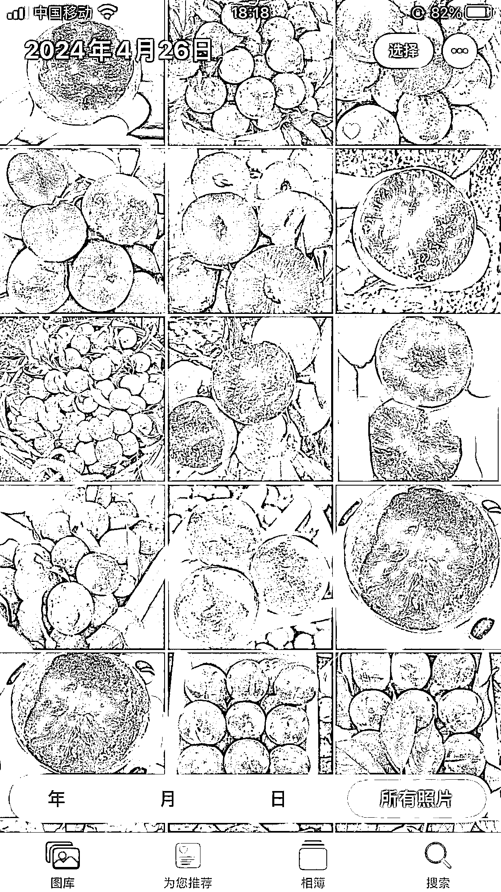
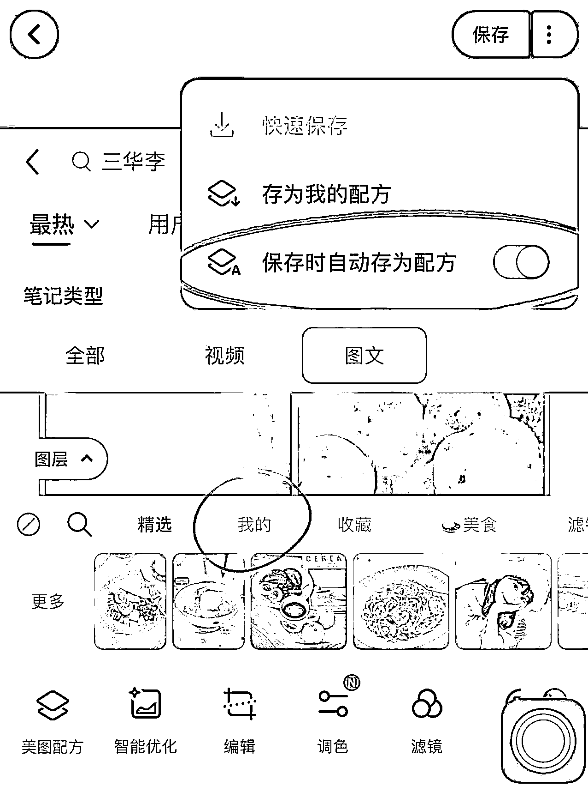

# 分享我平时在📕选品后，如何操作下一步的经验

最近总有人私信我：“飞哥，你讲选品讲得挺透，但选完之后呢？我整个就卡住了。”说实话，我本来觉得这属于基本操作，没想到还真有不少人被这一步难住。行，那今天就用我最近看上的【钱排三华李】来举个例子，带你走一遍我在📕做无人直播时，选完品之后的全套流程。这个果子利润空间不大，胜在需求够猛，封面标题弄好了，爆单几率不小，拿给新手练手再合适不过。

我确定产品后的首个动作，就是先发一条带货笔记。这一步不是为了凑热闹，而是为了拿真实数据做判断——看看这产品到底有没有人买账、我定的价格能不能被接受、我的封面和文案模板能不能打动用户、账号的流量是不是正常。这几个问题不搞清楚，光凭感觉瞎冲，最后大概率是白忙活一场。

笔记要发，就得把图跟文案分开来搞。先说图吧，很多人一选好品就急着买样自己拍，又花钱又费劲，关键拍出来能不能火根本没法保证。我走的是“借”的路线——把同行已经跑出过爆款的封面图拿来，经过简单加工再发出去。别人验证过的素材，你换个马甲再发一次，依然有不小的机会再爆一回。这也是为什么我每次选完品，经常当天就能开单的原因。

那具体怎么借？很简单，你现在打开📕，搜“三华李”，切到“图片”栏，点“最热”排序。这一页刷出来的，基本就是爆款中的爆款了，排得越靠前，流量越猛。

我挑图的标准特别直白：红、大、多汁。只要图片沾上其中一点，就直接截图存相册，集够20张左右就开工。注意，看图的时候千万别顺便看标题——有些标题写得贼吸引人，可封面平平无奇，容易把你的判断带偏，最后选出来的图根本没流量。给你们看看我挑出来的效果。

图选好之后，下一步就得给它们“洗个澡”做二次创作。为啥？因为这些图自带平台原创保护，你原封不动发出去，被平台或者原作者盯上，轻则限流，重则直接封号。所以安全第一，我的做法是：先统一把图裁成3:4的比例，再来一次垂直翻转，然后扔进美图秀秀，叠滤镜、贴纸、文字，尽量把“借”的痕迹藏起来。最后保存前记得在右上角点“保存配方”，以后每次处理素材，直接在“我的”里套配方，相当于一键复制，几分钟就能搞定一批。

图片这关过了，接着聊文案。要我说，📕笔记里最难啃的就是标题，很多朋友都是卡在这。我也没本事从零教你写，直接把压箱底的爆款标题模板掏出来给你，只要账号本身没毛病，这模板基本都有流量。你看到那些标题是不是有点眼熟？没错，我故意用上了明星姓名的谐音梗。当时我发现产品叫“三华李”，这个“李”正好是姓氏，我就琢磨着能不能蹭蹭姓李的明星热度。查了一圈，按影响力挨个筛，再用名字里剩下的字跟李子特性组词，一边组一边读，还得不违和。光这套词我就磨了5个小时，中途差点放弃。测试那天发出笔记不到半小时，评论区就热闹了：“笑死，我还以为是李宁改行卖水果了”“李宁不是卖衣服的吗，怎么沦落到卖……哦对不起看错了”“远看是李宁，近看是李子，想问这李子500克一斤卖吗”，当然也有真想买的：“看着好嘴馋，怎么买”“我们这超市好贵，你这多少钱一斤”。这些留言本身就说明问题——标题蹭热度这招，成了。那条笔记发出去一天，破了4万播放，留言800多条，大半是娱乐吐槽，小半是求链接。这个数据，我挺满意。你们要做这款产品，直接拿这套模板去试就行。

最后说几个发布时很容易被忽略的小常识。发笔记前，能别连Wi-Fi就别连，用流量发更稳；还有，别在短时间内一次性猛发多条，每条之间至少隔一个小时。你要是动作太频繁，平台为了维护用户体验，会直接把你判定成恶意营销号，轻则限流，重则永久封号。

其实里头的门道还远远不止这些，但我知道一口气写上万字，你们看着累也学不进去。这样吧，这篇点赞过百，我下期就更新这些内容：发布后的细节有哪些；为什么笔记没流量；流量低迷的号怎么盘活；怎么给用户一个忍不住下单的理由；怎么低风险安全引流；怎么低成本玩转矩阵账号。干货不多，但都是实战出来的。我是艾小飞，今天先聊到这，咱们下期见。

