# 零粉丝新号也能在📕快速成交？拆解1000家商家的真实爆单打法
作者：龙哥

## 📕零粉号也能迅速出单？1000个商家爆单经验太硬核

作者： 谢无敌🐱闪亮猫传媒

日期：2024-05-09

Hi~赚钱的小伙伴们好，我是龙哥，📕MCN闪亮猫传媒创始人。

既做实体生意，也做流量赋能，同时还是知识星球头部📕社群【谢无敌的红书宝】发起人。

前阵子在📕电商学习薯开了场电商直播，弹幕都在说信息量过大消化不完。

今天就把爆单笔记的底层逻辑掰开揉碎讲清楚。

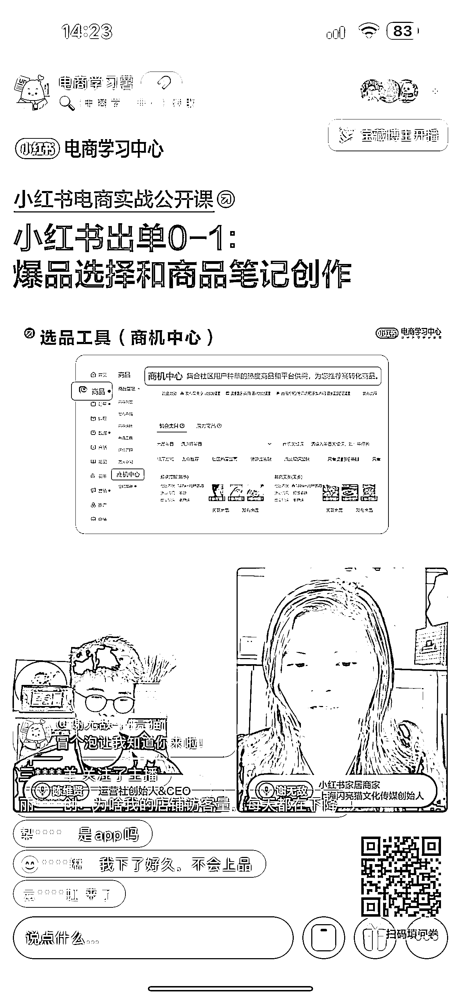

不少人说2023年是📕商业化的元年，用户和商家都发生了哪些变化？

以我手上孵化的商家为例，23年以前，大部分人都是在📕做种草，然后把流量导到其他平台或私域成交。

23年后，策略明显转向了：直接在站内完成交易。

比如做进口牛肉的商家，账号粉丝还没破百，店铺成交就达到了29单。

做减脂仪器的商家，低粉状态下成交31单，客单价还不低。

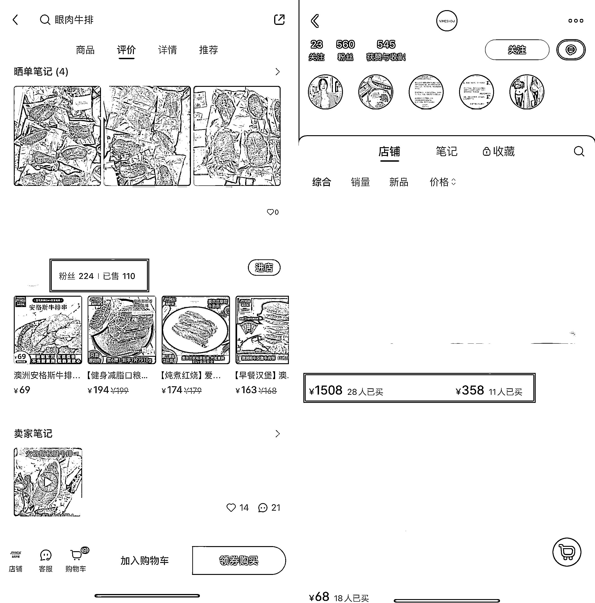

可以说，📕目前是商家里最友好的带货阵地之一，新手也能轻易拿到首单。

但很多人还是会困惑：人家能出单我为什么不行？

其实就卡在两件事上——选品和内容。

这篇笔记我会从选品、测品、选题、定标题、做封面、关键词布局等全流程出发，带你从0到1掌握爆单方法论，实现快速成交。

## 一、选品怎么选：抓住4个特征锁定爆品

选品一直是大家的痛点，到底选什么能爆？其实是有规律可循的。

结合平台用户画像和过往爆品，我们发现高转化产品大多都具备这4点——刚需+高颜值+低价+一级类目点评且DSR高。

* DSR指标 = 描述相符、服务态度、物流服务

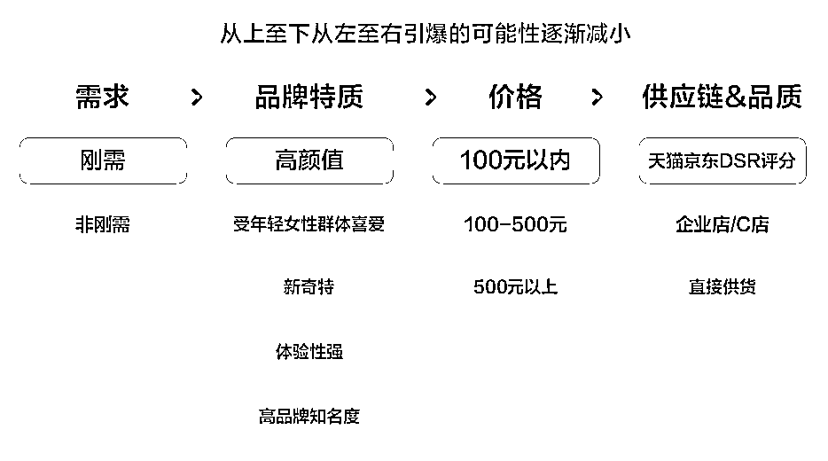

像毛毡手提袋、打底衫、日抛隐形眼镜，都在平台具备爆款基因。

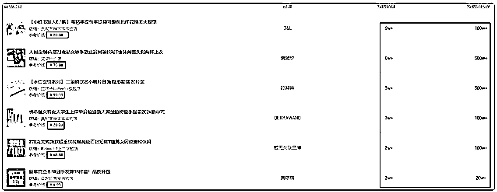

不同品类会有细微差异，但大方向是相通的。

举个例子，去年双十一我在一个直播间卖了一张万元床垫，70多个人下单。

乍看垂直且高价，难卖？但在📕的调性里，它反而更容易爆：

①质价比：万元级别的品质天花板

②颜值：家居风里流行的极简美学

③新奇特：智能睡眠的新体验

④刚需：孕妇、宝妈、打鼾人群刚需场景

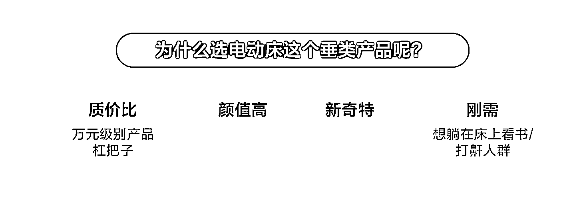

除了经验判断，官方也给了新手选品工具。

去年上线的商家辅助工具——千帆中心，里面的商机中心汇集了大量潜力商品，都是基于实时供需筛选出来的，参考价值很高。

操作路径：登录千帆中心→商品→商品管理→商机中心

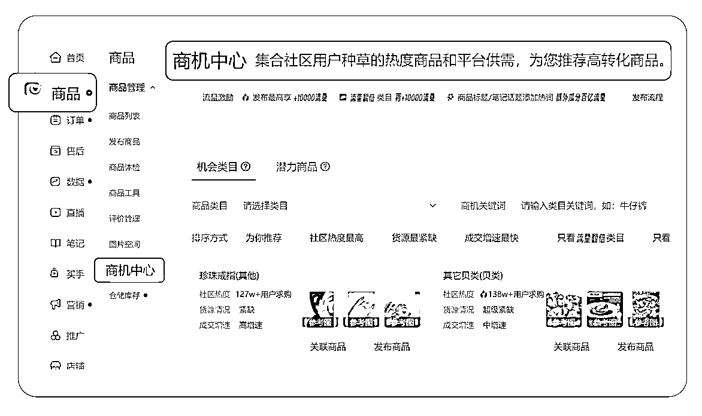

没有稳定渠道、供应链不成熟、选品没把握的商家一定要用上商机中心，后续选品会轻松很多。

## 二、如何测品：2套方法验证转化

选好品直接发？不，先测。

测品的目的是拿到真实销售数据，看它是否具备持续转化能力。

**①测品三步走**

测品大致分三步：多形态内容测试→重复创作+投放→无爆款即换品。

同一款产品，用3-5种笔记形态去试，比如图文/视频、单品/合集、不同场景拍摄，看哪种数据好就往哪种形态倾斜。

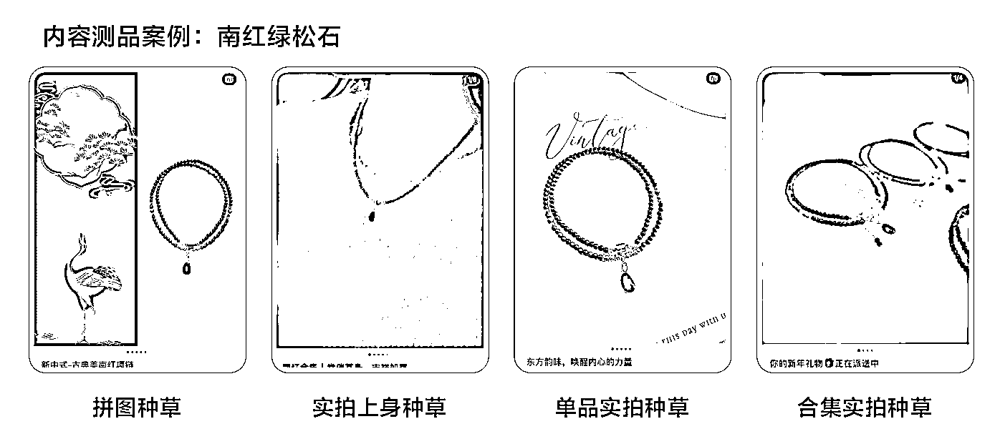

比如春节期间的爆品南红绿松石。

商家做了拼图、上身实拍、单品实拍、合集实拍4种测试，最后发现上身实拍转化最好。

后续内容基本都以实拍上身为主，还延伸到户外、手部试戴，数据都很好。

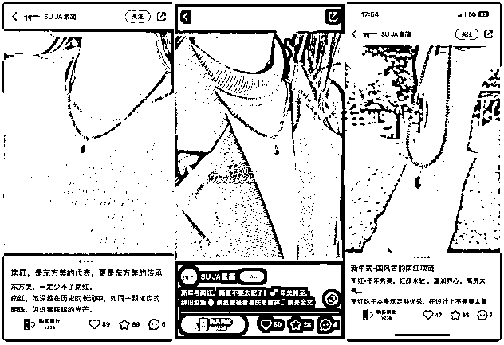

提醒一下，如果尝试多种形式后数据仍不理想，就果断换品，别在死品上浪费时间。市场需求大，总有品能打。

**②跟品抄作业**

不想自己测，也可以用跟品法。

市场上可抄的品主要分三类：

**第一类：低粉账号销量破百的产品**
不受粉丝和人设干扰，销量靠产品本身。这种经过市场验证的品，跟卖成功率很高。比如塑身吊带内衣、穿戴甲，很多商家都在卖，跟上基本就能出单↓

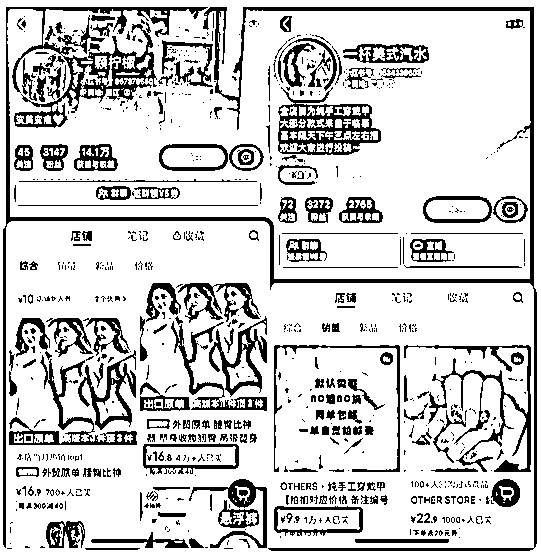

**第二类：短期内超级爆款**
比如前文说的南红绿松石，中式松石在过年节点非常契合，一到时间段就容易爆。但这类品要抓准时间窗口，错过就没了。

**第三类：小众刚需品**
需求总量不大，但属于小部分人的刚需，卖了就有单。比如沥水篮、蒸汽头改造配件。

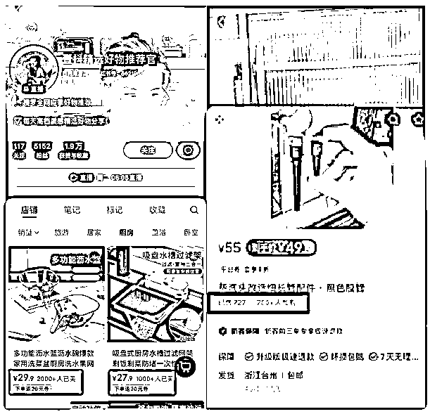

蒸汽头改造配件，听都没听过，但在平台没竞品，单价50元，销量700单，直接3.5万收入到手，这波很香。

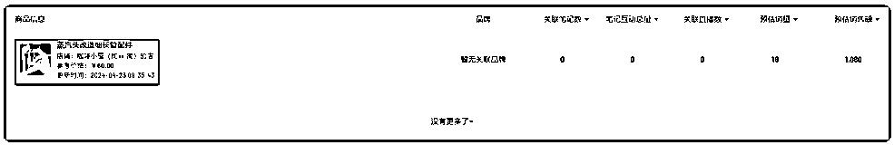

不管是自选还是跟品，核心都是找硬需求：谁需要解决什么问题？哪个品能解决？挖到刚需就成功一半，后面是内容的事。

## 三、内容节奏：从干货到深度种草

起号期一般用干货笔记，但商家不能一直干货，最多1-2周，后续要靠内容深度来提升销量。

①起号期 信息整理、攻略类：输出选品干货，初步吸住用户
②过渡期 单品种草：图文或视频展示使用方法、场景，引导下单
③成熟期 深度种草：测评、探厂、制作流程等，建立长期信任

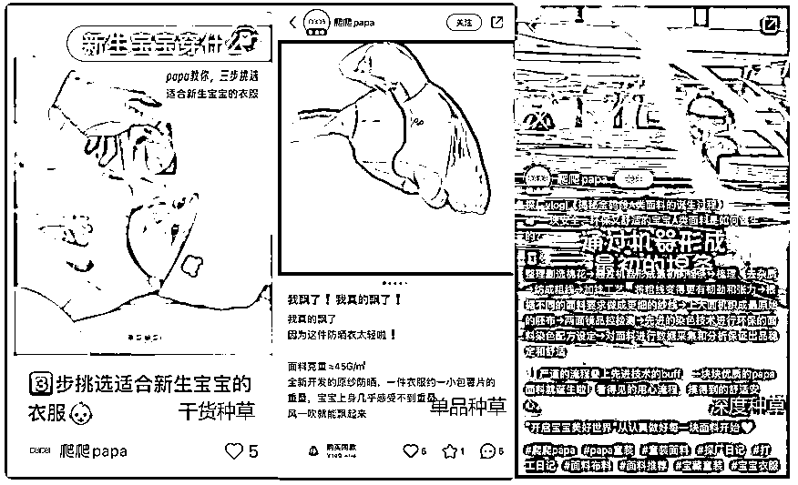

逻辑很简单，前期用软植入干货吸关注，账号成熟后要更细、更全面的介绍来留住用户。否则前期出单，后续断层也没用。

## 四、爆单笔记打法：5步成型

现在图文视频都能传，但为了转化，我更建议优先做视频，能展现更多产品细节。

如果视频拍摄成本高，图文也是可行的。

先搞清楚，哪些笔记更容易爆单？

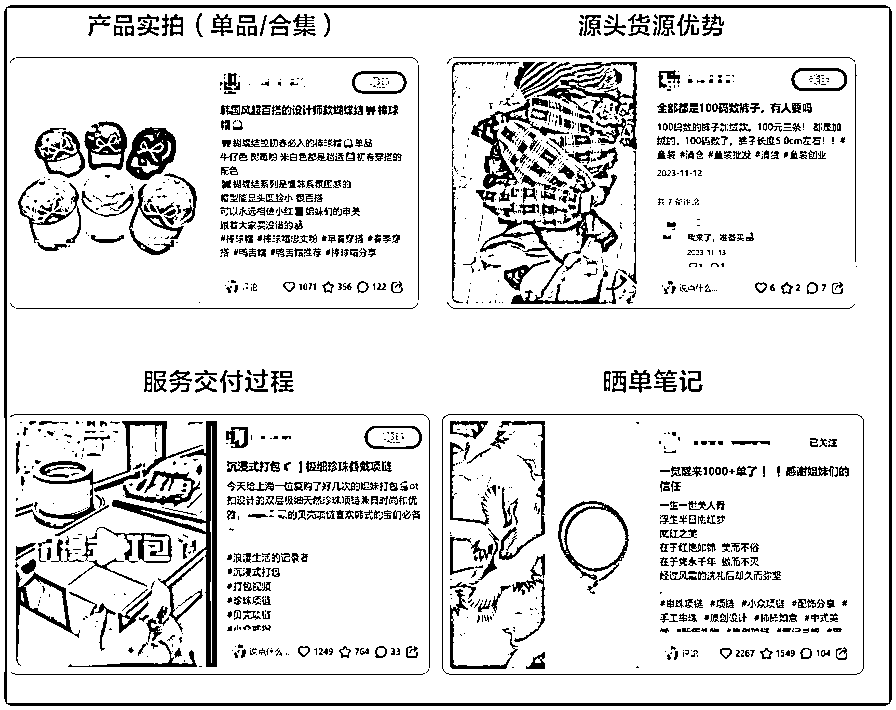

**①产品实拍**
单品或合集实拍，对审美要求不高，图清就行，新手友好且容易爆。

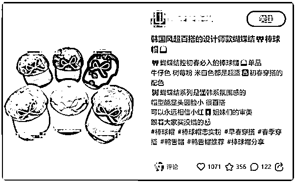

**②货源优势**
货源好、价格低，直接用真实感实拍图突出货源和价格优势。

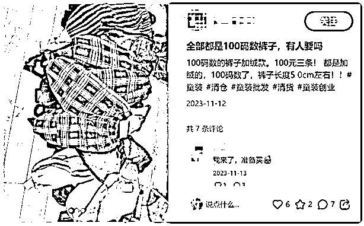

**③服务交付过程**
透露服务细节，能给用户精致体验感，饰品类很适用。

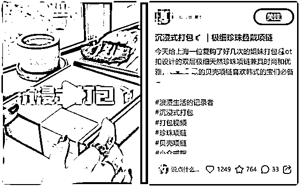

**④晒单笔记**
用真实数据为产品背书，带动跟风购买。

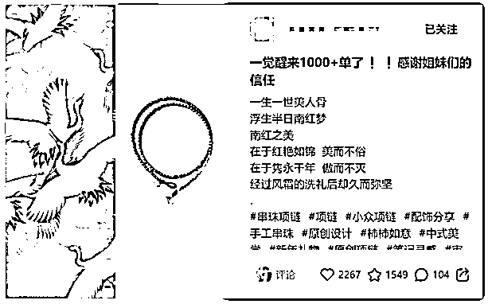

这四类转化高、模仿成本低，还有很多变种，数据好的都可以复刻。

总结下来，商品笔记创作的核心是5点：**选题、首图、标题、内容、关键词植入**。

### 1.选题

好选题直接决定点击率，占50%爆的概率。3个找选题的方法。

**①关键词选题法**
搜索框就是用户真实需求，看搜索框下方长尾词就能找到选题。比如“高级感、小户型”在家具布置里就是长青词，用作选题曝光有保障。

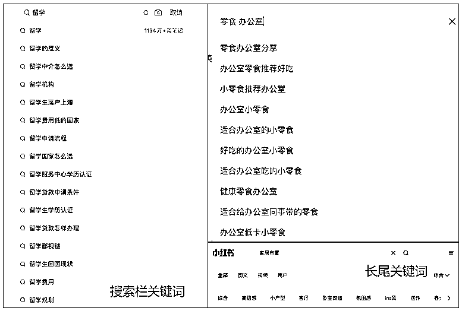

**②对标商家选题法**
同行是最佳老师。千帆中心搜索相关商品，笔记榜单直接告诉你哪种选题更爆，相当于官方把机会送到手里。

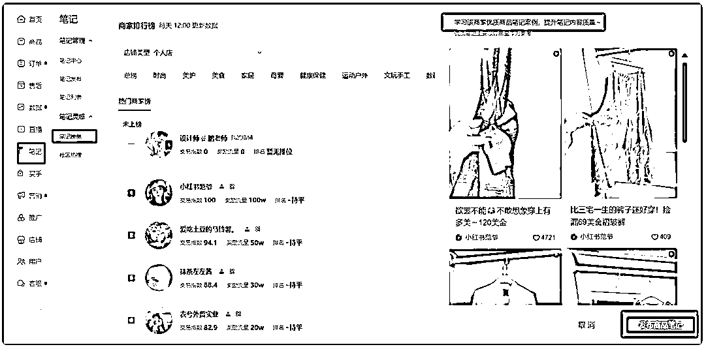

**③热门选题法**
📕热搜榜、创作中心灵感标签都是选题库。挑选和产品关联高的热点组合，蹭热度。

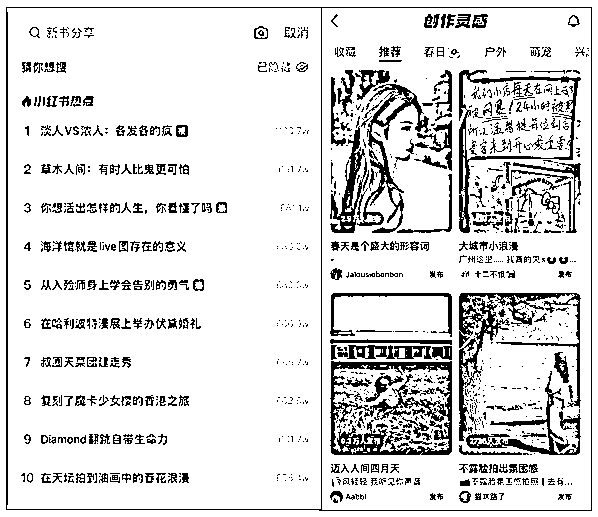

比如马斯克在📕热度一直高。用马斯克照片+金句做封面带货他的自传，流量和转化都能起来。

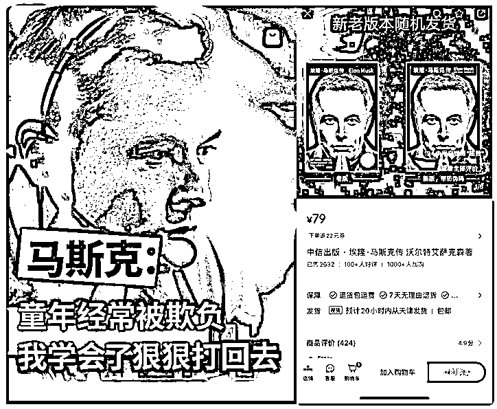

注意，一定要关联度高。无关热点会让内容发散、垂直度下降，点进来的人对产品无感，转化自然差。

### 2.首图

封面+标题决定点击率，封面占一半。

封面风格要看卖给谁。比如卖饰品，主力是20岁小姐姐，首图就要精致好看；卖茶叶，客群是40-60岁熟龄，封面不需要过度精修，天然、原生态更重要。

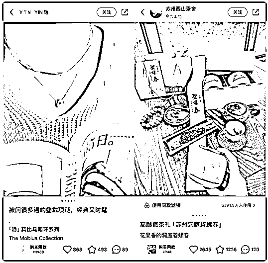

也可以代入卖货人设，在封面罗列产品信息、价格，或者配上“爆单了”、“开心”这类真实情绪文字，更容易引起共鸣↓

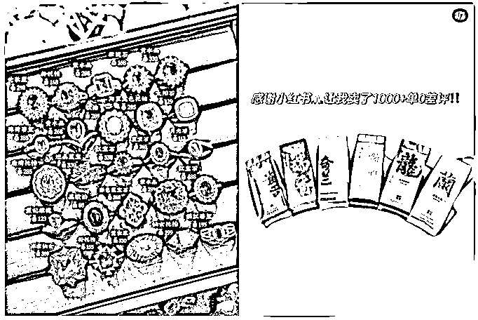

拍摄审美不够？直接搜关键词看爆款笔记的封面，从构图、字体、字号、位置等细节做1:1像素级模仿。但不要直接搬运，模仿要注意度，平台鼓励原创。

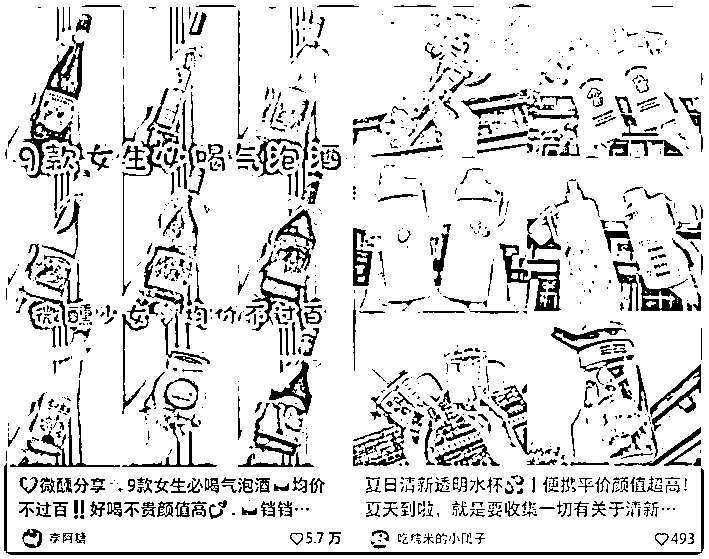

做首图需要耐心，多做就会熟能生巧，审美也会慢慢提升。

### 3.标题

好标题=简短有力+爆款关键词。总结爆款标题有4个特点：

①有代入感、场景感、画面感
②越具体越好，有细节和关键词
③简单粗暴，不要堆术语
④字数越少越吸睛

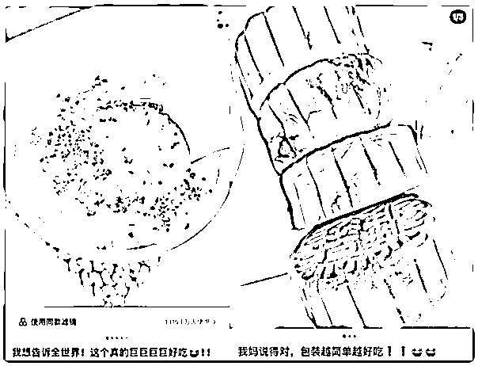

不同标题类型对应不同心理：

**好奇类：**利用未体验感激发好奇
例：在阿里上班是一种什么体验？

**痛点类：**直击痛点让人急于点击
例：如果你也经常失眠？一定要点进来看看

**极限类：**夸张具象化增强吸引力
例：99%的人都不知道的省钱小技巧，人人都能用！

**恐吓类：**制造危机感
例：千万不要和孩子说这4句话，后果很严重！

掌握心理后，可以对已有标题二次整合。找2个关键词一致但句式不同的标题，调整词序和表达：

例：变白变美的早C晚A茶，25+喝成白月光
养生20+女孩的早C晚A茶，让你白到发光
↓
养生女孩的早C晚A茶，20+喝成白月光！

对已有数据的标题做升华，点击率基本有保障。

### 4.正文

正文要有强布局意识，不同人设、产品结构不同。

**开头：**有人设账号可用固定问候增强亲切；大健康类可直接痛点切入；场景式开头自带画面感，种草力更强。

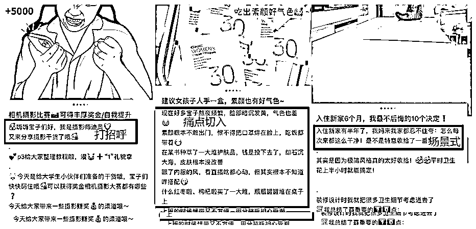

**中间：**看配图是否详细。图详细就总结信息或引导看图，不要重复；图不详细就要写清楚且有逻辑，让用户记住卖点。

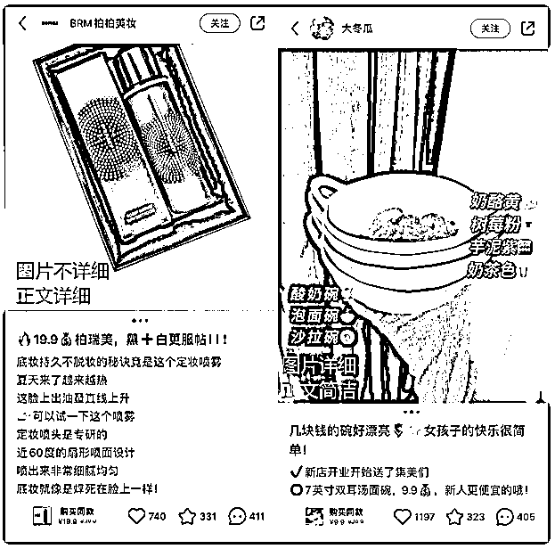

注意行间距，适当用表情符号分隔，阅读更轻松。

**结尾：**卖点多可做小总结方便复习；有人设可用招牌话术告诉用户能提供什么价值；品牌号适合留钩子做长期互动，个人号慎用有风险。

以上仅供参考，核心还是账号整体内容策略。

### 5.关键词植入

📕流量两块：首页推荐+搜索，搜索占比60%。笔记被搜到的概率越高，曝光越好。

千帆中心的“笔记-社区热搜”里能看到各品类高成交、飙升词，把这些词加进笔记，转化会明显提升。

操作：千帆中心-笔记-社区热搜-高成交/飙升词

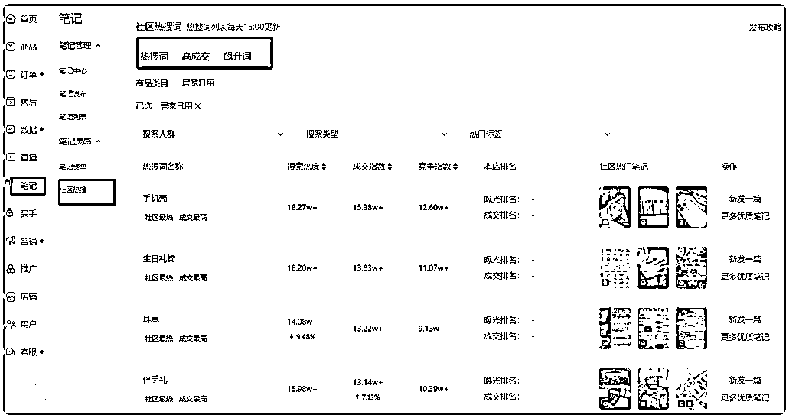

发布后官方还会推一波流，送流量的事别浪费。

关键词放哪里：

**①昵称：**行业关键词+IP，粉丝和互动好的账号容易排前。

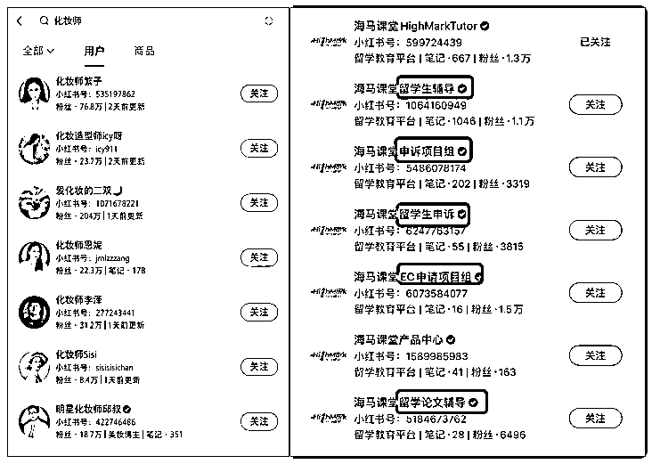

**②封面标题：**图片文字可被系统识别，用户也直观看到。

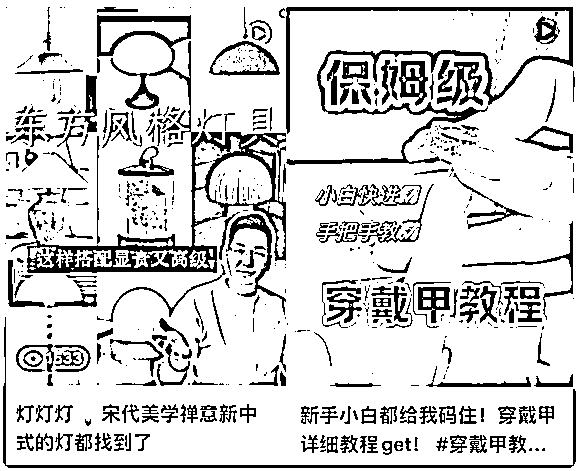

**③评论区：**评论区文字参与权重，经营好能提升权重和转化。

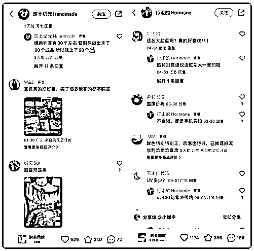

**④标签：**文末加相关话题，10个以内，别加无关标签。

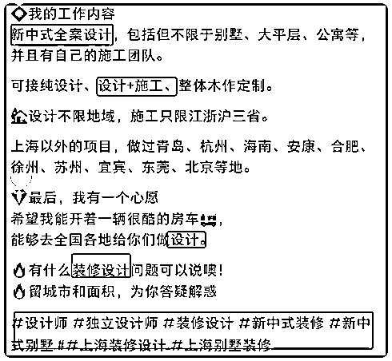

**⑤标题：**标题布局最重要，至少包含4种搜索词中的1种。

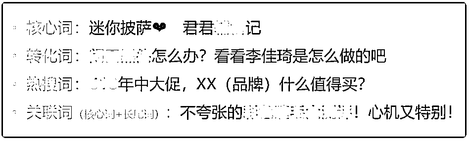

**⑥正文：**分段、隔行自然铺词，核心词+关联词+高转化词+热搜词组合使用。

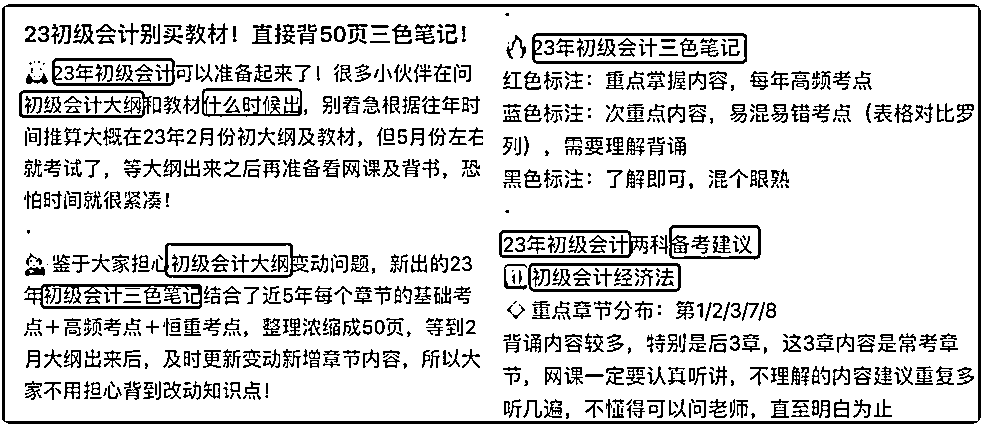

忌堆砌，影响阅读和完读率，反而降权。

只要标题、图片、正文、评论区都合理布局，搜索流量基本稳了。

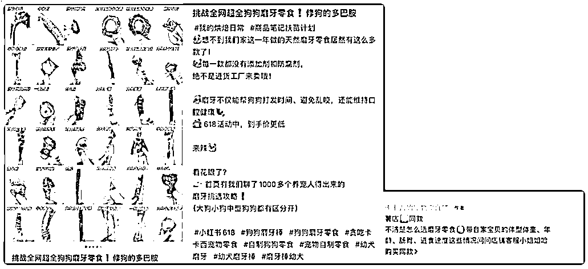

提醒：为了流量硬塞不相关关键词，用户有被欺骗感，转化差，平台也不鼓励。

官方流量扶持很多，只要有耐心不断根据数据调整内容，变现和爆单只是时间问题。

看到大家在笔记下的留言，心里暖乎乎的。有朋友说“内容扎实”，有朋友夸“讲得够细致”，也有朋友讲“受益匪浅”。你们的每一句肯定，对我来说都特别有意义。真的谢谢你们，愿意花时间读、花心思懂。

其中一位朋友问：“如果行业本身比较敏感，还能打造爆款笔记吗？”我很理解这份顾虑。不过这个问题没有统一答案，需要落到具体赛道上判断——不同的领域，内容尺度、受众偏好和平台环境都不太一样。要是你愿意，可以告诉我你具体做哪个方向，咱们一起拆解拆解。

做内容是一条不断交流的路，你们说“加油”，我也想把这份劲头送还给你们。一起往前走，期待你们做出让自己骄傲的作品。

* * *