# 📕全自动写文发文机器人-抓取爆款笔记（一）

📕创作者都在偷偷用的“爆款笔记自动抓取机器人”，到底怎么实现？

在📕做内容，最耗时间的不是写，而是找素材。面对成千上万的帖子，你想从中筛出真正有潜力的爆款，靠人工一条条刷，既费眼睛又费时间，效率低到让人抓狂。

但如果把这个活儿交给RPA机器人呢？它能自动在全网搜索高赞笔记，帮你把爆款素材挑出来，还能模仿这些内容进行二次创作。整条链路全自动跑完，不需要你盯在屏幕前，就能批量搞定多账号、多篇笔记的发布。

下面就把这套机器人的核心制作流程拆给你看。

## 整体操作链路

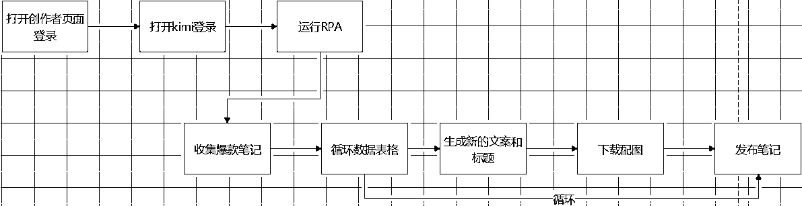

## 影刀RPA搭建详解

先看视频演示（因平台限制，暂无法直接展示）。

完整操作步骤如下：

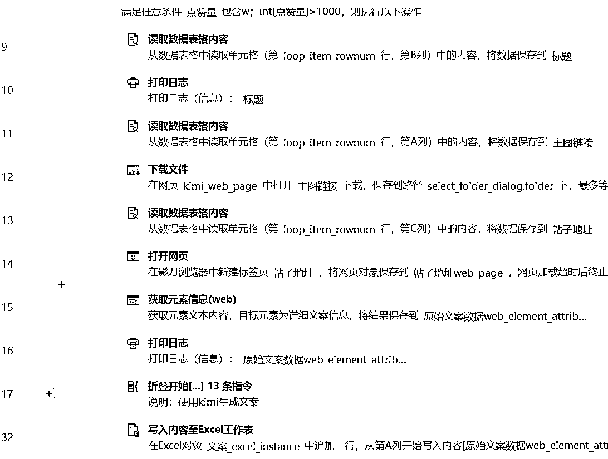

**第一步：创建新应用**

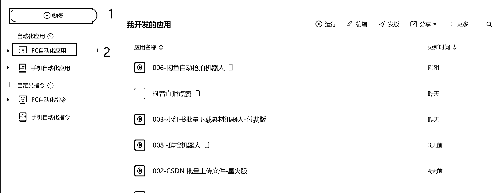

点击“新建”，选择创建一个PC自动化应用。

**第二步：配置网页访问**

先添加一个“打开选择文件夹对话框”指令，这样图片存储路径可以自己指定。

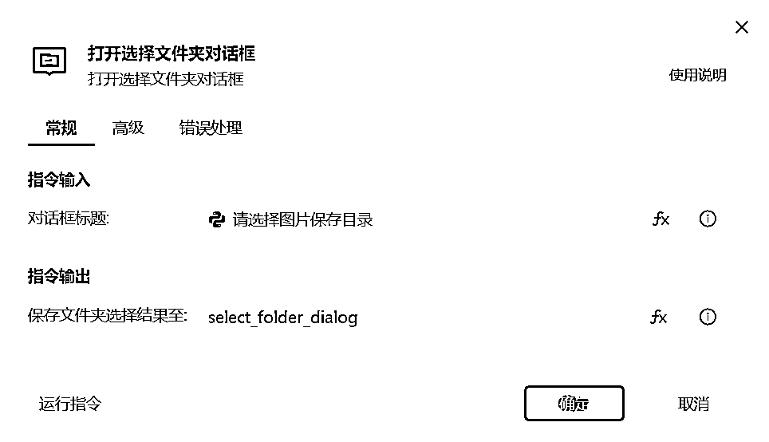

接着用“打开网页”指令，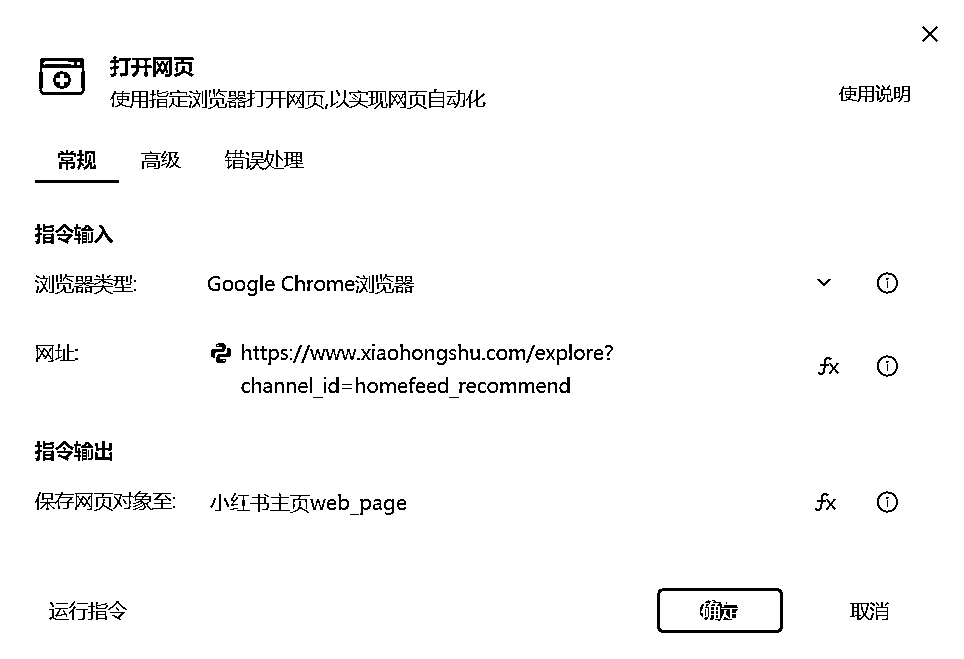浏览器选择谷歌Chrome，网址填入📕推荐页地址：
`https://www.xiaohongshu.com/explore?channel_id=homefeed_recommend`

**第三步：批量采集数据**

用“批量抓取数据”指令，直接把刚才打开的列表页内容全部抓下来。抓到的数据会自动存进影刀内置的数据表格里。

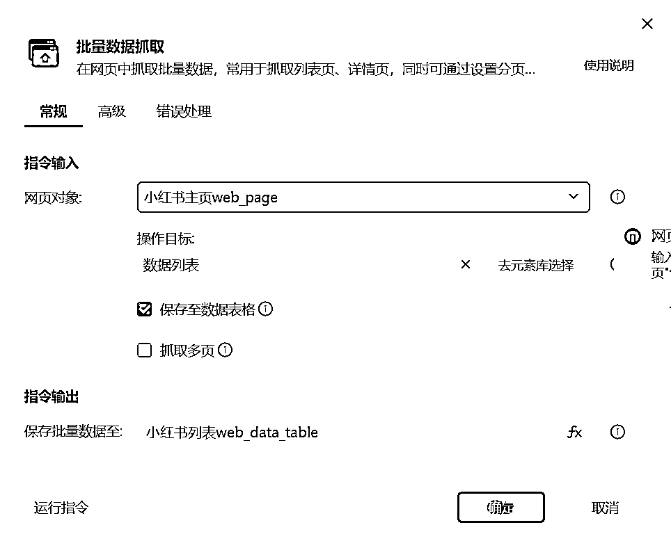

如果再加一个翻页动作，就能连续抓取多页内容，素材量直接翻倍。

**第四步：循环判断，锁定爆款**

用“循环数据表格内容”指令，逐行遍历抓取到的数据。

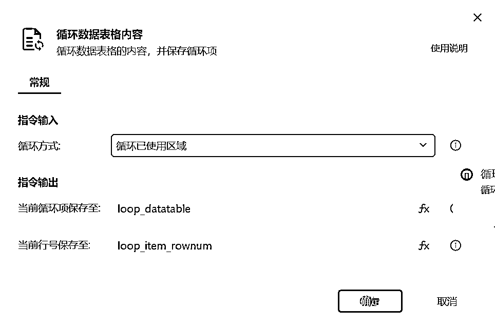

循环里先读取F列，拿到这条笔记的点赞数。

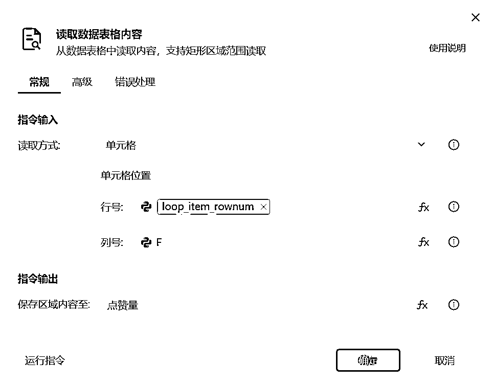

再用“IF多条件”指令，判断它算不算爆款。

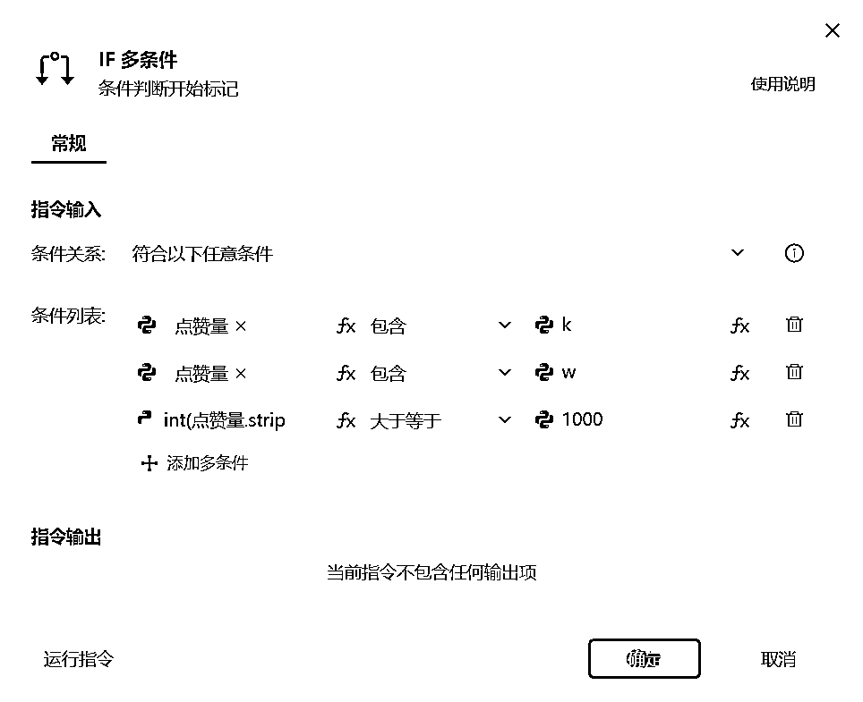

判断逻辑很简单：点赞数超过1000，就认定是爆款贴。

然后读取当前行A列，拿到这条笔记的主图链接。

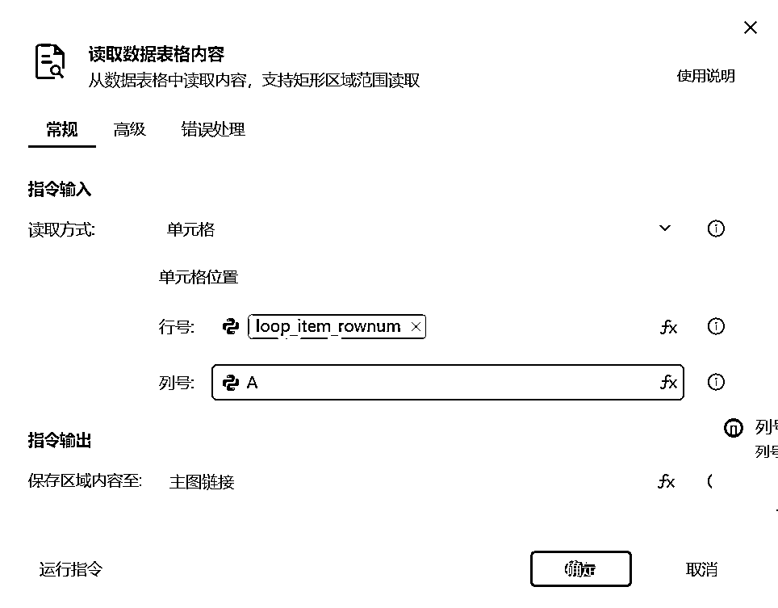

只有爆款贴才值得下载图片素材。用“下载文件”指令，把主图存到前面指定好的文件夹里。

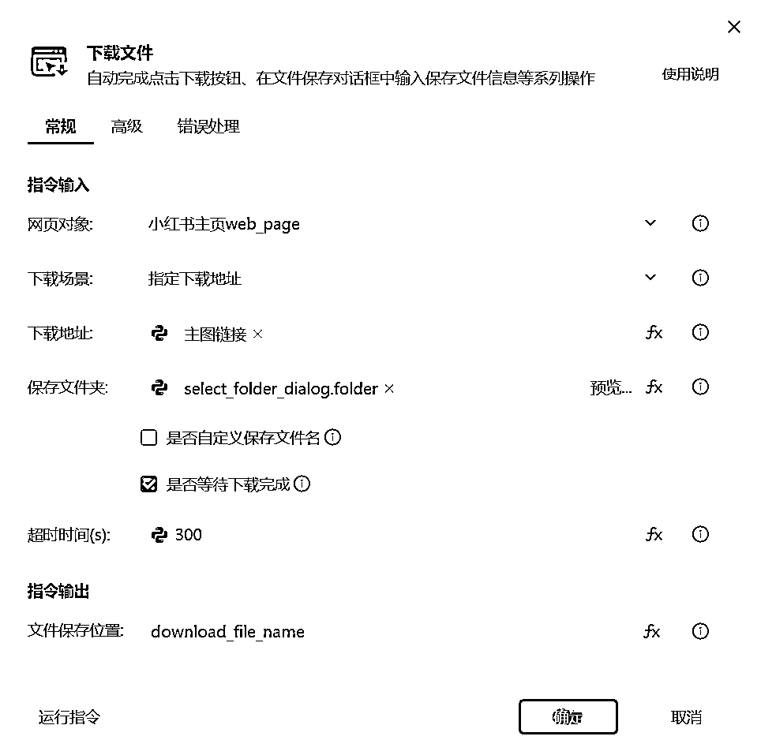

到这里，全自动发文机器人里的“素材抓取”环节就讲完了。下一篇我会继续拆解，怎么让机器人自动仿写这些爆款文案。

评论区暂时还没有留言，期待你的第一条。

