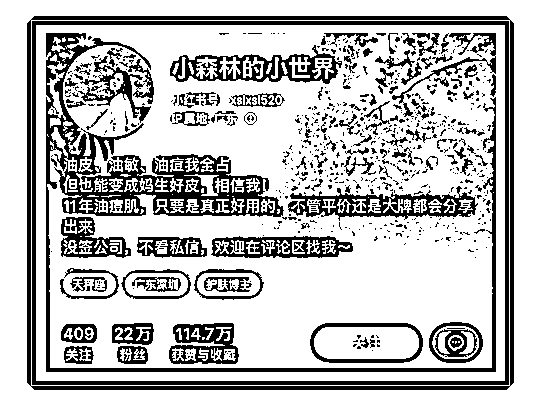

# 护肤垂类新人也能抄的买手IP打造方法，来自📕成长突破榜
作者：龙哥

## 成长突破买手榜上榜案例拆解：21万粉的护肤买手凭什么挤进TOP

作者： 李子木

日期：2024-05-06

📕上个月公布了30位成长突破买手榜单，竞争最激烈的护肤赛道里仅有2个名额。小森林以21万粉丝、205篇笔记的体量拿下其中一席。

在流量内卷、转化压力大的护肤品类里，她究竟做对了什么？

子木把小森林的账号内容完整梳理了一遍，发现她的打法其实非常具备可复制性，对刚入局的买手IP很有参考价值。

* * *

评论区：

暂无评论

* * *