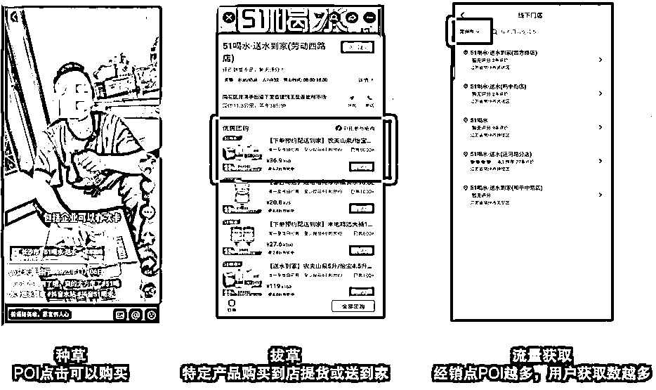
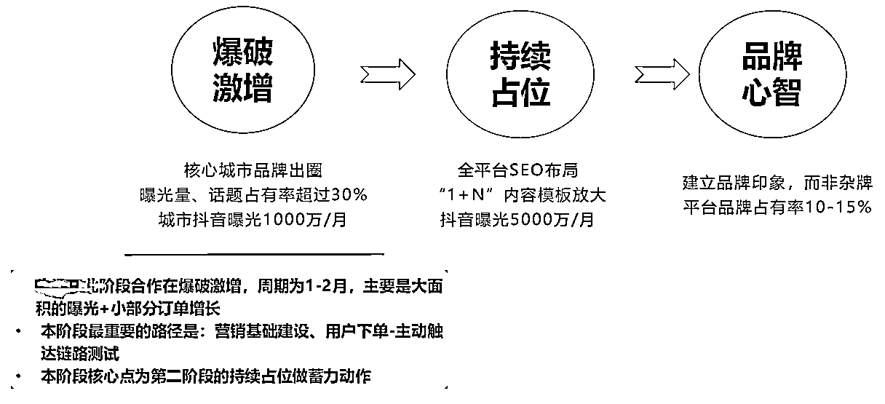
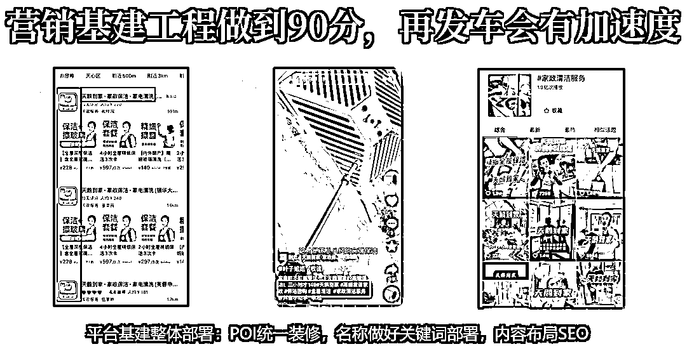

# 送水生意，正在成为抖音同城的下一个爆发点

先亮明一个判断：2024年的抖音同城生态里，最可能跑出黑马的赛道是送水。这不是凭空猜想，而是我们扎进去大半年、踩过无数坑之后得出的结论。

我们目前在做的事，概括起来就是八个字：打好地基，陪跑到底。为什么不直接做代运营？因为卖水的链条太长，短期回报很薄，多数老板都想自己掌握方法。所以我们选了另一条更重的路径——找一家区域水厂深度绑定，把它的水站改造成直营体系，再注入一整套流量玩法去赋能。如果你的队伍也对这个领域有兴趣，完全可以参照这条思路物色合作方，做长线生意。

下面这些内容信息密度比较高，既能当行业科普来读，也能作为起盘阶段的参考。

## 我们盯上这行的缘由

2023年，家政、车辆养护、衣物洗护这些低频服务，在抖音同城板块里重新焕发生机，也帮今年更大规模的线上到线下进击铺好了路。去年下半年，我们联合51喝水、农夫山泉、雀巢等品牌，共同推动平台开通水站/奶站类目。半年走下来，坦白讲，所有入驻品牌的发展都不达预期——配送掉链子、运营方向跑偏、下单流程卡顿，各种坑都踩了一遍。但正是这些波折，反过来证明了送水这门生意在抖音上值得期待，也值得继续投入。

与这行打了半年交道，我最大的感触是：信息壁垒厚得惊人。手里攥着水源、资金和配送实力的公司，根本触达不到互联网人群；他们对眼前的机会几乎无感，还反复被兜售信息的人收割，最终对新媒体彻底灰心。这是一个既传统又焦虑的圈子，上到水厂、品牌方、设备商、耗材商，下到水站、订单系统服务商，全都困在“缺少渠道”的泥潭里。“不是不想做大，而是没有平台和机会”——我在圈子里听到最多的话，就是这一句。

再看数据。家政属于低频消费，线下网点覆盖广，过去一年多来下单的顾客里，八成是头一回，说明渗透还远没到位。而我们这半年盯到的抖音水站数据更让人兴奋：新客占比75%。要掂量出这个数字的分量，只需要知道一件事——有人居住的地方，大概率就有水站，它的密度比家政网点还要高。75%的新客比例，恰恰说明这个市场的增量还远远没有释放。

所以今年3月，应闫崇义先生的邀请，我在中国饮水行业中部论坛上做了一次分享，专门拆解送水生意的抖音打法与机会。以下就是那次发言的完整整理（主题：饮用水产业抢滩抖音：重塑与可持续增长）。权当抛砖引玉。

## 我们持续押注的理由

### 队伍定位：专注垂直的O2O孵化

我们这支队伍服务过5000多家实体商家和品牌，涉及100多个细分门类。最擅长的是帮年营收10亿量级以内的公司找到增长方法论，然后搭班子、抓落地、拿结果。

从2020年到2024年，我们一直在想同一个问题：到底该选哪个细分赛道一直打下去，打深打透，而且能干上十年？直到2023年在家政赛道拿到大结果，我们才确认，这类O2O生意和我们的脾性高度契合。我们喜欢搞流量、做赋能，但更在意合作伙伴能不能持续成长，接受不了一锤子买卖，更不想一波流把大家都拖垮。

我们挨个看过饮水、保洁、清洗、维修、招工、养老、摄影、车后、装企这些细分方向，发现它们有共性：都要靠人来驱动，需要长期经营，与顾客的接触点密集。这种生意天然让品牌方忌惮差评、重视口碑、死磕服务品质——这正是我们想长久待下去的地方。

### 队伍的看家本领

第一，搭建抖音线上聚合连锁+员工账号自运营体系。同城流量的分发是网格状的，每个地点标签（POI）会优先推给周边3-5公里的人。想吃下更多流量，就要把无数个网格连起来，形成集群效应。这也解释了最早入驻的水站品牌（51喝水、水助理等）为何在各地招区域站点、用挂靠模式快速把体量做大。

实体生意利润薄，必须把流量开销压下来。所以我们帮大量公司搭过员工账号集群：员工出账号，中台统一剪辑发片，实现长期的内容输出。比如某品牌有100个账号，每个账号一天发3条，一个月就是9000条片子——这种积累相当恐怖，真正做到了省人省钱。之前大量合作客户，已经用结果验证了这套做法的有效性。

第二，自研AI量产视频工具，代号“1+N”。我们擅长做爆款内容，再用自研工具把爆款拆开、灌入新素材、合成复制出5000到5万条，然后经账号集群发出去，提高再次产出爆款的概率。这项能力在圈子里属于独一份。

第三，抖音搜索优化。很多传统公司还在靠百度、公众号SEO获客，但抖音的搜索体量其实早就超过了百度。这是我们今年必须拿下的板块，也是多年沉淀下来的判断。眼下我们操盘的项目，光靠搜索入口一个月就能成交2000万左右，潜力已经很直观。

第四，全国同城创作者+云剪辑资源，兼顾声量与转化。实体商家在抖音做推广，本质就是短视频种草爆破，靠本地流量把成交和拉新一起做起来。这个能力更多来自我们多年积累的资源，谈不上多高的壁垒，真正拼的还是更精细的执行。

### 发起人的背景

我本科读的是食品质量与安全，硕士读的是食品科学。做了这些年新媒体，说实话几乎没碰过和自己专业对口的项目。所以当饮水这个领域摆到面前时，我心里确实有一种情结——想用攒下的本事，为这个行业做点实事。

过去四年，抖音始终没开放水行业，做不成高效的商业闭环。现在窗口打开了，剩下的就是不断试错和调整。做，才有机会；不做，半点机会都没有。

## 第一阶段的数据，我们看到了什么

### 51喝水的投放复盘

2023年10到11月，我们对全国货盘做了一轮测算，主力单品是农夫山泉/怡宝的36.9元四桶组合。整体支付ROI能做到13.4（刨掉地点标签搭建、搜索优化等基础投入），兑换率约55%，折算下来最终回报率在6.7上下。

对51喝水来说，这其实是一个把成本击穿的业务。平台型公司手上全国货盘的毛利只有12%左右，再扣掉平台佣金5%、提现手续费0.4%，要打平，兑换ROI得做到15，支付ROI得冲到30左右才算过线。

但换个角度辩证地看：拉新本身就是要付的钱。一个水站每获得一位新顾客，等于摊薄了一部分推广开支。如果只盯着GMV和ROI两个数字来判断业务值不值，其实已经失去意义。我的判断是，抖音对平台型水商并不友好——链条太长，利润被吃干抹净。但非要论证这件事能成，我们也算过账：留出40%的毛利，在抖音上认真打一场，单月做到3000万以上是有可能的。

2023年11月下旬，我们换了一种思路测试：用51喝水扶持单城市的区域水品牌，第一站选了宿州。当时上架的是20元以上的景田，但当地桶装水的日常成交均价远低于这个价位。虽说抖音用户对价格不算敏感，可实际表现还是超出了预期。大约15天的市场培养期过后，产品持续出单，一波投放带来约500个新客。

这也印证了我的判断：用区域账号集群加本地创作者，做一个长期的生意盘子，拉长周期看，每月新增1000个顾客，预算控制在5万以内，相当划算。折算下来，单个顾客开销约50元，产品上没亏，实际新客成本只有35到40元。只要交付体验不掉链子，这些人就能沉淀进自己的池子。

虽然51喝水如今明显放缓了脚步，但他们替整个行业蹚出了一个参考，这是非常了不起的事，至少帮大家找到了一个新方向。核心启示只有一条：水企做抖音必须保持笃定，先把本地市场烧开，别浅尝辄止。农夫山泉也好，51喝水也罢，早期推广时市场确实毫无反应，但扛到流量临界点，收获自然会来。

### 长沙玺湘源的试水

2024年1月，玺湘源挂靠到入驻品牌名下，做了一波流量测试，最终交付成交500个左右的新客，单人成本约35元。当时主推9.9元/4桶水，交付前联系顾客收120元保证金。

坦白讲，我反对这种同时伤害平台和消费者的做法。正常一桶水的价格远高于9.9元，平台方大概率会判定站外引流，违规风险很高；再者，收保证金对18到40岁这批互联网原住民来说，抵触感很强，潜在的投诉压力极大。订单一旦爆仓，客户关系也会跟着爆仓。

这个案例带来的经验是：只要能做出增量，挂靠还是报白入驻根本不重要，不用天天琢磨自立门户。因为品牌正式入驻抖音，要搭小程序、跑链路，周期极长，白白耗掉大量时间，不如用最低的成本、最快的速度把测试和验证跑完。

另外，把顾客导进自己的池子，这件事急不得。需要在平台里花一段时间做心智铺垫，让顾客自然成为回头客，而不是靠强硬手段锁人，硬来的摩擦成本高得吓人。

以上，就是我们现阶段在这个领域攒下的全部实战经验。

## 抖音同城撬动送水生意的运作机理

### 客从哪里来

先讲清楚顾客的触达链路。大家刷视频时，经常在画面里看到一个绿色小标志，那是一个地点标签（POI）。点进去能挂团购套餐，选择配送门店时，对应的其实就是水站真实的经营位置。所以地点标签越多，经销点越密，顾客碰到你的概率就越大——这就是面向消费者的获客逻辑。

### 站点如何做大规模

水站为什么要走联营扩张？核心就是扩大地点标签的基数，在平台里多吃流量，把获客开销摊薄。这正是眼下成功入驻的水企都在招区域站点、到处布点的原因。这套打法在功夫肩颈、小黄蜂家政等品牌身上早已跑通，送水不过是换个类目重新演一遍。

这个模式最考验团队的，是对加盟站点的管控。上门服务和到店消费完全是两码事，必须按约定时间准点送到顾客家门口，而不是等服务对象自己上门。这块一旦崩盘，连锁反应马上就来：顾客投诉、加盟商闹事、平台出手治理。另一个致命点是团队的流量操盘能力——加盟站点拿不到稳定的订单增量，同样会闹出舆情。

至于这套打法能不能成，我的看法是：最终得是大玩家下场。流量端要做到订单量足够大，单均成本压到平衡甚至小亏；加盟商获取端，以行业视角切入，用一部抖音IP连续剧记录全程增长，两头同步使劲。第一阶段至少三个月，资金备足200到300万。后续把全部水站当作零售终端，变成水品牌的全国宣传阵地，盈利逻辑从卖水赚差价，升级为收入驻费和宣发费。

### 品牌方与站点的渠道协同

这个玩法和我们2022年做蓝龙虾供应链很像：我们供货给龙虾连锁店，抖音主推蓝龙虾套餐，再补贴流量费做推广，套餐卖得越多，龙虾采购量越大。水品牌想提升覆盖率完全可以照搬：进驻水站，借站点的资质做区域连锁化经营。前提是得有一支新媒体团队，也可以让我们陪跑，用三到六个月带出一支能独立操盘抖音同城的队伍，帮品牌一步步把市场覆盖率做上去。我们测算过，半年左右能拉动20到30个百分点的区域覆盖增长，而且对手几乎无法招架。

### 区域水厂加直营站点

这是目前我们最想合作的形态。链条最短，水厂直接管到站点，直面终端顾客，利润空间足够养活整套抖音投放模型。只要账能算明白，开局就能盈利。这种模式适合打算深耕本地、做长线布局的老板。当然，直营的代价是覆盖面增长慢，短期会遇到瓶颈，所以策略就是稳扎稳打，一个片区一个片区吃透，把体验做到极致，时间久了自然筑起自己的阵地。

## 抖音改写了同城O2O的分发法则

因为全面押注抖音，我们亲眼见过不少客户和伙伴完成十倍、百倍甚至千倍的增长。

早年看水行业做推广，手段无非是进社区摆摊、社群裂变、扫码拉单。如今抖音来了，所有探店博主、每位员工发出去的门店视频，本质上都是在“用短视频发传单”。

2015到2016年O2O打得最凶的时候，各家做增长先抢的是销售，社区团购抢的也是地面销售，靠人海战术做地推。但抖音把规则改了：把水放进同城版块来卖，不亏钱就能做出增长。只要让博主发片子、员工发片子、自己的IP号发片子，就能触达顾客、直接成交，而且全是新客。过去千军万马的地推大军，如今变成了海量的短视频。

## 送水生意如何完成量级跃升

### 已经被验证的放量事实

2022到2024年，相信不少人在抖音刷到过社区便利店的广告：团购引流品是农夫山泉，25元一件的瓶装水，引流价19.9元，中间就差5块钱，引流效果基本都能过万。这足以说明，把水当作引流品，消费者是买账的。

2023年下半年，我们挑了36.9元4桶的农夫山泉或怡宝来打，价格比别家还高，但我们心里有底。因为抖音同城用户最先考虑的是买起来方不方便、能不能快速送上门，十几块的价差真的没那么要紧。果然，15天的市场培养期一过，这个品直接爆单。农夫山泉-送水到府直到今天还在用这个品做售卖。

### 机会藏在哪

**短视频与直播必须双轮驱动**

先有短视频把基本盘做起来，再用直播把销量规模放大，两者互为补充，但短视频是那个前提条件。

短视频和直播为何非要一起上？因为直播比短视频难了至少10个量级。能把短视频做明白，已经能带来可观的增长。短视频的核心逻辑是：博主以内容为驱动，把卖点揉进画面去触达消费者，让消费者心甘情愿买单。

直播又是什么？直播是跟平台做交易。平台考核的是单位时间内的成交金额和成单量。眼下做小时达，如果连短视频都拍不明白，凭什么玩直播？就算流量涌进来，队伍也百分之百接不住。跟平台做交易，流量接不住就会变少，后面只能花钱买流量进来凑成交，代价会无限抬高。

算一笔账：冷启动直接开播，直播间设备加场景搭建5万，再雇两三个人，加上买流量的钱，累计10万打底。得卖多少桶水才赚得回来？对普通水企来说，这个压力太大了。

反过来看博主视频，性价比高得多。一批博主投入3万左右，换来100到300万曝光，还带着订单增长，投产比一目了然。而且博主和品牌是甲乙方关系，内容标准可以提要求；直播就不同了，要求越高，越得花钱请高手。转移成本是项目启动期必须修的一门课。我们做同城业务第五年了，到现在都没有全职摄影师，摄影活全部按SOP外包。

说到底，短视频是跟消费者做买卖，直播是跟平台做买卖。正确的顺序是：先靠短视频拿下市场，等品牌势能起来、队伍练出来了，再开直播做密集成交，把营销效率提上去，两端才能共振。两者的定位分别是：短视频是触达消费者最快的路径，直播是放大规模最顺手的杠杆。

**自营是绕不开的终点**

这行的毛利太薄，养不起代运营公司。拿家政来说，过去一年多我们接触或服务过600多家家政公司，不少请了代运营，但我们发现家政不是高频生意、毛利又低，很多代运营团队做得举步维艰。这让我想起抖音电商大赛道跑了三年后，平台开始力推“没有中间商赚差价”，鼓励品牌自播自营——说明中间的利润根本撑不起一层服务商。电商的毛利比卖水高得多，凭什么水行业还要再插一个服务商？为什么不自己干？

所以，自己上手是唯一的答案，也是最终的结局。不管品牌势能大小，自营就是终点。

**产品端必须创新**

坦白讲，我对这行的产品门道研究不深。但团队内部聊下来发现：许多人第一次接触农夫山泉那种用完即弃的小桶装水，就被直接种草，从此丢掉循环桶。可能在水行业老前辈眼里，这不合规矩。但我想说，我们这支平均年龄25岁的队伍，买过一次就改了喝水习惯。大家的共识是：大桶水放久了不卫生，4.5L的小规格桶装水才是更好的选择。

既然年轻人这么想，为什么不顺着他们的习惯做产品创新？我们看到的情况是：有些水企宁愿用9.9元4桶的循环桶来吸客，靠收保证金硬锁顾客，也不愿意用即弃型桶装水去触达消费者，在品质和服务上留住人。这样走下去，还有什么未来？消费者不需要端着架子的品牌，只需要愿意和他们站在一起的品牌。

同样的道理，大家可以琢磨：社交电商里4桶农夫山泉只卖25元，下单量却拼不过36.9元的抖音团购；天鹅到家站内93元两小时保洁，抖音用户却愿意花99元。原因是什么？因为消费者的习惯已经长在了这里。做生意的，必须靠过去，想办法迁就他们。

**理念要长在消费者身上**

我始终觉得，做这行必须深度贴近消费者，具体可以从两个角度切入，而且要写进企业的发心，不能只是嘴上说说。第一，让消费者喝水喝得方便、放心、划算；第二，砍掉中间冗余，让自己留出利润。

前面提到，年轻客群对即弃型小桶的接受度很高。我们第一阶段跑出的数据里，76%的顾客是23到40岁的女性。她们掏钱时最看重“方便、安全、高性价比”，这群购买力很强的人，一定要牢牢抓住。另外，第一阶段收到的差评里，几乎没有一条是针对产品本身的，全是“没送到家”“体验不好”。这一块要是不做到位，在抖音就是死路一条。

---

送水这门生意在抖音的故事，其实才刚刚开始。

生意能不能长久，关键看链条能不能被砍短、利润能不能留下来。

我们 2024 年第一季度聊了上百家做水的企业，算下来生产、物流、水站配送这三大块硬成本占了七成以上，真正能分给流量投放和用户运营的钱不到两成。面对这样的结构，用抖音做增长天生就吃力。身为操盘手，思路就不能停留在卖水上，要像做电商那样思考：怎么把快递费、包装费、中间环节的损耗压到最低，把省下来的空间还给用户或者自己，这才是能滚雪球的生意模型。

#### **2.4 抖音赛道上的水行业怎么打开局面**

1.  抖音本地生活品牌的增长节奏

我把抖音本地生活品牌的爬坡拆成三段。第一段是品牌引爆期，大概 2 个月，要集中火力砸曝光、撬订单；第二段是心智占位期，持续约 4 个月，让用户记住品牌名字；第三段是稳定增长期，6 到 10 个月左右，团队磨合顺畅，用户教育完成，品牌调性真正和同行拉开差距。

1.  把营销基建先做到 90 分

地基稳了，上层建筑才跑得快。前面聊的是破局思路，这里说一个更基础却人人都能落地的事：抖音营销基建。

道理很简单，开实体店谁也不会先做广告再装修。做线上也一样，企业要先把自己的营销体系打磨到 90 分，再去谈投放。

基建没打好，投放就是负分。会出现第一个月冲到 1000 万，第二个月直接掉到 100 万，后面想拉回来成本翻倍。反过来，基建做扎实的客户，几乎都能从 300 万起步，之后每个月保持 30% 左右的递增，越往后加速度越大。这块的交付，楚川团队一直保持着行业头部水准，有需要可以随时对接。

1.  云连锁 + 抖音 SEO + 职人矩阵化，打持久的流量消耗战

给你们一个可以量化的目标：做抖音就做矩阵。单城至少配 100 个职能账号，覆盖 20 城就是 2000 个。账号从哪来？员工、店长、送水师傅都能上阵。

手里握着 1000 个矩阵号，一次性发条视频就是 1000 条内容，就算一条平均 200 播放，也是 20 万自然曝光，这省下的投放成本不言而喻。

再深一层拆解职人矩阵的逻辑。新店开业大家会叫亲友捧场、请发传单的兼职，职人矩阵的本质就是让 n 个人每天在抖音上帮你发电子传单。传单吸来的人，达人和直播间负责承接转化。KOL、KOC 就像销售总监，靠日积月累的发传单势能做大规模成交，直播则相当于把所有人拉进一个会销大卖场放大战果。把这个闭环想透了，就能清楚每个阶段品牌到底缺什么。

1.  抖音水行业真正要重塑的是什么？

**服务交付和产品履约是生死线。**抖音本地生活已经过了教育期，现在只要供给和履约过硬，平台就会持续给量。近期的组织调整本质上都是在为服务质量站台，交付差的商家和平台都会被淘汰，交付好的品牌流量只会越来越多。

1.  最重要的永远是用户想在哪买、怎么喝

水企业必须尊重用户的选择权。用户在哪买水、怎么用水，决定权在他们手上。疯狂引流到私域的玩法，早晚会被平台收拾。抖音用户更在乎的是买得省心、不被打扰、不被营销绑架，而不是纠结那几块钱差价。别搞山头主义，忘了自己背后有平台、有 App。抖音的用户是抖音的，不是你的，学会和平台共生，才有大机会。

1.  告别品质自我感动

楚川本身是食品安全专业起家，所以特别强调一点：别沉迷品质自嗨。中国好水太多，水质早已不是稀缺点。酒香也怕巷子深，再好的水不触达用户就等于零。品质能不能驱动下单，要去问真正买单的年轻人，而不是自己觉得好就好。现在用户关注的已不是水源技术参数，而是能否带来可持续的体验和信任。

1.  抖音上的水生意怎么才能走得远？

想在抖音做水生意长期盈利，必须守住三条线：

**第一，企业自运营，把利润留在自己手里；**

**第二，营销基建是必修课，职人矩阵是可持续打法的核心，达人只作合理补充；**

**第三，供应链要做到坐庄，掌握产品定价权。相关逻辑前面已经展开。**

最后一句实话：想一千遍不如下场干一次。需要深度合作的可以来聊，但不接受白嫖。希望整个水行业在抖音都能起飞，完成一次完整的品牌进化。

* * *

评论区：

暂无评论

* * *