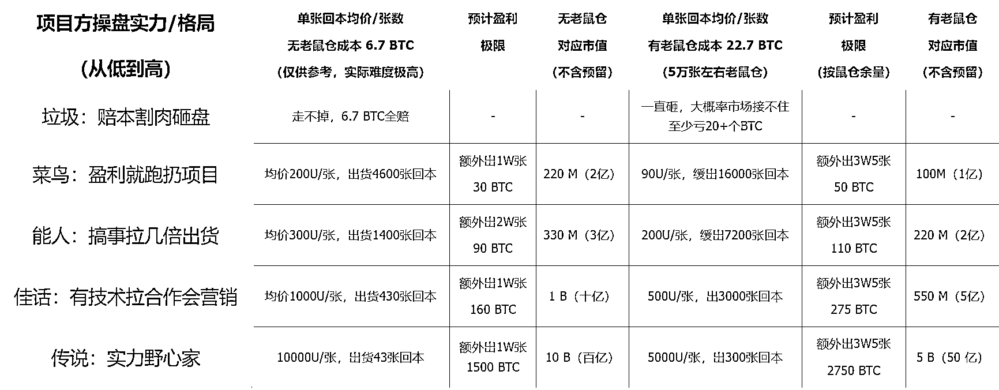
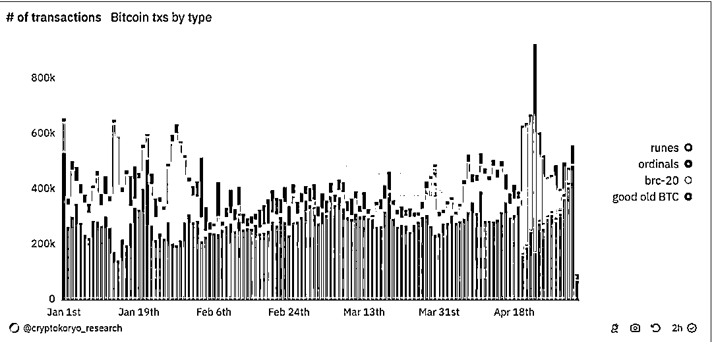
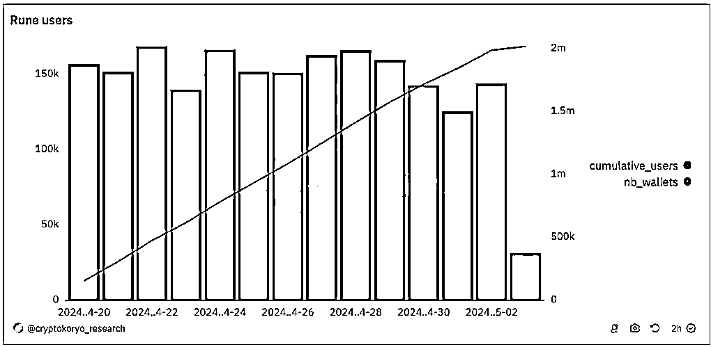
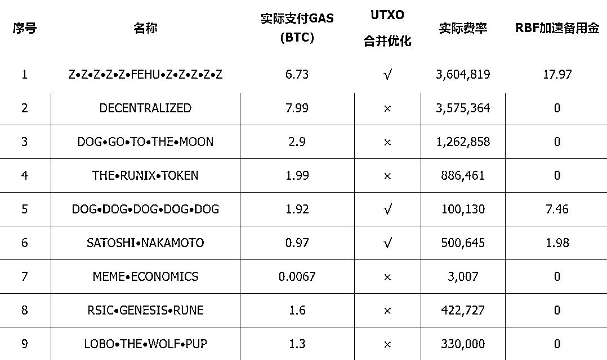
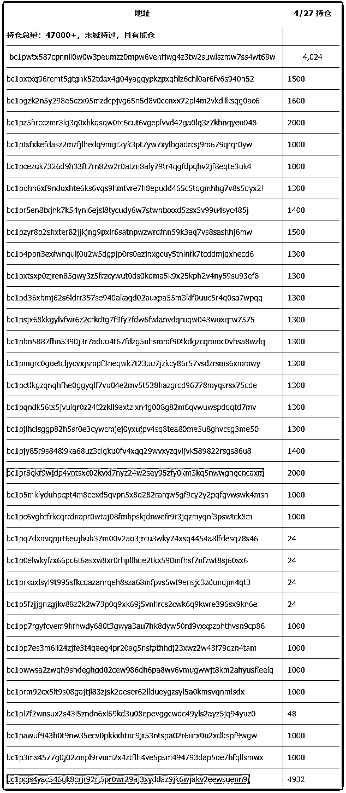
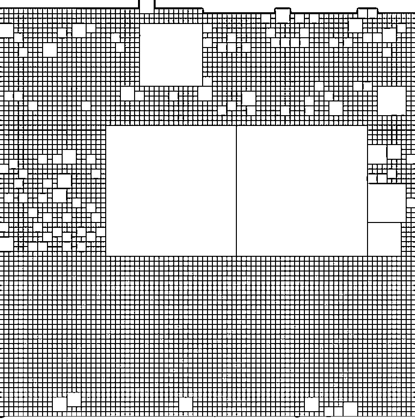
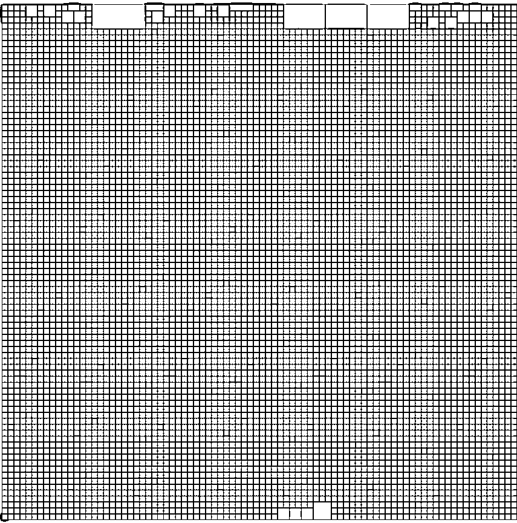
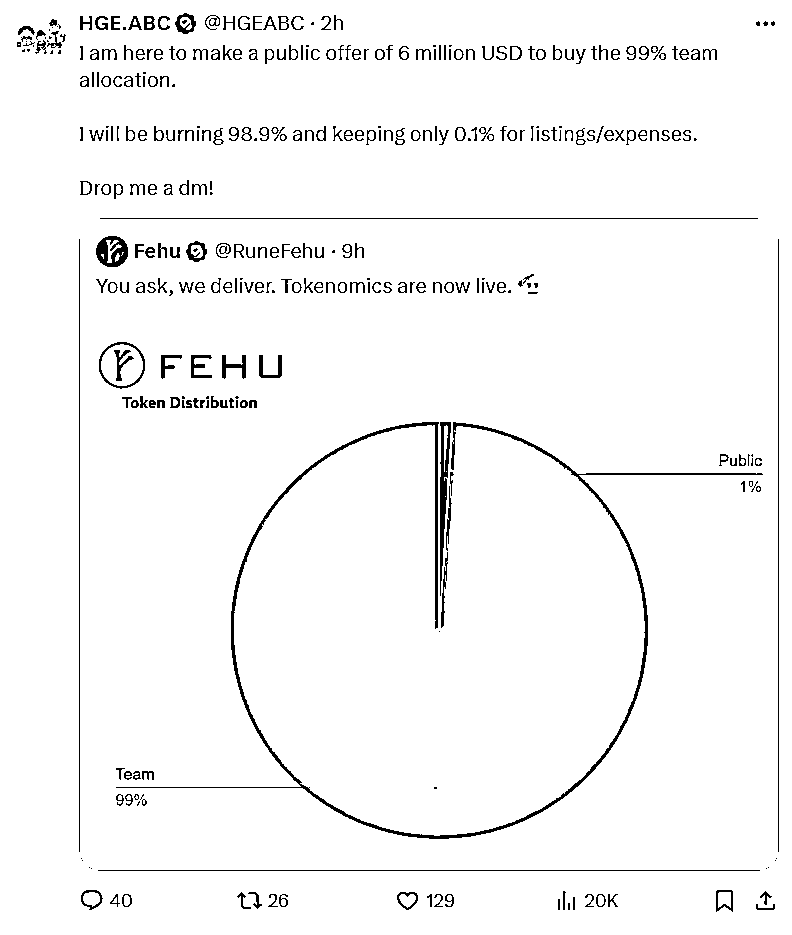
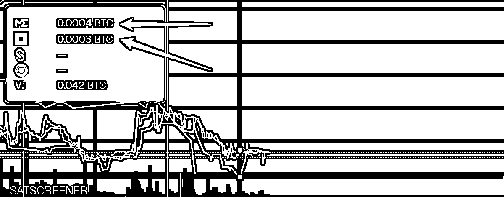

# 反驳我：这个一号符文怎么可能不赚？
作者：龙哥

## 异常值：说说看，你能找出 FEHU 不赚钱的理由吗？

作者： 安启 Archie

时间：2024-05-09

**写这篇时的 FEHU 现价**

**2024 年 5 月 9 日**

**[Z•Z•Z•Z•Z•FEHU•Z•Z•Z•Z•Z](https://unisat.io/runes/market?tick=Z%E2%80%A2Z%E2%80%A2Z%E2%80%A2Z%E2%80%A2Z%E2%80%A2FEHU%E2%80%A2Z%E2%80%A2Z%E2%80%A2Z%E2%80%A2Z%E2%80%A2Z&tab=2&p=1&at=Sold)**

**Unisat.io 实时价【35,550 sats/张 ≈ 22 美元】**

### 调研底线结论：30 美元以内建仓，短期翻倍回本，长期起步十倍

### 主要风险在时间成本，资金被占用的周期短则一个月，长则半年

**————按保守推演，三个月内若 FEHU 仍低于 90 美元/张，项目方基本回不了本**

**————按乐观推演，六个月内随着 Runes 生态扩容+一号序列+销毁预期，目标看向 500 美元/张，约 5 亿美金市值**

以上都是做减法的估算，均假设项目方运营拉胯，仅仅吃到 Runes 一号位置和销毁预期。

利益相关：本文作者深度持有 FEHU，且逢低持续加仓。

——深圳鱼跃 Labs 投研 安启

> # 序、从成本倒推盈利线

> **项目方需要什么价位才算回本**

> **结论：****单价跌破 90 美元，项目方亏本退出；单价不到 200 美元，项目难言可观利润**

> ### 成本测算与盈利逻辑说明

> 部署支出和盈利模型，其中包含多项假设和市场博弈策略

> 

> * * *

> # 一、Runes 协议与一号位价值

> 

> **红色区域显示了 Runes 交易量的爆发式上升，已明显超过 Ordinals 与 BRC20**

> **Runes 的走势就是本轮基本面**

> Runes 正在破圈，图表中红色部分正是 Runes 交易量井喷的证据，已然超越 Ordinals 和 BRC20。这一趋势说明协议渗透率在抬升，资金与用户正在加速流入。

> 币圈历来炒新不炒旧，随着 Runes 继续占据主导，市场总市值和财富效应超越 Ordinals、BRC20 只是时间问题。

> Runes 的崛起是大势所趋，赢家通吃，FEHU 作为开山一号，会持续吸睛并获得持续性资金加持。

> **红色区域显示了 Runes 交易量的爆发式上升，已明显超过 Ordinals 与 BRC20**

> 1. BTC 生态因 Ordinals 和 BRC20 而火爆，最早一批参与者赚得盆满钵满
> 2. 但西方社群集体踏空，BTC 生态迟迟没有形成全球共识的资产发行标准
> 3. BRC20 产生大量垃圾 UTXO 堵塞内存，被全网诟病，其他协议后继乏力，不过比特币生态仍需要一个稳健的资产协议来牵引
> 4. 过去一年多，多个新协议轮番登场。Casey 在设计 RUNES 时吸收了前人的优点并做了长时间预热，RUNES 正式诞生
> 5. 得益于西方社区的广泛参与，RUNES 的推出是东西方在比特币资产协议上首次达成共识
> 6. 牛市加持下，RUNES 尚处早期，却已展现出巨大潜力。新协议里预计将诞生多个市值上亿，甚至上百亿的资产标的。找准并重仓这些潜力标的，将是本轮牛市投研的核心主线

> 

> **协议能否走远取决于能否留住用户，图表黑线显示 Runes 用户在快速增长**

> # 一号 FEHU ᚠ 核心潜力速览

> > ### 优势
> > 
> > 1. **一号即正统，BTC 生态崇尚 First is First，排第一就是永远的第一**
> > 2. **项目方控盘程度高，天然排斥游资和野庄**
> > 3. **销毁预期体量巨大**
> > 4. **Z•Z•Z•Z•Z•FEHU•Z•Z•Z•Z•Z，名字记忆点极强**
> > 5. **资产结构设计精妙**
> > 6. **筹码分布上华语区占比低，外资为主，结构天然过滤纸手与低风险偏好者**
> > 7. **投资风险可控，30 美元以内建仓，保底收益 3 倍**

> > ### 风险
> > 
> > 1. 项目方具体背景尚不透明
> > 2. 运营节奏与市场周期难以精确判断
> > 3. 机会成本与资金占用，短至一个月，长至半年
> > 4. 销毁前提价仍依赖符文生态发展和项目方执行力

> * * *

> # 二、#1 FEHU ᚠ 资产设计拆解

> ## 资产结构总览

> ## 设计思路

> ### 名称与符号

> > **符文 FEHU**
> > 
> > 1. “ᚠ Fehu”是古北欧符文表 Futhark 的第 1 个符文，意为财富、物质与经济成功
> > 2. 名称“Z•Z•Z•Z•Z•FEHU•Z•Z•Z•Z•Z”由重复的 Z 与北欧首符 FEHU 组成，结构上带有强烈的仪式感与象征意味
> > 3. 在神秘学层面，Fehu 代表财富动能与生命起点，有“行动赚钱”的寓意
> > 
> > **重复的 Z**
> > 
> > 1. 两侧的 Z 犹如护符，强化中间核心符文的力量，类似符文仪式中的加固手法
> > 2. 重复出现形成视觉与语义上的对称，提升记忆度
> > 
> > **占位符 •**
> > 
> > 1. 原意为分隔过长名称，但部署方反向利用，反而让名称在前十名中辨识度最高
> > 
> > **符号 ᚠ**
> > 
> > 1. 前十排序中，多为表情符号，只有 1 号和 4 号使用符文符号，【ᚠ】为符文表第一位，代表财富，古时也指牛与牲畜，暗示持有 FEHU 即持有财富
> > 

> > 

> > 

> > 

> > 

> > 

> > 

> > 

> > 

> > 

> > 
> > #### 审美与便利
> > 
> > 1. Z+• 的组合强化视觉对称，观感平衡且吸睛
> > 2. 搜索便利：符文平台搜索时占位符可忽略，只需输入“zz”即可快速定位
> > 3. 若项目后期上所，冗长名称不利于缩写，FEHU 的命名已提前考虑合规上所需求
> > 
> > **总结**
> > 
> > 1. 在 Runes 前十项目名中，#1 FEHU 的命名独树一帜，与 Runes 协议高度契合
> > 2. 取北欧首符 FEHU ᚠ，可推断部署前已规划抢占序号 1
> > 3. 财富寓意+强记忆点名称，能有效激发好奇与探索欲
> > 4. 既便于搜索，又有 4 字符核心词 FEHU，利于未来上线中心化交易所

> ### 总量与分配

> > 实际情况表明，“项目方设置失误”这一说不成立
> > 
> > 1. 若总量设置错误，至少要多敲两个 1，本来想设 111 万，结果变成上亿，这种极端手滑概率极低
> > 2. 数字正确但预留比例错误也不成立，若真只预留 1%、99% 公平 mint，1 亿的公开量一年都打不完，项目必死

> > #### 部署结构思路
> > 
> > 1. **总量为何是 111,111,111**：部署时就瞄准 Rune 一号，用连续 1 号向全网宣告意图
> > 2. **为何预留一亿一千万**：一号位必须用 99% 的巨量预留来劝退盲目 FOMO，否则初始成本过高无人赚钱
> > 3. 有观点认为预留太多砸盘风险大，但实操中巨量预留无法变现，没有强利好无人接盘。链上透明，预留筹码只有两种动用方式：防御性控盘或建设性运营
> > 4. **防御性即控盘需求**，当流通筹码被大户或游资拉至不合理高位时，项目方可通过挪动预留资产降温，甚至无需释放
> > 5. **建设性动作分两类**
> > 6. 一是通过空投、互动奖励扩散筹码，但目前预留全在冷钱包，短期难见
> > 7. 二是当 FEHU 需要承接更大体量资金或对接二层时，若惜售导致价格过高，项目方可释放部分存量压价，引导新资金入场
> > 8. **赔率逻辑**：1.11 亿总量+99% 预留是为了劝退大众，降低项目方与早期持有者的 mint 成本，从而抬高未来倍数
> > 9. 只有足够高的总量和预留比例，才能避免过度 FOMO 导致 GAS 爆表，赔率被稀释。散户若高价拿到筹码，后续增长乏力，开高走低不利发展，也提高控盘难度
> > 10. **对抗操纵**：大比例预留天然排斥游资和非项目方庄家，保护基本盘
> > 11. **销毁预期**：早期参与者敢于参与 99% 预留的项目，是押注项目方会销毁预留。但长期看，这些筹码不必急着烧。销毁虽能瞬间拉升十倍，但利好兑现后易见回撤，FEHU 除了序号一以外，可能失去唯一强叙事
> > 12. 更优策略是先通过运营抬升底部，再在高位销毁。销毁是该项目的王炸，若项目方执行失误或想快速变现，随时可启动
> > 13. **为何公开 111 万**：为何不是 2 万、5 万、50 万，而是 111 万？
> > 14. 项目方需控制老鼠仓成本，同时让首批参与者获得高额收益形成口碑效应
> > 15. 要达成上述目标，公开 mint 总市值需控制在 2000-5000 万美金区间
> > 16. 市值过高会限制倍数，如前所述
> > 17. 公开量过少易被垄断且持有者稀少，过量则市值过高且 mint 周期拉长
> > 18. 最理想节奏是协议开启前五天内打完，且越快越好但不能过快导致 GAS 爆表，反推张数约 100 万张
> > 19. 3-4 天打完为最佳，约 370-555 个区块，每个区块数千笔交易，去掉其他项目交易，111 万张一周内可完成
> > 20. 在 Casey 的负面言论与规则不透明的情况下，只需快速推进 5% 进度即可引爆聪明钱跟进，进度随之加速

> ### 可分割度

> > 1. FEHU 的分割设定恰到好处，1000 美元一张的资产可分割 100 次，上线分割后可挂 0.01-1 份，最低可降至 10 美元
> > 2. 无分割代币后期高价后流动性受限
> > 3. 分割度过高无意义，分割度 3 可分 1000 份，除非能涨数千倍，否则用户不会买极小份额
> > 4. 分割上线后，即便销毁 1.11 亿预留，流通份数仍可维持在 1.11 亿级别

比特币网络迎来840000减半块，这个史诗级区块的1号位争夺战，远比大多数人想象的更烧脑。从[840000块记录](https://mempool.space/zh/block/0000000000000000000320283a032748cef8227873ff4872689bf23f1cda83a5)里的1~9号排位可以看到，每个位次背后都藏着项目方的精心算计。

要把1号位抢到手，四个维度必须看清，优先级排序是：RBF加速备用金＞实际支付＞实际费率＞UTXO合并优化。也就是说，光舍得掏Gas没用，还得懂RBF技术，同时备好随时加码的“押金”。这枚押金的逻辑是：一旦有对手想超车，项目方就能立刻追加费用、反复加速，只要你的备用金比对方更厚，或者对方根本不会玩RBF，1号位便牢牢锁死。

反过来讲，如果某个项目方没留这笔钱，大概率只有两种情况：要么团队不熟悉RBF，只能按预算上限一把付清，接下来排名全凭运气；要么资金紧张，干脆不与强者争锋。绝大多数时候，转账费率更高的交易会先被打包，可矿工的排序规则并不是铁板一块，有时为了效率，低Gas交易也会被置于前方——7号MEME以极低成本滑进前9，就是典型的好运。

想挤进前9，低Gas想都别想；想要问鼎1号位，总Gas和单位费率都要足够突出。有趣的是，FEHU支付的总Gas比2号少了1.26个BTC，却依然排在最前，原因出在UTXO合并优化上——项目方用这个技巧把实际费率硬生生拉高了29455。再看5号与6号，5号单位费率仅多出40万聪，但总Gas是6号的两倍，所以占优；2号总Gas却只有1号的1.18倍，优先级自然不够看。

复盘FEHU的夺冠打法，基本可以还原为：减半块出现的瞬间，立刻对所有竞争者的Gas和费率做全面扫描，精准算出当下报多少Gas才能登顶；同时，为了防备后来者加价，还专门留了17.97个BTC作为RBF加速的后手。准备做得如此滴水不漏，1号位归属其实早已没有悬念。

再看项目方的底细。链上锁定的头号目标是推特[@RuneFehu](https://twitter.com/RuneFehu)、官网[runefehu.xyz](https://runefehu.xyz/)，背景一片模糊，但钱包里有300到700个BTC的弹药。另一个被怀疑过的对象是[@FehuLayer](https://twitter.com/FehuLayer)，官网[fehulayer.wiki](https://fehulayer.wiki)，据说是章鱼网络老团队，不过对方已经出面否认。虽然这种可能性微乎其微，但若真是他们操盘，对FEHU来说也不算坏事。目前FEHU累计持仓47000+张，从未减持。

更有意思的是，挖出减半块的全球第三大矿池ViaBTC也来抢筹了，第一次抢了[2000张](https://mempool.space/block/000000000000000000004bdefb4487da3e55fae299c342341a2473897d04a1b8)，第二次又拿[5000张](https://mempool.space/block/0000000000000000000050c1c51208603a78a8bfc5004a831c020fdb64ffac54)。

分析师@mononautical最早发过一篇非常详细的[拆解贴](https://twitter.com/mononautical/status/1782791176434721202)；ViaBTC的CEO则公开澄清，并在[推文](https://twitter.com/yhaiyang/status/1782977270828958109)中表示这并非矿场官方行为。从技术角度说，这也不是什么“漏洞”。既然不是官方下场，那大概率就是矿池内部人士所为。用矿池身份大规模抢筹，圈子内极为罕见。若只是为了低费套利，市面上流动性更好的标的多得是，何必非要选FEHU？唯一的解释，是那个手握权限的人极度看好FEHU，甚至不怕外界知道。

之后，还有“大割盘999”项目方及相关推特账号开价600万U，想要买断FEHU的预留额度。顶着Runes#1的光环，FEHU的曝光量只会更上一层楼，巨鲸、盘圈大佬、正规军的合作邀约想必源源不断。稍微想象一下官方推特每天要被多少合作私信淹没，就明白这个位置的含金量了。

接下来预判FEHU的走势。目前项目方完全没有着急套现的意思。最直接的证据是，如果他只想一波流，直接把预留销毁再通过老鼠仓出货，马上就能带走110个BTC。可他没有这么做。放着100多个BTC不要，明显是想要吃下更大的利润。要吸更多筹码，最简单的方式就是把运营节奏放慢，或借大盘震荡顺势洗盘。用一些看似“笨”的动作让散户交出筹码，在市场恐慌、回调时接住没耐心的抛压。越往后，吸筹只会越难，纸手被反复清洗，最终敢拿FEHU的大多是高风险偏好的玩家。而且盘口地板太薄，大户们基本不挂大单，外面多是零散的单张卖单。项目方或大鲸一直在盯盘，碰到合适价格的大包就会一口吃下。等ME平台上线限价单功能，捡漏的难度还会进一步抬升。

运营方面，1号标的从设计上就赢在了起跑线。项目方的基本功相当扎实，对市场和散户心理的拿捏很到位。接下来拿好筹码看戏即可。空投和交互方面，交互奖励的可能性偏小，即便有分配也会很克制；优质社区空投存在一定可能；持有者奖励属于常规选项，但持有比例空投预留的概率不高；比较靠谱的反而是持有者获得某种奖励或资格，中等概率。另外还可能有HOLD OG卡/NFT Freemint，限量500到2000份，量少好拉盘。这里有句实在话：建议大家提前把FEHU分仓，至少10张一个号，最好20张以上一个号。技术性玩法方面，稳定币、BTC二层/EVM、质押套娃和积分系统都是可行的方向。机构合作方面，无外乎宣布融资、上所、和其他项目联动，或者按持仓数量发放资格/奖励/空投。

大利好的发布时间节点，前两个条件必须最先成立：一是项目方（庄家）下一阶段搞事的基建已经准备就绪；二是大盘企稳、小涨或上行，没有哪个知名项目方会选在市场恐慌时放利好。此外还得避开其他大热点，并且确保项目方已经吸筹完毕。不过项目方也不会无限吸筹，因为如果后续不搞事，价格拉不起来，吸再多筹码也出不了货。要知道，早期市场给FEHU的心理价位只有40U以内。真到要搞事的阶段，庄家手里有个5~10万张就已经足够了。

防守端，如果价格和运营节奏脱钩，项目方大概率会护盘。已知其热钱包里有300到700个BTC（仅计算部署和老鼠仓相关钱包，已排除交易所），真到了关键节点，也许2个BTC配合运营就能稳住盘面。进攻端，如果新阶段运营效果不佳，项目方会出手拉盘带动情绪；时机合适时，暴力拉升直接引发FOMO。至于销毁/捐赠，吸筹完成后可能会开始慢性销毁，比如每次烧1%，用通缩节奏把价格顶上去；或者以各种名头分5份、10份分批销毁，配合运营效果更好；等项目进入后期或价格摸到天花板，也可能一次性销毁点燃最后一把火。捐赠对象可选合作交易所；不排除无预警直接销毁全部的可能——这通常意味着项目方已无计可施，或者只想快点套现离场。

最后说说出货。所有策略的核心，都是盯住项目方老鼠仓的动向。无论选择哪种策略，都可以在前面加上一句“翻倍出本”。低风险玩家奉行“大庄不动我不动，大庄小跑我中跑，大庄大跑我全抛，最后留底仓”；稳健玩家则死守60U一张的底线，不到这个价坚决不出。

关于FEHU（1号），很多人的问题不是看不懂项目，而是不知道什么时候该动手、什么时候该收手。换个角度把策略重新捋一遍，思路会清晰很多。

先分两种人：求稳的和贪的。

**求稳型玩家：**
- 60U不是终点，是第一个分水岭。过了60U之后，别想着一步卖完，用阶梯挂单的方式一层层出。
- 无论如何手里要留底仓，这是后续操作的本钱。

**激进型玩家：**
- 动作更快：先把本金抽回来，剩下的全部丢进冷钱包。
- 200U之前，一张都不卖。
- 等价格真正到了200U，再开始分批出货。
- 冷钱包里的底仓，做好归零的心理准备，拿住不动，只为疯牛。

然后说散户怎么抢筹。

抢筹本质是在别人恐慌的时候捡便宜：

1. 心态要够稳，等市场情绪最压抑的时候再入场，那时候筹码都是打折的。
2. 尽量买大包，20张起步，如果遇到百位数的包更不要错过。
3. 手里的筹码越多，后续操作空间越大。
4. 30U以下不用多想，闭眼建仓，直接把大仓位铺进去。
5. 35-50U属于第二梯队，还有耐心的人可以继续追加，但要做好短期震荡或回调的心理准备。
6. 50-90U再上车，盈利难度明显提高，风险开始显现，时间成本也会变高。
7. 100到300U这个区间，已经是防踏空大户的扫货区，价格早就脱离初始市值，变成大户之间的游戏。普通散户这时候去接，既贵又难建仓位，不划算。

套利机会也有，分两种来做。

**短线套利（难度较高）：**
用 [satscreener.com](https://satscreener.com/) 盯着三大平台的价格，平台之间经常存在价差，行情剧烈波动时，偶尔会出现明显的套利窗口。

**中线套利（难度中等）：**
- 节奏感很重要，要盯项目方的运营动作，也要看大饼大盘是涨是跌。
- 低位接货，等到溢价5%-10%再出手。
- 判断1号的价格，永远把币本位放在U本位前面。
- 举个例子：市场震荡向下时，FEHU的U本位看着是跌了，但币本位可能根本没跌。每一次U本位下杀，都是一个波段机会，相当于在做大饼波段的基础上，又叠加了一次FEHU波段。
- 注意，只拿主仓位之外的资金玩，别把主仓搭进去，否则卖飞以后想接回来就难了。

最后，把话说透。

在1号这个项目上，没有任何人能建立不对称优势。高度控盘决定了，除了项目方之外，散户、大户、科学家、野庄，全都没有优势。所有人本质上都是在赌：赌Runes协议起飞，赌项目方足够贪婪，赌它会真的拉盘。但换个角度看，没有任何人有绝对优势，也是一种机会。

剃刀原理，收尾看四件事：

1. 项目方天量预留的筹码，能不能直接变现？——不能。
2. 项目方想不想回本、赚大钱？——想。
3. 项目方会怎么做？——吸筹、销毁、拉盘、卖。
4. 市场会不会买账？——会。因为这是BTC生态，这是Runes，这是1号。

参考阅读：
- DUNE Runes数据看板：https://dune.com/cryptokoryo/runes
- 币安研究院Runes投研报告：https://www.binance.com/en/research/analysis/the-future-of-bitcoin-2-tokens
- Runes业内玩家分析：https://www.ignasdefi.com/p/navigating-runes-protocol-launch
- Runes分析：https://medium.com/coinmonks/what-next-after-bitcoin-runes-launch-will-it-outshine-ordinals-and-brc20-tokens-39def69781fb