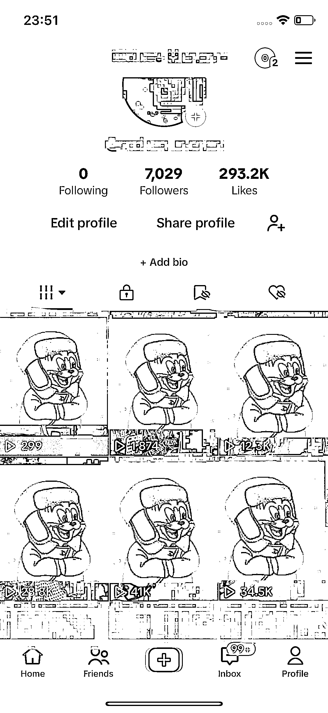
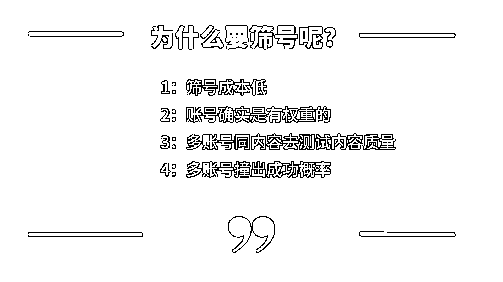
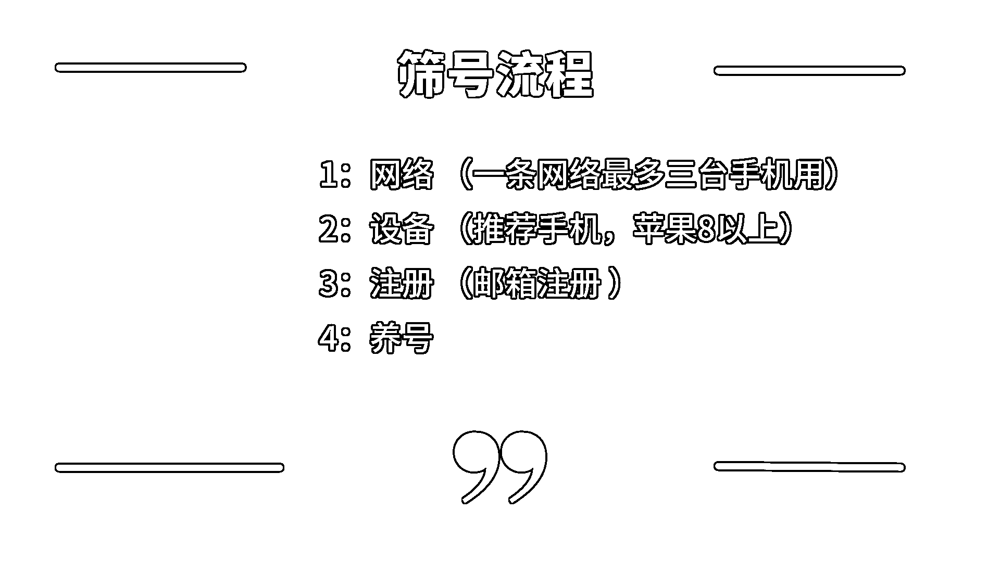
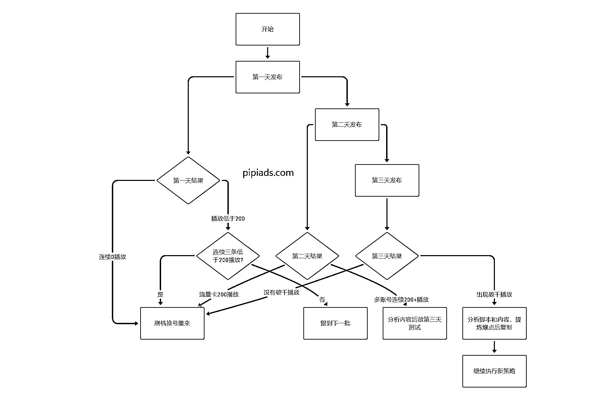
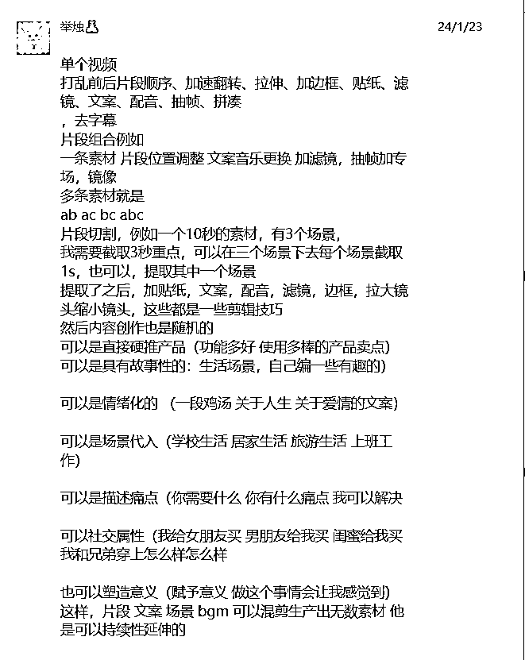
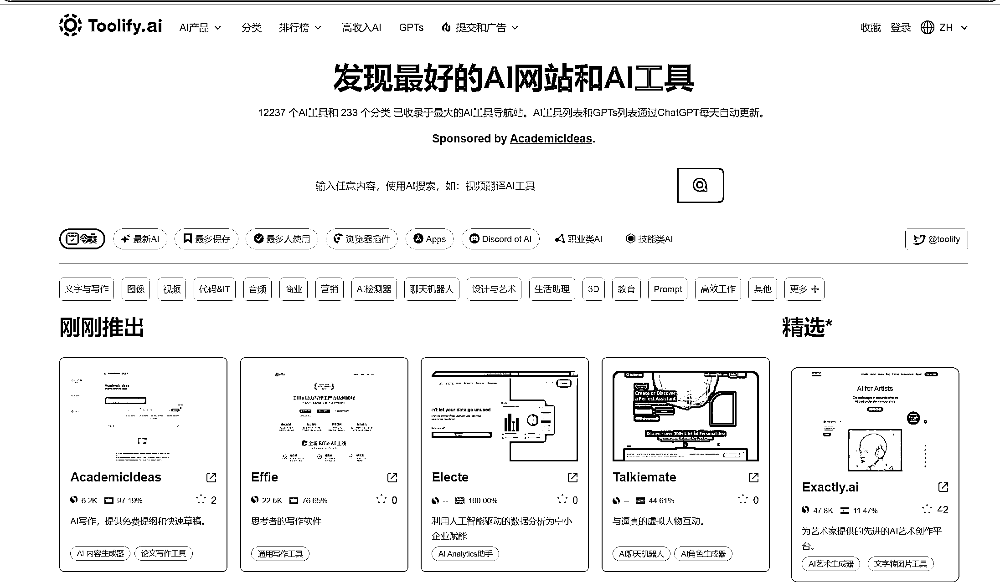
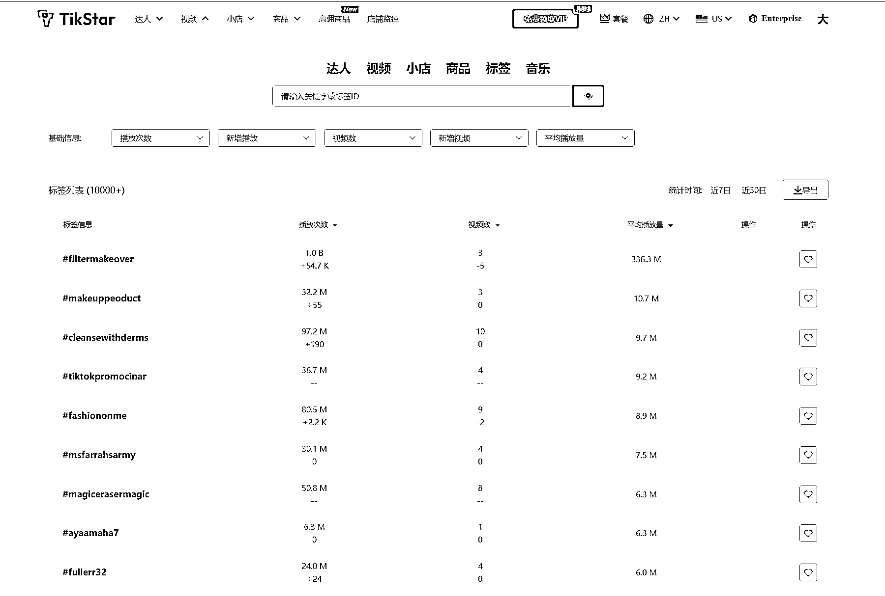
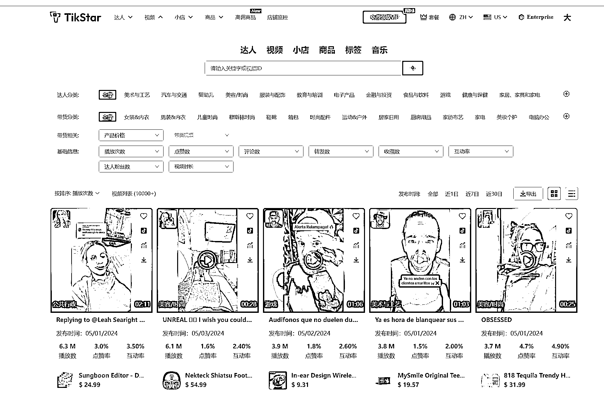

# TikTok 自然流量账号实战打法
作者：龙哥

## TikTok 自然流账号实操全案

作者： 梁小伟

日期：2024-05-08

对不少商家来说，TikTok 自然流投入产出比不高，成本下去了，效果没跟上。

我亲自带过一批号，现在把自然流的做号逻辑拆开讲。基础常识网上能查到，我这里不做重复科普，自己去补齐即可。

最近刚起的一个号，4 天涨到 7000 粉，全靠自然流，撞上了热度。

# TikTok 自然流的核心逻辑：先筛号

**和国内比，海外 TikTok 起号难度明显更低。很多团队带著国内思路去做，死磕一两个号，三个月播放卡在 200-800，起不来。还有人完全不懂海外生态，内容粗制滥造再大量投流，花几千上万买一堆僵尸粉。你是不是也踩过这些坑。海外做号第一件事，学会筛号。**

## 为啥一定要筛号

**1：筛号成本极低 2：账号本身有权重差异 3：多号同脚本测内容 4：多号并行抬高爆率**

1.筛号成本

TikTok 注册门槛低，一个邮箱就能开。号养不起来就扔，换下一个即可，沉没成本几乎为零。

2：账号权重

同样脚本内容，发在不同号上，表现会差很多

A 号 200，B 号 500，C 号 1000

基础冷启动权重就不一样。低权号一直硬发，除非长期高质深耕，才有小概率被养起来，效率极低。

先用多号筛出高权号，再集中运营，起号速度会快很多，这才是适配 TikTok 的打法。

3：内容测试

TikTok 是赛马机制，同一垂类内容要和同赛道创作者 PK。

新入场的剪辑师大多是国人，对海外热梗、热歌、本地文化不敏感，容易白费功夫。需要不断做 A/B 测试，尝试不同的文案、片段、配乐优化方向。

这过程中会遇到限流、违规、没爆点的情况，这类号直接放弃重开。测出爆款就多号复制，把偶然变成必然。

4：多账号撞出成功概率

多账号并发，本质是和时间赛跑。同样 30 条内容，一部手机每天发 3 条 10 天，和 10 部手机一天发完，前者的试错周期和成功率明显更高，时间成本不成正比。

## 筛号具体怎么做

网路-设备-注册-养号-发片是有套路的。大部分商家感觉模糊，下面是我团队的实操。

1：网络

一台网络最多绑三部手机

2：设备

建议用 iPhone 8 及以上机型

3：注册

邮箱注册即可

4：养号

养号分阶段，下面详细拆解。

### 养号流程

养号主体-手机

备用几台手机：新号注册后别急着发，先养 3 天，直接发极易被风控或 0 投放。

注册完后，用正常行为刷 10 分钟视频，然后搜你打算做的赛道关键词去逛、点赞、关注、互动。

累计约半小时，连续养 2-3 天。

当 For You 页面开始高频出现同类内容，说明养号完成。

开始发片 - 连续发 3 天，每天 3 条

第一天：

第二天：

第三天：

进入发布观察期，会出现几种情况

1.直接 0 播放
2.第一条 800-900，之后 200-500
3.前几条 200-300左右，第 7 条左右触发风控，英区常见

我的筛法是

第一天：

三台手机各发三条，间隔着发。第一天连续 0 播，直接刷机换号。

播放低于 200 且连续三条都没破 200，直接淘汰。

高于 200 的留下来继续观察。

第二天:

活到第二天的号，如果全是 200+ 区间且不卡 200，例如 200-1000 波动，属于内容问题，优化后可以留到第三天再测。

流量卡死在 200 左右，直接刷机重来。

第三天：

第 7-9 条发完，如果仍未出现破千的，直接放弃。

出现破千的，拆解脚本和结构，提炼爆点，开始多号复制。

持续筛号 + 反复筛号 = 提高成功率

被筛掉的号，封存一个月后可以拿来当满月号再测。

满月号需要重新养号。养号补充要点：

养号方法

同样三天周期

1.  内容垂直：保持账号主题统一，方便系统打标签。
2.  账号活跃：每天至少半小时刷对标赛道内容，提升完播习惯。
3.  资料完善：垂直后完善头像、昵称、签名。
4.  社媒绑定：绑定 Facebook 等海外社交账号可提升权重。
5.  互动：积极回评论，用提问引导二次互动。

注意：被警告或降权的号，如果粉丝不多，直接放弃不用。

筛号的本质是提效，最终还是要回归内容。

### 视频制作

##### 原创视频

适合有经验、有创造力的人做

1.  创意与创新：需要独特想法和脑洞。
2.  资源投入：拍摄、剪辑、布景成本较高。
3.  品牌建设：利于沉淀独特品牌调性，长线积累铁粉。

实操降本思路

1.  设备简化：一部手机就能完成拍摄，设备不是关键。
2.  创意来源：直接模仿可复制的对标爆款，做 1:1 翻拍。PIPIADS 或 TikStar 小店数据平台可以挖掘。
3.  品牌曝光：矩阵铺开，用最小成本实现最大曝光。

**二次剪辑视频**

新手最佳切入点：

1.  上手快：用达人素材或国内素材剪辑，快速掌握剪辑手感。
2.  批量产能：适合快速产出多条内容，提升账号活跃度。

剪辑视频的标签逻辑

系统会随机抽帧做截图打标签，标签决定推送人群。素材要保证标签准确，避免干扰标签过多。

使用热门流量标签如 #foryoupage 或 #fyp，提升分发。

用趋势查询工具找近期热标签和热歌，TikStar 可查 TikTok 热门标签音乐。

剪辑技巧：

剪映即可，基础剪辑功底即可。

4.  总结一下：

二创素材常见问题：

1：限流
2：风控

都能通过剪辑手法解决，我的二创从未出现过 0 播或限流。

实操工具和 AI 结合，工具都在这里找：

[toolify.ai](http://toolify.ai)

发布时间：

1.  分散到不同时段发，测出最佳流量窗口。
2.  记录视频 10 分钟到 2 小时内的播放启动情况，对比不同时段表现。

分析播放数据：

1.  正常冷启动在 200-300 左右。只有几十播基本等于限流。
2.  后台看流量来源，For You 占比超过 70% 说明分发正常。

无论原创还是二创，核心都是持续输出高质量内容，按数据迭代脚本。

标签是连接内容和用户的桥梁，用好标签能大幅提升曝光，尤其在账号冷启动期。

### 不同类型标签

1.  国家标签：如 #US，精准定位区域，避免流量浪费，对商业号更重要。
2.  流量标签：如 #foryou、#tiktok、#fyp，泛用但扩散力强，利于进入推荐池。
3.  细分标签：如 #cat，锁住兴趣人群，提升相关性。

### 视频标题写法

好标题能激发好奇或直接点明价值

提问式：你知道怎么解决 xxx 吗？
陈述式：2024 送给妈妈最难忘的礼物！

1.  问题型标题：用提问提高互动，如“有见过让你哭泣的东西吗？”“新发现！榨汁机你这样试过吗？”
2.  肯定型标题：用强判断语言，如“全班同学都买的水杯”“全世界都在用的钱包”，提升感知价值。

### 趋势短语

紧跟 TikTok 热门话题和挑战，把时下热词融入标题和内容，能快速吸睛，提升参与度。

### 对标账号筛选标准

1.  避开老号：老号内容多、粉丝高但流量平平，拆解价值低。高流量的老号权重已固化，不好模仿。
2.  规避品牌号：除非自己就是品牌，否则品牌号的成功依赖品牌力，难复制。
3.  避开水印和强曝光人物：版权和个人标识强，不适合二次使用。

**怎么找对标号**

1.  新兴同赛道号：视频量不超过 100 条，粉丝过千，爆款多，素材可用性高。
2.  用 TikTok 搜索相关标签、产品词、热门关键词挖掘。
3.  建立 20-30 个对标名单，持续追踪。

### 拆解对标账号三要素

1.  简介优化：学习成功号如何用关键词表达核心价值。
2.  账号名策略：看是否带关键词，或结合品牌+趣味性。
3.  活跃度：分析评论区互动，学习如何提升参与感。

### 拆解爆款视频

1.  标语与标题：记录高频出现的表达方式。
2.  标签策略：记录高观看视频的标签组合，分析原因。
3.  封面和字幕：封面是否直观呈现核心，字幕是否具备引导性。
4.  音乐与流量
5.  热门音乐追踪：高流量视频常用音乐，用热门 BGM 易获推荐。
6.  动态调整与实验
7.  不断实验：把拆解策略用到新视频，做连续测试。
8.  数据优化：用 TikTok 分析工具监控表现，迭代内容。

### 快速增粉与提升活跃度

1.  积极互动评论：
2.  回复全部评论，提升满意度和互动率。
3.  重点回复前 20-30 条热评，提升可见度。
4.  活跃于同行：
5.  多评论同行视频，建立联系，借流。
6.  在爆款视频下留下高质量评论，提高曝光。
7.  关注新粉丝：
8.  查看新粉丝主页，有价值就互动。
9.  定期点赞评论粉丝内容，提升忠诚度。

### 粉丝画像分析

1.  用 TikTok 内置分析工具看性别、地域、活跃时间。
2.  观察粉丝互动内容类型，判断兴趣偏好。
3.  直接发起投票问答获取偏好。
4.  监控粉丝增长趋势和来源，优化投放策略。

* * *

评论区：

声声瀲 : 想请问一下 一个账号被封了会影响同一 IP 下的其他账号吗[皱眉] 需要换 IP 吗

梁小伟 : 不影响

声声瀲 : 谢谢[握手]

哲学工作室 : 影响的吧 封 ip

* * *