如果你最近也在观望TikTok中视频，心里可能正嘀咕着同一个问题：现在进场到底晚不晚？还有哪些方向能做？

说实话，这个平台这半年来的变化确实频繁，几乎每个月都有新动态，甚至时不时冒出一些政策层面的波动，比如最近老美那边的风控话题就闹得沸沸扬扬。但有一点挺稳的——中视频这条项目线，依然站在风口上没掉下来。我自己在TK这个圈子里摸爬滚打了快四年，感受最深的一点是：TK始终是个活力十足、藏着巨大机会的舞台。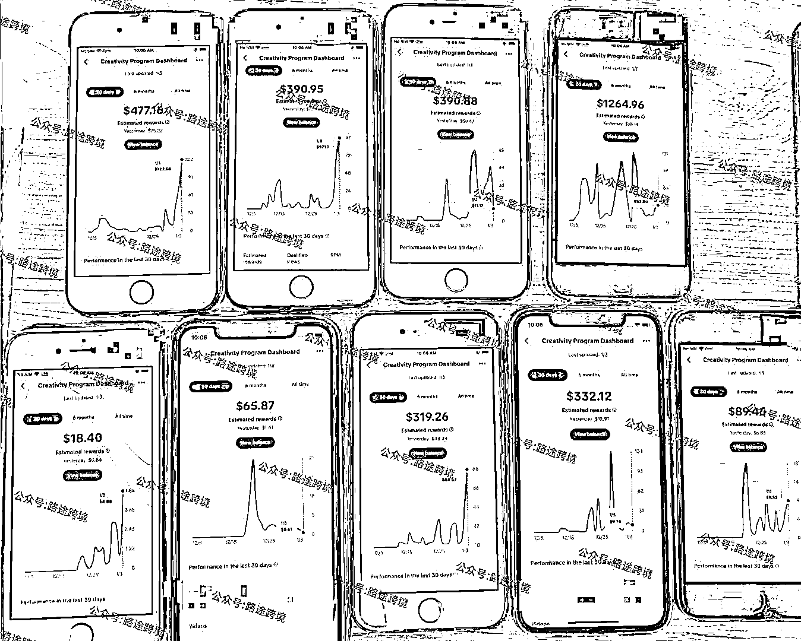

后台经常收到小伙伴的私信，问得最多的就是：现在入局TK中视频，还来得及吗？做什么赛道更有搞头？

其实赛道我们之前陆陆续续测试过不少，真要挑出有潜力的，我顺手整理了一份清单，给大家一个直观的参考：

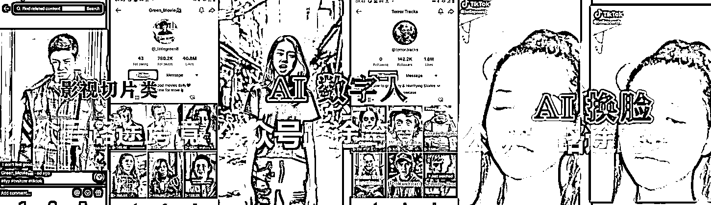

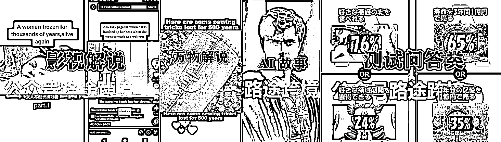

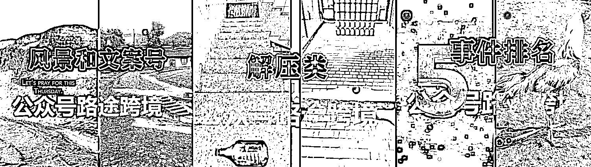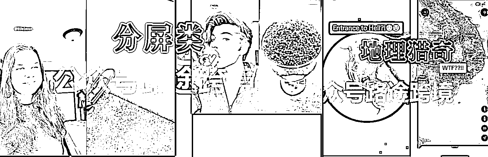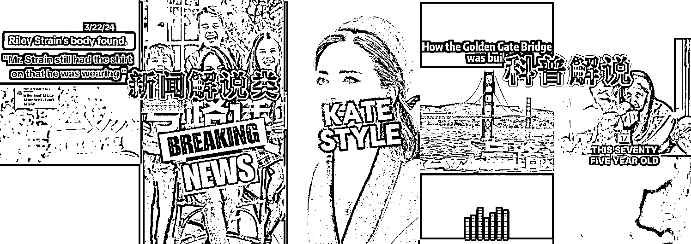

可如果要说新人最适合从哪儿下手，我的答案就俩字：解说。

你平时刷各个短视频平台，不论国内国外，最常撞见的作品形态是什么？仔细想想——是不是解说？

影视有影视解说，新闻时事也有解说，就连带货视频都离不开旁白讲解。无论背后是真人声线还是AI合成音，这种“画外音”的作用，就像是给视频注入灵魂的钥匙。而且很关键的一点是：好素材是有限的，但一旦加上解说，它就脱胎换骨，变成了一件新的原创作品。

回头看我前面列的那些赛道，从新闻解说、科普解说，到影视解说、AI数字人、AI讲故事……说白了，它们的底子都是同一种表现形式——解说。

所以说，你要是能把解说这件事吃透，基本上等于解锁了90%的内容赛道。

**那么问题来了：解说到底怎么做？常规流程又是什么？**

解说视频的核心，说白了就是声音加画面。比如影视解说，不就是一段电影画面，配上一条自己写的解说文案嘛。

我们做这类内容，其实有个“取巧”的路径：直接把国内现成的解说作品，拿来翻译、配音，再重新剪辑一下，就能发到TK上去了。

整个流程可以简单概括成四步：第一步，用剪映或者Capcut这类剪辑工具，把视频里的字幕抓出来，直接用自带的识别字幕功能就能搞定。

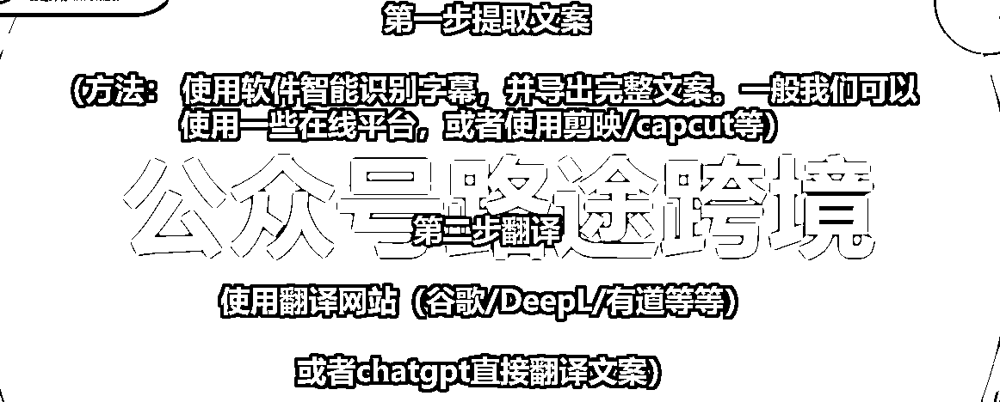

字幕提取出来后，拿翻译工具或者ChatGPT翻成目标语言。

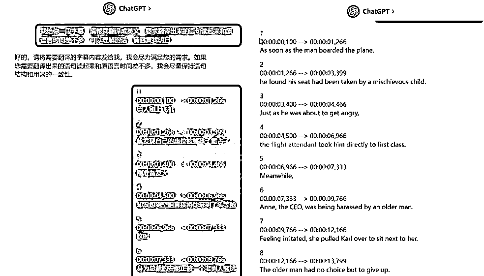

翻译好的文案，再扔进配音工具里，比如微软的AI配音，或者一些在线配音网站。

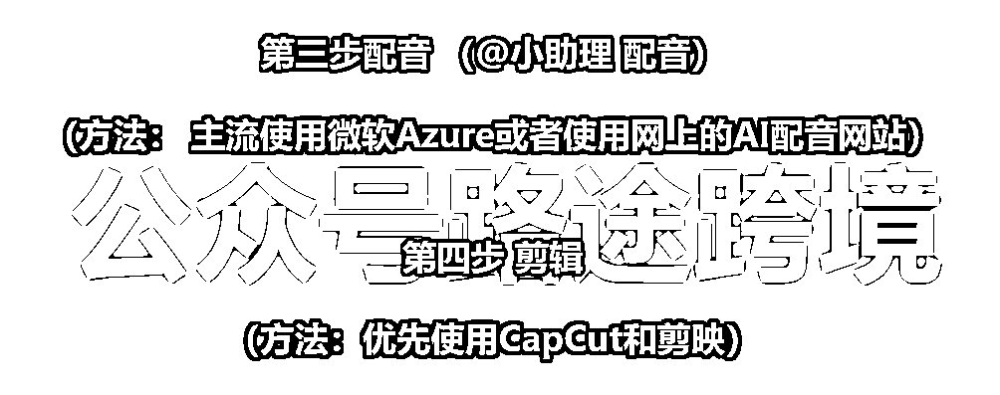

比如说这类在线配音平台。

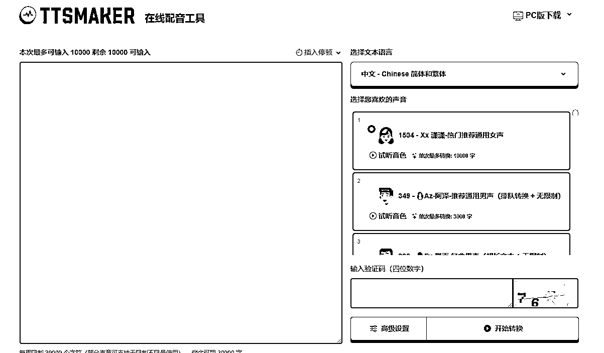

或者直接找配音软件，把翻译好的字幕粘贴进去，一键生成音频就行。

常用的配音网站和工具，我平时一般推荐这几个，亲测比较好使。

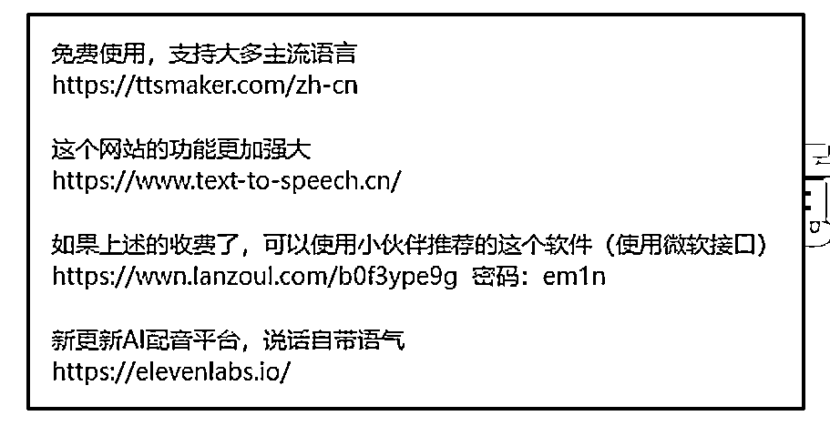

最后一步就是剪辑：把配音、字幕和画面融合到一块儿，一条视频就大功告成了。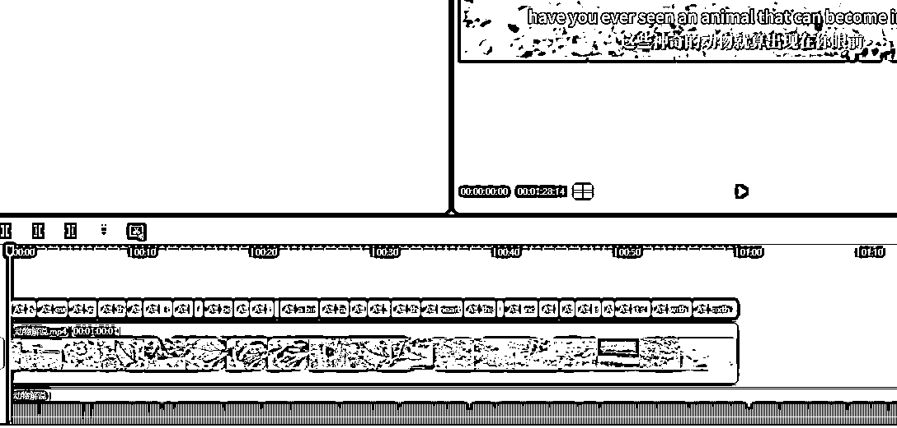

听着是不是挺轻松的？但真上手你就会发现：最折腾人的恰恰是剪辑这一步。比如你现在看这张图，翻译好字幕、生成好配音之后，拿去和源素材一对，对不上啊！

这很正常。中文翻成英文之后，发音长度天生就会拉长，怎么可能会完全贴合原画面呢？

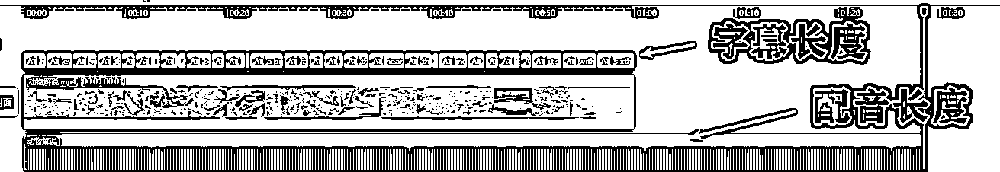

那遇到这种情况咋办？

正常操作是：每一句配音之间是有停顿的，我们根据这些停顿位置，去找对应的素材片段，然后一帧一帧地调整匹配，慢慢磨出一条解说视频来。

可要命的是，这个方法实在太费时间了。碰上外国语言的视频素材，光是看懂字幕就能让你头皮发麻，更别提调整匹配了。

效率一低，起号速度就被拖住了，矩阵也玩不起来——弹药都跟不上，还打什么仗？没法规模化的项目，根本上不了台面。

那有没有更聪明的解法呢？要是有一款软件能把上面这些脏活累活全包了，我们只负责挑素材，那该多爽？

还真有。为了解决这个痛点，我特意找大佬定制了一个工具，大家用下来反馈都相当不错。

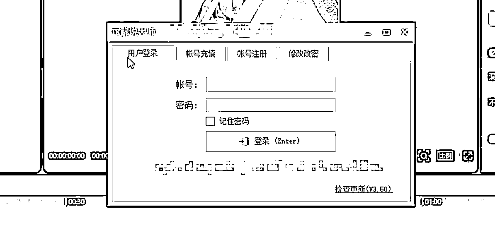

具体怎么用？效率有多高？直接给你演示一遍。

先把要做的视频文案提取出来，用剪映几十秒就能完成。

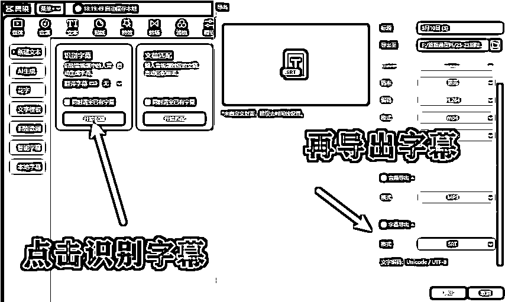

然后把视频和字幕文件导入，点击创建任务，搞定。想去重的话，还可以顺手设置一下画面翻转、锐化、对比度之类的参数。

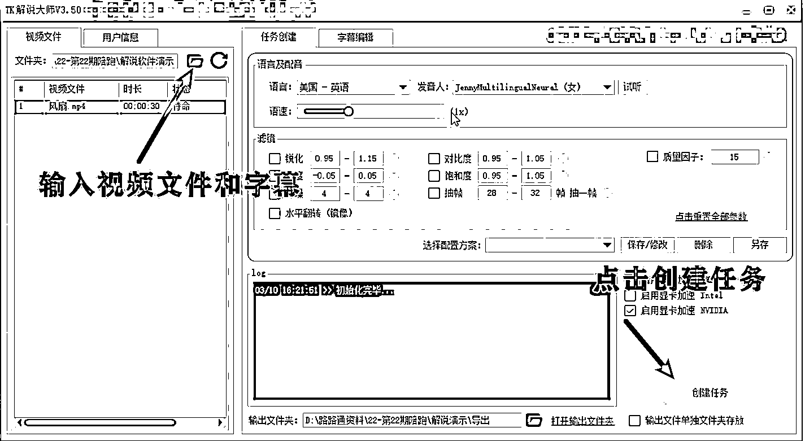

直接看效果：处理之前的视频是中文原声，处理完之后就直接变成你想要的目标语言了。拿到剪辑软件里一键识别字体，再加个好看的字幕效果，一条视频就新鲜出炉了，整体效果相当能打。

一条视频从导入到完成，快的情况下1-2分钟就能搞定！

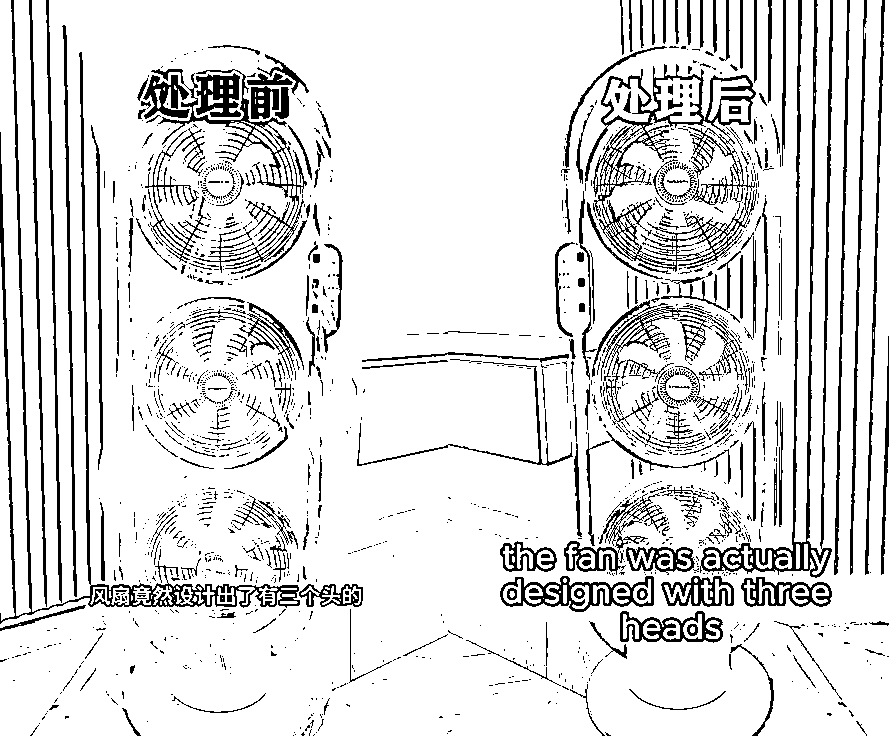

软件下载地址：TK解说大师  
[`share.feijipan.com/s/xSUmSzDX`](https://share.feijipan.com/s/xSUmSzDX)

感兴趣的朋友可以自己拿去试试。我仔细琢磨过这个工具的实现原理，其实不算特别复杂——还记得吗？咱们前面刚说，做解说最耗时耗力的就是字幕和视频画面的匹配。比如一段英文解说音频长达3分钟，可中文原素材只有2分钟，音画不同步的问题就这么冒出来了。

这个软件的做法是：根据原字幕的时间轴先把画面拆分开，再把对应的配音音频匹配进去，然后通过降速或提速来调整每段画面的速度，让画面和音频对上，最后把所有片段重新拼装成完整的视频。

所以，你要是也有这方面的技术底子，完全可以自己动手做一个同款工具试试看。

* * *

评论区里也有不少朋友在聊：

子白 : [坏笑][坏笑][坏笑]

REALDP : capcut怎么导出字幕啊大佬

啊明 : 这能达到tiktok去重的效果吗？搬运国内解说视频对去重要求挺高的。

A 😇路途 : 能到，字幕翻成英文之后就属于去重了，语言转换本身就是在改变画面匹配逻辑。

A 😇路途 : 海外版剪映跟国内版操作一致，导出时选仅文本就行。

A 😇路途 : 子白大佬来捧场了哈哈。

