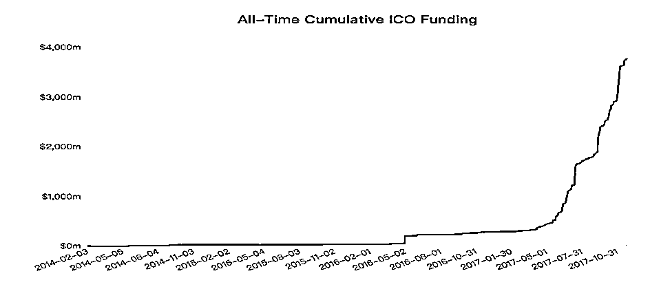
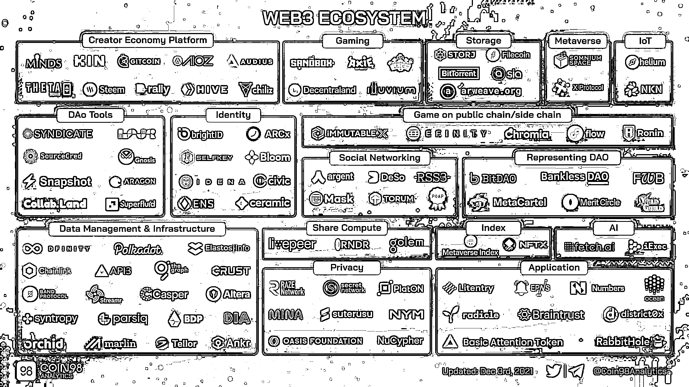

# 从NFT到空投再到铭文：我在Web3一年实现千倍收益的全程复盘
作者：龙哥

大家好，我是龙哥。最近两年多，我和团队成员几乎把所有精力都放在了Web3赛道上。今天想把这条赛道里那些被我看见、抓住、以及错过的东西，一次性讲透。比起放图，我更想把真实经历和实用干货分享出来。

我第一次接触加密行业，要追溯到2016、2017年。那时刚毕业，年轻气盛，正好撞上了一轮轰轰烈烈的大牛市。当时ICO风头无两，热钱到处乱窜，只要能在一级市场拿到额度，上线就是翻倍行情。整个市场像打了鸡血一样亢奋，到最后，哪怕是随便一串字母，也会被抢到飞起。但这种击鼓传花的游戏，终究有散场的一天。我记得特别清楚：那年大年初二晚上，我投的一个做图书馆上链的项目，开盘头十分钟就跌掉了99.9%。好在当初投入的本金不多，但那个瞬间我隐约感觉，整个行业恐怕要崩了。于是我开始陆陆续续分批撤出本金和利润，果然没多久市场转入熊市，曾经龙飞凤舞的场面，转眼变成一地鸡毛。

那时候为了买房，我把手里十几个ETH和两台显卡矿机低价处理掉了。放到现在，差不多也值五十万了。算是和加密行业断了个干干净净。

再次回到Web3，已经是2022年初。那阵子NFT火得惊人，只要有热度，抢到基本就是几倍甚至几十倍的收益。我人生第一个NFT——小幽灵，就是在那个阶段纯靠手速，在一堆科学家的夹击下抢到的。后来它最高涨到过上千美金。

NFT发售时，大部分项目会采用“白名单”机制：用户靠抽奖、做任务之类的方式，拿到比别人早一步铸造的资格，相当于先把名额锁定、利润锁定。业内把这叫“肝白”。当时已经有不少工作室专门批量搞白名单来变现，收益相当可观。

发现这里面的机会后，我也开始想方设法地把白名单获取规模化。项目方让做什么，我就做什么：比如按照要求给NFT形象做二次创作——当时还专门去闲鱼找美工；比如写文章宣传项目；比如在项目社区里聊天升级。复盘来看，最容易实现批量操作的还是抽奖。抽奖的本质是概率问题，核心在于怎么批量模拟多个不同的身份和浏览器环境。长期做外贸的人，对这套应该再熟悉不过。我通过指纹浏览器加“三件套”的模式，搭了数十套独立环境去参与抽奖，陆续拿到了不少项目的白名单，比如国潮、yoga petz等等。每个名额的利润都相当可观，不少单号能到0.5ETH甚至1ETH以上。

一边用抽奖搞白名单，我一边也积极去打一级市场的NFT。具体分两条线：一是从Twitter、Alpha社区之类的地方捕捉早期项目线索，等项目一上线就第一时间冲进去；二是盯住链上动态，如果发现新项目出现，同时全网参与速度极快，那就马上跟上。这种打法，往往能带来相当不错的利润。

也正是打新NFT这段经历，让我把“多环境搭建”和“链上数据分析”这两项技能练到了很熟，为后面转战空投打好了底子。

2022年底到2023年，整个市场进入了一段又冷又长的熊市，惨到NFT也渐渐没人看了。那段时间，我们深度参与了Web3的建设，自己创业做过一个工具类项目。我们团队大多数人来自正经互联网大厂，曾经幻想能做一个有情怀、真正被用户使用的产品，而不是那种纯割韭菜的资金盘。但在熊市里谁也逃不过，现实狠狠给我们上了一课，学费不便宜。

我们也真切认识到，目前Web3行业的几乎所有产品，本质上还是把“让参与者——尤其是早期参与者赚钱”当作核心目标。原因也简单：Web3的人群比Web2小太多，行业整体还处在非常早期。但另一方面，我们也看到越来越多的专业选手进场了。最明显的例子就是GameFi：以前链游基本是画质粗糙、玩法烂俗的资金盘子；现在已经有越来越多3A大作从业者和专业游戏工作室愿意沉下心来慢慢做，离真正的“边玩边赚”越来越近了。

去年年初，我们正式搭了空投工作室，也就是大家常说的“撸毛”。简单讲，就是早期去交互项目方的产品，以种子用户身份参与，等项目上线后拿到初始代币空投。本质上很像做早期的体验顾问：帮还没上线的项目测试、反馈，换取未来的“原始股份”。

我们工作室每个人大概负责100到150套环境和对应账号。核心思路跟NFT抽奖很像：用指纹浏览器模拟一百个互不关联的用户，分别去和项目产品做交互，为的是拿到未来的空投预期。这里少不了指纹浏览器、IP、女巫等等这些概念，每个环节都有讲究。

整体来看，空投是件需要长线思维的事，核算周期往往以月甚至季度为单位。换句话说，必须要有“延迟满足感”。想靠空投在极短时间里赚一笔大的，相当难，但也不是没有运气爆表的案例。我认识一位朋友，去年12月才进场，今年3月就靠Arbitrum空投拿到了500万+，从此一战成名。

所以说，短期暴富拼的是运气和勇气；长期坚持耕耘，则一定有不错的回报。经常听人说，空投是普通人靠自己努力完成一次较大财富积累的好机会——投入门槛不高，但确定性相对不低。

空投还是一个厚积薄发的过程。账号在链上交互越久，质量和权重就会越高。这就好比一个美食点评新人，慢慢混成资深探店专家，后面能拿到的探店收益自然成倍增加。我们最近的BTC账户就是活例子：因为之前积累过不少高质量链上行为，现在每隔几天就会有新项目方来空投，几十美金、几百美金、几千美金不等，基本等于白捡。如果这样有质量的账号你有一批，每天都被总价值几千美金的空投砸中，那种感觉确实挺爽。

正因为空投的周期存在不确定性，我目前的策略是“空投+1级/1.5级打新”两只脚走路。这样既能给过程中增加很多确定性，又能让本来枯燥的“撸毛”生活多一点乐趣。

2023年开启的铭文牛市，是生态级别的大机会。从最早Ordi的造富神话开始，新的协议一批接一批往外冒。我们陆续打中了ETHS、Atom、Pipe、Sols等等，每个都有几千甚至上万倍的涨幅。这也是币圈一个很显著的特征：某一个生态里跑出一个爆火模式、尤其产生了足够大的财富效应之后，很快会被复制到其他生态。铭文就是如此，从BTC生态开始，几乎每一条链都被轮流引爆了一次，最后都扛不住突如其来的巨大流量而打崩。

拿我们打Atom铭文那晚来说，协议凌晨1点上线，中间被打崩了好几次。我和合伙人一直干到凌晨三点多，最终打到了将近80张，最高价格冲到1.5万美金一张。虽然有一部分当了“钻石手”没卖，但最后落袋的收益已经很可观了。

而且，铭文只是这个行业众多热点里的其中一个。这样的热点，基本上每隔一段时间就会冒出来，并且永远会给普通人足够多上车的机会。

所以总结下来，我觉得Web3大概率是一个可以穿越周期、长久做下去的事情。只要行业还在，只要这个行业的运转模式还在，就会源源不断有新的热点和赛道跑出来。从早年的“一片空白”到DeFi、NFT，再到铭文、DePIN，再到最近的BTC生态、符文……参与方式可能一直在变，但空投的机会没断过，1级/1.5级的打新机会也没断过。肉眼可见的是，整个行业在不断进步、不断丰富，后面的体量只会越来越大。普通人只要能在一堆机会里抓住一两个赛道级别的机会，收益就会非常可观。

最后，说点掏心窝的话。经历了这么多风风雨雨，也踩过不少坑，我想给想在Web3扎根、想赚到钱的普通人几条认识。

第一，找对志同道合的人。这个行业里，信息差远比想象中重要。能不能拿到第一手信息，或者说拿到足够优质的Alpha信息，直接决定了你能赚多少利润、少损失多少成本。有时候大家拼的就是分钟级甚至秒级的信息速度。举个最简单的例子：马斯克发条推特点名某个项目，输赢可能就在一瞬间。

第二，学会卖出。俗话说，“会卖的是师傅”。Web3的热点轮动极快，基本上每隔一段时间就有新热点出来，而场内资金总量是有限的。于是板块轮动带来的，往往是快速FOMO，以及热点结束后的迅速陨落。

第三，超强的学习能力和执行力。板块一直在轮动，新叙事不断出现，能不能快速掌握新东西，是最基础的要求。而学到之后，必须用力执行。如果你判断这是一个值得笃定的机会，就要把全部力气押上去，才能换来最大化回报。

第四，也是最后一点，足够的耐心和毅力。这个行业里通宵熬夜是家常便饭，因为很多项目方团队都在海外。但说到底，拿到就是赚到，赚钱的事再苦也是快乐的，而且会让人不知疲倦。

今天就先聊到这里，希望有机会和大家一起，在Web3这条路上稳稳赚钱、持续精进！
