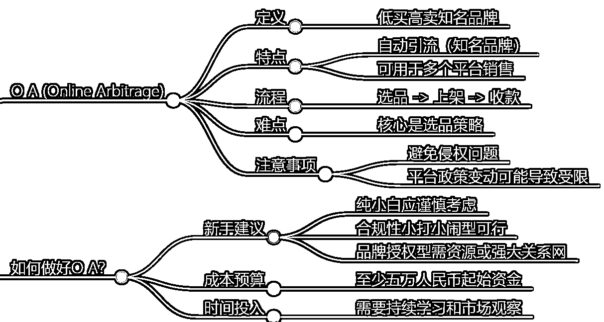

# 亚马逊 OA 到底是什么？现在普通人还能不能玩？

> 原文：[`www.yuque.com/for_lazy/zhoubao/yyrzt9ilqzqwws3d`](https://www.yuque.com/for_lazy/zhoubao/yyrzt9ilqzqwws3d)

和大龙哥连麦聊了很久，主题就是《亚马逊 OA 怎么操作，普通人还有机会吗？》

下面把这场直播的核心要点重新梳理了一遍。

# 一句话讲清亚马逊 OA

OA 全称 Online Arbitrage，中文就是线上套利。

逻辑非常直接：在沃尔玛、Target 等其他电商平台低价拿货，然后转到亚马逊高价卖出，赚取价差。

# OA、FBA、FBM 有什么不一样

**亚马逊 OA**：自己去外部网站找货、买货，再挂到亚马逊卖。好处是借助亚马逊自带的巨大流量快速起量。坏处是竞争白热化，而且很多品牌现在不让碰了。

**FBA**：把货放进亚马逊的仓库，由亚马逊来揽收、打包、发货和售后。优点是物流效率高，退货等服务有保障。缺点是需要交仓储费，对商品品控要求也高。

**FBM**：发货和客服都自己扛。优点是可以完全掌控物流和商品，不用付仓储费。缺点是所有流程都要自己处理，操作比较繁琐。

# OA 的标准操作流程

整体下来就四步：

1. 找到有价差的商品；
2. 下单采购，货到第三方物流点更换面单；
3. 在亚马逊后台把商品上架；
4. 卖出去后回款结算。

开始之前，得先备好一个能正常上架的亚马逊账号，以及一张能海外付款的信用卡或美区 PayPal 账号。

# 做 OA 最难的是什么，需要注意哪些坑

最难的环节永远是选品。

一个能做的品，底线是三点：
1. 有可观利润空间；
2. 不触碰侵权红线；
3. 账号有权销售。尤其是新号，很多大牌根本没有销售权限。

# 现在新手还适合做 OA 吗

就目前环境来看，新手入场并不友好，原因主要有三：

第一，品牌限制越来越严。过去很多品牌还能上，现在亚马逊直接禁止 OA 卖家销售，主要是因为大量套利卖家打乱了品牌的官方定价体系。

第二，账号风控严。账号如果是新号，销量一旦猛涨，平台很容易怀疑是假货，会启动审核，要求你提供一堆合规文件。

第三，投诉即触发审核。客户随口一句“感觉像假的”，就可能让整个 Listing 甚至账号被查。特别是用中国身份信息开的店铺，审核力度会更狠，需要准备从源头到末端完整的证明链。

# 启动 OA 大概需要多少钱

保守估计要 5 万左右。

要办美国公司、搞定美国信用卡、美国银行账户、美国收货地址。加上首批采购和周转资金，压力不小。因为一个产品从采购到卖出，通常要一个月，再加上回款周期，资金会很紧张。

# 不同阶段的人该怎么走 OA 这条路

1. 完全零基础、连跨境电脑操作都不熟的，劝退。不建议入局。
2. 已经在做，但规模不大的，建议往合规走。选品尽量选大平台的货，小网站的采购记录在被查时很容易不被认可。进货前确认品牌是否允许在亚马逊销售，并全程保留订单、发票、物流等凭证。
3. 规模已经做起来了的，可以开始布局拿品牌授权。与品牌方直接签约成为批发商，路子会更稳，但对资金和资源要求也更高。

# 怎么建立 OA 的护城河

核心在于能否拿到品牌授权。

比如某个品类跑起来了，可以尝试联系品牌方谈合作，拿下批发资质或者授权书。这需要谈判能力，也需要一定资源积累。初期可以先从小众品牌练手，大牌基本很难谈下来。

# 什么品能做，什么品别碰

不建议做的：
1. 玩具，侵权风险高；
2. 大牌服饰，几乎都侵权；
3. 保健品，最近封号扫号非常频繁。

相对友好、适合练手的类目：
办公家具、户外工具。

# OA 常见问题解答

**为什么要建议用护照注册账号？** 用国内身份开的号先天有缺陷，最稳妥是用美国公司+美国银行+美国信用卡的组合，这样销售资质会宽松很多。

**能不能用其他国家身份注册？** 可以。

**没账号怎么办？** 不建议买号，风险极大，也不建议用国内信息注册。如果能拿到美国 SSN 注册的账号也能用，但风险依然存在，投入要控制好。

**美国公司只能做亚马逊吗？** 不止，还能用来注册 eBay、申请沃尔玛账号，收款上也能开 Stripe、PayPal Business，做独立站也通用。

# 给新手的 4 条实操建议

**1. 别被模式限制住。**
OA 本质是倒买倒卖。你不一定只能在亚马逊卖，也不一定要卖实物。大龙哥举过例子：卖 Google Voice，3 美元进货，59 美元卖出，利润远超大部分实体 OA。甚至可以反过来做：海外进货，国内在淘宝闲鱼卖，或者直接转型 B 端，给商家供货。

**2. 课程都是基础，进阶靠实操。**
市面上的课基本都停留在入门，真正能用的方法只能自己上手试错。

**3. 新手最快的学习方式是先去上班。**
想快速入行，别光看课，去一个相关的公司打工，边拿工资边学，最划算。

**4. 没有独立解决问题的能力，别轻易辞职创业。**

**如果分享对你有帮助希望点个赞哦~**

————————

**我在生财的精华文章**

[跨境创业？新手下场前必看的赚钱指南！](https://articles.zsxq.com/id_n97vrpiahx5w.html)

[一个工具管理 100 个 fb 社媒账号？指纹浏览器使用全攻略！](https://articles.zsxq.com/id_u2ub0iv60p1g.html)

**我在生财的其他文章链接：**

[快速分析一个产品在海外有多大市场？B 端和 C 端市场分析](https://articles.zsxq.com/id_nh64drgxukw8.html)

[1 天内如何启动电商/外贸/跨境网站？ChatGPT 来助力！](https://articles.zsxq.com/id_1azlnfovac6q.html)

[白嫖！3000 元的谷歌广告优惠你要吗？](https://articles.zsxq.com/id_sa1bz4dckqeq.html)

[Etsy 注册最新最全指南！一文回答如何注册、需要哪些材料、如何避免封店、如何申诉](https://articles.zsxq.com/id_590wii7jr4iu.html)

[批量做小红书图片/视频的方法-canva 批量创建](https://articles.zsxq.com/id_pnpv1g2m5fi6.html)

[一个 ChatGPT 高效使用技巧—编辑原有内容](https://articles.zsxq.com/id_5twbrd3idlbw.html)

[效率飙升！跨境电商领域的 ChatGPT 应用指南 v1.0](https://articles.zsxq.com/id_7wu5dtpkh4n4.html)

[《零编程知识怎么在 AI 帮助做一个贪吃蛇的游戏》](https://articles.zsxq.com/id_nqxxc79whz1t.html)

[快速获取谷歌 SEO 流量的一个策略](https://articles.zsxq.com/id_txli3kufpvig.html)

[ChatGPT 4.0 新功能，让你的数据和设计工作事半功倍！](https://articles.zsxq.com/id_it0blu6we0t.html)

[打造转化率页面的 13 个技巧大公开](https://articles.zsxq.com/id_ohdbfoxwndkx.html)

[什么是跨境电商独立站？有哪些运营模式？](https://articles.zsxq.com/id_3lz2mf370csx.html)

[公众号想要 10 万+？试试这几招！](https://articles.zsxq.com/id_4lz2rw79as1d.html)

[《新手如何入场 Tiktok》—Sky 老思的直播记录](https://articles.zsxq.com/id_d9z98gocnvh.html)

[4 个技巧获取无限个邮箱账号！](http://xn--4!-hy2ca373eyfm37d9uii0h032dppse2zzfk0zt/)

[新加坡有哪些商业机会？-附 2024 新加坡免签入境指南](https://articles.zsxq.com/id_7q5dtpkh4tjq.html)

[免费批量搞定 Canva 的 VIP 账号](https://articles.zsxq.com/id_hkn02uwf6b1e.html)

[保姆级教程！注册 Midjourney 并开通付费订阅功能](https://articles.zsxq.com/id_gnm2x96buu9t.html)

[跨境电商的 ChatGPT 应用指南全集 v3.0](https://articles.zsxq.com/id_e1z2geqn0fo.html)

[跨境新蓝海！中亚跨境机会分析](https://articles.zsxq.com/id_8z1x1u8fojb1.html)

[生财的 12 种搞钱思维，人人都能学会](https://articles.zsxq.com/id_9ozhgeqn0fo.html)

**我在生财的读书笔记链接：**

[《段永平投资问答录-商业逻辑篇》精华金句摘录](https://articles.zsxq.com/id_xrltpwocer4p.html)

[《段永平投资问答录-投资逻辑篇》精华金句摘录](https://articles.zsxq.com/id_2k5d3mdace44.html)

[《穷查理宝典》精华金句摘录](https://articles.zsxq.com/id_erch8m8lx7w.html)

[《华与华品牌五年计划》精华金句整理](https://articles.zsxq.com/id_objd6xv8ddp.html)

* * *

评论区：

暂无评论

* * *