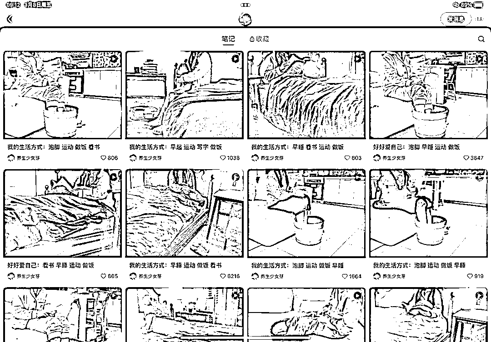
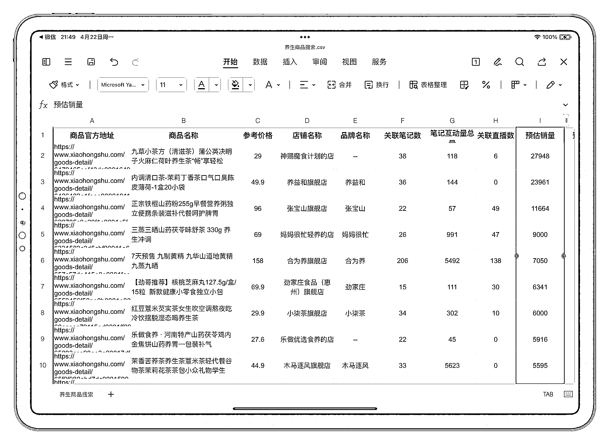
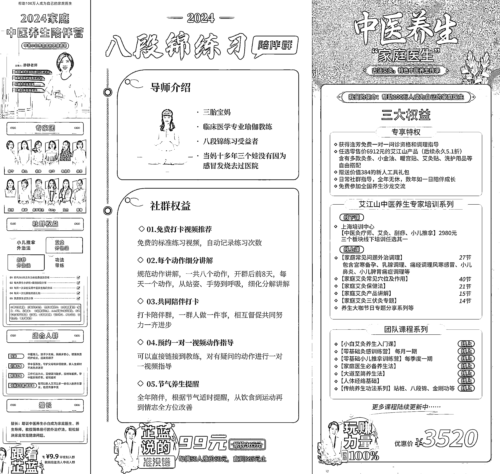
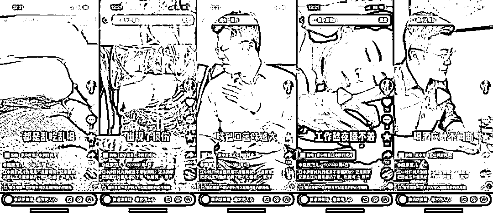

# 养生博主IP如何从0到变现？一套可复制的定位-产品-流量打法

## 如何打造养生博主 IP 变现流程？

作者： 芷蓝

日期：2024-05-07

给做自媒体的朋友分享一篇养生赛道个人IP商业化的梳理，我会围绕养生博主的**定位、产品和流量**三大板块展开，并配上实操案例和数据参考，希望能帮你更快上手。

# 一、定位

说到定位很多人就卡住了，其实是被各种方法论搞晕了。

与其先去套定位的框架，不如先反问自己：我为什么会想做养生博主？

这两年我带过上千个做IP的伙伴，发现大家想入这个赛道基本就三类动机：

1、在平台上刷到某个账号播放量很高，想复制；
2、身边有人在做，看朋友圈带货很赚钱，想跟进；
3、自己本身就热爱养生，压根没想过赚钱的事。

想清楚动机后，用下面三个维度去自检，就能判断能不能做、值不值得做。

**1、你是否真心喜欢这件事？**
你自己是不是已经在养生的路上？坚持多久了？过程中有没有获得正反馈？喜欢是长期主义的基础。

**2、你做这件事的成本高不高？**
适合不适合的关键在于门槛。

轻养生就是低成本：比如每天固定喝一杯自购的养生茶，内容就是记录喝茶的日常+讲成分；或者每天睡前泡脚，水+药包+泡脚三步走，拍个沉浸式记录都不用配音，这类内容在抖音和📕很常见。

重养生则需要专业背书和投入时间：比如本身是中医从业者，或家里有中医背景，可以自己调配茶饮、做艾灸。拍摄时需要多机位呈现。第一重视角是操作过程：选材、调配、成品；第二重视角是用法的场景化：怎么喝、针对人群、注意事项；第三重视角是原理科普：讲清楚养生逻辑，这一步必须有专业身份做背书，否则用户不信。

**3、市场有没有真实需求？**
喜欢+会做，还得值得做。

养生属于强刚需痛点：
• 中年人不爱去医院查体，怕查出问题，更倾向用养生方式调理；
• 年轻人作息紊乱，用茶饮、泡脚、八段锦来“续命”；
• 想减脂的人认为身体湿气重，先喝茶排湿再减肥。

这就是真实的市场诉求。

给自己做定位无痛的办法就三步：

第一步，看赛道有没有商业价值。去平台查这个赛道的商品销量。值得做但不会做可以慢慢学，先当搬运工和陪伴者也能先赚钱。不值得做，再努力也没反馈。

第二步，看自己是否喜欢。选自己愿意长期做的事，时间会放大复利。

第三步，看自己能做到什么程度，有什么资源，是否具备专业身份。专业身份一套打法，爱好者又是一套打法。

**定位公式：身份 + 用户画像 + 能解决的问题或提供的价值**

举例：
普通素人可以是：95后养生爱好者，日更茶饮泡脚八段锦，陪你一起精致变美。
专业选手可以是：从业8年中医，擅长调理脾胃，帮助职场人缓解亚健康状态。

注意要把身份写出来。读者要的不仅是方法，更是身份认同。我在📕看养生内容，根本不看老中医人设，反而更愿意看养生少女的生活方式，因为更贴近我。

# 二、产品

定位清晰后，下一步就是想清楚靠什么变现。

养生博主常见的变现路径主要有三类：

**1、卖养生产品**
养生茶、养生书籍、泡脚桶、草药包等都是常态。我用灰豚拉过最近30天的数据，养生茶长期霸榜，季节性也很明显，比如春季蒲公英茶销量会明显上升。

**2、接广告**
广告也基本围绕养生产品。想接到好广告，内容里要给品牌预留好露出空间。

我的建议是：用空间+时间的双维度做内容排布，让品牌能预判你的露出方式。

比如一个素人懒人养生定位，一天的内容框架可以是：
5:30 起床喝一杯清体饮品；
6:00 做晨间运动，八段锦或瑜伽；
7:00 养生早餐，粥品或自制养胃餐；
9:00 上班喝养生茶，下午吃养生零食，晚上回家泡脚。

账号“养生少女芽”就是典型，长线稳定输出固定时段的固定行为，很受品牌欢迎。同时她抓住了“独居少女”这个生活方式标签，高度同频带来的关注率很高。

**3、知识付费**
任何赛道都能做知识付费，但养生赛道的知识产品对专业度要求更高。

和写作、兴趣类不同，养生不能靠信息差空转，必须有专业支撑。早期唯库大课堂的徒手瘦脸、八段锦、逆龄养颜等课程，主理人都有证书和案例背书。

如果你有技能想做成课程，注意三点：

第一，不要做成系统大课。一本书从原理讲到案例，用户会睡着。课程要痛点切入+观点+解决方案。得到上常说的方法是：建立挑战+给出解决方案。例如标题直接写“熬夜3年黑眼圈重？7天恢复素颜的作息修复法”。先调研目标用户的7-9个真实痛点，每个痛点做成一个挑战式标题。系统课20节以上不好做也不好卖，完课率低就传播不了。

第二，大纲要有网感。专业的人常犯的错误是内容太干、标题像论文。标题要站在用户视角，口语化、带情绪。比如“如何减肥”不如“30天减掉游泳圈，职场女白领的懒人瘦身法”。

# 三、流量

定位和产品定好后，流量是核心。

流量=优质内容+引流方式+持续复盘。

引流方式其实大同小异：简介留🛰️、评论区引导私聊、私信导流、群内转化。关键是持续不断地输出好内容，内容好平台容忍度才高，用户才留存。

养生赛道更容易爆的内容选题，总结下来有三类：

**1、人群**
养生是全民话题，但动机不同。
年轻人：熬夜、抽烟、加班，恢复快但透支大，掉发、蜡黄、亚健康成为刚需；
中年人：工作压力大、身体机能下滑、上有老下有小，需要兼顾家庭和事业的身体恢复方案；
老年人：无工作压力但带娃、慢性病多，希望缓解不适、延年益寿。

**2、痛点**
卖产品靠痛点比靠愿景更有效。痛点是正在发生的，愿景是未来的。

比如“江中牌护肝片”在📕抖音爆火，核心是覆盖了肚子大、口臭、失眠、掉发、应酬等一堆亚健康表象，只要命中其中1-2个，用户就会停留。

痛点+中医辨证的不确定性，容易让人下单：a症状是b脏器问题，价格不贵，试试无害。

我长期观察养生博主的高频词：
7个关键词：阳虚、阴虚、气虚、痰湿、湿热、血瘀、气滞
7个常见病：头疼、失眠、口臭、掉发、虚胖、无力、便秘

围绕人群+痛点持续生产内容，流量自然会聚拢，变现也就水到渠成。

我其实不是学医的，这套养生赛道的玩法，完全是我从灰豚上拉取了近 30 天的爆款内容后，逐条拆解标题得出的结果。

说白了，你只要把那些高频出现的关键词，自然地嵌进标题和正文里，用户搜到你的概率就会明显变大。

就拿“气虚”这个词来说吧。很多人并不是一开始就知道自己“气虚”，而是刷到某个内容后，突然觉得“哎，我好像也有这种情况”，然后带着这个词去📕、抖音搜索。如果你的内容里早就放了“气虚”，那你就刚好接住了这批流量。

再来说说“权威感”这件事。

我很认清华杉老师讲的一个思路——文化母体。他给固安新城做的广告是“我爱北京天安门正南50公里”。固安新城可能没多少人知道，但天安门谁不知道？这就是借文化母体的势。

养生赛道也一样。你一个素人，说自己研究出一套养生法，没几个人愿意点开。但你如果能联动李时珍、孙思邈、《黄帝内经》、扁鹊这些大家熟悉的符号，效果完全不一样。标题里带个“老中医”也能让人多停留几秒，但这个标签得慎用，没有职业认证的话，平台很容易判定违规，不建议随便碰。

那知道了人群是谁、痛点是什么，再加上这些“母体”做加持，剩下的选题就好办了。你只需要结合自己情况，加上用户画像和需求，做个组合就行。怎么拼？我在之前写时间管理赛道的那篇里详细拆过，想看的可以去我星球翻翻。

说白了，这就是个拼凑的活。比如你想卖什么产品，就去找对应的痛点人群，再挂上合适的文化符号。当然，无论哪个赛道，自媒体底层都离不开模仿。找一两个对标账号，拆解他们的选题结构，再用自己的内容重新组装。很多人搞不清“模仿”和“抄袭”的分界线，其实区别就在于：抄的是表面文案，模仿的是内在骨架。

絮叨这么多，其实养生赛道做个人 IP，核心就三块：定位、产品、流量。成交和交付环节，要看你自己业务模式怎么搭。有问题欢迎随时来聊。

