# 网易云 & 腾讯音乐人认证全流程拆解，从0到可变现

## 网易云-腾讯音乐人认证项目实操拆解

作者： 睡不着的阿凯

日期：2024-05-08

**前言**

各位朋友大家好，我是***睡不着的阿凯***。

翻看一下自己在圈内的发帖时间，上次还是2020年底。之前分享过外卖 CPS 和红包封面，这两篇在赚钱里都挺受欢迎。这次的主题在赚钱里几乎没人讲，网上也找不到系统教程，可以算是比较早的完整披露了。

起因是我在风向标看到有圈友聊到认证音乐人后薅网易云黑胶会员，以及参与网易云梯计划拿平台派息。腾讯音乐人同样有这块奖励，而要吃到这部分收益，前置条件就是先把音乐人身份做下来。

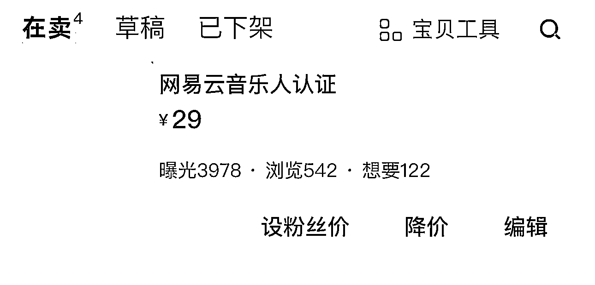

云梯计划的玩家很多都是找人代办认证。恰好近期这个赛道热度在涨，需求量也跟着起来，闲鱼上关于代认证的供给需求很明显。

不想做代办也能自己用。把作品发上去，通过播放量吃云梯计划的分成，同样可行。

相信看完这一篇，大家都能上手操作，要么做代认证赚副业钱，要么自己发歌拿收益。

下面进入正文。篇幅较长，我尽量把细节讲清楚。

## 音乐人身份到底是什么

以网易云为例，认证时可选的标签有歌手、作曲、作词、编曲。

圈里常说的“标”就是指这些标签的组合。比如“两标”指音乐人主体+歌手/作曲/作词/编曲其中一种；“全标”指音乐人主体+歌手+作词+作曲+编曲，共五项。

腾讯音乐人的逻辑差不多，区别在于腾讯的作品会同时分发到 🐧 音乐、酷狗、酷我，播放数据是三家汇总。作品还能绑定到视频号主页展示，具体能不能算播放目前不确定，但整体数据盘子会更大。

## 市场上的认证报价

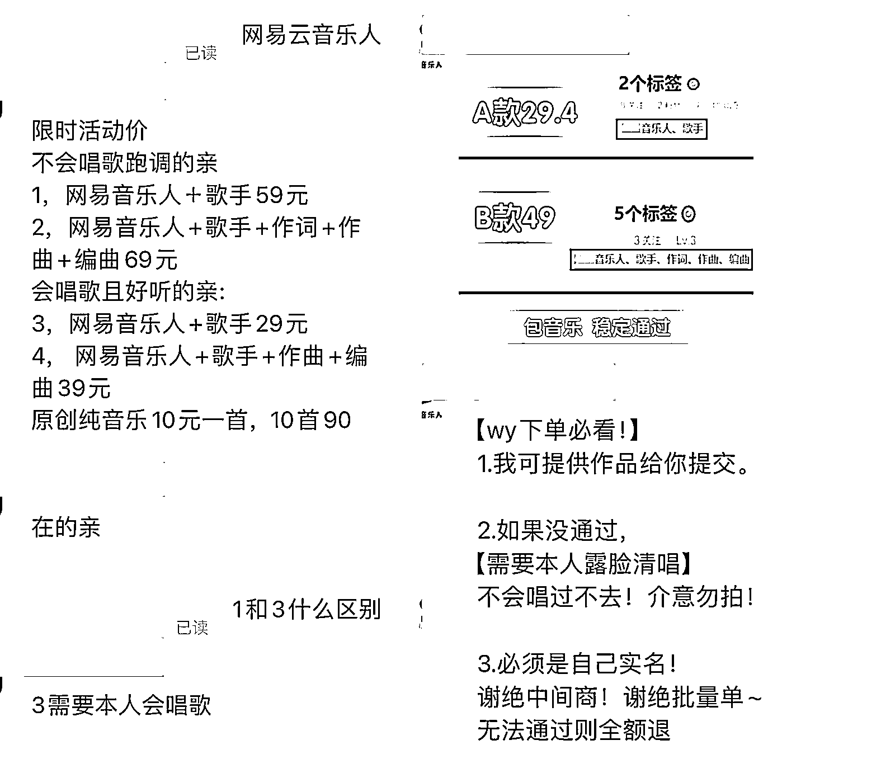

有些工作室或个人本身懂音乐，操作更专业。我们普通人没这技能，所以下面讲的都是零基础也能跑通的玩法。

市场上常见两种报价：能露脸清唱的一般收29，只做歌手一个标签，本质是翻唱别人的歌；不能露脸的就贵，通常全身份要69起步。因为审核有波动，大部分商家都承诺不过就退，拒审原因多和账号健康度有关。

价格可以根据你自己的成本和客群弹性调。

## 认证操作步骤

网易云和 🐧 音乐都支持手机端认证，但涉及到音频制作，建议用电脑端，腾讯音乐人和网易云流程几乎一致。

#### 第一步，申请入驻音乐人

网易云创作者中心入口：[`music.163.com/#/creatorcenter?module=creatorcenter`](https://music.163.com/#/creatorcenter?module=creatorcenter)，点网易音乐人进去填资料。

腾讯音乐人入驻入口：[`y.tencentmusic.com/`](https://y.tencentmusic.com/)，顶部就是音乐人开放平台。

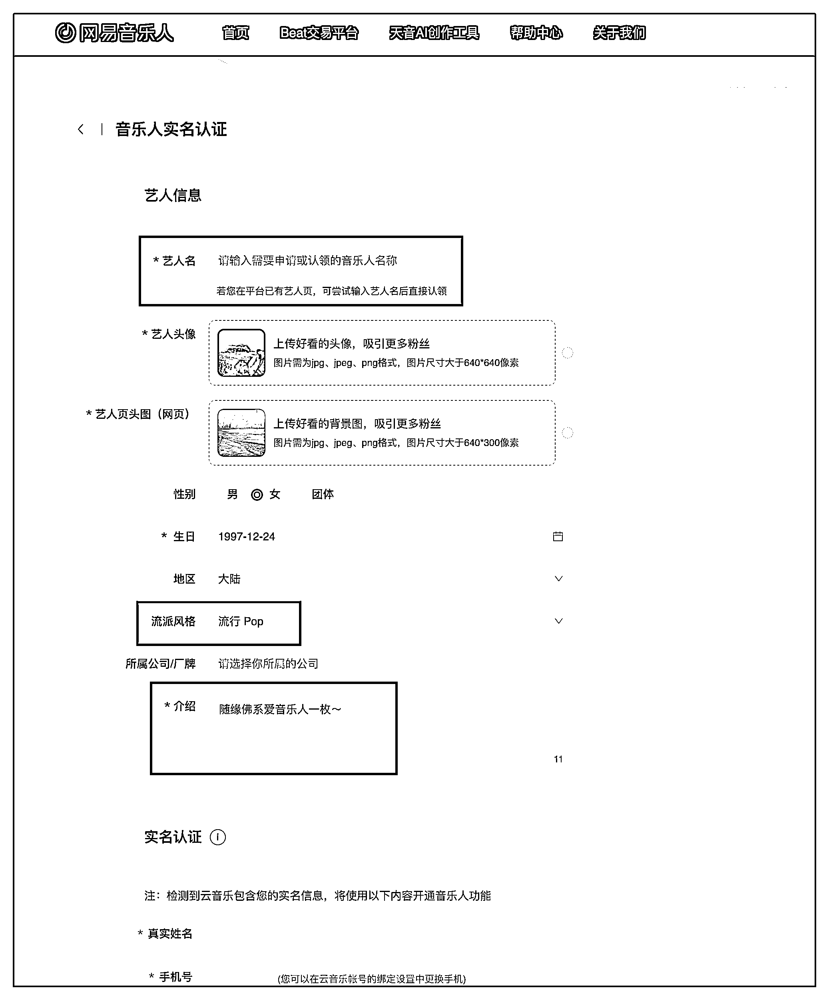

入驻时有几个点要特别注意：

1.  艺人名即歌手名，可以和网易昵称不一致，建议纯中文。带英文容易被拒。
2.  用中文网名或真实姓名通过率更高。艺名不要带敏感词、明星名，同名不受影响。
3.  流派风格最好选流行，通用性强。选摇滚说唱等风格，作品就必须匹配，难度上升。
4.  艺人介绍要写得像样，可以参考小歌手的文案，改写成有质感的自我介绍。别乱写，别用英文。
5.  底部的站外平台信息不用填。

信息补完后提交即可。

#### 第二步，上传作品等待审核

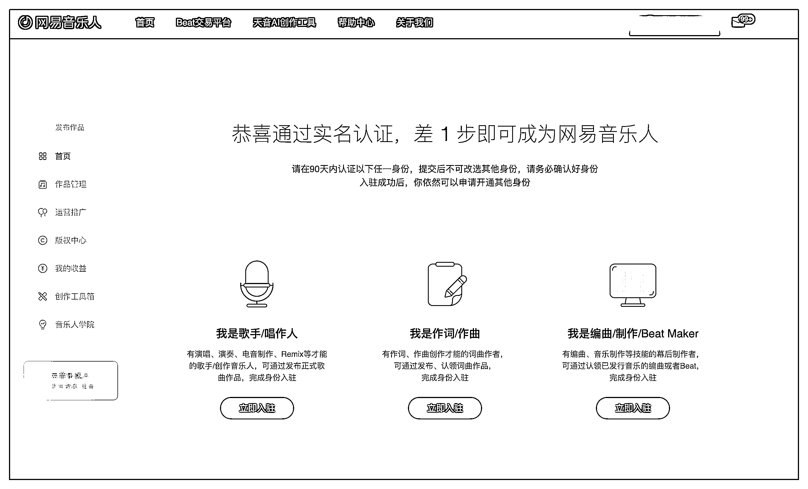

这个页面有三种身份可选，我们主要用歌手和词曲。

根据客户是否愿意露脸，选择不同路径。

##### 路径一：客户可露脸清唱

这种做法走翻唱认证，最终显示网易云音乐人+歌手。

为省事，不提供曲目也不代唱。让客户去全民 K 歌录一首自己会唱的歌，录完再用手机自拍一段清唱+口头报艺名的视频。

有人会问，那我们卖什么服务？话术是提供调音优化、转码处理以及入驻引导，能显著提升过审率。调音细节后面讲，入驻引导就是个增值名目。

**翻唱选歌小技巧**

先问客户拿手曲目，拿网易云搜一下有没有翻唱版本。有翻唱版本说明版权允许上架。然后让客户去全民 K 歌唱这首歌，完成后拿到链接。

用解析工具把视频或 mp3 抽出来，比如[`kg.iiilab.com/`](http://kg.iiilab.com/)或[`tool.fyovo.cn/`](https://tool.fyovo.cn/)。

全民 K 歌演唱设置可参考[`www.bilibili.com/video/BV1m54y1X7mU/`](https://www.bilibili.com/video/BV1m54y1X7mU/)，重点调升降调、混响、人声音量，避免高音破音影响审感。

**正式上传歌手身份**

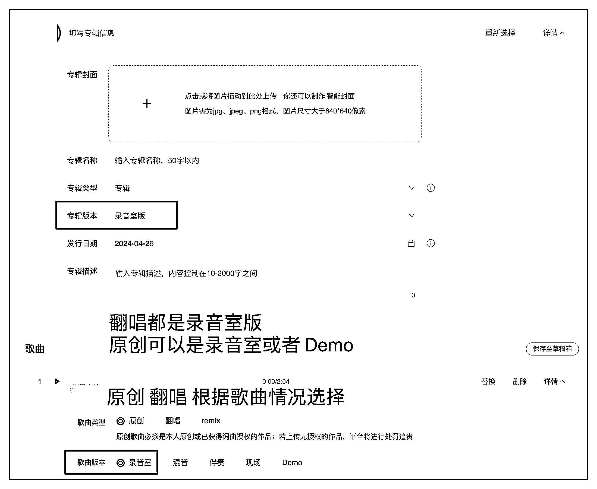

建专辑时专辑名可和歌名一致也可不同。封面用 AI 生成一张无真人图，避免尴尬，也可用客户自己的照片。封面质量要过关。

因为是翻唱，歌曲类型选翻唱。

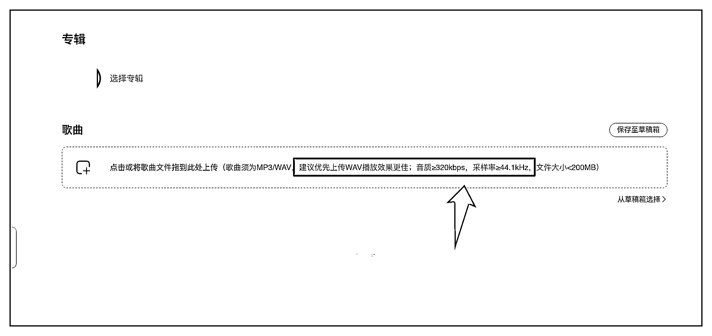

网易云和 🐧 音乐对音频参数都有要求，需要先处理好。

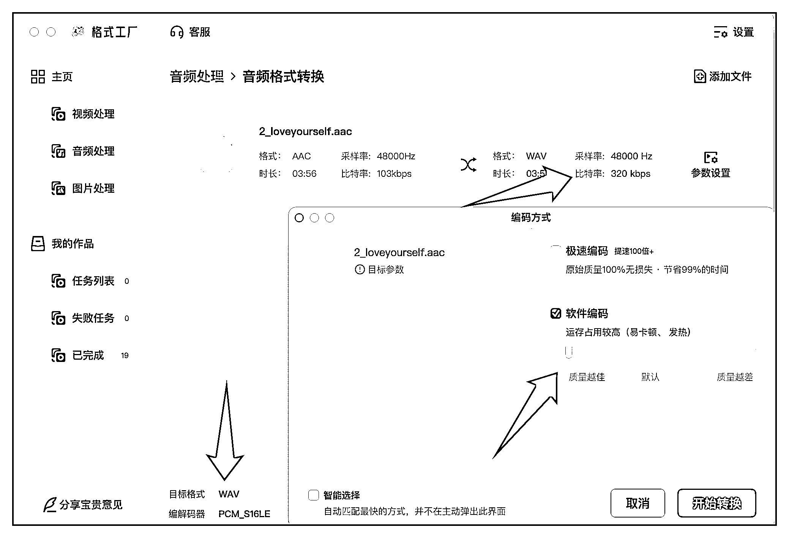

处理工具推荐格式工厂。把音质设为320kbps，采样率48000Hz，格式转 wav，质量选最佳。转换完上传到音乐人后台。

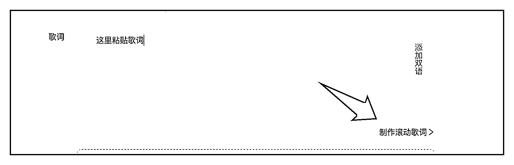

上传前选择翻唱版本，填原唱信息。把歌词粘进去，点制作滚动歌词，系统会自动打轴。然后下一步，签约授权，等待审核。被拒可按理由修改。

##### 路径二：客户不想露脸清唱

网易云这边有两种方案。

先登录客户账号，看看有没有网易天音 AI 创作工具权限。这个工具没全量开放，没权限通常意味着账号不活跃或资料不全，后续大概率要露脸。先有个概念，后面细讲。

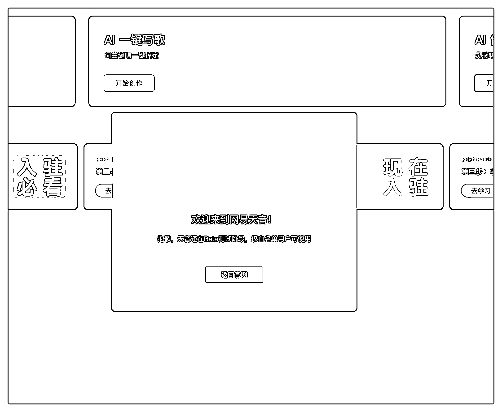

**1. 没有天音 AI 权限**

没有白名单时，最省力的办法是走作词身份入驻，这时可以让 GPT 帮忙出词。

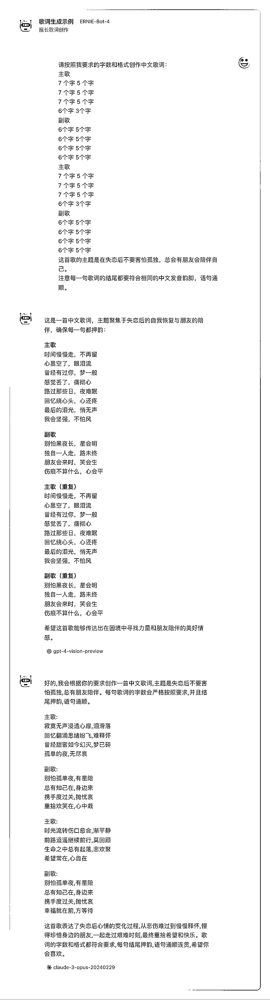

下面是我的一个例子，提示词大家可自行优化。不限情歌，成长、爱国类主题也行。

AI 出的词往往通顺度一般，格式也不规范，表达偏死板，需要人工润色。

想让句子更押韵，可用🛰️小程序【觅词】，进灵感菜单，输入想押的尾词，里面选词替换，联想功能自己摸索。

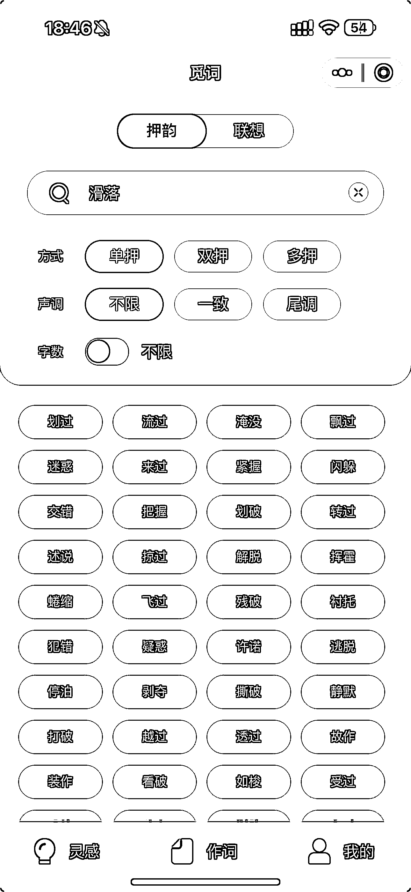

词写好后回到网易音乐人平台，选作词作曲入驻，新建词曲，选仅歌词，上传并按要求填写，提交审核。

歌词押韵、有深度基本都能过。过不了可点右下角客服反馈，转人工问原因。

通过后可追加作曲、编曲身份，曲子可在淘宝买，注意编曲必须有工程文件，不能只有音频。

没有天音权限的账号追加歌手基本要露脸，因为需要验证本人演唱。

没有权限也可以用 SUNO 这类 AI 音乐工具，但本篇主讲天音 AI 的流程，SUNO 的实操以后再单独出。

**2. 有天音 AI 权限**

能用天音 AI 就是重点环节。官方教程在[`tianyin.music.163.com/#/guide`](https://tianyin.music.163.com/#/guide)，我下面补充实操经验。

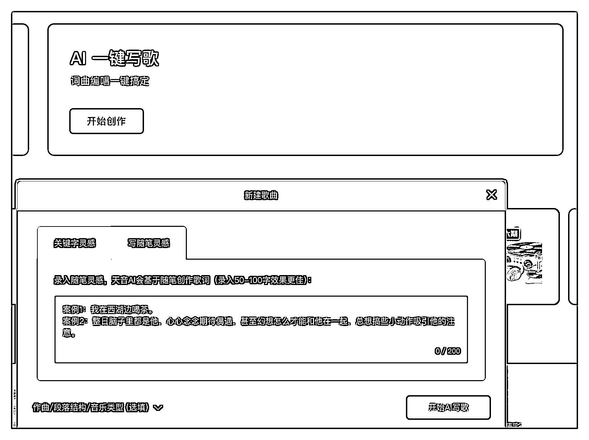

进入天音后点 AI 一键写歌。可选关键词灵感，也可随笔灵感。随笔灵感建议用网易云热评或优质文案，效果更好。

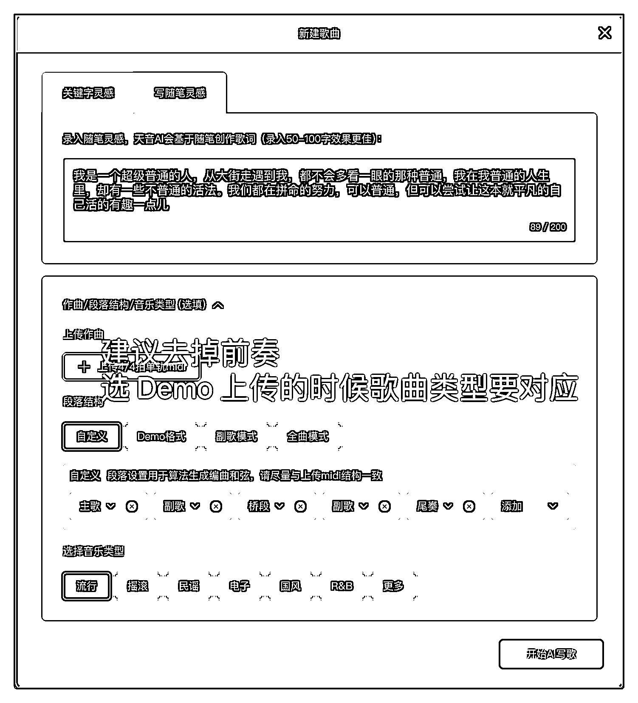

上面随笔灵感来自评论区。生成后进入操作台，常用功能如下。

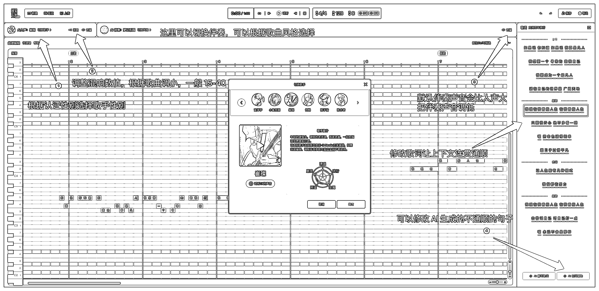

几个关键点：不同 AI 歌手音色差异大，按风格选；混响是让声音舒服的核心，还可调人声音量；伴奏默认偏吵，通常要调小。

审核通过的要点：歌词通顺、意义明确、人声伴奏听感和谐。AI 偶尔跑调或发音怪一点不影响过审，属于艺术风格。

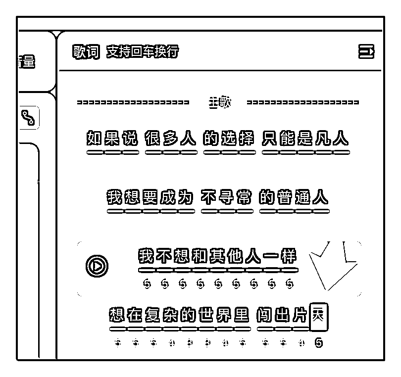

鼠标点歌词中的字，光标出现后可修改。可继续借助【觅词】小程序，统一韵脚。

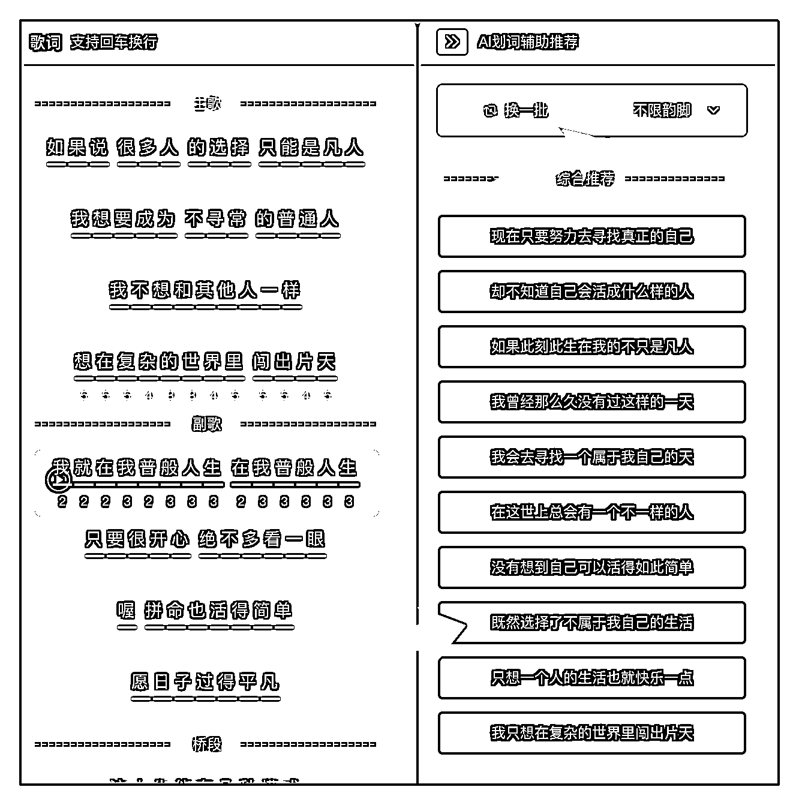

右下角的 AI 划词辅助选中一行或几字后，右侧会给出推荐句，可设韵脚，选情感连贯的句子。

改好后试听一下整体感觉。

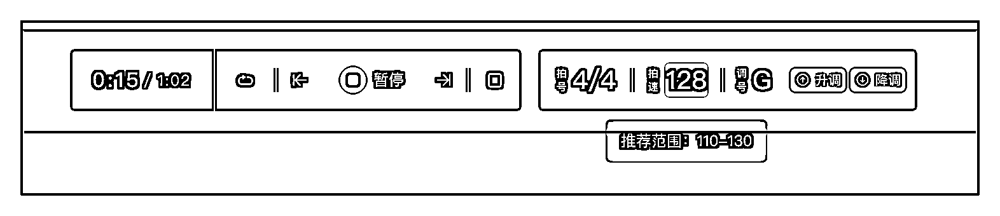

部分歌生成速度过快，可调拍速，数值越大越快。BPM 120 的听感比 60 快一倍，所以可适当调小。

调号可根据需要升降调，一般默认即可，调完记得试听。

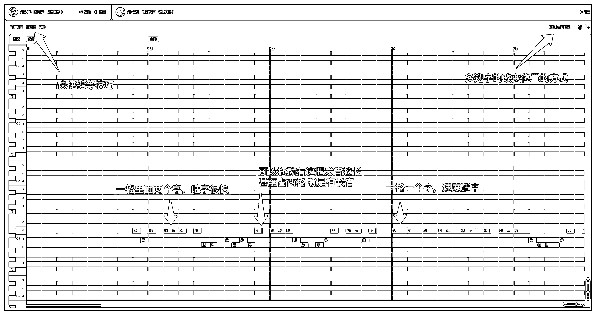

看曲谱横向格子，一格挤两个字速度就快。这时可按住 ctrl 把前两句拖前一点，同时把每个字占格长度调到一格，注意只横向移动，上下位置决定音高。

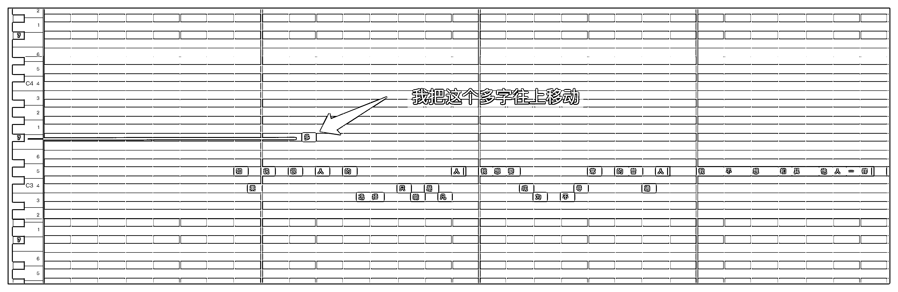

有时候某个字音高发音怪，可调整该字符对应的上下位置，来匹配前后音高。音高过高过低也用同样方法调。删字加字右击即可操作。

全部调整完试听一遍，人声伴奏不冲突即可。主要功夫在歌词。

不满意旋律节奏就返回首页重生成。生成次数无限制，多试几遍挑最好结果。

编辑完成后全屏截图留存，后续需要。

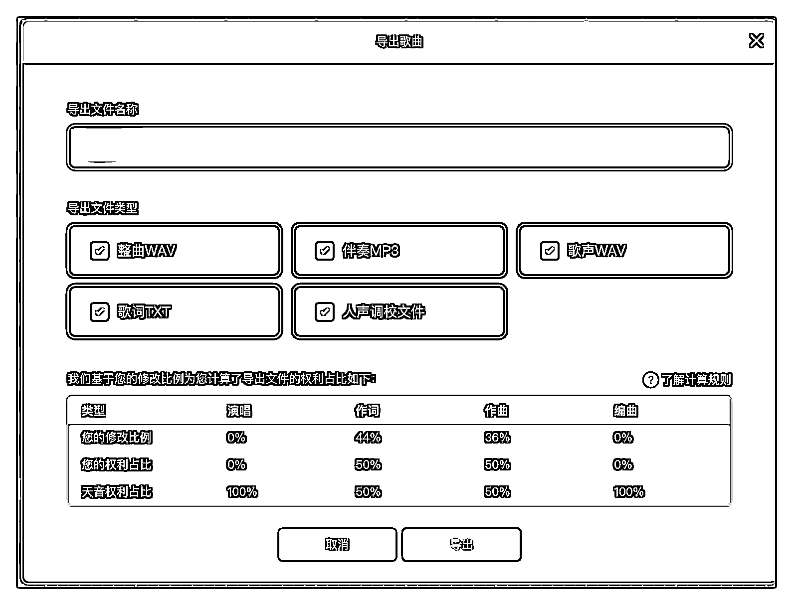

点右上角导出，全选文件类型。导出后人声调教文件给懂调音的人用，普通用户可忽略。官方还有[`xstudio.music.163.com/`](https://xstudio.music.163.com/)做精细优化，这里不展开。

在导出记录里点操作导出全部，解压后用“歌曲名-整曲”文件，用格式工厂按前文参数处理。

然后创建专辑上传，歌曲类型选原创。

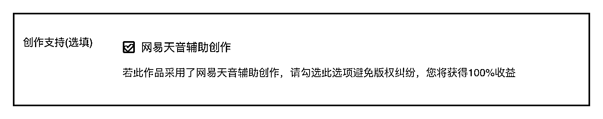

**务必勾选网易天音辅助创作。**

粘贴解压包里的歌词，制作滚动歌词后下一步。

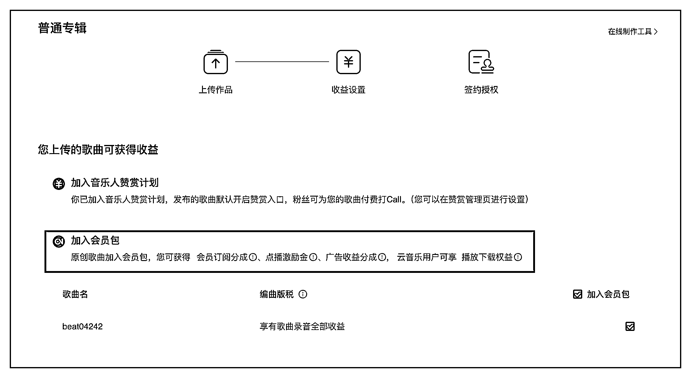

上传原创时会看到加入会员包的选项，必须勾选，这是云梯计划收益来源。

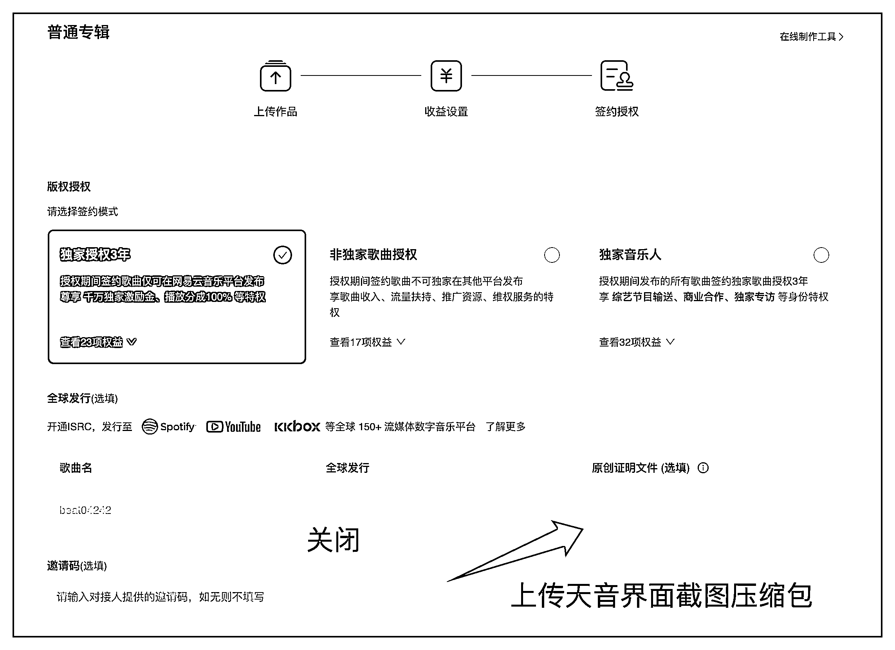

签约授权时不要开全球发行，AI 歌质量参差，开启容易被拒。但要上传原创证明，把刚才截图的天音编辑界面压缩后上传。

提交后等待审核，歌曲流畅不难听基本都能过。

以上就是音乐人认证的完整细节。建议先用自己的号跑一遍，文字虽多，实际操作很快。

## 常见拒审问题

官方拒审原因汇总：[`y.music.163.com/m/at/656714eec446bfc99f93afd3`](https://y.music.163.com/m/at/656714eec446bfc99f93afd3)

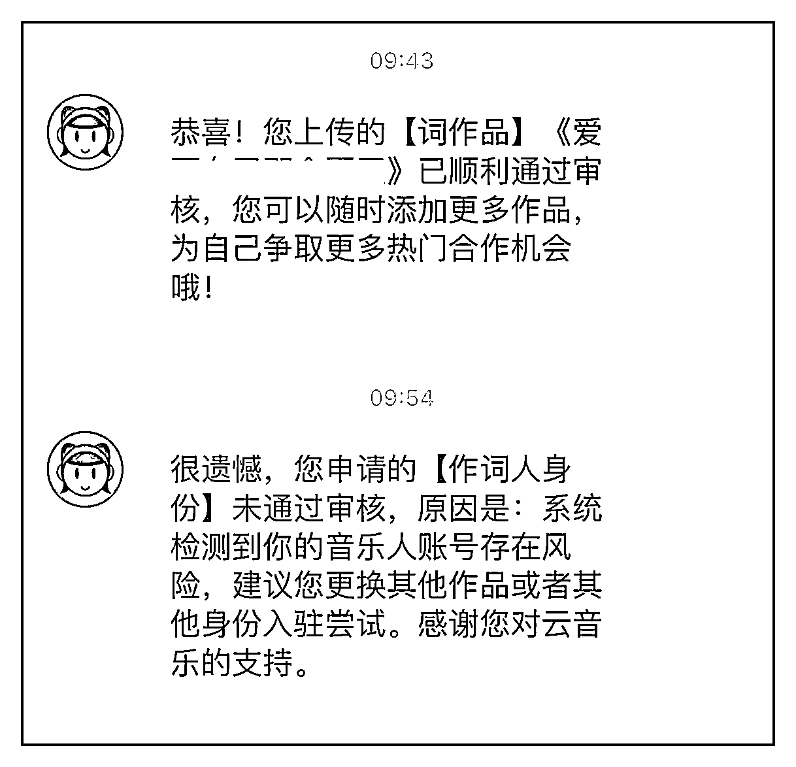

**作品已过，身份审核提示风险**

大概率账号活跃度低、新号、英文艺名。异地登录影响不大，如果担心，第二天再操作。

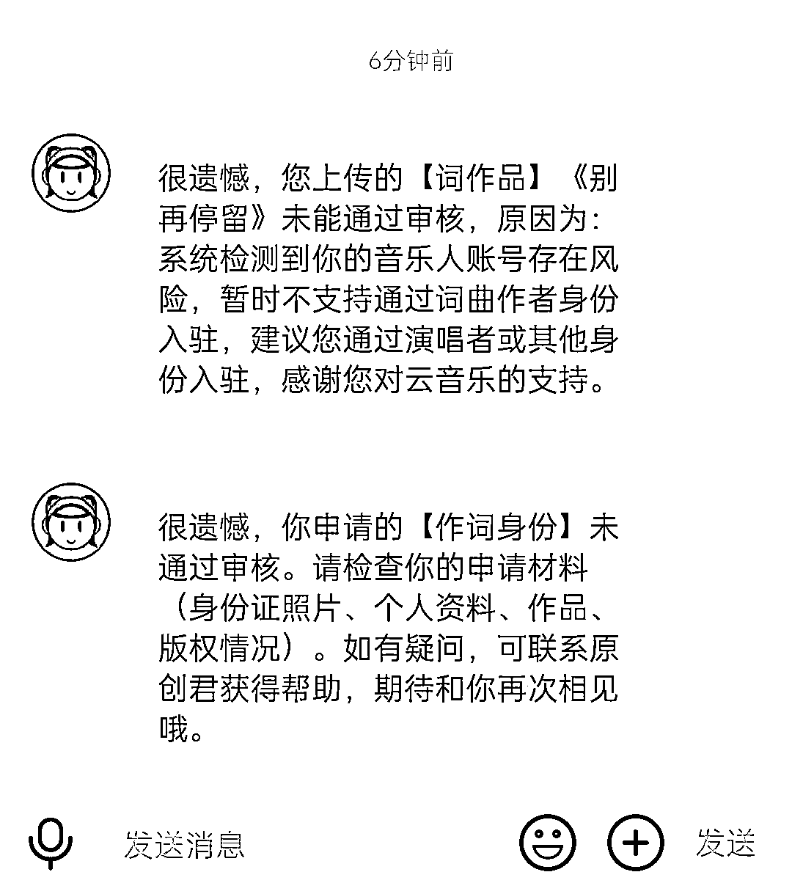

**作品未通过，身份提示检查材料**

安全风险和上面一样，账号不健康。作品问题通常是歌词太浅，或和版权库撞词。

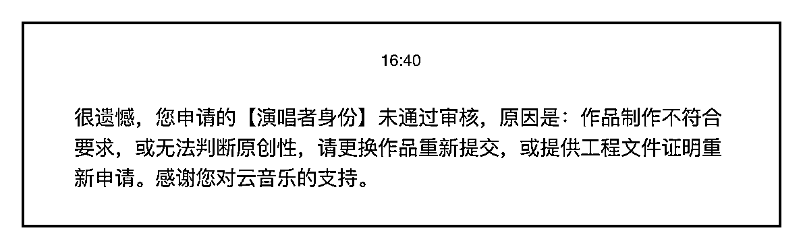

**天音 AI 歌曲提示制作不符合要求**

字面意思，歌词撞库或听感不和谐，重调或换歌。

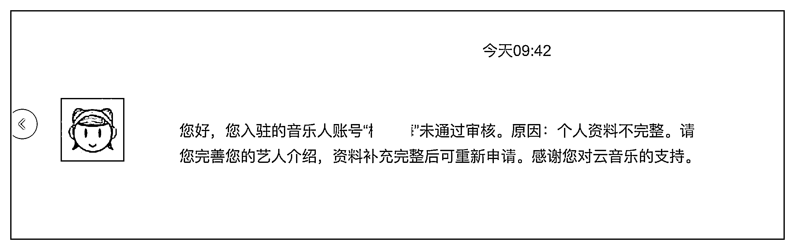

**提示个人资料不完整**

很少见，多是生日等信息填错。入驻时提醒客户多检查。

**账号切换麻烦**

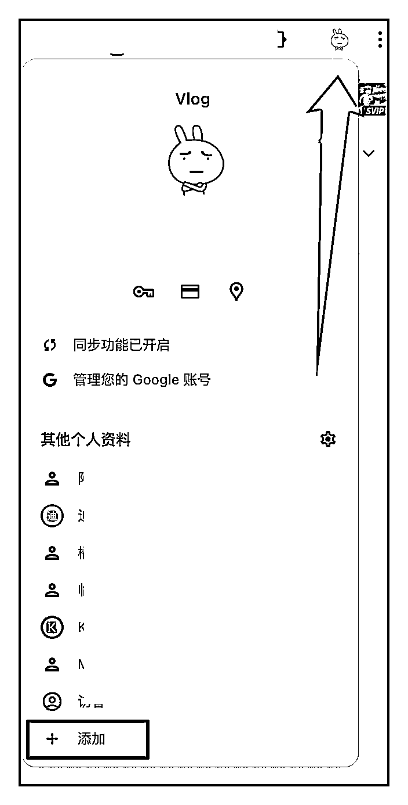

很多人可能没注意到，谷歌Chrome浏览器右上角有一个“添加新用户”的入口。利用这个功能，你可以在同一台电脑上同时打开多个浏览器窗口，分别登录不同账号，互不干扰。每个窗口里的账号状态完全独立，再也不用频繁来回切换登录。等某个账号认证完毕后，直接删掉这个用户，再新建一个继续用，非常方便。

再来说说抖音音乐人入驻，现阶段审核门槛确实挺高，并不容易通过。

云梯计划怎么赚钱？说白了它和流量主本质上差不多，歌曲的播放量、下载量都会转化为收益，具体的计算规则可以在后台查看。实际操作中，不少人会借助模拟器多开账号来刷播放，常见做法是把作品放进小号的歌单，然后循环播放整个歌单，别一直单曲重复。当然，也有人直接用脚本刷，网上卖这类工具的人很多。如果你打算做代认证，也可以找这些卖脚本的聊聊合作。

其实音乐人代认证这行当已经存在很久了。早先大家找人认证，无非是为了装点门面，或者拿它去兑换网易云黑胶会员。最近因为云梯计划收益翻倍的活动被网赚圈热炒，代认证一下子火了起来。但伴随热度升高，审核也变得更严，通过率反而不如从前了。

现在做云梯计划，基本都靠Suno来批量生成音乐。每个账号下通常放10到50首作品。Suno出的成品质量不错，而且单首成本相当低。如果直接购买别人用Suno生成好的歌，纯音乐大概2到5元一首，人声唱得好的也才5到10元。

关于Suno的生成技巧，以及音乐人认证过审的方法，如果感兴趣，欢迎点赞！

我是睡不着的阿凯，一起龙哥盟！

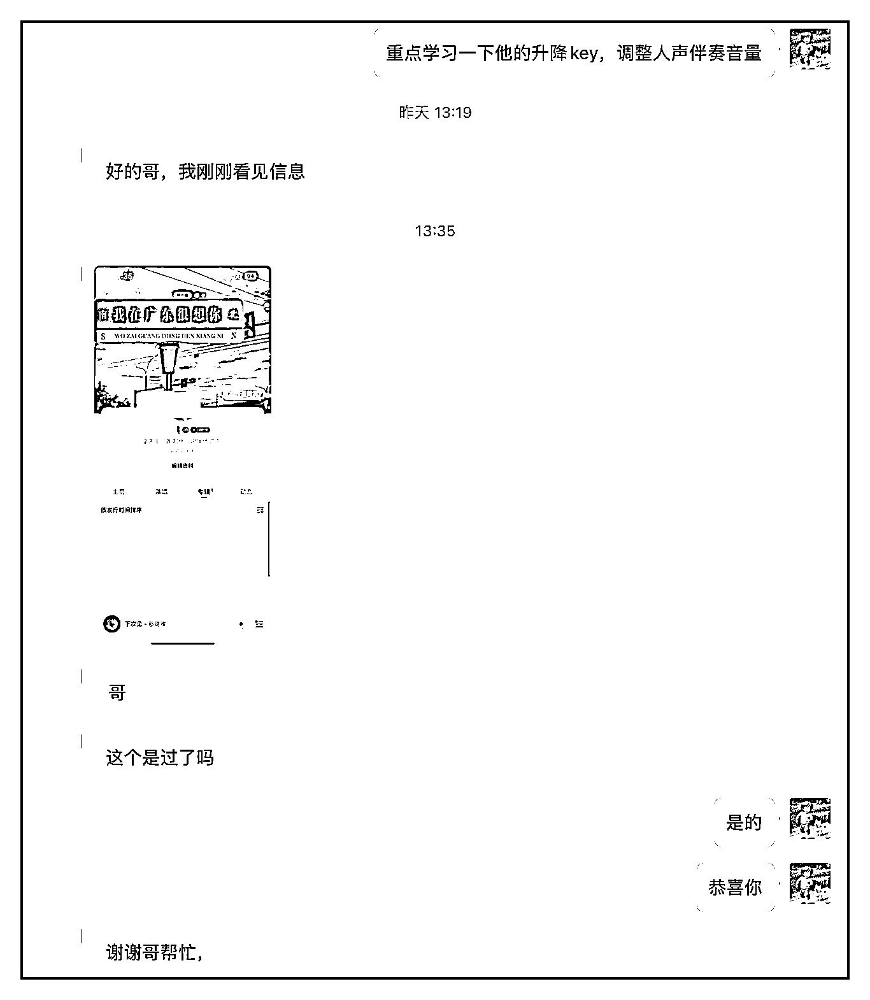

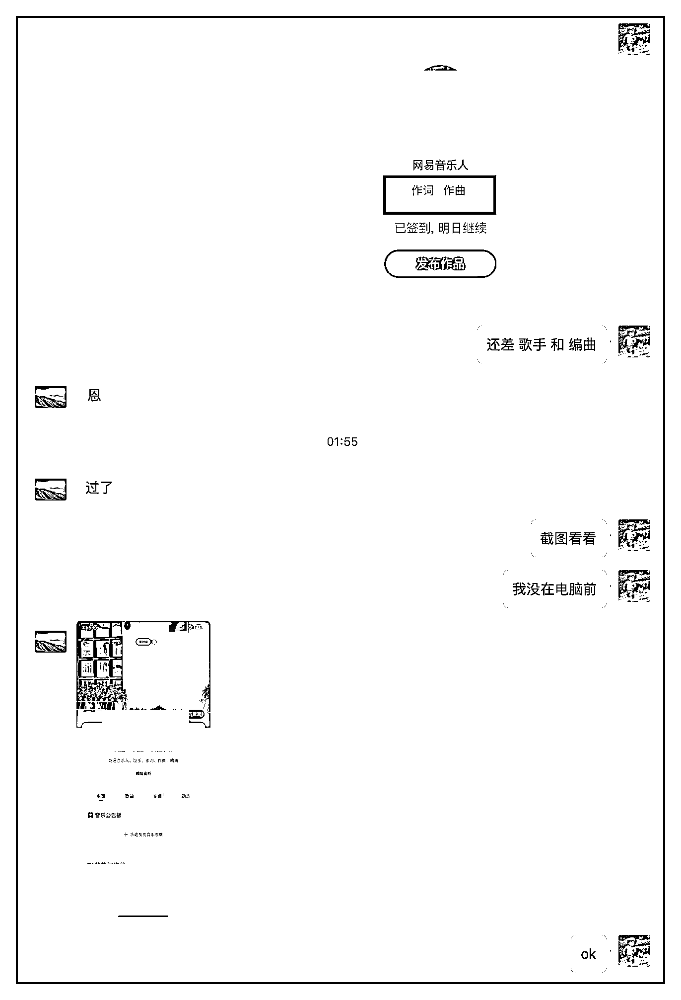

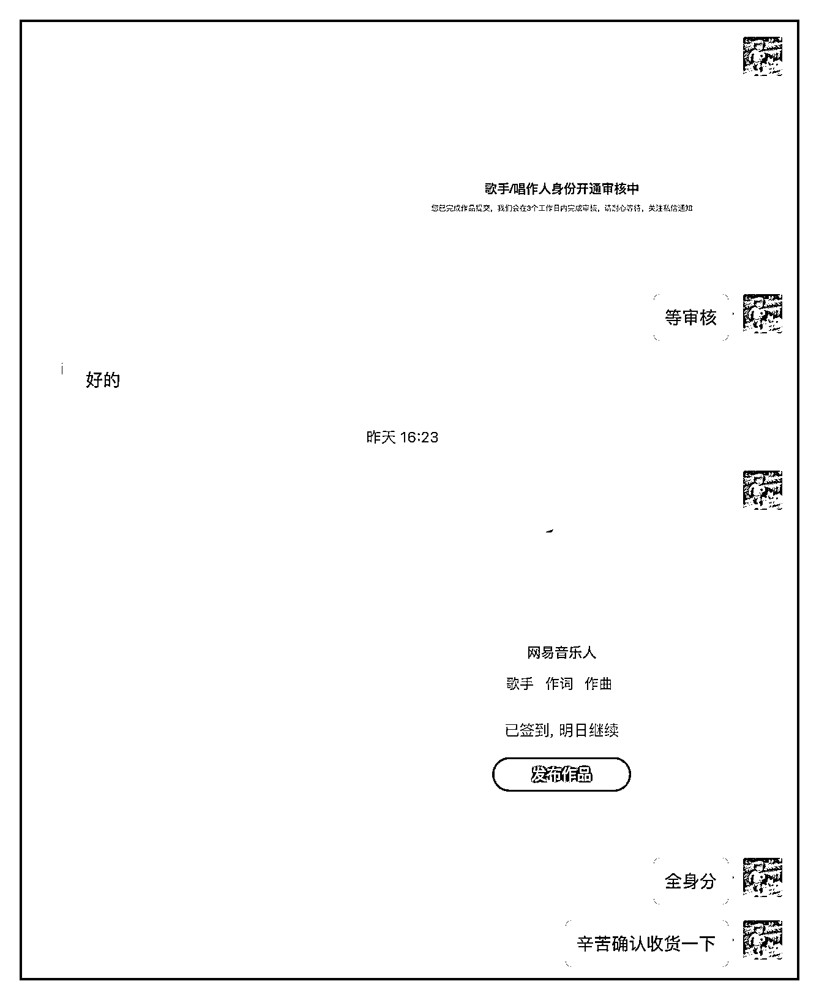

* * *

评论区：

木婉 : 我之前也自己试过申请，编的曲音轨太少，没通过。

木婉 : 看完感觉我的音乐梦又能实现了，「◦㉨◦」

人是可以通过学习改变* : 有点意思

