# 《家庭离异、一手白牌又怎样？搞定视频号投流带货照样月入30万》

谁规定拿到一手烂牌就得认命？我偏要打出个王炸来。

刷到这篇文章的你，或许正站在迷茫的岔路口，不知道往哪走。那不妨花几分钟，看看我这个普通人的故事。我叫何岷，97年生人，一个不折不扣的白羊座。几年前，我还是个月入2000、天天泡在洗车泡沫里的底层小伙，而现在，我是一家视频号投流公司的操盘手，账户月消耗稳定在100万到200万之间，最疯的一次，三天干出84万纯利。这个成绩在圈内算不得顶天，但对我这种出生即“白牌”的人来说，已经是当初想都不敢想的画面。江湖上有人叫我“视频号投流，素人实拍不死号流派”的开创者，也有人称我为“视频号投流挂车第一博主”。这些名号听着响亮，但背后都是用一个个不眠夜和无数的坑换来的。

回望这一路，我得先感谢两个人：我的合伙人小熊，和我的好兄弟阿皓。是他俩把我带进了龙哥盟这个圈子，让这个小城青年第一次看到了什么叫“原来钱可以这么赚”。

这条致富路，说起来其实挺简单的：踩坑，爬出来；再踩，再爬。但我还是想把这段经历拆给你看，不是为了教你什么大道理，就是想告诉你：一个家道中落、离婚家庭出身、兜里比脸还干净的孩子，都能靠自己的倔强闯出一条路，你也千万别先放弃自己。

我从小就有个座右铭，在这里也分享给正在屏幕前鼓着劲儿的你：“心系创业成功路，目的不达誓不休，他日若遂凌云志，敢笑马云不丈夫。”

先说说我这手“白牌”牌是怎么起手的吧。我生在贵州德江，一个名不见经传的小县城。提起贵州，大多数人脑子里蹦出来的词儿不外乎是“穷山恶水”。确实，我们那儿的整体经济就那样，我家更是普通到尘埃里，全家一年到头为生计奔波。更麻烦的是，我爸年轻时好赌，欠了一屁股外债，我还没记事呢，他们就离了婚。我妈一个人拉扯我，打工、照顾我，一直到我上技校。

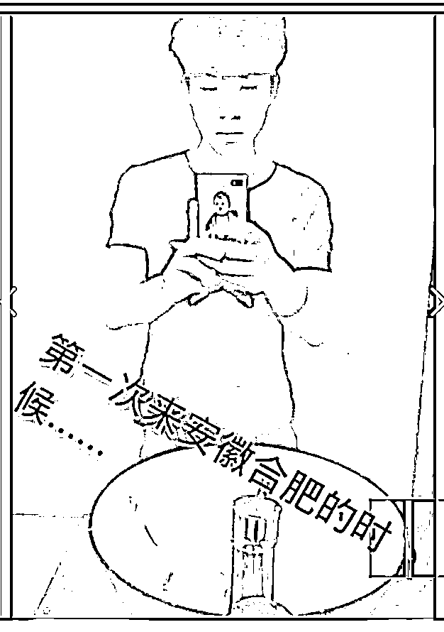

初中毕业，我实在不忍心看我妈那么累，想着早点出来干活，减轻点家里的担子。在网上翻来覆去地找技校，什么新东方厨师、蓝翔挖掘机、电子商务，都研究过一圈，最后在朋友推荐下，选择了万通汽修。可能男孩子天生对汽车有好感吧，再加上看到汽修里面有“汽车改装”这门课，一下子觉得，嘿，这就是我的人生方向了，当时甚至天真地想把一辈子都献给这门技术。

后来我妈给我凑齐学费，我一个人从温州杀到了合肥。那时候也不知道哪来的胆子，半大个孩子，就敢孤身走那么远。几经周折找到了学校，办好入学手续，我的人生新阶段就这么稀里糊涂地开始了。

到了学校，日子并不好过。第一个学期，班主任老骂我“太浮躁，爱表现”，那些话对于当时那个敏感的少年来说，杀伤力极大，我慢慢把自己缩进壳里，不爱说话，也不爱表现，越来越自卑。我老在心里问自己：一个农村出来、毛病一身、毫无特长的孩子，拿什么跟别人比？那种看不到光的滋味，不知道有没有人懂。

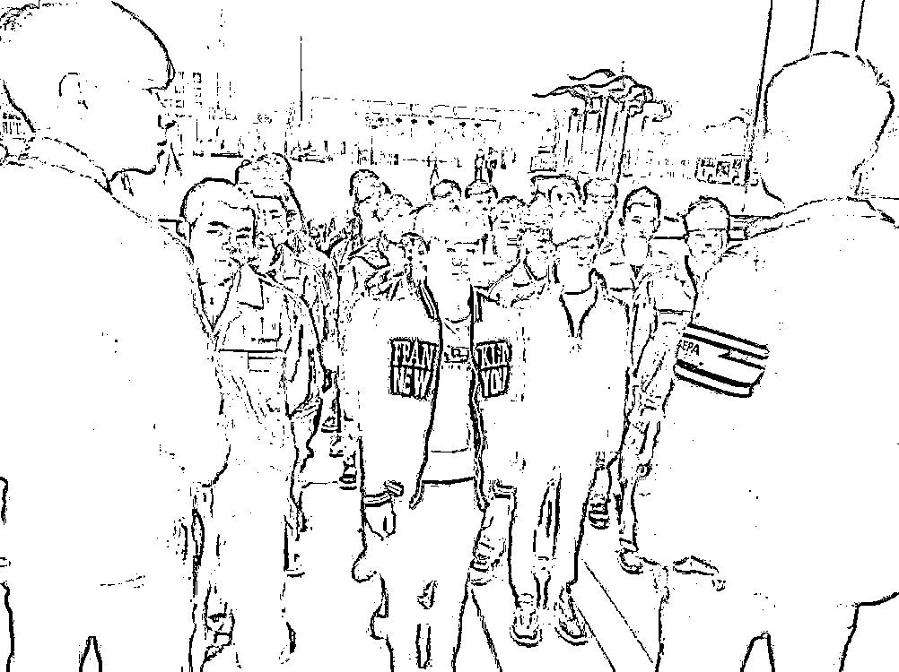

直到我遇到了一个食堂大姐。她发现了我的异样，主动找我聊天，鼓励我要勇敢做自己。那是我第一次感受到来自陌生人的真诚善意，心一下就暖了。后来我干脆去后厨帮她打下手，跟她越来越熟，人也慢慢活过来了。

有了自信，胆子就大了。我开始混学生会圈子，进了生活部，拼了命地干活。后来选组长，我以为稳了，结果选上的却是一个不怎么说话的哥们儿。当时委屈得不行，觉得世界太不公平。后来我想明白了：事儿得踏实做，但人也得学会跟对的人、处好关系。

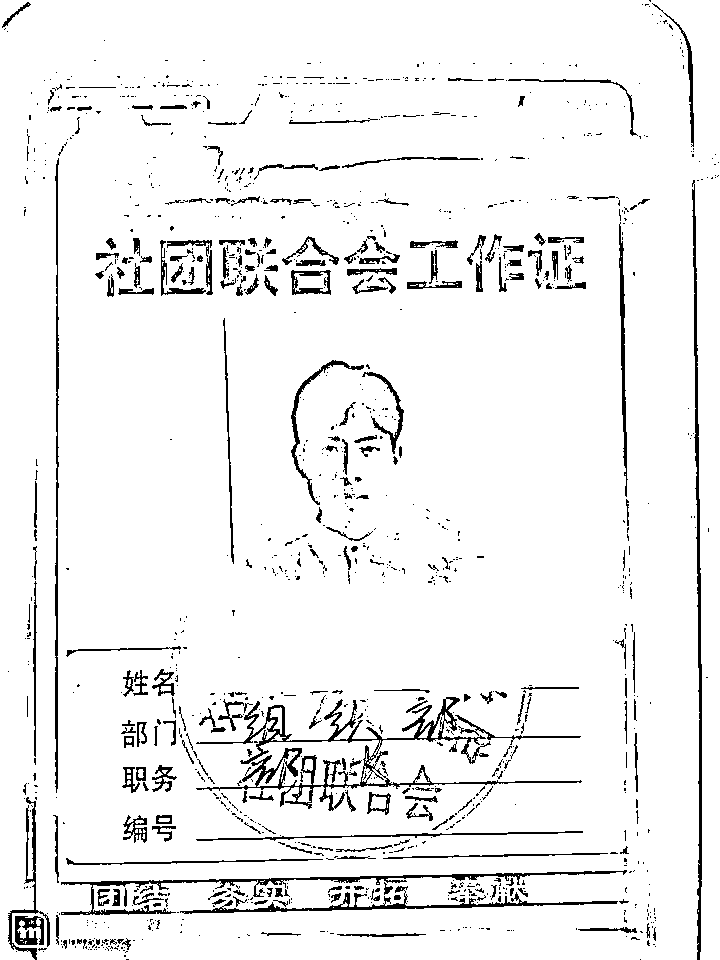

我换到组织部后，学聪明了，工作之余也学着跟部长多接触，请吃饭、会来事儿。一个月下来，效果显著——部长啥事儿都让我牵头，有好玩的也叫我。我直接当了大队长，统领所有组长。后来一路升到部长、副主席。这段经历让我深刻明白了一个道理：圈子太重要了，向上社交是成长最快的捷径。

毕业后的第一份工作，是去4S店当洗车工。每天早上7点起床，开早会，8点准时开干。夏天，一天要洗80多台车，晚上回去两条腿跟灌了铅一样，累到澡都不想洗，倒头就睡。就这么熬了两个月，我回到温州，在床上躺了一整周才缓过来。

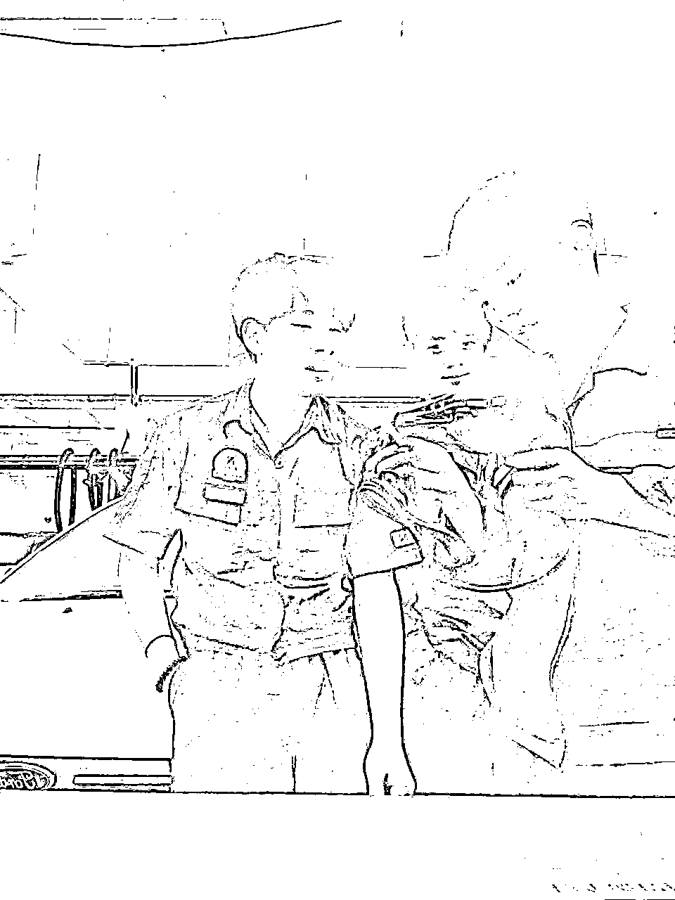

后来我妈念叨我，让我找份正经事。我寻思喷漆老师傅挣钱多，就跑去当喷漆学徒。但做这行伤身体，漆对肺不好。年轻人哪听得进去这个啊，满脑子就想改善家里条件。可现实打脸太快——第一个师傅压根不教真东西，每天就是让我买烟买水递工具，连漆房都不让我进。干了俩月，啥也没学着，我急得不行。心想：我要是这一年都在混日子，那岂不是白费了？一咬牙，辞了。

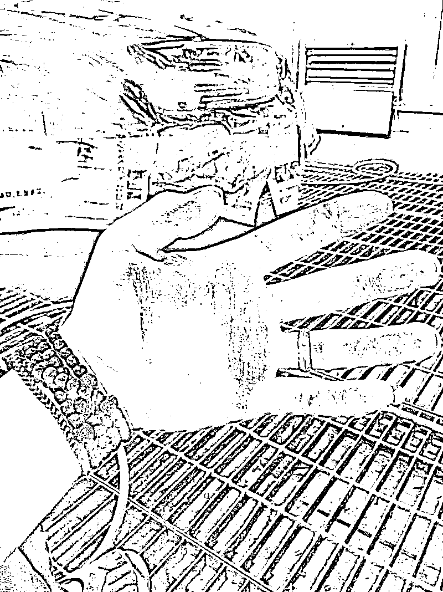

换了个师傅，照样不教。不过这个师傅懒，全让中工干活。那中工倒是有点真功夫，啥活都能上手。我灵光一闪，又掏出在学校那套，没事就找中工玩，买水、买烟、陪他打王者，总结一个字，“舔”。混熟之后，我抢着干活，他在旁边看着我操作，乐得清闲，我也偷师成功了。

两个月后，我出师了，直接跳槽去别的店当中工，工资一下子从500跳到4500。后面几个月，我干活比店里老师还猛，工资却只有他们一半。三个月后，我直接升成店里的老师，还带了几个徒弟。有意思的是，我的徒弟们个个半年就出去单干了——我撵走的。因为我太清楚他们正在经历什么，我希望他们也能快点学到本事，多挣钱。现在回想起来，我真的很感谢那个拼命、倔强、不服输的自己。

这几段打工经历让我意识到自己的认知太缺了，心里有股劲儿一直在往上顶：我想赚钱，赚大钱。创业的种子就这么埋下了。

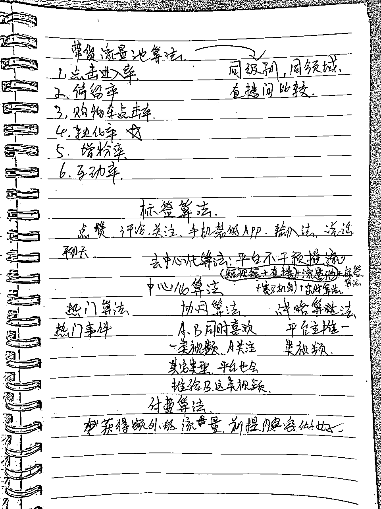

疫情那两年，我跟着表哥去广州开口罩厂，但最终竹篮打水一场空，第一次创业就这么黄了。可这一趟没白跑，我认识了不少身价过亿的集团老板。看到过更大的世界，就再也回不到井底了。我不断问自己：是回去做喷漆师傅，还是继续冒险？回去干喷漆，月薪撑死一万，饿不死但绝对富不了，天花板太明显了。我想清楚了：坚决不能再打工了，不管怎样，都要自己干！

我开始疯狂在抖音、百度搜“一个人能做的项目”，搜半天全是吹水的，没有讲核心的。后面想，干脆报个课学算了。那时候直播很火，脑子一热就报了名，把身上仅有的15000分出一半交了学费，想着学完就算去打工也不至于饿死吧。交完钱第二天就开课了，班上四十多人，每天早九晚五，笔记写满了好几个本子。说真的，读书时都没这么认真过。

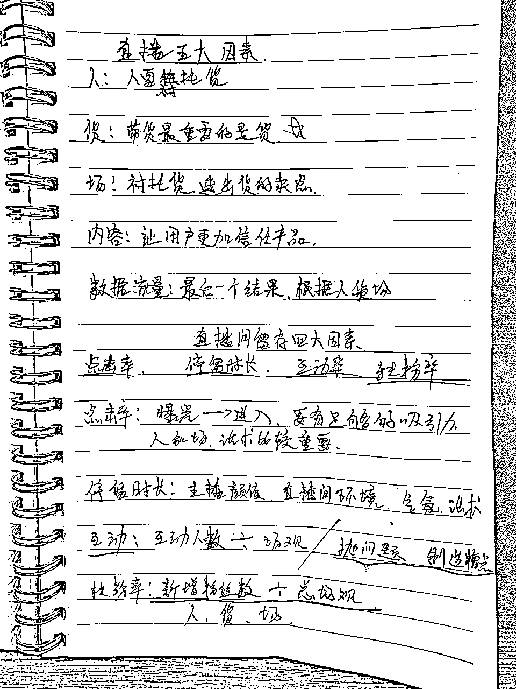

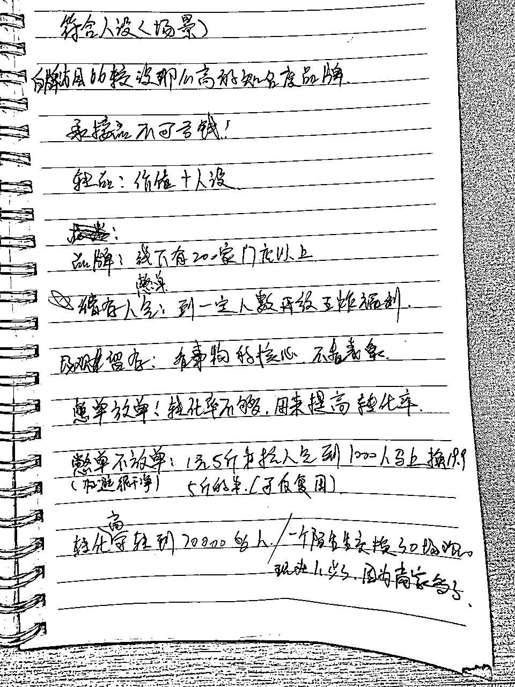

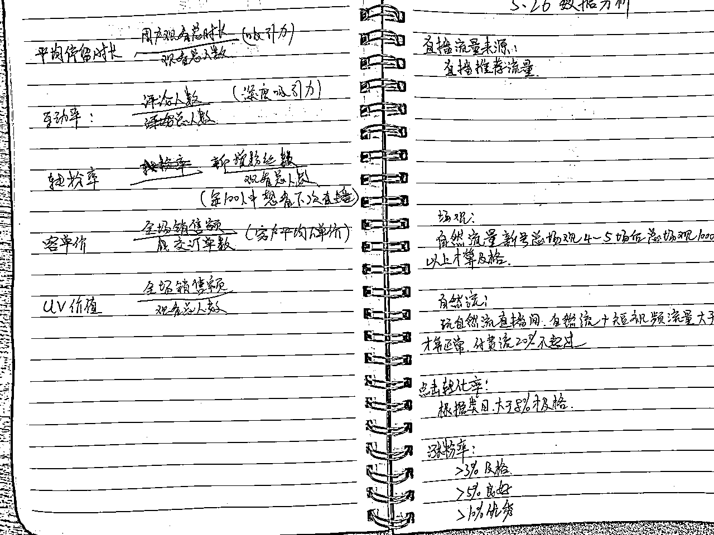

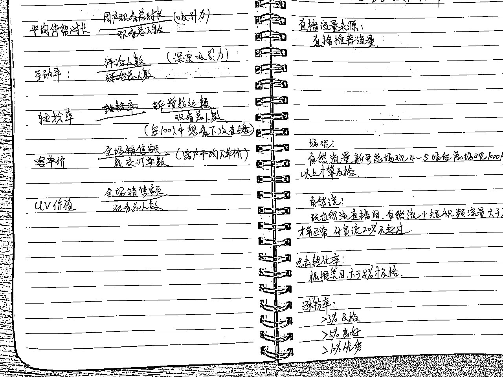

学完一周，感觉自己已经无敌了。跟几个同学相约去直播公司实习，结果人家说太水了，运营不要，只能干中控。就我一直一家一家面试，最后进了一家童装公司，启动了直播生涯。鱼塘起号、付费起号、七天螺旋起号……折腾了一堆套路，没一个起来的。加上家里老人出了点变故，我请假离职回到了温州，就再也没回广州。

后来，一个初中同学跟我说有个“无人直播”的技术，能赚大钱，我一听就来劲了，刚好赶上风口，就跟他合伙干。最高的时候一天能卖几百万，佣金几十万，那是我创业以来第一次尝到甜头。可惜平台很快开始打压，大批封号，我们被迫撤离。期间也花钱学过小红书无货源、公众号爆文等项目，但都没做起来。

到了23年初，合伙人小熊跟我说：“今年视频号投流带货是风口，有人一天赚十来万，要去报课，你一起吗？”当时我满脑子还是抖音逻辑，“视频号是啥？”根本不知道，后来才搞清楚是微信视频号。还觉得一天十来万太假了，现在想想，是我那时候眼界太窄。好在那年过完年正愁不知道干啥，就当机立断跟他去学了。一人三万块学费，学三天。上完课，他建议我跟阿皓先在杭州跑起来。

于是我就留在杭州，和阿皓租了个小办公室，开始白天黑夜地研究选品、跟品、投流、做素材。那时候的玩法就是纯搬运混剪，操作不复杂，但选品和测品极其折磨人——每天选8个品，每个品做3个素材。剪辑忙不过来，招了两个剪辑，每人分一个。每天早9点干到凌晨1点，有问题就问机构，结果那机构的小客服啥也不懂，回答得特别官方，我们天天亏钱，虽然亏得不多，但特别憋屈。

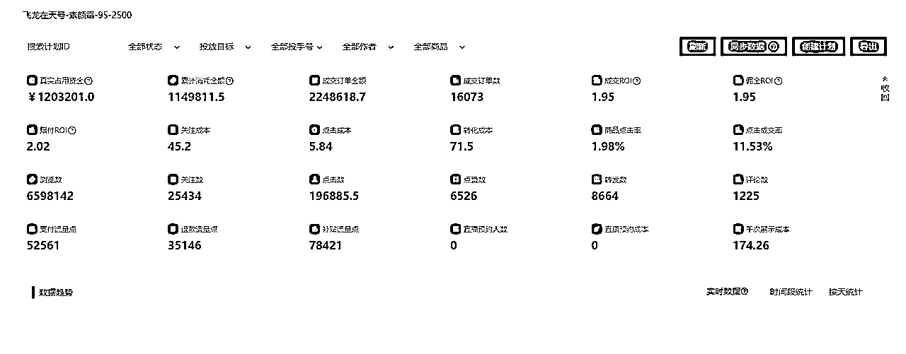

好在我们一直坚持搭建账号，扛了20天，第一单终于出了——晚上10点03分，投产微微正。那一刻的开心，真的无法用语言形容，算是0到1了。第三个月，我们的第一个爆品出现了：一款素颜霜。1瓶139.9元，2瓶159.9元，成本含快递才10.5元，一单利润上百。三天利润84万，成为公司里现象级的投流案例，至今没人破纪录。

这个品，是一个广州大哥告诉我们的。他当时坐在我们旁边上课，我们问他为什么起量这么难，他说：“打美妆吧，利润高。”我们花半个月专打美妆，结果真爆了！后来我专门跑到广州登门感谢。相比于赚到钱，更开心的其实是看到了希望。所以说，朋友们，一定要多出去学习，多结交大佬，别人随口一句话可能就是你的转折点。

有人问：当时身上就10万，哪来钱包得起量？实话实说，那是用钱换钱的阶段，我砸锅卖铁地借钱，把亲戚朋友借了个遍。好在合伙人本来就是做抖音投流的，有点积蓄，直接垫了一百万进账户。那几天我们整个团队连轴转，在工作室三天三夜没合眼。后来视频号开始封号，几个账号都被封得差不多了，短视频不消耗了。我们收工后睡了两天两夜才缓过来。之后又招了几个剪辑，陆陆续续又小爆了几次，GMV都是几十万。

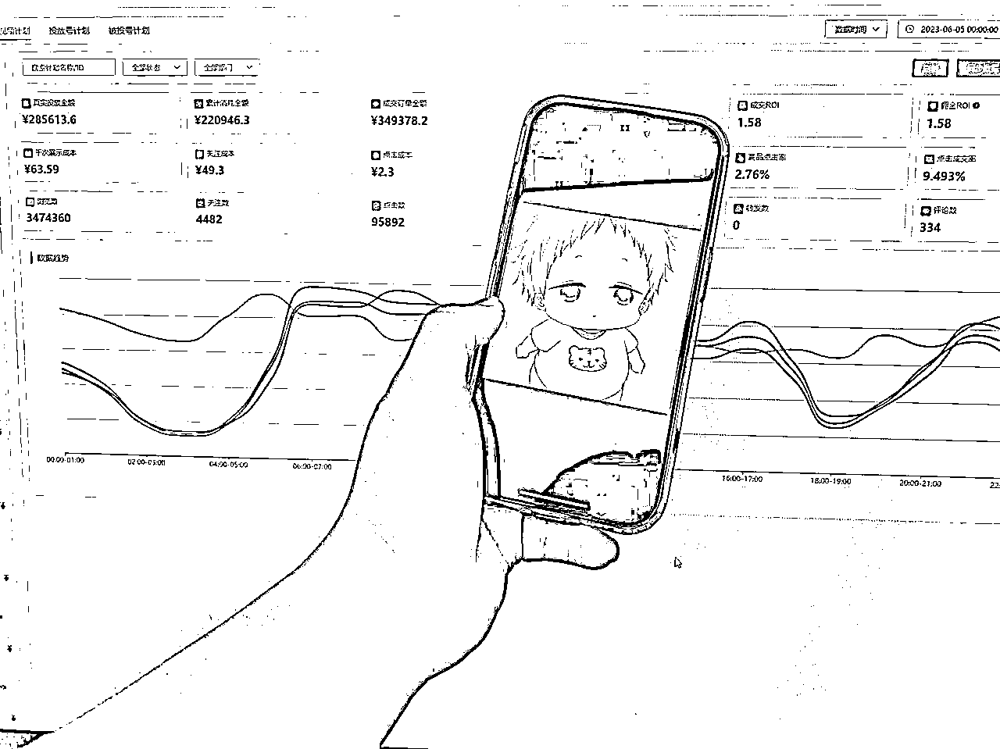

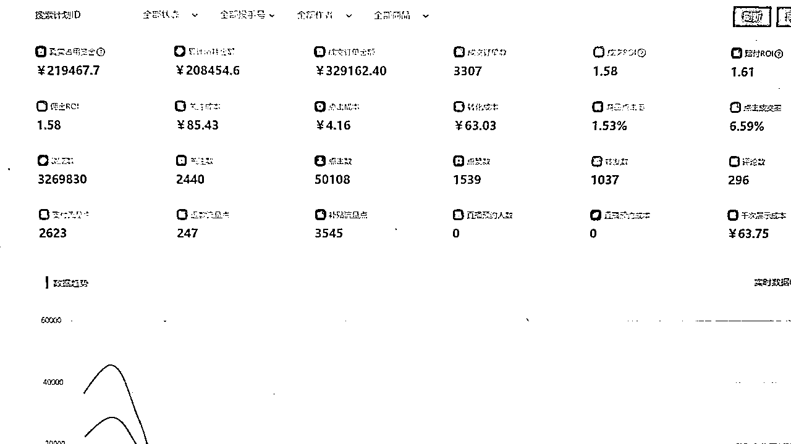

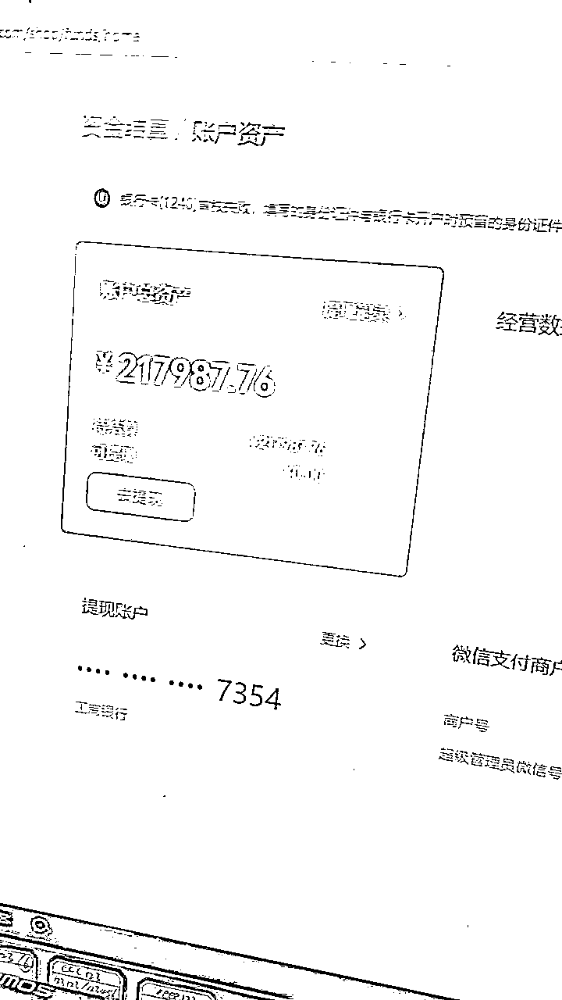

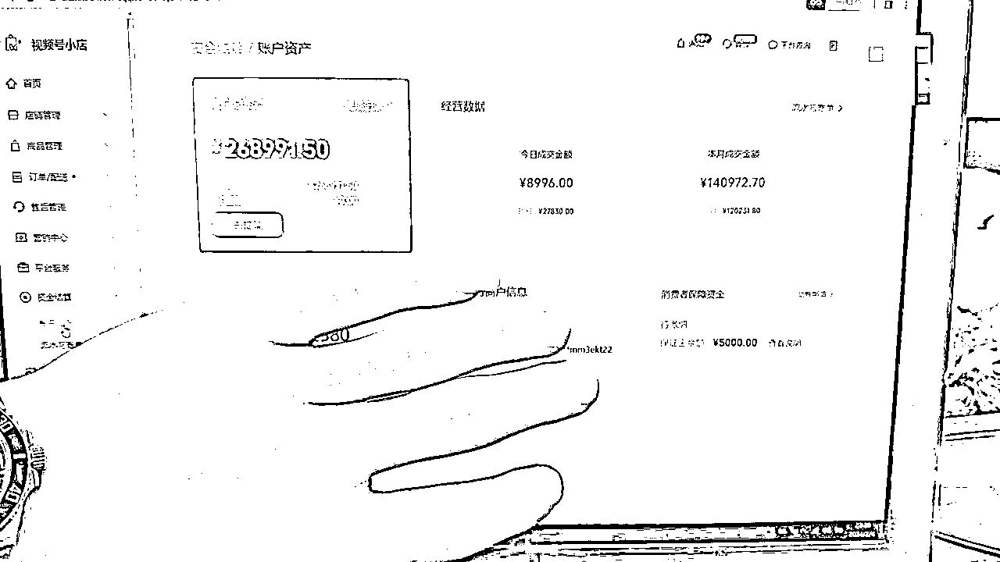

然而好景不长。2023年7月，平台对混剪打压明显加重了，各种理由满天飞：“画风不统一”、“短视频挂车掉权益”，一天封几十个号。我当时心里直打鼓：是不是要黄了？红利是不是要过去了？难道团队要就地解散？

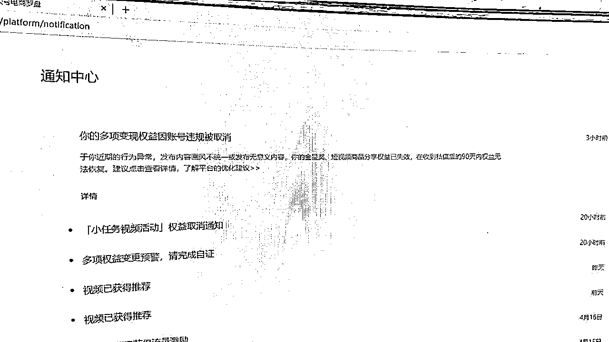

跟圈子里的同行交流，好多人说要退出了。我失落了半个月，但还是觉得视频号的风没停，又开始没日没夜翻平台规则，通宵地看。终于让我找到了封号的根子——画风不统一，是因为最开始过内容规范的时候，我们发的全是风景、搞笑段子、生活随拍，压根没有给账号做清晰定位。

于是我开始代领团队实操转型：从养号开始，替换掉之前过规范的内容，买样品自己拍摄产品短视频，加上产品介绍。测试了一阵子，好像真有效果！接着就矩阵化地复制这种账号。不少同行打电话来问新方法，我也知无不言，乐在其中。

那阵子我们又打出了一轮小的成绩，赚了几万块。但紧接着，又有账号因为“画风不统一”被封。我人都快麻了，真想把电脑砸了。刚开始突破一个难关，平台又来一层压制。问题到底出在哪儿？

又是一个彻夜难眠的晚上，我忽然想：画风？统一？那我固定一个场景去拍不就行了？想到就干。试了在画面里摆一个固定产品，虽然还会被判定违规，但我把主页截图和拍摄现场保存下来，违规后马上去申诉，你猜怎么着？真有奇效，很多号就这样救回来了。那种解决了问题的感觉，真比赚了几万块还爽。

到了9-10月，新招又失效了。不加热、画风不统一、硬广退回……平台上已经开始流行AI主播类型的视频，挂车、点赞高，但基本是自然流玩法，当时我没太上心。我又开始琢磨：既然所有规则都能突破，不如突破到底？于是决定真人出镜带货。技术难关被我一次次刷新，公司也被抬到了新的高度。

我把方法分享了给几个同行，没几天，广场上全是类似脚本和形式了。有人用更专业的模特，有人直接请演员。偶尔被判搬运，也能靠剪辑手法规避掉。数据就不多晒了，技术层面基本已经通了。

年底分红后，我全款提了一辆商务车，在老家买了人生第一套房送给妈妈，还自驾带家人去了川西。这些都是人生的第一次。我永远忘不了妈妈脸上的灿烂笑容，她已经不再唠叨那些有的没的了，因为她知道，自己的孩子能撑起一片天了。

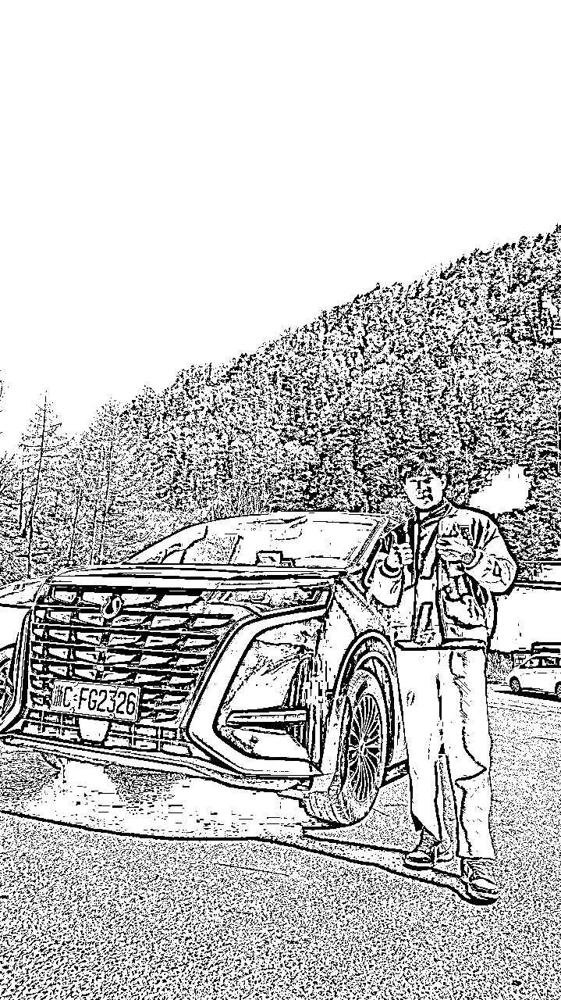

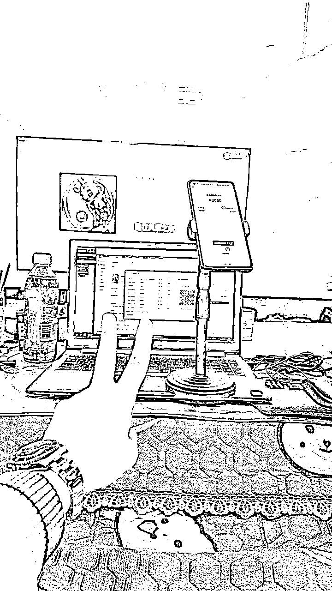

项目稳定以后，经常有同行打电话问我技术问题，同频的老板有，刚入门的小白也有。合伙人看见我整天跟人语音聊天，开玩笑说：“你这么能说，不如去做个抖音博主。”他擅长流量、私域和IP孵化，这建议一出来，我的第一反应是——这是不是去割韭菜啊？但他说让我认真想想。

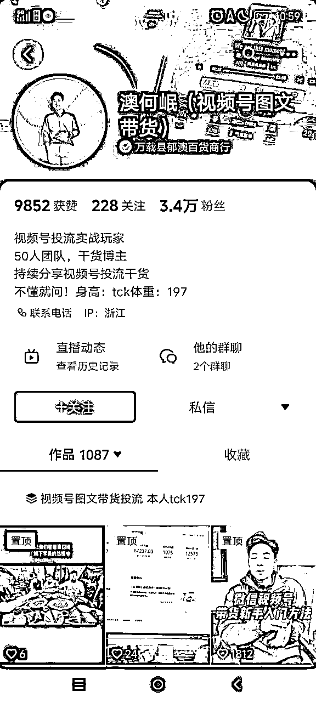

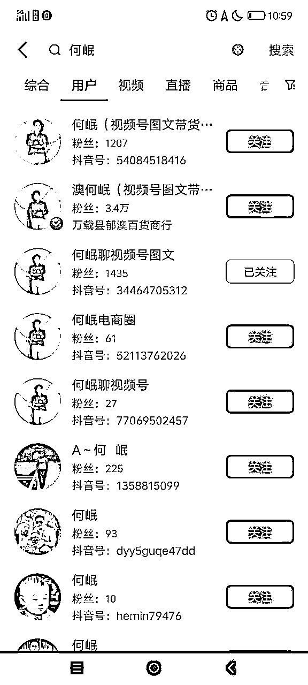

后来我拗不过自己，决定试一试。从头开始做IP，所有的作品内容都是分享我知道的干货，或者解答一些具体问题。慢慢地，开始有人来咨询，也有人直接选择相信我，给我付费。我也就从一个小小的干货博主，一步步变成了视频号短视频带货圈里还算有影响力的头部博主。

一路走到今天，我要再次感谢那些在我最困难时候拉过我一把的人。也要谢谢那个无论跌多少次，都没有真正泄气的自己。

如果你也想聊聊视频号投流带货、想了解这个项目怎么落地、或者单纯想交个朋友，欢迎随时来找我聊。不一定能给你什么保证，但我这走过的坑，希望能让你少走几步。

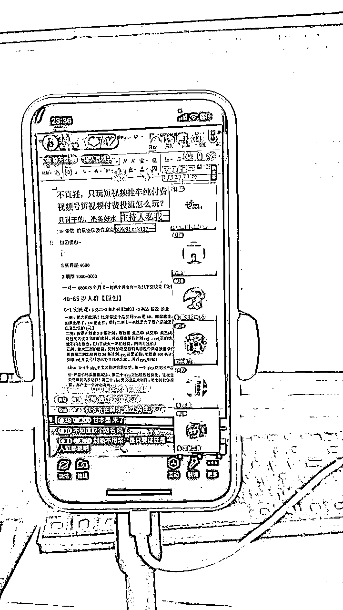

从去年到现在，累计带跑了一百五十多名同学。有人凌晨三四点第一次放量，直接打电话过来问我该怎么处理；有人需要我远程看数据、搭计划；有人卡在内容上，需要我帮忙剪辑、补素材。因为自己经历过那些生死时刻，才明白关键节点有多重要。只要我在状态里，不管几点都会接电话、把问题先封住。为了让大家能互相碰撞、一起孵化，我把新老学员全放进同一个大群。群里汇集了供应链、代发团队等各路资源，大家可以自主对接，也是在检验我们的服务闭环。

实践下来，超过一半的学员都拿到了自己想要的结果。有学员主业在忙，把这个项目先搁置；也有学员去年报完名，今年才重新联系我学习，我也照旧把技术和新打法同步过去。因为我踩过坑，所以想替后来的人撑伞。钱可以持续赚，但信任和伙伴关系很难再造，所以我不会丢下任何一个信任我的人。

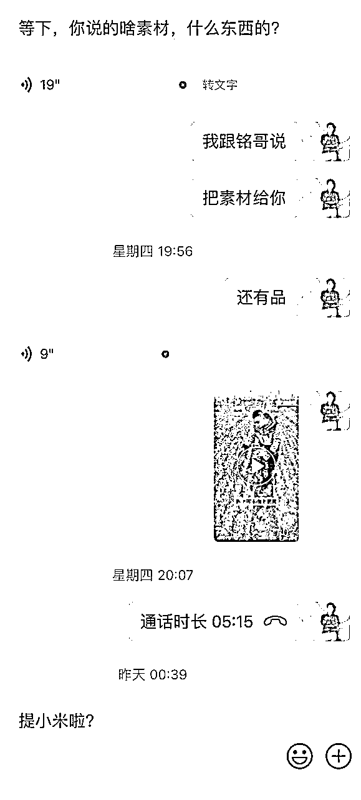

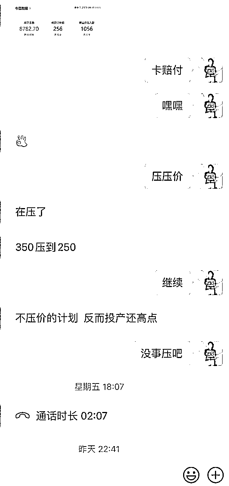

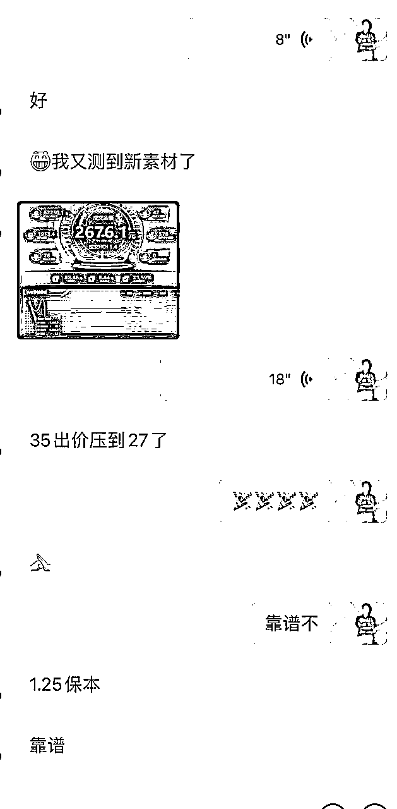

说实话，我走这一路，太清楚做项目时的迷茫和无力感了。所以能分享的经验我都尽量拿出来，希望能给屏幕前的你一点帮助和启发。关于视频号带货投放，如果有疑问，圈友可以直接来找我沟通，我免费解答。无论你现在做视频号还是做别的赛道，我都希望你别放弃。

接下来我详细拆解一下自己从0到1做到月入30万的实操路径和细节。核心围绕视频号带货投放展开，主要包括：视频号挂车选品怎么想？爆款素材怎么做？微信豆不消耗怎么破？素材审核不过怎么办？

## 四、项目拆解：视频号短视频带货投放的底层逻辑

### 1.项目介绍

#### （1）项目逻辑

拍实拍或混剪短视频挂上商品链接，然后用付费加热去获取精准流量，完成转化。核心就一个：多测素材、多测产品。只要有一个素材或产品跑通，可能就覆盖一年的开销。

#### （2）项目收益

只要是付费投放的模式，天花板几乎不存在。正是这个特性，让普通人能用同样的投入获得更大的回报。圈内常说：自然流门槛低，容易起步。但投放是有成本门槛的，往往赚得更多。身边做视频号打品的同行和学员，单月几十万的比比皆是。用心去做，一个月小几万到十几万是常态。当然付费也有亏损风险，通常控制在2000-3000元以内，ROI不健康就及时止损。

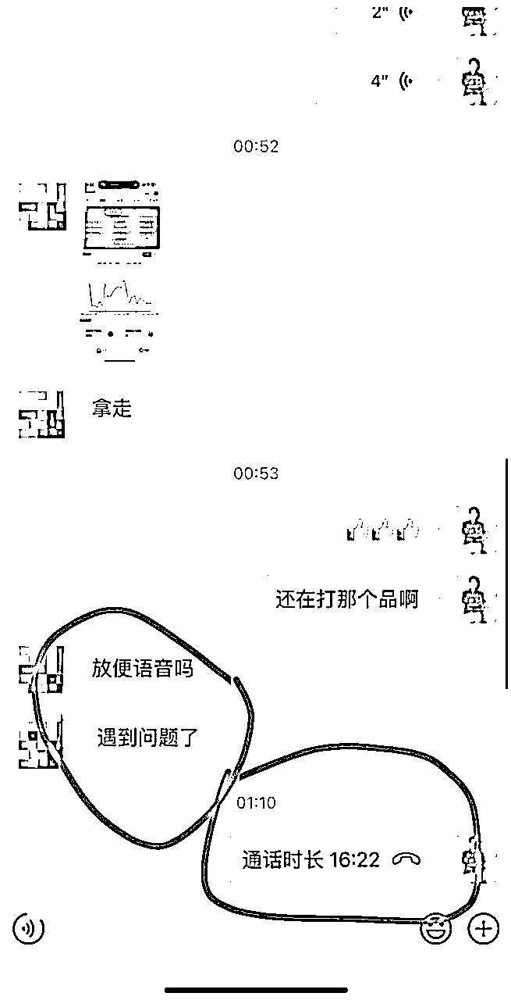

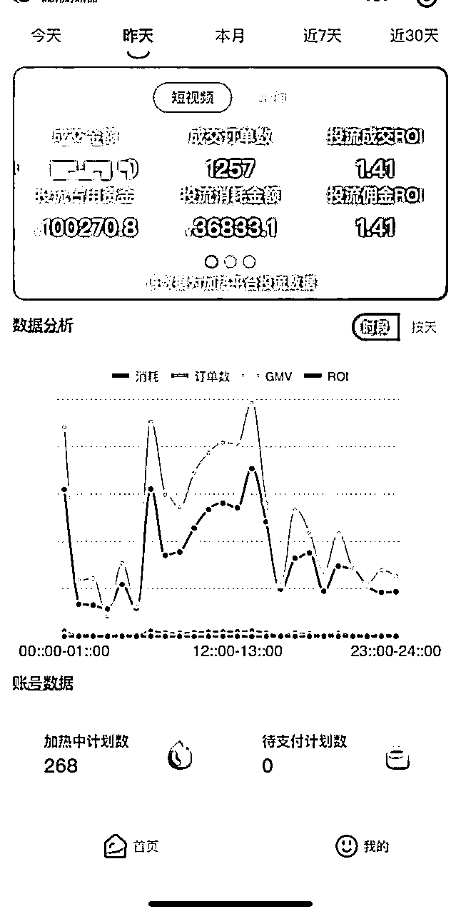

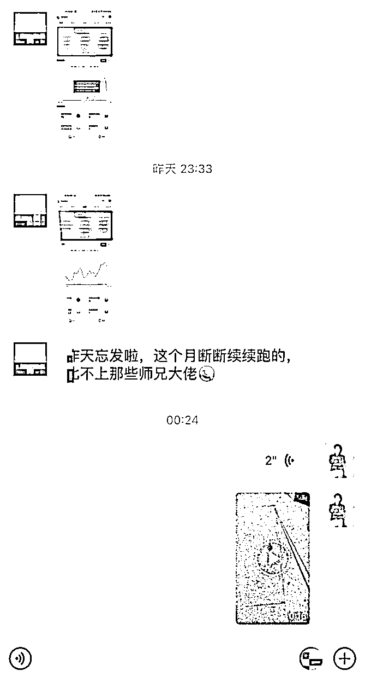

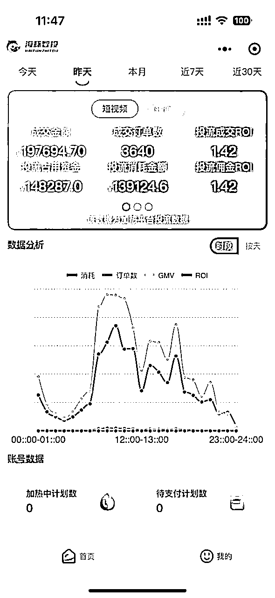

### 2.实操流程

#### 第一步：注册视频号

打开微信发现页，找到视频号入口，进入后点右上角头像。若未注册，只能看到发表视频、发起直播两个入口。点击发表视频，按提示完善资料、头像即可。注册完就能正常发布作品。

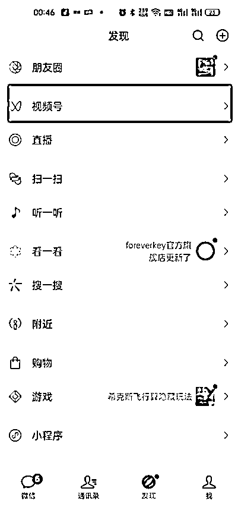

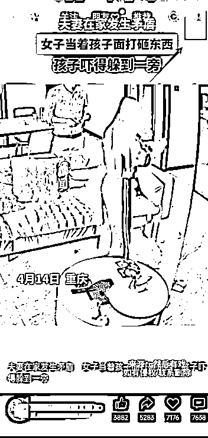

#### 第二步：发布养号素材

账号注册后可以立刻发作品，目的就是拿到挂车权限。进入视频号首页—创作者中心—加热工具—我的账户查看。正常新号会显示商品不可加热，按步骤操作就能拿到内容规范权限。

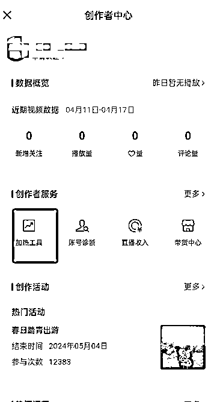

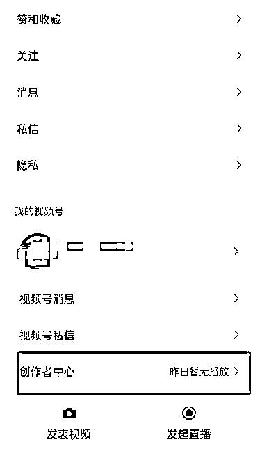

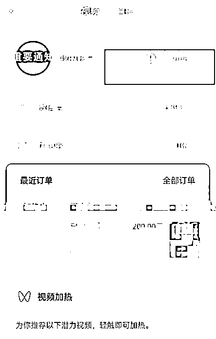

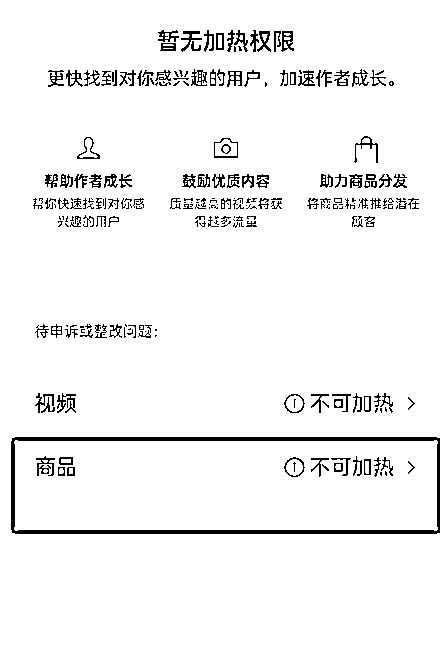

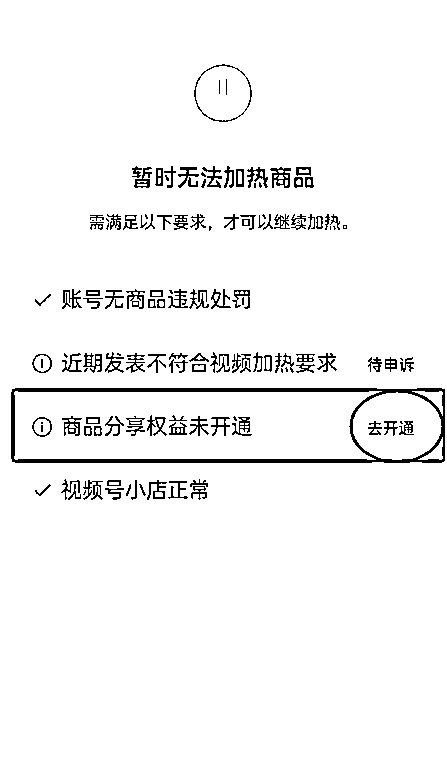

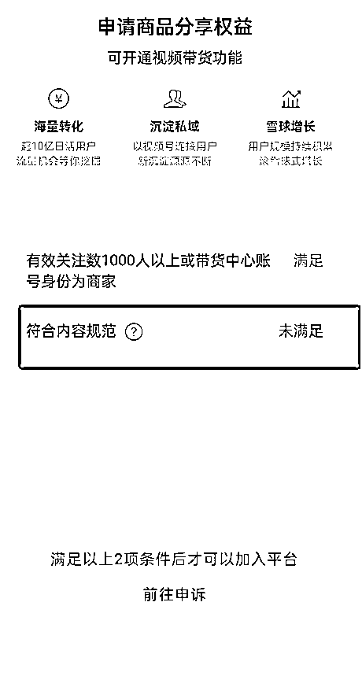

新号可以直接发十条以上人脸口播视频，20秒以上即可。不会写脚本就用剪映提词器，把抖音上优质的情感、鸡汤文案复制进去，自己读出来就是一条原创。尽量多拍，15条左右最佳。话题和封面类似下图即可。

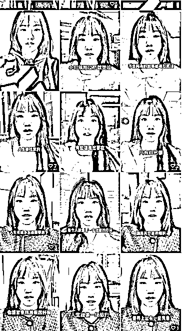

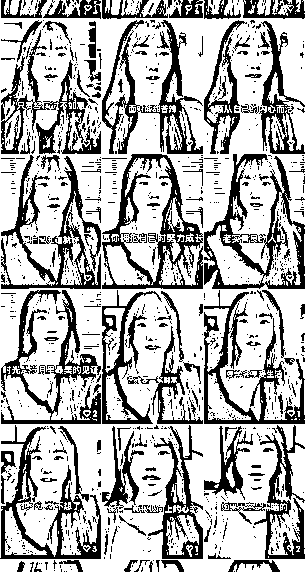

#### 第三步：快速通过内容规范

作品上传后，给其中一条加热100元播放量，能加速人工审核，基本隔天就能过内容规范。不想花钱也能申诉，在内容规范入口提交即可，但成功率不高。做项目要的是效率，节省时间成本最重要。

#### 第四步：快速获取一千粉丝

内容规范通过后再涨粉，不要先做粉丝。最快的方式是付费刷粉，几百块就能刷到一千，半小时搞定。有资源需求的同学可以直接联系我。

刷完后就完整具备了短视频挂车带货权限，接下来就是选品、做素材、投放测品。

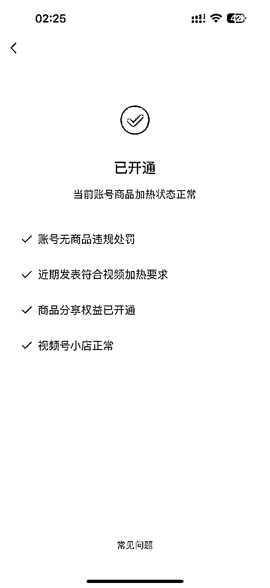

### 3.选品

#### （1）人群画像

先搞懂平台用户是谁，才能打中痛点。选品时建议把产品溢价做到5-10倍以上。

视频号人群标签：

1、核心年龄段45-55岁，年轻人也有，但高溢价品对爱比价的年轻群体转化低、退货高，需要足够溢价空间。

2、三线及以下县城、乡镇为主。

3、缺乏电商购物经验。

4、产品要大众适用，避免太冷门的品。

5、抛弃抖音的都市时尚感，要接地气、好用。

#### （2）选品思路与平台

1、品先行：先在拼多多、淘宝、京东筛选类目或年龄段选品，再去抖音、快手找对应素材。

2、素材先行：在抖音、快手按年龄段或类目找爆款短视频，再反推产品。

3、第三方工具：在蝉妈妈、有米有数、新视数据等工具里按类目找爆品，再找素材。

4、跟品：在视频号广场刷爆款，直接搬运音频或混剪翻拍。

5、爆品延伸：基于自身或他人的爆品找延伸品、相似品，并匹配素材。

选品耗时，我用蝉妈妈演示：

1、打开蝉妈妈—商品。

2、勾选视频带货为主，比例设到60%，可框定受众人群，更易找到素材。

3、列表即为当天销量榜，逐一查看人群画像是否符合40岁+，符合就记录下来针对性找素材。

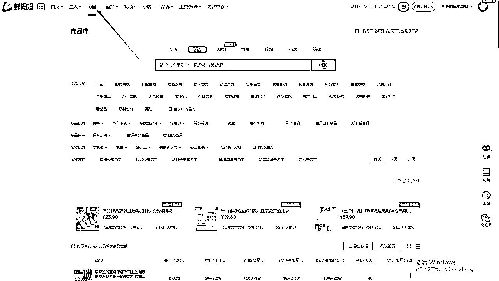

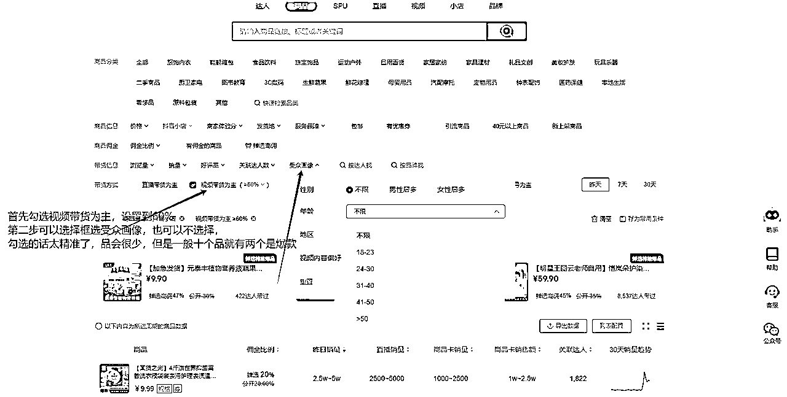

例如古龙香水，进入受众分析，受众多为中老年，完全可以测试。成本1688约3元，我们售价39.9。

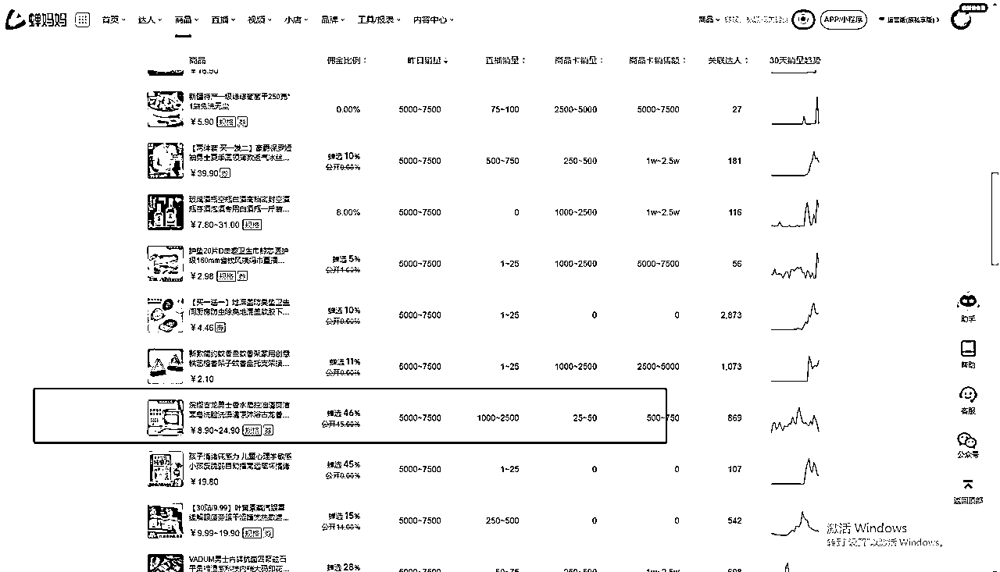

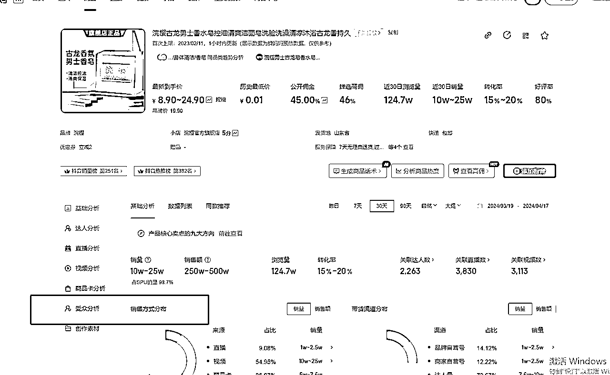

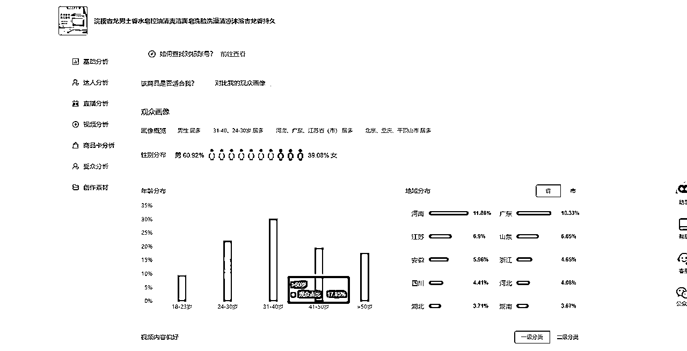

每天从此渠道挑5-10个品建表测试，十个里通常能出1-2个爆款。

#### （3）素材制作要点

素材要求：

1、画面清晰、音频流畅，有痛点有卖点，只为带货，不要纯测评。
2、配字幕，字体要大。
3、配合口播，不要只有背景音乐，音乐选中老年偏爱的轻缓风格。
4、介绍直截了当，不要娱乐化，要有反差对比。
5、语速偏慢、镜头偏慢，时长建议40秒以上。

同样以古龙香皂为例，用蝉妈妈视频分析找到对应素材，翻拍或混剪。看脚本是否可用，也可自己拍样品，用爆款音频剪辑。

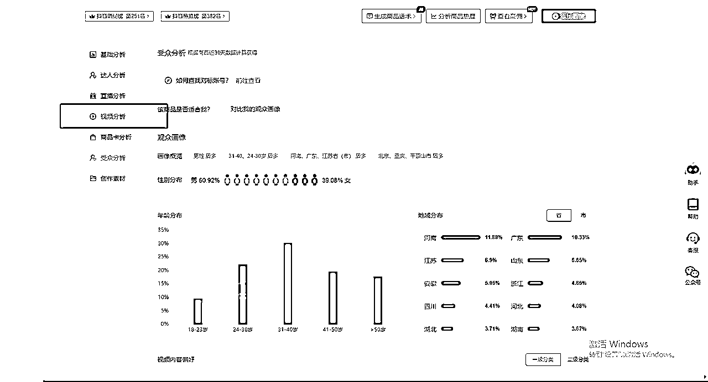

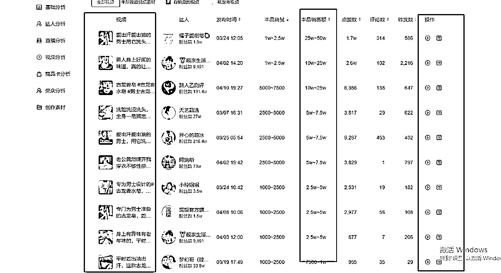

### 4.投放技巧

投放工具：我常用海豚智投，性价比更高。
试用链接：https://www.ieh5.com/?invite_code=P2XUIQ

#### （1）低客单价玩法：59.9元以下

1、起步出价=商品毛利或售价×1.5~1.8倍。
2、出价要根据流速及时下调。

#### （2）中客单价玩法：69.9~139.9元

1、起步出价800-1000豆。
2、根据流速及时降价。

#### （3）测品出价思路

① 不消耗多半是出价太低，可拉到上限测试。
② 1测可设1000豆，2测放量900豆，出单密集后降到800豆，保持ROI稳定。
③ 1测直接拉满，消耗完看点击率，测出单后再大量建计划。2测可设950豆、900豆递减，找出能消耗且出单的计划，复制10~30条。
④ 2测再精细化出价。

#### （4）投放细节与复投优化

① 建计划时先建1个分组，1个品1个计划包，设置空耗监控和自动关停。
② 空耗阈值建议设为客单价1.3倍，多SKU参考小店后台出单数据。
③ 点击成本控制在8元左右浮动1元。
④ 计划跑正后不要无脑放量，需二次小放量验证转化。
⑤ 打赔付时可开大面值跑24小时。
⑥ 用总消耗除以投放时长得小时消耗，正常则降20-50豆，不正常则维持；消耗过大则升50-100豆。
⑦ 二次小放量30-50条计划，需2次以上稳定转化，毛利20%才可无限放量。
⑧ 1测1条、2测5条递减出价，投产正时可做30条小放量，毛利20%再扩。
⑨ 800豆逐步降到500豆，每次降5-8-10元；500以下每次降2-5元。
⑩ 始终复制消耗与转化最好的计划。

流速=真实投放金额÷消耗时长，即每小时消耗。既可算单条计划流速，也可算总量流速。

## 五、结尾寄语：行动才能感受到风，属于你的风

感谢看到这里。项目的核心就一句话：多建计划多拉组，年底人人换路虎。投流本质是用钱换钱，执行力决定结果。

很多人说视频号是风口，我的定义是：行动时你能感觉到风，速度再快一点风就更大。风口是自己造出来的。做了才知道门道。记住：不抛弃不放弃，我能做到你也能！

最后感谢龙哥盟让我进入不一样的圈子，学到真本事。也感谢我的聚知家人们。和两三个志同道合的伙伴一起拿着赚钱的项目跑出MVP，赚到钱的感觉太爽了！

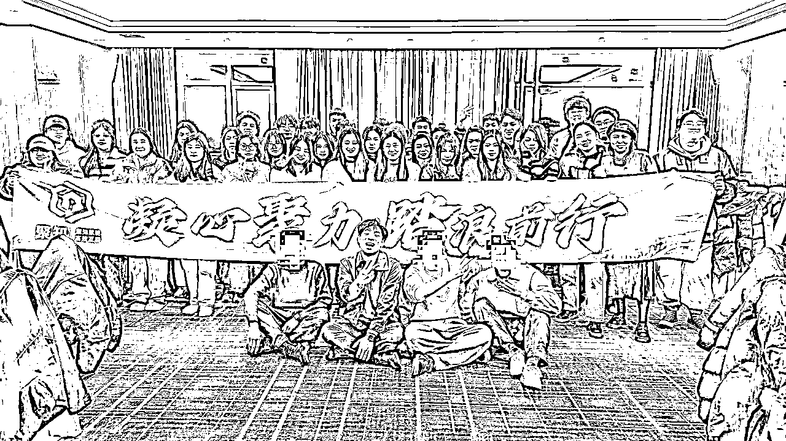