# 用影刀RPA配合AI，把龙哥盟的风向标和精华帖变成每日早报

此前我分享过一套基于影刀+Claude的方案，可以自动抓取龙哥盟的风向标与精华帖并推送到微信以及飞书群组，原帖链接见上文。

当时搭建这套自动化的初衷，是想更从容地吸收赚钱的优质内容，摆脱信息过载的焦虑。每天早晨醒来就能收到一份精华汇总推送到微信和飞书群里。核心痛点在于：

*   风向标和精华帖更新频繁、数量庞大，关键信息很容易被淹没。
*   进入星球查看流程繁琐，时间被切割后很难逐条精读。
*   内容信息量过高，人工筛选耗时耗力，难以迅速提炼要义。

第一版跑通后，我发现了几处短板。比如龙哥老师的评选并不固定每天都有，而原方案只抓取当天的风向标和精华进行AI处理后无状态推送，容易出现漏抓。推送完成的数据也没有沉淀，无法追溯回看。于是利用周末时间做了升级，引入飞书多维表格做数据沉淀和二次分发，让推送质量更稳定。

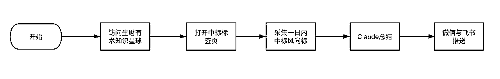

升级后的整体架构如下：

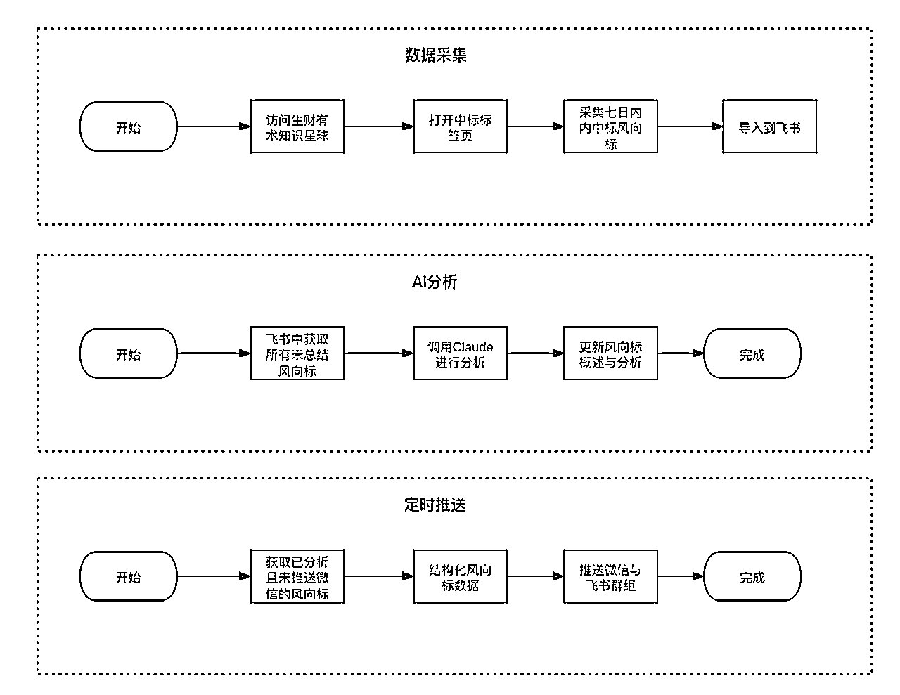

整个链路被拆成采集、分析、推送三步走。

1.  数据采集：影刀会按天多次自动抓取精华帖和中标风向标，抓回后做去重合并，统一写入飞书多维表格。这样即使评选延迟，第二天补评的内容也不会丢失。
2.  AI分析：Claude负责对入库的内容进行解读，抽取出核心要点，输出精简摘要和潜力点评，让人几十秒就能把握一篇长文的价值。
3.  定时推送：每日早晨，影刀从表格里筛选出前一日尚未推送的条目，自动推送到微信群和飞书群，醒来即看最新动态。
4.  原文直达：每条推送都附带原文链接，可一键跳转回星球深读，细节不遗漏。

采集与分析完成后，多维表格里就是一份可查询的素材库。推送时直接读取表格中状态为未推送的数据即可，无需重复抓取。

在测试期间，Claude的输出经常超出预期。趁着这次迭代，我把过去半年内的全部风向标都重新跑了一遍AI分析，数据已同步到表格里，可直接打开查看。

表格中还包含一份精华汇总表，同样是影刀采集近半年精华帖并由Claude完成提炼，供参考借鉴。

为尊重龙哥盟的版权，表格里未保留正文原文，仅提供分析与摘要，完整内容需赚钱官方会员权限方可访问。发布前已与鱼丸沟通确认，获得发表许可。

推送效果对比：

之前推送：

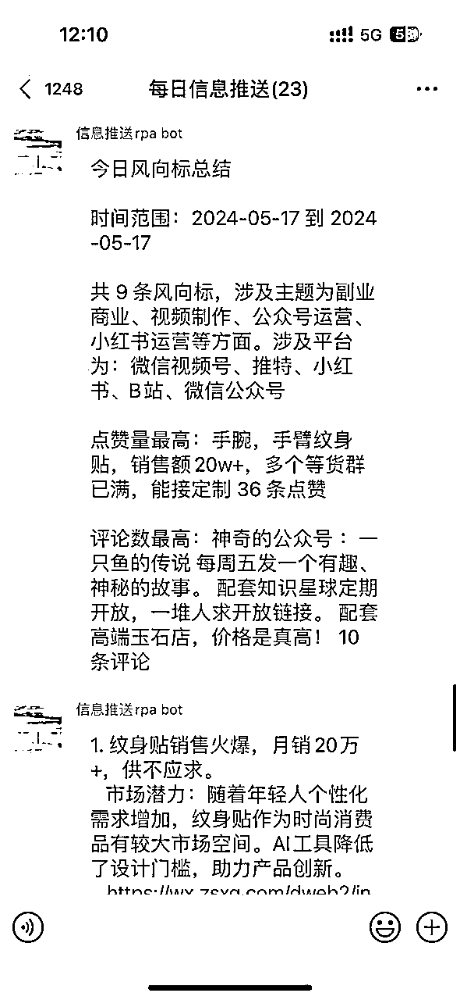

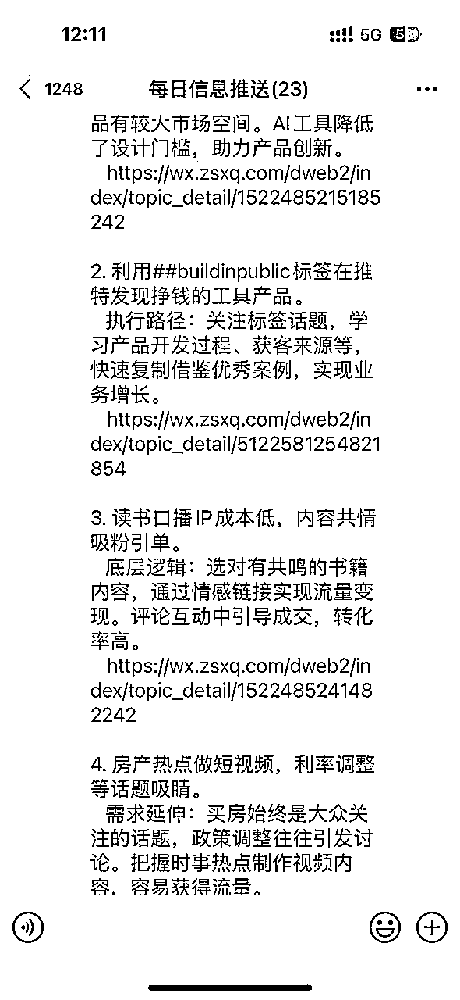

优化后：

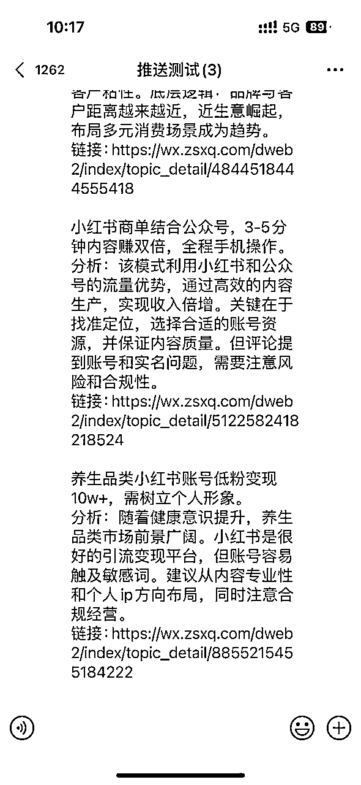

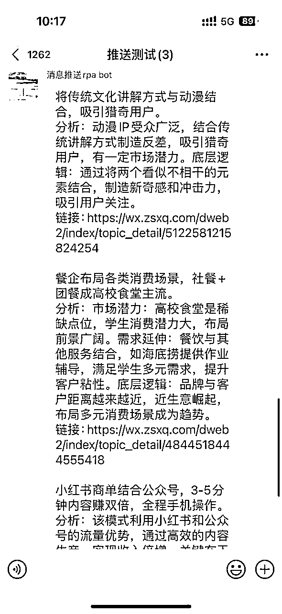

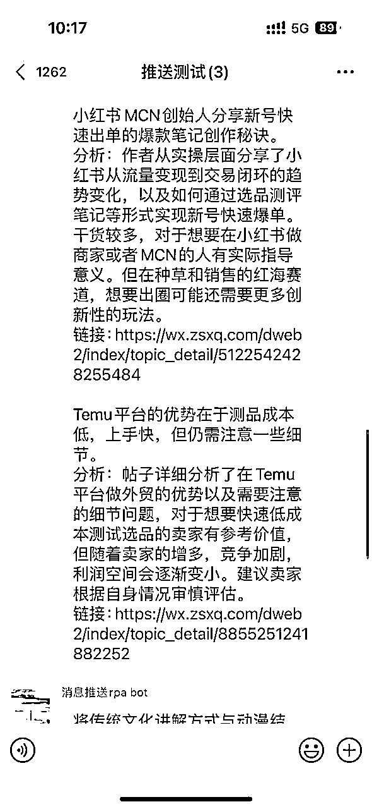

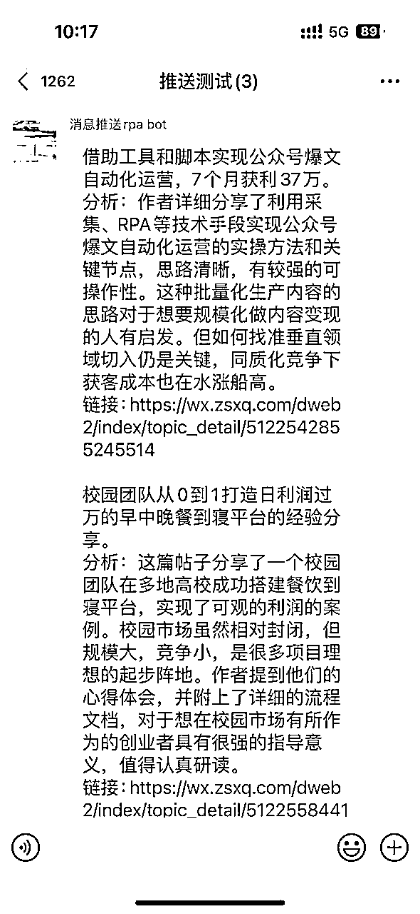

核心实现代码如下：

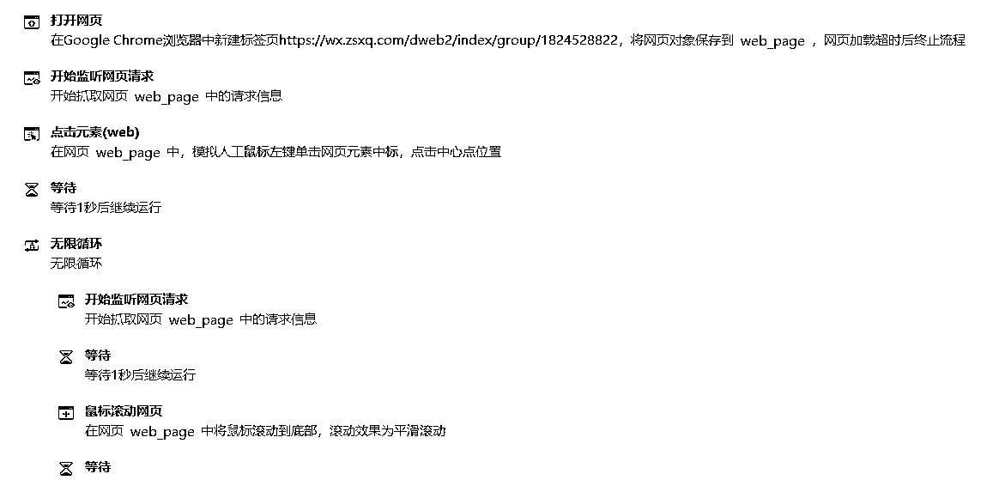

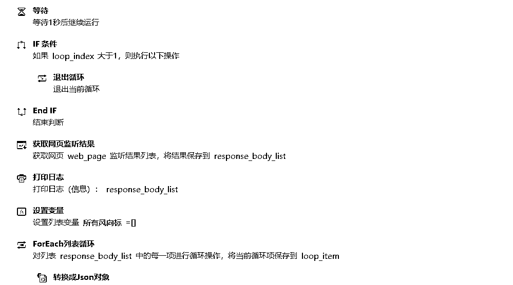

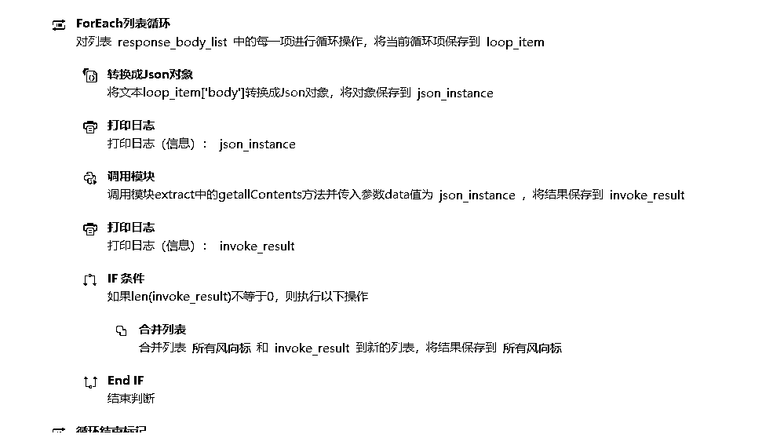

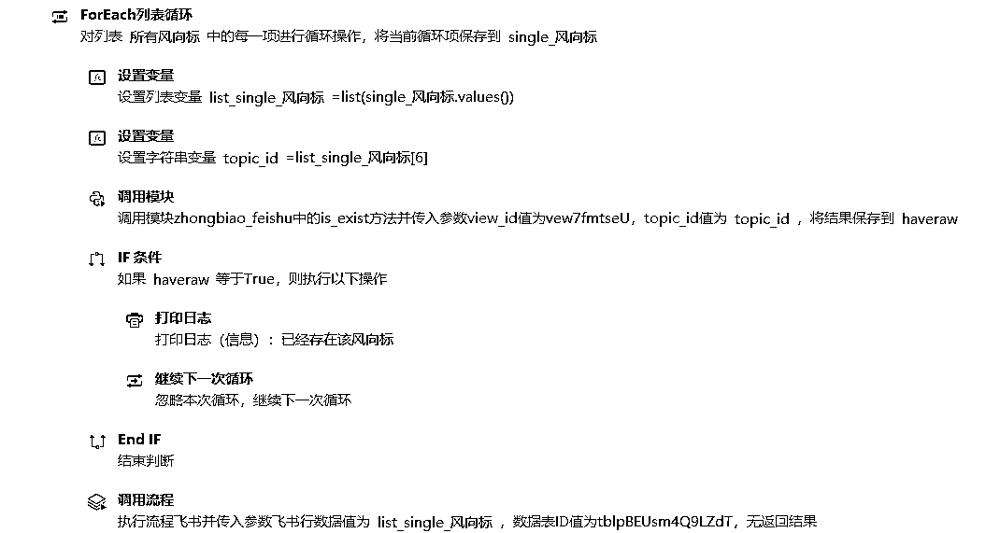

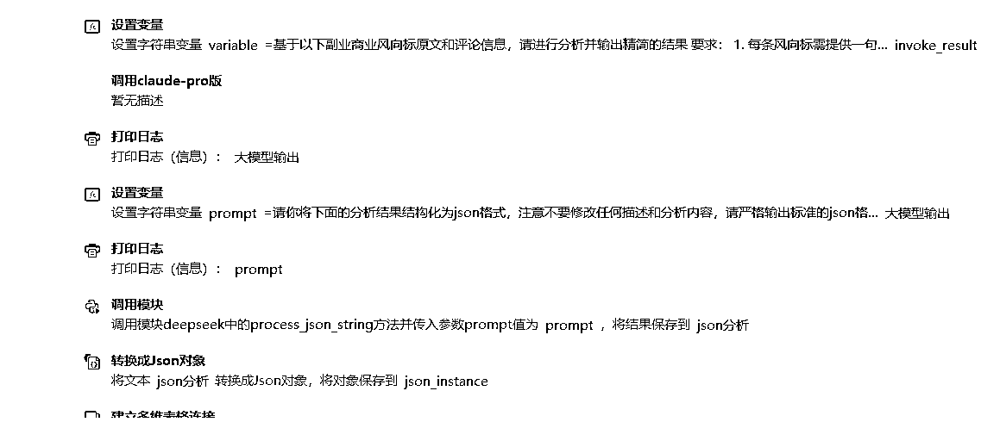

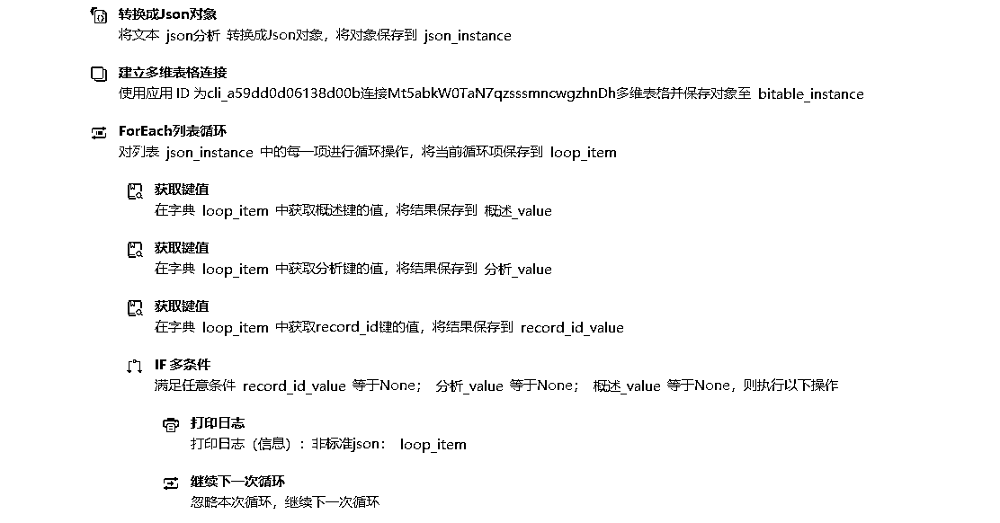

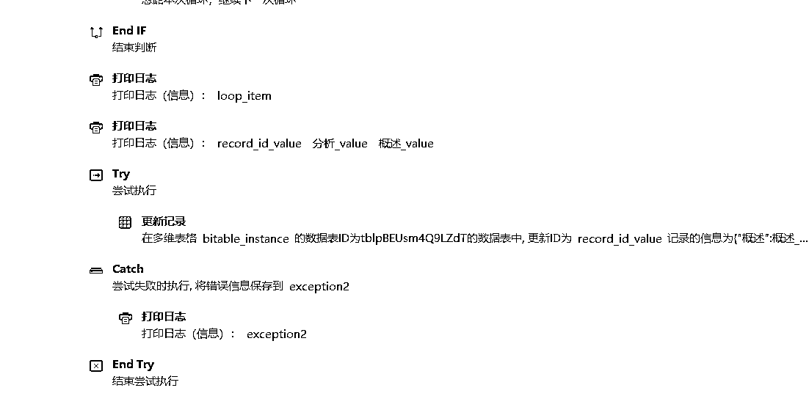

这套采集模块具备较强的可迁移性，数据源可以替换成Twitter列表、AI资讯聚合等内容源，结合RPA和大模型的解析能力，为自己定制一套专属的信息收集与分发工作流。