# 从卡债压顶到把赚钱门票翻了一百倍：我的公众号爆文矩阵翻身记

先自我介绍一下，我是阿泽，00后，佛山人，做运营的。今天想跟你分享一段真实经历——我曾经被球鞋项目压得喘不过气，差点连信用卡都还不上了，却靠着公众号爆文的矩阵化操作，硬生生把自己拉出了泥潭，最后连赚钱的百倍门票都拿到手。这一路上如果没有那些愿意拉我一把的人，我不可能有今天。所以我也想把这套打法整理出来，希望能给同样在挣扎的圈友一点启发。

这篇内容适合几类人看：正准备碰公众号爆文的圈友、刚进赚钱还摸不着头脑的新人、正在犹豫要不要上车的观望者，以及想搞矩阵玩法的朋友。

全文我按这几个板块来讲：我为什么选择这个项目、踩过哪些坑怎么填、项目完整复盘、往后怎么迭代，以及我自己学到的东西。

去年这个时候，我在做球鞋搬砖，说白了就是撸货——从各个平台的活动价里低价把球鞋买进来，再挂到得物转手。前期和朋友合作，确实尝到了甜头，账面上算下来一个月能进账一两万。问题就出在我太乐观了，看着收益不错就一直往里砸钱，货越来越多，出货速度却完全跟不上。等到我某天早上睁开眼，打开信用卡App看到6位数的待还金额时，整个人直接懵了。

说实话，那时候我有一种特别强烈的预感：这个项目马上要完了。就像头顶上悬着一块大石头，随时会砸下来。那段时间我反复问自己：难道我就只能被困在球鞋里了？不行，我真的不服。我得想办法救自己，我得拼命卷起来。

现在回头看，这事儿还挺讽刺的——如果不是球鞋项目爆雷，我跟赚钱之间的缘分可能根本不会这么深。正是因为被逼到绝路，我才重新翻出了那些躺了快一年的赚钱帖子，开始一个字一个字地看。

我是去年4月进的赚钱。跟大多数小白一样，一开始完全是刘姥姥逛大观园的心态，想大干一场，结果打开星球满屏都是帖子，根本不知道从哪看起，索性直接躺平，再也没打开过。

但那时候我对自己没什么高要求。我只有一个念头：每个月能多赚两三千块，让我在卡债里喘口气，我就谢天谢地了。也正是这个时候，公众号爆文这四个字，直愣愣地撞进了我眼睛里。

## 一、为什么偏偏是公众号爆文？

我认真盘算过，选择这个项目，这五个理由是决定性的：

第一，赚钱里已经有不少人靠公众号爆文拿到了真金白银的结果。今天入几百、明天入几千的帖子不在少数，而且基本都用AI在写，上手难度不算高，见效也快。当时的我，最缺的就是一个能迅速给我正反馈的东西。

第二，门槛是真的低。不用学剪辑，不用搞图片去重，AI就能帮你完成二创。这属于我踮踮脚够得着的事，不会让人望而却步。

第三，它离钱特别近。整个链路无非就是写文章，然后赚流量主收益。没有客服要对接，没有快递要发，也没有售后要处理，一个人就能转起来。当然，反过来说，单账号的天花板也不算高。

第四，前期投入极小。有个魔法工具，再买个GPT会员，加起来两三百块就完事了。我刚经历过大投入的痛，不可能再碰需要重金砸进去的项目。

第五，身边有信任的大佬在力荐。他的一句话直接给了我巨大的信心，让我认准了就埋头往前冲。

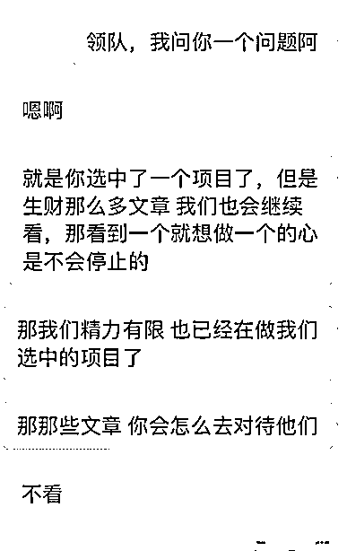

球鞋项目的那笔债已经把我压怕了，我真的承受不起第二次类似的暴击。所以把上面几条综合看完之后，我带着一屁股卡债，正式踏进了公众号爆文的赛道。

## 二、这一路上踩过的坑

### 02.1 第一步就卡住了：我连GPT都不会注册

万事开头难，这句话我算是亲身体验过。都已经加进赚钱四个多月了，我居然连ChatGPT都不认识。更尴尬的是，我本来想借着赚钱航海的机会把这门AI技能学会，结果一查时间，偏偏夹在两个航海周期之间，根本赶不上。

没辙，我只能老老实实坐在电脑前，对着密密麻麻的航海手册，一个又一个关键词地在帖子里翻，只求能找到一份完整的注册流程。后来终于在AI风向标星球里找到了一份GPT注册教程的Word文档，我就像拿到参考答案一样，一步一步跟着点。整整折腾了一个下午，才终于把GPT给注册成功了。

不是夸张——那天下午的那种开心，我到现在都记得特别清楚。这种靠自己一点点摸索、最终搞定一件事的成就感，真的无可替代。

有人可能会问：你为什么不直接去问那些已经拿到结果的大佬？

说实话，我下意识觉得自己不配。一是我作为小白给大佬提供不了任何价值；二是我总觉得这种问题大佬可能都懒得回。我试着加过几个人，发了消息石沉大海之后，我就想通了——与其浪费别人的时间问这种细枝末节，还不如自己动手搜。

顺便说一句，真正做过项目之后我才知道，涛哥说的“搜商是稀缺资源”这句话有多准。这里我要特别提一个B站UP主，他的视频给了我很多启发。如果你的搜商也比较一般，强烈建议你也去翻翻他的内容。如果对你有用，回来告诉我，我们一起进步～

https://www.bilibili.com/video/BV1yw411F7J1/?spm_id_from=333.337.search-card.all.click

### 02.2 不知道做什么定位

当时我面临的第一个大问题就是：账号到底该做什么内容？

那时候中老年情感文特别火，但我是钢铁直男，实在编不出那种缠缠绵绵的调调。我试过写搞笑文，可平时没怎么练过写作，硬憋一篇要花一两个小时，而且找素材的时间比写还久，一天下来出不了3篇稿子。实在撑不住，只能放弃。

现实逼着我换个方向。剧评没兴趣，历史不擅长，军事碰都没碰过，算下来只剩法律赛道了。这里要说实话：我和很多小白一样，老觉得法律文只有专业人士才写得出来。但看到法律赛道里这么多人跑出了成绩，说实话那个收益我实在没法抗拒。于是我抱着试试看的心态去操作，结果这一试，直接转动了我的命运齿轮。

这里也给个温馨提示：AI偶尔会编出和事实对不上的内容，人工一定要二次审核。

我的诀窍是，除了航海手册，船员的日志我也一篇不放过，就想着从别人的记录里捡点能用的线索。运气不错，有位船员提到教练在群里发过法律爆文的框架。我顺着这条线索开始一个个私信其他船员，好些消息也都没人回。最后，总算有一位热心的圈友答应了我的请求，把框架转给了我。这件事让我特别感慨：要是没有自己的死磕，没有圈友的善意，可能后面的一切都不会发生。

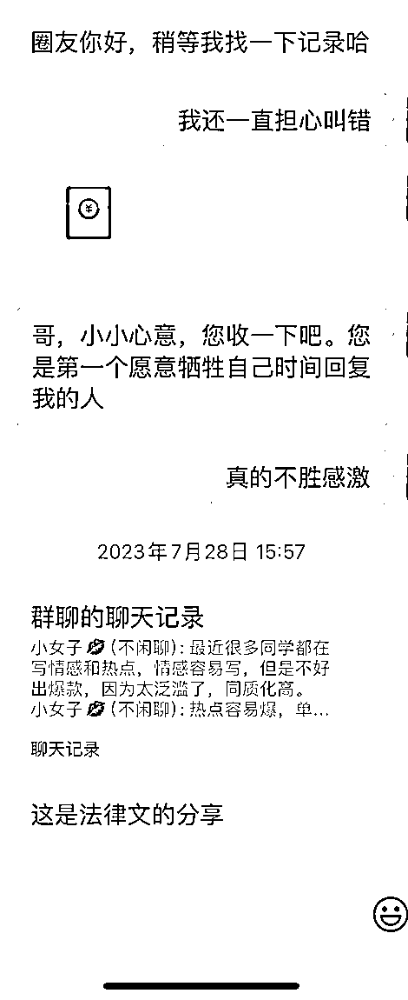

找对对标之后，我的写作明显顺了很多。后来我发现，不只公众号能挖到对标，头条也是个宝库，两边受众还高度重合。搞清楚这一点后，我的素材源源不断，越写越多平台越写越花。

我给自己定了个小目标：先坚持半个月，没结果再换方向。后来的事实证明，这套思路是真的管用——在日更的第二周，我就写出了人生中第一篇20w+阅读的爆文。有了第一次的正反馈，我一下就踏实了，也更認定了这条路。

教练有句话说得特别扎心：哪有一蹴而就的好事，无非就是日复一日地更新，日复一日地修正方向。也正因为能这样坚持，后面才出现了一篇接一篇的爆文。

顺带分享一个观察：法律爆文和热点爆文不一样。只要类似的法律事件在中老年群体里持续有热度，这类文章就能反复爆。说到底，能搅动中老年情绪的内容，本身就自带爆款基因，你说是不是？

写着写着，我的网感也慢慢变好了。后来我又踩中了一个医疗反腐的热点，写出了人生第二篇100w+阅读。那篇文确实在很短时间里帮我拿到了很可观的收益。

不过后来平台对医疗反腐类内容的审核明显变严了，当时群里不少圈友都在哀嚎说自己的文章被下架。我其实也感觉到了这类内容做不长久，所以趁着收益到位，直接把文章删了。

法律文写了一个月的时候，我已经跑出了两篇百万阅读、十几篇十万阅读的成绩，公众号涨粉到5000多，也成功入池了。那段时间，我每天更新两篇，当天的基础阅读基本都能到3w+，再加上老文章还在持续被推荐，每天收益稳稳两千以上。

关于为什么能持续产出爆款，我自己复盘过，就几个原因：

第一，只参考真正的爆款。我在头条找对标的时候会把标准卡得很严：阅读量低于5w的不要，评论数低于1000的不要。法律赛道的爆文没有严格的时间门槛，所以我不会太在意对标账号的发文时间。另外，很多律师账号我也一直在关注。

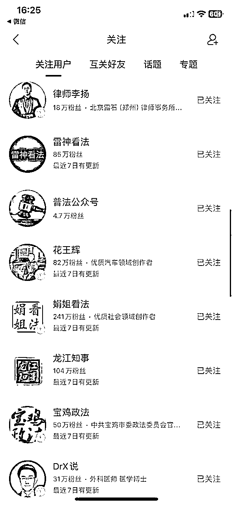

第二，标题要“开幕雷击”。星球里早就有大佬分享过这类写法，我就不在这儿班门弄斧了。感兴趣的圈友可以直接去看公众号爆文项目的航海手册。简单说，城管、物业、银行、农民这类话题相对尖锐，能直接戳到普通人的神经。比如我自己写过的这些标题，基本都是这个路数，每篇的阅读都没低于10w：

第三，受众定位要准。看法律文的大多是中老年人，他们看完了会给我发私信、留言指责，这些互动在系统看来就是内容质量高的信号，会把我推向下一个更大的流量池。对于正能量的话题我也乐于回复，慢慢培养了一批每篇都来看的铁粉。

第四，时机也很重要。那会儿公众号爆文还处在红利期，确实是野蛮生长就能捞到钱的阶段。现在不行了，不再是早期那种粗放打法，但机会始终存在。

我的大号到现在这个阶段，算起来有两篇百万阅读，超过50w的有5篇，10w+的就更多了。具体收益我也贴一下：

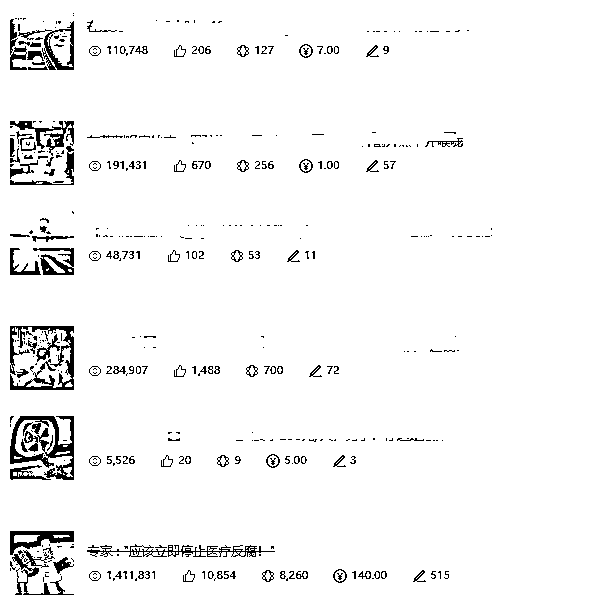

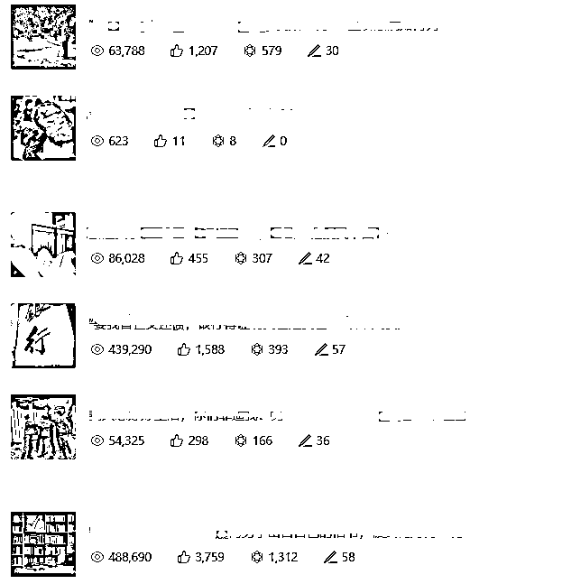

### 02.3 怎么把收益做大

单账号最高的一天，我的收益突破了一万块。直觉告诉我，想赚更多得把盘子拉大，于是我一口气加了5个新号。

加完之后就后悔了——一个人根本扛不下6个号每天的更新量。怎么办？只能想办法降本增效。也是巧，我误打误撞接触到了RPA，知道了影刀这个工具，也因此认识了我生命里的另一个贵人：Leeka卡姐。

人在足够穷的时候，是真的能腾出时间去学东西的。我用了两周时间刷完影刀的初级和中级课程，已经可以做出简单的RPA机器人了。中间调试机器人流程时卡了好几次，多亏卡姐和威哥帮我一个个把困惑点解开。

到公众号2.0阶段，RPA给我带来的变化是翻天覆地的。我终于不用死守在电脑前，等GPT生成内容然后手动复制粘贴到草稿箱了。这些重复操作全部交给机器人：它等着GPT出答案，再把答案自动写进草稿箱。整个人直接解放了。

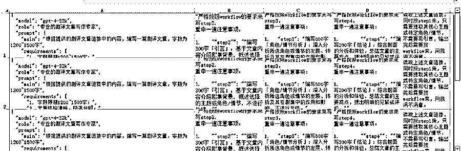

上面的截图是我当时给GPT用的指令词，现在估计已经落后无数个版本了，大家当个思路参考就行。

RPA跟AI之间的协作思路，大致是这样的：

第一步，把对标的文章链接存进Excel。用webPolit插件（这个插件已经被封了）去读取网页内容，再交给GPT提取文章选题。

第二步，我的一组prompt拆成了5个模块，要跟GPT交互5次才能拼出完整文章。这个过程让RPA自动检测对话是否结束——识别到“复制”按钮，就代表这轮完成了。

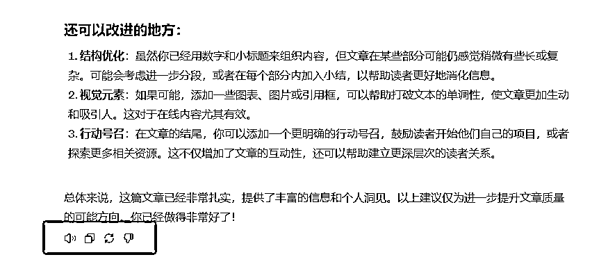

第三步，等所有prompt发完之后，把GPT回的内容自动复制进Word，文件会自动保存在电脑上。

这样一套流程下来，容错率可以拉到很满。再加上几个try catch语句，电脑几乎能自己运行——报错了自动重来。到了这一步，我基本已经做到了双手自由。

但账号多了，问题也随之而来。当时我有七八个号，数量是上去了，可大号的成功却没法完美复制到小号上，并不是每个号都能爆。

后来是一个同行提醒了我：外面那些工作室，哪个不是几百上千个号同时跑？如果成功是概率事件，那号多本身就意味着更多成功的机会。真正的王道，就是加号。

既然这样，我就想做100个号试试。我的矩阵之路，就此正式开启。

### 02.4 入场的人越来越多，收益在变薄，只能矩阵化

到了公众号3.0阶段，我一个手底下已经有了100+个号。为了保证账号每天都有内容更新，我每天得生产200到300篇文章。RPA虽然可以24小时不停转，但跟纯代码比起来还是慢了点。再加上GPT本身有对话次数限制，3小时40次，就算我后面开了3个GPT账号，依然不太够用。

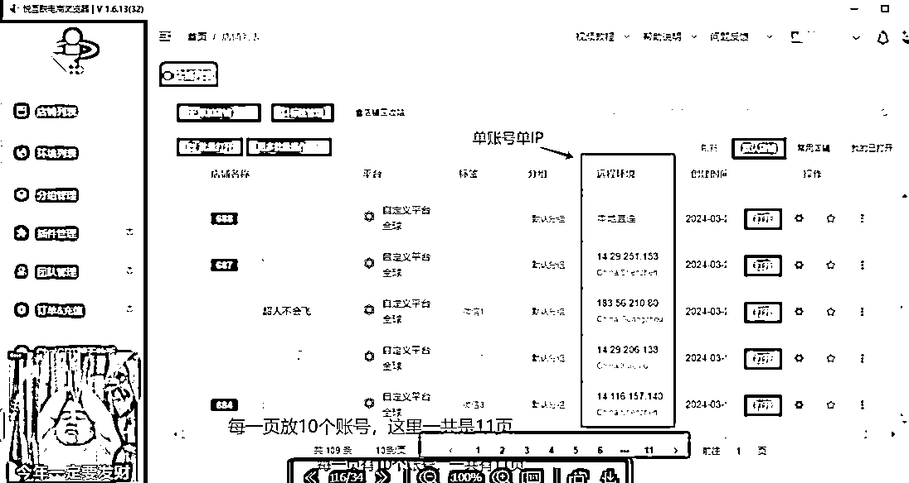

这里真的要感谢赚钱，也感谢9月那期公众号爆文航海。正是在那一次航行里，我认识了另一位大神级的引路人：毛韩教练。还有他群里那些伙伴们，专业程度都让我对公众号爆文有了全新的认知。

下面这些玩法，全是跟高手中的高手学来的。我现在把它们毫无保留地整理出来，希望能帮到正在做这个项目的你。

#### 02.4.1 我是怎么拿到100+个公众号的？

大多数人的第一反应是找身边亲戚朋友帮忙实名认证。但毛韩教练给了另一种思路，一下让我豁然开朗：直接用营业执照去注册。一张营业执照可以注册两个公众号，大部分人注册第二个号时会被提示交300块认证费，但实际上是可以绕过去的，操作方式我放在下面：

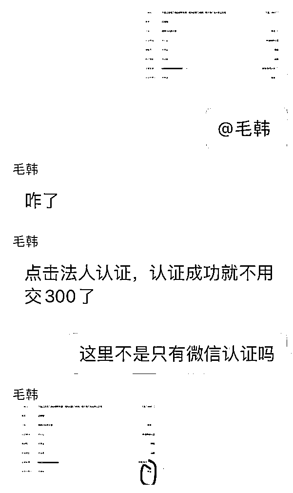

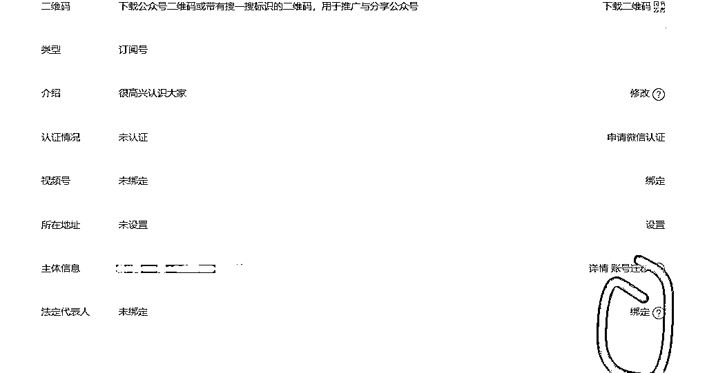

工商局不会限制你一个人名下有多少张营业执照——所以，你领会一下这个空间有多大。

营业执照去哪儿弄？万能的某宝就能办，甚至支付宝里也能搜得到，最低9.9元就能搞定一张。具体的详细教程，星球里其实已经有人写过好多篇了，考验大家搜商的时候又到了。

注册好公众号之后，还要开流量主。一个流量主的费用是45元，真人粉的话大概一个号90到100元。我一般选45元那一档先刷着，等一个星期后再去开通流量主功能。最近平台审核比较严，大家还是要以最新政策为准来调整节奏。

#### 02.4.2 100多个号怎么管？

一个微信号最多只能绑定5个公众号做运营者。所以我手里这100个号，至少需要准备20个微信号。

一个身份证可以在三大运营商办5张电话卡。但为了压缩成本，我选的是注册卡来注册微信。注册卡一年只要10块月租，而三大运营商的卡最低一个月也得9.9块，算下来一年就是120，差距还是挺明显的。

一个身份证只能实名认证5个微信号，这也意味着，你需要找一些亲人朋友来帮忙。我家里人口比较多，微信这块倒是没难倒我，就是操作起来比较麻烦，纯费时间。注册微信、绑定公众号这一步，我一个人跑了很久，真的不容易。

#### 02.4.3 独立IP到底怎么做？

项目跑到后半段，圈子里都在说单号单IP，不然容易被平台“连坐”。我也跟着搞了起来。操作方式是按照毛韩教练分享的B站教学链接，来来回回把视频反复看了好几遍，一点一点照着弄出来的。

至于为什么不用指纹浏览器——因为我一开始用的就是悦互联。这个软件可以直接买IP，一个IP每月40元，我当时是一个IP挂着5个公众号。后来又接触到了天翼云，才发现如果自己动手搭IP，成本低到吓人——一个IP算下来每个月只要3块钱。

具体的搭建流程B站上就能找到。我本来应该把自己看过的那个视频直接发出来，但可惜因为315的缘故原链接已经失效了。整体操作流程差不多就是这样，难度倒是不高，就是很花时间。早知道应该早点请个小助理来帮我干这个活。

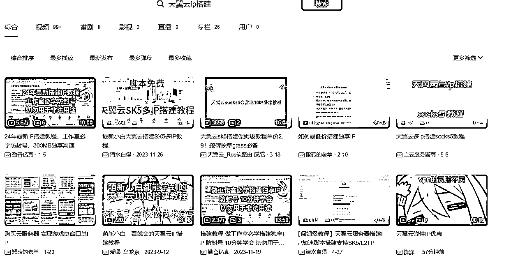

#### 02.4.4 公众号矩阵的自动化跑法

这一部分尽量讲细一点，都是我实操验证过的流程。

先说代码部分。

第一步，提前把自己选好的对标账号拿过来，提取它们的主页链接。接着让代码自动进入这些账号的头条主页，寻找有没有适合我要求的文章选题，碰到合适的就抓取下来。这一步要特别感谢群里的毫末大佬，爬虫抓取代码就是他提供的。

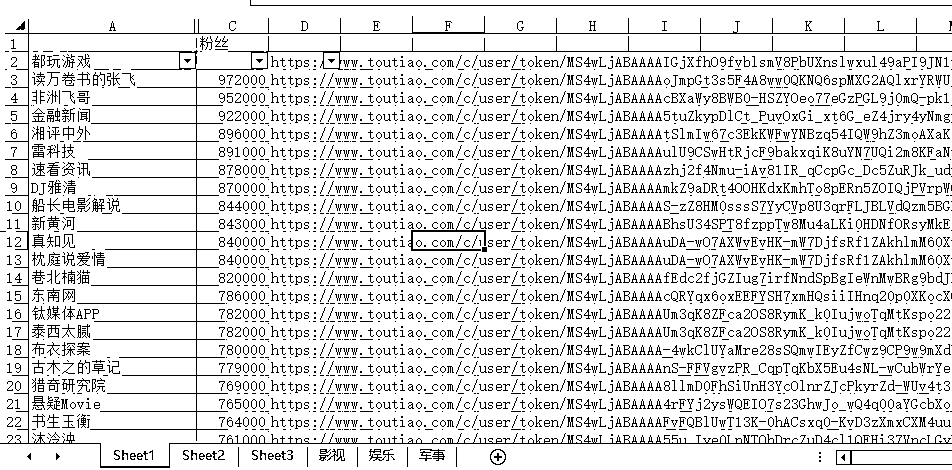

第二步，设置循环抓取机制：每两个小时跑一遍，自动抓取符合阅读量门槛的文章。我当时设置的是：12小时阅读量大于1w、24小时大于2w、72小时大于5w。注意这个标准要灵活调整，如果你卡得太高，可能一个符合条件的都采不到。热点型文章更需要抢时效，可以设成：2小时超过1000，4小时超过3000，6小时超过5000。总之标准是活的，不是死的。

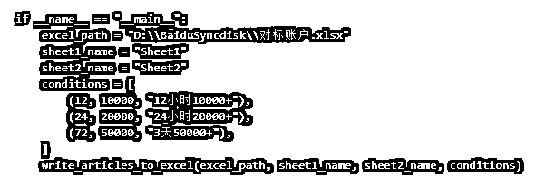

第三步，把筛选出来的文章通过代码提取正文内容（HTML格式），交给AI去提炼核心主题。这一步用的是卡姐推荐的智谱AI——新注册用户实名之后会送500w token，我不小心白嫖了不少。主题提取出来的效果大概像这样：

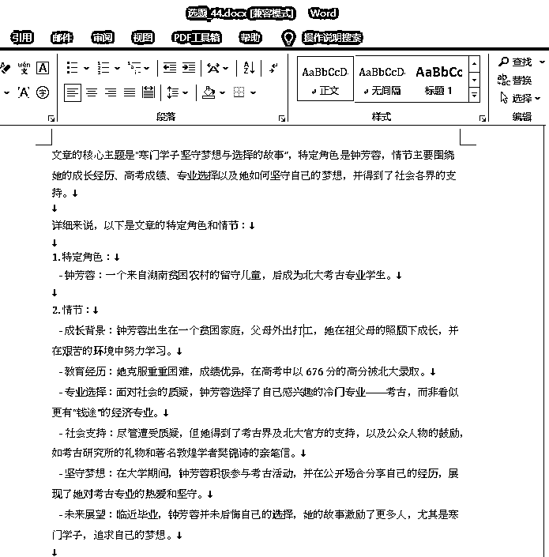

第四步，让AI根据提取出来的主题仿写全文。本来用GPT4效果会更好，但为了控制项目成本，再加上科学上网也是个事，我最后选了智谱AI。打个比方，GPT4大概能拿90分，智谱写出来的也有85分——对我来说完全够用了。

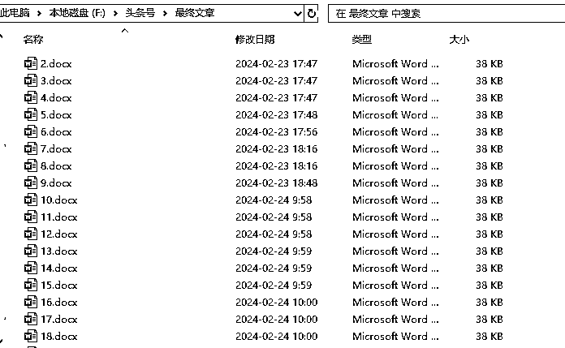

第五步，AI仿出来的初稿通常只有700到900字，距离1100字的要求还差一截。于是我再要求它扩写到1500字，这样字数稳稳能超过1100，刚好满足插入两条广告的条件。

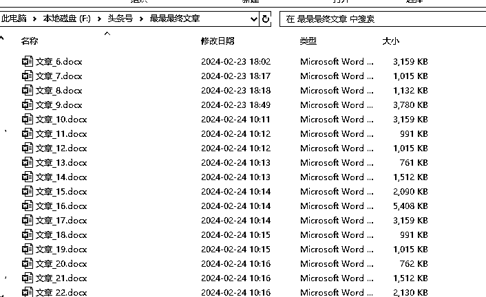

第六步，关于图片的处理。最开始我是用影刀RPA去自动抓取原文章的图片，结果代码怎么调都报错。后来换了用代码来抓取，抓完以后自动把图片裁剪掉90%，相当于把水印直接裁掉。然后再让代码自动把图片插入到成稿的第1、3、5段后面。附上我之前拍的自动下载图片操作视频，代码会自动跳转到文章并抓取里面的所有图片：

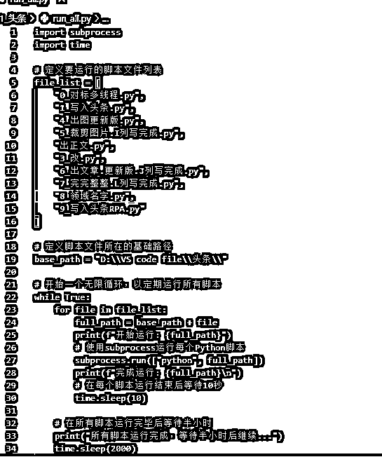

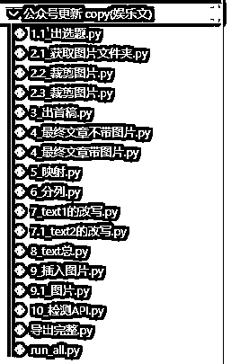

第七步，每天要面对几百篇生成好的文章，我是用一个Excel总表来管理的。结构大概是这样的：A列放的是采集到的头条文章链接，然后按流程一步步处理，每完成一个环节就在对应列打上“完成”：

①提取正文内容——完成；
②提取图片——完成；
③图片是否裁剪完成——完成；
④把正文内容丢给AI提取选题——完成；
⑤用选题生成初稿——完成；
⑥把初稿扩写成完整文章——完成；
⑦在Word中插入裁剪后的图片——完成；

就这样，从选题到成稿，再到配图和归档，全流程都跑通在了这套自动化的流水线上。现在回想起来，从那个躺在卡债里不敢醒来的清晨，到坐拥100多个号自动运转的今天，这中间差的其实不是天赋，而是被逼到墙角以后，肯不肯低下头去学、去搜、去问、去试。

希望我的这篇分享，能成为你推开那扇门的一只手。

最终生成的Word成品会先放进云盘，再用共享目录传到发布机；如果AI判定某些内容比较敏感、拒绝回应，脚本会在对应的Excel单元格里写下“跳过”或“出错”。

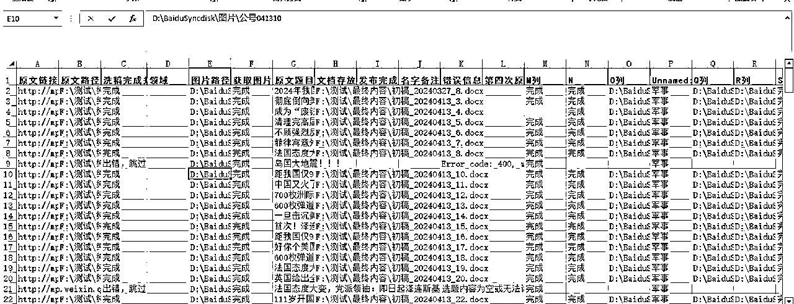

到这儿，整条脚本链路已经封口，后面的发布动作交给发布机上的RPA继续跑。

期间我反复请大模型写脚本，来来回回改了很多轮。经验有三：一是脚本若一直报错，别急着硬刚，停一停、换种问法，有时模型反而能给出能跑通的版本；二是去哔哩哔哩看几节基础教学，先弄清这类工具究竟能做到哪一步。

#### 发布流程部分（在副机完成）

1. 主力机上的成品要先传送到发布机，我用的是百度系云盘自带的同步空间，稳定性可以；两台设备需要登录同一个账号，并开通每月十几块的会员版。
2. 主力机把成品转成Word，发布机上的RPA再逐个打开Word，填进微信后台，调整文字样式与版面、勾选原创声明、挑选封面，这一串重复动作都能交由流程去执行。

最近微信平台经历过一次改版，按钮的位置变了，RPA脚本也得跟着适配；其实底层逻辑没有变。

RPA脚本相当长，加上当初只写给自己看，就不贴出来了；有需要可去找另一位朋友分享的RPA教程。

表面上看，这套流程已经很接近无人值守。但实际跑了半年后，我心里清楚：该退场了。不是兴趣没了，而是继续向里面投入精力，换回的正反馈已经严重不成比例，再做下去很可能连成本都收不回来。

全自动终究是一种幻觉。脚本一出错，我这个没有技术背景的人就要亲自救火；它没法彻底摆脱我，我也明白自己不该继续耗在这里。

当初拉着姐姐一起做，她听到我要撤，很不舍地问：都走到这一步了，真的舍得放下？

我对这段经历充满感激。是它把我从低谷中拽了出来，也推着我去学AI、大模型、RPA、编程，这些我以前连碰都不敢碰。但我同样清楚，任何故事都有收场的一天；当一件事不再给我新的成长反馈，就是离开的时候。

遗憾多少有一点，可一段路走完，下一段路自然会开始。真正能一直跟着我的，是那段经历里长出来的本领。Leeka说过：每一步的付出，最后都会以某种方式兑现。这句话，也送给读到这里的你。

# 三、复盘与反思

1. 缺少做大的布局意识。当时没有想过多铺几个号，也没在风口期果断放量；等决定加码时，窗口已经关上了。
2. 认知和判断都不足，信息也封闭。那时连API是什么都没概念，更别说独立设计出一套流程。
3. 习惯一个人闷头做，不愿出去对接资源。外面靠微信爆款内容吃饭的团队不少，赚得也挺可观，我却守着一小方天地，早该主动去结识达人、请教玩法。
4. 没有及时雇一个兼职助理来分担八成杂务。姐姐偶尔能帮把手，但她有自己的正职，配合得并不顺畅。涛哥提醒过：想当超级个体，先从给自己找个助理开始。

## 3.1 收入总结

主力账号进账约12w，另外几个号加起来约5w，姐姐跟着参与也赚了约4w，两个朋友各3w左右。成本还没仔细核算，诸如模型服务费、广告分成、工商注册费用，还有加入的一些付费社群。无论如何，我很庆幸来了赚钱，在这里赚到人生中第一笔像样的钱，也认识了更多人、看到了更大的世界。

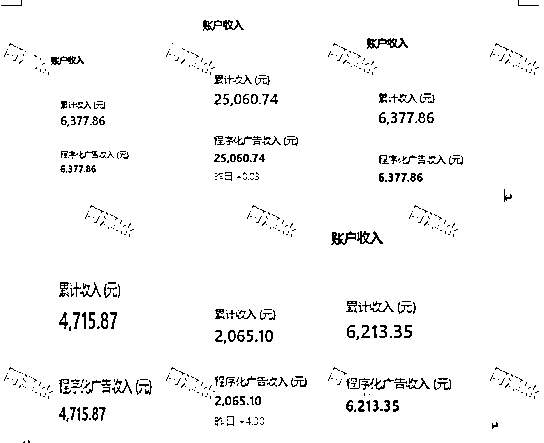

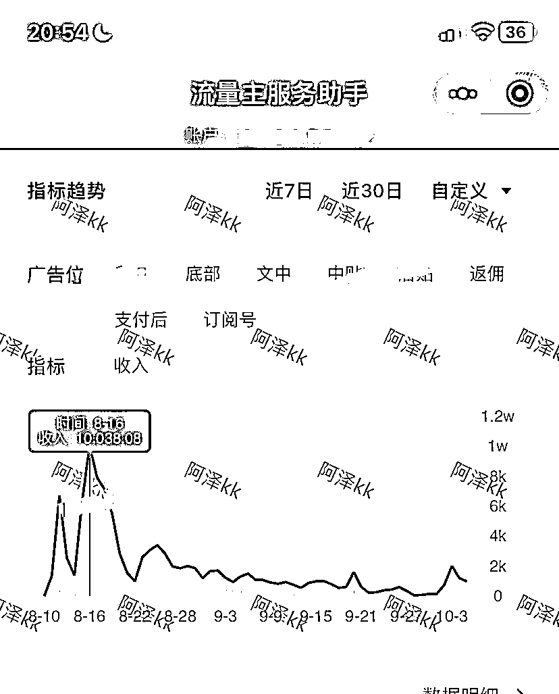

回头看，这段经历带给我的回报，已经远超当初那张门票的百倍。

# 四、微信爆款内容还能怎么做

1. 平台正在收紧AI生成内容的尺度，想继续做，可以从“AI识别”这个方向找缺口。

AI识别工具通常盯住两个指标：文本的困惑指数，以及句子的爆发起伏。如果既想借助模型提效，又不想被一眼看破，就从这两个维度反向调整。我试过一阵子，给文字掺入地方口音来改写，比如沪语、京腔、东北味，识别率会下降不少；当时检测用的是5118 API，网上搜来的第三方工具，不是官方出品，仅供尝鲜。下面这篇就是挺浓的京味样本。

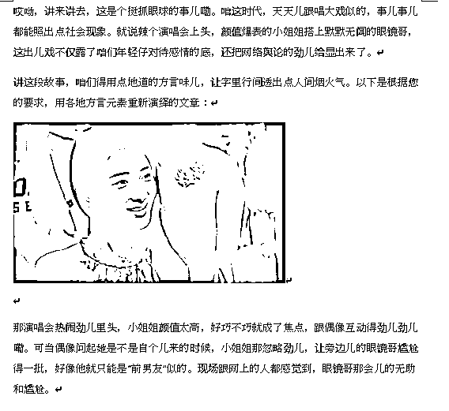

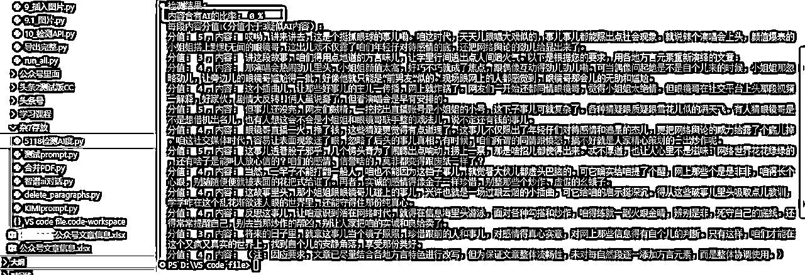

2. 微信生态眼下缺的，是真正有深度的内容，而不是更多同质化的数量。真人写出的稿件，和模型生成的稿件，差别往往在情绪是不是真实；模型偶尔做出几篇十万加不难，难的是长期持续出爆款，更难的是沉淀出别人拿不走的东西。

做内容真正要回答的问题是：我给了读者什么？要么是可上手的方法，要么是可共鸣的感受。只有认真体验过、反复反思过，文字里才会有活人的温度；读者也并非感受不到，谁是走心，谁只是走量，一眼就能分辨。

模型当然可以帮忙打草稿，但用心写才有滚雪球般的长期回报。如今的我更愿意做那些能够慢慢累积的事情，这也和龙哥所强调的长期主义对上了。

3. 足够好的内容，完全可以做成付费阅读。有位博主名叫Andy，他也是做这类内容起家，付费专栏的收入比平台广告分成高出不少，而且他经常大方地晒出后台收入。

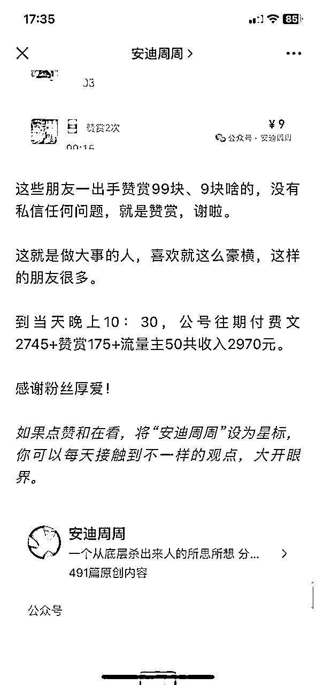

# 五、除了赚钱，我更想记下这些改变

同频的朋友多了很多。从前不论坐班还是做散活，身边来来去去无非那几张熟面孔；这回走出来，线上线下结识了不少牛人，聊的内容也从某个玩法、某种观点，延伸到技能打磨和自我成长，获益远超预期。

我也重新开始读书。以前一年未必翻完一本，可身边优秀的人几乎都在读，我便跟着读。从8月到现在，已经啃完七八本，有谈财富和时间的，有谈思维模型的，有谈运气的，有谈笔记系统的，有谈行为改变的，还有《毛选》。沉浸进去才发现，书像一位随时随地可以请教的前辈，越读越有滋味，我还因此卸下了游戏瘾。

工具箱也厚了起来：会用搜索引擎精准找资料，会用对话式AI辅助思考，会用绘画模型出图，会用RPA跑重复流程，还摸了一点点Python。人与人之间的差别，很多时候不是天赋，而是会不会使用杠杆；手边多一件趁手工具，执行效率往往就此翻倍。

心态比过去稳得多，也更专注。以前超过一小时的视频，我很难看完；现在一两小时的课程录像，能一口气消化完。做自由职业之后，日子几乎被自己喜欢的事填满，从早上八点忙到深夜十一点，周末也不停下，却没什么怨言。

自信也是这么长出来的。刚进这个圈子时，看别人分享高阶经验，总觉得遥不可及；如今我会去拆解对方哪里做得好、哪些思路能搬到自己的事情上，然后记进笔记。flomo团队一位创始人讲过：记录，就是给未来的自己准备后援。

如果只给新朋友一句建议：别站在岸上反复挑方向，先下水扑腾。一开始或许狼狈，但只要真正动起手来，认知和能力会在做的过程中快速生长，慢慢就会脱离小白状态。

龙哥也说过类似的话：不必事先纠结哪个方向最正确，随手挑一件能开干的事，最后真正跑出来的，往往不是最初选中的那个。

所以，别只想着当“会学的人”，要努力当“会打的人”。共勉。

还是要谢谢Leeka姐，稿子经过她反复打磨，才能以更完整的样子出现在这里；头一回发正式长文，就能得到她的指点，是我的运气。这篇内容改了很多遍，只要能给你一点灵感，就算没白写。

想聊更多细节，欢迎随时找我，我知道的一定尽量讲清楚。愿我们都能在自己的路上，一路走，一路积累，也一路赚钱。