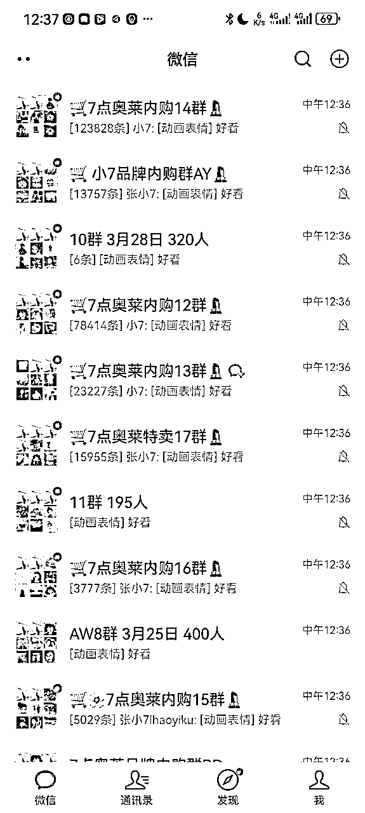
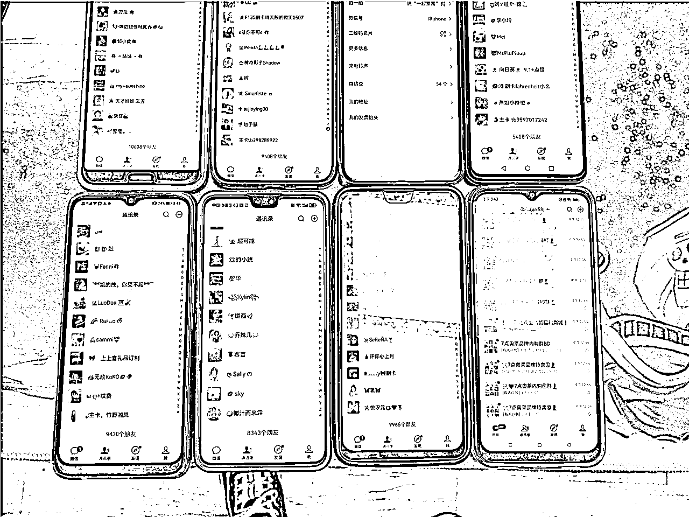
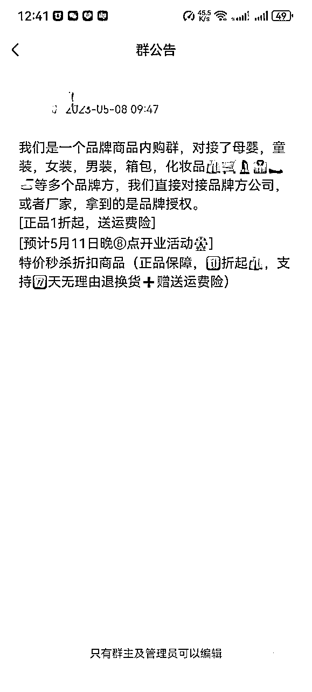

# 私域特卖群搭建全流程实操笔记

大家好，我是龙哥，团队整体月流水稳定在千万级，自营的私域特卖群单群月销也能做到50-60万。

之前在星球里分享过两轮关于私域群落地的经验，上一次还是去年11月。这次五一期间我把整个打法重新梳理了一遍，做得更细。做私域带货、快团团群、特卖群的朋友可以直接照着这套方法执行。

# 群名和群公告的设定

## 群名怎么取

我现在用的命名是：7点xx内购16群

拆解逻辑如下：

1. 名称里带了🛒和💄这类购物符号，一眼就能看出是商场群；
2. 7点xx指的是每天早上7点准时上新+开抢；
3. 数字用来区分多个群，避免混淆。

## 群公告怎么写

我们是一个对接品牌方的一手内购群，已覆盖母婴、童装、女装、男装、箱包、美妆🛍️🛒💄👔🥿🍜等多个品类，全部为品牌授权直供。

[正品1折起，送运费险]

[预计5月11日晚⑧点开业活动🎡]

特价秒杀在售，品质有保障，正品低至1⃣️折起🛍️，支持7⃣️天无理由退换➕赠运费险

—————————————————

公告拆解：

1、内容可以根据自身情况自行调整。

# 拉新进群环节

## 进群邀请的话术

我是悠悠，我们团队现在在做品牌特卖内购，邀请你进我们的内购群。群里每天都会上大牌美妆、大牌女装、母婴好物等，价格基本是线下商场的1-3折。

现在正值春季新品清仓期，库存走得很快，我们每天都有大量新品补货。

全部支持七天无理由退换，额外赠送8元运费险，欢迎比价比品质，正品可供专柜验货！

——————————————————————

话术要点：

1.  文案要极简，字数越少越好，别写成说明书；
2.  这是我私聊淘宝粉丝时的开场白，所以带了名字和团队信息。你要根据自己的真实情况改，比如没有团队就别硬造；
3.  话术的核心亮点：①品类全、覆盖广；②价格低至1-3折；③上新快；④售后有保障；

## 拉群的关键注意点

1.  人数越多越好，群多热闹，活跃度才起来；
    人多运营效率更高，管理1个400人的群和4个100人的群，投入的人力完全不是一个量级；
2.  拉群周期要压缩，最好2天内完成，绝对不要超过3天；
    拉得太久，前面进的人早就忘了为什么加这个群，开业时没人气；
3.  除了1v1私聊邀请，还有两种补充方式：
    ①朋友圈发文案+进群二维码；
    ②私聊群发文案+进群二维码；
    这两种走扫码进群，人数未满200时可用，自己先测试一下。

# 开业活动执行

## 开业预告

## 正式开业

## 商品促销

具体话术、红包节奏我整理在了🛰️聊天记录合集里，可直接去对照使用。

——————————————————————

开业拆解要点：

1.  开业全程要快，10分钟左右收尾；
    站在用户视角，大家都很忙，能省略就省略，别占用过多时间；
2.  托要备足；
    ①开业是唯一一次和新用户强互动的机会，有托带动才不会冷场；
    ②无论是拍一拍、抢红包还是猜价，都让托先带头，3个人起势后面就会跟；
    ③能安排几个就安排几个，我一般准备8-10个托，氛围直接起来；
3.  拍一拍互动；
    ①双击群成员头像会弹出拍一拍；
    ②优点是能让正在看群的人看到互动提示，但不会刷屏打扰；
    ③可设置烟花特效，视觉效果很好；
    ④我常用的文案是：“小7带我省钱“[烟花]；
    ⑤设置路径：🛰️→我→🛰️号区域→拍一拍；
4.  开业时间段；
    晚上7-9点之间选一个；
5.  预热节奏；
    预热3轮左右即可；
    ①开业前1小时提醒一次；
    ②开业前10分钟提醒一次；
    ③开业时@全体成员；
6.  开业预算；
    根据群人数来定；
7.  发红包；
8.  配上语音和实拍图更生动；
9.  提醒免打扰；
    用群免打扰表情包发几次；
    ①预热倒计时时提醒；
    ②正式开始时提醒；
    ③活动结束后再提醒一次；
10.  @全体成员要克制；
    1-2次足够，开业时必须用一次，拉群周期长的话倒计时1小时可再用一次；
11.  用福利穿插广告，内容要吸睛；
    福利如红包、实物赠品。我开业一般讲4个核心点，每个点都配一个福利回馈；
12.  开业要讲清的4件事；
    虽然要简短，但关键不能省；
    ①说明我是谁，建立信任；
    ②为什么在群里买更划算，便宜；
    ③靠不靠谱，正品保障吗；
    ④怎么下单、怎么售后；
13.  免费送礼物活动；
    我之前用一包纸巾做开业礼，10小包装，成本5.5元。
    操作方式：预热时先发商品介绍，让用户感知价值不低。活动时限时5分钟，5分钟内下单免单。用户先花5.9下单，我在群里以专属红包形式返还。
    优点：
    ①增加开业彩头；
    ②让新用户完成一单，熟悉流程；
    ③群内直接发红包兑现免单，增强信任；
    ④若有用户号，可用用户身份分享下单码，带来积分返利，基本不亏。
    缺点：
    ①部分用户只想要便宜礼品，不想买东西，会导致大量退群；
    ②参与人数往往不如预期，10个真实参与算不错。需提前安排托带节奏，至少3个托先买并晒图。
    经过十几个群的测试后我已停止此玩法，大家自行判断。
14.  猜价格活动；
    选一款高性价比爆品，发图让大家猜价，接近者发6.6或8.8红包。
    ①我一般做2轮猜价；
    ②托要提前参与；
    ③倒计时用1分钟表情包，时间不要拖；
    ④猜完后发购买链接，托再提问：能直接买吗？是正品吗？不合适能退吗？随后托晒单截图。
15.  晒单发红包；
    告知用户在群内下单后截图订单到群即可领红包。
    ①金额区间0.88-2.88，客单价高利润高可发1.88，冷启动可适当提高；
    ②先让托晒单，带动跟风效应。