# 扣子图像流上线，我替你们试了试，效果有点出乎意料！

> 素材来源：https://v0bko2tq65.feishu.cn/docx/BVopdSiF8oqtifxZGK6cSX0lnEb

最近发现Coze国内版悄悄上线了一个叫“图像流”的新玩意儿，听着跟ComfyUI有点沾边，我赶紧上手鼓捣了一番。整体评价：亮点不少，个别环节嘛，还有提升空间。挑几个主打功能，咱实测给你看。

## 智能换脸，确实能打

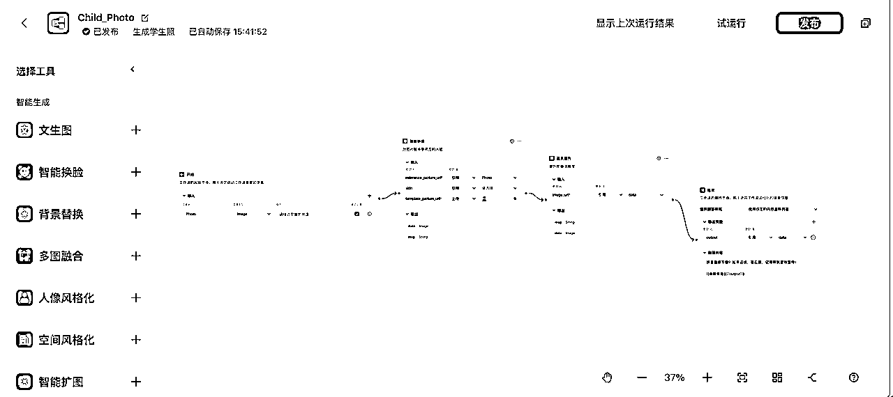

图像流的操作界面跟工作流一个路子，挺容易上手。我先做了个“学生照生成器”，传一张人脸，马上给你出学生模样的照片。话不多说，直接拿老马开刀😄：

### 定制学生照

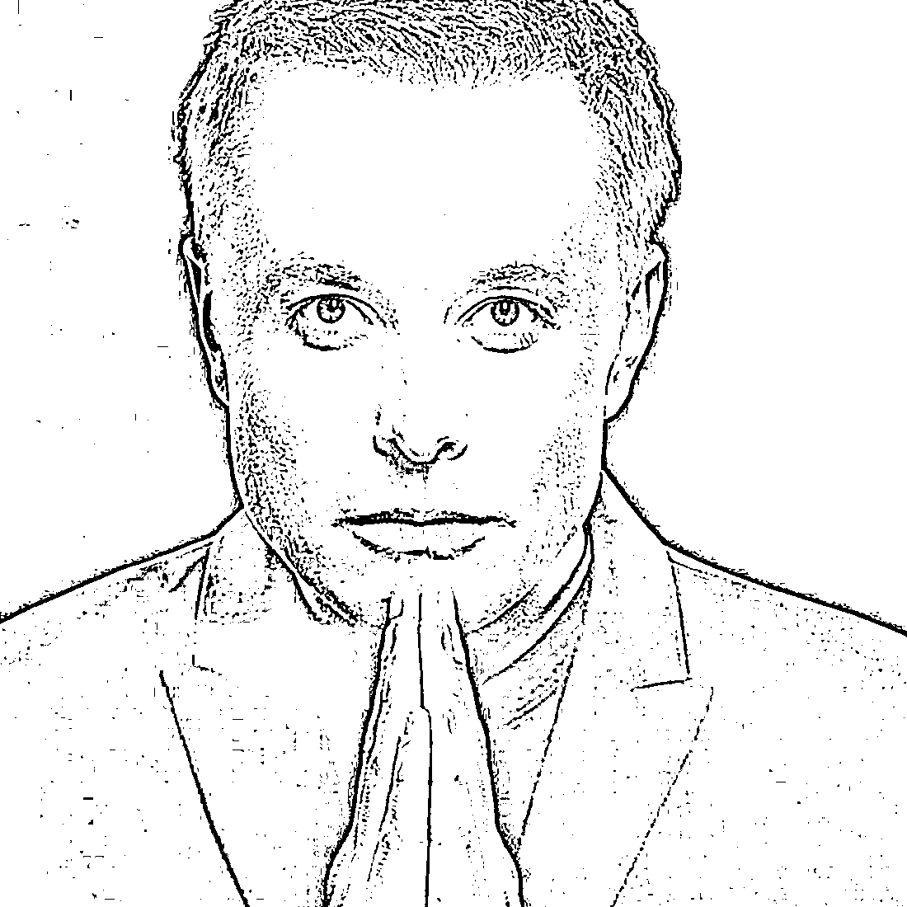

丢进去一张老马的证件照，没啥人挤服务器，出图速度妥妥的。

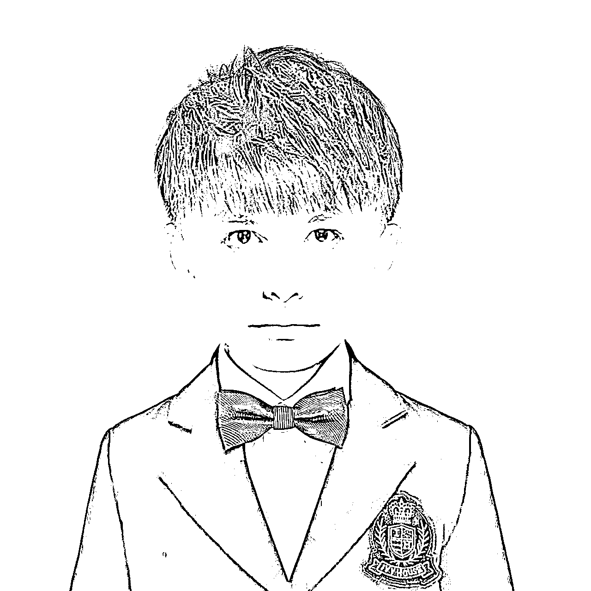

哟，整体还挺像那么回事，看看这刀削般的下颚线……就是，老马你这耳朵咋回事？小细节翻车了哈。

接着斗胆试了下MJ。

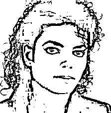

虽然喂的是侧脸照，但成品相似度还挺高。耳朵那边还是有点怪，估摸着是模板图自带的小毛病。

后来我又传了几张国内明星的照片试了试，发现咱亚洲面孔的效果比欧美脸更自然一些。Agent链接放这儿了，感兴趣自己去耍耍吧~

最后传了张自己的照片……啧啧，有点东西啊。

学生照Bot地址([1]) 链接失效看文末引用。

### 搞个证件照

玩归玩，闹归闹，真要当生产力，还得看实际场景。证件照是不是个好方向？赶紧安排。

原图我就不放了，免得剧透是哪位国外明星。

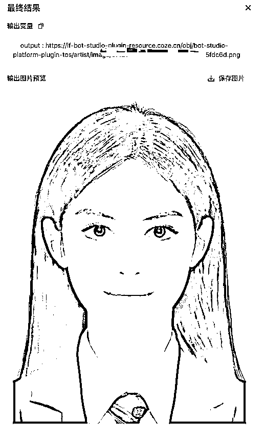

就说这效果，硬不硬！我特意把输出结果截了图，省得说我是网上现扒的图。地址也贴这儿了，男女都能用，想要更多模板来评论区喊我。

证件照Bot地址([2]) 链接失效看文末引用。

总的来讲，换脸这块硬实力还是值得肯定的，五官特征拿捏得挺稳。不过出图分辨率只能说一般般，搞不好是我上传图和模板图不搭，回头换点素材再测一次。

## 背景替换，美妆场景是真香

这个功能说白了就是把画面里的人物或物体拎出来，换个新背景。我本来想让小李子“在三亚的海边堆雪人”，结果直接被系统拒了。*#@#&

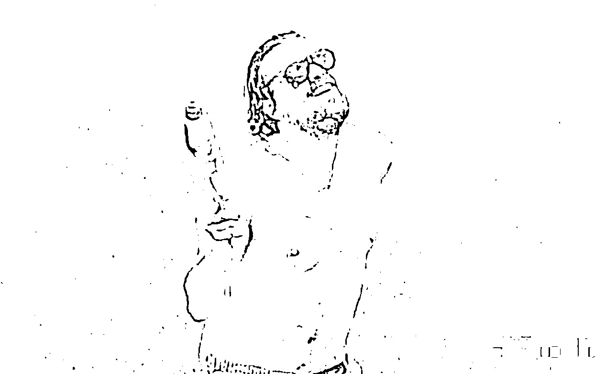

拒签理由写着：性感男性没穿衣服。这年头AI圈子也搞得这么保守了吗？这图网上遍地都是，也没觉得多出格啊。

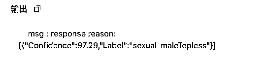

行呗，学会妥协是成年人的必修课，还是老马上吧。

### 通用背景替换

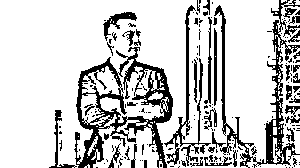

先来一张老马的标准精英照，场景咱依然指定“在三亚的海边堆雪人”。图像流一共给了三种替换策略：

- • 按图片替换：默认主体是前景，背景用指定图片
- • 按提示词替换：先用提示词生成一张背景图，再把主体嵌进去
- • 混合模式：图片和提示词都上，权重自己调

咱也懒得琢磨哪种模式了，我就是想让画面里出现个雪人，然后翻来覆去折腾了好久……总算出来了吧。

但这雪人……你站那么前是想跟老马比个儿吗？还有你这表情几个意思，嘲笑谁呢？围脖只挂一半，你还挺美。

老马这边算是指望不上了，咱换别的试试。听说现在车企渲染图都开始用AI了，那咱也凑个热闹。

顺手用了官方的“提示词优化”功能——就是你把一句粗糙的提示词丢给它，它帮你补全润色，再送去大模型生图。咱们把两个版本都跑了一遍。

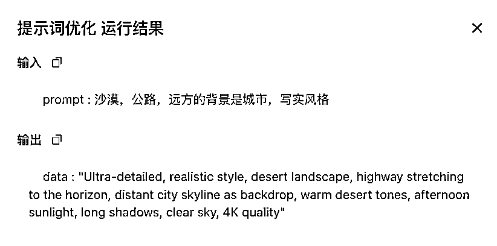

先给它一张干干净净不带背景的su7图，再让它生成“沙漠，写实风格”的效果。

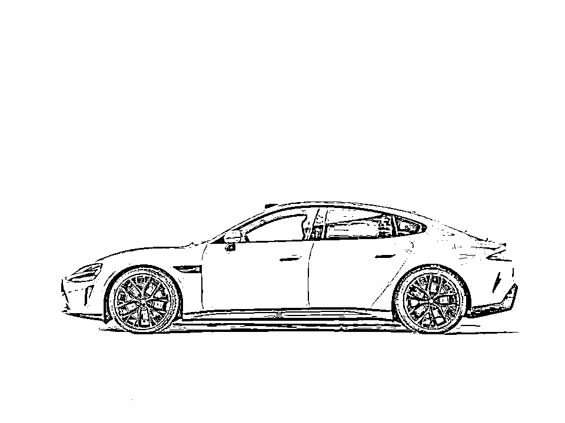

来猜猜看，这两张哪张是过了提示词优化的？

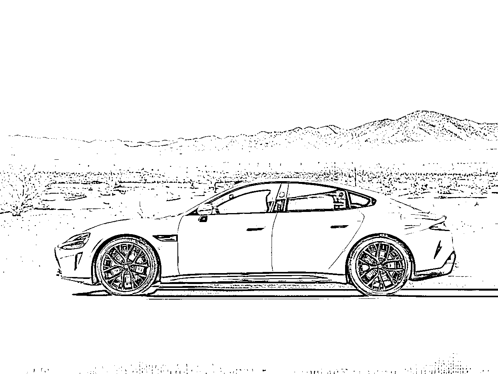

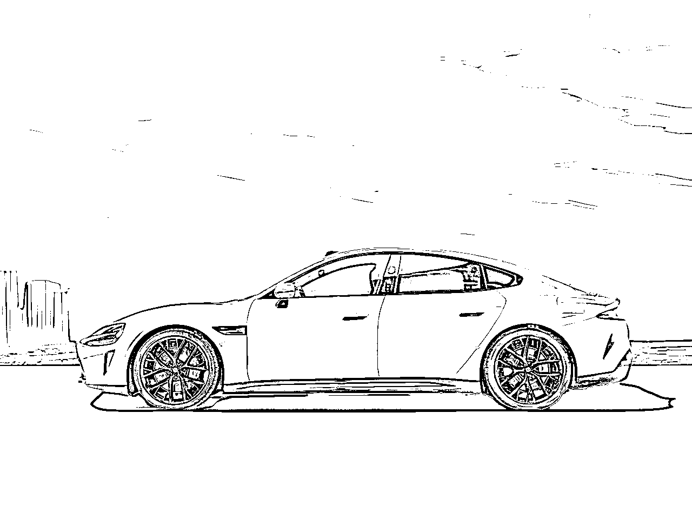

第二张是系统优化过提示词的，我咋觉得还不如第一张呢？而且这“真实感”也有点堪忧啊。

通用替换这关过不去，咱换正儿八经的。

### 电商-室内家居场景

官方很贴心地准备了三种场景模式，可以，这很周到。先来试试室内家居。

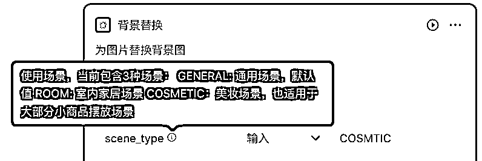

依然传一张纯色背景的商品图，这次选的是转椅。

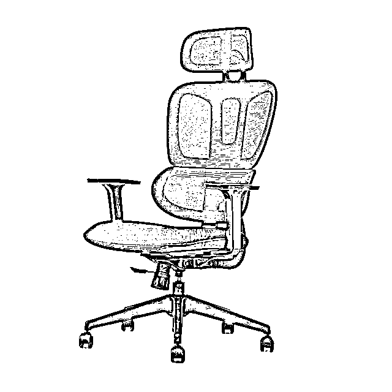

折腾了一阵子，挑了一张效果最好的放出来。

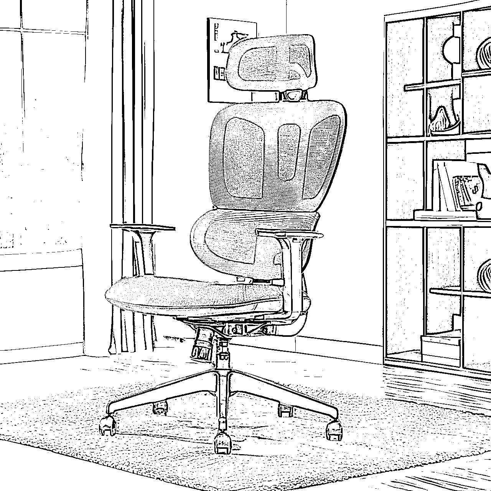

转椅边缘的白边没抠干净，仔细看地毯上的四个滚轮，要是用透明底的图估计会好不少。整体画面嘛……怎么说呢，一眼就能看出是合成的。

### 电商-美妆场景

再来看看美妆模式。官方说是针对大多数小物件摆桌效果设计的。没问题，那就选一瓶洗发水吧。

老规矩，纯色背景的商品图丢进去，同时配提示词。

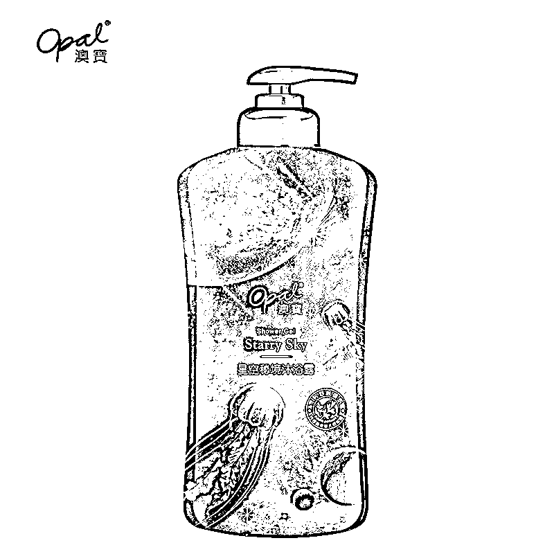

本来没抱啥期待，结果……

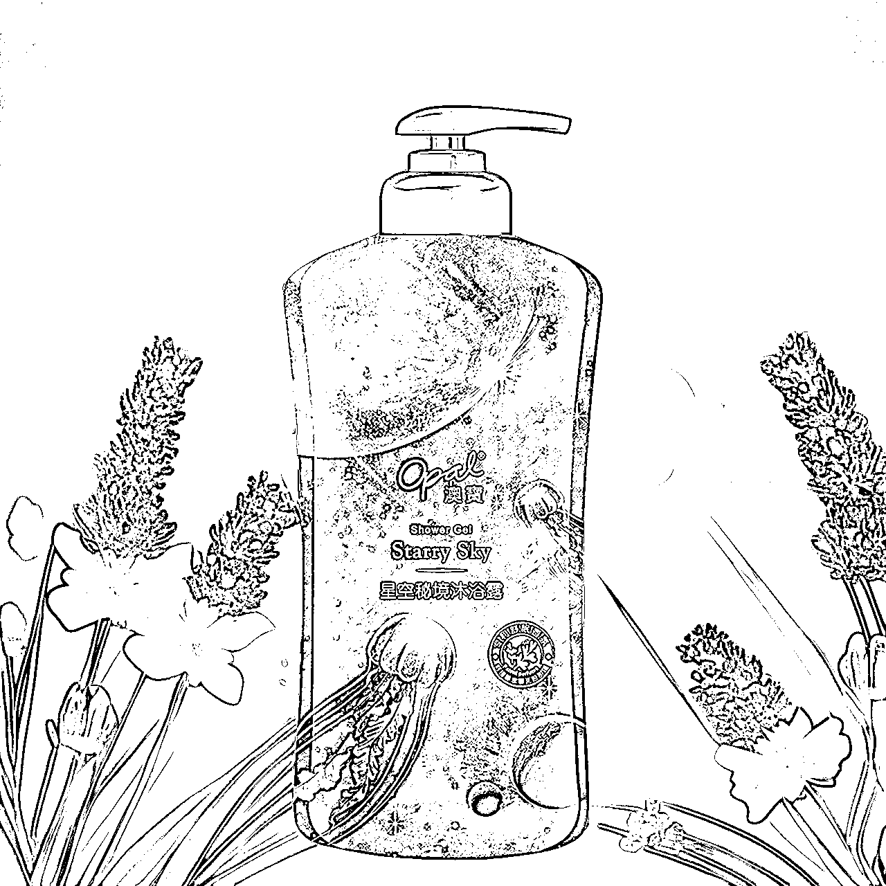

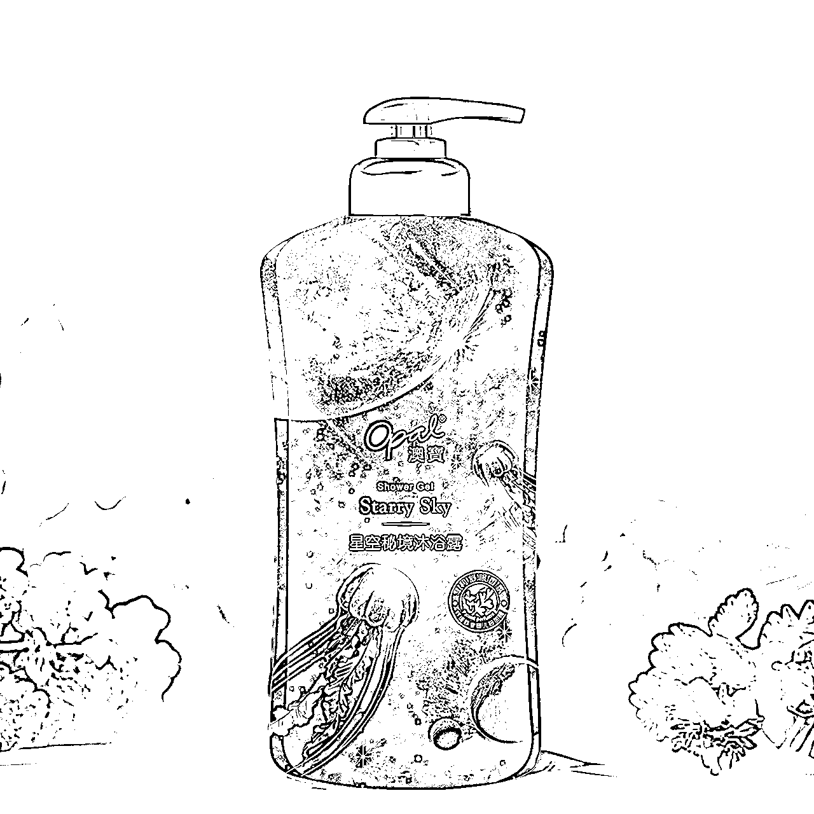

！！！它还真起来了！尤其是优化过提示词的那张，效果有点惊喜。

小结一下：受限于文生图大模型的能力，目前整点抽象场景问题不大；但你要是想搞写实类，还是有明显的“合成味”，坐等官方后续迭代吧。

商品图背景替换Bot地址([3]) 链接失效看文末引用。

## 多图融合 + 换脸，绝配

多图融合说白了就是：用这张图的结构，借那张图的风格，给你拼一张新的。试下来发现，Coze现在的基础模型搞写实风格还是不太行，那就整点动漫风试试呗。还是刚才那位国外女明星，拿某盲盒手办的风格当参考。

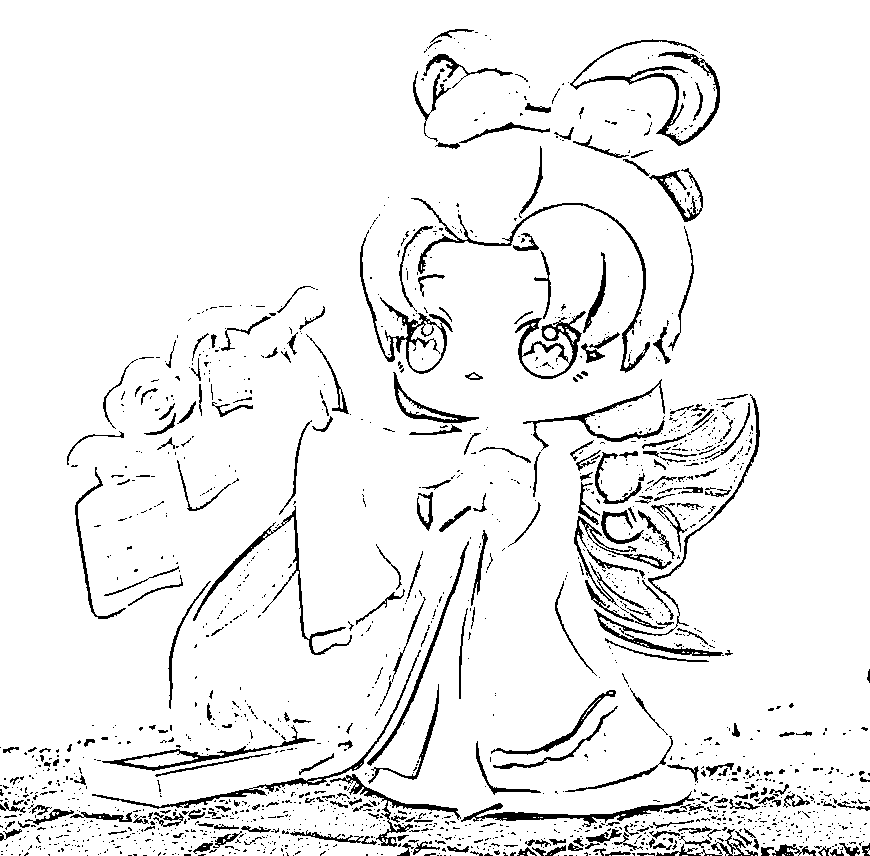

这张是参考图，再把女星原图传上去，新图出炉。

风格有点混搭，卡在写实和动漫之间，不过相似度还是在线的。就是……这成品跟我上传的女星有啥关系？算了，咱再叠加前面的换脸功能，重新生成一把。

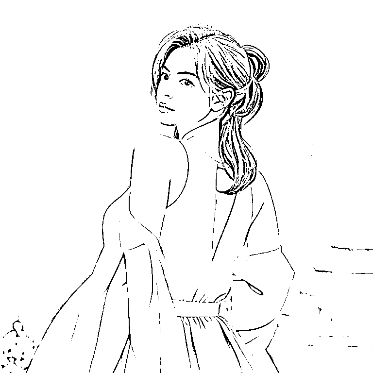

啊，舒服了！链接也放这儿了，自己上手试吧。

电子写真照Bot地址([4]) 链接失效见文末引用。

## 写在最后

这回把Coze图像流的核心功能挨个儿过了一遍，整体体验是值得肯定的。当然，模型能力摆在那儿，有些场景还差点意思，但版本迭代跟上之后，效果肯定会更香的。

图像流还有几个隐藏玩法没细测：文生图、扩图、风格化等。想看的话点个赞，下一期马上安排。

往期内容：

我的Agent智能体被Coze扣子官方翻牌之后……

告别手写Prompt！一句话生成6个结构化提示词，工具地址附上，免费薅！

#### 引用链接

[1] 学生照Bot地址: https://www.coze.cn/store/bot/7371099570463342601

[2] 证件照Bot地址: https://www.coze.cn/store/bot/7371362580344127523

[3] 商品图背景替换Bot地址: https://www.coze.cn/store/bot/7372130280066531364

[4] 电子写真照Bot地址: https://www.coze.cn/store/bot/7372208289989459980