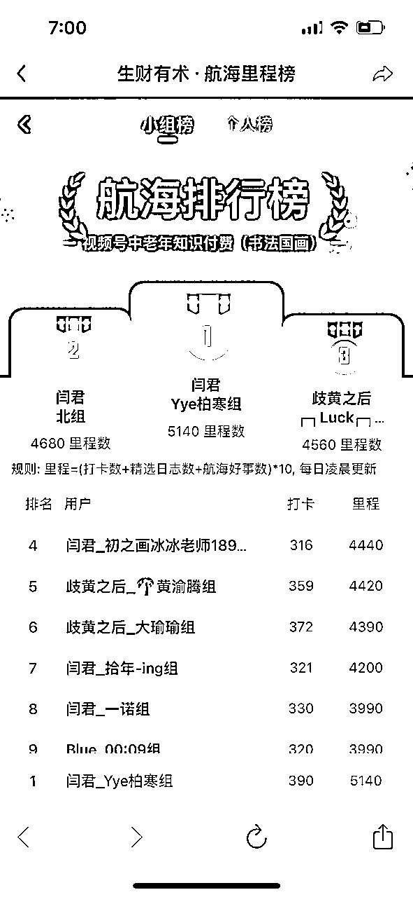
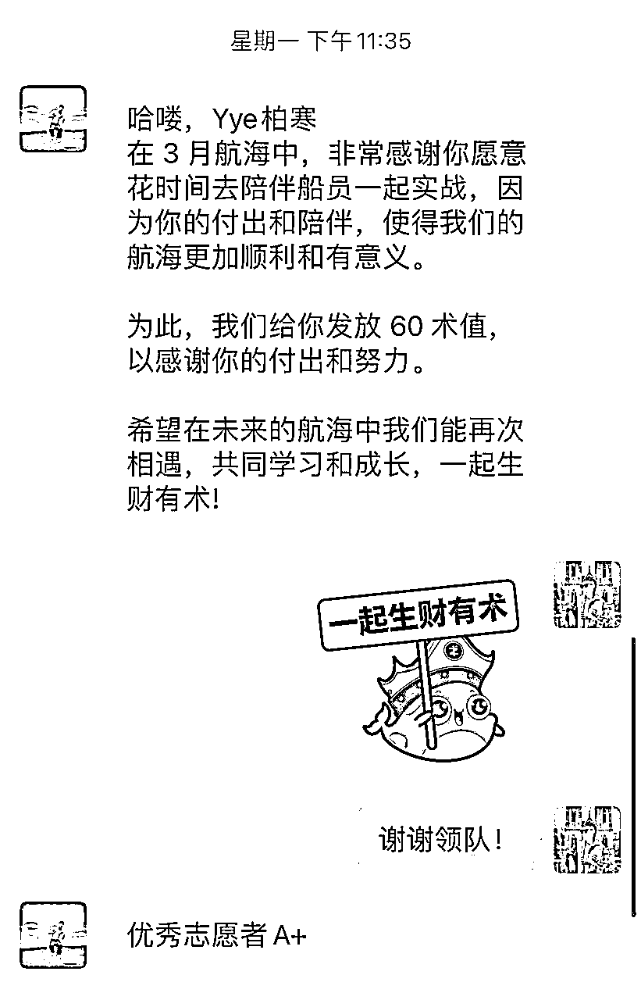
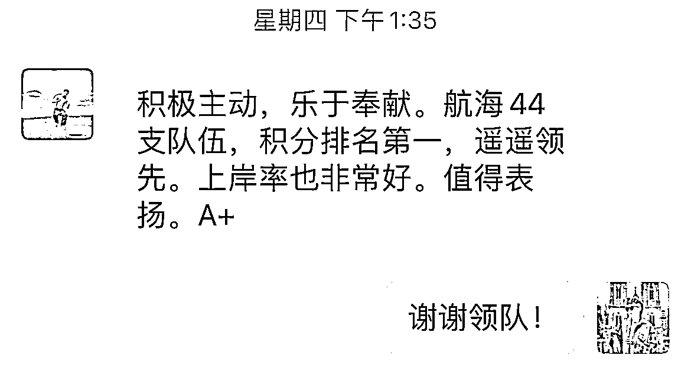
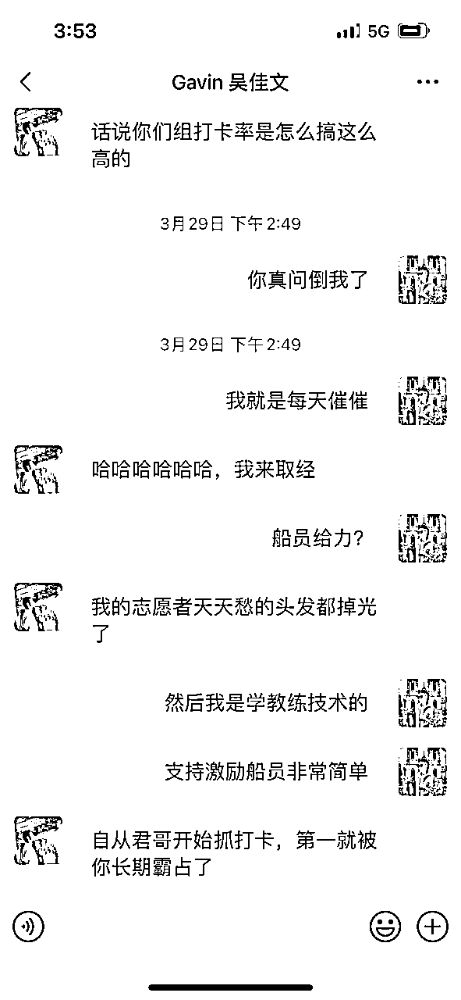
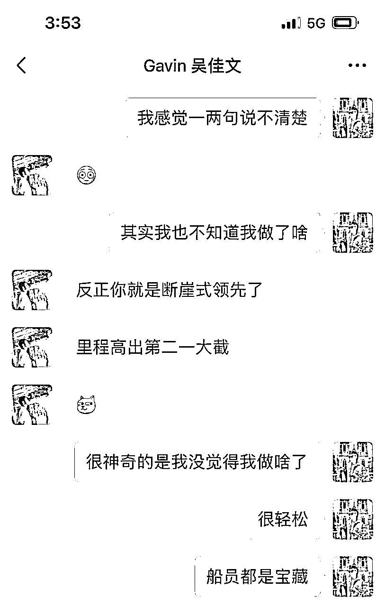
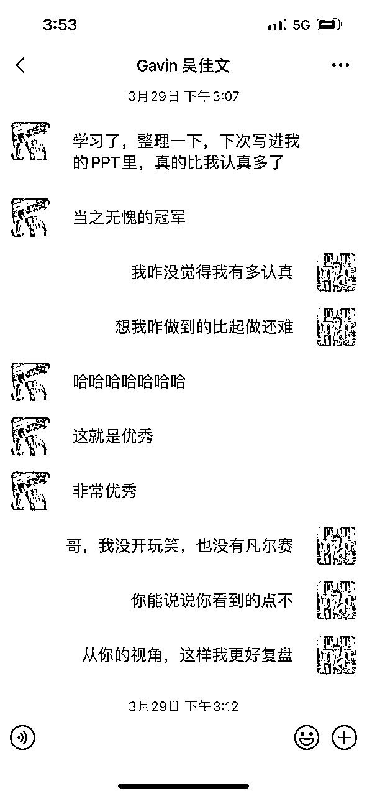
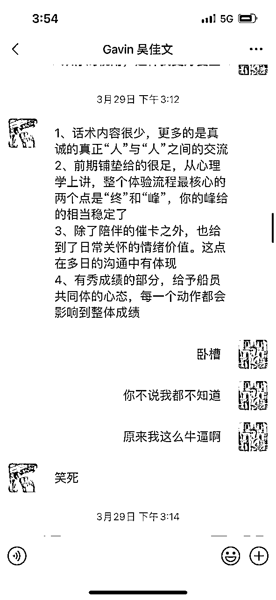
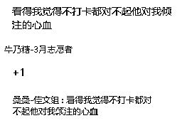

# 第一次做志愿者，小组里程就拿第一，我做对了什么？

大家好，我是龙哥。上次那篇实战复盘帖子拿到了精华，挺惊喜的。3月航海刚结束，我作为志愿者的“首秀”也画上句号。这次我带的是视频号中老年知识付费（书法国画）小组，最后小组里程拿了第一，而且是断层领先。领队给出的评价是：优秀志愿者，A+。

这中间还有个有意思的插曲：隔壁船的领队专门跑来问我到底怎么做到的。我当时真有点懵，感觉自己没做什么特别的事，怎么就到了第一。后来我把和船员的聊天记录发给他看，他好像明白了点什么。我也趁着这股劲儿，把这21天从头到尾捋了一遍，算是给自己一个交代，也想给未来想做志愿者的朋友一点参考。

这篇文章我会按时间线聊聊：开船前的准备、蜜月期、紧张期、冲刺懈怠期，最后做个总结。文末也放了和船员的聊天记录（已征得本人同意，且隐去了隐私信息）。

## 开船前，我先想明白了“志愿者是什么”

过去一年我参加过好几期航海，作为船员，我对志愿者的印象其实很模糊：拉群、传话、催打卡，好像仅此而已。船上有那么多人，可真正面对问题、解决问题的时候，往往还是自己。当然，赚钱本来就是自己的事，孤独也没什么好抱怨的。

也许正是因为自己经历过，我才特别想给船员带来不一样的体验。

那志愿者到底能发挥什么作用？我很认同赚钱的一个说法：“陪伴成长教练”。重点不在“教练”两个字，而在“陪伴”和“成长”。船员在航海里收获的，不只是赚了多少钱，也可能是某个瞬间的感受：觉得项目挺好玩、解决了一个卡了很久的问题、被圈友认可了、发现自己原来挺擅长这件事。这些都是宝贵的反馈，是我们跟世界碰撞之后弹回来的回音。很多改变，往往就是从这些回音里长出来的。

所以志愿者的核心任务，不是管住船员，而是支持他们拿到属于自己的反馈。再往下拆，我给自己定了三层工作：

第一层，基础运营：拉群、同步信息、点评日志、提醒打卡。这是保证船队正常运转的底线。

第二层，实战支持：用我自己做项目的经验，给船员具体的建议。相当于一个轻量级陪跑导师，陪他们解决航行中的实际问题。

第三层，行动教练：帮船员设定目标、给予鼓励和肯定、排除内心的卡点。比如对结果的恐惧、对行动失败的担心、拖延和完美主义等等。

这三层都能做到，对船员才是真正的帮助。恰好，我在这些方面都还算有点底气：过去一年跑过不少项目，0到1的阶段拿过结果；我是国际教练联盟的专业教练，有80多小时教练经验；盖洛普前十里还有积极、取悦、交往三个才干，用来做激励简直顺手。

所以我的第一个复盘点是：先想清楚志愿者的角色，再认真审视自己凭什么能胜任。

## 选船：计划赶不上变化

我最初报的是闲鱼高客单。去年做过闲鱼二手书，对平台很熟，也看好这个项目的变现能力。开船前我还把相关帖子基本翻了一遍，自己下场试了试，甚至已经出单了，就等着开船好好干一场。

结果，我被调剂到了视频号中老年知识付费。这项目我完全没碰过，平时不太看视频号，也没做过知识付费。

既然项目实战这条腿暂时短一截，那我干脆把重心放在“情绪价值、陪伴和激励”上。

加好友阶段，我给自己定了节奏：每天只加10位船员。因为开船前是建立关系最好的窗口期，我想让船员有机会认识一个不一样的志愿者，而不只是又一个拉群工具人。

具体动作就两步：

第一步，加好友后，先发一份项目合集。这个合集我自己全部看过，不是为了发而发。我想传递的信号很简单：我懂这个项目，我是来陪你跑的人，不是打卡提醒机器人。

第二步，去后台看看船员报名了哪几条船，问问他们需不需要提醒，聊聊他们的目标，尽量多了解这个人。目标只有一个：让彼此从“船客”变“战友”。

聊到目标时，很多人会说“想跑通项目”“想赚钱”。这种目标太模糊了，我会继续追问：什么叫跑通？你想赚多少？21天里具体要拿到什么结果？一个符合SMART原则的目标，才有真正的推动力。我自己做闲鱼二手书时就是这样，目标一清晰，行动力立刻就不一样了。

当然，也有人聊到目标时会迟疑、会抗拒。这背后往往藏着害怕失败、害怕做不好的心结。作为教练，我习惯陪他看见这些卡点，航程中随时可以继续聊。

这是第二个复盘点：做一个有温度的志愿者，愿意跟船员交朋友，而不是只完成差事。

## 蜜月期：先自己下场跑一遍，再把彩虹屁安排上

刚开船那几天，船员通常都很有冲劲，不太需要志愿者操心。我就把精力放在“自己做项目”上。只有自己下场，才知道船员此刻可能在哪儿卡住；自己搞不定，也清楚该去请教教练还是领队。

过去做过的项目多了，加上我逻辑还算清楚，只要自己跑一遍，基本就能把关键点想明白、讲清楚。船员如果听不懂，我不会觉得是对方的问题，只说明我还没讲到透。后来不少船员会主动找我聊项目思路，那种一起往前冲的感觉，特别棒。

同时，每个船员的状态都不一样。有人执行力强，有人很容易内耗，有人害怕困难。因为我自己都经历过，所以更能共情，也能给出更有针对性的建议。

点评日志时，我有个铁律：再小的进步，也值得被看见。有人几天没动，今天终于打卡了，我夸他“敢开始就赢了一半”；有人只刷手册不下场，我会一边提醒别水日志，一边夸他“坚持学习本身就很棒”；有人遇到瓶颈暂时停下来，我恭喜他“能看见挑战，说明已经开始思考”。

放心，当我的船员，我能把你夸得嘴角压不住，顺便做一场心灵大保健。

这是第三个复盘点：情绪价值要拉满，项目思路也要跟得上。

## 紧张期：领队开始抓打卡后，我的催卡小妙招

第一周我真没注意什么排名，领队也没逼咱们。到了第二周，风向变了，领队开始严抓打卡。我能明显感到压力上来了，一到晚上就条件反射似的想催卡。

说实话，这种紧张感我自己不太舒服。我更喜欢鼓励而不是催促，但目标就摆在那儿，总得想办法完成。

我当时想得很清楚：我能控制的是自己去触达了多少次，有没有把“该打卡了”这件事送到船员眼前；至于对方什么反应，不是我能控制的。所以策略很简单：当天之内，我会一直提醒到你打卡为止。你要是嫌烦，把我删了，我也认。

当然，也不能真把关系搞僵。催卡也要有点章法：

一是用轻松的方式开场。比如“叮咚”“我路过，你继续”“表情包先甩一个”，或者根据前两天日志关心一下近况。只要关系不崩，他看到我的消息，自然会想起要打卡。我想传递的是：我是关心你，不是催命。

二是适当示弱、提要求。有人经常不回消息，没关系，我照发不误，反正他看得到。偶尔有人回一句，我会先感谢，而不是抱怨。我会说：“谢谢你回我！看到你在做了，真棒。”姿态软一点，目的能达到就行。说白了，就是“绿茶式心疼”，谁听了不迷糊？

但那种既不打又不回、还不尊重人的，我也不会一直惯着。该打电话就打电话，该上报就上报。都是成年人，连船员的义务都不履行，那就别怪志愿者较真。每半小时提醒一次，直到他完成打卡，或者把我删掉——删掉了正好，直接转给领队。

第二周，眼看小组快要被追上，我把所有船员都私聊了一遍，把我们组第一的截图发过去，说：“咱们快被超了，我现在真的有点压力，需要大家帮帮忙，多打卡、多写写好事。”这一招很有效，大家一下子有了“一起守擂”的感觉，纷纷开始发力。扛过这周，后面稳住节奏就行。

这是第四个复盘点：先想清楚要什么，再选择刚好合适的沟通方式。

## 冲刺懈怠期：状态可以摆烂，但方法必须在线

到了最后一周，船员累了，我也累了。我觉得一个人不可能永远高能量，也不需要那样。重要的是，随时能把状态拉回来。那阵子我正好休假旅行，回深圳后整个人很懒散，提不起劲做项目，但志愿者的活儿还是咬着牙做完了。

这阶段我主要用了三个方法：

第一，用“yes and”接住船员的疲惫。有船员跟我说，打完12次就不想继续了，反正项目体验下来也不适合。我会先恭喜她：“你已经完成打卡，达成自己设定的目标了，很棒！”然后再补一句：航海打卡更珍贵的地方，是帮自己记录下这段成长。你坚持下来，不是为了别人，是为了未来的自己。哪怕只前进了一小步，也有一小步的欢喜。

第二，搞“靠岸倒计时”。对已经靠岸的船员，我恭喜他们，鼓励他们继续往前；对还没上岸的船员，我换了一种说法：“再坚持几天就上岸了。”这就像健身教练在你力竭的时候说“还有最后几个”，虽然很累，但看着数字一点点变小，反而又有了力气。我会重点关注那些休息次数少、需要每天打卡的船员，晚上提醒一次，每隔半小时再提醒一次，直到当天打完卡。

第三，讲清楚拿回保证金的意义。这21天里，有人赚到了钱，有人掌握了新技能，有人发现自己根本不喜欢这个项目，有人觉得自己学不会，也有人因为看到别人出成绩而陷入焦虑。但这些统统都是反馈，都是成果。只要最后能把保证金拿回来，我们付出的其实只有时间和精力——而时间和精力，本来就是会花掉的。从这个角度看，只要上岸，就是稳赚不赔。想明白这一点，咬咬牙再冲几天，其实很划算。

这是第五个复盘点：理解船员的疲惫，然后用向上的能量再推一把。

## 最后总结一下

这次能拿第一，当然有运气的成分，但回头看也确实有迹可循：

1. 开船前先理解志愿者的定位，再把自己的优势放进去。

2. 自己有实战经验，持续行动和迭代过，所以能陪跑。

3. 有教练技术，可以帮船员看清卡点、理清目标。

4. 会沟通，懂销售逻辑，知道怎么说对方更容易听进去。

5. 生活中的各种经验，也能迁移到志愿工作里。

6. 只盯自己可控的部分，把它做到极致。

7. 遇到了一个超强领队，和一帮特别棒的船员。

8. 最重要的一条：认真负责，是真的想让船员成长，而不是为了完成任务。

## 附：与船员的聊天记录

因为篇幅关系，完整聊天记录我放在网盘里了（22位船员的聊天，已征得同意，并处理好个人信息）。

链接：https://pan.baidu.com/s/1vIOKjgENz6_2b2tsPS-rEQ?pwd=2dtb

提取码：2dtb

最后，感谢赚钱团队、教练、领队和每一位志愿者的付出，也谢谢所有船员的参与。下一期航海，咱们船上见！