# 如何采集小红书APP关键词下的全量笔记

想做爆款内容的小伙伴，几乎都绕不开“对标分析”这一步。但如果你用过小红书 PC 端搜关键词，大概率会发现一个尴尬瓶颈：笔记结果最多只能翻到 200 条。想更深入地挖素材，这点量根本不够用。今天这篇就来聊聊，怎么用开源工具直接采集小红书 APP 端的关键词笔记，绕开 200 条限制，把爆款灵感一次性捞个够。

先说个大前提：目前这套方案是用 Windows + iOS 来跑。mac + iOS 也兼容，但手机端暂时只建议用苹果。因为 Android 7 以后系统默认使用自带证书，要搞定代理得花不少时间去配置甚至 root；苹果手机反而简单直接。

别一看教程很长就想划走——实际跑起来，只有第一次需要这样完整配置。之后每次采集，你只需要在手机端把网络代理改成手动，全程不到 30 秒。

另外先说明，我不会放出我目前用的完整代码。不过别担心，按照文中提到的方法，用 GPT-4 或 Claude 完全可以复现——因为我的整套代码当初就是让 Claude 从零生成的，几乎没人工改动。我也会分享一下我和 Claude 的关键对话。感兴趣的话，强烈建议自己动手试一次，收获会更大。

目前的采集还属于“半自动化”：需要手动滑动屏幕，脚本才能持续抓取。下一步我打算结合 RPA 自动化，实现批量关键词采集。

下面是完整流程分享。

---

**主角工具：mitmproxy**

这次采集的核心依赖是 mitmproxy，一个开源的 HTTP/HTTPS 代理抓包工具。它可以拦截、查看、修改甚至重放网络流量。更关键的是，mitmproxy 支持 Python 脚本扩展——你可以自写脚本，把抓到的数据二次加工，比如提取笔记标题、正文、作者、点赞数，导出成 Excel，还能异步下载无水印图片/视频，方便后续分析。

电脑上装好 mitmproxy，手机设置好代理，基本就可以开动了。具体步骤参考官方文档即可，这里不啰嗦。

**采集流程概括**

1. 电脑端启动 mitmproxy，打开代理服务。
2. 手机和电脑连同一个 WiFi，手机代理指向电脑 IP + mitmproxy 端口。
3. 打开小红书 APP，搜索目标关键词，正常刷笔记列表。
4. mitmproxy 自动拦截手机与服务器之间的流量，笔记数据就拿到了。
5. 用 Python 脚本解析数据，提取关键字段，导出 Excel 或飞书，还能顺手下载无水印资源。

---

**第一步：电脑端启动**

打开官网下载 mitmproxy：[https://mitmproxy.org/downloads/](https://mitmproxy.org/downloads/)

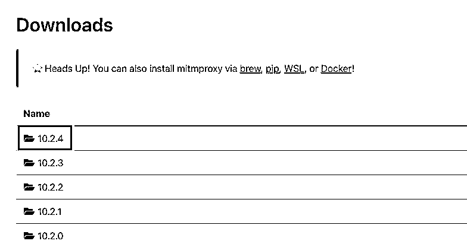

在页面上选最新版，点进对应下载链接。根据自己系统选择安装包，比如 64 位 Windows 就下 “mitmproxy-10.2.4-windows-x86_64-installer.exe”。

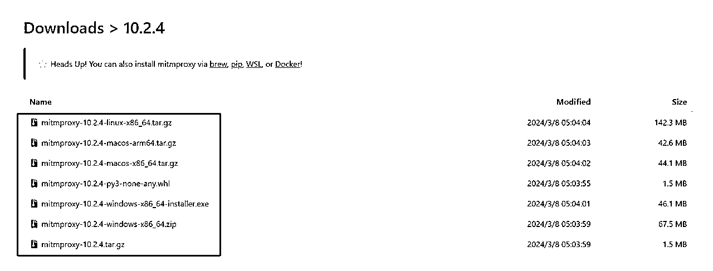

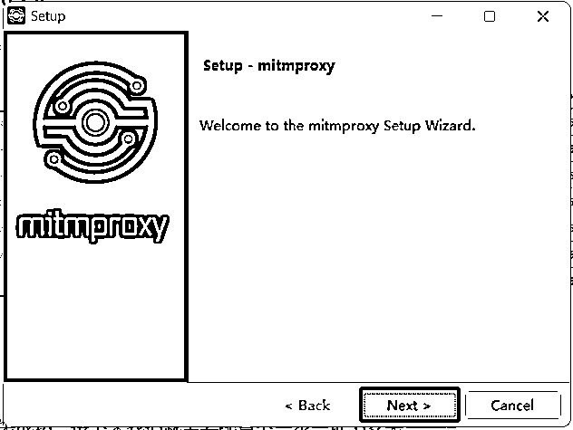

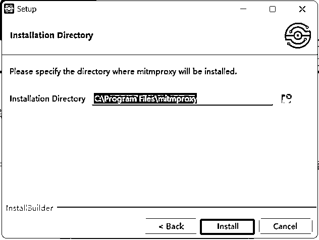

安装完成后，默认路径一般是 `C:\Program Files\mitmproxy`。启动 `mitmweb`，界面大概长这样：

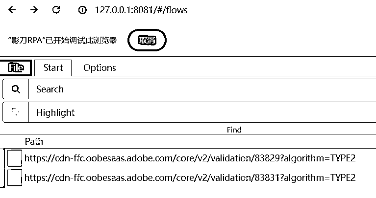

**第二步：手机配置代理**

确保手机和电脑在同一 WiFi 下（同一个局域网）。如果手机开了其他代理类工具，先关掉，不然后面会冲突。

苹果手机的操作路径：

1. 打开“设置” → “Wi-Fi”，点已连接网络旁边的 “i” 图标。

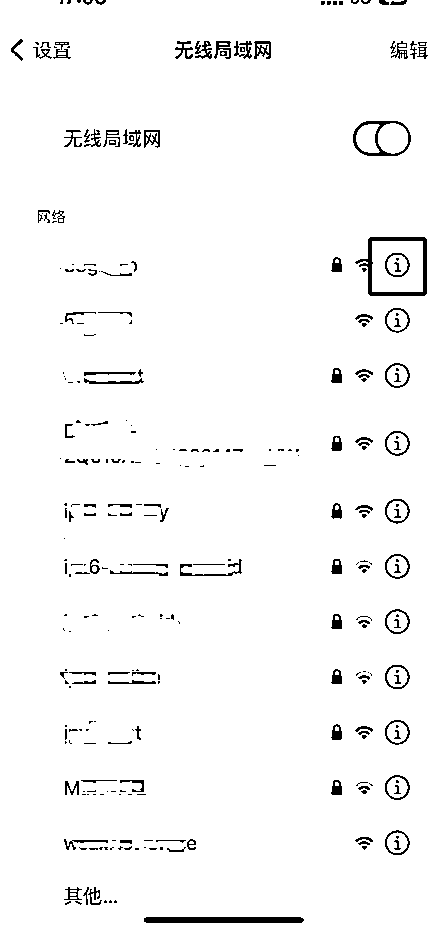

2. 下滑找到“HTTP 代理”，改成“手动”。

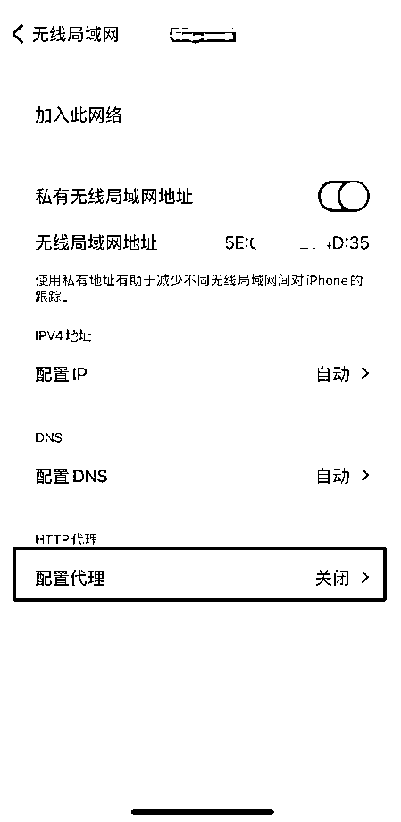

3. 在“服务器”里填第一步电脑端显示的 IP 地址，端口默认 `8888`。

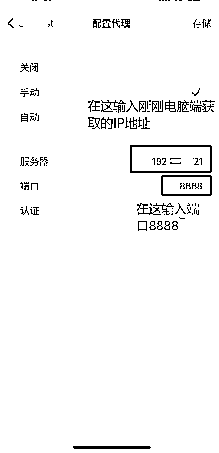

4. 保存设置，退出。

5. 用手机 Safari 浏览器访问 `http://mitm.it/`，下载安装 mitmproxy 证书。

如果打不开证书下载页，大概率是以下几种情况：

- 第 1-3 步代理没配对，电脑端 IP 或端口有误。
- 手机和电脑不在同一 WiFi。
- 有其他科学上网类代理软件干扰。

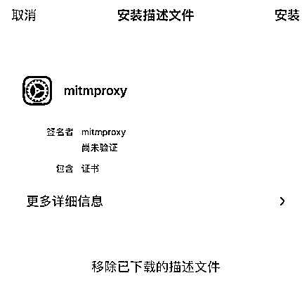

下载好证书后，去“设置” → “通用” → “VPN与设备管理” → 找到 mitmproxy，点进去安装。装完还要信任证书：去“通用” → “关于本机” → “证书信任设置”，把 mitmproxy 的开关打开。

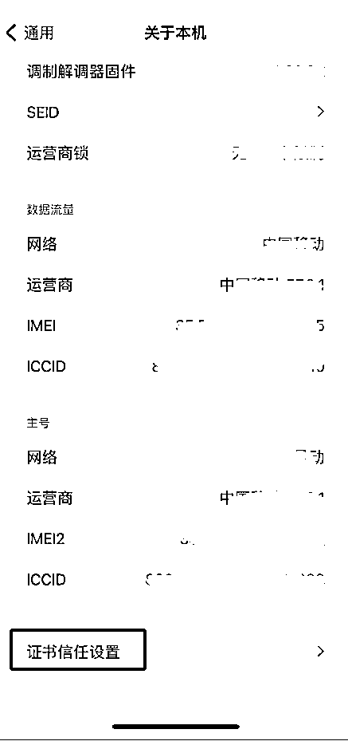

这时候，手机所有网络请求都会经过 mitmproxy 转发。你现在可以打开小红书搜索笔记，电脑端会自动看到抓取到的数据流。

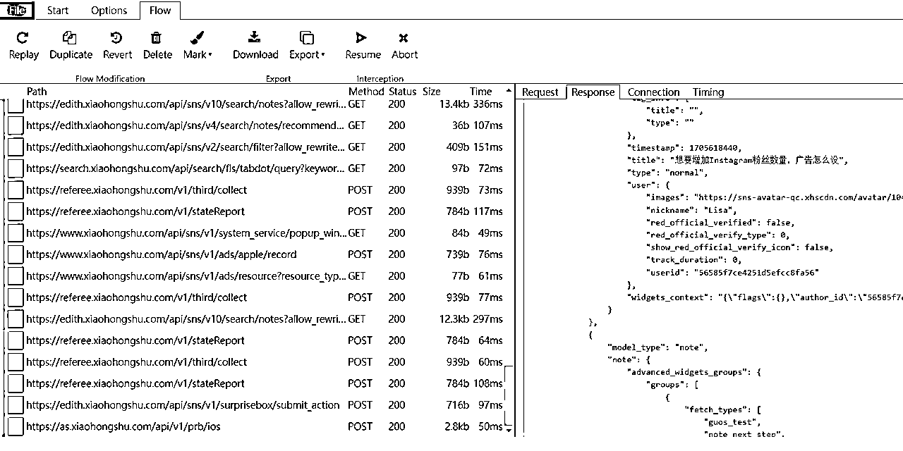

---

**第三步：用脚本解析数据**

抓到的笔记信息是结构化 JSON，直接用脚本解析就能导出。我把这份数据结构扔给 Claude，让它帮忙写解析脚本，核心对话放下面：

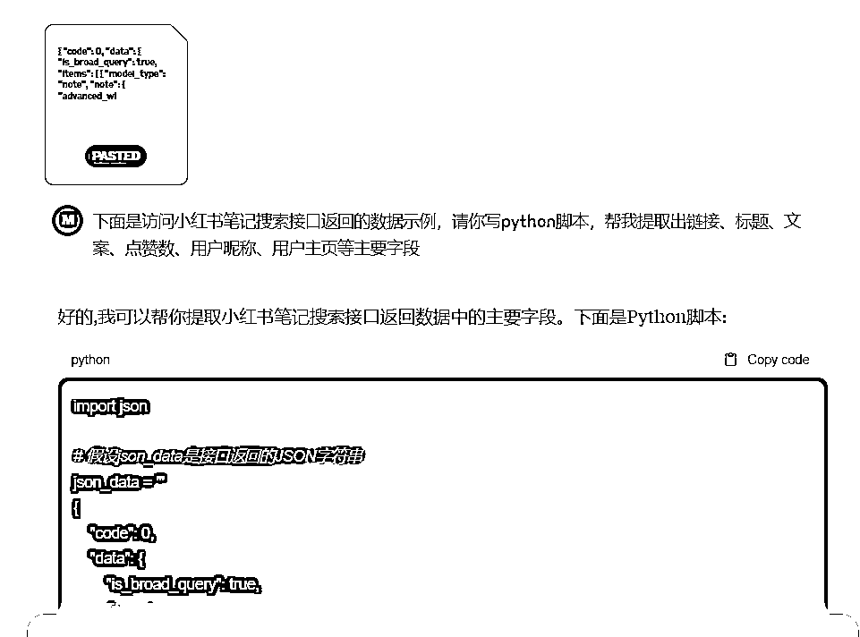

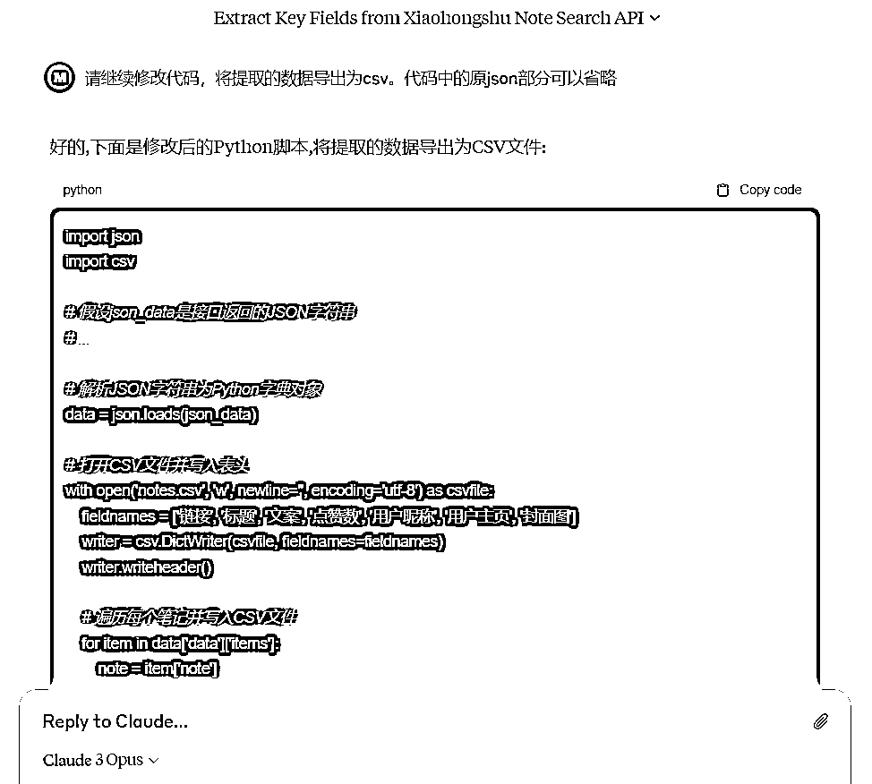

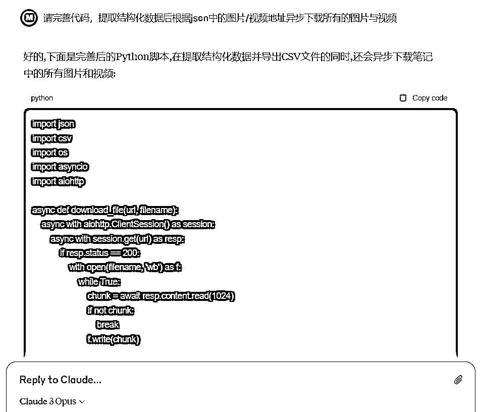

跑完脚本后，再根据实际输出报错和预期效果，继续和 Claude 调整迭代。这一步我用 Claude Opus 完全能搞定所有问题。

最终脚本实现的能力是：当 mitmproxy 拦截到小红书 APP 的笔记列表请求时，自动解析响应数据里的标题、内容、点赞数等字段，导出 CSV，同时异步下载所有图片和视频。采集后的数据长这样：

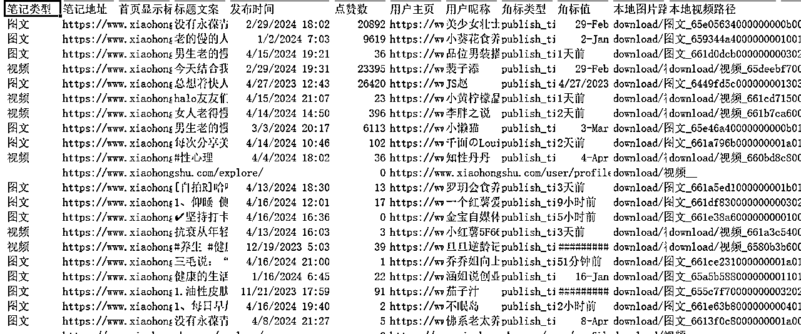

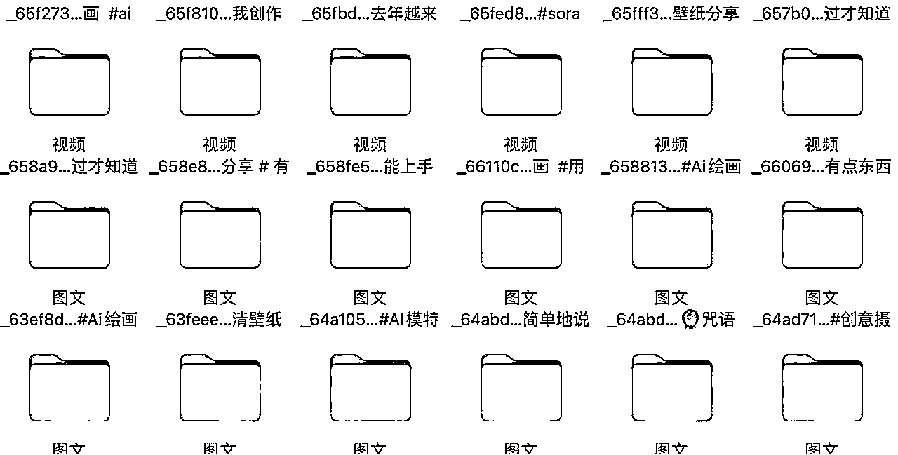

有了这套脚本，你只要启动 mitmproxy，在小红书 APP 里搜想采集的关键词，然后滑动屏幕刷笔记，所有加载出来的笔记都会被自动抓取和记录。字段包含笔记 ID、发布时间、作者、标题、描述、图片/视频链接等，方便后续做深度分析。

---

**效率与注意事项**

手动滑动刷笔记，实测下来大概 10 分钟就能采集一千多条笔记数据，效率比 PC 端翻页高太多了。采集完记得把手机代理改回“自动”，关掉手动代理即可。

另外几个点要留意：

- 每次换 WiFi，都要重新配置代理、重新下载并信任证书。
- 哪怕同一网络，路由器重启后电脑 IP 也可能变，这时手机代理里的服务器地址也要同步修改。

数据采集只是第一步，真正值钱的是从海量笔记里挖出有价值的信息。这需要结合你自己的分析方法和工具，持续实践，慢慢形成独特判断。

以上就是我折腾小红书 APP 端采集的一些心得，希望对你有帮助。