# 深耕私域十年斩获八位数营收，我用5步3力跑通私域闭环，业绩直接翻倍

> 来源：[https://w191e236q6t.feishu.cn/docx/CiVadxhB0ojxB7xsdxTcehPanqe](https://w191e236q6t.feishu.cn/docx/CiVadxhB0ojxB7xsdxTcehPanqe)

嗨，我是清一。加入生财有术的第二年，正好是我把知识付费从0到1跑通，然后从1到100放大的那年。

不少朋友看过我在抖音做的团购和口播教学，我前面几年靠生财圈子带动的副业，营收直接翻了10倍。

今天我聊的主赛道，也就是我从2014年就开始深耕的私域营销。

除了讲自己的成长路径，我还会把从微商创业者到私域内训师，再到独立私域教练这条路上的【私域运营心法】完整拆给你。

看完你能学会私域破冰的方法，搞懂私域成交的底层逻辑，理解私域的底层模型和基础框架，文末我还会分享拿到5位数B端内训合作的谈判技巧，想做B端生意的朋友一定要看。

先做个自我介绍：

• 0到1带私域带货团队，日销破100万
• 辅导1300+学员跑通私域变现闭环
• 策划300+高转化培训招商社群
• 前TOP级私域电商平台商学院负责人
• 国家中级人力资源管理师，5年内训履历

这次分享我会围绕以下几块展开。

一、高中做微商年入200万，摸清初级私域玩法
1、新私域：【人】是关系递进
2、新私域：【货】是产品递进
3、新私域：【场】是场景递进
4、私域本质是【建立信任】

二、大学两个月赚16万，总结成交秘法
1、私域成交黄金三步1：人设打造
2、私域成交黄金三步2：关系升级
3、私域成交黄金三步3：成交收割

三、0到1搭建私域商学院，玩转全链路运营
1、五步私域闭环1：定准定位与用户
2、五步私域闭环2：制定内容策略
3、五步私域闭环3：搭建精准获客渠道
4、五步私域闭环4：强化朋友圈与社群运营力
5、五步私域闭环5：深耕关系做高价值转化

四、带1300+学员放大业务盘
1、内容力
2、运营力
3、转化力

五、从C端陪跑教练到TOP品牌100万+私域内训陪跑师
1、B端合作特点，决策链路长
2、B端消费特点，理性刚需采购
3、B端服务准则，始终记住“定向”

下面正式进入正题：

# 一、高中入局微商年入200万，解锁初级私域玩法

还记得微商爆发的那些年吗？

2012到2015年，QQ空间、微信朋友圈铺天盖地都是微商广告。

那会很多草根通过微信QQ卖货，比如美即面膜、俏十岁之类，我家人也跟着开了线下美容院。

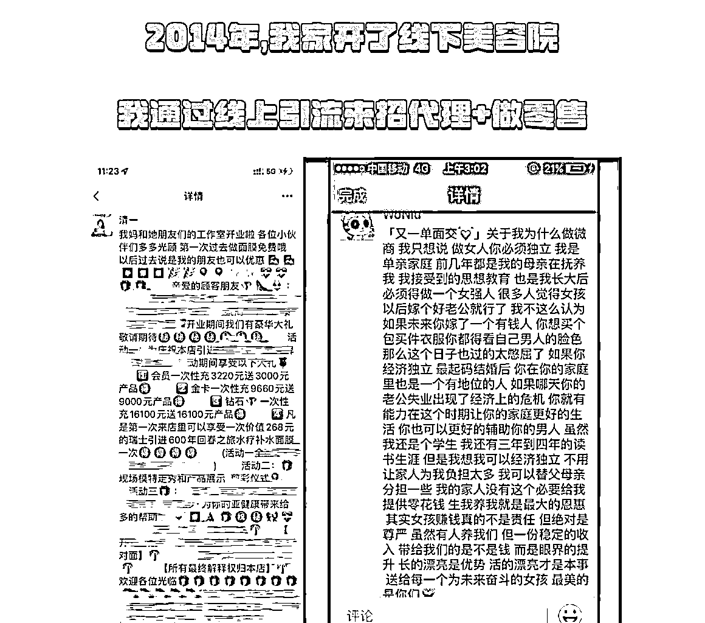

在本地我们做朋友圈裂变，把人引到门店，通过服务带动产品销量。

在线上我用舞蹈演员身份，在美拍微博发日常演出，引流到QQ招代理。

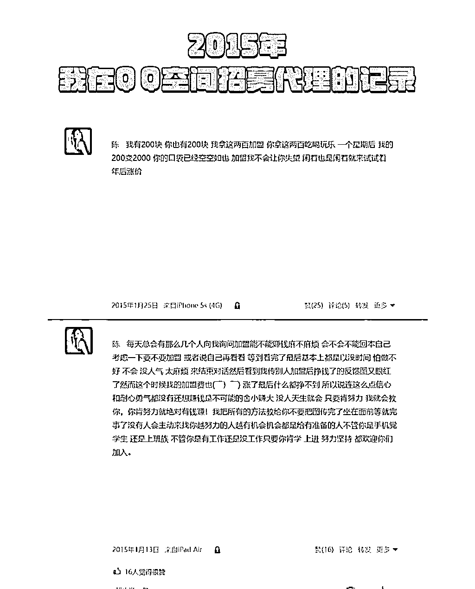

当时代理费200，活动价180。和动辄囤货几万的品牌比，我们算是良心价了，到一定销售额还会退加盟费。

所以2014-2015年，我帮家里招到了全国200+代理，年销200万+。

看看当年微商的朋友圈长什么样：

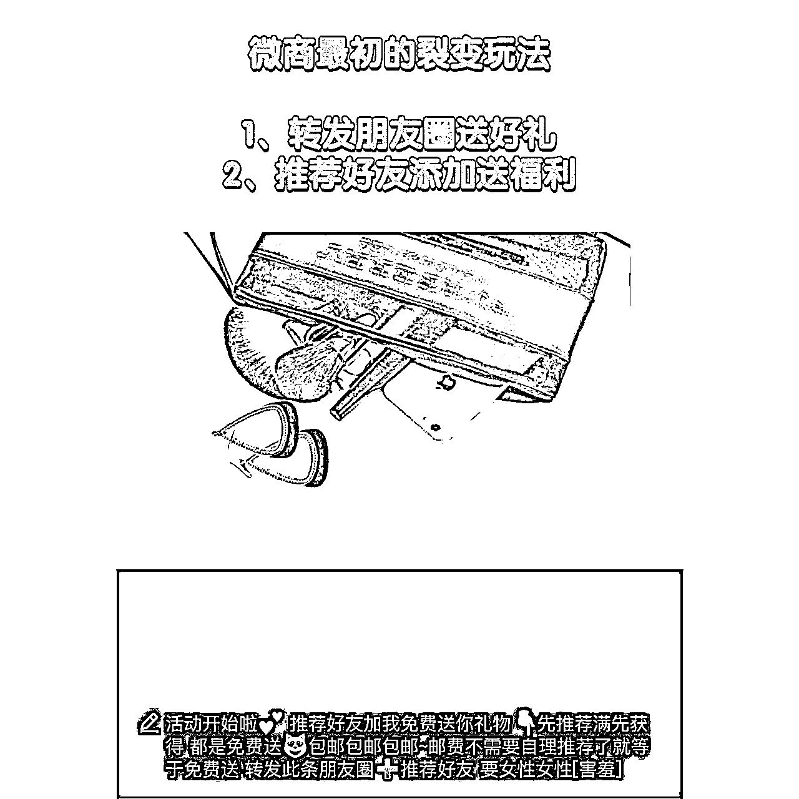

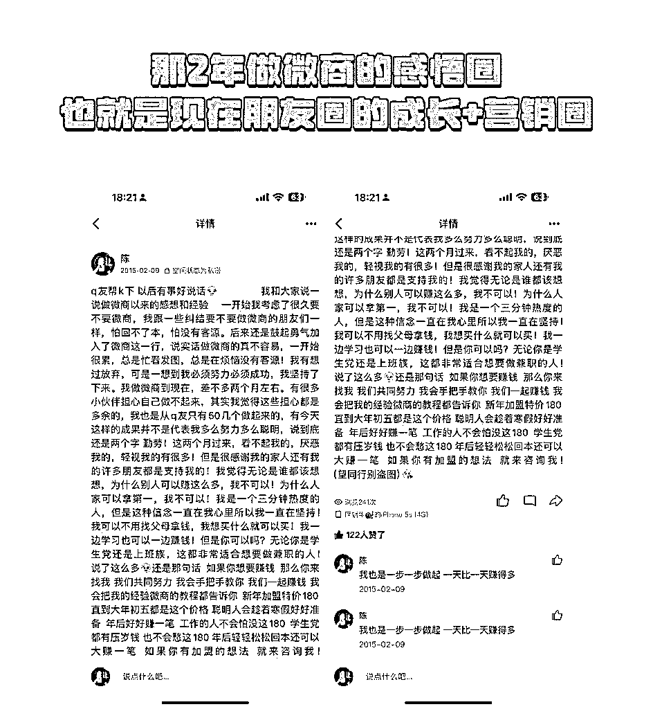

这就是最早的私域社交电商雏形，朋友圈疯狂刷屏，大家都在做招代理。

当年入局微商，要么做品牌代理囤货拿到货源，像我这种只要200就能授权的很少见。

但同样文案、同样玩法，2014年很有效，到现在就没人看了。

为什么？私域进入精细化时代，老微商那套已经失效了。

2020年疫情来了，又一波人涌入微商，当年嘲讽微商的，最后都成了微商。

我在头部社交电商做私域内训最清楚，2020年公司业绩再创新高，每天注册代理权限几十万。

只要微信还在，微商就不会死，只要人需要链接，私域就一直存在。

微商没消失，只是被优化成了用户能接受的形式。

现在是2024年，新私域元年。做私域核心是“人货场”。

【人】是客户关系的递进
【货】是成交产品的递进
【场】是销售场景的递进

## 1、新私域：【人】是客户关系的递进

从围观者到关注者，到购买者，再到使用者、传播者、销售者，这就是用户在私域里的不同阶段，每个阶段转化的关键点不一样。

一个人从对你好奇，到成为铁粉，再到核心用户，最后为你带来增量，这中间靠的就是客户关系。

用私域场景打造独一无二的关系，拿到用户的私心，这时候朋友圈运营和私聊转化就很关键了。

## 2、新私域：【货】是成交产品的递进

以前微商从零售到会员再到代理，底层逻辑和现在做私域一样，不同关系匹配不同产品。

引流品用来激发兴趣建立信任，裂变品像现在流行的xka、快团团这类社交电商。利润品利润高复购高，但不是首单产品，需要极强信任才成交，却是主要收益来源。

现在无论带货、知识付费还是定制产品，都要有一套产品体系，让用户买完一次还想买第二次第三次，这样1000个铁粉才越来越近。

## 3、新私域：【场】是销售场景的递进

第一次相识一般通过引流进入私域，第一印象就是朋友圈。

朋友圈做得好，用户自然放下戒备，做不好，加了你那一刻就开始流失，这就是朋友圈的“偶然邂逅”。

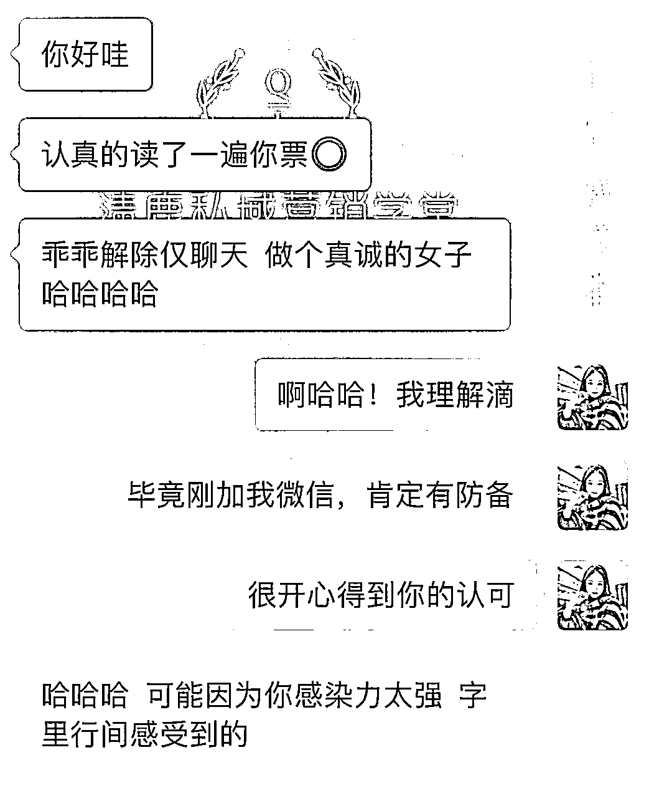

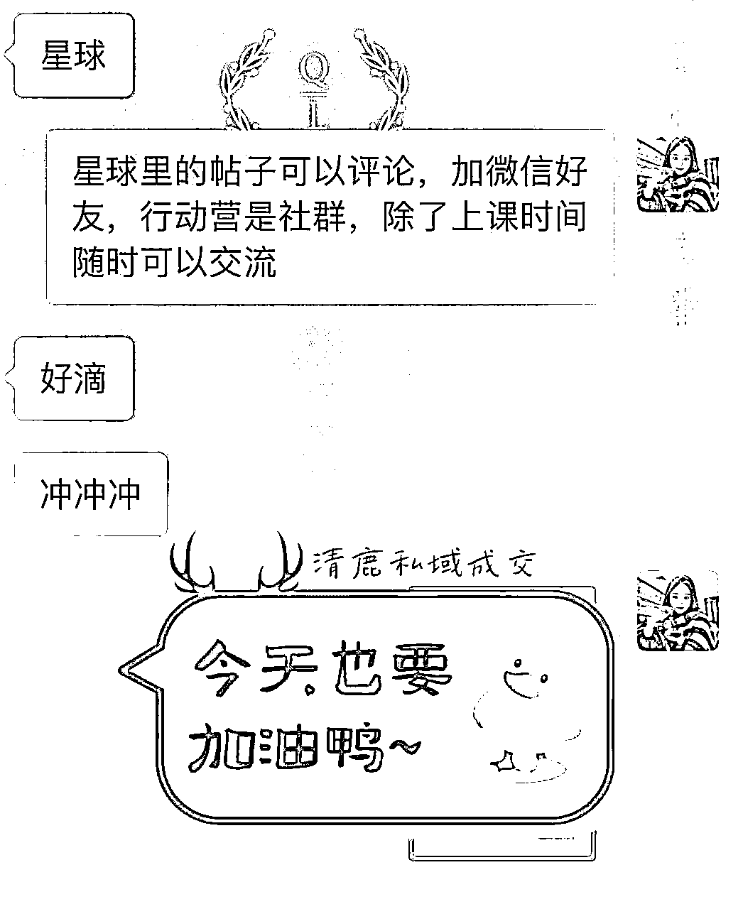

我有个客户从小红书加我，看完朋友圈觉得我感染力强，半小时就成交了首个引流品。

第一次成交后就是“再次光临”，要靠日常朋友圈营业、微信客勤、社群运营来维护。怎么让用户买第二单、客单更高？核心是持续给价值，把实力和魅力传达出去。

再到经常购买、一生相随，就要把客户当朋友，拿到他们的私心。

说完人货场，私域的核心是什么？

## 4、私域的核心是【建立信任】

线上线下生意，本质都是人找货或货找人。

优惠券、推销、渠道、异业互推都是我们主动触达。

私域本身没流量，通过上述方式带来流量后，能不能留住并复购？客户为什么选你只认你？

关键在于有没有做温度运营。内容好+运营对，才能真正留住客户。

具体怎么做？下面结合我的经历和清鹿私域模型来拆解。

# 二、大学2个月赚16万，掌握成交秘法

2015年下半年我上大学了，我这“事业脑”坐不住，看到赚钱机会眼睛就亮。

我去学了设计，想着做更好的图会助力线上生意。

可惜我设计没学好，老师说我海报没美感，是【丑图制造机】。

但在几次留学指导里我发现，这家机构有转介绍奖励，介绍一个学员有佣金，这让我心动了。

教学质量这么好，我学不会不代表别人学不会，我把机会介绍出去既赚钱也帮到人。

于是我开始行动。

那两个月成绩：转化100万+，佣金16万。

我在杭州各大高校贴吧引流，发帖说加微信送设计手册，有免费试听课。还招了一批同学帮发帖，每帖1块，一天能发50多帖。

再通过私聊筛选，带用户去线下听免费课，配合机构老师成交。

两个月里我掌握了私域成交秘诀，一直沿用至今，尤其适合高客单。

我称之为【私域成交黄金三步】

## 1、私域成交黄金三步1：人设培养

新用户加你，第一反应是发长篇自我介绍还是直接推销？陌生人对你一无所知，这么做只会被屏蔽或贴上卖货标签。

初期不要介绍产品，只讲清楚你能提供什么帮助，挖掘客户痛点即可。

当时贴吧来的学设计用户，我先送资料，再说有免费线下课讲PS基础，无隐形消费。然后问：为什么想学设计？就业还是兴趣？

用户回应后，我从专业角度讲学设计后的就业方向、市场薪资、需要设计岗位的企业类型。事先调研过，张口就来。用户对我产生初步信任，这就是人设期。

## 2、私域成交黄金三步2：关系升级

线下听课，万一是诈骗或有隐形消费怎么办？大家防备心都很重。

所以朋友圈我常发自己在哪个大学上课、真实生活照片，交流时尽可能语音。点赞评论用户朋友圈，提供免费咨询和见证，关系慢慢进入互信稳定期。

## 3、私域成交黄金三步3：销售成交

在信任积累下，很容易邀约到线下。有需求的人对你有基本了解和信任，就会优先选择你。

到线下基本来了就成交。没成交通常是信任不够。

千万不要刚加好友就卖，这会让朋友圈努力白费，贴上营销人标签。

私域高客单转化很丝滑，从加微信那一刻就要做好每个细节。破冰是温情输出，咨询是耐心解答，最后付款时用户毫无疑虑。

严格按三步走，转化率一定大幅提升。

检查下你的破冰、咨询、转化做到位了吗？是不是找到了低转化的原因？

继续往下聊，我是怎么成为头部社交电商平台私域商学院负责人，并带1300+学员实现变现的。

# 三、从0~1搭建私域商学院，玩转私域运营

毕业后我做了培训师，从就业培训做到私域商学院负责人。

这些年靠私域赚了不少，比如我给老东家做转化，连续两年破纪录，转化率从65%提到95%。

圈里很多朋友是通过我的口播关注我的，从小红书口播引流到私域，复购做到80%。

做私域，成为真正的私域培训师，一直是我的方向，大学就埋下种子，如今实现。

刚到公司就被冠上【百万私域社群操盘手】，虽然做过微商和高转化项目，这身份还是有点突兀。

这些年我手把手赋能，深耕一线。研究豆瓣引流、地推、小红书壁纸头像引流、带货引流、微博快手副业粉引流、招商项目群、裂变操盘。

从0到1产出私域课程，涵盖定位、朋友圈、引流、私聊、转化、招商，把所有技能通过社群图文和直播赋能给代理商。

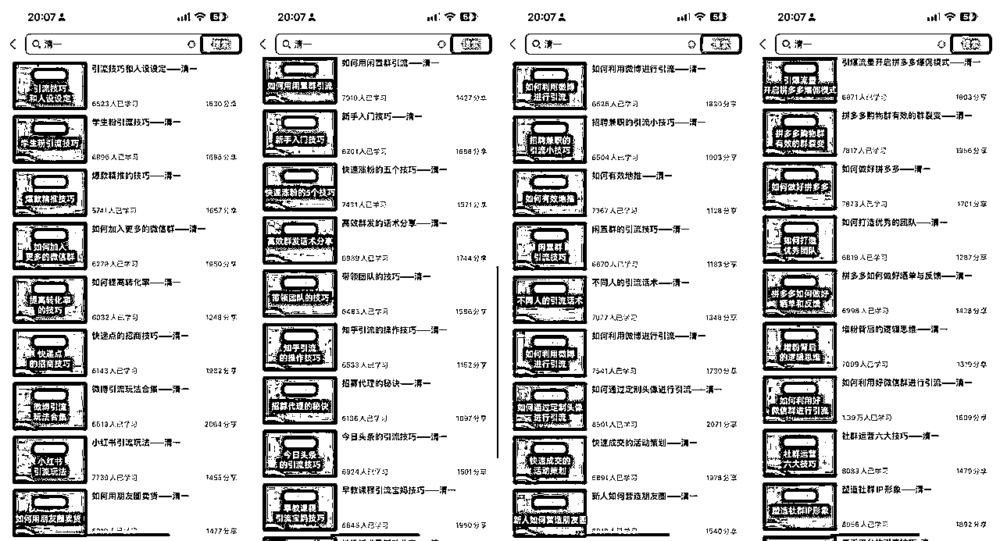

这是部分课程，后面还带了两个0~1项目。

通过至少创收8位数的带教经验，我沉淀了完整的私域运营闭环，也就是清鹿私域学堂赋能体系。接下来这5步私域技巧，请做好笔记。

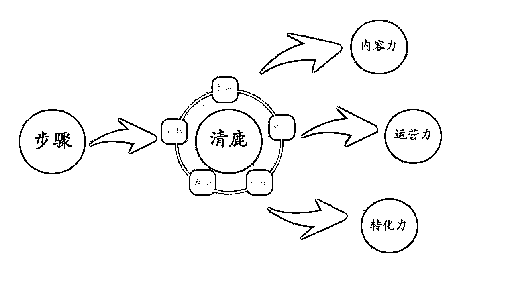

## 1、五步私域闭环1：确定私域定位和目标受众

-分析品牌优势，明确私域定位
-确定目标人群，了解痛点

清鹿体系里最基础的原则：想放大业务，先做私域，再做公域。

私域没跑通，公域引来再多也接不住。顺序错了就会定位和内容不匹配，白白浪费流量。

做好定位的秘诀：找到“我喜欢、我擅长、能变现”的交集。

### 1）我喜欢
喜欢的事有源源不断的动力。我小学六年级就爱在QQ空间给自己留言，很爱表达，做这事比别人好，所以毕业后做培训，做到私域培训师。

想想你愿意无偿坚持做的事，没监督没工资也会做。

### 2）我擅长
擅长是不用特别努力就比别人好。比如镜头感好、拍照好看。这就是天生吃这碗饭的领域，事半功倍。

### 3）能变现
喜欢和擅长不能变现，动力就会减。私域最终目的就是变现。可以是公域引流私域成交，直接卖货卖课，接广告，打赏等多种形式。

提前规划变现方式，比如展示技能提供服务知识变现，提供商品卖货变现，教人做短视频变现等。

定位和目标受众明确后，才能做具体布局。

## 2、五步私域闭环2：制定私域运营内容策略

-确定核心主题和内容类别
-创作高质量有价值内容

定位之后要决定公域和私域的内容输出，也就是内容布局。

定位就是为输出服务的，要找适合产品和目标用户感兴趣的内容，否则输出再多也没用。

比如做母婴的，目标是宝妈，宝妈喜欢什么内容，什么年龄段。

朋友圈里是独立女性，喜欢成长类内容。

圈子里爱珠宝爱打扮的，可以分享变美技巧、穿搭时尚信息。

确定领域：生活、副业、护肤、养生、健康管理等。

确定内容风格，每个人表达方式不同。要找到适合自己的。有人适合录视频发语音，有人擅长做图。

定位内容领域要垂直，风格要鲜明，才能让用户快速建立认知。

做好基础内容布局，确定主题和类别，创作高质量内容。

## 3、五步私域闭环3：打造精准引流获客渠道

-确定高质量引流钩子
-吸引精准用户，助力高效成交

私域的命脉是流量，没流量再好的内容也没转化。

要保证每天输出，保证新用户加入，保证与用户互动。

本质就是找到精准流量来源，选择正确的引流渠道？

流量本质上就是一个捕捞场，池子决定了能碰到什么鱼，鱼饵决定了谁会咬钩。

渠道就是那个池塘。池塘里既有游荡的小虾米，也有体型巨大的鲤鱼。你选用什么工具、投入多少精力，直接影响到最后钓上来的是什么规格的鱼、能钓多少条。

选池子的时候，不能只看水面有多大，还得看里面鱼的饥饿度，以及你的饵是不是正好踩中它们的需求点。

举个母婴品类的例子，如果要规划引流路径，我会先把产品本身拆清楚。

这个品类要打动的是哪一类妈妈？她们大致处在什么年龄段？是自用为主还是走礼赠路线？适合多大宝宝？价格带落在哪个区间？

把这些用户画像和产品属性想透了，再去谈渠道才不至于乱撞。美柚、宝妈社群、豆瓣小组、小红书这类池子，都是首先要评估的方向。

如果从零起步，完全没有获客经验，最有效的做法是先做小规模测试。用最低的成本、最短的周期去验证渠道反应，拿到数据后再放大投入，逐步筛选出性价比最高的那条获客线。

渠道从不是一成不变的。我前几年在小红书引流相对顺畅，平台管控也松；到了今年，同样的做法已经很难奏效，必须用更高的内容密度和更好的质量去对抗算法。整个过程中，数据沉淀和数据敏感度是命脉。就像郑韩老师提到的那张数据表，每条内容的数据、引流情况都要留痕，只有这样才能在平台规则变动时，依然保持增长的节奏和体量。

## 4、五步私域闭环4：把朋友圈和社群运营力练起来

落地私域全流程SOP，精细化运营，成交自然不费力

有了基础的私域流量池，下一步就是把朋友圈和社群的运营能力升级。优质内容必须配合精准的运营动作，才能实现更深层的用户链接，从多角度触达目标人群，为转化提供持续动力。

朋友圈和社群，本质上就是私域转化的主战场。运营做好了，私域的成交量可以直接翻倍。

以朋友圈为例，日更是基础，但很多人卡在不知道怎么更。抓住三个核心问题就能破局：

1、为什么发？
2、发给谁看？
3、发什么？

这其实就是3W黄金圈的思路，源自西蒙·斯涅克的底层思考框架，也与《高效能人士的七个习惯》里“以终为始”的逻辑相通。做任何事先认清方向，才能避免在执行中走偏浪费精力。

应用到朋友圈写作上，就是写之前先想清楚目的、受众和内容。

朋友圈内容大致可归为三类：

产品圈，偏营销，主要用于直接成交；
人设圈，偏成长认知，用于塑造IP形象；
生活圈，偏日常分享，用于拉近距离。

把这三类内容与三大核心问题结合，就能沉淀出朋友圈的日更SOP。

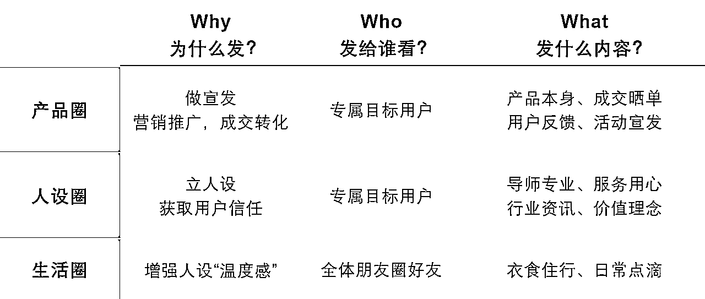

再往下细化到具体时间点。比如设定日更3条，就对应早中晚；日更5条以上，结合排期表就能形成完整的日更SOP，从此告别断更。同样的方法也可以复用到社群运营、私信破冰等环节，真正把私域全流程标准化，精细化运营才能让成交变得轻松。

## 5、五步私域闭环5：把关系做深，实现高价值转化

打造高粘性私域IP，培养1000个铁杆粉，变现就有了底气

成交只是销售的起点。私域的真正价值在于让一个客户持续复购，并带来稳定的转介绍。核心在于提升客户终身价值，即客户在生命周期内为品牌创造的总价值回报。

终身价值由历史价值、未来价值和推广价值构成。

比如每天一杯瑞幸，一年365天，每杯10元，一年3650元。按乔·吉拉德的“250定律”，一个顾客能影响身边250人的消费决策。抓住一个用户，就等于撬动250个用户；得罪一个用户，也等于得罪250个用户。按此计算，其终身价值会被放大250倍，达到4500万元级别。

所以我们要做的，是把体验感做到极致。私域本质是心域，跑赢竞争对手的关键在于能否创造超出预期的服务。

当前多数产品的现状是同质化严重，服务平平。极致体验感必须做到好到令人难忘，好到用户不选择你都觉得亏欠自己，这已经成为企业厮杀的核心武器，也是体验课、试听课、公开课不断兴起的原因。

公开课的本质也是引流裂变，用一场高质量的输出给用户不一般的感受。

极致体验感分产品体验和服务体验，常常同时呈现。持续收集用户反馈、不断迭代产品，用用户思维去沟通，这才是关键。

微信不是单纯的营销工具，而是维系人际关系的沟通工具。对每个用户都要高度重视，因为“好事不出门，坏事传千里”。

用极致服务提升体验，让用户成为忠实粉丝，从而创造更多终身商业价值，这才是私域的终极目标。

# 四、带领1300+学员，跑通并放大私域业务盘

从去年至今，我实操带领1300+学员，用私域方法高效放大业务盘。下面直接上学员反馈，用户的证言才是最真实的。

“短短1个半月，副业收入过万”
“学了清一的社群课程，单月佣金6000”
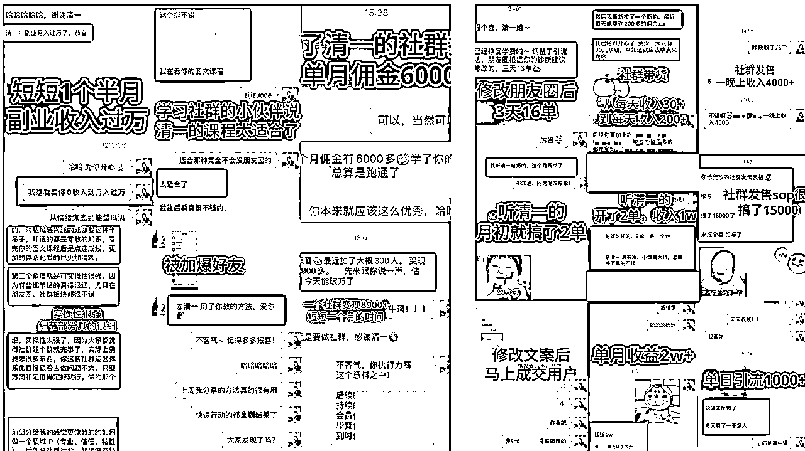

这批反馈是我去年起盘时第一批用户的声音。至今我们的案例已多到无法完全汇总。去年我自己延伸的【抖音团购】业务盘，通过私域发售玩法，3个月实现10倍增长。

这些结果都在验证清鹿私域模型的可行性。如果你的私域还比较模糊，用这5步自查即可。

路径规划清晰后，所有工作都落在了三个层面：内容、运营、转化。所以这5步走完后，我们要持续打磨的3力是【内容力】【运营力】【转化力】

前段时间我在朋友圈问过一个问题：有什么东西能跨越时空进入大脑并让人印象深刻？

大概分两类，“刺激之物”和“启迪之物”，做私域这两类都要。

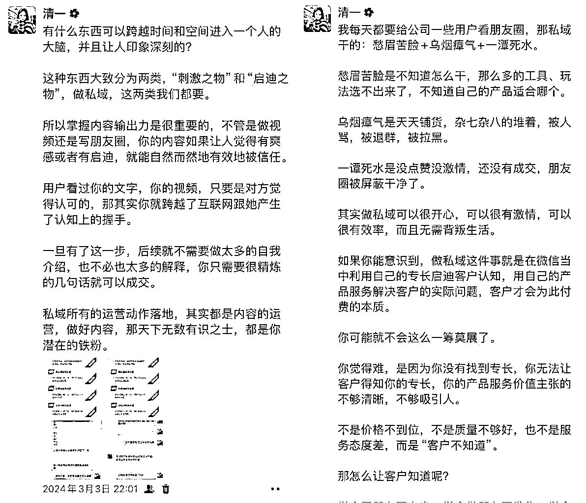

掌握内容输出力至关重要。无论是视频还是朋友圈，只要内容有爽感或启迪，就能自然建立信任。

用户看过你的文字和视频，一旦认可，就等于在认知上完成了握手。后续不需要过多自我介绍，不需要反复解释，几句话就能完成成交。

私域所有运营动作的本质都是内容运营。内容做好了，无数有识之士都是你的潜在铁粉。

只有好的内容加上正确的运营姿势，才可能实现高转化。

这三点做到位，才能牢牢抓住用户的心。好的运营、好的内容、好的转化，会共同培养用户的规律和习惯。

比如我和挚友打造的【清鹿私域俱乐部】，每月都会进行打卡活动，引流打卡、朋友圈打卡、实战答疑，久而久之养成了用户的习惯。

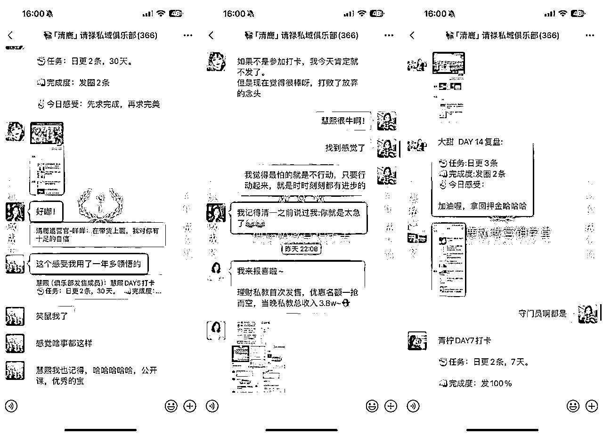

每位参与打卡的伙伴都会在睡前打开社群打卡并浏览，从中获得强正反馈，通过规律发圈赚到更多钱，自然就会留存下来。

私域同理，人性对有把握且规律的事会产生依赖和信任。持续满足用户安心、靠谱、稳定的心理需求，是成交的基础也是核心。

你需要思考的不是要不要做私域、别人会不会烦，而是如何把这些做好。

这些年，各种产品、各种人设，包括小区超市、外卖、咖啡、知识付费、定制化服务都在做私域，这本身就证明了私域是一个非常好的场域。

房地产销售的微信、中介的微信、律师的微信，本质上都是利用私域这个杠杆来维护客户、撬动复购、提升收益，只是在玩法上各有差异。

所以如果你的产品具备复购属性，强烈建议把私域做起来，高效放大收益，构建品牌护城河。

# 五、从C端陪跑教练，到教育赛道Top级品牌100w+私域内训陪跑师

23年年底，我们开始为微商团队做内训，当时以线上图文语音为主，帮助代理招商转化。

到今年，内训价格已涨至6000/天，接下头部品牌合作，从线上走向线下，从内训升级为陪跑。

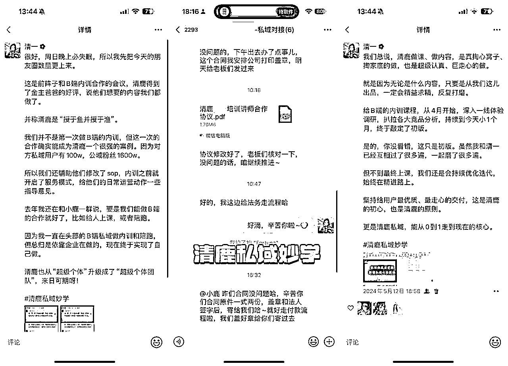

今年对接大企业，有几点感受特别深，也和大家分享B端与C端的差异。想成交B端老板的，这部分一定要看。

我们也总结出ToB与ToC的诸多区别，希望能助力各位IP做好B端成交。

做知识IP大多从C端起步，尤其是刚入行的小伙伴，想直接跳ToB不现实，必须在ToC积累足够后再拓展ToB业务。

要做ToB，就要把与业务和专业内容相关的所有亮点、优势、能证明专业度的点全部展示出来，比如过往履历、做过的项目、服务过的客户、对特定问题的独到认知等，这些在拓展ToB时会大幅加分。

像清鹿拿下的这次合作，除了过往案例和个人介绍，还专门为该公司赛道制定了一份内训计划表，因为是头部IP合作，体量不小。

那么B端客户到底如何决策？购买行为有什么特征？下面展开。

## 1、B端合作特点，内训决策链路长

B和C截然不同。B是一种法人主体，不是真实有血有肉的个人，而是一个法律人格化的经济社会组织。

比如公司创始人决定了需求偏好、购买行为和决策范围，这与C端客户完全不同。

想要拿下B端业务，首先要深度理解B端业务特点，否则用ToC的服务模式去谈ToB，必定踩坑。

卖给B端老板的产品，买单的人和最终使用者是分开的。

比如你给企业做内训，老板是决策人，员工才是使用者。这次合作老板明确预算10万。我们就要站在老板角度思考：这10万如何让团队掌握私域运营技巧，同时留下可复制的SOP，并缩短周期，让服务更轻、收益更大。

这种谈判必须带着完整方案过去才有机会成交。

对公司行政或HR而言，更看重人效、供应商靠谱度、性价比。对员工而言，只关心是否有帮助，体验好不好。

面对B端客户，必须找到所有利益相关方的诉求，这单才有可能做成。

## 2、B端消费特点，刚性需求的理性采购

B端采购基于刚性需求，理性驱动，不会冲动消费。

因此B端合作节奏很慢，决策链路长、周期长、试错成本高。因为采购是超理性的，不会因某个个体的感性认知而改变。

一个企业采购培训，主管经理要汇报给上司，人力资源总监要参与，可能还要和业务部门沟通，金额较大时还要财务采购审议，还有三方比价，每一个角色都要发声，是集体决策。

C端强调小步迭代边做边调，但B端很难接受试错成本。越成熟的企业，决策流程越完善，保证决策不差。

一天谈成、半天落地的B端合作，我在B端培训多年未曾见过。除非是极小微企业，大企业通常需要7-15天才能落地合作。

因此和B端打交道时，必须考虑他们的决策方式和链上各角色的想法。

## 3、B端服务准则，时刻谨记“定向”

客单价越高，越要做定向化方案。B端老板特别喜欢以客户为中心的服务态度。

B端更强调在垂直领域的精准专业影响力。就像理发，Tony老师要根据脸型、气质定制发型。

我们每次提案都会针对企业赛道做定制化课程内容。

做知识付费的伙伴，如果未来想赚得更多更轻松，B端合作不可少，这几点原则要把控好。

目前清鹿的合作已进入交付期，交付结束后我会再详细分享B端内训和陪跑的流程，帮助大家少走弯路。

以上是我全部的分享，希望能为你的私域成长提供启发和帮助。

感恩生财有术，也祝大家生财有术！