# 新手入局到单场GMV110万的绝处逢生之战
作者：龙哥

**从实体店负债累累，到单场GMV 110万：一个电商小白的绝境翻身记**

> 半年前，我还是个连“随心推”都没听过的纯新人；昨天，我的抖音直播间单场销售额破了百万，还登上了周榜第三。这一路没什么高深莫测的黑科技，只想把这个过程里的真实经历讲给你听——也许能给同样在摸索期的你一点共鸣。

短视频带货的底层密码，其实就一条：量变引发质变。

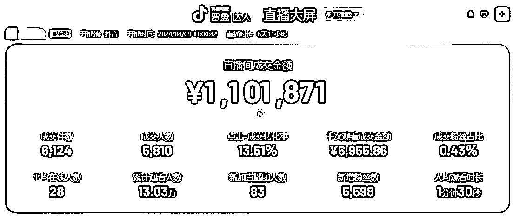

圈里的朋友，我是龙哥。你看到那张后台数据截图时的第一反应，是不是“这波赚大了”？说实话，我当时的第一感觉不是爽，是懵。一个入局才半年的行业新手，突然等到这个成绩，多少带着点不真实。有人可能会酸一句“纯属走了狗屎运”，而我更想说的是：如果没有遇见那群愿意拉我一把的贵人，就没有现在的翻身仗。其中最打动我的一句话是：“别小富即安。”所以，我收拾心情，坐下来把整段路复盘给你看。

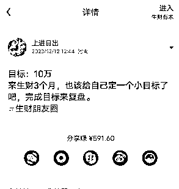

这篇复盘分成五个部分，方便你阅读：

一、怎么亏出来的
二、怎么跌跌撞撞入了视频号
三、一个全新的电商小白，怎么在一周里把单品做到爆1000单？
四、110万的GMV到底是用什么铺出来的？
五、为什么“双频共振”是我这局真正的杀招？

# 一、先讲讲我如何把自己折腾到负债累累

在正式开始做电商之前，我的标签非常朴素：一个在实体行业埋头苦干了十三年的上班族。如果非要给我的前半生写一句话，那大概就是——从身无分文，到身负巨债。现在网上很少有人会坦白讲自己怎么失败的，大家更爱晒成功、教你复制成功。但今天我想当那个说实话的人，把自己踩过的坑，掰开了讲给你。

2009年，我刚入行做销售，底薪400块。说句掏心窝的话，当时虚荣心特别重——干了两年，为了结婚有面子，我敢在零积蓄的情况下借钱买房。后来换了工作，月收入大概五千，又眼看周围人买房买车，心里压不住，就铆着劲儿想创业。于是，背着一身债，跑去借高息，开了一家公司。头一年运气好，赚了点钱；然后我又眼热别人换房，把老家的房子卖了，跑去买了第二套。结果，公司撑到第二年底就没扛住，负债越滚越大。

中间老实上了一年班，但对一个欠债的人来说，靠死工资还钱等于幻想。我满脑子还是那句话：“想翻身，必须做生意。”于是又借了一笔钱，开始第二次创业。第一年确实还可以，但紧跟着三年特殊情况，公司熬了三年，最终还是以失败收场。

给自己做个小总结：当你的消费跑在收入前面，生活会变得毫无幸福感。没有财务规划，大概率过得狼狈。不要跟人比较——比较是个大坑，你越较劲越深陷。现在的社交网络，让真实的贫富差距被放大了无数倍（这话引自《财富的真相》）。如果我的这些经历里，有那么一两句能帮你在做决定时多留个心眼，那这段黑历史就没白写。不过回过头看，每一次摔进谷底，好像都在暗地里为后来的翻身埋着草蛇灰线。

# 二、掉进视频号这个大坑，从“零”开始

去年年中，我偶然接触到了赚钱这个圈子，花了三天时间体验课程。说实话，当时整个人都傻了：原来电商还能这么做？比我过去十三年干实体所了解的一砖一瓦，颠覆太多了。但因为公司还在清算，我没办法立刻专注去做项目，心里干着急。痛定思痛，我意识到最大的问题出在认知不够。于是那段时间拼了命看书，从经典文学一路看到励志故事，只想把思路打开、把视角撑大。直到9月份，我正式加入赚钱，定下第一个目标是👸号爆文。因为错过了集体航海时间，我就自己抱着手册啃，硬是琢磨了一个月，赚到了人生中第一块钱。

不过家里人不理解：“整天窝在家里弄这些，到底搞不搞得明白？”那段时间压力特别大，我自己也不甘心，耐着性子又给了自己一个机会。我跟家人做了个约定：再试一个项目，要是还不行，就老老实实出去找工作。后来在赚钱的帖子里翻来覆去看了好几天，终于遇到一篇特别真诚、特别贴合普通人的文章，顺着链接认识了“奋斗ing老师”。他给我引荐了现在在做的郭晓文养生项目，可以说是全网最懂新手的男人。

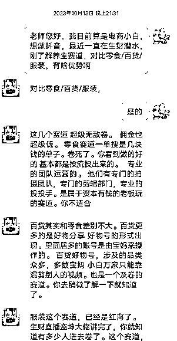

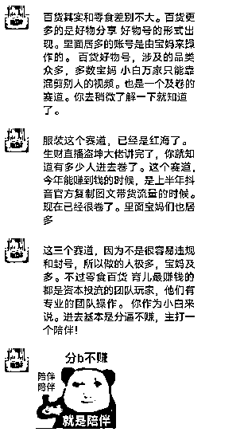

刚上手时，光是学剪辑混剪就把我干崩溃了。一条视频要磨3个钟头，每天熬到凌晨两点才睡。直到剪到第100条左右的视频，速度忽然上了一个台阶——量变带来的质变，是实打实的：速度上去了，质量也比之前好得多。混剪做了半个月，终于开始出单。第一次开播没能守住流量，还因违规被强制下播了，但那条视频最终跑到了50多万播放，换了300块钱收益。别笑，当时我真的激动坏了。后面就不停地测品、剪视频，每天发20到30条，结果当月佣金直线冲到3.5万。我拿着这个数字给家里人看，像交了一份迟到很久的答卷：“我的选择没有错，我的坚持也没错，请相信我。”

# 三、一个新手怎么在短视频直播带货里活下来？

新人想在短视频带货里突围，我觉得关键看四样东西：选赛道、拼作品质量、堆作品数量、养账号权重。听起来简单，做起来全是要命的细节。

第一条，选一个对手不那么多的赛道。思考决定选择，选择决定方向，那些自己扎进去就是红海的赛道，新人连水花都翻不起来。一定要找有壁垒的地方——但所谓壁垒不是技术壁垒，而是心理壁垒，比如别人嫌违规风险高、不敢做，你把它拿下。

第二条，尽量做出比别人好看的内容。作品质量涵盖创意、拍摄、剪辑、展示等方方面面。能力一时半会儿练不出来，但如果目标是快速搞钱，还有另一条路子——我技术不够，能不能“借用”别人的？抠像呗。借力使力不费力，中短期完全有效。平台现阶段其实很缺内容，供给跟不上需求，我那110万的GMV，说白了就是这条思路打出来的。这个道理是Erik老师点醒我的：“人一定要剖析自己的优劣势，找准自己的位置，把优势放大。口播不适合你，你硬练也没用，那能不能找人代播、借势？”想明白了这一点，就豁然开朗了。

第三条，产出的数量要压过对手。不是让你盲目堆量忽略质量，而是在保证质量的前提下，尽量把作品发得比别人勤快。持续更新能带来大量曝光，新粉也会被慢慢带起来。

第四条，账号权重一定不能忽视，可以做单品长期路线。多跟粉丝互动，保持账号活跃度，流量视频和带货视频之间得有个平衡。权重高了，平台给的自然曝光也会更多。

再说说怎么选品。我的方法是盯广场，看看正在直播而且场观不错的，那说明视频正在爆。点进商品详情，研究带货达人数和销量，判断品的热度是否到了我的预期；再观察赛道上对手数量，以及有没有持续增长的势头。最后打开🛰️指数搜下关键词，看趋势走向——基本上，这个品能不能跟，心里就有谱了。

如果你前期根本不会选品，那就老实跟着老师和圈友推荐的品走。我自己的习惯是：锁定好品之后，多号一起打，持续打，把流量吃透。视频一被推上热门，我立刻开播把流量接住。11月份那个“一周爆1000单”的小成绩，就是这一场一场累积出来的。

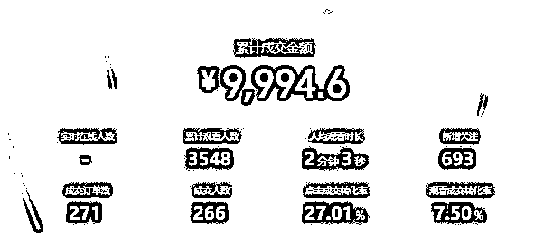

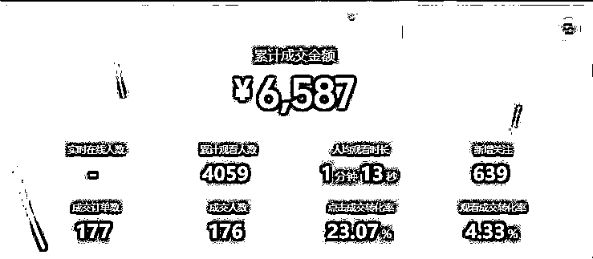

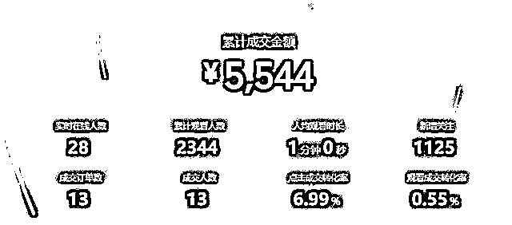

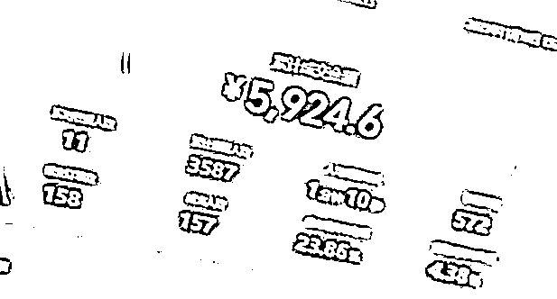

# 四、那单场110万的GMV，是怎么打出来的？

11月那波小爆发后，我整个人有点飘。12月，我决定开始做“抠像+实拍”，心里想着：这不得搞个5万回来？结果是——整整一个月只赚了5000。脸被打得生疼。根源在哪？发力点错了，思考太浅。所谓骄兵必败，我陷入了极度的自我否定，那阵子我管它叫“灰色12月”，每天又焦虑又煎熬，因为每一份结果都在提醒我：如果收入远低于预期，那颗炸弹随时会炸。

有句董宇辉说过的话陪了我一阵：“痛苦的本质来源于你对现状的不满，焦虑的本质来源于你成长速度太慢。往往不开心的人更容易做出伟大的成就。”不开心的人写诗，能流传千年；写书，能收获好评。我把这句话也送给你。

1月份，我终于跟上一个别人已经打爆的品，决定深耕：一直播到短视频流量衰减，然后平播。70天，整整140场直播，佣金11万。正是这些扎实的基础，把我送上了4月份在抖音集中爆发的舞台。用我老师那句经典的话：“没有白走的路，每一步都算数！”

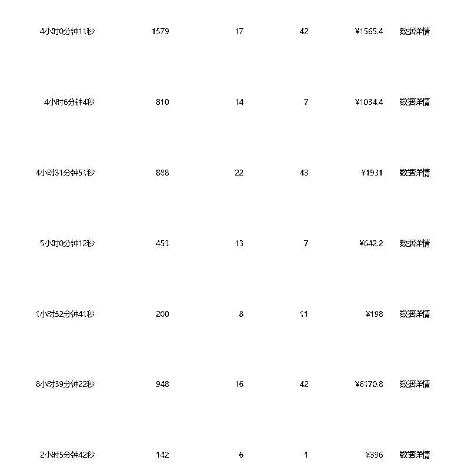

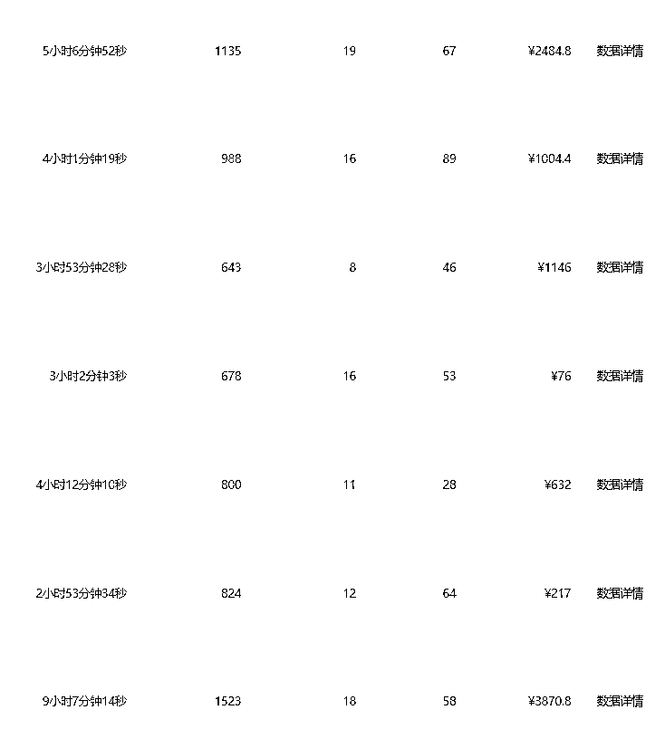

这一仗的体感是什么？第一，对品的生命周期要有判断力。别靠感觉，感觉经常是错的。得调研：广场上还有没有同类内容？量多不多？圈子里的玩家还有多少在打？1月份锁定那个品之后，我一直坚守单品单号，口播+带货视频交替输出，坚信“慢就是快”。虽然有时候一天只有几百块收入，好的时候能有几千线，而身边很多人凭借其他品爆单，说实话我心里很痒。但我忍住了——因为这个品一直有人出素材，一直有人爆单，我就一直播，直到把这个品的流量基本吃完才罢手。

吃完视频号这个品之后，我的重心转回选品和实拍。偶然刷抖音时，看到有人在同样一个品上爆单——这里要强调一句，做项目一定要多号、多平台、一鱼多吃。那个品还是我熟悉的，之前也见过别的品在抖音用同样的方式引流，没太当回事；这次我多留了个心眼，第二天看到对方还在爆单，立刻着手剪视频。没想到刚好有个六千多粉丝的抖音号垂直在这个赛道，先前的布局没有白费。视频一发，当天直接开播12个小时，打了20万GMV。之后直播间被违规下播。这一点我要重点提醒：视频号对视频严格，抖音其实对直播管得更紧。下播后我一条条翻系统的处罚细则，总结违禁词，优化话术，第二天换号再上，硬是成功避开了雷区。

那之后我完全不敢下播，因为我习惯把流量吃透：中段和家人轮番上阵，播到第34个小时，GMV冲到85万；后来实在扛不住，请了专业的代播团队来接力，做日不落直播间。最终那场直播整整打了6天零11个小时，直到账号违规被强制下播。那一周，我和家人平均每天只睡3个小时。这个“断引直播间模式”在抖音上完全行得通——因为抖音的用户习惯是挂车购物，如果你没挂车，就一定要开播把流量接住。这一战，我叫它“绝处逢生之战”。因为它让我拿到了这辈子最大的一笔结果。负债始终像炸弹绑在身上，逼得我不敢有半分松懈。这里要郑重感谢原创作者——爆款制造机@芬达，以及代播界的吴彦祖@阿祖。没有你们，不会有这110万。

现在各平台都在大力扶持真人口播，流量很猛、爆发力强，对新手其实极其友好。你可以没资本、没颜值、没家底，但只要有一颗不服输的心，肯下笨功夫坚持，结果不会亏待你。赚钱圈里很多人写透彻了口播技巧，不妨搜来试试。心动不如行动。

最后想跟你分享我一个干项目的四点心得：

1. 专注：心无旁骛，万事可破。
2. 勤奋：付出不亚于任何人的努力，连神明都会庇佑你。
3. 耐挫：人得皮实一点，别轻易被困难打倒；平衡好心态，学会自我疗愈。
4. 正确的初衷：它会在关键时候成为你的铠甲。很多时候聪明是智慧的天敌，聪明人跑得都早，而定力才是笑到最后的武器。

# 五、双频共振，才是真正的大杀器

说起直播，很多人第一反应是“我不会，我恐惧”。我以前也一样——只会爆量后开播接流量，不懂什么叫憋单、微逼单、强逼单，也不会引导互动和浅层数据。直到遇上肖肖老师——直播界YYDS，她给了我连播70天的勇气，让我真正开了窍，也让我做成了“双频共振”的效果。

短视频和直播间之间的关系，远不只是“视频引流到直播间”这么简单。当短视频的流量涌进你直播间之后，你在直播间的表现，会反过来影响这条短视频的流量分配。举个例子：一条视频引来100个人，如果其中5个人下单，你的转化率是5%。平台的算法会拿这个数据和同类直播间做横向对比，如果你的数据胜出，它就会给你的短视频加权，把流量推给更多新用户；更多人来了之后只要你继续热卖，系统再继续加权，于是越滚越大。这，就是短视频和直播间双频共振的基本模型。

当然，底层算法要比这复杂得多，远不止考核一个转化率。但核心逻辑和刚才的例子差不多——所以你会看到，很多直播间发现视频有爆的苗头后，会24小时不下播。理由很简单：视频爆了就往直播间灌流量，进来了能转化就继续卖货；直播间转化得好，又反向推动视频更爆，流量滚起来，直播间销售额就更稳。视频爆了之后别给自己设上限，直播间能开多久就开多久，流量吃不透不下播。

如果想深入学习直播干货，强烈推荐我师姐@李嗯嗯的复盘笔记（直接戳链接进去看）。

# 写在最后

我这一路最深的体会是：一定要戒掉抱怨。遇到麻烦和不顺心，能解决就去解决，解决不了就承受。抱怨没有任何意义，只会把你面对问题的能量白白耗掉。（这话出自李笑来的《财富自由之路》）

人偶尔气馁太正常了，毕竟谁也不是铁人。但真正决定胜负的，常常是在那些“再咬牙顶一下”的关键时刻——放弃是致命的。

只要不下场，就永远有机会。别太早否定自己。天赋型选手万里挑一，我们普通人就踏踏实实做勤奋型选手。我身边靠勤奋拼出结果的太多了。“慢就是快”，复利曲线是“世界第八大奇迹”，你不断去学习各种技能、持续积累，把“学到”的东西“做到”了，总会在某一天突然感受到复利回报。对此，你必须笃信。

再借用《水浒传》里一句话：“谁无暴风劲雨时，守得云开见月明。”

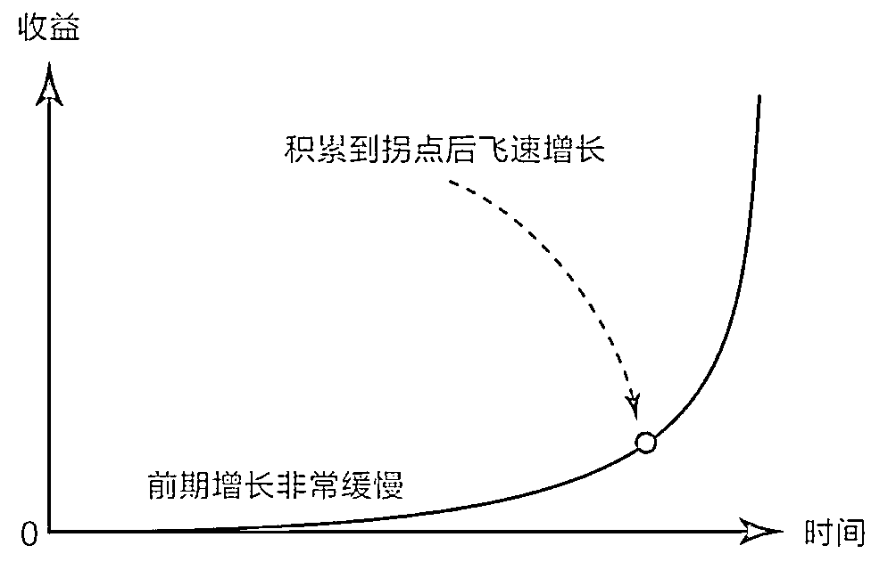

你问我的动力来源是什么？很直白：我欠了钱，所以对金钱的渴望是刻在骨子里的。目标我一般设两层，理想目标和预期目标。想碰到预期目标，你必须瞄准理想目标走；同时也要挑那些可能兑现理想目标的项目，把自己的时间成本放足够大，把注意力聚焦到每周每天。因为注意力＞时间＞金钱。

最后一定要说感谢。谢谢所有贵人，是你们在深坑里递来一条条救命绳索，而我选择了死死抓住、拼命往上爬。感谢龙哥、木易、盗坤、纸壳等大佬，你们的文章每篇都是满格硬货，一直给我供血；感谢郭晓文、李超鹏、Erik、肖肖、奋斗ing几位老师，帮我少走了无数弯路；也感谢芬达、木头疙瘩、冠哥、图图、向阳花、逍遥子、非凡、董小姐、李嗯嗯这些圈友——和优秀的人在一起，自己也会变得更加优秀。趁红利还在，一起努力，爆单爆单！

希望这篇文字可以给你哪怕一点点动力，感谢你花时间读到这里。一起上进，一起赚钱。

最后附上一张学习金字塔，共勉。

等我自己挣到100万，再来跟你复盘。

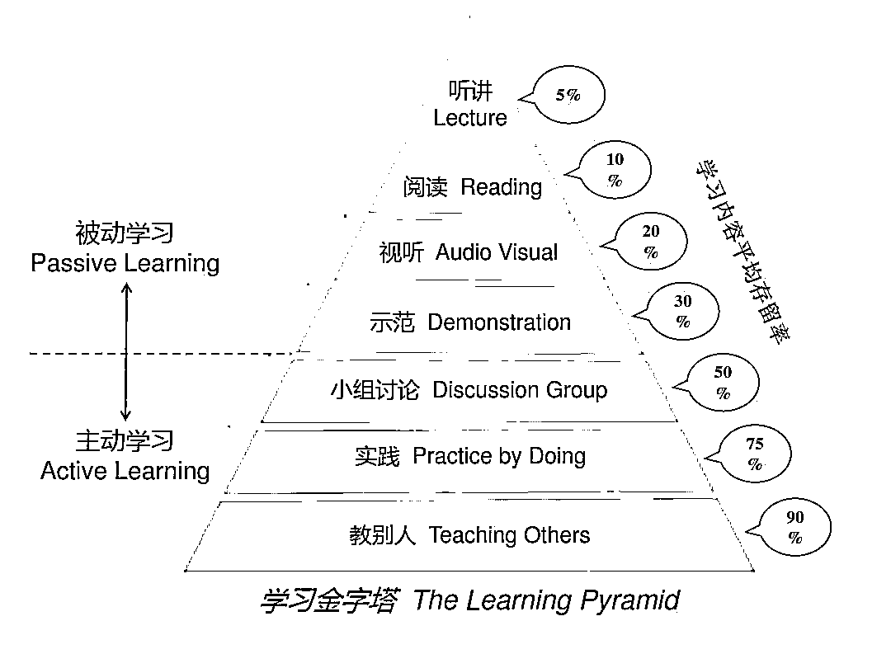