# 别再“光看不做”了！从失业到月入10w，我想通了一件事：实践才是唯一的答案

hello，各位赚钱的圈友，我是张波。一个穿得普普通通、没什么光环的男生，在很多人眼里大概还带着点“屌丝”气质。

2023年4月18号加入赚钱，可以说是我人生的一道分水岭。从那一天起，我从一个安安稳稳的打工人，跌入失业的谷底，再一路爬到现在月入10w+。这中间的落差、忐忑、咬牙硬撑，真的只有自己知道。

之前我写过一篇《扬帆正当时》，分享了自己这一年多的经历，想给刚进来的小白、以及还在迷茫期的圈友一点参考。写完那篇之后，很多人问我：到底该选什么项目？怎么才能赚到钱？为什么看了那么多帖子还是不知道怎么下手？

这些问题让我想起自己一直在读的《实践论》——教员在书里反复讲的那个道理：你要真知道，就一定要真去干。所以今天这篇，我想顺着这个思路，认真聊聊“实践”这件事。

【知道得再多，不落地等于零】

很多人把“赚钱难”归结于信息不够、认知不够。但我觉得，真正拉开差距的是两件事：一是认知的深浅，二是一个人肯不肯动手。

你看那些真正拿到结果的人，要么认知比普通人更锐利、更独特；要么执行力强得惊人，说干就干。知行合一这词儿，说起来简单，做起来难。

王阳明早就说透了：“知而不行，只是未知。”意思很直白——你光知道、光收藏、光看帖子，脑子里囤了几百G的教程，手却一动不动，那跟不知道没什么两样。

我自己试过的项目不算少：抖音、👸号、📕、知乎，但凡看到赚钱手册里有合适的方向，我都会去碰一碰。这个比例多少不方便细说，但我的态度很坚定：先干起来，再谈结果。如果只想不做，那所有的干货和帖子，攥在手里也只是一堆没用的文字。

因为说白了，认知从哪儿来？从实践里来。认知要验证，也得靠实践。你不亲自下水游一圈，怎么知道水有多深、哪里能捞到鱼？光靠别人口中的真假，你都没法分辨。

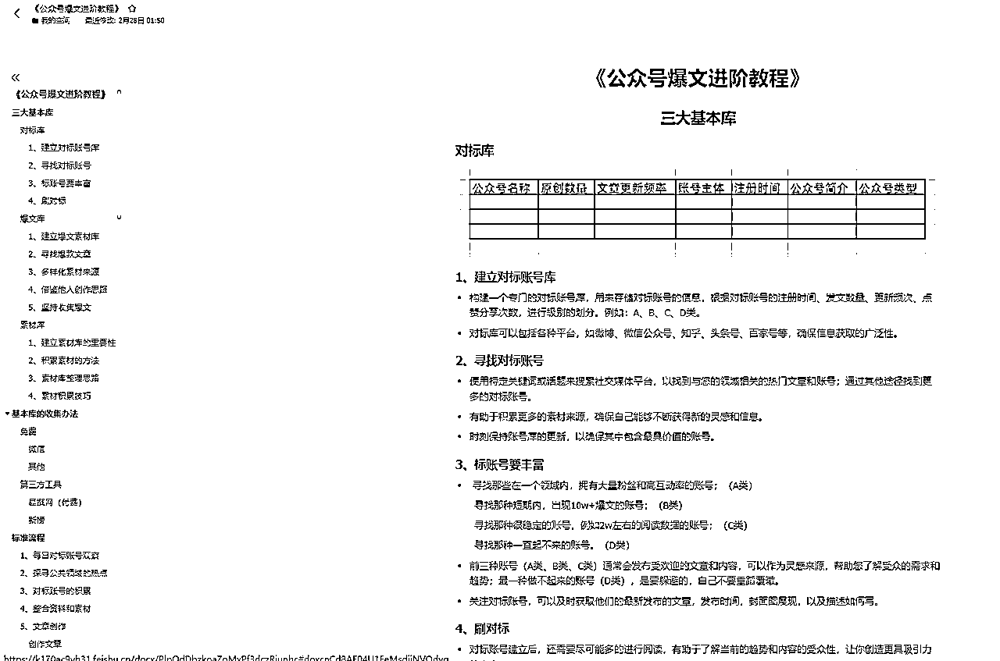

这篇《👸号爆文进阶教程》就是最好的例子。它不是拍脑袋编出来的，而是我在赚钱跑完一场航海、又续了一场之后，亲手把每一步摸透、拆细、做成了SOP。做完之后，我甚至可以把这套手册交给别人，让他们按标准执行，我来验收就行。

当时有朋友劝我：“这东西拿去开课收钱不香吗？干嘛直接发出来？”我没听。我把它公开，不是为了证明自己多了不起，而是想做一个利他的动作——我希望每个人都能快点拿到收益，而不是攥着这套东西自己去捞钱。

那次航海之后，我又默默潜了一个季度。那段时间我没闲着，一直在看帖子、拆帖子，把之前的东西沉淀下来。没去开课，是因为开课太耗精力了，我只想安安静静地积累，把根基扎深。

这堆文件袋，每一个都代表一个项目——至少有40个。里面除了我自己的笔记，还有不少自己总结的SOP。这些东西，靠看帖子看不来，靠花钱报课也不一定有人讲给你。这就是实践的独特价值：它可以让你适应随时变化的环境，遇到问题自己上手解决，在一次次试错里迭代出属于你自己的方法论，而不是永远活在别人的二手经验里。

【目标，是行动的灯塔，也是动力的源头】

没有目标的人，就像无头苍蝇，永远在迷茫里打转。我给自己定的规矩是：每年、每月、每周、每天，都要有清晰的小目标。别嫌麻烦，把大目标拆成小块，每天坚持推进一点点，一年、三年、五年回头看，你会感谢那个一直没停下的自己。

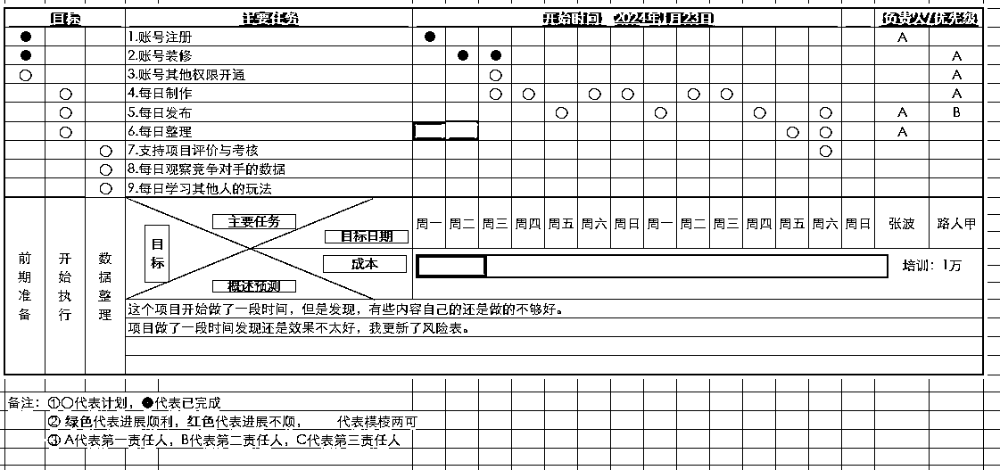

定目标还有个讲究——要具体、可实现。别在脑子里飘着“我要多赚钱”这种抽象愿望，把它翻译成数字和计划。

比如你想做📕，那就给自己定一个这样的目标：未来三个月内，每个月通过📕多赚6000块。目标一旦量化，思路就会清晰很多——该选哪个赛道？该用什么变现方式？每天该更新什么内容？这些细节都会被目标自动牵引出来。

当然，目标也得掂量掂量自己的分量。你让一个纯小白第一个月就实现副业月入过万，那基本是难为人。除非你手上有强资源、好运气，但如果有这实力，那说明目标反而定低了。当然，也不排除天选之子，一来就是巅峰，那另当别论。

目标还有个隐藏功能：它是一面反馈的镜子。你盯着目标，就知道自己走偏没有、哪里需要修正。比如你的账号数据不好，目标会提醒你——去对标竞争对手，去研究他们的选题、文案、节奏，然后调整自己的内容和运营策略。

【动手之前，先做好功课】

选择项目，不能靠拍脑袋。尽可能多地收集数据：平台是什么、变现周期要多长、大概能赚多少、市面上有哪些人跑通了。前期信息量越大，越不容易误判。哪怕有些数据看起来不那么合理，也先收集起来，后面慢慢筛选。

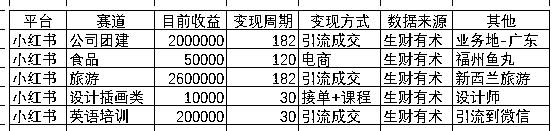

把这些数据整理成表，你会很直观地看到哪些项目已经跑通、收益是否符合心理预期。我在筛选项目时，主要看两个维度：变现周期 + 变现金额。如果这两个指标对你的吸引力不够大，那这个项目趁早换，别在自己不认可的事情上耗时间。

数据质量同样关键，它在很大程度上直接决定了一个项目的成败和收益天花板。

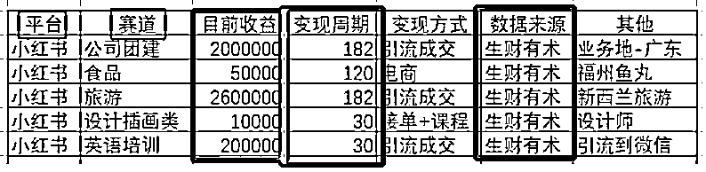

有两个数据基本不用担心质量和真实性，一个是平台、一个是赛道——这些都在明面上，肉眼就能判断，很难造假。但“目前收益”“变现周期”“数据来源”这三个就比较关键了。如果身边有跑通的朋友，不要不好意思问，多打听；或者多翻翻相关帖子的数据；实在不行，也可以付费去换取靠谱的答案。宁可花点小钱买信息，也别拿大把时间去试错。

拿到数据之后，还要做个验证：

内部一致性：比如你看的两篇案例，变现方式和项目周期是否差不多？如果差不多，说明这个赛道确实是这样走的。
外部一致性：可以问问做得久的大佬，看你拿到的数据符不符合行情。
连续性：两个案例发布时间最好相隔不要太远。如果一个年初、一个年尾，市场环境可能已经变了，数据参考价值就会打折，所以尽量选时间接近的样本。
完整性：除了收益数字之外，有没有业务逻辑、操作方法、经验感悟？信息越完整，说明数据的可信度越高。
综合验证：最后结合自己的实际情况做判断——这需要长期积累的直觉和经验。

这里还得提一个容易踩的坑：辛普森悖论。

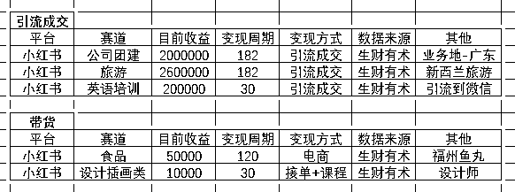

什么意思呢？就是数据收集不够细分、分类不够合理，得出的结论就会失真。比如同样都是做📕的项目，笔记带货和引流成交的收益差距极大。如果你把这两类混在一起算平均——做笔记的预期月入1-5w，做引流成交的月入可能20w——两者拉平看，数据就会变得很怪，结果自然不准。

万一哪天一条笔记突然爆了几十万，或者引流项目做了很久还只有几万块，你如果不做区分，很容易掉进这个陷阱里。

所以，选择一个项目之前，各种调研和验证是必须的。不调研就进场，除非你输得起，那当我没说。

【算好你的三笔账：技术、资源、成本】

动手之前，先看看自己手里的牌够不够打。

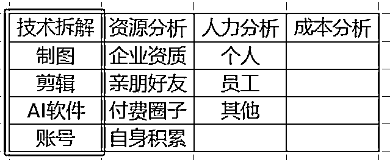

技术方面：做视频号的，剪辑熟不熟练？做图文号的，首图能不能抓人眼球？PS、创客贴、稿定设计这些工具是不是能顺手用起来？如果灵感不够，AI写作文案的指令会不会调？另外，有些赛道需要批量账号，那接码、办卡、养号这些，也都是技术活儿。

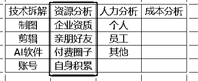

资源方面：平台有没有企业资质或个体工商要求？如果需要，你有没有现成的能拿来用？需不需要大量个人账号？那可能就得动用亲戚朋友的手机号来帮忙注册。自己所在的付费圈子里，有没有可用的资料能支撑起来？还有最关键的一条——你自身积累的知识，撑不撑得起这个项目？如果撑不起，该补课就补课。

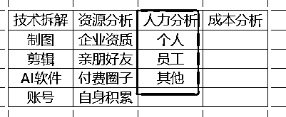

人力方面：项目前期大概需要几个人？每个人每天要投入多少时间？别小看这个问题，很多不起眼的小项目，恰恰在投入产出比上最考验人。如果一个人天天耗在上面，回报却少得可怜，那这笔买卖就不划算。

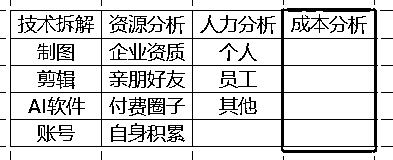

成本方面：把账算清楚。GPT账号20美元一个月，服务器要租，付费课程要买，这些林林总总的开销，一项项列出来，心里才有底。

【理论与实践，本来就是一场双向奔赴】

先界定一下：别人写的帖子、别人讲的方法，本质上都算“理论”。而你真正去跑一遍项目的过程，才是“实践”。

两者缺一不可，而且相互成就。

先说说感性认识。什么叫感性认识？就是你今天刷了10篇帖子，觉得“哇，这个项目太简单了，我也行”；或者看到一个大佬在宣传项目，你马上就信了——这种直观的、未经检验的感受，就是感性认识。反过来，一看项目就说“这不行，我做不了，要资质要时间要团队”——这也是另一种感性认识。

这两种心态都靠不住：一种是盲目乐观，一种是本能设限。但每个人又都从这一路走过来，所以我们需要“理性认识”来修正。

理性认识是什么？是根据数据和逻辑，把感性认识打磨成可检验的经验。比如你看了30篇成功帖和30篇失败帖，归纳出共通的SOP，再拿这个SOP去指导下一步行动。这样的循环——实践→理论→再实践→再修正——才是个人成长最快的方式。

理论也不是一成不变的。市场在变、平台在变，你只有不断用实践去校准旧理论，才能一直保持敏锐。比如我在做📕的时候，会随时根据数据反馈，调整内容的呈现方式、风格或者选题方向——这正是理论落地之后继续迭代的过程。

【执行时，先小规模试水，再放大】

最后聊一下执行节奏。很多人一说到做项目，就想着起步就搞矩阵、搞规模。但更稳妥的做法是：先跑通一两个号。

比如你打算做👸号矩阵，不用一上来就铺几十个号。先拿两三个账号测试内容方向，看看用户接不接受、数据反馈好不好，跑通一个再复制到下一个。小规模的好处是风险低、成本可控，而且方便你快速调整。等你摸清了门道，再放开手脚铺量，这样既稳，也快。

写在最后

其实这篇并不是想跟大家讲什么高深的道理。“实践检验真理”这句话，说起来是老生常谈，但真正把它当回事儿的人不多。

赚钱这条路上，没有哪个项目是躺着就能拿到结果的。那些你看到的月入十万，背后是一次次试错、一次次复盘、一次次把自己按在电脑前死磕的结果。

如果你还站在原地观望，那不如就从今天开始，挑一件不起眼的小事，先干起来。干着干着，路自然就清晰了。

愿我们都能在实践里，验证出属于自己的真理。

很多人在做项目时，最容易犯的一个错误就是“一上来就全力冲刺”。其实，更聪明的做法是先把计划放到小范围里试水，看看用户到底买不买账。小规模测试后获得的反馈，不是随便看看就扔掉的，而是调整下一步动作的“指南针”。根据真实用户的声音，你可能要修改产品细节、换一种表达方式，或者改变内容呈现的形式。这些改变不是凭空想象，而是基于一线反馈做出的，因此更容易让内容融入平台，也更容易让用户感到满意。

当策略在小规模测试中被验证有效，就可以着手准备更大范围地推进了。但全面铺开不等于可以掉以轻心，反而需要更敏锐地观察平台的动态变化，时刻准备着做下一轮微调。全面推广还必须搭配持续的监控与评估，这样才能确保策略在更大范围内依然有效。通过这种“小步快跑、逐步放量”的分阶段打法，整个执行过程会更加稳健，也更有弹性，既能帮助实现商业目标，又能大幅降低试错风险。

# 策略分析示例

在正式采取行动之前，不妨先借助一些经典的分析模型，帮自己看清局面。

## SWOT分析

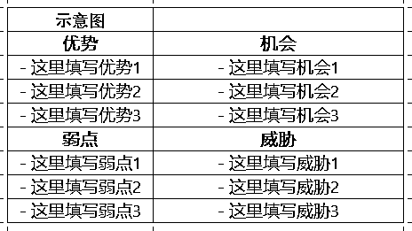

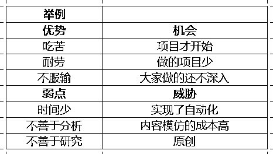

首先要认真掂量一下：这个项目适不适合自己？比如项目需要大量时间投入，而你平时主业已经忙得不可开交，就别自欺欺人地说“时间挤一挤就有”。先对自己做一次理性的SWOT分析，把优势、劣势、机会和威胁都摆到台面上。

## 贝叶斯分析

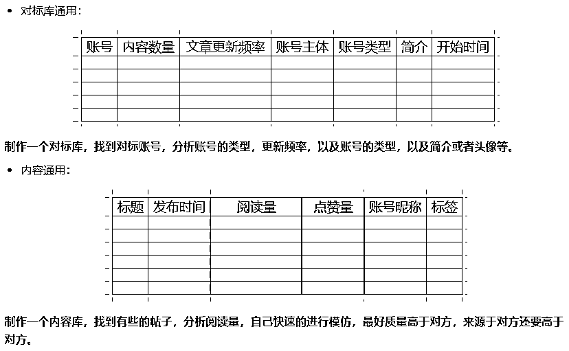

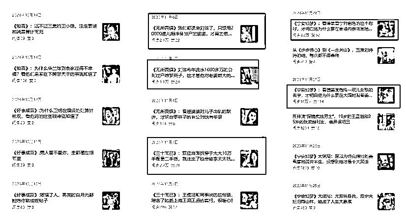

接着，结合自己搭建的对标案例库，把对方的数据一项项填进去。比如对标账号有12项数据指标，你的数据越接近对方，说明成功的概率越大；如果对标的项目有121项数据，而你只有1-2项接近，那成功率就比较渺茫了。要么你就做真正的创新，要么就得承认自己真的是“天选之子”，否则很难复制对方的成绩。

## 最好/最差分析

再看手头收集的数据，比如有的文章阅读量是10w+，有的只有39。一眼就能看出哪些是极端情况。这时候做好心理预期，别被最高的数字冲昏头脑，也别被最低的数值吓退。找到一个中间水平的平均值，那才更符合账号大多数时候的真实表现。

# 时间管理与资源优化

想把副业做出成绩，光有好的策略还不够，时间管理和资源调配同样是成败的关键。尤其对白天还要上班的人来说，时间和精力都极其有限，能不能高效利用就成了分水岭。

## 有效的时间管理策略

### 时间管理的技巧

开始管理时间之前，建议你先算一笔账：每天到底有多少小时可用？每月又能拿出多少小时投入副业？先给一个粗略的估算，再借助工具一步步细化，找出最优的时间分配方案。如果你每天都是“996”的状态，那要做的就不仅是时间规划了，而是要想办法节省时间。下面这张表是我每个月都会做的时间规划表：

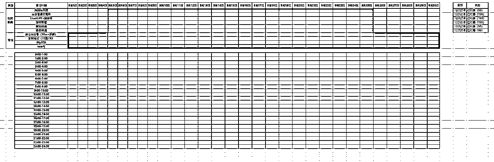

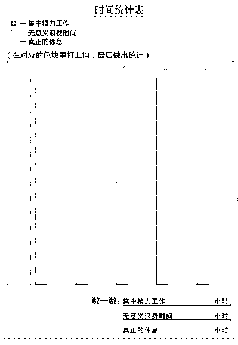

时间管理技巧能帮助我们更好地统筹日常生活，确保在繁忙的日程里仍能挤出整块时间推进副业。一些基本方法包括：

1.  优先级排序：把任务按重要性和紧急程度分类，优先处理那些既重要又紧急的事项。

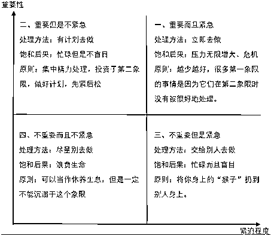

1.  批量处理：把性质相近的任务集中到一起完成，减少频繁切换带来的损耗。

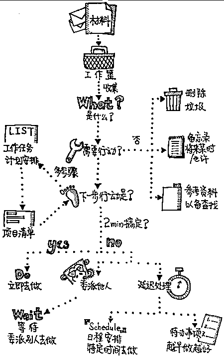

1.  时间管理工具：借助日历、提醒、计划软件等来安排和追踪进度。

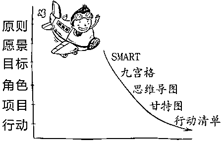

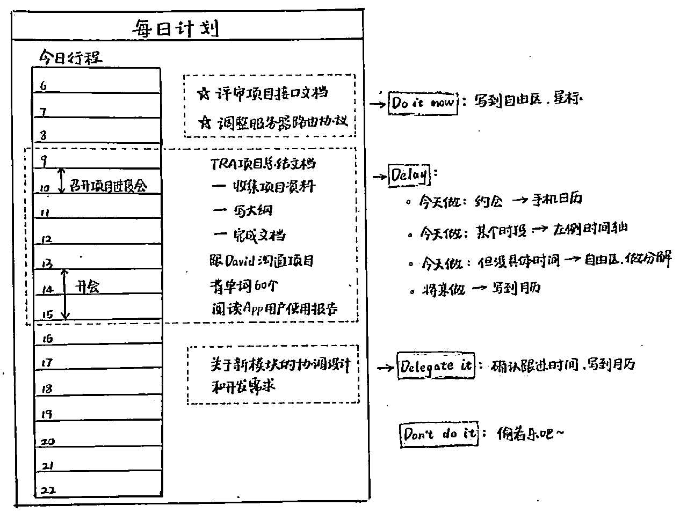

1.  设定时间限制：给每件事设定明确的完成时限，避免因为追求完美而白白消耗时间。

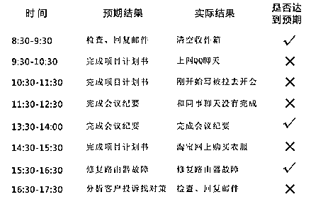

这些方法应用得当，可以明显提升效率，把原本浪费在低效工作上的时间省下来，给副业留出更多空间。

上面的时间管理图出自《小强升职记》，对时间管理感兴趣的朋友，建议系统地读一读。

### 时间管理策略

把上面的方法套用到主业和副业上，你还得为具体活动做好规划。比如你的副业是做在线教育，可以每周固定时间准备教案、录制课程、回复学生。把大部分备课工作安排在周末，这样工作日的晚上就能专心做直播互动，不会影响白天的正职。

碎片时间也千万别浪费。上下班路上听行业播客、做市场调研，都是在不影响主职和生活质量的前提下，悄悄给副业加码。这些具体的时间管理方式，既能帮你平衡主业和副业，也能提升整体效率，加快副业成长的节奏。

## 资源优化与最大化利用

### 分析现有的问题

说到资源优化，第一步要摸清家底：时间、金钱、技能，以及各种有形无形的资源，通通盘点一遍。理解这些资源的现状和潜力，才能谈得上优化。接下来这些方法可以帮你把资源用到刀刃上：

1.  集中资源用于核心活动：找出对副业收益贡献最大的部分，优先把资源投进去，可以用“收益投入比”来衡量。

1.  外包非核心任务：有些事虽然必要，但未必是收益核心，考虑外包出去，解放自己去做更关键的工作。

1.  利用自动化工具：能交给工具的就别自己动手，比如邮件自动回复、社交媒体定时发布，都能省下不少精力。

1.  资源共享：有机会就和同行或合作伙伴共用资源，比如合租办公空间、拼单采购物料，把成本摊薄。

### 优化资源提升收益

举个例子，如果你已经加入了“龙哥盟”，身边至少有三类资源：

1.  赚钱索引帖：搜索相关帖子，能找到近期最新的信息；

2.  赚钱航海期间的教练：这些是官方筛选出来、当下已经拿到结果的人；

3.  赚钱航海的其他同学：每一期都会冒出一些刚刚做出成绩的新人。

这三类资源，绝大多数人都有能力用起来。说实话，至少80%的问题都能通过这些途径解决，怕就怕你行动力太差，那就会觉得寸步难行。

如果你为某个项目进行了二次付费，说明你认可这个人。那就一定要多和他沟通，去问清楚对方能提供什么样的资源和支持，然后再围绕这些资源制定计划、落地执行。这样才能让付费的价值最大化。

请记住，任何能给你提供价值的人，都是你的潜在资源。哪怕父母、朋友帮你解决了做饭的问题，这也是资源。甚至小区里的保洁阿姨或保安大叔，都可能成为你的资源。

# 从别人的经验中学习与批判性思考

想在职业和成长路上走得远，向别人学习是必须的。但简单模仿成功者的做法，往往达不到同样的效果，你得带着批判性思维去分析这些经验。尤其要警惕盲目的投机主义和冒险主义。这些行为也许能带来短期的运气，却很难长久，甚至可能造成严重的损失。因此，避开这些坑，用务实的态度采取行动，才是稳健发展、长期成功的根本。

## 辩证地看待别人的经验

### 筛选与吸收有价值的经验

向人学习，第一步是筛选信息。信息铺天盖地，但哪些真正靠谱、哪些有价值，需要你评估信息源的可信度，再结合行业认知来做判断。

比如你想做👸号，就应该优先研究那些已经明显做出成绩的人，尤其是能拿出具体数据来证明结果的案例，这样才更有参考价值。

除了选对信源，你还要深挖成功案例的背景和执行细节。了解背景，才能明白这个方法在什么条件下适用，能不能迁移到自己身上。

### 考量经验与个人情况的适应性

辩证地看别人的经验，还意味着要评估它适不适合自己。不是每个成功策略都能套用到你身上。你得想想自己的资源、技能、兴趣，还有所处的市场环境，是否和学习对象匹配。

举个例子：一个大IP的👸号，随便写一篇都是10w+。如果你直接照搬他的风格和结构，数据大概率会很难看。又比如某个策略需要大量初期资金，而你手头并不宽裕，那显然不适合硬上。

所以说，借鉴别人的经验，一定要结合自己的实际去分析，批判性地想想怎么调整、怎么适配。这种思考方式，不仅提升学习效果，也在锻炼你的批判性思维能力。经过这样的过程，你不仅知道了什么方法有效，还明白了为什么有效，以及什么情况下可能失效。这种能力，无论做副业还是做任何职业，都不可或缺。

## 避免非实际行为

### 投机主义和冒险主义的识别与避免

投机和冒险行为往往盯着快速成功和高回报，却选择性地忽略背后的高风险和不稳定。想识别这些行为，关键是看策略是否可持续、风险有多大。比如，押注一个未经验证的快速赚钱模式，或者在完全没有准备的情况下冲进高风险市场，都属于这类。

怎么避免？做全面的市场研究，把相关风险都评估一遍，尽量选择稳健的策略。同时，遵循最佳实践和标准的SOP，也是抵御投机和冒险的有效护城河。

### 实事求是的行动策略

实事求是的策略，就是基于现实来做决定。准确评估自己的资源和能力，设定合理的目标，再根据进展适时调整。例如想做抖音视频，你要先看看目标分类的数据表现，再判断自己会不会剪辑、能不能达到别人的效果。

同时，保持持续学习、顺应环境变化，也要多听不同来源的意见和反馈。态度开放、灵活应对，能让你在变化的市场和技术趋势中做出更明智的决策。避免投机和冒险，坚持实事求是，副业和职业发展才会走得更稳、走得更远。

# 实践检验与个人收益的评估

做任何实践，都要懂得评估成果、验证策略是否成立。这既能保证方向正确，也能通过持续优化来提升效率，及时调整甚至淘汰不产生效果的做法。

## 实践的检验标准

### 评估实践的成果

评估成果的第一步，是明确标准。这些标准要在实践开始前定好，并且和目标紧密相连。比如目标是增加副业收入，那评估指标就可以是收入增长率、新客户获取数量、客户满意度等。指标越量化，越方便测量和对比。

实际操作中，数据收集非常关键。你可以通过问卷、财务报表、客户反馈、网站流量分析等方式获取数据。拿到数据后，再用合适的工具和方法做分析，看看实践是否达到了预期目标。

### 确认的具体步骤

理论和策略到底正不正确、有没有效，需要靠实践成果去验证。具体步骤如下：

1.  结果分析：对比实践前后的目标差距，分析原因。这涉及执行质量、外部环境影响、内部效率等。

1.  假设验证：实践前对成果做的种种假设，实践后要逐一验证，包括理论假设、市场假设、操作假设等。

1.  反馈循环：把评估结果送回实践过程，对策略进行必要的调整和优化。这是持续改进的关键，让实践在未来能更高效地达成目标。

1.  持续监控：评估不是一次性行为，而是持续过程。定期重新评估实践成果，适应变化的环境和市场。

通过这些步骤，你能有效检验实践成果、确认策略的真实有效性，并根据评估结果进行调整，最终提高个人收益和效率。这种基于证据的做法，保证了实践活动的科学性和实效性，是持续成功的基石。

## 个人收益的持续增长

### 监测个人收益的变化

收益变化是检验副业成效最直观的指标。你需要定期检查并记录收入水平，还要关注成本、利润率、投资回报率等财务数据。方法可以很灵活：用财务软件，或者简单的电子表格都行。

定期监测能让你迅速察觉收益波动。如果某个月收入突然下滑，可以马上排查原因并采取措施；如果某个策略特别管用，也能及时发现并加大投入。

### 分析收益增长的因素

除了盯住收益数字，更要深入分析是什么推动了增长。哪些具体活动、市场策略或商业模式对收入贡献最大？通过数据分析和市场反馈，你能发现成功的模式和趋势。

比如，数据显示社交媒体营销带来的转化率和订单量明显提高，那就说明社交媒体是重要的增长引擎。这时你就可以决定增加这些平台的预算，或者进一步优化营销策略。

当然，还要考虑外部因素，比如市场变化、消费者行为趋势、经济环境等等。全面分析这些因素，你才能对当下的业务做精准调整，并为未来制定更好的策略。通过这些方法，你能牢牢掌握财务状况，确保收益持续增长，在副业和职业上做出更聪明的决策。

# 个人实践的呼吁

实践是连接理论与成果的桥梁，它把抽象知识变成具体技能，也给了你一个验证和打磨技能的平台。通过实践，你可以直接改善经济状况——提高工作效率、开拓新收入渠道，或者优化业务流程以增加利润。更重要的是，实践让你在真实的市场中运用创意和技能，亲眼看到努力的结果，随之不断调整优化，实现收益增长。

实践的普适价值在于，几乎所有领域，它都是通往成功的关键。看看不同行业里的案例，有人靠专业技能做自由职业增加收入，有人通过市场研究和产品创新扩张业务——实践都是他们成功路上绕不开的部分。

为了顺利开启实践，这里有一些切实可行的建议：

1.  设定具体目标：明确你想达到什么成果。目标要量化，比如“收入增长百分之多少”“获取多少新客户”“完成某个具体项目”。

1.  制定详细计划：围绕目标规划可行的行动方案，包括步骤、时间表、所需资源，并明确每步的预期结果，方便追踪和调整。

1.  开始小规模实验：不要一上来就投入全部，先做小规模测试，验证理论的实际效果，再根据初步结果调整。

1.  收集反馈并优化：实践过程中主动收集反馈，无论是客户、同事还是自我评估。用反馈来优化策略和方法，确保它们更好地为目标服务。

1.  持续学习和适应：市场在变，环境在变，持续学习必不可少。保持对趋势和新技术的好奇心，防止自己的方法过时。

用实践来检验真理，这一点永远重要。理论提供方向和框架，但只有实践才能让你真正理解它的价值与局限。实践是学习和改进的过程，不仅帮你拿到具体成果，也促进个人成长和职业进步。

别怕挑战现有的思维和方法。大胆去试，敢于创新，让你的行动成为揭示真相、推动改变的力量。每一步实践都是向成功迈进的一步，无论结果如何，都是前进的动力。