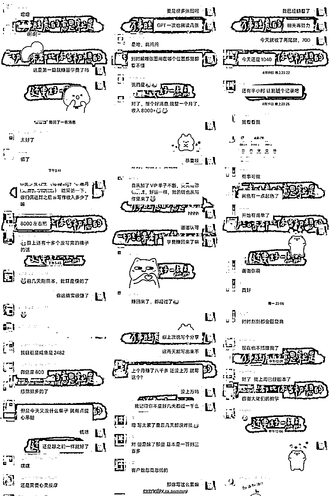
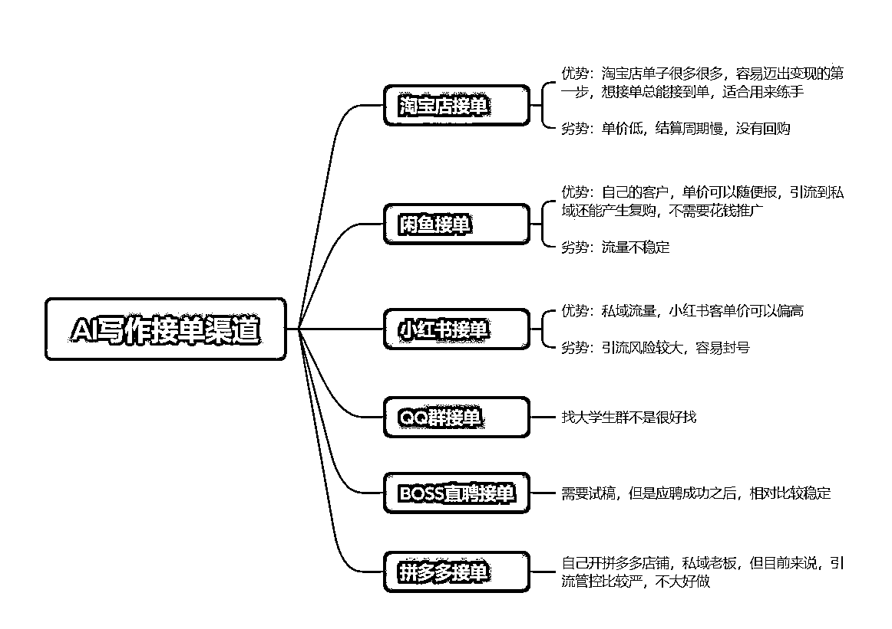

# 我给新手的唯一建议：先从AI写作开始

> 来源：[https://riupvml5qjl.feishu.cn/docx/EWTSd2cKDoRunHxm7bGcgaIsnHd](https://riupvml5qjl.feishu.cn/docx/EWTSd2cKDoRunHxm7bGcgaIsnHd)

大家好，我是轻舟。在生财混了快一年半了，摸过的赛道不在少数，但如果让我给刚起步的朋友选一个最容易跑通0-1的方向，我会毫不犹豫推荐AI写作。

算一下时间，我做这个方向刚好到第三个月。两个月下来，背着的20万债务已经还掉了5万，还剩15万。能找到一条真正适合自己的路，真的要谢谢这个圈子。

# 这个项目到底在干嘛

说白了，AI写作就是用AI工具帮别人写稿子。拆开来看就两件事：会用工具 + 有客户。写作能力+获客渠道，就是核心。

# 我目前的进度

先上点真实数据。2月底入局到现在，还不到90天，靠接单累计下来大概6万左右的收入，单笔最高的一单接近7000块。

之前发过一些复盘帖，有兴趣可以去翻。最近还带了一些一起做的小伙伴，反馈都很正向。正因为上手快、见效快，我才敢说，对小白来说，AI写作的0-1体验是目前我见过最友好的。团队里有全职转型的，一个月稳定2万左右；也有利用业余时间做的，一个月能有8000；还有人准备把它做成主业的。

# 做这个要花多少钱

几乎可以忽略不计。入门阶段用免费版的AI也能跑起来，想要体验更顺一点，建议新手直接上GPT4.0，人机协作会更省心。

# 好处和瓶颈

好处很明显：反馈来得超快。门槛低到不需要你有文笔，不需要你有经验，照着流程走就能出成果。

瓶颈也在这里：如果一直是自己写自己接，产能吃紧，一个月1-2万基本就是天花板了，想做得更大，就得往小工作室的方向去做拆分和协作。

# 实操层面怎么落地

## 写什么

需求非常杂，大到演讲稿、征文、述职报告，小到简历、主持词、自我评价、开题报告等等，基本都能用AI完成。唯独理科论文、设计类论文这类专业性极强的相对吃力，其他的都能接。

具体的指令怎么打，星球里技术帖很多，我自己也只是半桶水，就不班门弄斧了，有需要直接搜就行。

## 哪里接单

我自己最熟练的就是闲鱼和小红书。其他渠道也很多，这里先细说我最常用的两块。

## 闲鱼怎么玩

文案怎么写
别自己瞎编。直接搜“代写”，把排在前面的同行文案复制过来，顺序微调一下就行。原创文案风险高，敏感词太多不好控，用成熟的模板最稳。切记不要重复发一模一样的图文。

图片怎么来
最省事就是搜同行的商品主图，用手机截图保存。别直接下载，下载会带水印，直接点主图截屏就干净。

上架和维护
发完可能会被审核，这是正常情况，等通过就行。
保持每天都上新，哪怕就1-2条。闲鱼流量波动大，新品更容易拿到曝光。
每天记得擦亮商品，凌晨0点后或早上空闲时点一下“我发布的”-一键擦亮就行。
卖出后商品会自动下架，一定要立刻重新上架，因为卖掉的通常是曝光好的，上架能保持热度。
同行骚扰问题：我个人很烦同行留言，看到就点进主页拉黑，再把留言删掉。不处理的话他们会反复刷。
自动回复必须设置好，回消息的效率直接影响转化。
急速卖要每天做：闲鱼首页右上角签到里有急速卖，每天用闲鱼币投一个商品，这步不做等于白干。