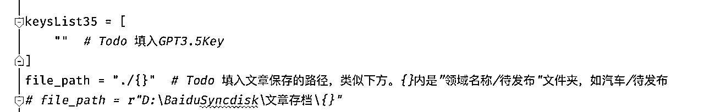
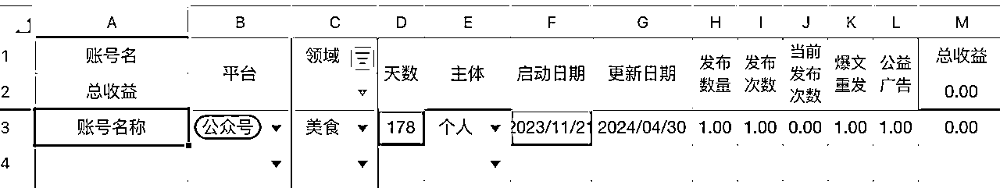
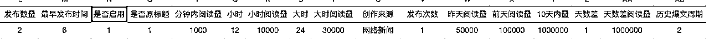
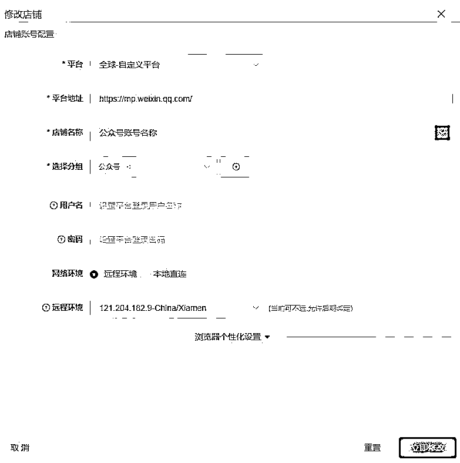

# 公众号爆文自动化全套代码开源交付

> 来源：[https://tjhy5ng53f.feishu.cn/docx/EaSSd0KJsoHDysxItnFc3xsgnAh](https://tjhy5ng53f.feishu.cn/docx/EaSSd0KJsoHDysxItnFc3xsgnAh)

各位伙伴好，我是圈内第五期成员毛韩，编号21985。

上回我做了一次公众号爆文复盘的分享，反响挺热烈，也收到了不少点赞鼓励，在此先谢谢大家。

也有很多朋友私信问我能不能用上那套全自动化的工具。为此我花了两天时间把整套代码做了解耦，并整理成了现在这份上手说明，希望还在做公众号内容的朋友能省点心。

要提前说清楚，这套代码体量不小、结构比较乱，配置过程会比较费劲。

有编程基础的同学完整跑通大概需要2小时左右；
完全没写过代码的同学，预估要5小时以上才比较稳。

整体实现拆成三块协同工作：

1. Python脚本部分：负责抓取对标号的文章，用GPT API改写生成新文，保存到本地目录
2. 飞书部分：作为整个系统的调度中心，用来调整参数、计算收益等
3. 影刀部分：操控悦互联浏览器，把本地文件夹里的稿件推送到公众号后台

配套文档也按三块来写：

1. 环境搭建
2. 参数调整
3. Q&A，后续遇到的问题我会持续补充

* * *

# 1、环境搭建

1. 获取Python自动生成脚本
2. 获取影刀脚本
3. 安装悦互联浏览器 https://kj.chinafic.com
4. 准备运行环境
5. 安装Python，自行搜索教程
6. 安装依赖包，自行搜索教程
7. pip install openai
8. pip install requests
9. pip install selenium
10. pip install beautifulsoup4
11. pip install python-docx
12. pip install pillow
13. 复制飞书文档模板
14. 进入文档后点开
15. 顶部点击创建副本
16. 新建飞书应用并写入表格内，配置方式自行搜索
17. 参考教程：https://open.feishu.cn/community/articles/7298446935350231044
18. 建立本地文件夹
19. 在电脑本地建一个文件夹，路径要与Python -> main.py -> #16行保持一致，建议照搬我用的 D:\BaiduSyncdisk\文章存档，能大幅降低出错概率
20. 每个垂直领域下再建三个子文件夹：爆文文章、待发布、历史文章

# 2、参数调整

1. 在Python文件里搜索Todo，把所有带Todo标记的参数按提示改成自己的信息

2. 影刀RPA脚本同理，搜索Todo，按提示补全
3. 飞书表格 -> 账号配置，修改相关信息

1. 账号名称：填写公众号名称
2. 平台：默认公众号
3. 领域：必须与本地文件夹里的领域名称及「素材配置」页里的领域一致，否则会错乱
4. 天数：公式字段，不用改但不能删
5. 主体：无需关注，不能删
6. 启动日期：该号最早发布日期，不用改但不能删
7. 更新日期：默认是昨天。今天日期脚本会判定今天已发，不会重复推送；非今天则会触发发布
8. 发布数量：单次推送几篇，上限8篇
9. 发布次数：一天推送几次，无上限。当天总推送量 = 发布次数 x 发布数量
10. 爆文重发：默认1。若过去x天内有爆文且符合素材配置的领域规则，会优先复发旧爆文，不足再补新文。设为0则不复发
11. 公益广告：配合「自动关闭公益广告RPA」使用，能提升CPM。1表示已关闭，0表示未关闭
12. 总收益、月度收益、每日收益：用于统计各号及总收益，可用「自动查询收益」RPA抓取
13. 飞书表格 -> 素材配置，修改相关信息

1. 领域名称：需与账号配置的领域保持一致
2. 排序/阅读量/时间/是否原创/易撰领域等：均为易撰筛选条件，不用易撰可不填
3. RPAing：填入「教育ing」表格ID
4. Prompt：填入「教育APIpro」表格ID
5. 原创发布分类：公众号发布时选用的首层分类，已弃用但不能删
6. 原创发布子分类：同上
7. 素材来源：头条 / 飞书 / 易撰三选一
8. 选头条：默认去「对标账号库」里找对应领域的对标号抓取
9. 选飞书：默认从「教育ing」里读取已导入素材，一般不用
10. 选易撰：从易撰抓取当前领域素材，目前易撰验证码识别易卡顿，建议少用
11. 发布数量：该领域的默认单次发布数，若账号配置已填则以账号为准，未填则用此值
12. 最早发布时间：单位小时，部分领域晚上18点后发更好可填18
13. 是否启用：1启用 0停用，0则不生成也不发布该领域
14. 是否原标题：1保留原标题，0则让AI重新生成标题
15. 分钟内阅读量：筛选头条文章时使用，60分钟内达到x阅读
16. 小时、小时阅读量：x小时内达到x阅读
17. 大时、大时阅读量：同上，时间窗口更大
18. 创造来源：已弃用
19. 发布次数：同上文含义
20. 昨天阅读量、前天阅读量、10天量：均为头条筛选条件
21. 天数差、天数差阅读量：x天内的文章阅读量需满足x
22. 历史爆文周期：单位天。RPA在爬收益时会把该领域最近x天的爆文统计到「爆文记录」文档，并在发布时复用。热点类建议1天，情感故事类可设30天
23. 飞书文档 -> key配置：填入GPT4.0直连Key
24. 飞书文档 -> 教育APIPro：按行填入指令
25. 其他飞书文档无需改动
26. 悦互联配置
27. 将公众号账号导入悦互联

28. 打开对应账号页面，完成公众号登录
29. 微信配置：运行前先在电脑登录一个微信账户并打开与文件传输助手或其他好友的聊天窗口。运行中若出现未登录或掉线，脚本会自动把账号名称推送到当前微信聊天框

以上要点都核对完成后，就可以先做一次试跑。

# 3、Q&A

1. 问：代码里重复片段很多，能不能精简？
答：能精简但比较费时间。车能跑就先别动，轮胎上有点脏也先凑合用，有兴趣有时间的朋友可以自己重构。
2. 问：脚本跑不起来是什么原因？
答：十有八九是参数填错了。
飞书配置问题占5%左右，有问题可联系飞书客服或搜索Python对接飞书文档的教程。
3. 问：