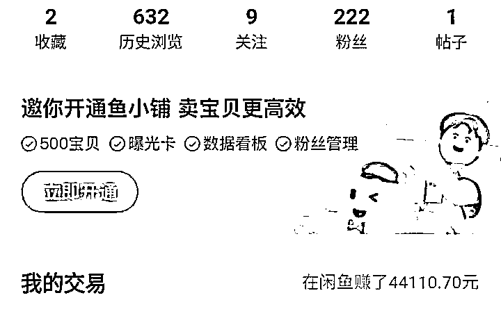
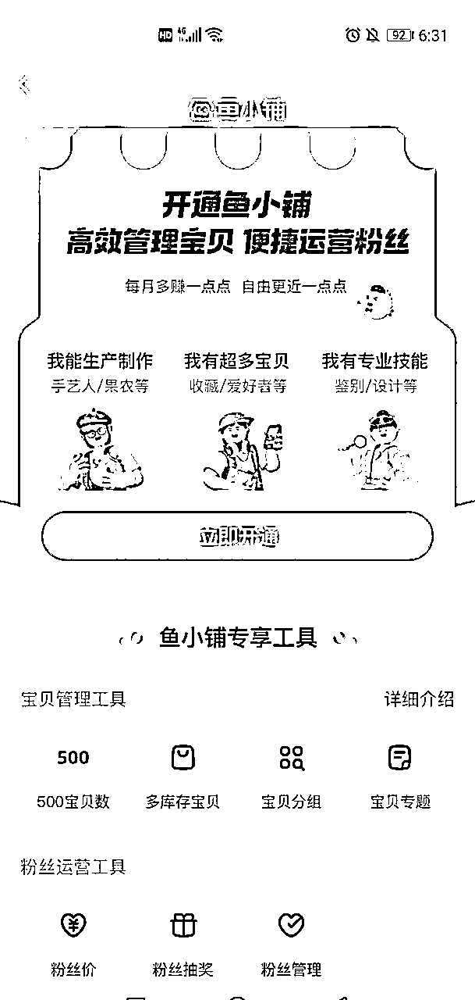
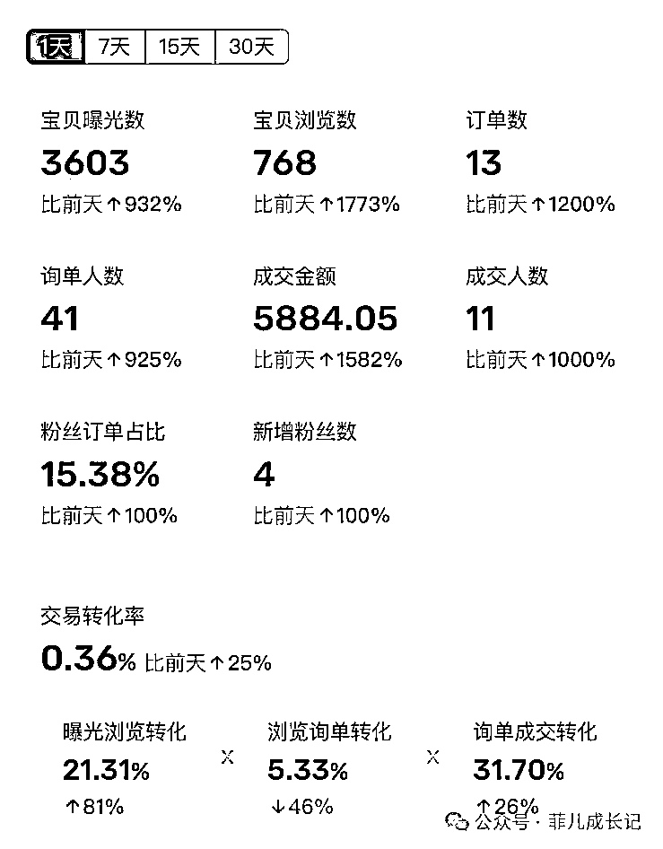
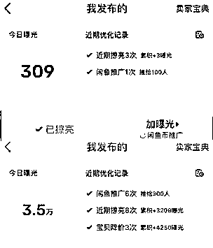

# 闲鱼卖货，到底要不要开通鱼小铺？过来人给你讲透
作者：龙哥

在闲鱼圈，不少卖家都在纠结一件事：鱼小铺，到底开还是不开？社群里的讨论也从来没停过。今天就把这个话题一次性聊透——鱼小铺是什么、开通有什么后果、什么时候开最好。

## 一、先搞懂鱼小铺是个啥

简单说，它是闲鱼针对卖家推出的一项增值服务，相当于给卖家配备的专属工作台。开通之后，你可以给自己的店铺设计专属风格，还能获得更给力的推广资源，比如广告位、流量倾斜，甚至专属客服和精准投放工具。总之，它就是帮卖家把货卖得更好的一个升级工具。

## 二、怎么才能开通？

开通不需要花一分钱，是免费的。平台会定期开放邀请通道，如果你的账号满足条件，在闲鱼主页自己的头像下方就能看到入口。

具体要满足什么条件呢？主要有这么几点：

第一，账号得是正常在用的，实名认证过了，支付宝也授权了，芝麻信用分在“良好”及以上。

第二，过去三个月内没发生过买家申请客服介入的退款纠纷，注册时长超过三个月，而且最近30天内至少有16天登录过闲鱼。

第三，这个账号以及名下关联的账号，都没有卖假货之类的严重违规记录。

说白了，只要你账号正常、实名、没严重违规，最近30天有16天以上登录，基本都有机会被邀请。

## 三、和普通账号相比，差别在哪？

首先是数量上的升级。普通闲鱼号最多只能挂50个宝贝，而鱼小铺能上架500个，容量直接翻了十倍。

其次是功能上的增强。你可以给商品设置价格区间，还能设置库存数量，不用再像以前那样卖掉一个就改价或者重新上架，对专业卖家来说真的省了不少事。

再一个就是宝贝分组。你可以把自己的商品按品类进行分类，比如家电、五金、农用工具等等，用户进店后能马上找到自己需要的东西，体验感更好。

另外，你还能把爆款置顶在店铺首页，顺便设置粉丝价、搞粉丝抽奖、做粉丝管理，用来留住回头客。

## 四、为什么有人开了之后曝光反而跌了？

确实，不少卖家一开通鱼小铺，就遇到限流，曝光数据一下子掉了不少。我带的学员里就有这样的例子。

那问题到底出在哪？通常逃不出下面这几个原因：

### （一）常卖领域选偏了

开通时系统会让你选择一个主攻类目，选完后店铺就有了标签。如果标签和你实际卖的东西对不上，比如你本来是做家居的，却选了数码，系统推荐的流量就完全对不上号，自然没有曝光。解决办法也很简单：到个人资料里重新改选回正确领域就行。

### （二）新号扶持期刚好结束

闲鱼对新上架的商品有7到15天的扶持期，帮你获得一波初始曝光。扶持期结束，流量本来就该回落一些。很多人是刚开完鱼小铺，扶持期也正好结束，于是误以为是鱼小铺把自己限流了。

### （三）上架和改链接太频繁

一开通鱼小铺，有人就特别兴奋，赶紧把店铺里的商品全部改价改库存，又一次性上了好多新链接。这种高频操作容易被系统判定为异常行为，结果就是被限流。

### （四）店铺转化率被拉低了

转化率是平台判断店铺好坏的重要指标。举个例子，普通店铺挂50个商品，一天出5单，转化率是10%；鱼小铺挂了500个，出10单，转化率就变成2%。上架越多，出单跟不上，转化率大幅下滑，平台会觉得你的店质量变差，反而减少推流。所以很多人发现，挂得越多，曝光越低，就是这个道理。

## 五、那到底什么时候开比较合适？

先说结论：如果你是刚入坑的新手，先别急着开鱼小铺，老老实实做杂货铺就行。

为什么？因为闲鱼平台的规则是，每个账号能卖的品类是有限制的，别人的爆款到你这儿不一定卖得动，你的好品别人也未必能复制。刚起步时，最好先测试哪个品类能出单，把优势品找出来，慢慢把店铺往垂直方向养，等稳定了再考虑要不要开鱼小铺。

有些新人一看能挂500个品，脑子一热就开了。可实际上，你连50个品都未必能填满。如果你已经上了50个品，可以自查一下：链接都优化好了吗？有没有坚持上新？卖的东西是不是越来越垂直？成交率怎么样？如果这50个品都没经营好，就算给你500个位置，结果也不会好到哪里去。所以，先把少量商品玩明白，让店铺达到一个稳定的状态，再谈升级也不迟。

反过来说，如果你50个品已经玩得转，而且确实想往专业卖家方向发展，那鱼小铺就是必须开的。价格区间、库存管理这些功能，能大大提升运营效率，而且和普通账号比起来，鱼小铺在竞争中也更有优势。你看闲鱼排行榜上那些头部卖家，基本都开了鱼小铺。但要注意时机，一定要具备相应的运营能力再开，这样才能应对短期的限流问题，尽快把流量拉回来。

还有一种情况：如果你现在的店铺流量本来就很一般，那开鱼小铺也没什么太大意义。别指望开通后店铺突然就火了。与其去点那个开通按钮，不如静下心来研究选品，早点找到能爆的款。

## 六、开了之后被限流，怎么救？

有一个简单有效的方法：删掉一些闲置或滞销的宝贝。

如果你的店铺持续不出单、曝光也很差，可以考虑先退出鱼小铺，然后清理掉一部分闲置商品。具体删多少？可以根据你店里需要优化的商品数量来定。比如说，删掉5个闲置的，就重新补上5个新的。这样操作之后，等一周左右，流量通常就能慢慢恢复。

## 七、怎么退出鱼小铺？

想退出的话，前提条件得先满足：

所有多规格、多库存的商品要全部下架，在线商品总数不能超过50件。

账户里不能有进行中的订单、退款、纠纷、抽奖这类未完成操作。

而且退出后要等90天才能再次申请，所以退出之前一定要想清楚。

好了，关于鱼小铺的那些事儿，今天就聊到这儿。希望对正在犹豫的你有点帮助。

往期文章：