# 聊私域的人很多，能聊透的没几个：这份私域体系化运营攻略，建议收藏

聊私域的内容铺天盖地，但能聊到点子上的少，把体系讲清楚且能上手操作的更是凤毛麟角。

我花了整整一周，把自己这几年的实战经验和踩坑记录，重新梳理成了一套完整打法，写成了这篇文章。它或许是你见过最详细、也最接地气的私域系统作战手册。我还准备了一张私域体系化运营地图，方便你建立全局视角，领取方式放在文末。

私域能不能落地，就看四个要素：策略、内容、工具、团队。接下来一个一个说。

## 01 策略篇

策略就是运营方法。

聊方法前，先达成两个共识：第一，方法没有绝对的好坏、行与不行，抓到老鼠的就是好猫；第二，不存在通吃所有业务的万能方法。行业不同、产品不同、客单价不同、业务模式和私域规模不同，适配的打法往往南辕北辙。

但比这些更重要的，是你的私域目标。你到底想“把微信当一个营销/销售工具”，还是想“认真经营一份私域资产”？这两个目标，决定了完全不同的路径。

如果只是把微信当工具，最简单的是先把一个触点打透：朋友圈、社群、私聊、公众号，任选其一都可以。比如你可以做一场“浪潮式发售”，说白了就是把线下的会销搬到微信上，像浪潮一样集中成交。只要做得好，营收很可观。但这种打法一年最多玩两三次。你要算一算：一年靠两三次大促，能不能撑起你想要的业绩？

这个玩法特别适合单实体门店，像美容店、理发店、社区儿童兴趣班，尤其开业节点。社区型超市也可以建微信群搞特卖，把群当成信息宣发阵地。这不算“经营私域”，只是把微信当成比线下、电话更高频高效的工具。

如果你想做体系化的私域，就不能只解决某一个点，得有一套完整方法论。对企业来说，我建议把私域上升到公司战略：它需要资源投入，也值得长期经营。

无论你的目标是哪种，策略其实都是那几样：人设、引流、留存、转化、客户关系管理。区别不在策略本身，而在于你配齐了没有。

### 1. 人设策略

人设就是你对外以什么身份出现：老板、顾问、店长、客服……身份越高，势能通常越高。但请记住：你是靠行为定义身份，不是靠昵称。嘴上说自己是老板，做出来的事全是客服的水平，别人心里就把你当客服。

人设也不是越高级越好，关键在于能不能帮你更好地和用户打交道、完成成交。那么，做私域一定要有人设吗？不一定。但有没有人设，结果天差地别。有人设，尤其是老板、顾问这类IP，势能和信任感直接拉满，运营和销售都会顺手很多；没人设，往往特别吃流量和运营成本，就算这样，成交也未必顺。

不少公司习惯买量做投放，但买来的流量如果落到没有IP人设承接的私域里，大概率只做一锤子买卖。用一句话说：流量接不住。

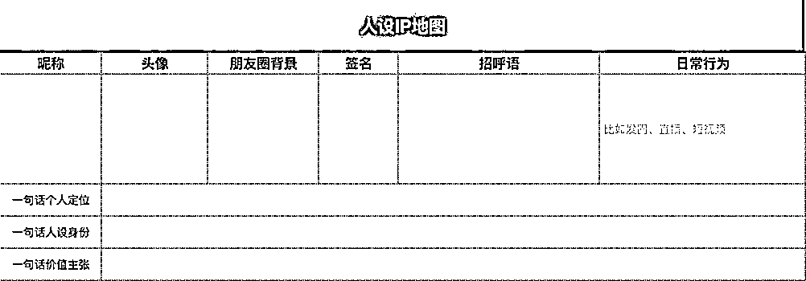

### 2. 引流策略

引流解决的是“人怎么进来”。

先说个误区：很多人把引流当成私域第一步，这话真的坑过不少人。引流之前，先想清楚：进来之后怎么留存？怎么转化？不能走到哪算哪。这和开店一个道理，人都进店了，你却不知道怎么接待怎么卖，那还做什么生意？

不同渠道，引流路径完全不同。

**公域买量。** 比如百度SEM、腾讯广点通（视频号、朋友圈、公众号）、字节系（今日头条、抖音）等付费投放。有预算就可以考虑这种方式，只要ROI大于1（战略性亏损业务除外），买量就可以规模化；如果目标市场够大，甚至能持续很久，只是成本会越来越高。记住，有钱赚的时候，就往死里投。

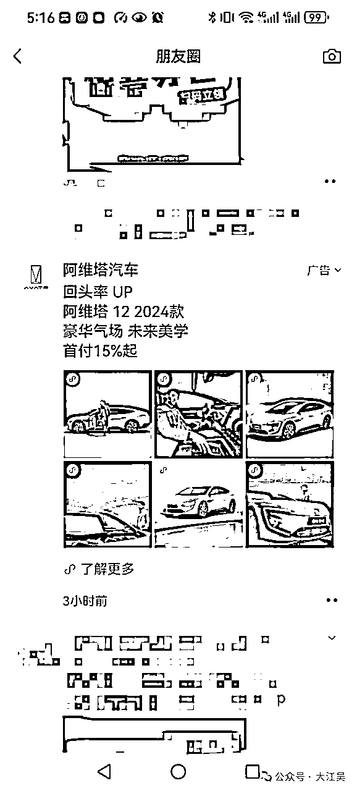

**短视频平台。** 抖音、快手、B站、视频号。目前短视频流量相对便宜，免费流量也容易薅到，但平台规则会越来越严，引流门槛会不断抬高。以抖音为例：主页简介栏、把抖音号设成微信号、背景图引导私信（小流量没事，流量大了有风险）、咨询挂件直接加微（仅限抖音企业号），都是可用的触点。

另外还有一种引导填表的路子，我个人不太推荐：行动门槛太高，路径太长。既然目标是把人引进微信，就不要绕弯子。

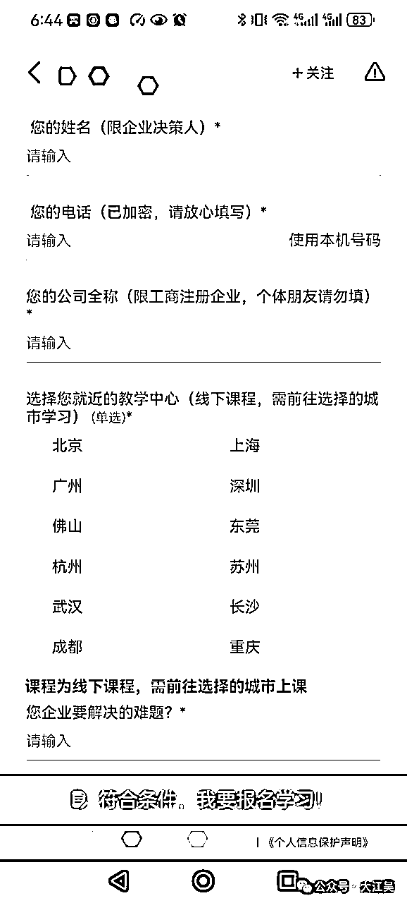

**新媒体平台。** 百度知道、贴吧、文库、百家号，今日头条、西瓜视频，还有微博、小红书、知乎、B站、搜狐号等。这里有三个提醒：第一，平台用户属性差异很大——知乎用户认知高、男性偏多，今日头条中老年用户更多，小红书聚集年轻女性和宝妈，B站是Z世代主场。引流前先问一句：我的目标客户是谁？他们在哪？一个找客户的方法：把自己当客户，去各个平台搜行业信息，哪个平台信息或广告最多，你的客户大概率就在哪。第二，平台规则不一样，比如很多平台不允许出现微信号，但知乎可以。不熟悉规则很容易封号。第三，别贪多，选最适合的一两个平台深耕就够。

**电商平台。** 淘宝、京东、拼多多……坦白说，电商平台不太好引流，转化率通常不高。站内玩法是靠聊天工具（如淘宝旺旺），小打小闹、效率不高、还有风险；站外玩法是包裹卡、AI电话+短信，转化率一般是个位数，能做到10%以上就算高手——我们服务过的客户里，有人能做到30%多。

这里重点说说短信。很多人觉得短信没人看，其实是误解。用好短信，尤其是短信里可以直接放短链跳转企业微信，它依然是非常有效的引流方式。

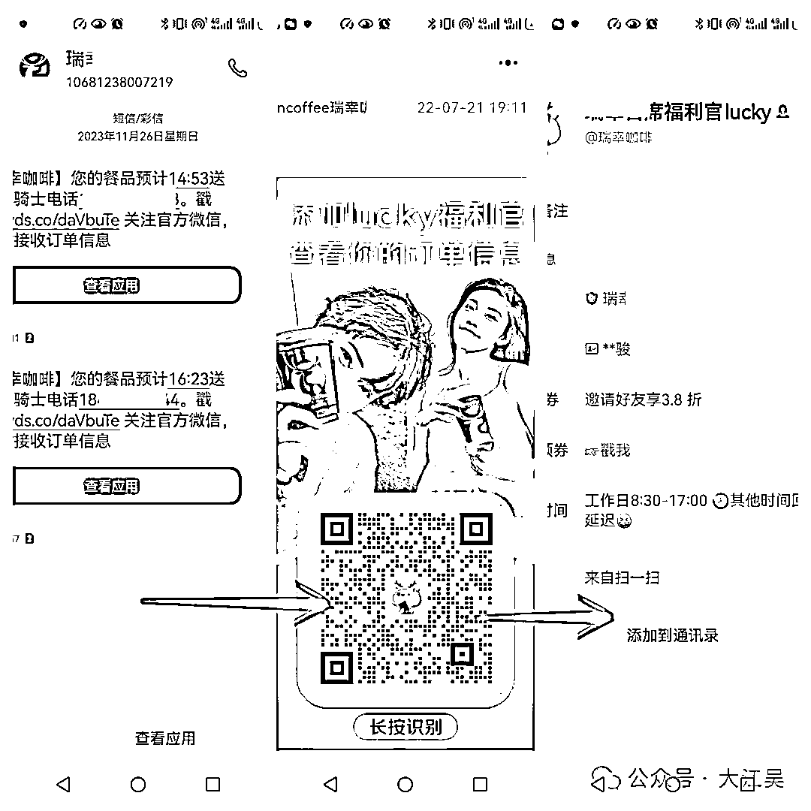
有个小绝招我们团队一直在用：短信SOP。别指望一条短信就能打动人，一条不行就多条，每一条都精心打磨，总有一条能戳中客户。假设一条短信转化率是5%，短信SOP可以做到两倍甚至几倍。

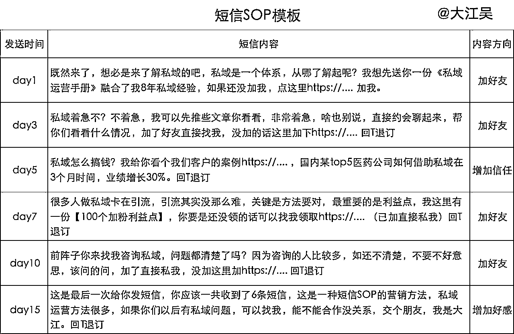

**垂直行业平台。** 互联网发展到今天，每个行业基本都有属于自己的垂直平台。比如做运营的有人人都是产品经理，搞副业的有生财有术。这类平台，只要你认真找，顺着蛛丝马迹一定能发现。

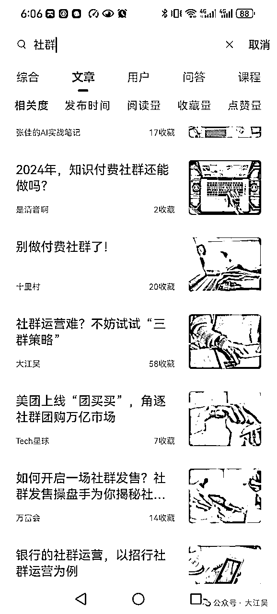

**实体店。** 有实体店做引流，简直是天赐的流量。人都站到你店里了，你还搞不定，说不过去。但我见过的实体店引流，太多形同虚设：放个二维码就没人管了。这种问题，不是老板不上心，就是执行层不重视。实体店的加微率，但凡低于90%，都有优化空间。

引流还有一套五要素：渠道、利益点、内容、时机、路径。渠道就是前面说的，客户在哪儿就去哪儿引；利益点就是拿出一个让客户没法拒绝的理由；内容要让客户一看就懂；时机要选客户最容易看到、最愿意行动的时间；路径能短一分是一分。

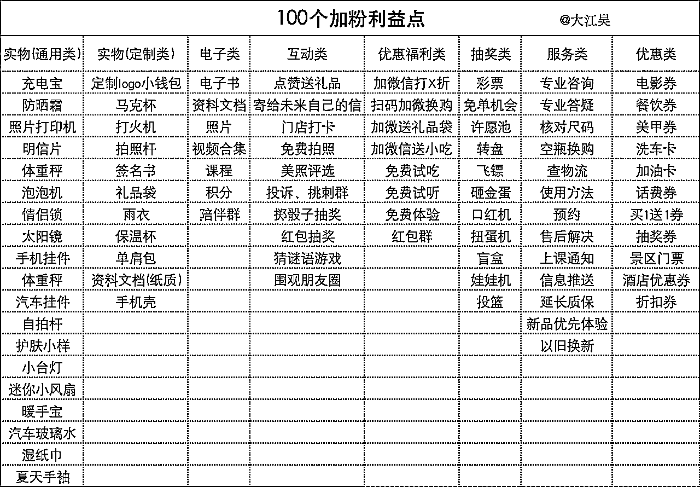

最后多说一句：引流不是越多越快越好。多不代表精准，快不代表安全。好的引流方案，是在安全、稳定、精准、成本可控这四者之间做平衡。而且引流没捷径，一个好方案往往靠不断测试打磨：把不同的利益点、内容、时机拿出来做AB测试，留下转化率最好的那一版。

### 3. 留存策略

真正拉开私域序幕的动作，其实是留存。

什么叫留存？“留”是让客户留下来、不删你；“存”是把客户数据沉淀下来。私域最有魅力的地方在于——只要客户愿意留下，你就总有机会成交他。

接下来要想的是：把客户留在哪个触点？用什么方式更高效地触达和激活？私域的触点很多，性质和特征也不一样。

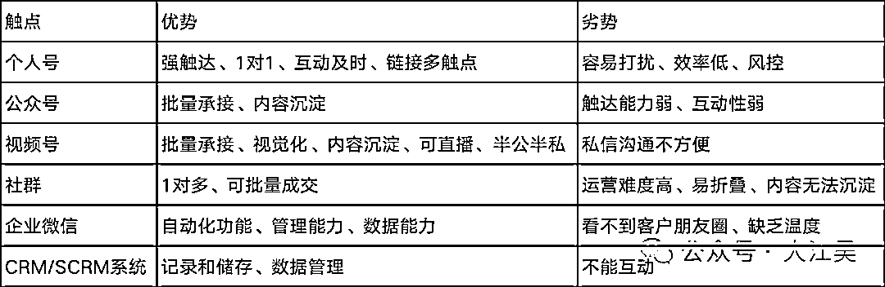
客户留在哪里，不一定非此即彼，可以是多个触点组合。但组合的先后顺序很有讲究。比如你也可以想想：先加微信再进社群，和先进社群再加微信，两者的体验和信任进度一样吗？

至于留存，有一个特别重要的触点：朋友圈。想想看，你加了别人微信后的第一个动作是什么？多半是翻朋友圈，看对方是个什么样的人。所以，朋友圈的功课要提前做到位。分享一个技巧：至少置顶3条朋友圈，分别回答三个问题——你是谁、你干了什么、凭什么相信你。

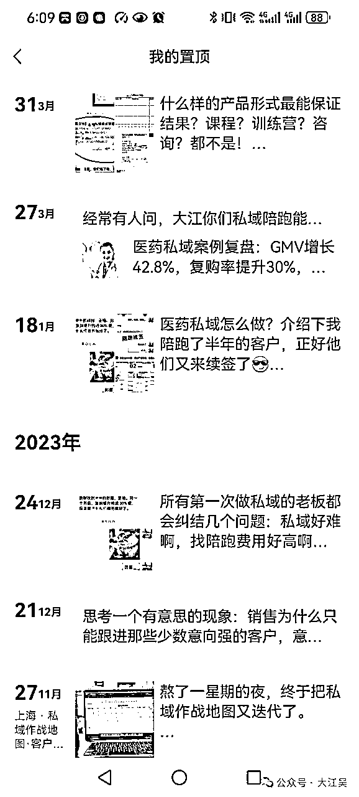
还没有置顶的人，现在就可以去操作。

比置顶更高级的玩法叫“朋友圈剧本”。我们平时发圈是全员可见、想到啥发啥；朋友圈剧本则相反——不同类型的客户加进来，看到的朋友圈完全不一样，而且都是提前为他们量身定做的。这个玩法目前知道的人少，用的人更少，算是我们压箱底的杀手锏。

在“存”的层面，要存的是标签、订单、积分、行为、手机号等数据。为什么存这些？有什么用？放到下面的数据策略里一起说。

### 4. 转化策略

私域要跑起来，关键是找到对的转化模型。

不同业务类型，适合的模型并不一样。常见的模型有这么几种：

**流量模型。** 本质是流量的生意，绝大多数品牌并不适用。KFC、瑞幸这类品牌发发券就能成，因为它们流量够大、品牌够响、利润够足。

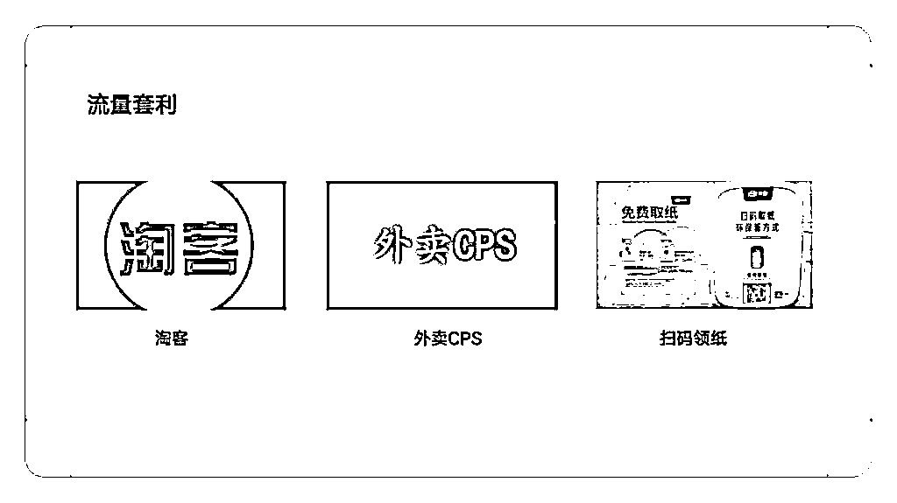

**社群销转模型。** 典型的“低转高”：先用低客单价完成第一笔成交，再用超值交付、超预期体验、羊群效应一步步实现高客单价成交，K12教育玩得最典型。这种模型适合“低转高”的业务，短期要算账，账算得过来；长期则要看留存，千万别做一锤子买卖。

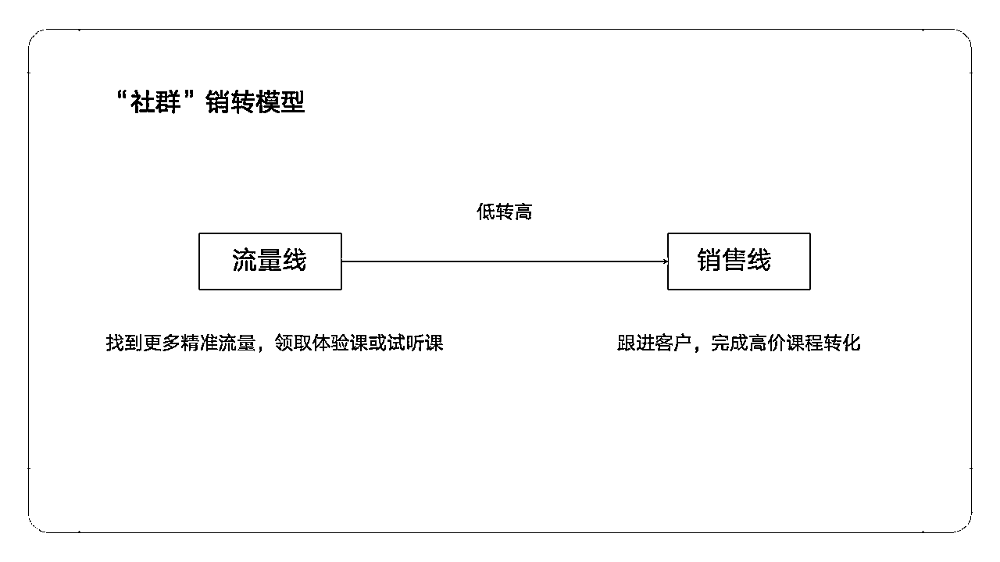

**社群发售。** 通过精心设计一场社群发售活动，制造高势能，实现集中成交。实体店和知识付费用得多。要注意，社群发售的效果会递减，所以一年最好不超过3次。

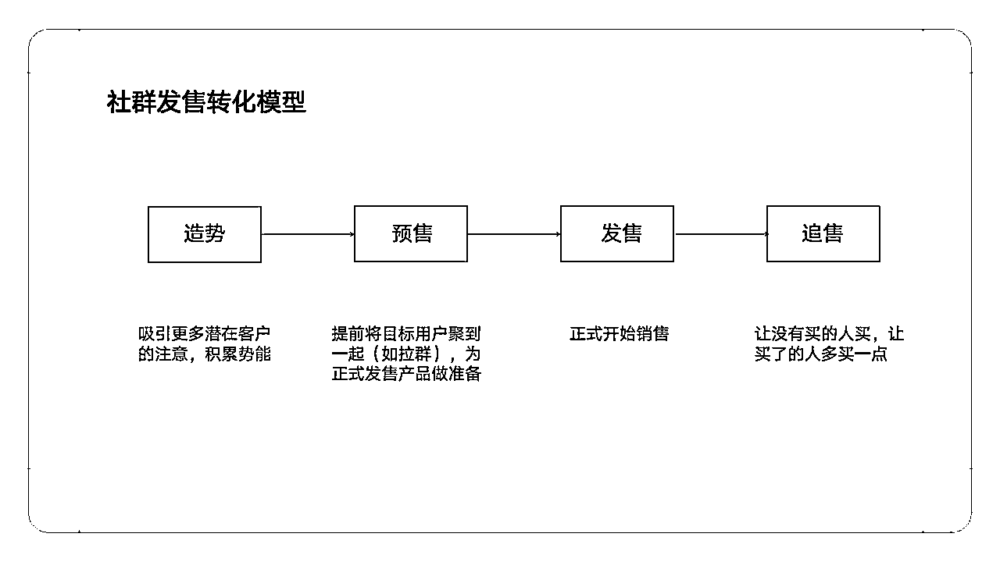

**1v1私聊剧本营销。** 根据不同类型的客户，提前设计好不同的营销剧本（短信SOP也算其中一种）。它的重中之重，是业务流程拆解和内容的提前配齐。

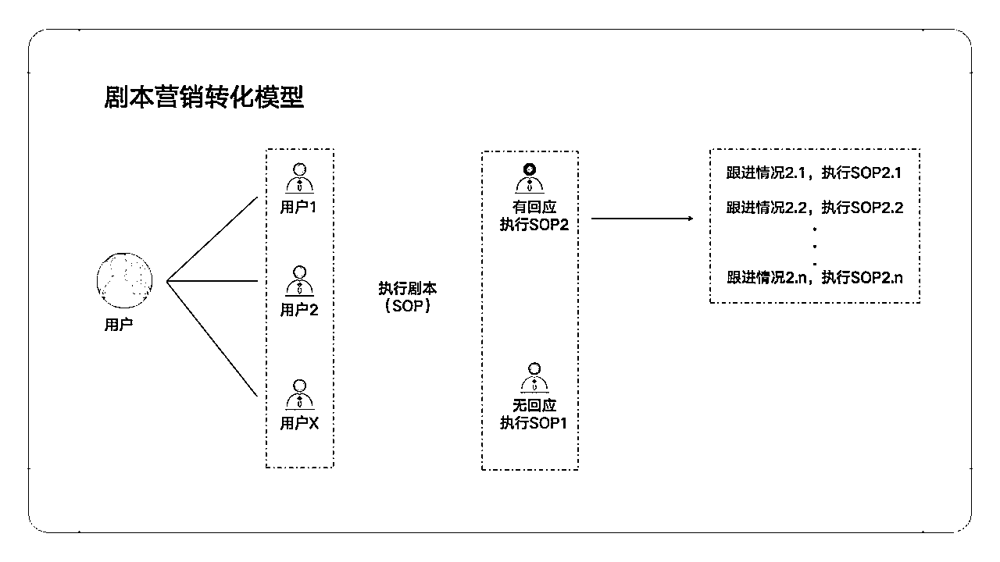

**私域返公域成交。** 把私域里的客户引导回公域去成交。为什么要“绕回去”？原因很多：有的产品在私域里卖不了，有的公域更适合集中成交，有的则是为了刷公域数据。典型的像服装商家，用私域把人气带回淘宝、抖音直播间再成交。

**3+1组合模型。** 朋友圈+微信群+视频号直播+私聊。朋友圈负责立人设、造势能、建立信任；微信群负责形成一个封闭的“集中影响”场域；私聊用来解决疑难杂症、临门促单；直播间则把信任推向高潮，制造稀缺感和紧迫感，最终集中转化——这是最高效的销售场景。

每个触点都可以衍生出一种转化玩法，不同触点叠加，又能产生新玩法。这正是私域的可扩展性。说到底，没有哪一种模型是绝对的“最好”，只有最适合你自己的。

### 5. 数据策略

私域运营里，普遍存在两种情况：一种是没有数据意识（微信本身能提供的数据维度也确实有限），另一种是有数据却不知道怎么用。

干过运营的人都知道：没有数据，就像开车没有仪表盘，全靠感觉。数据的作用是指导运营，而且数据颗粒度越细，运营就能越精细。私域人效是多少？员工盈亏平衡点在哪？私域整体赚不赚钱？单粉平均产值有多少？转化策略的切入口是什么？答案全藏在数据里。

很多公司私域做了半天，既不晓得效果好坏，也不算账，就是因为没有数据。数据真正用法是：从数据中找规律，做分析，然后推导出策略。

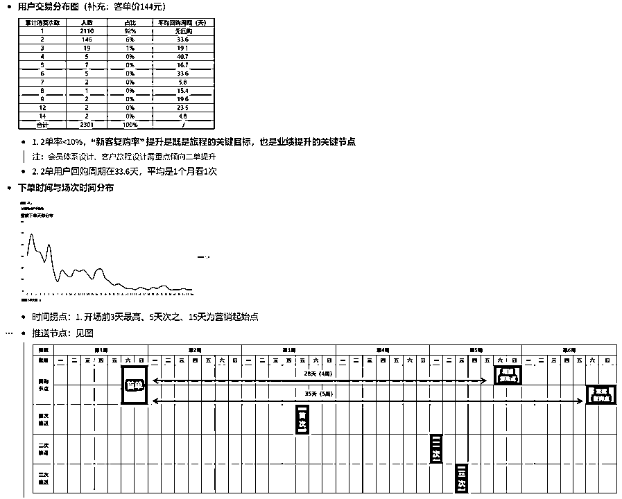

举个例子。我们服务一家舞台剧客户时，通过数据分析发现：消费过2次的客户占比不到10%。这意味着“二销率”就是最大的机会点。再看原来的产品体系，太单一，只有单次票，于是我们针对性推出了次卡，销售结果直接带动了二销率和复购率。

再比如推送时间的问题。我们通过小程序打开时间发现：中午和下午下班前的打开率最高——中午是午休刷手机，下班前是摸鱼时间。好，推送时间就锁定在这两个时段。

懂运营的朋友大概已经看出了门道。没有这些数据分析，策略就只能简单粗暴，比如全员群发。为什么很多人做私域策略极其简单？要么是压根不知道有数据分析这回事，要么是知道但不会用，还有一种是公司压根没有数据支持。所以，还没搭数据的企业，尽快把自己的数据体系建起来，否则私域做起来处处是短板。

### 6. 客户关系管理

客户关系管理，说白了就是你和客户的关系演变过程：一个陌生流量，先变成用户，再变成活跃用户；买了单，成为客户；继续买，变成复购客户；一直买，变成忠实客户；最后，他还会帮你转介绍。

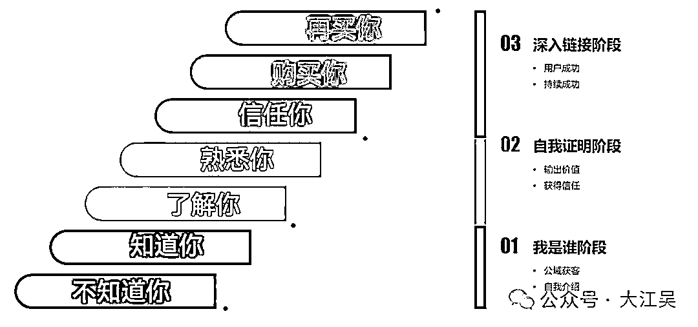

还记得开头私域的定义吗？企业和用户建立长期、忠实的客户关系。私域的本质就是建立关系。从运营层面看，私域流量运营表面是数据，深层逻辑却是关系的层层递进。

策略这块就讲到这里。记住：策略就是运营方法。如果策略还没想清楚，别着急开始私域。

## 02 内容篇

内容有多重要？如果这篇文章没有干货，你可能早就划走了。这就是内容的价值。

在私域里，内容无处不在：

- 好友加过来的那一刻，需要一条留下好印象的「欢迎语」；
- 培育、激活客户时，需要能讲清产品价值、激发兴趣的「营销话术」；
- 邀请人进群时，需要一条让人愿意点的「群邀请话术」；
- 在直播间留人、转化时，需要「留人话术」「成交话术」；
- 接待咨询或客服回复时，不管人工还是ChatGPT，都需要标准且有效的回答；
- 每一次触达用户，都需要一条刚好命中目标人群需求的「群发话术」。

看，所有策略落到最后都是内容。内容质量不一样，运营效果差距巨大。

但难题也来了：如何持续生产内容？

答案是搭建内容生产体系。创作方式通常有两种：PGC（专业生产内容）和UGC（用户生产内容）；现在又多了一个AIGC，也就是让AI大模型参与创作。无论用哪种方式，运营团队都需要建一个【素材库】——文案库、话术库、图文库、视频库，以及一套内容生产机制。

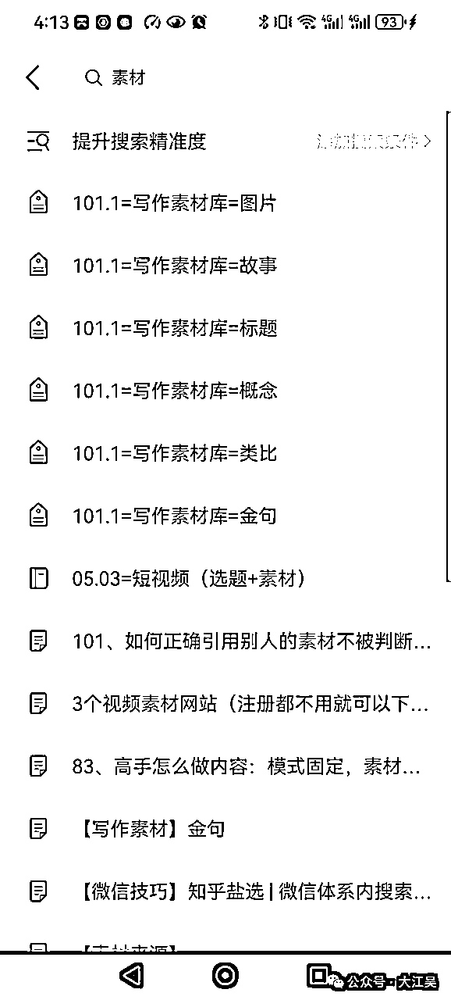

还有一个被长期忽略的问题：好内容往往用完一次就浪费了。我们总在不停地生产新内容，却没想过好内容其实可以复用。

怎么复用？把好内容固定下来，做成内容序列SOP（也就是内容剧本）。不同人群可以配不同的内容剧本；随着好内容越攒越多，这套SOP会越来越厚实、越来越有杀伤力，直到覆盖整个客户生命周期。前面提到的短信SOP，就是同一逻辑。

这算是高阶玩法。但当下大盘的私域内容，还停留在硬广刷屏阶段，最大的问题就是“不说人话”。

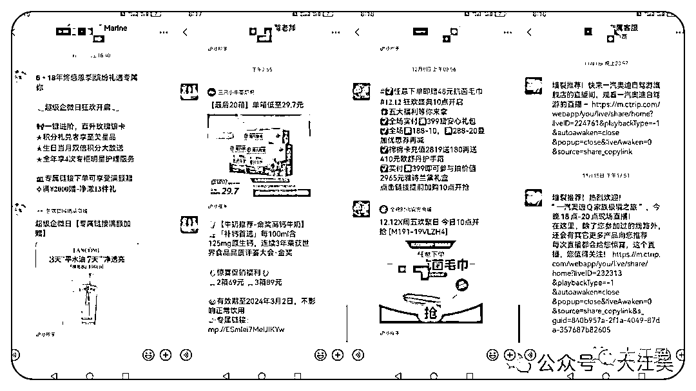
说句实话：对绝大多数私域来说，只要把内容改成“说人话”，效果马上就能起来。

举个例子。我们给一家餐饮企业写过一条话术：

“我店里其实有三个特别服务，一直没来得及告诉你：第一，你可以提前在小程序上点餐；第二，套餐本来就有折扣，你要是想换别的品也可以和我说，价格差不多的我都给你换；第三，有张20元券是总公司出钱补贴的，能帮你再省一笔。现在是淡季，我就盼着你再来照顾我生意。券记得用，下单后30分钟我给你送过来。”

就是这段话术，帮这家餐企把复购率提升了10%，全国全年销售额增加四千多万。而且这条话术是能复用的——每个第一次消费的新会员，在即将第二次消费之前，都会收到它。看，这就是内容的魔力。

## 03 工具篇

工具篇大概是全文里最容易让人踩坑的部分了，注意看。

做私域，真的非要上第三方工具吗？不一定。你可能不信，但这是事实。我这里说的工具，特指微信之外的第三方工具。

只要满足以下两种情况里的任意一种，你都不必上工具：
第一种，你的业务性质和业务量，只靠一个微信就够用；
第二种，你的私域正处于第一阶段——测模型阶段。

重点说说第二种。搭建私域体系，标准动作是四步走，第一步就是验证模式。就像创业一样，先跑通业务闭环；落到私域，就是先跑通“引流—留存—转化”这个闭环。在这个阶段，你需要的功能微信或企业微信本身就能覆盖，并不需要第三方工具。

所以，私域什么时候上工具？不是一上来就上，也不是老板拍板说上就上。而是——当业务真的需要它的时候。

对了，开头提到的那张私域体系化运营地图，领取方式就放在文末，需要的朋友记得去拿。

私域没有捷径，想清楚策略、备足内容、按需上工具、把团队落到人，剩下的就是持续迭代。

跑通业务闭环之后，想放量增长？这时候你自然会把目光投向各种系统与软件。

原因很简单——流程要规范、操作要自动、效率要提升、数据要复盘，这些都离不开工具来支撑。

那具体有哪些常用工具呢？

做引流，有AI外呼（思避驰、百应等）；做裂变、自动加好友，很多SCRM自带裂变玩法；做商城，小程序（有赞、微盟这类）几乎是标配；还有营销自动化（HubSpot）、大数据分析（神策）、内容营销（鲸奇）、数字化系统（明道云）、AI大模型（通义千问、文心一言）等等。

但请注意一个关键点：工具本身不等于解决方案，真正能解决问题的，永远是人。

举个例子，很多人觉得买了引流软件就能躺着来客户。要是真这么简单，那些卖引流软件的厂商自己还投什么广告？何必到处买量？事实就是，他们不也照样砸钱搞投放，想想还挺搞笑🤣。

做私域也是同理。你买一套私域软件，不代表就能把私域做好。恰恰相反，如果你过度依赖工具，很可能被工具牵着鼻子走，甚至被“反噬”。

很多人的心态是：把私域成败寄托在工具上，准确说，是寄托在工具的功能上——指望软件自带的功能去解决私域里所有麻烦。这种想法既天真又可惜。

一线运营这么想，还能理解（虽然一个负责任的运营不该如此），毕竟ta关心的是活儿能不能轻松点、KPI能不能达标、提成能不能拿到。但如果老板也抱着这种幻想，那就危险了：钱花了一大笔，私域还可能从一开始就走偏了方向。

而且正是因为有这种心理，不少软件厂商也顺势而为，不停堆叠功能，让你觉得“这软件真强大”。

但工具越强大，你就越强大吗？

恰恰相反。工具越强，对使用者的能力要求反而越高——你看AI就是这么回事。

图片来自得到

想真正变强？前提是你能驾驭好这个工具。工具本身只是放大镜，放大的其实是你的能力。

但问题来了：你真的会用吗？或者，你真的需要它吗？

事实上，对大多数人来说，缺的从来不是某个工具，而是业务理解力、用户洞察力和内容创造力。

还是那句话：工具，该上时再上，别为了上而上。

* * *

# 04 团队篇

## 1、私域团队怎么搭？

先抛个问题：你觉得私域团队最少需要几个人？

现在市面上的私域岗位多得让人眼花——私域总监、操盘手、内容运营、用户运营、活动运营、会员运营、文案、微信专员……

但实际上，真不一定需要那么多人。尤其是团队小、刚起步的阶段，如果只能保留一个岗位，那一定是内容岗。

先放张图，看看以“内容中台”为核心的团队架构长什么样。

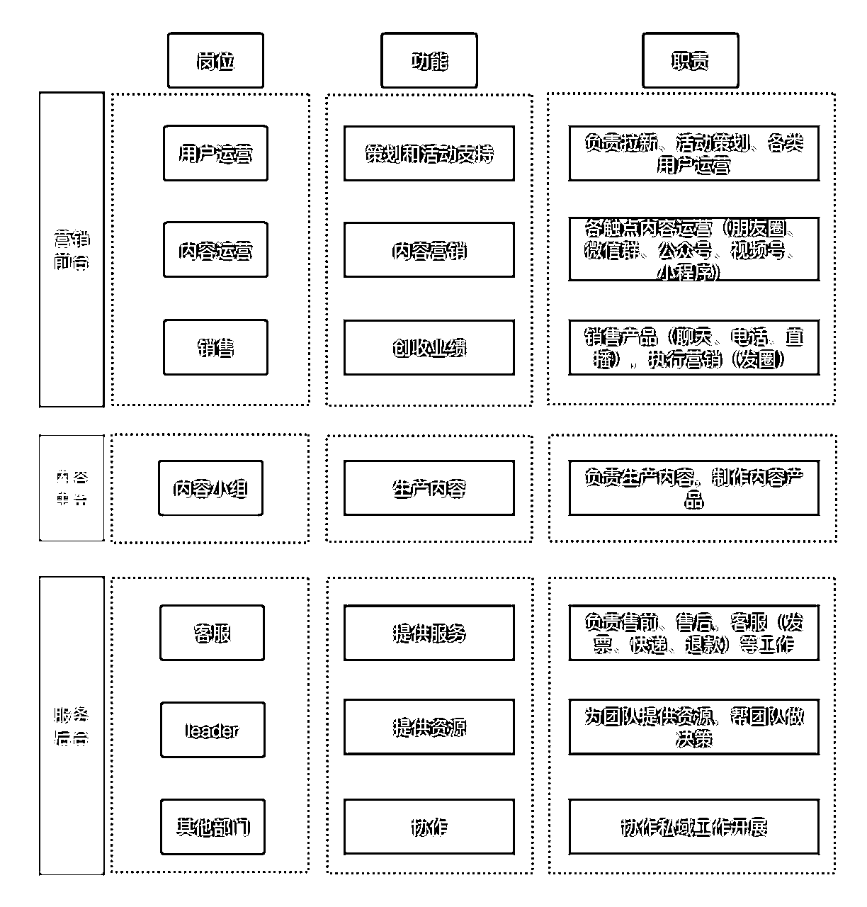

前面讲过，私域里到处都是内容。

内容就是营销、内容就是流量、内容就是转化。从引流到留存再到成交，内容一个人就能跑完整条链路。

内容中台和营销前台、服务后台之间，是相互配合的关系：营销前台冲在一线，直接面对“掏钱”的客户；内容中台在后方给前台供“弹药”；服务后台既帮前台也帮中台。同时，前中后台都要把素材反馈给中台。

比如：运营策划完活动，活动过程、效果、用户反馈是内容；销售手里客户痛点、需求、直播切片、战斗捷报是内容；客服那边的售后记录、发货信息，也是内容。

搭建团队时，有一个角色特别容易被忽略，那就是leader。这个leader要么是老板本人，要么至少是有实权的高管。因为私域经营牵扯太多部门利益，需要跨部门配合，也需要资源倾斜，每天都有无数决策要做。没有leader拍板，内部根本推不动——很多公司的私域就是死在内部协调上。

举个很小的例子：私域做到一定阶段，公司要招人，那就得人力资源部配合。先别说人家配不配合，光“薪资谁定”和“招什么样的人”这两件事，HR能搞得清楚吗？这些都是卡点。

## 2、能力模型拆解

**1）内容岗**

私域做内容，最基本的门槛不是文笔多好，而是会说人话。私域内容的基本功，就是口语化表达，说白了，讲人话。

往上走，一个优秀的内容人才还得懂客户、懂产品、懂业务、懂销售，文笔也不能差。为什么？

- 不懂客户，戳不中客户心理；
- 不懂产品，讲不清价值和亮点；
- 不懂业务，开口就显得业余；
- 不懂销售，内容没有攻击力；
- 文笔不好，内容打动不了人。

业内有个词叫“内容运营”，我觉得这个叫法不太准。

私域对内容的需求，其实分两块：内容生产和内容运营。生产是创作和产出；运营本质上还是“运营”——放大效果。

内容是1，运营是后面的0。内容做得越牛，对运营的依赖性就越小。因为真正好的内容，自己会传播。

**2）运营岗**

什么是运营？运营就是用策略和方法，达成某个目标。

细分下来，有用户运营和内容运营。

用户运营是个比较复杂的活儿：既要懂用户，又要懂活动策划。

懂用户，就是明白用户喜欢什么、讨厌什么，摸清用户生命周期，会做分层、设计会员体系，还会用数据分析用户行为来指导策略。最终目的是让用户活跃起来，留下来。

懂活动策划，就是会通过各种活动达成运营目标，比如拉新、转化。

一个优秀的用户运营，通常还具备社群运营能力，对常见工具也门儿清。

但说到底，用户运营的底层能力是对用户需求的洞察。洞察不了需求，一切都白搭。

内容运营，则是把内容的效果无限放大。这要求你对各平台、各触点的规则和特征非常熟，会梳理SOP，会整理成交话术，还能收集内容反馈、做分析，帮团队优化内容。

**3）销售岗**

做销售的方式因业务而异：有的业务本身就有销售岗；有的没有，就靠IP、内容或运营来承担销售角色；还有极少数业务，私域运营只做客服，不带销售性质。

如果采用私聊成交，就得会私聊销售；社群成交，就得会社群批量转化；直播成交，就得会直播间话术；文章成交，就得会文案销售。总之，不管有没有专门的销售岗，用什么方式卖，总得有人把销售这件事扛起来。

**4）客服岗**

私域是不是一定要配客服？不一定。

如果你的业务产品简单，没什么售后问题，大概率不需要。你可能会问：那客服的工作谁干？其实不一定非得客服干，运营、销售甚至AI都可以“行使客服职能”。

但如果真设了这个岗位，那基本要求就是：有服务意识、有用户思维、态度好、有耐心、会沟通、执行力强。

**5）私域操盘手 / 项目负责人**

这俩不是一回事。

操盘手得真正懂私域怎么玩，有方法论。他不一定每个环节都精，但一定要明白每个版块需要什么样的人，知道每个阶段的重点，还得能搭班子、带队伍。

项目负责人则未必懂私域，很多是从公司某个中高层管理者里拉出来的。

另外，一个称职的操盘手还得会“向上管理”——不是老板说什么就全盘照做，而是能跟老板对齐预期、争取资源。

## 3、团队配置怎么定？

私域团队最少得几个人？

答案是：一个人。

这个人只要内容能力强就行，最常见的形态就是个人IP。

那到底怎么配人？其实没有标准答案。

但有一个大区别：有没有IP。

有IP的话，运营和销售都会好做很多；没有IP，那就非常吃流量和运营功力，即便如此，销售也不见得轻松。

还有个常见误区：很多公司压根没安排一个人来统筹私域。虽然有运营、有客服，但都只做基础的执行工作。这样的私域，基本就是小打小闹，翻不起浪。说白了，还是老板不重视。

另外，团队配置要匹配私域的阶段和规模。

刚起步、规模也小的时候，团队1到2人就行：一个负责内容生产，一个负责内容运营。

等做大了，那建议5个岗位配齐，人数可以按需调整。

## 4、薪酬怎么设计？

具体方案和数字就不展开了，篇幅有限。

这里分享一个我亲测有效的制定方法：试用期给高底薪，转正后改成底薪+提成。

先用一个高于同行的底薪把人招进来。试用期没有提成，但高底薪能让人安心工作。两三个月的试用期，双方基本都能摸清彼此的底。然后根据实际业绩情况，再重新核定底薪和提成比例。

另外，我真心建议：如果员工能力不错，工资一定要高于同行；管理层最好有年度分红或奖金。原因很朴素——私域人才难得，好的人才值得好回报。

好了，这篇就聊到这。希望对你有帮助。如果你们企业做私域遇到难题，欢迎来找我聊聊。

附件《私域运营地图》：

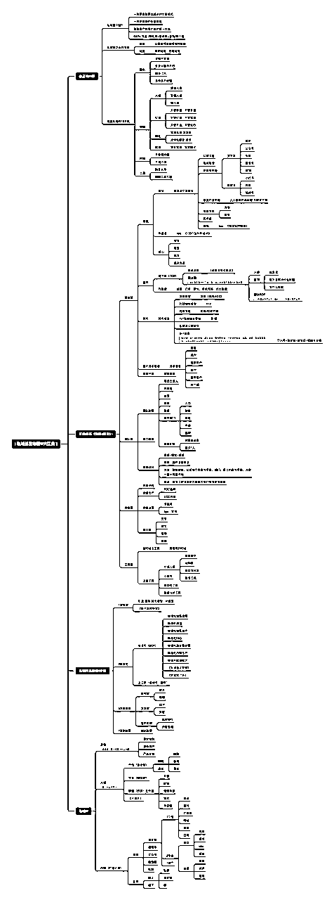

# 往期精选干货（精华贴）：

医药私域案例复盘：GMV增长42.8%，复购率提升30%，私域如何改善经营？