# 用焦虑当燃料，三月航海我赚到了第一笔美元

全文12209字

阅读时间大概18min

文末我把整段经历浓缩成要点，赶时间的朋友可以直接拉到最后看—高光时刻

# 一、开场白

大家好，我是小雨，某车企国企的测试工程师。外界眼里我是学霸，成绩好带来的副作用就是总拿自己去跟优秀的人比，然后陷入自我否定，焦虑成了常态。在搞钱女孩的分享里认识赚钱，几乎是立刻就交了钱。我没有亮眼的履历，却亲眼看着自己在这差不多三个月里一点点发生变化。

这篇想给同样觉得自己平凡、缺乏底气、容易自卑、又没有专长的小伙伴一些安慰。

也想给刚进赚钱的新人一些可以参照的路。

# 二、航海战报

*   航海主题：tiktok短剧出海

*   成果汇报：

累计剪出40条视频，其中一条播放破7万，带来6个代理充值，合计7美金。21天全勤打卡，个人榜单第一。航海结束至今我仍保持每天剪一条的节奏。

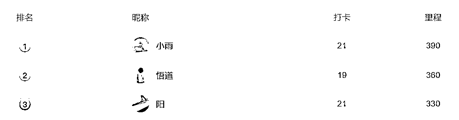

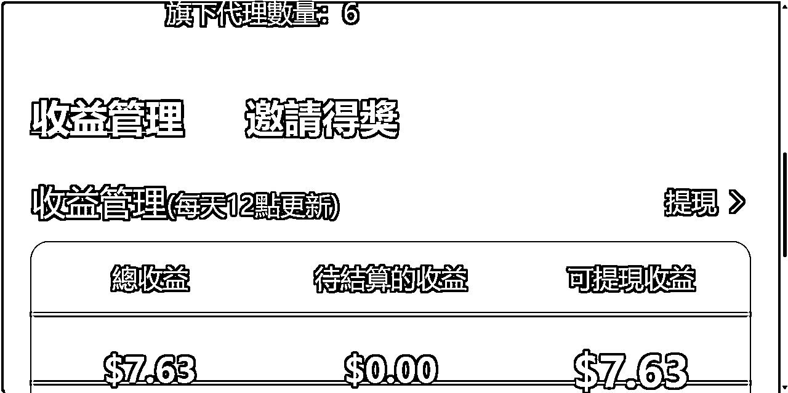

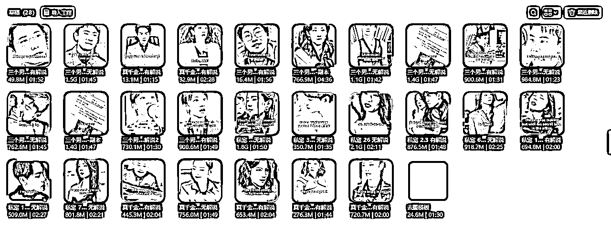

我本人没有正常的tiktok号，全程靠教练代发。总的来看，项目逻辑跑通了。

在这个船上成绩只能算很普通，基本属于垫底梯队。今天作为分享者，把航海里踩过的坑和调整方式记录下来，也算做一次复盘。

方法不一定人人适用，核心变化是航海前后心态的位移，希望能做到真正的利他。

前戏有点长，想省时间的可以直接跳到第五部分

# 三、个人背景

*   工薪家庭长大的传统女生，被叫做“别人家的孩子”，7年舞蹈训练。

*   初三从班级倒数冲到前十；高中三年稳坐年级第一；本科四年专业第一车辆工程，保研211；自考PMP；提前一年完成硕士毕业论文。

*   一年瘦身30斤，体重一直控着。

*   如今在车企国企做测试工程师，位置在项目末端，工作是实车测试、写用例、写专利。实车测试属于高度可替代的交付活。同事基本都在加班，只有我能准点收工。

* * *

靠年轻和刚毕业的滤镜，各种松懈都能被原谅。

但越往后责任越大，新手期总会结束。最近两年汽车行业内卷加剧，集团盈利下滑，管理层公开说要裁员1%。

对毕业生来说似乎很遥远，可迟早轮到我。

于是我在搞钱女孩的背书下踏上了赚钱之路。

# 四、心态起伏

## 起步

### 捡芝麻丢西瓜

拿到3天体验卡后，并没有马上入会，只是想着免费期能看多少算多少，结果发现根本看不完，一个航海手册就得花一天。

为了能继续看，我交了钱，心里一块石头落地。

我的第一个付费社群，从此也是赚钱人，可以正式接受知识灌输了。

回头看当时挺拼的，为了薅羊毛想尽办法。

碎片化时间利用没错，但方式要对。边走路边刷手机，我完全吸收不了，还头晕，反而影响工作状态。

### 盲目刷帖，越看越耗

精华帖、航海手册、风向标，我开始无头苍蝇一样猛刷。

精华帖都是大佬的案例，距离我太远，标题就能把我吓退。好胜心让我越看越焦虑，开始怪自己为什么学了这个专业、进这个行业，只会交付，创造不了价值。

我怎么这么失败，大家怎么都比我强？

### 拍脑袋，凭空设想

第一次脑热的点子：

风向标里内容良莠不齐，更新又快，我刷不过来。看到点子就想立马干。

当时心动的项目：老人穿脱袜神器、春节现打春联。甚至想在pdd下单，周末拿到街上卖。冷静一想：

*   距离回老家不到两周，物料工作日才到，下周末就回家了，年后也没人需要现场打春联了；
*   平时有打春联需求的人多吗？
*   就算有，为什么来找我不去街边打印店？
*   赚的钱能cover打印机和墨水吗？
*   没调研过，怎么知道菜场大妈们买不买穿脱袜神器？

第一次创业念头就此作废，不过脑子里多少有了点找需求的意识。

第二次脑热的点子：

广州城中村窗户单层，防风条也挡不住风，冬天睡觉脸被吹得凉。于是我想做一条盖住脖子和额头的枕巾，上网一查没有，开始问鱼丸下一步怎么走。

这个过程我挺执着，还自己画了产品图写了介绍。

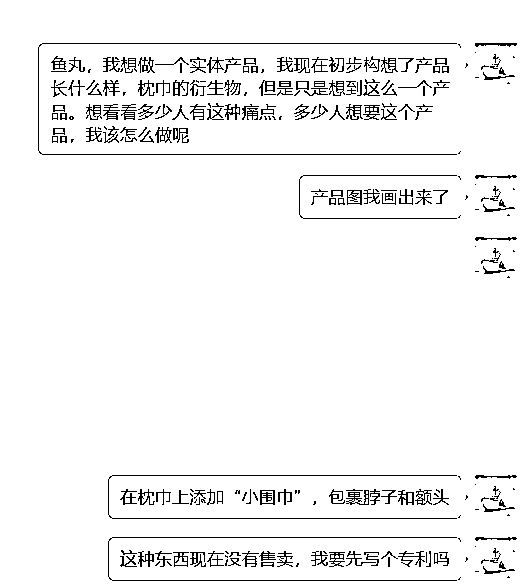

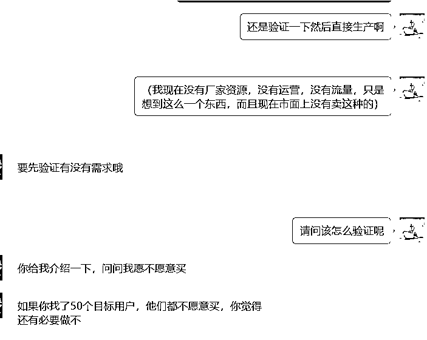

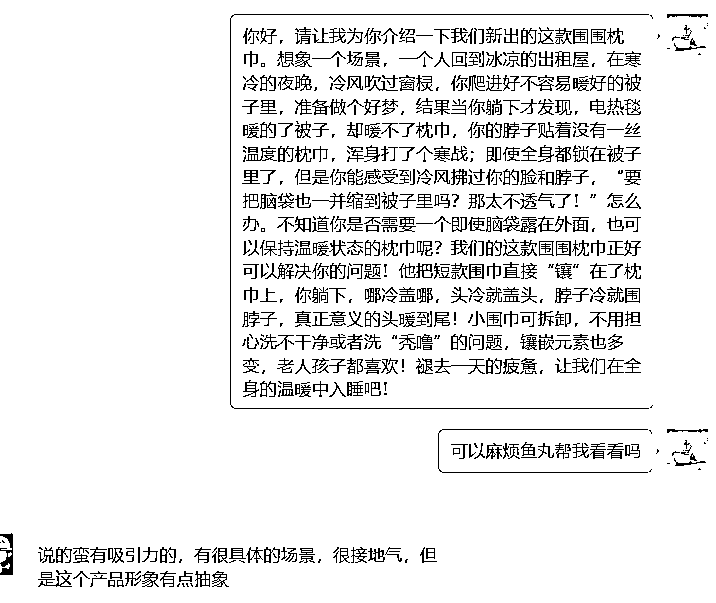

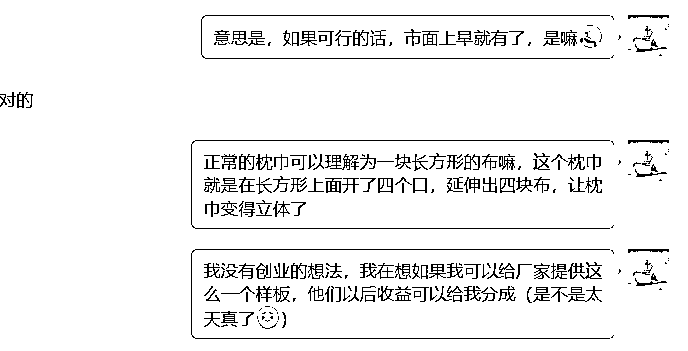

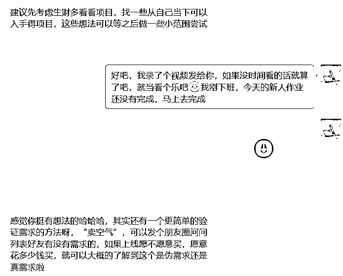

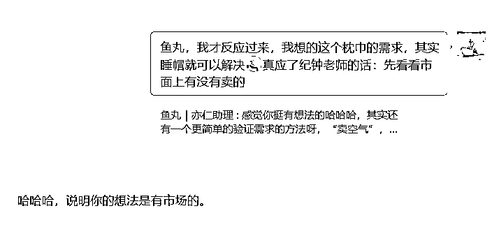

纪钟老师一句话点醒：想做产品先看市场有没有，先模仿，别以为自己是天才。

后来一想，睡帽就能解决的问题，何必整花活，还不好清洗。

这两次拍脑袋的想法像梦一样散了，我甚至觉得自己不是做钱的料。

### 侥幸心态，不肯动手

航海手册很实战，我看了12月手册里的👸号爆文、📕境外游、抖音教育直播、闲鱼二手书。

看是看懂了，就差实操那一步。

坊间传闻航海很多人赚钱，所以我对航海的印象是神圣的，上了船就能赚钱。

于是从2月开始我就等着航海，心想只要上了船就得救了。

2月到3月初，我基本都是焦虑状态，期间看了几篇精华帖，跟着做了快手本地团购生活剪辑、支付宝直播、快手数字人带货、视频号涨粉、短剧cps，最久坚持一个月，最后全放弃。

所以我对航海的期待越来越高。

## 船只公布

### 幻想很美好

12月手册里我对📕旅游感兴趣，打算下次报名。

航海标题公布后，中老年知识付费和闲鱼高客单我比较心动，打算二选一。

### 现实很骨感

项目介绍更新几天后，我第一时间看门槛和适合人群。

知识付费要导私域，我不太会经营朋友圈，放弃了。

闲鱼高客单介绍模糊，我觉得高客单应该有门槛，而且售后退货麻烦，也不敢报。

正好看到tiktok短剧，想起8月短剧cps手册我看了三遍却没实操，确实后悔。

没想到3月航海又来了，还不用海外账号，只需剪辑，每天投入也可控，名额有限，我觉得门槛我能吃下，就报了。

想和做是两回事，现实来临前空想无意义，除非你开始行动。

## 出发前

### 战战兢兢

这次真的要开船了。

我把短剧cps手册又认认真真看了两遍，连带链接的文档也一起看，这次基本搞懂了变现逻辑。

预热文档贴了平台上热门视频和账号，我全保存了打算全部看完，其实最后只看了不到一半。

既期待又害怕：

能顺利上岸吗？

能变现吗？

这次手册和8月版有什么区别？

……

### 不断自我否定

开船前一天，船员在群里自我介绍，后缀全是lv5+，甚至lv10。

比我大的有自己擅长的领域和资源，比我小的也都早有成绩。每个人都有可提供的资源和目标。

只有我，拿不出像样的技能，一瓶子不满半瓶子晃荡，成绩全靠老本，介绍时都不好意思开口。

感觉还没起跑就输了，空气般的存在，没脸说话，只能硬着头皮发了。

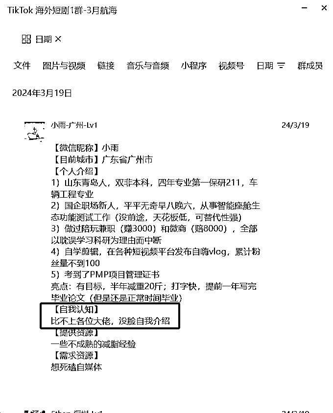

发完后久久不能平静，又把8月手册再看一遍，告诉自己一定要跟上。

后来翻聊天记录发现，当时教练对海外短剧赛道的讲解和问题解答其实已经很透彻了。

我得承认自己当时眼高手低，过眼不过脑，看完就忘。

## 航海第一天

### 充会员、下片源、看手册、存怀疑

开通网盘超级会员，官方片源下载完毕，午休结束第一件事就是眯着眼看刚发布的航海手册，十几分钟看完。

因为里面约50%内容在8月手册出现过。

我当时觉得这次手册不如8月全面，心里嘀咕：

就这？国外短剧这么简单？

不信，又看了一遍，确实没看错。

航海中才明白，中外短剧剪辑逻辑不同，国内基本10分钟以上，国外大多2分钟左右。

### 抢福利、跟进度、上手、愧疚

带着对手册的疑问，我在第一场直播里努力跟节奏，积极回答问题，想拿到教练说的福利，但答得不准，与福利擦肩。

当时不理解千粉链接福利是什么意思，等搞懂tk变现路径才知道对新手很友好。

没抢到福利，但之后几场直播我都积极答题，想碰运气。

现实是，普通人还是老老实实剪视频。

直播结束后动手才发现没那么容易，而白天的我还在挑剔手册。

第一步选剧就花了我十几分钟。

按标题找对标视频，觉得还行才开始构思剪辑。

那天晚上剪了两小时没剪完，只能睡觉，第二天继续。

看到有船员凌晨1点多就交了第一条视频，我又愧疚。

大家都很重视航海，我肯定比不过，再加上没抢到福利的遗憾，下船念头开始冒头。

## 航海前期

### 开卷

前期心理斗争最激烈，因为还能下船，但我还是开始剪了。

群里大家举手提问，很多我都没想过的问题被问遍，不禁竖大拇指，太细了，佩服。

看到日志打卡，我的想法是：大家热情这么高，我不能输。

为了快点见到成果，每天下班后剪3-4小时，作息全乱，熬夜党，体重涨，第二天工作效率下降。

### 卡壳

挑剧、剪辑的动作还没熟练。

群里大家都有问题可问，我却不知道自己的问题在哪，一直觉得自己在掉队，甚至产生大家打开方式不一样的错觉。

### 提问

剪辑熟练些后，我开始发现问题：

*   怎么在教练给的片源里挑好剧？
*   一条视频要覆盖原剧几集？
*   需要看完整部再剪吗？
*   解说和剧情要对应吗？
*   字幕留解说还是原剧？

于是开始有针对性提问，有时教练忙没回，我会觉得自己问题很蠢。

没想到有几位船员很热心地解答，一针见血，让我明白提问本身的意义，也让我感觉自己确实是群里的一份子。

## 航海中期

### 好学生式的坚持

刚开始数据一直不过千也不违规，我以为是时间问题，继续剪总会有结果。

后来的直播教练带我们看千播案例，我按套路改：丝滑转场、attention、冲突对话浓缩、冲突动作语气、适当擦边、悬念收尾、原声混bgm。

每天雷打不动剪两条，可还是不破千。

### 不服气、看不上

这期间其他船员陆续报喜，收代理、变现，还有人受邀分享剪辑方法。

我心里嘀咕：这些我都会，分享我也能讲。

实际上能分享的人都是有结果且拿得快的人，我得承认并虚心请教。

### 迷茫与思考

内心平静后，复盘意义不大，我靠重复剪辑提升熟练度，脑子却停滞了。

我开始思考航海意义，决定恢复作息，不再把剪辑和看数据当短期目标，而是当成下班后的习惯动作。

清明假期我没出去玩，每天在家剪，平均四条，为接下来工作日每天少剪一条做准备，但保证每天提交两条。

* * *

打卡在一定程度上帮我复盘：状态好时我会思考改进点。

我的打卡内容一般是：

*   发现剪映某个功能
*   用了剪映某个功能
*   剪辑速度提升几分钟
*   对剪辑套路的总结选剧、剧情重组等

一天的小确幸来自于发现并使用剪映的新功能。

于是我发现，

专注自己的事后，他人的成果已与我无关。

## 航海后期

### 分水岭来了

有人下船，有人开始运营自己的号，成绩出来的人越来越多，分水岭显现。

### 好胜心作祟

内心虽平静甚至有点凉，但剪辑没停。

打卡排名越来越靠前，我的想法是：大家估计都闷声发大财，没空打卡了。

学霸的好胜心又冒头：

我看看这个No.1能不能守到最后。

于是我多了一个关注点：打卡排名。

大家别学我，精力有限，关注点越多，注意力越分散，最后会混淆真正重要的事。

### 小水花

有天我在tk搜自己的作品，发现一周前发的视频播放到39.5k。

确认是自己的后，我登录代理系统，代理从0变4。

心里很激动，剪辑路终于有点水花了，但跟别人比还是差很远。

* * *

有了正反馈，我不再满心抱怨或心灰意冷，也确认项目确实能变现。

就这样，21天航海顺利靠岸。

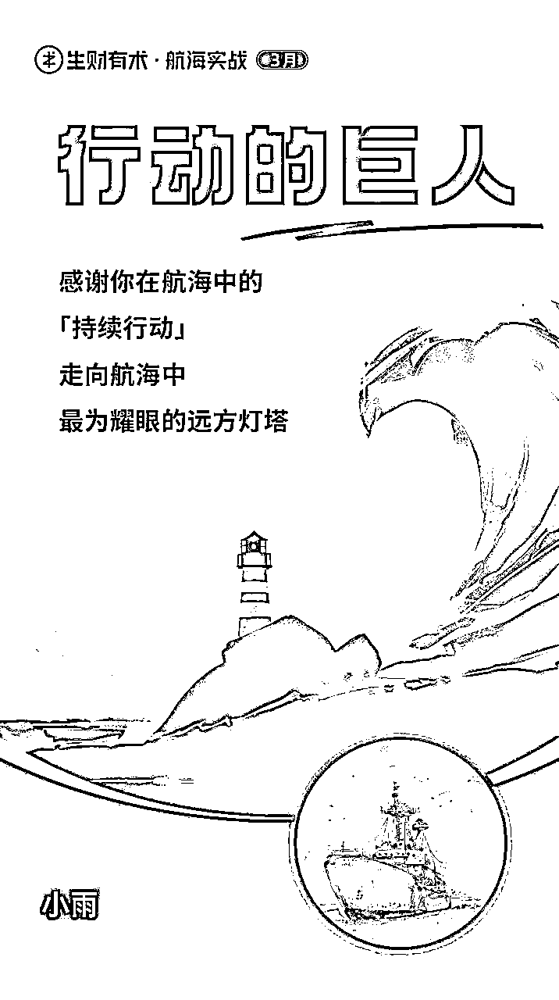

下面是实操中遇到的技术问题，和心态无关，可自选阅读

# 五、航海中踩过的坑

## 关于选剧：我干过哪些蠢事

### 不分青红皂白

教练给了官方片源和高分片源两份表格，我拿到时只看到sheet1的官方片源，直接全存网盘。

网剧分男频女频，我定了女频赛道，却没在第一步保存时就筛选，导致后面靠英文简介模糊判断归属和内容。

直到船员提问我才发现sheet2还有高分片源国内可找对标。

对于只需剪两三条的短剧，没必要下整部，直接在国内短视频平台找爆款，下ai裁剪去重即可。

### 对标难找

官方片源都是英文标题，翻译后在国内平台搜，大多搜不到。找不到对标就只能一集集看剧情，后来我只剪了两部官方片源。

国外成品2-3分钟，国内爆款多是10-20分钟，7-8分钟的很少。我开始怀疑时长不一致还能不能对标，后来用法从手册要求的对标，变成了解一部剧的途径。

### 没优先级

高分片源分3S、2S、S、A、B，我当时不知道字母含义，按顺序一部部搜，凭感觉判断能不能剪。

也是船员提问教练解答后我才知道S级最值得剪。这步浪费我一天。

### 粗糙过剧情

为省时间在午休过剧情，剧情点靠记忆，或只记觉得好的集数不做说明。

剪辑需要多集混剪，结果真正剪时要重看剧情，节奏被剧情牵着走，脑子里没有自己的想法。下面是我早期的记录，真的很敷衍

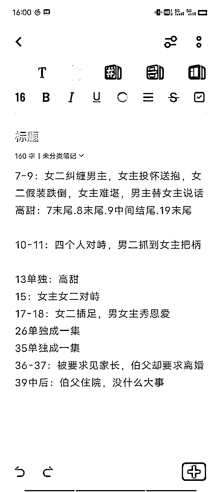

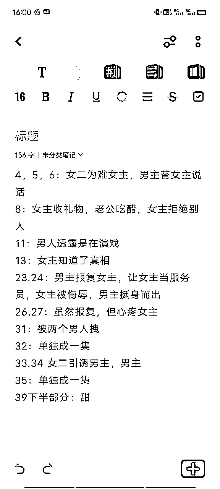

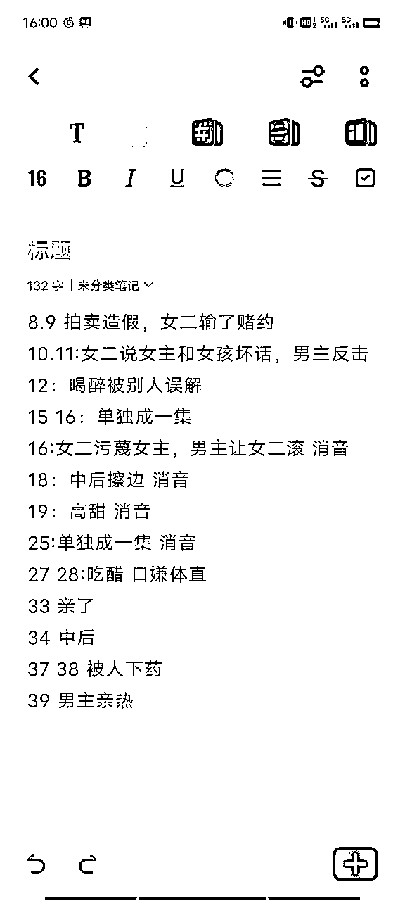

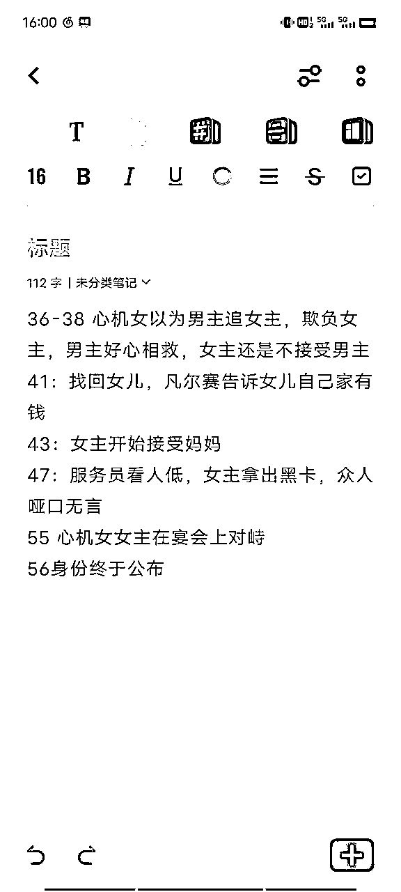

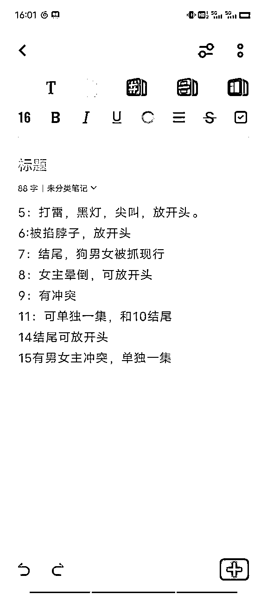

现在才明白自己的问题：单打独斗、闭门造车、钻牛角尖。

剪辑问题敢举手，选剧这个第一步却从没想过可以问。

## 关于剪辑：我做的无用功

### 片段增删改放在导入英文配字后

重新导入翻译字幕后才发现要加新片段，导致要重识、重翻、重导入，或手工打字幕

### 片段衔接细节改在做复合片段后

复合片段做好蒙版后才发现零碎片段细节剪得不好、单片段没剪完、需要补转场镜像去重，导致要解散复合片段、重改单片段、重建复合、重做蒙版

### 剪辑方向没定，视频就散了

前期没把想要的调性、想要的桥段先想清楚，就把一堆集数一股脑扔进主轨里靠直觉乱剪。剪完才发现叙事断掉、情绪接不上，临时换片段换顺序，也说不清这条片子到底想讲一件什么事、主角是谁、为什么要插这一段。

### 字幕锁死后才动画面，英文字幕全乱

一开始就把轨道锁定，觉得稳当了。后期想给片段加速、调顺序，英文字幕却纹丝不动，最后对不上口型对不上节奏，整条视频时间线全崩，只能一帧一帧手动拖拽对齐。

### 翻好字幕才发现片段要删

一段已经翻译好英文字幕的素材，最后判定用不上，直接作废。翻译的功夫白费，还拖慢了整体进度。

### 解说字幕和识别字幕大小打架

手动打的解说字幕和自动识别的中文字幕规格不一致，字号、间距、排版都不统一，看起来很不专业。

## 关于去重，我差点入坑

“哪怕去重动作做得再多，只要一直套用同一套去重模版，平台照样能和你之前发布的作品撞车。”

这是有船员被判定重复后提问，教练给出的回覆。

看到这句话我后背发凉。因为我本来就主要靠去重模版在做，只不过换了不同模版，参数却从没动过。

# 六、针对这些问题，我做了哪些调整

## 关于选剧

### 有自己的标准

挑剧就像挑人，得有底线。我现在心里很清楚：要冲突密集的、要甜的、要自带钩子的。

### 先把剧情摸透

先去抖音搜这部剧的长视频，大概18分钟左右的那种，了解大体脉络；再看7分钟左右的中视频，锁定冲突点在哪。

*   如果这部剧的爆款冲突点都高度重合，我就直接跟爆款剪那几集
*   如果这部剧的爆款基本都是长视频，我就把全剧过一遍，自己找可剪点
*   如果是老剧，基本不浪费时间去下，优先挑更新的短剧

### 判断风格合不合适

有时候光看抖音上的中长视频就能判断不合适：

*   风格太怪？
*   妆造违和？
*   台词没营养？
*   ……

即便是S级、A级标注的剧，对我来说也可能是烂剧。

## 关于剪辑

### 写手顺

找一段安静完整的时间，把这次剪辑的步骤记录下来。第二次剪的时候对照手顺操作，熟练后手顺就可以丢掉了。我的手顺写得很糙，但够用。

主要流程：

1. 分割片段：早期靠识别字幕按对话起止切，后期直接用智能片段分割
2. 做片头加解说：把英文解说配进去，保证时长匹配且衔接顺畅。解说段的原音分离后静音或删除
3. 字幕识别导出：英文解说和中文字对话一起识别，方便统一字体样式
4. 字幕翻译导入：翻译好的字幕重新导入剪映，确认无遗漏后再删掉中文字幕
5. 字幕格式统一：调字号、字间距、行间距、位置，检查是否超出安全区
6. 定格收尾：片尾常用定格最后一幕，加一点音效做悬念
7. 遮挡中文字幕：蒙版只对单个片段生效，所以先做复合片段把零碎片段打包，再加蒙版

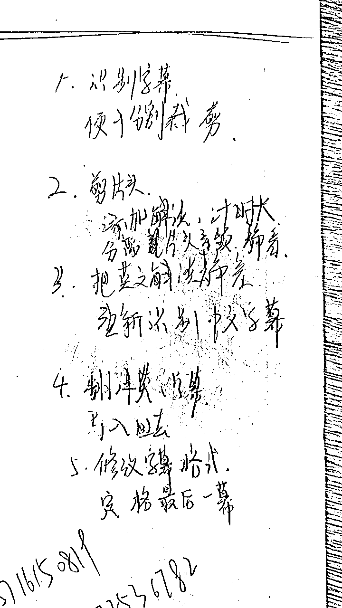

### 中英一起识别

做解说类视频时，先把解说内容读出来，让英文和中文对话同时被识别，这样解说字幕和对话字幕的尺寸就不会打架

### 锁定前先校对

确认主轨片段彻底不需要再改动后，再锁定文字，最后才建立复合片段做蒙版遮挡中文字幕

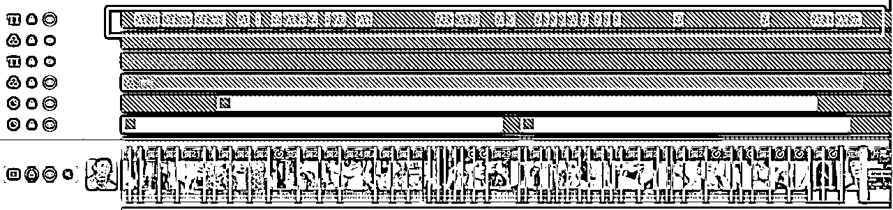

### 先过剧情再动手

拿到剧先把剧情过一遍，记下每集在讲什么。剧情注水的集数直接跳过。条件允许的话，把前后呼应的集数标注出来。下面是我最近几部剧的笔记，还有一部剧的讲解文档被我清空回收站了

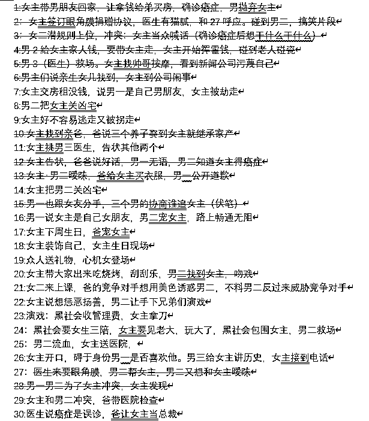

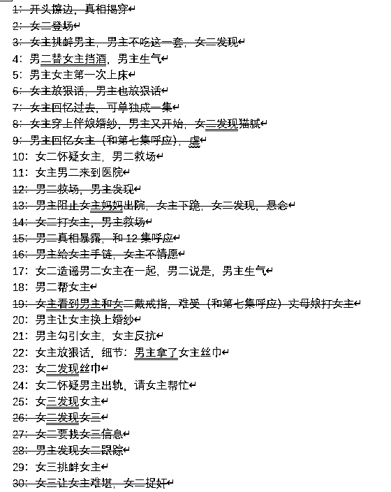

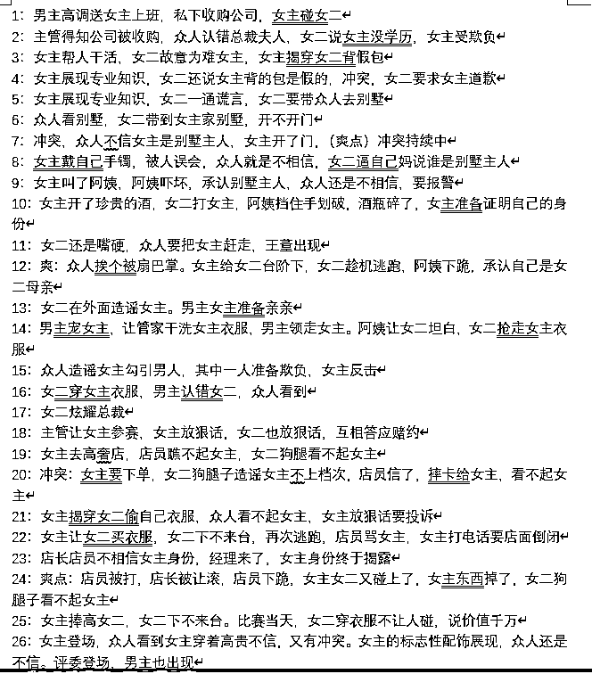

### 用编辑的视角看剧

剪辑没有框架这件事无法避免，我能做的就是让视频始终围绕一个核心：该甜就甜，该反转就反转。

短剧本身在制作上就有连贯性和转场的问题，观众看的时候很容易被带偏。比如上一秒还在讲A，下一秒就跳到B了。所以要跳出观众视角，用俯视、客观的态度去审视剧情，筛出真正能用的剧。

## 关于去重

教练解答完问题后，“去重”这两个字一直在我脑子里回响。

不能只靠副轨的去重模版，还要对主轨原片动手，每条视频都用不同的模版、不同的参数。

我现在剪每条都会刻意改参数：

*   特效轨的长短、透明度、顺序
*   扫光的角度、大小、透明度
*   滤镜的叠加方式和透明度
*   其他调节参数
*   贴纸大小、关键帧定位路线、覆盖时长
*   画中画的数量、组合方式、透明度、位置
*   主轨用智能镜头分割做场景切片，方便镜像和转场
*   字幕的字号、位置、样式：文字颜色粗细、背景色透明度、圆角、宽高比例等

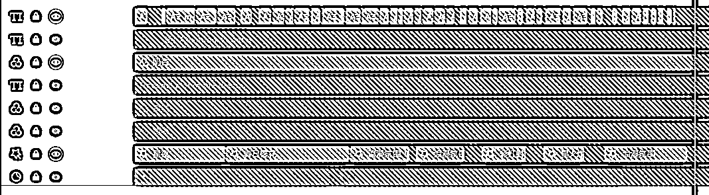

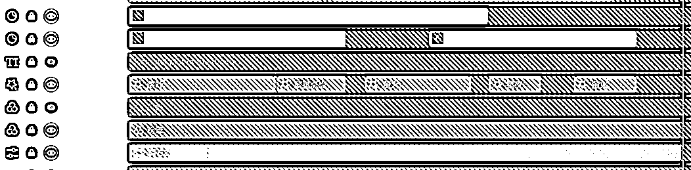

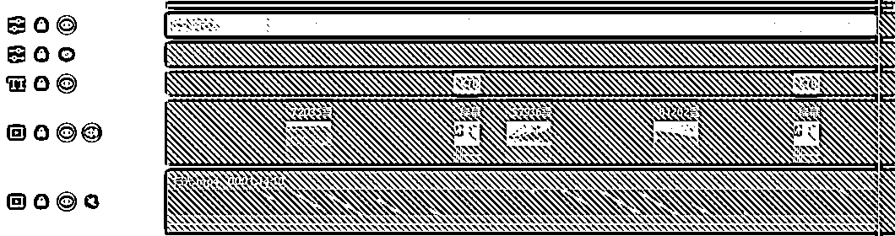

以上经验很业余，还请前辈多指点。

# 七、航海收获

## 技能：专业版剪映的熟练度

1. 主副轨、转场、蒙版、抠图、关键帧、分镜头、口播剪辑等功能已基本熟练
2. 副轨去重模版+主轨画面剪辑旋转等操作，形成降重组合
3. 辨别好剧烂剧的能力提升了
4. 能产出半解说、全消音类型的视频，精剪的网感还需多对标多实操

* * *

以前只用手机剪映，看见电脑端一排排轨道就发怵。

实操下来才发现，电脑版剪映并没有想象中复杂。没接触过PR，不知道PR是不是也一样简单。

跨过心理那道坎，第一步迈出去了，后面自然会接上第二步第三步。只要持续做下去，惯性会带着你继续走。

## 心态

### 救命稻草心态

还没参加航海或没拿到明显结果的圈友，容易把航海当成发财的救命稻草，觉得参加了就能赚钱，现在先等开始再说。

我刚开始也是这样。看了无数航海手册，一个字都没动手，浪费了一个月的等待时间。等到看到别人入局就备好了，才更焦虑、更被卷。

### 急于求成

带着靠航海致富的心态，会把每一天都看得很重。随着时间推移没结果，焦虑会越来越强，和别人的横向比较也会加剧。内耗很大，而根源往往是前期懒惰。

航海不是让你21天暴富的魔法。它是一块快速获得正反馈的敲门砖，帮你跑通MVP，验证项目是否可行，建立信心和意志力。

航海期间保持和圈友、志愿者、教练的连接，收获的可能不只是钱，更是视角和认知。

### 焦虑与嫉妒

焦虑的反义词是具体。焦虑往往来自于想得太远、当下没行动、以及看见别人光鲜的结果。

忙起来就没空焦虑，因为没空管别人。

*   我们有目标：剪出来、拿到结果
*   我们有计划：今天剪几条、今天找什么素材

但要在保持链接的前提下，不能像我一样闭门造车钻牛角尖，不然会走进死胡同。

### 目标与习惯

航海只是帮你跑通MVP的基础建设，让你快速熟悉项目、拿到正反馈。

雪姨说，航海结束后也要保持学习和输出，最好的方式是跟着往期手册实操。每天抽1-2小时或7-8小时来学习输出。

所以航海结束后我也保持了这个节奏，日复一日。

一年的规划很长，拆成半年、每月、每周、每天就容易执行。

从0到100很漫长，从0到1只要踮脚就能到。迈出第一步，就会习惯性迈出第二步第三步。

内心守住不变的目标，用持续的努力和耐心，去面对赚钱过程中的不确定，把赚钱变成爱好，把赚钱的动作变成习惯，每天做和目标相关的小事，见证变化。

### 正确看待赚钱

我承认成长慢、经历浅。

但要放长眼光，知道什么时候做什么事。老师在播客里讲过主业和副业的关系：我们花25年才换来的主业，怎么能指望每天投入2-3小时的副业收入就持平甚至超过主业呢？

给自己一个底线，规定时间内保持状态，否则就要换机会。

## 基于事实的一些结论

### 小马过河

航海群里有人问：过剧情需要全集看吗？大部分人说看几集就行。

实际操作下来，我必须完整看过才能剪。

就像小马过河，每个人的水平不一样，不能用别人的标准要求自己。

### 急躁没用

越想快完成，结果越不理想。急躁很少能提高效率。

### 数据为王

心里再不服，数据好的经验也值得借鉴。自己的数据差，原因只有自己清楚。

### 坚持+复盘+交流，三者缺一不可

*   只坚持不思考是无用功
*   只说不做是空谈

无论技术路线还是管理路线，无论文科理科都适用。

### 关于打卡

打卡21天的排名要感谢每一位船员，是大家的衬托让我在最后几天重新燃起好胜心。

认真努力一直是我的标签，以前觉得没用，因为我的人生轨迹一直是普通人的样子。

学生时代年年第一，自视甚高。进入社会后，用“普通”来掩盖曾经的骄傲。

我总想比别人强，后来发现只能追到别人的脚后跟。但也没什么。

至少在tiktok航海这件事上，我有资格分享收获，我又一次站到了聚光灯下。

# 八、致谢

## 人和

专业的教练、负责的领队、温柔的志愿者、陌生却热心的船员，全部都要感谢。

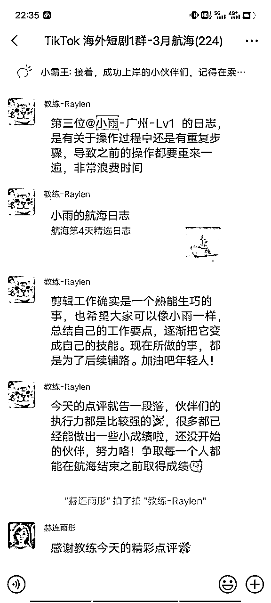

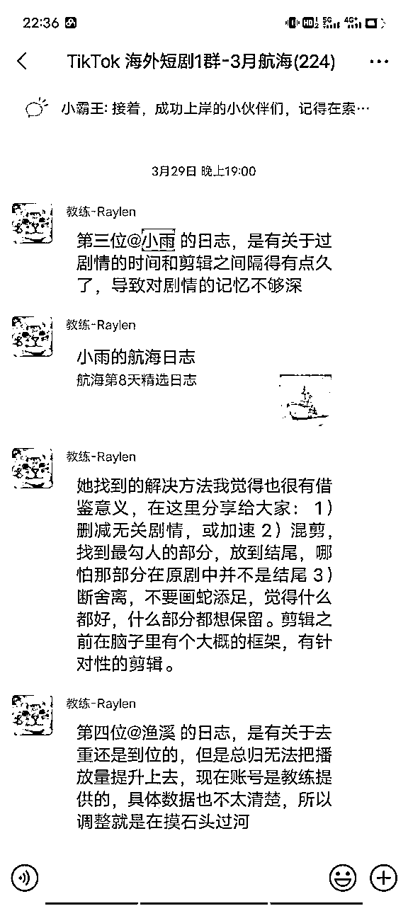

教练没空回消息时，其他船员的解答后来得到领队@赫连雨彤和教练的肯定；

感谢教练@Bridge @Raylen，感谢圈友@悟道 @云端 @yhx @凉亭 @平凡 @乐善人生 @未闻 @梓佳的帮助。

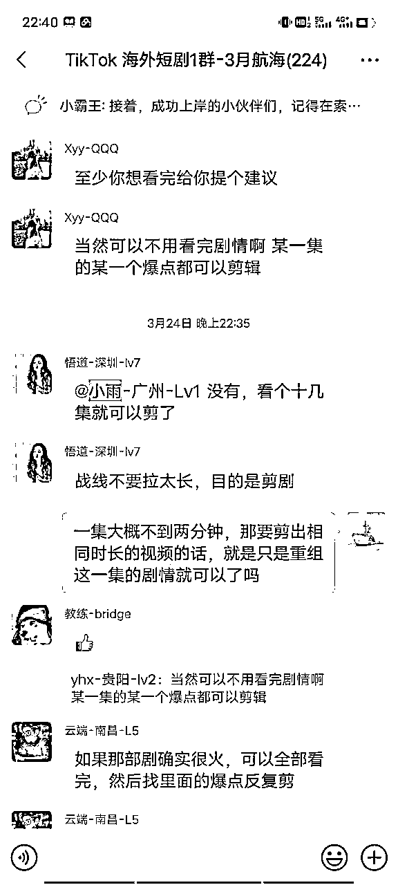

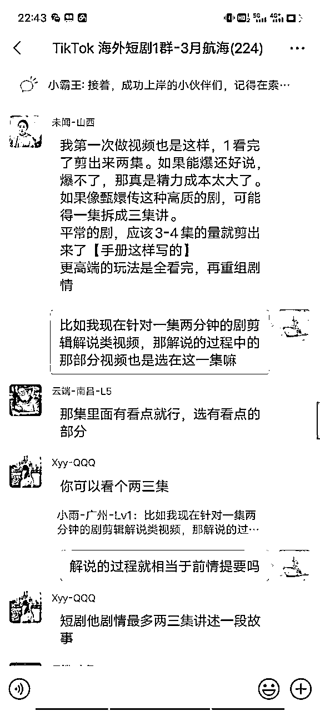

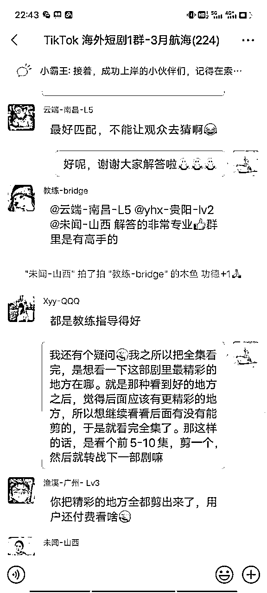

航海结束后志愿者@鸿鹏邀请我做经验分享，还基于自身经验给我宝贵的建议。

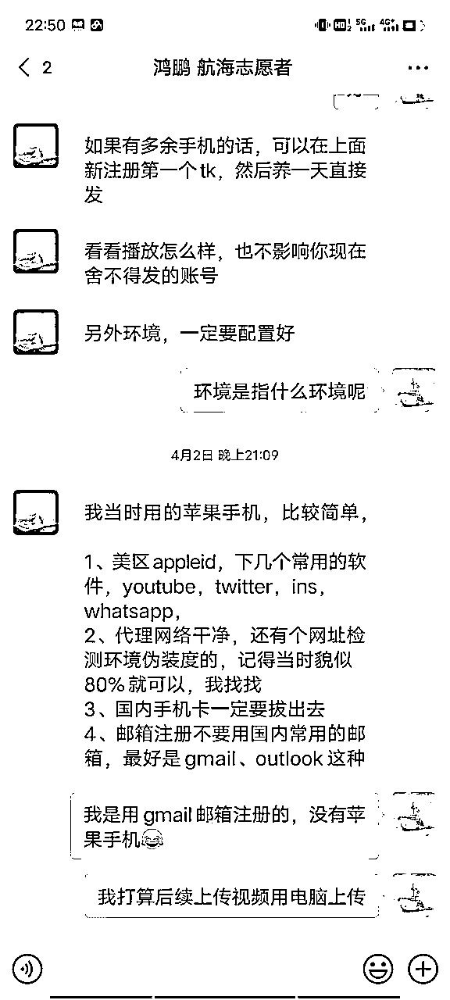

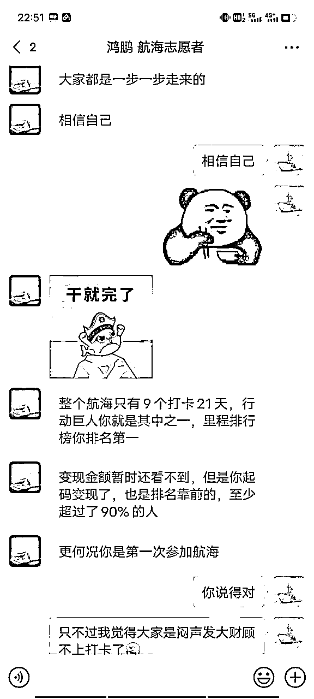

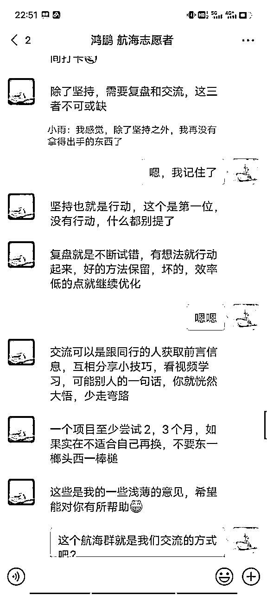

作为首次航海的我，这份温暖很珍贵。被看见、被帮助的感觉很好。感谢的方式就是把这份温暖传下去。

## 天时

航海结束了，我的tiktok短剧才刚刚开始。

教练现在还开放上传通道，我会继续做下去。虽然暂时没正反馈，但我已经有了代理。

概率博弈，搏一搏单车变摩托。我们负责做，剩下的交给时间。

我会一直提醒自己，把剪辑的动作和短视频的底层逻辑内化成习惯。

人活着为了快乐，科学家最后都去研究哲学，保持阳光心态积极面对生活，才是终极意义。我愿意保持干净热烈的心和认真的品质。

# 高光时刻：给“像我一样的新人”的小建议

## 想一万遍不如动手一次

刚加入赚钱没方向时，多看精华帖。总有一篇戳中你，确认第一个项目就去做，别再找借口。

最懂新手的郭晓文老师说：“干就完了！”

## 正确看待航海

航海是链接大佬的渠道，也是督促你每天学习实践的机制。不是参加了就赚钱，也不是救命稻草。

## 手册的使用方式

反复看手册，看实手法记标题，看到标题就能想起大致内容。遇到问题带着目的性去找答案。不懂的可以顺着手册的出处找作者。

## 每天都是航海

手册摆在面前，看也是一天，不看也是一天。打开看一个字自然会看到第二个字，看一行自然会看到下一行。难的不是学习，是面对困难时选择解决还是用它当借口。

## 焦虑是常态

压力在一定程度上能提升效率。焦虑不可怕，关键是分清来源。看别人有成绩自己不动手的焦虑，坚决不要。

专注于自己的事，外界噪音会被屏蔽。剩下的焦虑学会转化成动力。

## 把赚钱变成习惯

别把赚钱当短期目标而做牺牲，长期得不偿失。

*   就像减肥，短期猛掉秤会反弹
*   掌握底层逻辑，把运动和健康饮食融入生活，才能长期盈利

## 三人行必有我师

别闭门造车。向有成绩的人看齐，保持开放心态链接沟通，而不是嫉妒。能提供帮助时就帮助，路会越走越宽。

## 慢慢来比较快

不要一口吃胖，不要没学会走就想飞。向钱看齐没有捷径，一步一步走。

## 复盘、交流、执行缺一不可

复盘短期动作和结果，分析原因改进并实践。和同行聊技术，和圈友聊心态，不抱怨，提升能力。

一个人走得快，一群人走得远。

执行力，别人学你也学，别人玩你也在学。笨鸟先飞，一天看不出变化，一个月看不出，半年一年一定会有变化，如果没有，就是复盘和交流没做到位。

## 每个人都是独一无二的

别人的方法不一定适合你。我写的基于我的经历，也不一定适合你。正确使用赚钱，找到适合自己的方式。

人外有人山外有山，与自己和解，承认局限，快乐生活。

感谢大家读到这里。在赚钱被看见就像从幕后走到台前，接受灯光和目光，也接受不屑。

这是我在赚钱的第一篇帖子，不立flag，但我会保持热血和野心。

希望平凡的女孩能在这趟列车上找到自己的座位，用微小而坚定的力量闪烁微光。

各位前辈，若文中冒犯，请见谅。