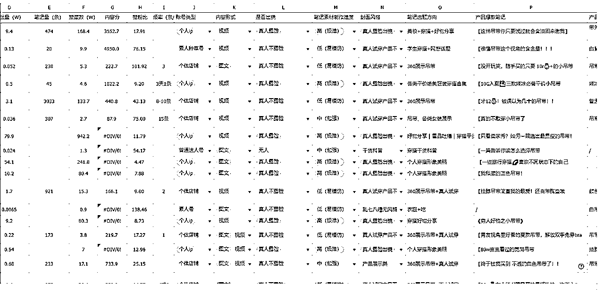
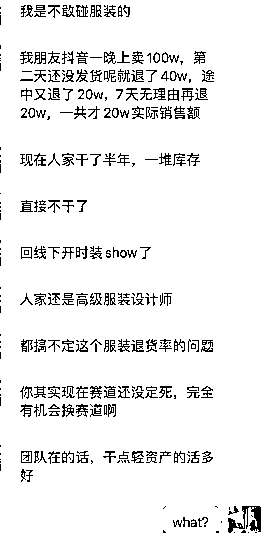
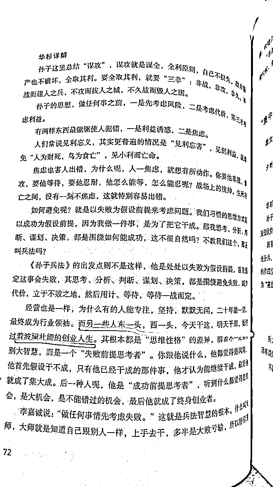

# 📕女装创业踩坑实录：投了几万块，满打满算只成交1单

2023年5月我加入赚钱社区，基本都是潜水状态。那一年我正忙着换房、装修，等房子收尾了才开始琢磨下一步要干点什么，不想一直躺平下去。

2019年我在头条做内容一年赚了五十多万，后来因为迷惘、找不到自己真正想做的事，就开始了三年的躺平期。整整三年没上班，每天就是在家耗着。

个人品牌我不是没想过，但我觉得没有实操项目支撑的IP都是空中楼阁，所以我没去做IP，而是想先找到一个能长期做、能出结果的生意。

期间我惦记过图书直播，样品也拿了，设备也买了，还报了Eric教练的训练营。真正上手才发现，我连开麦都过不去心里那关，镜头还没对上脸就开始脸红心跳，根本没法持续。

也研究过👸号爆文、AI项目，一直下不了决心。和刚进赚钱的人一样，信息爆炸，根本无从抉择。

📕电商我也注意到了，但迟迟不敢动。因为2019年赚到钱的同时，我也曾带团队做抖音视频带货，最后亏了10万收场。那次不知道赚钱，团队草率解散。现在回想，如果当时能多沉淀一些经验，或许结果会不一样。

真正让我重启电商的契机在今年3月，除了赚钱里看的信息，最关键的是我老公团队的实战验证。

去年他一个负责游戏业务的团队遇到瓶颈，我随口提了句让他们试试📕电商，还丢给他一堆资料。他做业务多年，眼光很清，从不被光鲜的案例带节奏。任何看起来很美的项目，他都觉得水面下藏着事。

我在他耳边念叨了很久，加上游戏业务确实没前景，团队又要养活好几个人。权衡再三，他们的负责人就从游戏运营转成了📕运营，从零摸索。没有照抄市面上的成功经验，完全自己走。他拒绝了我的建议不要花钱进赚钱学，觉得先把事做起来，卡住再找答案。

我只知道大体进展，他们不断测试产品，一个多月后某个单品爆了，一条笔记几十万播放，上千单成交，正好赶上春节，流量直接起飞，工厂产能都跟不上。

看到正向反馈后，他才加大投入，开始做直播。我准备入场时，他们一天GMV稳在3万左右。没有任何技术门槛，一群零基础的人转行也能做到这个成绩，对我冲击很大。

3月我下场时，他们的月GMV目标是冲击100万，为此招了一批主播。那段时间他们在密集招聘，而我也在旁边看着觉得，既然有人验证了，我也试试，先拿到钱再说。

# 一、赛道试错：从加长裆内裤到吊带女装

起初我选了女性内裤，特别是加长裆款式。理由很实际：一是我自己也是用户，比较懂需求；二是卖不出去还能自己穿；三是产品图不用上身，靠文案就能推，直播只要露个手。

找供应商时，我挑了两家实体品牌供货商。颜值在线，天猫店一条卖18到25元。但进货价10到15元一 条，还要算上快递、代发3.5到5元、包装人工。用户能接受的价格基本也就20元左右，甚至很多店在做9块9三条。算下来一单赚一两块钱，还得先能卖出去。同样的时间投入低利润品，本质靠跑量，而能否跑量完全是未知数。那还不如选个利润高一点的。

而且另一家供货商要求整箱齐色拿，一款36条或18条起，样品成本就要几千上万，还没测出款式，我根本不敢压那么多货。

于是放弃内裤。

内裤供应商恰好也有吊带、背心，基础款百搭，我平时也穿得上。商家齐色拿货但一个款四五件，可以接受。我又在网上找了十来家做对比，同时拿样。

同样一条背心，拿货价从6块到30块再到50块，差距拉得很大。现在📕上卖19.9、29.9的，基本都是6到10元的货，实物能穿但质感一般，穿几次就变形，属于月抛型。

我最后选的都是比市价更高的中端货，不自觉就滑进了女装赛道。

# 二、实操四座大山

我和老公做事风格完全相反，他喜欢自己琢磨，我更愿意花钱买经验。哪怕这些年被割了十几万的韭菜，我仍然觉得付费学习是捷径，过程中确实遇到过真心带我出结果的老师。就像我看中医，换了无数个医生，花了不少冤枉钱，但遇到对的那一个，二十多年的口腔溃疡都好得差不多了。

做📕女装时，我的全部方法论都来自赚钱的项目复盘和航海实战手册。觉得够用了，直接照着做就好。

我把所有相关帖子梳理了一遍，小白可用的打法基本两类：一类是混剪加无人直播，废号收割一波流；一类是做原创视频矩阵，用数量堆概率。我选了后者，不想跟平台对着干。

矩阵打法的逻辑是：同一个款按爆款模板做几十上百条原创，换色、换场景排列组合，每周测3到5款，测不动就换品，出现爆款后集中账号和流量放大。看上去很简单，执行起来全变形了。

我一开始就开了4个企业店，认证费600一个，刚开始还好。真正踩坑开始了：

## 坑一：过度追求产品图完美

拿到货后开始拍图，结果在摄影上卡了快20天。自己不擅长拍照，总觉得缺工具。先觉得缺Ins风的桌子，再买了个人体模特买成肤色，被老公吐槽土。想拍真实无滤镜，就要求自然光，广州那段时间一直阴天，拍出来又黑又暗。后来又搬出柔光箱、神牛灯、支架，还是不满意。又买了落地挂衣架，出来的还是出租屋风格。

没办法只能自己上身拍。那时广州还冷，开着空调拍，第二天重感冒病了一个多星期。等天气好转，自拍永远不会摆姿势，画面很怪毫无吸引力。

老公劝我直接招全职摄影，说我适合做策略不适合执行。真相刺耳但没用，我当时不服气觉得别人能拍我也能拍。事后回头看纯粹浪费时间，发笔记不挂车也没事，因为本来就未必能爆。当时我还迷信真实，原图直出。后来才明白用户要的是“看起来真实的美”，不是真的原图。

## 坑二：数据差就先怪限流

病好后，我按爆款模板一比一模仿拍摄制作笔记，每天发5条商业笔记。发了不到20篇，第4天出了第一单，店铺才3个粉丝，单条播放不过百。单价69.9的工字背心，我还送了条内裤，又倒贴了两次运费，这单没赚到钱，但证明模式能跑。

以为要起飞了，我们马上租了200平的场地，一个月2万，里面有三个直播间，准备做联动。不到一周办公室布置完，就开始招人，招了基础运营和主播，本来想招个资深运营开到1.5万提成，一直没招到。

结果第一单后账号彻底沉寂，笔记播放个位数，花薯条投放也拉不动，曝光也就两百。太邪门，我怀疑限流违规，找了聚光官方，回复正常。

不甘心，觉得是拍摄不行，就找主播去朋友家拍。朋友是电视编导，专业相机拍了四个多小时挑出十几张，还发生了小插曲，主播坚持要修图把皮肤提亮，我当时很不理解，后来才知道女装圈的图都是精修的，我一直原图直出。

专业图发到企业号上，播放只有30。换新手机注册全新企业号再发，还是30。用一个老小号测试，那个号发第二篇就有3K播放、百多评论，账号绝对没问题。把同一张专业图发上去，还是30。

这才死心，内容不行，不是账号限流。📕数据不好，99%是内容问题。同行拍得更粗糙也能爆单，因为人家内容对了，而不是因为你被罚了。

## 坑三：对标错了账号类型

这时我认识的朋友22年底就做📕电商，经历过同样的起号困境。后来他抛开外界经验，从平台底层逻辑出发自己测试才做起来。他做前端流量，合伙人做后端供应，总结出一套起号方法，基本5条笔记就能起号。

他毫无保留地分享，还带运营去公司看了后台。重点指出了我们一直对标错了。

我是做矩阵的，就去对标矩阵号。但那些账号都是靠一两条爆款撑起来的，日更3到8条，最狠15条，大部分笔记点赞个位数。它们吃的是时间红利，靠不断测试等待下一个爆款，粉丝粘性几乎为零，平台也不喜欢这种纯硬广。

朋友发来官方指南，强调📕要种草，先种草。他也破除几个迷思：新号无需养号三天，直接发；同WiFi不会限流；企业号发普通笔记和个人号一样，只有发商笔和聚光时才需要注意。

回去后我分析了20个同行，原计划100个，分析到20个就已经明白问题了。

【价格】

20个里18个价格在30元以内；

1个169元靠博主强个人属性带；1个59元同理；

其余都在14到29元；

我的产品定价69元。

【带货模式】

8个是个人IP，高辨识度；

7个是素人矩阵，靠量怼，靠一两个爆款续命，日均5条以上；

剩下的是引流号，评论区导流。

唯一在我们能力范围内够得着的是一个素人引流号，靠极强的网感和话题吸睛，门槛很高。

总结就是：

同价位段，我的视觉和穿搭打不过别人；

同等粗糙图，我的价格还更高；

结论——又土又贵的硬广。

## 坑四：项目超出能力圈

以为选个小类目女装就在能力圈内，结果完全超出。

女装还能不能做？能，但只有三条路：

1、走低价路线，价格压到19到29元，用网感话题和素人种草配合；

2、坚持中高端价位，但审美、构图、呈现要达到同价位水平；

3、做IP。

后两条都需要时间成本和金钱成本。我不懂穿搭，不化妆，这怎么拿货？团队选品一旦依赖一个懂穿搭的人，人员流失风险极大。自己学形象穿搭也很难短期提上来。找专业摄影师、美工、模特成本巨大，且周期不确定。

孵化穿搭IP更不现实。

能走的只有能力圈内能做到的，唯一选择是走低价走性价比。

但我一直觉得19块29块的衣服根本不配叫衣服，面料差、做工差、线头多、易变形。15块的吊带，19块买一送一的文胸，我拿到样就会申请退货。我觉得带这种货没良心，是欺骗。

问了一下手下的应届生同学，她们常年蹲直播间买39、29的衣服，只要基本需求满足就行，有线头剪掉，不贵就再买。她们的消费观让我恍惚。

大概是广州这几年太安逸，让我忘了刚毕业月薪2000、借钱过活、假期不敢逛街的日子。忘了学生时代只能用肥皂洗衣服，看着室友用蓝月亮羡慕的自己。

这轮女装创业，真是一路踩坑踩过来的。我把这些坑复盘出来，不是为了卖惨，而是想让打算做电商的朋友知道：有些苦，不一定非要去吃。

第一个坑：我太容易忘记自己是谁。当年我买衣服，几十块都纠结半天，进森马、美特斯邦威都会觉得贵。可等我做项目时，眼睛全盯在工艺、面料、版型上，还觉得69块的定价已经非常厚道。然而大多数用户看商品的第一眼，永远盯着价格。我倒是想向市场妥协，可实在过不了自己那关——无论从个人喜好、退货率还是长远口碑看，我都不想碰低价货。

第二个坑：直播这事，我想得太复杂，又犹豫太久。最早我自己在家播过三次，每次1小时，还拉过朋友助阵。但数据一次比一次差，讲着讲着就没了逻辑。更要命的是，我的腰在第50分钟左右就开始剧痛，没法站直，更别说每天播3小时。后来主播到岗，原本打算上午3小时、下午3小时，可笔记数据迟迟没起色，直播就一直被拖着。我担心主播熬不住冷板凳，总想等出一条爆款再开播，结果越是等，数据越是死循环。我甚至都准备好投聚光做付费流量，但心里很清楚：得先让账号有一定数据基础和笔记点击率，付费才有放大的意义。当初花钱认证企业号，也是冲着这个目标，结果第一步就卡住了。后来我咬咬牙，算了，直接播！每天固定时间开播，先把时长播够，反正也有人0粉就开始播。可等我花了一整天梳理产品、核对库存、设置活动价、算清利润空间，准备和主播聊几句给她打打气时，她突然说明天不来了——她觉得创业太难，数据起不来提成也没着落，不想慢慢熬。那天晚上没播成，我让她收拾东西走了，自己顶上去。结果还是1小时，腰疼到弯着身子回家。回头看，主播招得太早了（当时还想让她当拍版模特），招来后又一拖再拖没开播，前怕狼后怕虎，节奏全乱了。

第三个坑：我对自己的认知严重过高。因为19年第一次裸辞创业拿过好结果，我以为“别人能做到的我也能做到”——可很多时候，我们看到的光鲜案例，人家要么进场早，要么有长期积累，等到我们这种没资源的小白都知道时，赛道早就挤满了人；背后的失败者、炮灰，根本没人看见。那段时间，我也请教过一些赚钱财友，为了不白嫖，每次都会先发200元红包。但依然因为现金流焦虑，病急乱投医去弄视频号小店做后端店群，结果刚交完钱学完，规则就改了，店铺到现在还卡在新手村。这能怪谁？只能怪自己认知不行。我还有点眼高手低，看不上小钱和小项目。其实哪有什么“小项目”，只有自己能力不够，才把项目做小了。就算让我现在去写👸号爆文，我也不能保证马上出成绩。

后来我看到赚钱圈友“家蒙”的一段话，深有感触：盲目上车、跟风，和赌博没有区别。赚了，会误以为自己很厉害，以后可能吃更大的亏；亏了，又会陷入自我怀疑。那阵子副业来钱快，我不珍惜，还打着“为了家庭更好”的口号，一头扎进完全不懂的市场，其实很不负责。为了补救认知短板，我还看了《华杉讲孙子兵法》，里面第一篇《计篇》就在强调：要计算，要先有胜算再打。也就是说，还没下场时就要认真盘算，对比自己的能力和资源，看看胜算有多少；胜算都没有的仗，不能打。我为什么突然看这书？还不是因为这次创业暴露了自己分析和决策能力全面拉垮，只能靠多看书来补。

看到那句“有人总在写失败复盘，还写得波澜壮阔”，说的不就是我吗？——我这辈子好像总在给自己写失败总结。

再补充一个观察：我做女装之后，老公的📕团队也开始走下坡路。直播间突然没了流量，没有任何预兆；矩阵笔记的弊病也显现出来，爆款之后再无爆款，用户关系松散，账号也没有任何沉淀，最后拼的就是谁资金更雄厚。前脚赚到的钱，后脚又填进场地和人工，甚至开始亏损。他们刚扩招的主播，也只能一个个裁掉。如果时间停留在团队爆单、直播间日销过万的那一刻，负责人写总结，我们大概率会以为他们成功且彻底成功了。可后续走势却像股票一样冲高回落，能不能熬到下一波爆发，没人知道。

想清楚这些后，我的女装项目正式告一段落。方向既然错了，再努力也是白费，我对自己也不再有什么执念。现在，我和一个朋友正在筹备我们俩都很喜欢的一个新项目——他也不想做原来的电商了。他聊起做电商的痛苦：流量好不容易起来，工厂产能却跟不上；产品不是随便一件代发的货，工厂起订量往往要十万件，最少也要3000单；这种处处受制于人的感觉让人崩溃。而且做电商要24小时随时待命，奇葩客户和退货问题一大堆，退回来的货还得忍着恶心去处理，最要命的是跟合伙人在产品、营销理念上分歧越来越大。我俩深度聊了一次，发现三观惊人一致：都是喜欢独处、爱思考、追求成就感和精神世界的i人，对我们来说，电商属于能量消耗型项目，会把人掏空。我们应该去找一个在能力圈内、能反过来滋养自己的方向。

对了，在放弃女装之前，我用朋友的系统方法论，认认真真在企业号上发了一篇强内容笔记，账号终于摆脱了只有几十、一百阅读的命运，直接冲到6000多，也算验证了他的思路。

写到这里，我猜肯定有人说我不够坚持，浅尝辄止，起码要坚持半年。说实话，我发这篇复盘都有点难为情——翻看19年做抖音带货时写的失败复盘，简直一模一样。但错就要认，批评我都收下。过去这三年，我躺平了许久，不说进步，能力甚至全面退化。但人只有在持续行动和犯错反馈中，才能真正成长。愿自己，在创业路上步履不停。

（完）

最后更新一下：我发这个失败复盘，初心是帮大家避雷，别走老路；另一方面也是因为自己认知有限，希望能有大佬指出更多问题。我没有太好的东西回报，只能拿出这段教训，换一个被高手点拨的机会。目前我已经转战中老年知识付费项目，跟电商比，算是在自己能力圈里了。如果有正在做老年人培训的圈友，或也在广州创业的朋友，欢迎交流，我的微信是：tznetdong，加我时备注“财友”就行。