# 10元引流品撬动5000+加粉与近50万流水：自由职业指数型增长拆法

嗨，这里是赚钱龙珠圈的立心。曾在大厂负责产品，离职一年半后单月收入过六位。现在专注职场转身和自由职业陪跑。

上月我把卡住的瓶颈打通，完成一次十倍级跃迁。付费用户逼近一万，流水接近五十万。

主推的小报童专栏《自由职业0-100w指南大全》，上线48小时售出近六千份，六日累计冲到全网第二，仅次于赚钱官方项目精选，累计已破八千份。

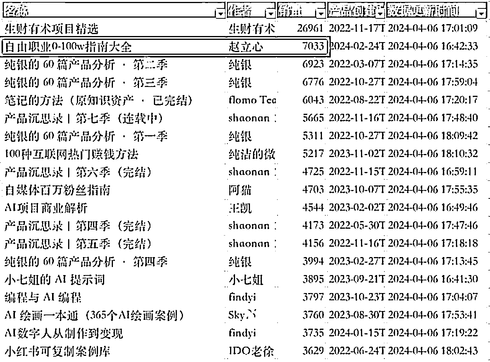

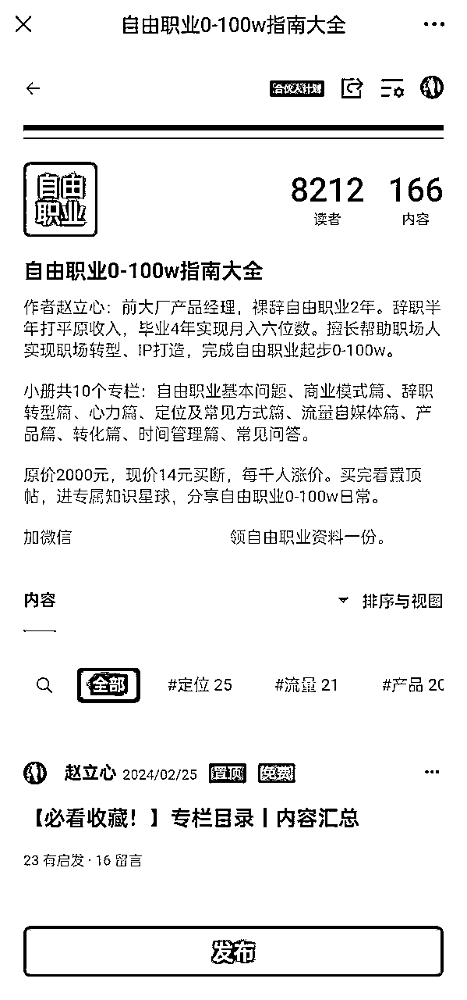

这次投放的直接反馈是新增好友超五千人，变现约五十万，知识星球从一百人涨到四千多人。期间四家出版社主动邀约把专栏做成图书。

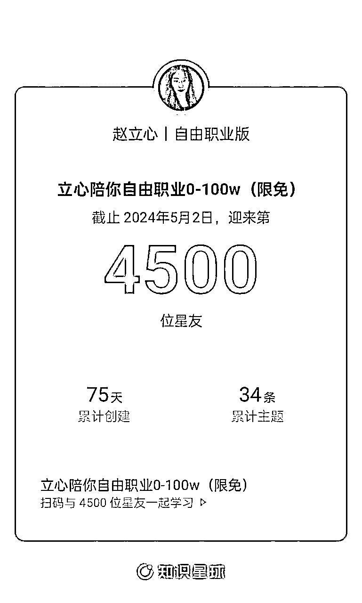

更值得说的是，截至现在有七百多位读者真实参与分销并产生成交，且数字仍在攀升。多个社群自发讨论，出现跟风抢购的氛围。

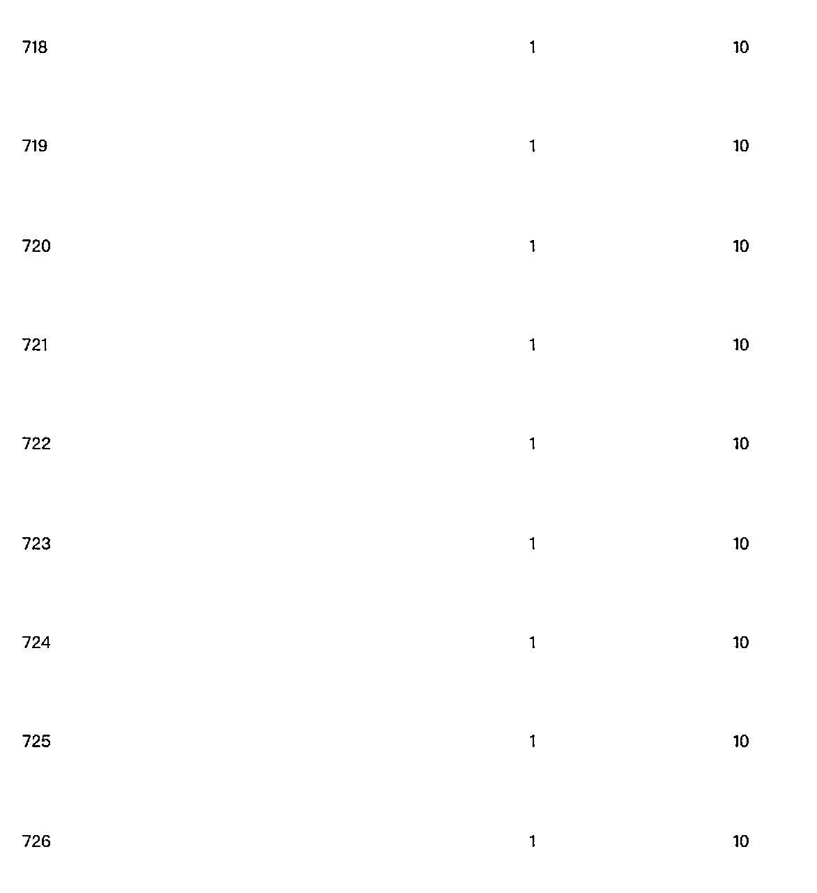

甚至几十万关注的账号主也来站台，头部大V单人带出数百单，还有多人拼用同一分销码冲榜。跟真正头部相比，我的结果不值一提，但现金流很稳，我更看重的是背后能被复制的方法论。

本篇拆解如何完成瓶颈突破与十倍增长，围绕四个核心——

1、职场人转向自由职业，如何摆脱迷茫与收入波动，沉淀可复用的核心竞争力？
2、自由职业的稳定跃迁需要怎样的标准化路径？
3、普通人把获客、成交、产品三端串起来，如何做到指数级放大？
4、十倍增长的起点在哪？哪些环节必须死盯？

## 自由职业常见的三重困境：定力不足、现金流不稳、商业化缺失

讲增长前，先说我踩过的坑，以及陪跑学员反复出现的痛点。收入上不去，本质是三类问题：

### 1、选题发散，内耗严重，结果为零

职场像轨道，照着走就行；自由职业像旷野，很容易偏。

启动期最容易陷入迷茫与心累，尤其是决策上的内耗。

总觉得每个赛道都能碰一碰：本职相关的产品经理、面试辅导、职场号；再到阅读写作、个人成长、情绪心理；看到别人做直播带货、抽卡解读，觉得也有趣也赚钱，便想尝试。

于是几个月在不同方向来回试水，最后换来半成品与自我怀疑，以为自己不适合。

本质是选项很多，能启动也不少，关键是挑一个市场认可、自己能持续深耕的点，定下来就扎进去。

### 2、现金流波动，竞争焦虑

第一轮阅读课能变现，第二轮招生就乏力，感觉可买的人都买完了。靠社群续命也难为继。后来才发现阅读并非刚需。

再转📕导师，发现市场上早已被履历华丽的大号占满，信心瞬间崩。

其实职场里程序员成千上万，没人会觉得做不了程序员。自由职业的市场远比想象大，做好差异化足够过活，不必总与他人比较。

### 3、闭环能力不足，转化效率低

很多人产品思维七八十分，成交六十分，几乎没有获客能力，靠存量勉强维持。想稳定月入数万就难了。

一对一咨询看似能收几千上万，但时间被掏空，服务天花板低，做得累又缺规模感。

自由职业本质是一人公司，要跑通完整的商业闭环。一个人扛产品、获客、成交，极易顾此失彼。

要提升变现效率，必须补齐商业化操盘能力：产品、获客、成交三端都要达标。0到1靠粗糙框架能跑通，1到10需要体系化与深度化。向成熟模式学习，在关键环节做深做透，是必经之路。

## 突破瓶颈、放大体量的核心竞争力构建

### 1、先划清“我的事”和“别人的事”

方向频繁切换，本质是自我认知不清，把别人的长处当成机会。

我的事 = 我做比别人更快、更好、更省力。别人的事 = 我也能做，但做不到他那种水准。

比如小报童玩法圈内很成熟，常见做法是建群+大量定向邀请推。确实能跑，但社群维护、关系经营不是我的强项，投入产出比低，所以我舍了。

我擅长写内容、写文案、做机制，于是把资源集中于此，结果反而更好。

也有学员想放弃原赛道去做个人成长，因为看到别人做到几十万。个人成长看似人人可做，实则门槛高，需要可验证的成绩背书。那位学员没有相关履历支撑，硬转只会更迷茫。纠正后回归擅长方向，很快见效。

不要觊觎他人，守住自身的优势即可。

### 2、把个人优势复制放大，形成飞轮

找到优势后，要在每次焦虑时回到它。成交方式很多：谈单、直播、内容被动成交。我清楚前两者也能做，但效率不如内容被动成交，所以直接砍掉，只做擅长的一环。

长期看，聚焦优势环节才是指数增长的来源。

我的飞轮大概是：深度内容 + 深度服务，通过朋友圈、播客、📕、知识星球联动。产品侧更强调交付与观点输出，而非硬广营销。

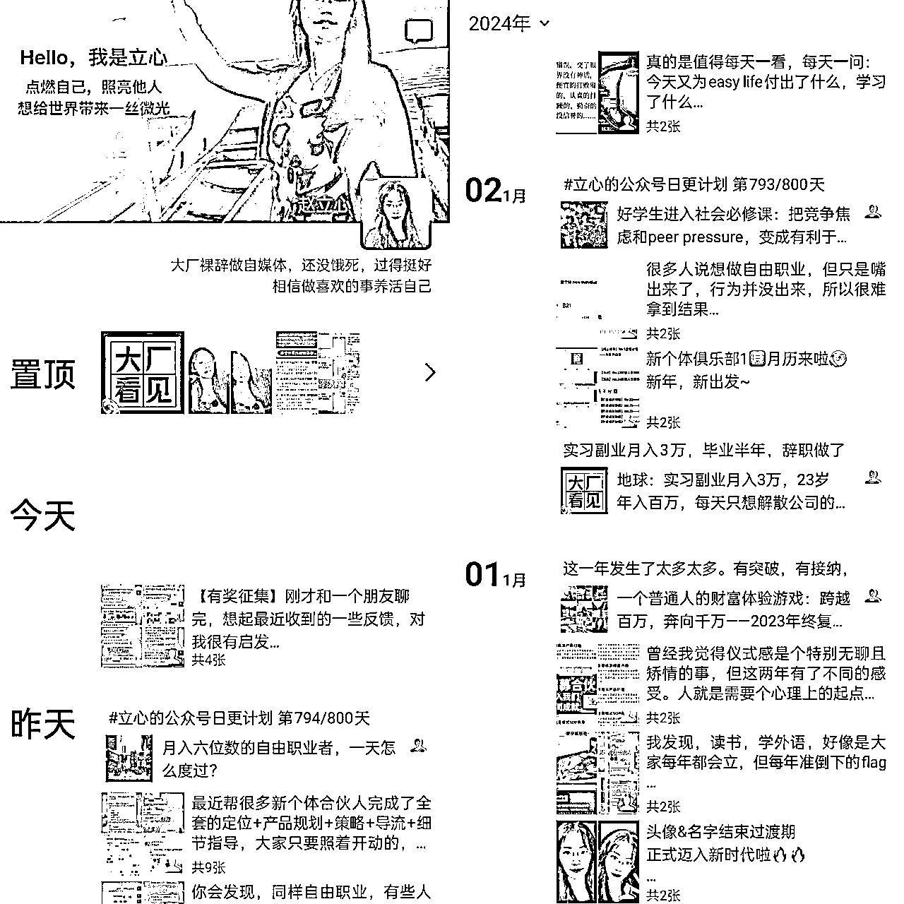

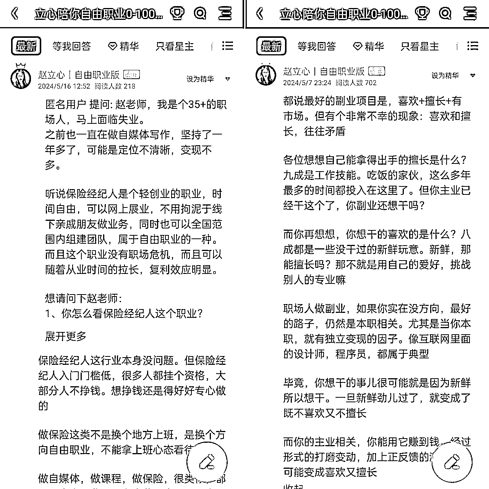

同时建立“不做清单”，明确边界。比如沟通时哪些问题可答、哪些必须付费、哪些帮忙可以兑换，规则清晰才避免消耗。

我的一位合伙人学员也走通了自己的飞轮，月入六位数。他的特质和我完全不同，但逻辑一致：拿自己擅长的，放弃追别人的玩法。

### 3、把成交转化做成标准动作

完整转化包含触达、关注、信任、付费、高客转化。每个环节都有可标准化的做法。

获客无非内容钩子获客和裂变推荐获客；转化无非谈单、大事件集中成交、内容长线转化。

每个细分动作都能做到60分，细节做好天花板很高。1到10的卡点，往往是停在“能跑就行”的粗糙水平。

要做的事是：进入他人的体系，问清细节，做到位。持续跟随比自己高一到两层的人，研究透、执行透。

## 一套标准化流程，如何实现指数增长

自由职业闭环就是获客-成交-产品。0到1跑通后，把每个环节放大十倍，整体就是千倍级。赚一千块的模式，运作得当也能赚百万。

但十倍增长往往不是微调，而是模式升级。比如私域第一次触达：加好友、打标签、回几句话，三分钟搞定。但当四千多好友两三天涌进来时，手工作业根本跟不上，消息堆成山。

量级上来后，必须换模式：用助理或机器人承接。整个闭环都是同理。赚小钱靠朋友圈随手发，赚大钱需要成熟商业模型。

以下以我这次小报童+群发售+高客产品的主线为例拆解：

### 1、流量端

#### （1）降门槛

带学员时最大的误区：流量品定价一百多两百多，觉得便宜亏了。核心是没想清楚这个产品在体系里的定位。

一旦要走量，就别纠结价格能否赚得多，最后量上不去、价格也不香。

要清晰区分流量品与利润品。流量品负责拉新，利润品负责变现。别让一个动作同时承担两件事。

我这次小报童作为引流款，定价就是10元起。资料包做裂变时也要控制门槛，公域引流更不要设置购买门槛。

涨价也一样，机制要有，但别吓退用户。我从10元只涨到14元，分两次完成，用户体感几乎不变，却起到了促销效果。

#### （2）交付要超值

流量品必须让用户有“赚到”的感觉，才会分享、才有下一步转化。

自媒体最容易火的帖子就是干货合集，别人一本书、我一千本，收藏欲拉满。

我的专栏叫《自由职业0-100w指南大全》，166篇文章，10大章节，16万字，涵盖商业模式、定位、产品、流量、转化、时间管理，甚至社保、离职注意事项都有。十几块钱拿下，超值感自然形成。

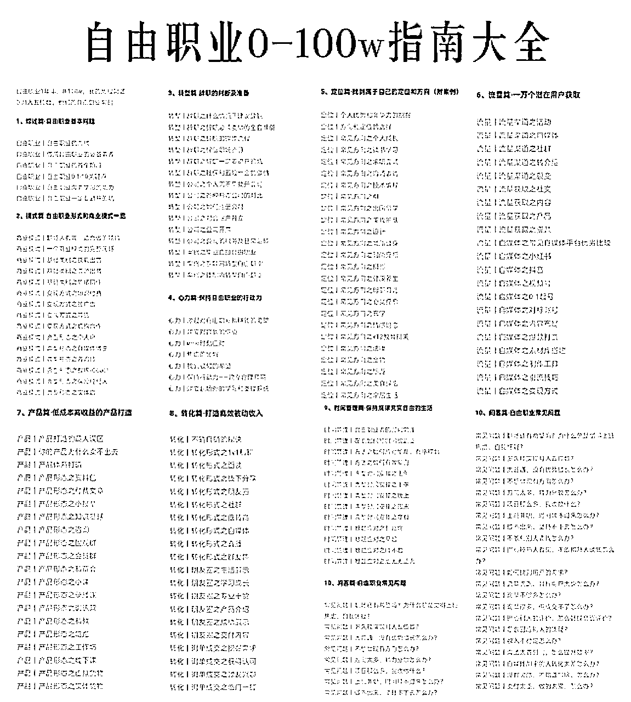

很多学员担心给太多后面没东西。我不担心，只要自己持续成长，供给是无限的。最稀缺的不是信息，是具体问题的解决方案。形式承载不了，不是藏着掖着的问题。

用户说要精简涨价，我最后没改。因为要看行为而非言语。人性就是想要多、贪便宜。显性理性的声音永远斗不过本能。

#### （3）裂变设计

低客单比高客单更考验量，靠个人力量有限，必须设计裂变。

核心看三点：

第一，奖励机制。不能自嗨。66元红包对大V无感。奖励要分里程碑榜奖励散户、排名榜激励大KOL。奖励形式五种：资料、付费产品、推流、荣誉、现金，兼顾不同诉求。要控制成本，排名榜人数可控，里程碑榜若给现金易失控。

第二，节奏节点。心气很重要。最好的三分钟要打透。我的正式发售压缩在2-3天，前期两个月我在朋友圈日更打卡预热，16万字是写出来的，不是空口。

二维码早就可以发，但我只内测50份，其余压着不卖，就是为了集中爆发，让市场感受到势能。

发售中不断设置报喜、涨价、榜单截止等小节点，保持热度。文案也提前准备好。

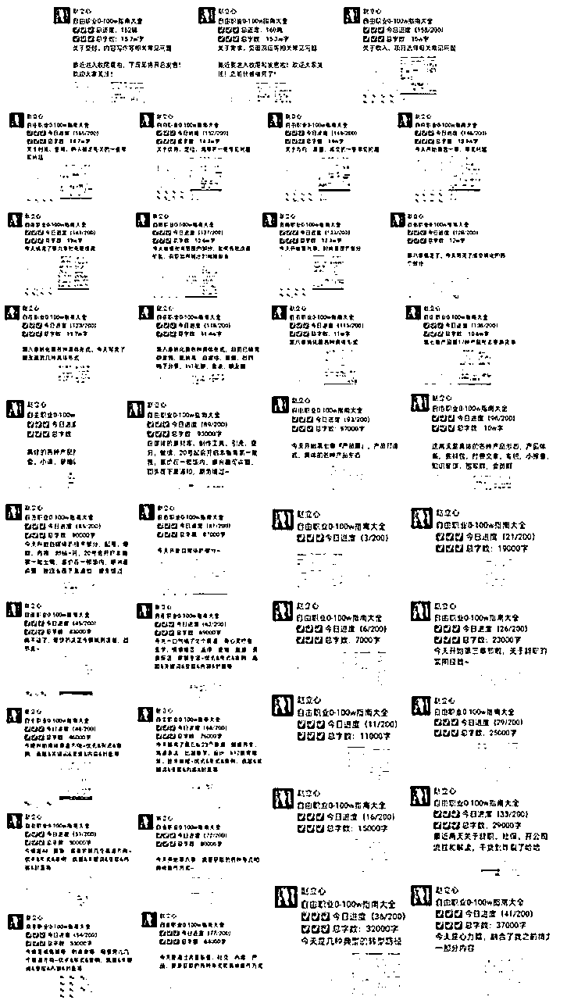

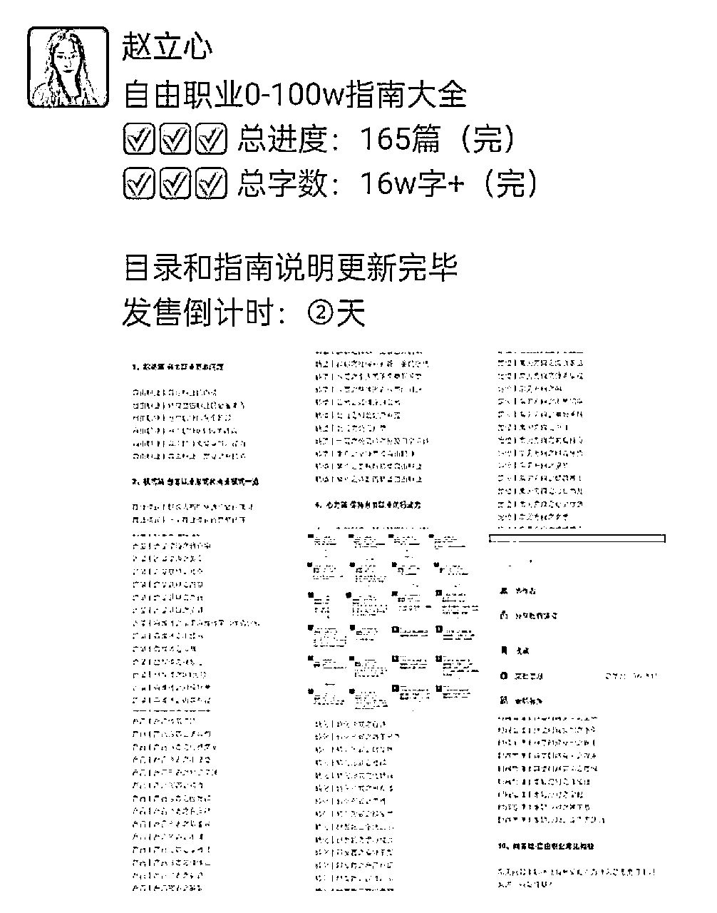

第三，大KOL邀请。销量遵循二八定律。冷启动需要关键人物点火。提前激活内部学员和团队，他们是最好的证言；再对外部友好大佬提前沟通，争取助力。

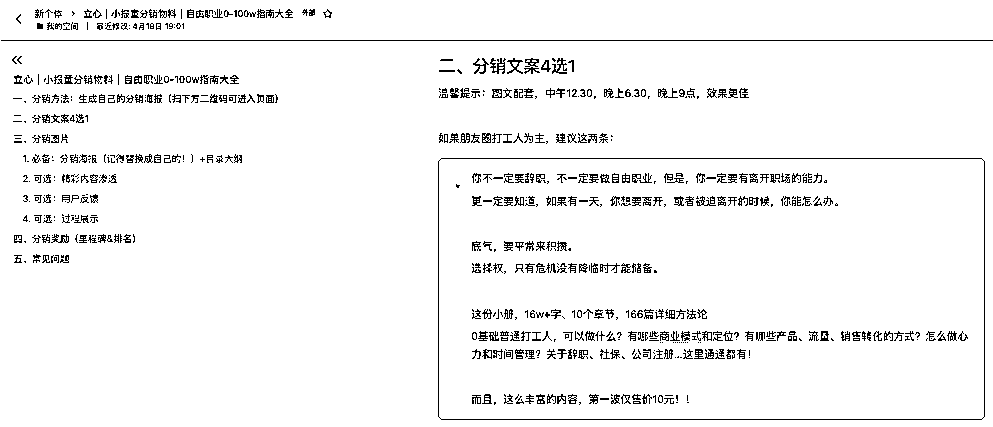

真正起决定作用的，往往是日常里一点一滴的积累。你有没有在平時就持续经营用户关系，有没有在人脉上持续投入、把情感账户做厚，這才是真正的根基。

等到要实操的时候，能做的也就是把自己能给对方带来什么想清楚、讲明白。不同量级、不同风格的KOL，诉求差异很大，必须对症寻找。

渠道的布局，成熟之后要切换到撒网心态、靠概率取胜。并非能量越强越好，契合度不对，效果可能还不如一个小而精准的博主。这类事情很难提前精确判断，预期别放太高。

爆款里运气成分永远存在。但把动作做扎实，结果至少不会差。找十个渠道做十次尝试，哪怕只有一半奏效，整体盘面依旧划算。

收尾环节也很关键，要真诚致谢每一位助力者。我们当时投入大量时间，为中间配合的KOL定制感谢物料、发放相应的权益，这都是应尽的情分。

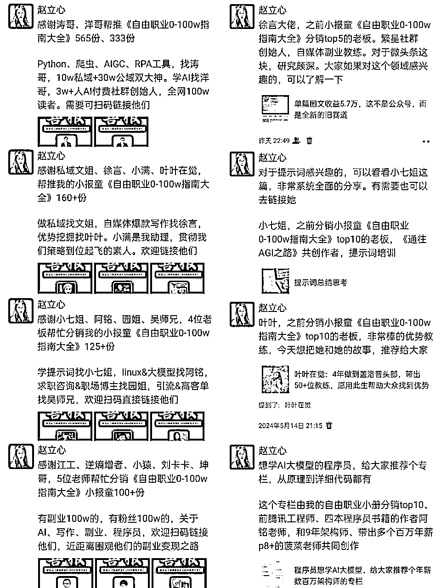

#### （4）钩子的设置
流量型内容，最终必须沉淀到自己的私域，否则价值会流失。

常见的承接方式有：个人微信、社群、知识星球。其中最普及且转化效率最高的，是加好友领资料包。

除引流钩子外，流量品也能承担转化钩子。比如适当展示实力，晒出过往成绩；比如明确告知，我有XX服务，若你正好有相关需求可以来沟通。

需要警惕的是，不要幻想用户能同时完成加微信、进群、进星球、关注👸号、购买产品。每增加一个动作，就会有一定比例的损耗。先导向哪里、后导向哪里、中间如何串联配套，细节非常多，必须提前理顺。

### 2、转化端

#### （1）快速建立信任
接触频率越高、时间越长，信任感自然越强。集中式转化最难的点，就是在短时间内补齐本该靠长期自然形成的信任。

信任来自正向信息的全面度。你对一个人了解得越完整，信任度越高。婚姻里常说的知根知底，就是因为家庭背景、父母、关系网相互交错，欺骗成本高，所以更踏实。

成交逻辑同理。我们可以多维度让对方迅速看到这些可验证的信息，建立信任。

参考做法如下——

真人出镜实时互动，信任感远胜纯文字；能线下见面交流，更是强转化手段。

比如邀请长期合作的朋友、老学员连麦聊天、唠家常，适度展示真实生活、真实想法和情绪，会让人觉得更接近人性。我的朋友圈内容就是五花八门。

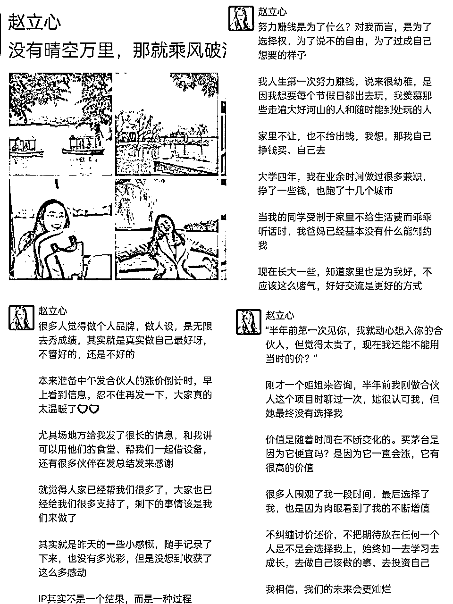

比如在现场安排案例拆解与答疑环节。答疑最能体现专业深度。

比如在介绍产品时，直接拿出真实学员的截图与物料——时间、人物、内容都能核查，并且有清晰的成长线与时间节点。更可让学员上场现身说法。

体会一下这个图，比一句随口的“我的学员XXX”，在真实感、具体度、可感知性上高出多少倍。

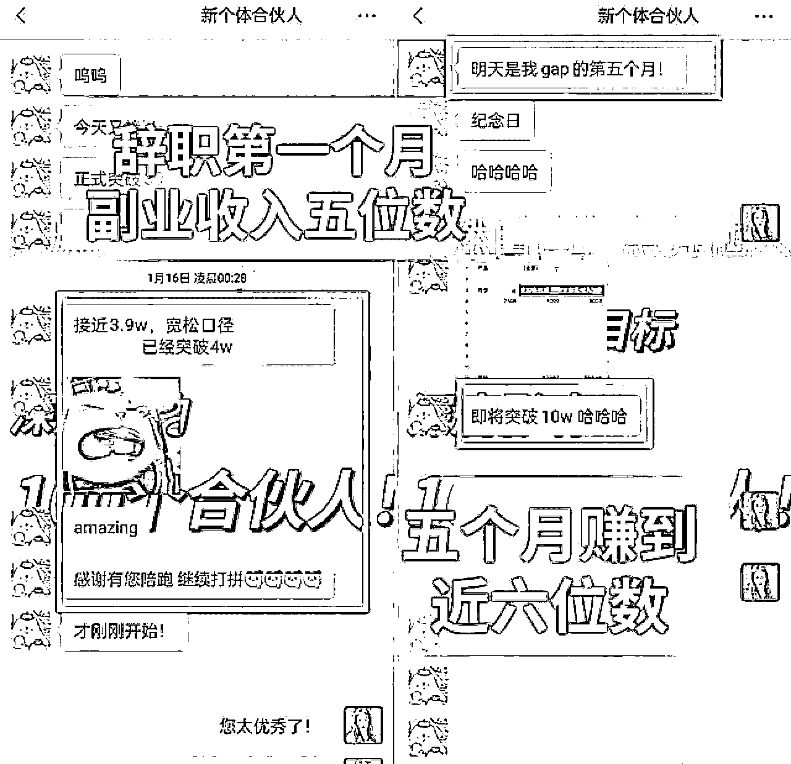

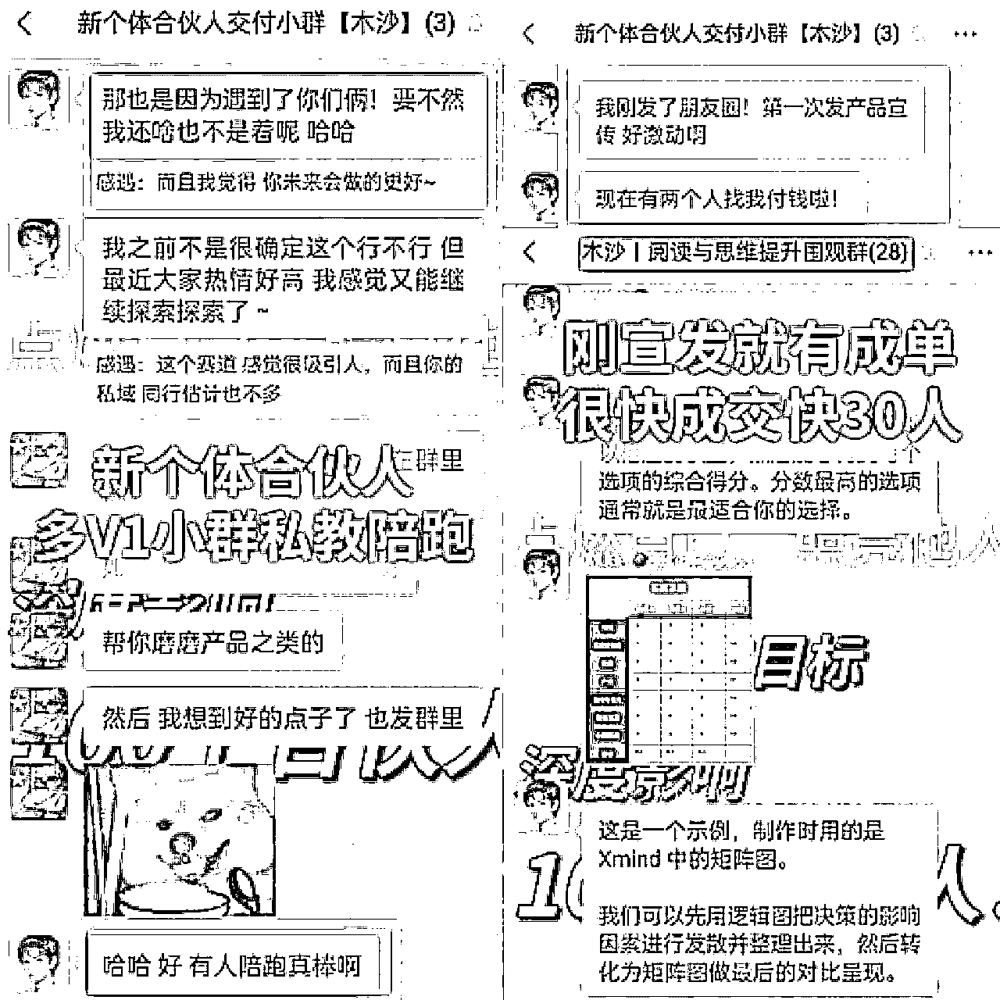

再比如，面对敏感问题不要回避也不对峙。像我发售时有人问是不是话术，我就直说：人多，是话术，也包含本人，有需求可找我。

群发通知时也讲清楚：是群发，但不是乱发，只定向给小报童购买者，并承诺之后不再打扰。

有学员觉得收佣金不好。我就坦诚：我确实收佣金，但也是因为认可才推荐。

很多事提前说开就没事了。对方有疑虑，把它讲清楚。

#### （2）获取更多线索
信息越全面，成交越容易。适用于用户，也适用于产品方。

过程中要设法了解用户的具体状况，再做针对性跟进。答疑时请对方说明自身背景；可采用调研问卷收集信息；回复问题时要求对方把情况与需求讲透。

在不了解对方的前提下沟通，无异于盲人摸象。

#### （3）降低决策成本
高客单产品决策周期长、顾虑多。即便信任与信息充足，下单环节仍易卡壳。

常见做法是用中客单品先做体验。但这等于把一次销售拆成两次，反而可能拉长周期、增加变数。日常成交尚可，集中式转化就不太合适。

更匹配的方式是体验卡、体验课、小样。让用户先做一定程度的投入，比如可退的押金，先体验再决定是否继续。

另外需记住：体验品可以承诺可退，正价品尽量避免承诺可退。即便对交付有十足信心，也不建议用可退来卖正价。它能拉进犹豫人群，但这些人往往心态不够坚定、留退路，后续麻烦会很多。

#### （4）设置截止时间
Deadline是强生产力，既适用于执行，也适用于购买。

不少用户对产品心动，却会无限拖延决策。适时用截止节点去推动。例如体验后补尾款的截止期、下架倒计时、涨价策略、限时赠品、名额限制，都是时间截止的变体。核心是给用户一个立刻行动的理由。

关于发售更多细节，我此前写过一篇精华帖，可自行查阅：

### 3、产品端
产品的十倍，常见于交付更轻、更好规模化的中客单，或高客单。后者更普遍，也更易操作。

高客单不是简单提价，而是解决的问题更值钱、更深入。赛道可能相同，但交付形态已截然不同。

典型有三类。

#### （1）目标人群的十倍
我有一个合伙人学员做设计，最初想教人做海报。教海报有需求、能变现，但天花板不高。

我给她的十倍思路：更换目标人群。从服务普通用户，转向服务企业主。支付能力提升十倍以上。

教海报的用户是打工人。哪个企业主、时间成本高的人会自己做海报？肯定直接买成品服务。因此她做工作室，为企业主提供成品设计服务，产品端即实现十倍。

#### （2）需求价值的十倍
另一位合伙人学员经营情绪能量方向。最初带大家吃喝玩乐放松，也能变现，但瓶颈明显。普通打工人愿意为开心付费，但吃喝玩乐的开心偏表层，很难支撑高客单。

我给她的十倍思路：调整需求定位。追求开心背后是对抗情绪痛苦——生活压力、成长焦虑、人际困扰。短暂开心很快消散，痛苦却持续。若做深度心灵疗愈，从根源解决，价值立刻提升。

据她情况选定细分赛道后，很快便卖出近万元客单的服务。

#### （3）问题深度的十倍
我们的产品正是此路。把交付做得更深、更扎实，解决效果更好。

我们做自由职业陪跑，帮助职场人挖掘优势与竞争力，明确定位与商业模式，打通产品、流量、转化链路，提升变现效率。

最初我们只做单纯咨询。用户有问题来问，不来就不管，各方面都很粗糙。

现在做陪跑，对标教培，极致追求结果，而非知识付费或咨询顾问模式。

每个陪跑学员配备1对1助教，每周跟进进度并给出详细指导。建立个人成长档案，提供各环节SOP。在学员卡壳时，用多种方式给予鼓励与支持。

还会带学员做项目实战，并提供资源等全方位赋能。

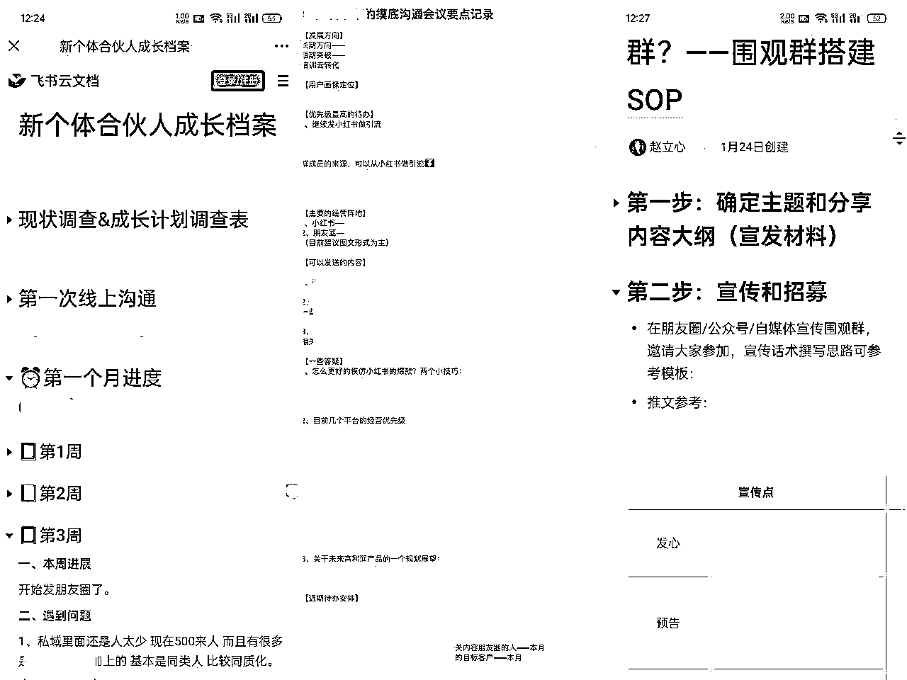

同时，我们会依据不同阶段、不同需求提供不同服务。新人入营先评估，匹配路径。0-1阶段侧重助教深度跟进，1-10阶段侧重资源赋能+深度信息+综合商业能力的精进。

还会按个人情况匹配合适的教练，满足更高维度的个性化需求。模式持续迭代，结合学员反馈不断优化，以更有效地解决问题。

目前出结果的人明显增多。无论自媒体运营、产品打造、咨询转化、朋友圈运营，还是时间管理、心力调节、财税问题等，我们都能提供更深度的解决。

### 4、多端协同
各环节都有成熟打法，但最终成交是整体，必须实现匹配，这考验综合操盘能力。

比如有学员引流很强，但后端产品只剩低客单，最终只是好看的数据，收不到钱，也难持续。也有学员产品与交付都很强，但前端获客打不开，很快触顶。

我们平时非常重视内容与案例沉淀，朋友圈、社群、自媒体持续做获客与种草。模式跑通后再逐点突破。

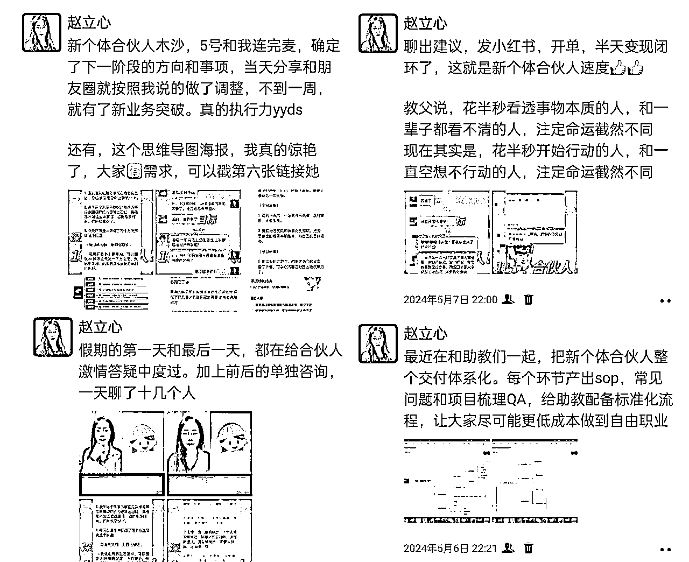

另外，不同赛道和模式玩法差异很大。每个人的具体处境不同，打法也不同。

比如一位合伙人学员做企业端📕生意，流量不能只看体量，必须极致精准，对案例要求更高。

另一位合伙人学员做玄学赛道，公域受限严重，只能用公域极致玩法+大量私域配合。

所以大家常觉得：学到的东西很好，落到自己身上效果打折。必须系统整合搭配，才能实现最大化结果。这是难度最高的环节，需要更高的视角与视野。

## 我的自由职业十倍之旅：起于心力，终于心态

“十倍首先是身份的改变，是我内心认定我是谁。股价总会在某个点位卡住，人和财富亦然，那不是真正的天花板，而是心理压力，是大家默认‘就到这里了’。这需要放下过去的自己，抛弃旧的活动、场景、人，实现全方位刷新。”——《十倍比两倍容易》

三月起，跟着航海家行动营共读此书，我决定开启自己的自由职业十倍之旅：确立新身份，提升标准，迎接挑战。

我过去的想法是，自由职业就是一个人逍遥。我只适合单干，应付不了复杂人际。随缘做点陪跑，月入六位，自由自在就好。

但个人能力终有边界。

我给自己立了新身份：我要带领更多人实现自由职业，帮助大家脱离职场困境，走上自由之路。

我不再只是自由人，我是“团队领航者”。

这意味着我要做很多过去不会做的事。旧方法结不出新果。只有大幅刷新思维与行为，才可能出现结果跃迁。

### 1、聚人、搭建团队、协同作战
做事，who比what更重要，包含找人与协作两部分。

第一，找人：找更强的人，而非能干的人。
以前我总觉得自己也能扛，花钱花精力不如自己来。即使找人，也只是找个干杂活的。

这会掉进低效陷阱。我不可能面面俱到，我需要比我更强的人。我只需聚焦最擅长的环节，再与他人合作。

我的核心优势是内容与机制设计。这次做小报童+群发售，在谈单、销售、运营等我不擅长的环节，我都高价引入外部助力。目的就是释放注意力、节约能量，去做更重要的事。同时也组建配合团队，共同完成日常各环节。

第二，协作：领导不是管控，而是愿景驱动。
每个人都是团队的领航者。我不是管理者，我是与大家一起出海的人，激发每个人对海洋的渴望。

因此我高度重视沟通与士气提振。不是单纯的任务分发，而是把能量与愿景传递出去。

我曾以为自己做不到。我表现力与感染力并不强，风格偏平淡内敛。后来发现没那么难——简单真诚地把想法告诉团队，相信他们每个人。找到优秀的人，给他们充分空间发挥，再用我的能量与能力赋能。这就够了。

### 2、抬高标准，瞄准更远处
过去我觉得做到领域内中等偏上就不错。这次我给自己抬高标准——我要成为该领域的顶尖。

于是做《自由职业0-100万指南大全》发售前，我设定目标：卖到4000册。当时告诉团队，大家都觉得过高、难达成。

结果一天多便达成，很快又翻倍以上。

4000册意味着什么？我调研过，市面上过千的小报童不多，个人做到3000多册基本就推不动了，再往上是老牌大佬或团队项目。

我说目标就是4000册，超过行业常见水位。做之前就把话放出去了——跟团队说、跟合伙人学员说、对外也说，还告诉助力的资源方大佬。

就是势在必得，不留退路。

我内心很忐忑，不知道能否达成。但我想逼自己一把。话已说出，不好意思打脸，总要拼一下。

就像贾玲拍《热辣滚烫》，要成片她必须减到100斤。前期已投入大量资金、时间、信誉，很多人已上船。你已入局，不完成也得完成。

《论语》有云：取乎其上，得乎其中；取乎其中，得乎其下；取乎其下，则无所得矣。

很多事在定标时就已决定上限。若无此目标，我大概推到1000多册就满意了，不会殚精竭虑冲击更高点。

而若标准是“超越市面”，就不能照搬别人的做法。用别人的方法，造不出超越别人的结果。

因此从机制设计之初，我没有参照任何既有小报童路径，也没用行业的水准线来要求自己。

思考原点不是横向比较，而是：用户真正需要什么、更满意什么、更愿意传播什么。

别人十几二十篇，写几天，发一个垂类。我写了一个多月，写完166篇，覆盖多个领域才开始发布。别人的分销榜几十几百，我直接给1000。按几万人星球的拉新榜来设计奖励榜，打着亏一万的预期去做。

事实上，几乎每个环节我都做了类似的超配。

十倍的决心，不仅是要做更大的事，也是要直面更多困难，承担更大的失败风险。

怕做不到有两种解法：一是放弃，二是做A计划、B计划……各种预案。我选了后者。

我的做法是先定目标，再全力去达。而不是先评估能做到什么，再反推目标。

也许你会觉得有必要吗？这事不大，成了也不算惊人。确实。但思维模式与行为模式是一贯的。每件事都拿出这种状态，和每件事都差不多就行，最终差异会非常大。

### 3、每个细节，再好一点
每个点都比别人好一点，累积起来就是压倒性优势。

我在做陪跑时常听到学员说：学了很多课程、读了很多资料，就是做不出来。很正常。

大家觉得“他赚100万，不就是发朋友圈、做个📕、做个产品嘛，我照做就行”——颗粒度差太多。就像“我要化成范冰冰，她涂口红我也涂，她画眼影我也画，我就能成范冰冰”一样荒谬。

成败藏在无数细节里。死磕细节，做到极致。

我们这次发售的奖励、转化话术，每一项我都参考了大量同类项目，反复打磨。光奖励就修改了六七版，每个字都抠过。

我给合伙人看，问感受如何？他们问：赠送的课程权益，我们自己不都有吗？我意识到合伙人激励不足，于是专门设计了内部激励方案。

我给朋友看，问能否激励你多发？他们说推到一定程度就不推了，奖励差距不大，再推也难出单。于是我把前几名奖励差异化，拉大金额差距，并准备多套不同角度的文案供轮换。

我给助理看，问是否会因奖励多发一条朋友圈？她们说如果已有4单，可能会冲5单，但差距太大就不动了。于是我把前期里程碑奖励调得更密集：1单、3单、5单、10单，一步一奖。

我觉得奖励价值感不清晰，就标注了量级与单价。担心拉人成本过高，就加上人数限制。海报完成后觉得不够清晰，又改了三四版。

无数细节反复打磨，直至最后一刻。

### 4、选择，是舍弃的艺术
比如权衡用户与KOL的利益。

小报童定价是我纠结最久的问题，前后咨询过很多人。

前面提到它是引流品，理应低价。但实际操作矛盾很多：价格高了，用户有压力、决策成本高，裂变难；价格低了，传播者没动力，分销收益低，也裂变不动。

后来的考量是：

第一，终端是用户，用户利益优先。只满足KOL不顾用户，KOL也推不动；满足用户，KOL好推，最终双赢。

第二，小报童定位是流量品，目标是销量与人数，价格就不该成为阻碍。取主舍次。

第三，在此原则下，通过提高分销奖励榜、定向邀约等手段，平衡KOL利益，提升积极性。

比如权衡特殊性与普遍性。

多数人路径：小报童→加微信→陪伴群，通过陪伴群转化。
我的路径：小报童→加微信→知识星球，后续单独拉群做发售转化。

有三点考量：

第一，我需要把知识星球打造成流量沉淀池，后续为合伙人学员导流。战略意义高于本次即时收入。小报童单点做得再好意义有限，但对整体体系的长远价值值得。

第二，后续将做群发售，对外开放。若一开始承诺小报童专属陪伴群，后续做强转化且不买的人也能进入，体验会很差。而且间隔时间久，用户注意力难以维持。

第三，我不愿拉免费群养人，运营成本高、效率低。刚起步做IP的人这么做可以理解，我流量已大，转化能力也不弱，没必要。

所以我牺牲更直接的微信群，改为引导进知识星球。

再比如权衡成本与收益。

中间有一个环节，要给所有前期购买小报童的人发信息，邀请他们进入公开课群。但群发助手无法发送群二维码图片。问遍渠道，当时条件下无解。

于是有三个选项——

前几天重新复盘这半年做小报童发售的经过，很多感受特别真实，想换个方式讲给你听。

先说一个特别小的事：拉人进群。

我试过三种路子。

第一种，自己手动转发，九个人一批、挨个勾选再发出去。听着好像不费劲，可架不住好友多。我算了一笔账：连带找人、勾选、下翻，哪怕一轮只花一分钟，四千多人就是四百多分钟，不眠不休也得耗上七个钟头。以前加好友时就栽过这个跟头，同样的坑我不想再踩第二回。

第二种，在群里告诉大家“想进群的扣个1，我来拉”。问题在于，对社恐来说，开口本身就很要命。我自己就是这样——你甩个二维码，我可能安安静静就扫进去了；但让我主动回你一句话，我反而要纠结老半天。光是这个心理门槛，就会筛掉不少人。

第三种，朋友圈放个二维码，说明白是免费群，想来的自己扫。链路是长了一点，但好处是大家压力很小，自己悄悄看一眼、直接进就行了，整个过程不用跟任何人说话。

综合考虑之后，我选了第三种。

这三种方式其实没有对错，差别只在于你更想得到什么。

这半年里，也有不少现在回想起来挺“智障”的操作，纯粹是经验和准备都不够。

比如说，我完全没预料到会有这么多好友一下子涌过来，手工加人加到大半夜，基本是在做没效率的重复功。

比如说，靠群来做发售，能明显感到触达效果不如以前了。但说句实话，在真正更好的新玩法出现之前，它依然是最顺手、最好用的工具。

比如说，我也纠结过：发售排行榜三天就截止了，要是时间更长一些，数字会不会冲得再高一点？但我又不想占着资源太久，后面还有其他人要用。

再比如说，内测时有人提过，部分章节篇幅太短，配上案例会更完整。这个后来确实被吐槽了。但这不是短期能改出来的。何况定价这么低的一本小册子，本来就不是正经课程。如果连这样都还觉得亏，那大概率也不是我们想服务的人。

相比之下，时间的节奏和心力的状态，才是更重要的。拖得太久，状态可能就散了；而就算做了调整，结果也不一定会有多大改变。没有所谓最完美的结果。走到这一步，一切已经很好了。

另一个让我想明白的关键词，是“专注”。

整个商业闭环，产品、流量、转化，哪一个端口都得照顾到；一次发售，也有成串的环节。但在同一段时间里，最重要的事情只有一件——想清楚这一件，然后打透它。

我做小报童期间，最核心的一件事，就是把量级尽量拉大。后面的事，早就规划好了，现在不去想。

举个当时的例子。

发售期加我好友的人特别多。加完之后，该给对方什么指令？

常规的做法是自我介绍、顺势推一把高价产品。毕竟小报童只是流量品，大头利润在后面。但我没有把重点放在卖贵的东西上，注意力还是绕着这个小册子转。

我定了三条：

第一，只要对方没说“已经买了”并且甩截图过来，就默认没买，再推一次。事实证明，确实有相当一批人是看了微信名直接加过来，压根还没下单。靠这条，二次成交了不少。

第二，如果对方说已经买过了，我就引导他深度阅读。我提前写好了一份阅读说明，发给对方，让人先把内容真正用起来。

第三，继续引导裂变。无论是说明还是内容里，我都埋了分销的入口，加好友的话术也特意往分销上带了带。

为什么这么做？

原因有三。

一是你自己没想清楚重点，给出一堆乱七八糟的指令，用户一定会懵。给用户的指令要简单、干净，每一次只给一条核心信息。

二是每个环节做什么，都要提前策划好，然后坚决执行。高客单价的东西，很难靠几句话就成交，除非对方本来就决心很大。转化这件事，就留给后面的群发售去做，不要在加好友时硬推销。小报童在这里的角色是引流和增强信任——用户把内容深度消费了，后面成交就是水到渠成的事。

三是用户刚买完产品，哪怕价格不高，他内心的预期也是“被交付”，而不是“被推销”。这个时候多从交付的角度给予，体验会好很多。更何况小报童这个产品形态比较特殊，不少人买完会迷路、找不到在哪读，提前把说明发过去，正好能避免一堆后续问题。

所谓十倍成长，不是说我比以前更省力了，恰恰相反——是把力气收到更少的事情上，然后更费心。思考的颗粒度更细，面对的问题更难。

自由职业这件事，本质上拼的是心力。

所以这段时间，我也有意识地在给自己做清理。比如，能用钱解决的麻烦事，就花钱解决；比如，重新把作息和运动捡起来，从身体到能量，给自己补足支撑。

一个结果好不好，当然有运气和外部因素。但底层原理应该是一样的：目标定在哪里，心思花在哪里，结果就一定不一样。很多人看着都在做差不多的动作，实际上做的可能根本不是一回事。

顺便提醒一句：我上面讲的这些具体操作，放到你的真实场景里，很可能全是错的。不同阶段、不同情况，差别非常大，请谨慎参考。

比如遇到卡点这件事——只有你在行业头部了，才有资格谈创新；刚起步的时候，模仿就是最好的策略。大多数人的问题恰恰是：还没找到手感，就非要自己硬造一套。

比如聚焦和专注，其实都是相对的。如果你的商业闭环还没跑通，那你就必须什么都做，否则单点技能再强，也变不了现。

再比如我举例的产品方法，并不是人人都适用。每个人特质不同、性格不同，适合的打法也不一样。

但那些藏在背后的原理和思考方式，或许能给你一点小小的启发。

讲一点我自己的故事吧。

2021年4月，我加入赚钱。和今天很多新朋友一样，我觉得圈子里全是光芒万丈的大佬，自己高不可攀。

前两年，我是纯粹的透明人，跟任何大佬都搭不上话。但我没有躺平，心里一直想着：也许哪一天，我也能变得不那么透明。

2023年，我写下一篇转型帖，命运的齿轮就此转动。之后，我受邀做航海教练、做实战派访谈、当年会嘉宾、做视频栏目、组织线下局，也加入了航海家。

那一年，我和赚钱走得很近，收获巨大。我真切见识到这个圈子强大的力量，也亲眼验证了：好好写内容、踏实做事情、真诚利他，这些朴素的事，真的有回报。

当然，和真正的大佬比，我这点成绩依然什么都不是。但那又怎样，时间还长着呢。

我之前写过一篇精华帖，讲做事和做势。一个IP，要持续性做事，间歇性做势。

没有事的日积月累，就形不成势；没有势的集中爆发，事就只是在感动自己。

你可能听过有人跟你说：要日更，要积累；也可能听过另一种声音：日更没用，爆款才有用。

但我很清楚，自己没什么过人天赋。如果还不努力，那我手里还剩什么？

像我们这样的普通人，没有日复一日的练习，哪来的什么爆款？

当然，闷头做事的价值有限；真正有用的是目标明确、持续迭代地做事。而所谓天纵奇才，绝大多数也只是后天刻意练习的产物。

我的发展速度不算快，远远算不上快。但我始终在往前走，不断突破，不断成长。

就像龟兔赛跑——持续向前，也许比偶尔飞速狂奔更有效。

这句话，也送给你。

如果你也正处在焦虑里，请相信厚积薄发，相信时间的力量，更相信：即便今天还有很多不如意，只要自己肯努力，明天依然可以活得很精彩。

这半年能有所突破，我收到了太多大佬和朋友的帮助，在这里特别说一声感谢。

感谢龙哥哥和条形马马哥，路演时给我的提问和指导，真的是醍醐灌顶。那些话打通了我困惑已久的思路，让我决定真的去做这些事情。没有那次沟通，后面的一切都不会发生。

感谢洋哥、芷蓝姐，你们是举整个体系在倾力相托，不管操盘还是声势，都给了我巨大的助力。

感谢靠谱姐、理白哥，持续的托举和支持，过程中给了我特别多宝贵建议，还在这个帖子的修改上费心指导。

感谢我的操盘手彩卉，运营雪萌、邵菲、梦梦。发售期间有太多突发情况，但你们每个人都在全力以赴，靠谱、团结，一起想办法。能和你们同行，是我的幸运。

感谢sitin彭涛、内推熊cjm、Gone阿秀，私域文姐kevin，徐言、叶叶在觉、小七姐、园姐fightingmom、逆熵增者、阿铭、程序员吴师兄、黄赟、江工、谭庆波、刘卡卡、坤哥、小猿等众多大佬，在拉新过程中给了大力支持。

感谢我的合伙人牛牛、园姐、夏至、感遇，在公开课里帮我站台；也感谢合伙人邓邓、jessie、竞一、甘甘、甜小菜等，在发售过程中鼎力相撑。因为有你们，这条路我走得并不孤单。

感谢阿坡帮我做的RPA工具，不厌其烦地陪我一遍遍适配和调整。感谢洪智提供的小报童数据，感谢饭大官人提供的小报童复盘，都给了我非常多重要的参考。

感谢之前负责微天使项目的木棉小姐姐，一直持续鼓励我向前走，给我很多信心和动力。

还有很多兄弟姐妹默默支持，没法在这里一一列完，但我都记在心里了。正是因为你们，才有了这个看起来还算不错的结果。

最后，谢谢你耐心看到这里。如果这段经历能给你一点帮助，我会很满足。也期待更多朋友，能在自由职业这条路上，一步步突破自己。

商业闭环里的细节实在太多，篇幅有限，没办法每个都讲透。大家有任何需要，欢迎随时来跟我聊。