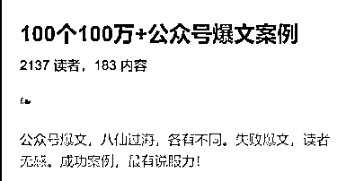
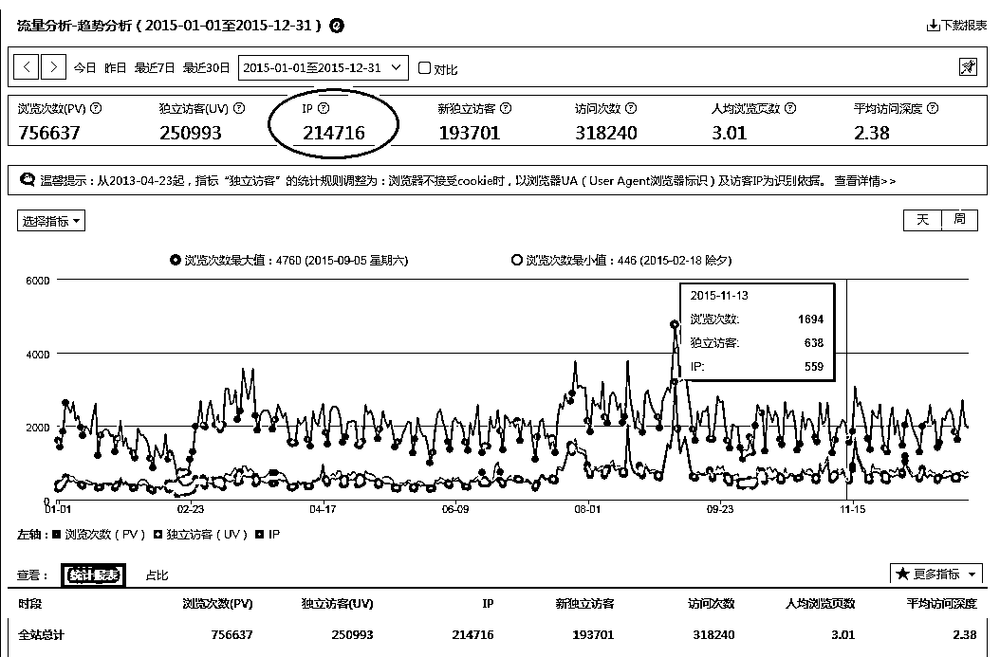
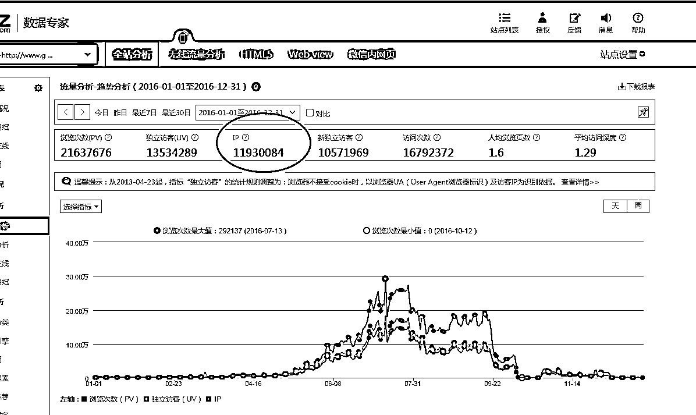
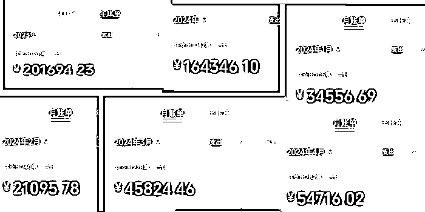
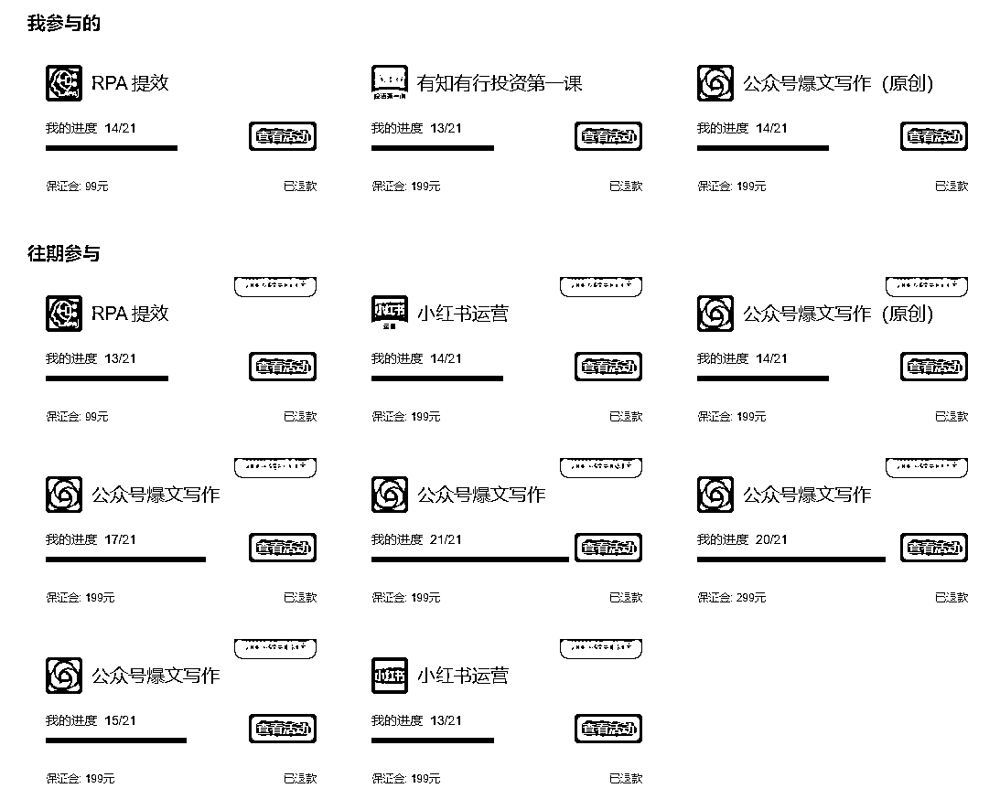
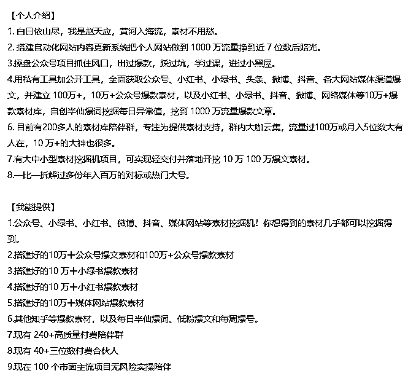
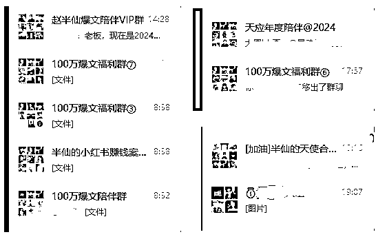
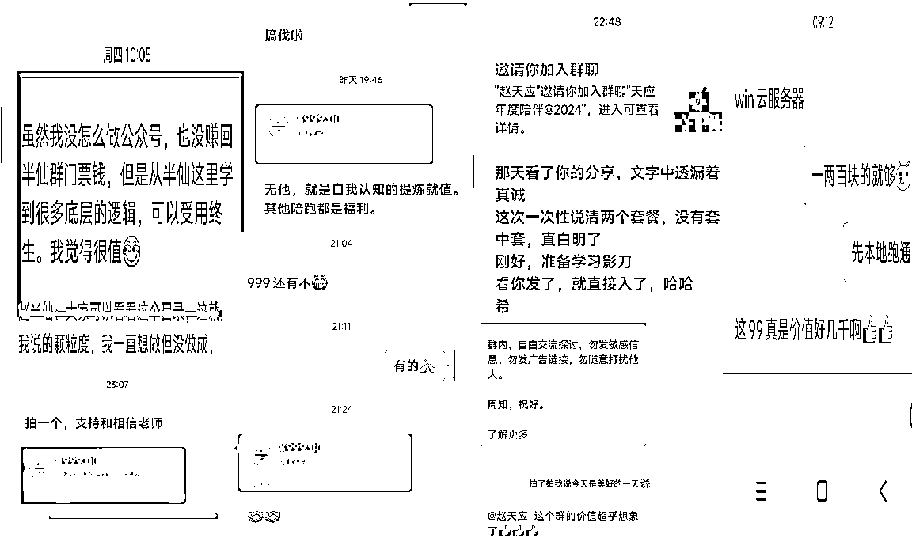

# 20240516赚钱：重生之80后大叔职场外寻求第2春的故事

大家好，我是龙哥，一个80后。干过医，后来转了行，一头扎进互联网里，业余时间做自媒体。现在主要就干三件事：写爆文、挖素材、做陪伴。没背景，没资源，全靠一口气撑着，愣是在职场的夹缝里，给自己劈开了一条路。

在职场熬了差不多20年。早些年搞个人网站，最高做到过千万流量，第一桶金也是那么挖出来的。可惜好日子不长，自己能量不够，凭运气赚来的钱，最后凭实力亏了个底朝天。加上工作也不顺，那几年基本是空转。跟很多体制内的人一样，我也以为这辈子就这样了，混到点下班，再熬个20年退休拉到。那种憋屈和绝望，说多了都是泪。这也是为什么把这故事叫“重生”。

颓了几年之后，心里那点不甘心又冒出来了，琢磨着下班之后干点别的，给自己找条新路。

可再看看周围，90后00后都起来了，我一个80后大叔，还有戏吗？家里老小要养，工作也脱不开身，手脚能伸得开吗？脑子能不能换个新版本？眼光能不能不等着看见才相信？

其实吧，想成长，跟年龄没多大关系。关键看你有没有那股子劲，敢不敢推翻自己重来。

也是运气，我遇上了赚钱，还有在赚钱里做到悬崖式拉新第一名的那位靠谱理白，以及很多愿意拉一把的前辈。从那以后，我的剧本好像突然被推着走了。

我开始转身做自媒体，照着大佬们的路子学，先是把👸号爆文跑到了百万流量，接着挖出一批10万+、100万+的猛料。后来在几位大哥的指点下，想明白了定位，确定了方向，以价值为导向，用素材开道，拿工具铺路，陪着大家一起跑。慢慢搞起来一个1000人的小报童矩阵群，还有270人的付费素材群、180人的付费陪伴群、70多人的付费陪跑群。

从兜里空空，到锁定“素材+陪伴”这条道，只用了半年，副业流水破了10万。一个80后职场大叔，就这么给自己开出一条新路。

今天把这些事拿出来聊聊，是希望那些跟我一样在犹豫、在折腾的朋友，能从这里看到点影子，或者得到点启发。

这篇全文一万字的样子，看完得花个15分钟。拆成五个部分讲：

1. 莽撞期：边趟河边混饭，全凭一腔爱好，把个人网站搞出千万浏览量
2. 爆文素材：一路磕磕绊绊，死磕爆款，硬扛到底不撒手
3. 私域社群：掏心掏肺分享，轻推一把，真心待人没有输家
4. 工具赋能：借力打力，顺着人性来，提效率治懒病
5. 最小后悔：光喊口号没用，不下场干，谈啥都是废话

# 1. 莽撞期：边趟河边混饭，全凭一腔爱好，把个人网站搞出千万浏览量

我本来是学医的。赶上那会儿学制改革，砍掉了一年，我这行医执照也就没影了，后来从医学院拿着一个管理学学士学位出来了。进了单位，本该拿手术刀的人，改成了拿鼠标做管理，以为能把自己管明白，其实哪那么简单。

我跟靠谱理白（赚钱拉新第一名那位）算是师出同门又同在职场。区别是，他们是标杆，我拿他们当目标，想着能学个皮毛也行。

因为成长环境的关系，我前半辈子也没啥特别明确的想法，更谈不上定位。如果非要说个定位，那就是“瞎折腾”——想到啥弄啥，看人家弄啥也跟着弄。反正，先动起来再说。

成就是干出来的，没干成，也怨不着谁。

后来我才悟到，这才是定位的真意：做定位不是静态设计出来的，而是动态实操当中踩出来的。

我一直挺迷网络的。这玩意儿对我这种性格内向、从小镇上走出来、没资源没背景的人，真是扇门。不用拼人脉、不用走关系、不用靠后台，有根网线就能跟世界连上线。借用靠谱的一句话：只要你放得下心魔，马上行动，结果自然会找上门。

大概2010年前后，我就利用下班时间折腾个人网站，属于那种用爱发电的状态，玩得挺嗨。

一开始纯属兴趣，后来觉得既然玩，不如玩点跟赚钱沾边的。于是做了个本地的信息门户，一度排名压过了当地最牛的政府官网。没有技巧，纯靠手工堆，搜出来的结果常年本地第一。

可没人指点，要技术没技术，要资源没资源，流量是有一些，钱却没见着。弄了五年，网站等于给搜索引擎打工。到2015年，整年流量也就勉强凑个20万。

转机在2016年。那会儿被朋友拽去听了一堂SEO公开课，听完之后我才发现，以前那些玩法全是野路子，基本就是门外汉瞎舞。

后来下了狠心，掏了2500块钱，跟几个哥们一块儿系统地学了一遍SEO。搞明白了什么叫TDK（标题、描述、关键词），还知道算法看重的是页面响应速度、能不能满足用户搜东西的需求、对爬虫友不友好等，也学了基于用户、环境、功能、体验这四维度的白帽操作手法。

理论学了不少，可我不会写代码，只能眼睁睁看着别人流量飞涨、权重起飞，钱包鼓起来，自己啥也干不了。

那阵子天天在🐧群里混，有人发几个做得好的网站，我也会点开看看，分享一下白帽的案例，可自己就是没下场动手。

后来群里有大神又推荐了一个更牛的前辈，说这人找到了流量密码，只要你有执行力、懂基础技术，跟上就能出成绩。这话听着，跟现在遍地都是的知识付费和CX套路神似。

但我那时候满脑子想赚钱，咬了咬牙，又交了5000块。当时的说法是，买的是两套方案：一个是他发现的巨大机会，另一个是参与站群一起分享机会。

结果付完钱，就上了三节课。第一节课说百度手机端的流量巨大，第二节课教怎么挖那些带人性的移动流量词，第三节课讲的是站群怎么玩——其实就跟现在的爆文矩阵一个路子。

站群得懂技术啊，我完全没基础。一边得掏钱买站群软件，还得自己维护；一边心里打鼓，不怎么信这玩意能赚钱，最后就放弃了。但是挖掘百度移动端流量词这件事，我放在了心上。

谁能想到，就是这笔5000块的投入，我这技术小白，不到一年时间，把那原本半死不活的小破站，一波操作干到了千万流量，回报差不多有百倍。

一个学医的门外汉，技术八窍通了七窍，最后居然“莽夫”一样把网站干到了千万级别。回头总结，大概是这么几个原因：

一是赶上了时代的风口。那阵正好碰上手机上网人数暴涨，百度猛推移动端来抢用户。这个机会被一个小圈子的人发现了，人家不光自己实操赚到了钱，还想通过开课搞点利润，顺带拉人一起弄站群、放大流量，靠广告流量赚钱。

结果我这个完全不懂技术的人，反而沾了“不懂”的光——没能入伙，只好狠下心把自己的站给养大了，一路养到流量爆棚，最后碰了红线，不得不关站。

靠谱说过一句话：现在这时代，产品早就过剩了，渠道反而乏力。好东西到处都是，可真正能卖得动的人没几个。4P营销里的核心是渠道，谁手里攥着流量，谁就能出货，谁就是老大。我那会儿，正巧把这波时代的红利接住了。

二是不怕交学费的胆量。我嗅觉还算灵敏，也敢赌。一直相信关于流量的信息和认知本身不值钱，关键在于用好它，尤其是要用技术去落地，才能接得住大流量。

从市面上几个主流采集工具开始试，完全零基础去学自动化采集发布。一开始从大家推荐的火车头采集器切入，前前后后花了几千块，找人带路、找人帮写采集规则、做入库规则，然后参考别人做好的现成规则，边搜边改。

就这么一步步来，从能看懂一行代码，到可以照着别人的逻辑仿写整套。甚至因为数据量太大，一台服务器跑不动，直接上了三台旗舰版采集器。然后四处采集网上的文章，连外文的也弄，拿去抢“原创”标签的流量；又用关键词做交叉组合，把同一篇内容套上不同的词，从而铺出大量新页面。

这就好比我后来干的👸号爆文。许多人做爆文只盯着平台推荐流量，但我那一回不仅要推荐量，还瞄准了搜索流量。推送量要，自然的搜索量也要。就算内容发了很久，别人依然能通过搜索翻出来，持续产生收益。

靠着这种方式，我硬是啃下了自动化，弄通了关键词交叉组合的套路：拿一个词对应一篇内容，两个词就能出两篇，三个词整出四篇，四个词更是能组合出9篇、16篇、甚至24篇来。页面数暴增，落地页多了，总流量当然就水涨船高。

三是碰上了贵人带路。有人肯把自己验证过、走通的路径，以不那么高的成本分享出来，这本身就很难得。对我来说，能用钱换来近距离围观高手的思路、做法，已经是走捷径了。要是还能混进高手们的圈子，看到他们怎么指导别人玩出新花样，那更是花了一份钱，听了好几场的干货。

那5000块学费，比当时一个月的工资都多。但说实话，大佬也就是点破了两个方向：一是百度的移动端需求极大，二是可以从人性底层去选些特殊关键词。

工具嘛，是群友自发做了免费送的。网站仍是我那个小破站，内容得靠我自己学技术去补。但路子一旦指明了，整个世界都不一样了。

说实话，我这个一本正经的80后，靠着“啊~啊~啊~”这三个字，陡然打开了一扇新世界的门。那种震撼，那种突然看见别人赚钱思路的冲击，以及他们抓住机会后变现的速度，完全把我原来的观念碾碎了。

“啊~啊~啊~”懂的人都懂。但要碰到对的时间、对的人、对的时机、对的方法，每一步都是条件缺一不可。

而我靠着在百度的某些特殊通道里，不断挖这类关键词，批量采集相关的文章和配图，再不断组合出新的页面来承接流量、把流量变成钱——这就是当时那个咸鱼翻身的关键招数，也是我唯一能抓住的最优解。

一手货源，狗都不做。别人都在拼那些头部热词，打个头破血流，99分的努力才能换一点汤喝。而我们找的是几乎没人抢的词：随便抓点资讯、小说，繁体转简体，英文转中文，组织起来就能有流量。然后把这些流量导给弹窗广告、其他联盟平台，变现走人。

当然，那一千万流量带来的钱，来得凶走得也快。后来碰到P吐P的烂事，加上职场家庭一堆破事，那点成绩终究是烟花一场，我重新变回了那个素人。

# 2. 爆文素材：一路磕磕绊绊，死磕爆款，硬扛到底不撒手

到了2023年，杂七杂八的事情处理得差不多了，我带着这些年用钱买来的一条条碎片化认知，再次出发。

那几年，前前后后往里砸了六位数学费。学到最有价值的一点就是：要有个人IP，长线短线相结合，并且要把“定位—内容—流量—产品—成交”这个完整链路给想清楚。尤其是定位，得先做减法。

别人听到你的名字，第一时间想到的是啥？别人凭什么信任你、愿意把钱给你？

用一句话说就是：你得整明白你提供的是什么东西，给人解决什么问题，帮的是哪一类人，收的是哪一档的钱。有没有产品，这个区别非常明显。

都说如今环境不景气，晒收入容易被骂、招黑。那我就不晒收入了，晒一下我为聚焦在这条路上所付出的各种开销吧。

有天翻网盘，突然发现一份别人之前转给我的赚钱资料。里面的文章内容有些已经显得过时了，但再仔细看看，不少东西依然有嚼头。

七年算一辈子。一眨眼的工夫，我这辈子都过了好几轮，世界的玩法又是一通翻天覆地的变化。这时候光守着旧资料肯定不够了，我打定主意：亲自进去看看，看看那帮人到底在玩什么。

进了赚钱，就听说一个风向标能带来几万几十万的收益，一篇精华帖能赚几百万。于是赶紧去一篇一篇刷精华，又看着各种各样月入三四五六七八九位数的新手和大佬晒帖子，心里的小念头又开始活泛了：这里有这么多内容，这么多信息，我能干点啥？我是不是也能掺一脚？

后来听说有航海项目，押金不贵，只要划划水打个卡就能退回。我立马报了名，一口气押了好几个航线。

第一次进去完全找不到北，连打卡从哪进、文档在哪儿都摸了半天。后来才明白，在这里你得对自己负责，光刷脸打卡不走心，亏掉的不只是那点押金，还有大把的时间和心气。第一次就这么无疾而终了。不过也多亏了这次航海，我在线上认识了一批正经同行。

一边继续拿钱换认知，一边接着试错。二刷三刷的时候，我琢磨着，腾讯这种体量的巨头推出来的平台和赛道，只要大趋势没变，一定还有得玩，所以又跑回去做爆文。也想起当年折腾火车头采集器的经历，顺手报了个RPA自动化课。

在体制内待久了，习惯了听话照做。可一到商业场上，反而容易把这事给忘了，动不动就想自己换个花样。

后来我索性又把自己当回小白，不去想别的，就照别人验证过的流程一顿认真执行。基于模仿和参考，先僵化，之后再优化。先是自己做的一篇文意外爆了，接着又顺藤摸瓜发现了许XX那篇千万阅读的爆帖——因为这点直觉，被人送了“半仙”这个外号。也是从这儿，我琢磨出了自己的一套“情绪大法”：不管AI多厉害，真人那种复杂的情绪它不一定学得来；但只要是活人，就得喂养心里那头情绪怪兽。

后来再操盘爆文账号的时候，我有时把彩虹屁吹到天花板，有时把愤怒拉到顶格，借助素材和热点的壳，把情绪灌进去再整篇输出，竟然意外做出了一篇近百万的爆文。才发现爆文是互相勾连的，你对已有素材和内容理解足够深，就能跟着出一篇又一篇爆款。当然，也有几次情绪没收住，被关过小黑屋，算是吃了一串亏、踩了一串雷。

文章爆了之后，我又想起十多年前玩过的自动化采集技术——这玩意儿好像也能搬到爆文和素材挖掘上来。于是先从整理素材库、归类建档开始，再到各个平台翻工具，最后尝试用零基础自学的RPA做了一个小工具，算是正式踏上了素材挖掘这条路。

我把身边能找到的素材都先挖回来，再做排序，从榜单和爆款数据里反过来锁定更多高潜内容。靠着许XX那篇被封神的千万爆文，我进一步摸清了一个号可以怎么玩，这让我对“情绪大法”和素材挖掘这件事更加死心塌地。

借着手上这些爆文素材和实战经验，我想着不如把一部分内容分享出去，找个伴儿一起跑，还可以分摊一下服务器和工具费用。

那会儿李佳X和花西子事件正闹得厉害，79元被全网嘲笑。我这人喜欢反着来，直接顶风定了个79元半年期的“素材+陪伴群”，看有没有人愿意上车。结果第一批就来了上百号人。

就这样认识了一堆做爆文的朋友。群里的人各种需求都有，那段时间我也确实有点飘，手伸得极长，从👸号延到📕、小绿书，再到抖音、🧣、知乎，各类媒体爆文挨个收。几乎是放弃了所有休息时间，天天更新素材、挖新料。

大家可以看看我早前那份个人介绍，就知道我给自己贴过多少个标签、挖过多少种素材。可是回头想想，跟别人说那么多，别人根本记不住你到底是干嘛的，等于是白说。

时间一天天过去，付费群的人数却没怎么往上走。找几位高手请教一圈才逐渐明白：拉个群扔点素材就算交差？这个思路不对。后来我仔细观察那些厉害的人，发现他们很早就开始做减法了，所谓“舍九取一”，聚焦是第一步。

那之后我也买了不少书和课，清单很长，这里只摆一部分。

可书读万卷，不如自己上路；路走万里，不如认识个对的人。书不是买来收藏的，而是拿来翻烂的；实在读不懂的地方，就去找赚钱里的大神私聊，厚着脸皮求教。

我先从自己的实操讲起，跟别人聊怎么做出爆文、提示词是什么、做了哪些赛道，也不藏着掖着。靠这种真诚输出的方式，又圈了一批人进来。

不过很快又遇到天花板了：能影响的还是那几个熟脸，没有多少新增长。流量来源、转化动作、客单价、复购率，这几个环节，我起跑的时候就不占便宜。借用“人货场”的路数来想——我自己是操作爆文的人，手上的素材就算“货”，那我该吸引的是谁？这些人又是在什么场景里碰到我？

一方面还是很焦虑，另一方面继续付费求解。中间断断续续找书、找人、找课程，后来按靠谱所讲的聚焦理论，把那些意义不大、价值不足的素材统统砍掉，把重心挪到大佬们一致推荐的👸号和📕上——这两个平台级别的机会窗口，再结合素材能力去拓展新项目和社群。

没有慧根，就得会跟。

既然上了路，就没有回头的道理。

# 3. 私域社群：掏心掏肺分享，轻推一把，真心待人没有输家

又一轮学完消化之后，我继续向几位大佬取经。他们一直鼓励我说，光你自己做出结果不够，还得带着一群人拿结果。所以不只素材要凑齐，还得有承接的载体，得有用户验证过的声音。私域的池子，更是无论如何要赶紧蓄水。

自己琢磨了之后也有个判断：从2024年再往未来看十年，🛰️私域绝对是最值得做的那门生意，没有之一。

这个时代最贵的就是注意力（流量）。有流量还不够，你还需要一个“容器”来接住它，而🛰️正好把这活给包圆了。可以说，🛰️几乎相当于整个社会的线上投影。一个人不太可能开两三个支付宝号，但手里有两个🛰️号，再正常不过。

靠谱的销冠群，客单价几千块，居然能做到1200多人加入。我理解他的逻辑是：一个人靠内部发力去改变自己，真的很难，所以大多数人会被困在“能力陷阱”里——总觉得自己能想明白，总觉得自己会做出正确的选择。

一直在盼着顿悟，盼着哪天突然醍醐灌顶，这基本不现实。我折腾这么多年，真开悟了吗？我自以为是的那点思考，搞了半天，只是在反复加固自己的偏见罢了。

顿悟、开悟、得道，确实存在，可那只属于极少数的幸运儿，我这种80后中年大叔大概率是不在那边的。

于是继续花钱买已经出结果的人的产品来研究，同时开始做素材之外的“载体型产品”，把私域社群的价值做厚。朋友圈也不再发些有的没的，重新聚焦到“素材能带来什么结果”这个核心上来。

最后，参考赚钱整理的那66个赚钱案例，又模仿了很多大佬卖得飞起的📕、视频号、职场转型、社区等小报童思路，我基于👸号爆文素材这个赛道，从我那个定价666元的绝密素材库里，手工挑了一批大众听都没听过的百万流量爆款案例，再结合自己操盘爆文的经验，做了个“👸号爆文案例库”。

这个东西，从观察到解读再到分析都有；数据、判断、链接也都配上了；赛道、配图、手法一应俱全。我做它的初衷也很简单：一篇拆解文章，就能代表一种爆文打法；文章对应的那个账号，就是一个新赛道。

定价10块钱，先自己内部测了测，又请人帮着吆喝了一阵，卖出四百多份。后来经过洋哥团队一套魔鬼式的硬磨，里里外外大改了一遍，加上当时选题正踩在风口上，再配合劲爆素材库的福利和陪伴群加持，这册子一下就冲出去了。很快，订阅数窜过2100人，光这个小报童带来的GMV就达到2万多。

小报童本身赚不到几个钱，这是公开的秘密。为了反复打磨、让人帮忙推荐，我自己搭进去的红包可能都快赶上报童挣的那点了。但因此聚起来的同频朋友、从大佬那里学来的经验，还有靠谱、洋哥这些高手给的认知，这些可全是长在自己身上的东西，有钱也买不着。

经这一圈，我也算重新看到了自己的价值。借着提供超预期的交付，社群越做越有底气。以前群里只发一次素材，后来拉长到连续更新一个月；以前只聊爆文小报童，后来增加了低粉对标账号的拆解；还有我实操当中踩过的坑、进小黑屋的体验、被夺原创、被踢出池子的教训，以及我亲测有效的提示词、赛道跑法——全都摊开来，在群里实实在在地跟大家交底。

很感谢这段时间大家的关注与陪伴，我也在这里坦诚说明一件事：如果愿意，可以把手里的小报童福利群权益，进一步升级到我这边搭建的年度陪伴群，或者更进阶的年度陪跑营，里面会分享更深入、更直接落地的干货，也能获得我的一对一诊断与陪跑支持。

起步阶段，我把重心先放在了小报童这个轻量入口上。靠着几位大佬的背书，小报童本身的内容质感，加上底层逻辑拆解，以及十几块钱的低门槛，再配上持续更新的素材福利和日常社群互动，硬是把一个十几块的小群，和几十块的入门群，做出了一种群友们口中“值几百块”的体感与获得感。很快就有将近一千人通过小报童进来，加入了爆文福利群。

与此同时，我并没有把精力只押在爆文这一个点上。于是同步启动了年度陪伴群。它的定位更宽，不只讲爆文，而是把我从大佬那里学到的判断机会的思维方法、自己踩过的坑、走过的弯路，都原原本本拿出来聊。

我坚持做精细化、持续性的分享：认知拆解、副业实操复盘、各类赚钱风口的拆解、以及我参与或带队项目的避坑经验。慢慢地，氛围变得非常真诚、有人味。最终有将近两百人进入了年度陪伴群，其中七十多人选择加入我的陪跑营。也是从这一刻起，除了爆文的10万+阅读，我个人的GMV也第一次站上了10万+。

和赚钱系大佬、以及已经做出大结果的朋友相比，我这点成绩实在不值一提。但我更在意的不是短期数字，而是这套思路能留下什么。哪怕哪天爆文不再吃香，哪怕别的赛道出现波动，这套打法带给我的认知和行动力，会一直跟随我。并且它是可以迁移到其他赛道的方法论。

作为一个80后、困在小城镇、每月领固定工资的职场老炮儿，能在几个大佬的点拨下，找准自己的位置，把副业做成职业的第二条腿，这份重生的感触，远比营收数字更让我珍惜。

# 4.工具加持：用杠杆顺人性，把效率和质感拉满

流量来了，社群热了，需求自然会跟着增长。我一边持续产出素材相关的精品爆款内容，包括各种写文必备的榜单、日常福利素材，都用在赚钱学到的RPA方式做自动化处理；一边借助飞书和RPA的协同，把过去零散的分享整理成系统化的群内稿件。

借助RPA，我把爆破性强的素材做分块分类，通过进度表、数据盘的方式在社群里持续展示，提醒大家除了常规素材，还有哪些更劲爆的参考可以拿。

结合靠谱老师提出的IP1.0、2.0、3.0的框架，我意识到爆文本身具有很强的重复操作性，于是拉起一个小团队，在自动化挖掘素材的基础上，开始尝试开发批量自动爆文工具。RPA能把高频重复、费时的任务自动跑通，这不是为了偷懒，而是因为工具还不够好用。

当然也有人说，爆文流量不行了，已经在走下坡路。对普通人来说，完全没必要替一个日活过亿的平台操心它的兴衰。平台下滑，我们照样能赚钱。爆文不行了，我们就玩IP+爆文，玩“加我领资料”的私域，依然香得很。

为了让大家能真正持续写下去，我顺着人性设计了一套素材搜集、分类、使用的方法论，并融合了kimi、GPT、文心一言等十几种常用模型，开发出基础版的批量爆文生产工具，供陪伴群成员使用。它解决了很多人“没灵感、懒得动、写不出来”的痛点，给新手一个继续坚守写作的理由。它既提升了效率，也解放了人，让精力集中在更有创造性的环节。

同时，我也结合当下📕的风向玩法，结合爆款打造逻辑，开发了针对📕的机器人，选定细分垂直赛道做质与量双向进攻，探索👸号之外的下一个平台级机会。

通过1V1的咨询交流，我对IP有了更清晰的理解。IP1.0、IP2.0、IP3.0不只是概念，而是可以操作的工具杠杆。

IP1.0的核心是先做出能被看见的内容与一点个人成绩，比如写文章、做短视频、做小报童，目的就是吸睛。定位要稳、要垂直，朋友圈、👸号、📕要信息统一。

IP2.0是在1.0的基础上打造个人形象与辨识度，让人一提到某个品类、需求或项目就能想到你。我正基于爆文的垂直内容，制作公开课、反复参加小项目打磨自己。

IP3.0则是用社群把用户沉淀下来，形成互动与归属感。环境会塑造人，有共同氛围，大家才能一起做事、共同见证结果，形成用户证言，把个人影响力放大到更多人身上，帮助更多人赚钱。

IP就像种树。1.0是播种，2.0是培育，3.0是长出枝丫，招来鸟儿，变成一个生态。我目前勉强走到1.0阶段，接下来想和更多同行者一起奔赴2.0、3.0。

# 5.最小后悔：别光说，光做

人生要的是说到做到。光说不练是假把式，说多了都是废话，只有真的做过，才不会后悔。

在网上我可能聊得挺起劲，但骨子里我是个I人。嘴笨，说错话是常事。但我真的很拼命想给社群里的每个人提供价值，我自己也在我加入的社群里尽量输出。

我默默写日记快十年了，大部分时间就是单位两点一线，独来独往，心事自己扛。曾经为了改造自己，每天五点多起床走一万步、日更一万字，风雨无阻坚持了一年。除了付费链接认识的网友，能说心里话的人屈指可数。

职场人要么太忙要么太闲，做该做的事要高效，然后把时间留给自己的事。可大家都像陀螺一样转，我这个年纪的人出来折腾副业，很多人不屑、视而不见、不理解。

起初我还挺“正派”，朋友圈不发副业相关，怕同事熟人知道，也有点怕卖东西，觉得自己是谁啊要去推销。所以更别提开单了。

后来我明白了，最好的当然是卖自己的东西，但卖别人的好东西也能带来价值，信息差本身就是价值。

我一直担心自己能力不够、达不到大家的期待，犹豫了很久要不要进赚钱、要不要进破局、要不要加销冠。最终没听从大佬“先有点成绩再付费”的建议，一咬牙先付了。一次次看似莽撞的决定，为我打开了一扇又一扇门。

也许是懒，也许是不想搞分身号。我想通了正当赚钱不丢人，个人成长更重要，于是直接把🛰️里两千多个联系人全部打标签，屏蔽熟人同事，开始大面积推送副业信息，破釜沉舟上路。

刚开始还闹了点笑话，有几个熟人同事给我点了赞，私聊我问你在干嘛。检查后发现是漏标了几个人，赶紧补上漏洞。说到底，大家都有自己的生活，也没空管你。

正如杨绛说的，很多问题都是读书少而想得多。

后来通过连线、咨询、群内深度交流，我发现大佬们说的和做的完全一致，都是真金不怕火炼。他们真做过，也在全力交付，盼着我们早日出结果。

这让我从“先看见再相信”慢慢转成了“先相信再看见”。有了大佬的指点和社群的加持，一个小小的爆文素材产品，经过我摸爬滚打，成了副业的一大步。不到半年，私域流量翻了一番，精准好友多了两千人。

我知道有些做小报童的人订阅才一两千人就做出了几十万的商业化，我的商业化节奏很慢，但这已经是我继当年搞网站后的又一次小试牛刀，是从底部反弹的重生。我特别珍惜每一个相信我、信任我的朋友。

借着分享、陪伴和陪跑，我不仅为自己搭起了一所自我学校，也希望能连结一群优秀的同伴，一起避坑、共同成长。同时也完成了副业的一小步，探索出了职场外的第二春。

我常想起一个哲学，叫最小后悔法则。到了暮年，回头看现在能做、想做、该做的事，如果没做，会不会悔恨终生。

认知上，该花的钱现在不花，就像我当年做网站一样，认知不够，赚到也是要还的。

所以我希望，通过分享、陪伴和陪跑，除了给自己搭建学习体系，也能链接和帮助更多优秀同伴，帮他们避雷、助他们成长。当然也顺带实现了个人副业的小突破，找到了职场外的第二春。

人间清醒就是搞钱要紧。没有慧根就要会跟。凡是过往，皆为序章。

人到中年不是理由，身在职场不是借口，唯有行动能解忧。

以上就是我的踩坑、避坑和向上挣扎的真实记录，感谢大家听一位中年职场人唠叨这么久。

如果你也在为素材发愁，或刚入自媒体找不到方向，也想像天应一样在主业外拓展副业、打造个人IP，欢迎来链接我，一起聊聊，一路同行。

白日依山尽，我是赵天应，希望我们都能做一个叫天天应、叫地地灵、靠谱的人！