# 把天花板顶开：一个装修个体户的十倍速进化实录

> 原文出处：飞书文档个人复盘

# 把天花板顶开：一个装修个体户的十倍速进化实录

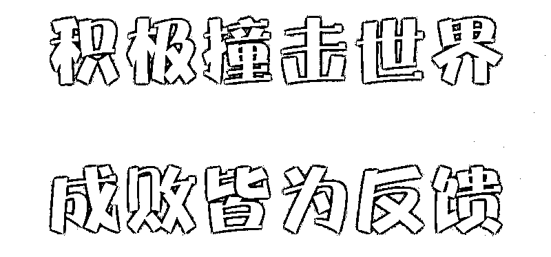

各位好，我是龙哥，在赚钱社区里常年负责“冒泡”的那个话痨。

想离开自己原来的圈子，比想象中难得多。你身边有什么样的人，你很容易长成什么样。如果我当年没有从小县城走出来，很可能一辈子守着一家门面，做点小生意，然后下一代也跟着走同样的路。

2023年，是我的真正转折点。那一年里，我的认知和人脉积累，超过了之前整整十年。前前后后，我认识了1800多位各领域的圈友。从搞门窗的装修个体户，到一脚踩进线上社群生态，这条路我走得很笨，但也很值。如果你也正困在一个出不去的圈子里，希望我这点经历能给你一点劲。

接触赚钱之前，我的人生大致长这样👇

* 2012年，我还是一枚肥宅，后来开始疯狂运动。百公里马拉松、通宵徒步、爬山，深圳大小山头被我踩了个遍。
* 2014年，我回老家做门窗生意，顺便靠爱好拉起了一个300多人的跑团，带出了几十个能跑完马拉松的人。
* 2018年前，我对互联网项目几乎零认知，就是个在县城里混日子的个体户。每天和一群朋友吃吃喝喝，开心倒是开心，可玩完之后心里空荡荡的。我也经常在夜里问自己：这真是我要的日子吗？社交质量太低，没什么向上的通道，内心深处那点想折腾的劲儿又没灭。
* 2019年，我开始追健身梦，准备拜师、打比赛，连工作室的构想都有了。
* 2020年，疫情一来，健身梦直接碎了。我只好回去做门窗定制。那阵子我天天刷抖音，误打误撞进了一个别墅群，别人问门窗问题，我就热心解答。跟着群主学了两年多，认知慢慢长起来了。大哥大姐们认可我，杭州、上海的单子都带来给我，还给我介绍同城客户。后来有个朋友分到安置房，让我去那边开门店。我以为是六层小楼，没想到是33层、上百栋的大社区。按当年的水平，至少能接五六十单。可那会儿认知不够，愣是没接下来，眼睁睁看着机会溜走。

说实话，资源、平台、眼界，这三样东西捆住了我太久。我在老家的圈子混了很多年，始终没法真正突围。后来我干脆放弃了经营多年的本地关系，跑到长沙重新起步。破而后立，大概就是我当时的处境。

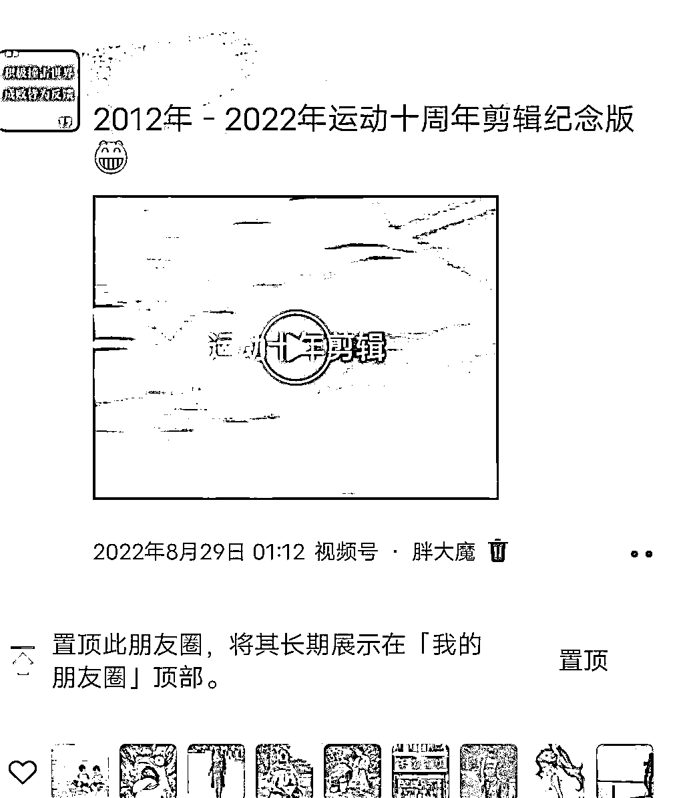

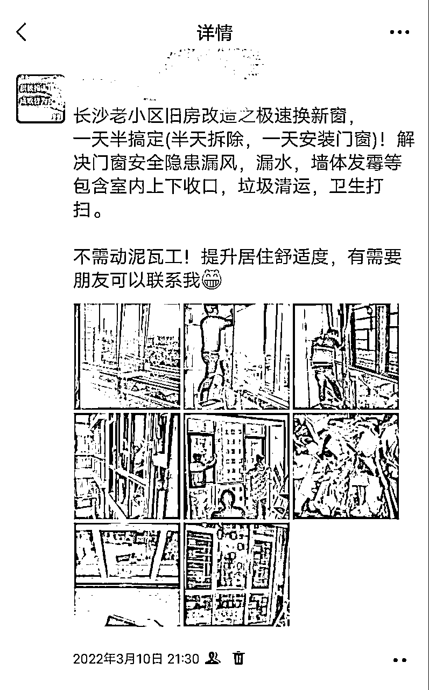

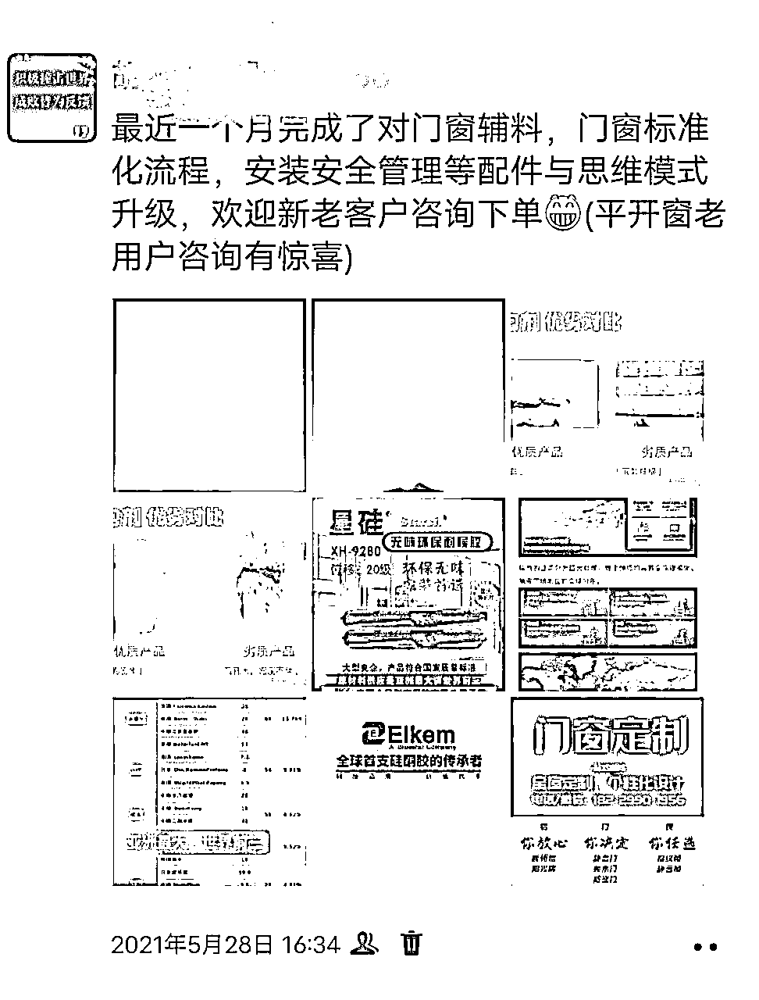

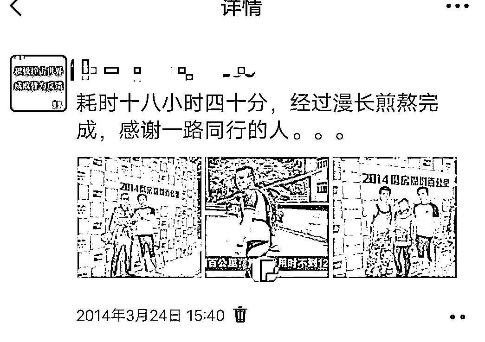

## 01 从角落里的透明人，到社区里的活跃分子：我的认知升级路线图

2023年3月，我没花钱也没走关系，靠自然流量摸进了龙哥盟。刚进去那会儿，谁都不认识我。后来看刀姐的直播，她现场演示用GPT十几秒生成一份完整培训文案，我一下子被震住了。那是我第一次直观感受到AI的力量，也第一次觉得，心里琢磨很久的养老方向，终于有了落地的可能。

当时的我，34岁，一个装修个体户，跟互联网圈子完全不搭界。面对赚钱里的海量信息，我整个人是懵的，根本不知道从哪里下嘴。

2023年5月27日，我参加了第一次同城聚会。那场聚会里，00后大学生雄熊讲私域玩法，算是把我点醒了。他教我怎么用风向标栏目，这条线我先记下了。

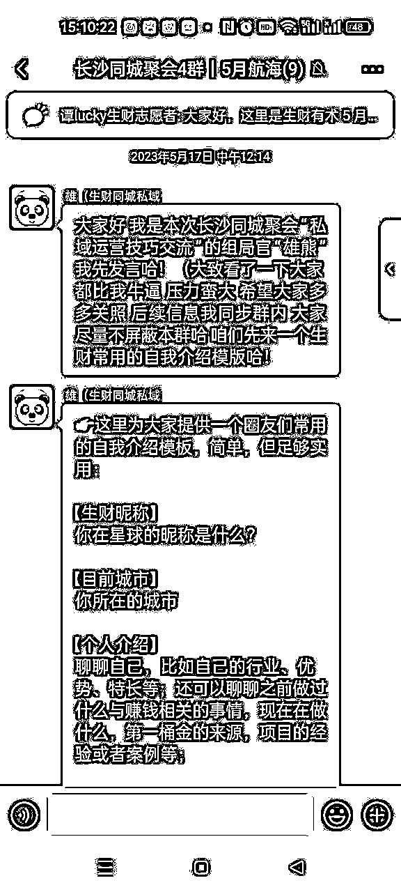

从那以后，我开始疯狂往下挖。整整四个多月，我把赚钱过去7年积累的精华帖基本刷了一遍，每天雷打不动地看完所有风向标内容，硬是给自己养出了商业嗅觉。

那段时间，我睁眼第一件事就是刷风向标，拿它当早课。整天泡在帖子里，日均阅读量十几万字，经常看着看着就进入心流。别人觉得学习苦，我觉得学习爽。大量阅读、收集信息，这件事本身就让我上瘾。

这二十多年泡在网上的水群功力，在赚钱里总算派上了用场。复盘下来，有几个关键动作帮了大忙：

1、我特别喜欢给新人帖和风向标下的内容点赞、留言、互动。次数多了，曝光自然上来，也链接到大量圈友。我顺势进了不少地方群、行业群，还花钱付费进了大咖群，跟着学东西。
2、混进风向标3群后，我天天练各种“钩子话术”，可能实在太吵了，被刀姐直接禁言，改成每天只能说三十分钟。

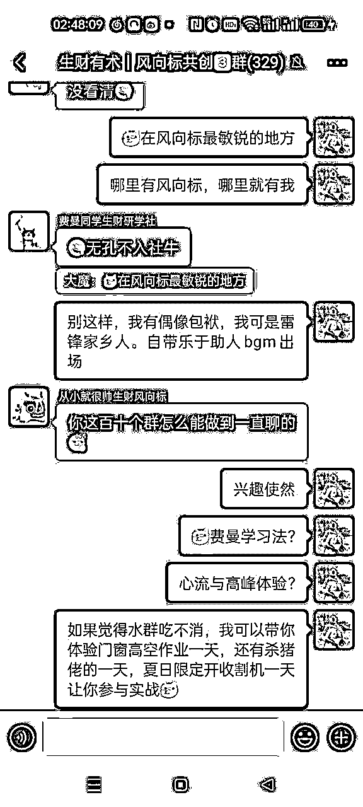

3、我对风向比较敏感。那年5月航海期，平台明显在鼓励大家自建小群。我参加的两个航海小群，湖南人占到了八成。6月4日，我看到深圳群在组织复盘，立刻申请进群学习。6月23日，我搭起了赚钱湖南同城群的框架，三天进来150多人，现在已经700多了。后来湖南群累计组局20次以上，深度局超过10次，各种线下局加起来30多次。

顺带说一下，长沙的深度局经常是下午场、晚上场、深夜场连轴转，我基本场场都在。

2023年欠下的组局复盘帖，拖到2025年我才总算补上了。

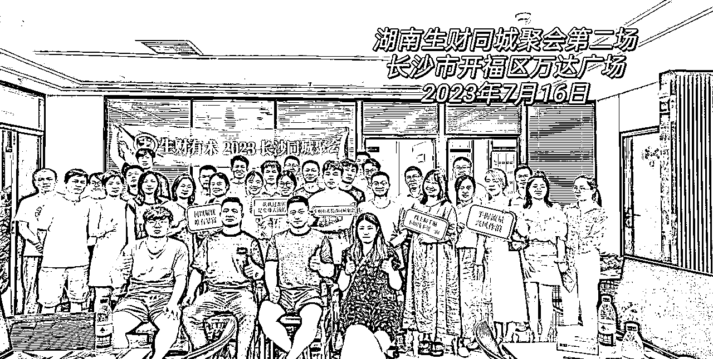

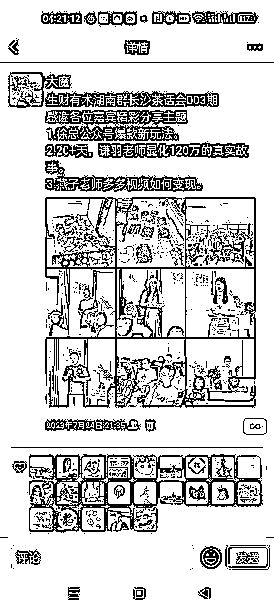

4、我习惯热心帮人，过程中也帮圈友对接了不少资源。帮别人的同时，我的眼界被撑大了——原来这也能赚钱，那也能赚钱。这个时代，表达者是有红利的。你被看见得越多，拿到的注意力就越多，而流量的本质本来就是注意力。

2023年6月，我给自己定了一个挺朴素的定位：最差也能当大佬的铁粉。我去研究了一圈赚钱大佬的成长路径，发现每个人身边都需要铁杆支持者。那我就当最铁的那一个。说白了，你在自家跳舞和在天安门广场上跳舞，收获完全不是一个量级。

我和大多数圈友不太一样，没有把搞钱放在第一位。以前吃过太多亏，身边赚钱的机会不少，可我看不懂，只能一个个放掉。那阵子我天天拍大腿。人赚不到认知以外的钱，这句话我算是拿肉身子验证过了。想赚钱，先得把自己认知的天花板顶开。

2023年7月4日，风向标3群的老侃喊人组队，我跟着做了龙哥益语共读，后来把它转型成赚钱研学社。

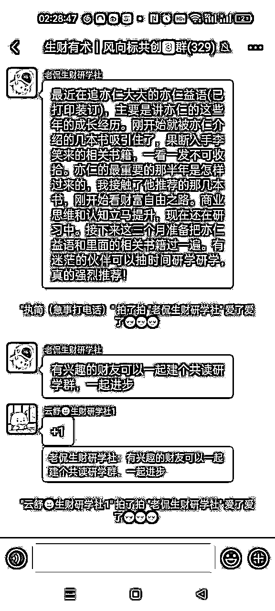

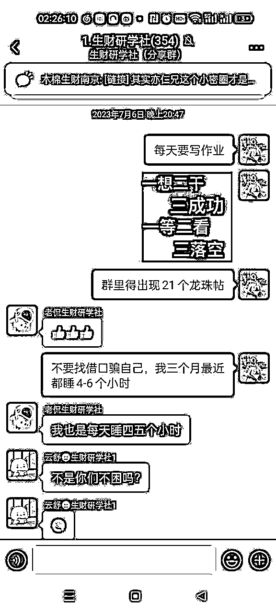

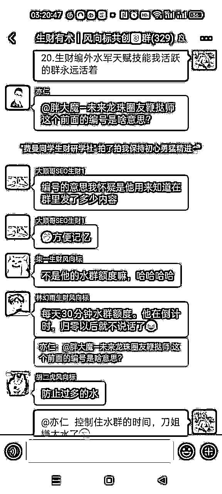

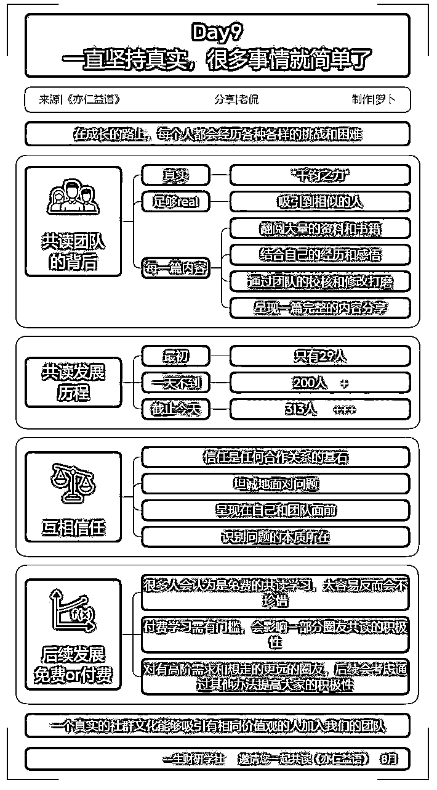

5、再后来，我成了风向标教练。818大会那天，我去见了刀姐，领到了专属鱼丸。龙哥看到我第一句话就是：“你就是那个在赚钱特别能水的？” 一听这话我就知道，前面那些存在感没白刷，平台负责人记住我了。

我几乎是住在风向标栏目里，天天在3群冒泡，最后硬是从一个话痨“泡”成了教练。复盘那一年的爆发，其实没什么秘诀，就四个字：硬干到底。翻译成年头流行的话，叫大力出奇迹。

为什么我各种领域的东西都懂一点？因为我一直在追风向标。连续四个月，每天把所有风向标内容刷完，挨个点赞，感兴趣的再上评论区互动，一天阅读量在10万到30万字之间。那时候我老觉得自己挺闲，但回看记录，每天只睡四到六小时。

风向标对我的价值，我数过，至少有七层：

1、帮我提升商业嗅觉，补认知差异。比如抖音评论截流怎么赚钱、倪海厦视频的变现路子，我都是在风向标里看明白的。
2、让我重新看见机会。2010年以后，我错过太多风口。豆瓣、知乎我都是深度用户，某英语类博主还没火的时候，我跟他几乎同期出现。他现在几百万人关注，用的还是我大哥十几年前给过的职场框架，而我当时完全没抓住。
3、帮我打破信息差。进赚钱之后翻精华帖，我才知道长投学院当年那么猛，我明明在豆瓣看着它从无到有，却从没想过参与进去。还有2011年跑步热的时候，我在深圳跟着老大哥们山里野跑、通宵夜爬；可有的圈友已经在深圳湾带大佬跑步，边跑边聊商业化。两下一对比，差距马上可见。
4、费曼学习法。点赞和评论本身就是一种反馈，逼着我重新读一遍、再消化一遍。
5、深度参与赚钱运营，系统学了一遍社群玩法，短板变长板。
6、兴趣因素。我从2004年开始混论坛、水群，待过的群基本都不容易死。
7、在风向标里搭起了自己的小团队。

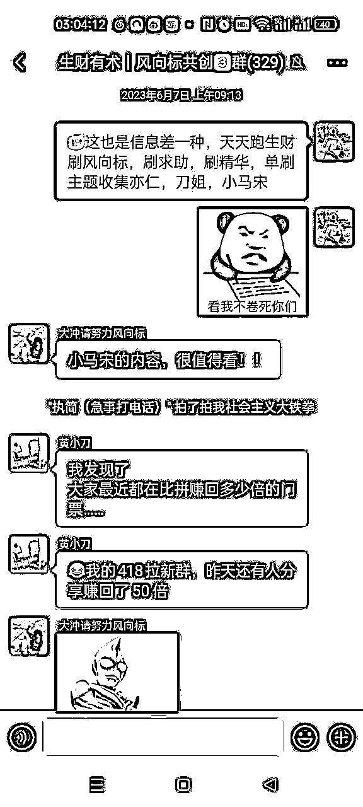

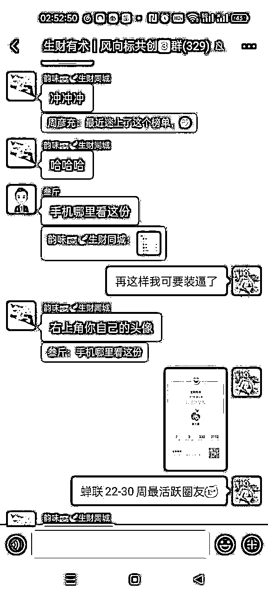

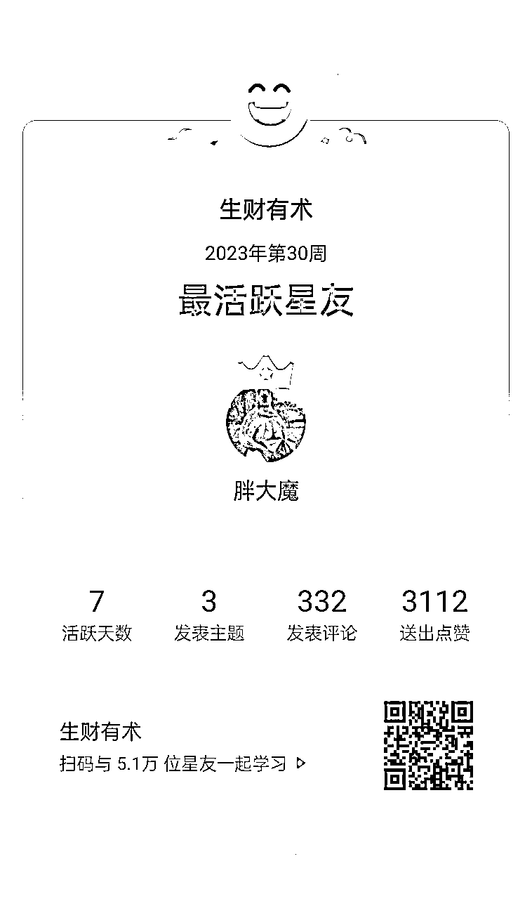

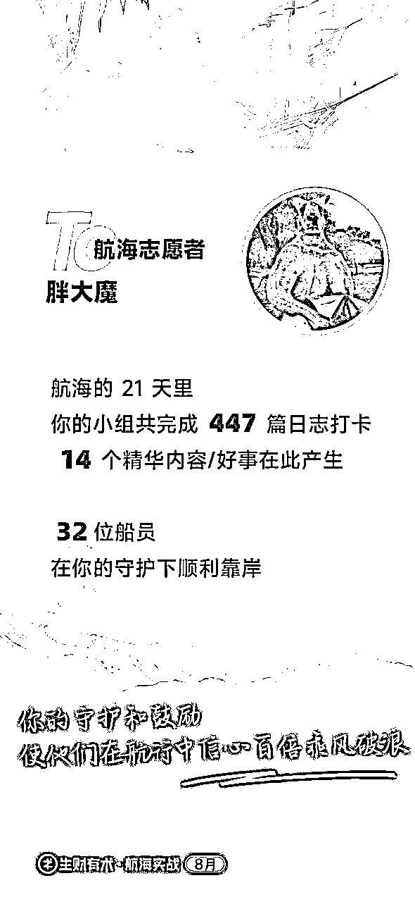

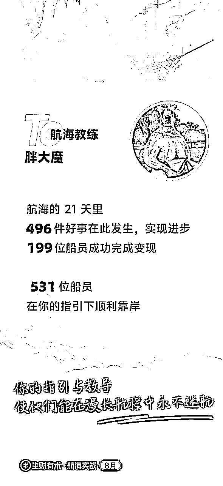

2023年9月，我开始用竖式导图整理思路，这段具体经历我在知识星球专门记录过。

这一路除了水群天赋，还有个东西帮了我大忙：战略才干。我好奇心极重，对什么都来劲，还天生爱分享。只要觉得某个信息对某个人有用，我第一时间就会转给他。

做着做着，我也发现了自己的第一层价值：链接。我给自己立了个长期目标：链接3000位赚钱圈友，帮100位圈友拿到龙珠、当上教练，或者达成深度合作。

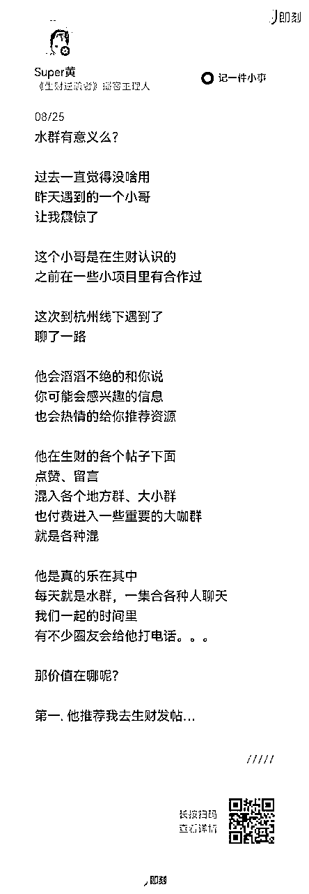

## 02 盖洛普拆掉了我旧脑子：先打碎，再重建，我才找到方向

去年6月14日，身边的圈友突然都在聊盖洛普。圈友林幻雨推荐我去测，我当时还有点不屑，心想一个测评能讲出什么花。结果测完，真香。

6月17日拿到报告，我愣了一下午。它把我过去的自我认知彻底推翻了。之前做的规划全部作废，我重新给自己画路线，边画边走，边走边迭代。

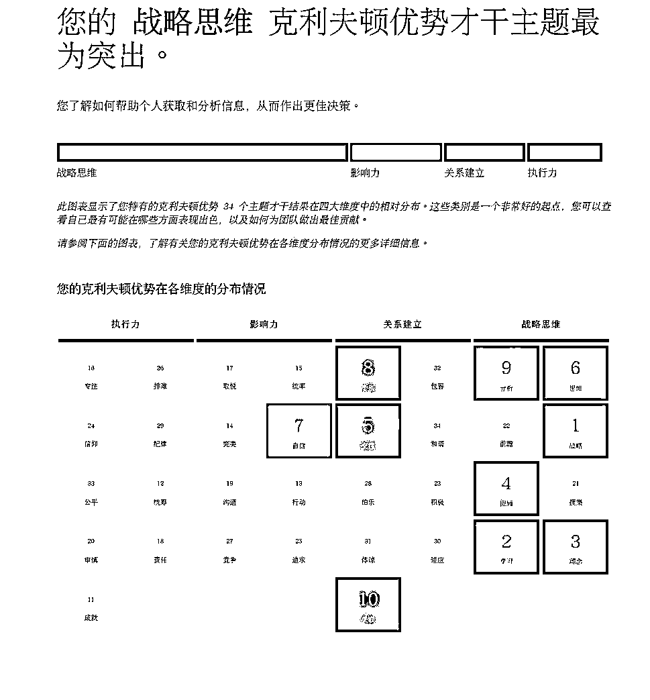

测之前，我一直以为自己是“搜集”第一，毕竟从小我就有收集癖。可报告告诉我，“战略”才是第一位。这一下子把我点通了。我为什么爱收集、爱分享、爱扒事情背后的脉络？原来都是战略才干在驱动。我了解得越多，分享得越多，收到的反馈越多，行为就越被修正。进了赚钱以后，场域对了、圈子对了，成长速度飞起。

在那之前，我长期处于内耗和迷茫状态，反复试错，总想确认自己到底要干嘛。脑子里像住着一百个小人，一百个方向，好不容易说服这个，那个又冒出来。后来的解法很妙：用“战略”才干拎出一个将军，把那些小人拧成一股绳，所有力气只朝一个目标打。内耗瞬间就停了。

我也慢慢看清了自己喜欢什么。让我蹲守装修工地十几小时，我累得半死；可研究社群玩法，我乐此不疲。从十几岁开始混论坛、水群，玩了十几年依旧上头。现在我一个人就能把社群的“水”灌满，哪里有局，我都想挤进去。

以前我总觉得是资源和平台限制了我。盖洛普帮我打通任督二脉之后，我这种“战略第一”的人开始自己整活。我去网上到处留言，问小马宋老师：像我这样的，该对标哪位高人？

从那时起，我恶补了一批战略知识。归纳起来其实就三点：

1）像素级复刻高手的思维、策略和打法；
2）研究高手的成长路径；
3）研究竞争对手的战略布局。

战略就是生态位。按这个逻辑去想问题，思路一下子清爽很多。

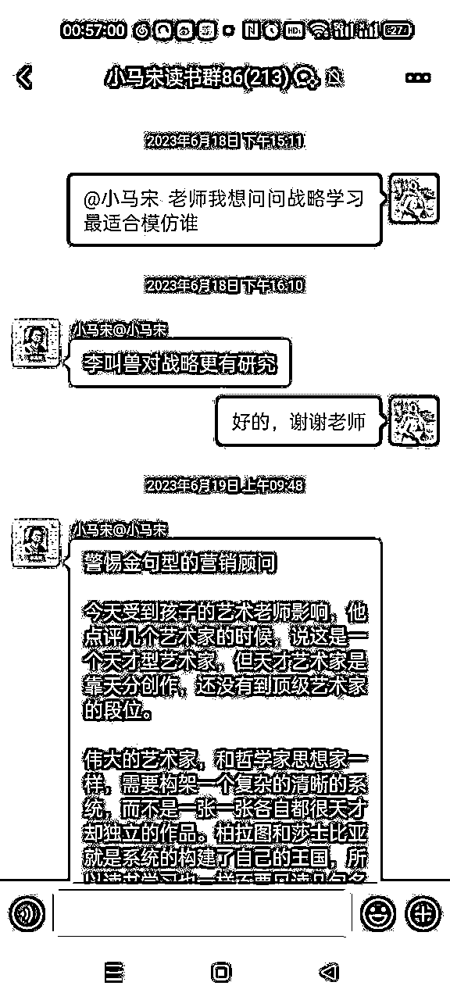

除了战略，我的“学习”和“回顾”分列第二、第三。我以前自学跑步、健身十几年，我妈62岁还能用软件画阳光房效果图。我嘴硬说，就凭这股基因，我60岁脑子都不会僵。

我还喜欢研究高手的成长路径，看他们怎么从小透明一步步做成大佬。搞清楚来龙去脉，我就更容易看懂自己现在站在哪，也知道下一步该往哪儿走。只要觉得有价值的事，我一定会复盘，重新挖一遍。

说到水群能力，“关系建立”里的“交往”才干发挥了很大作用。我爱交朋友，也愿意分享。但过犹不及，以前装修被师傅坑了好几轮。后来读了《乡土中国》，我才看明白社会规范和市场规范是两回事。我给自己定了个规矩：认可的朋友用社会规范，其他人统统按市场规范来。从那以后，我这个出主意的军师越干越顺手。

柳大给我做过盖洛普优势分析，一句“盈亏同因，优劣同源”直接点破。人嘛，都是为自己的利益发声。盖洛普替我补上了最后一块短板，所以我天天给柳大打call。信息和资源上的差距，我在赚钱里都找到了解法，所以也为赚钱打call。

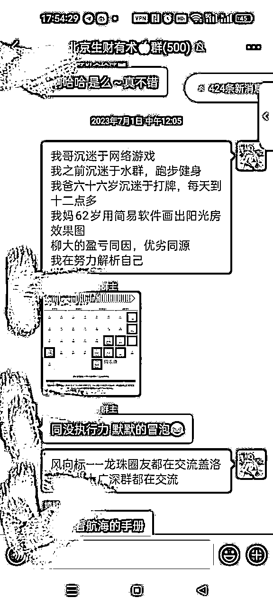

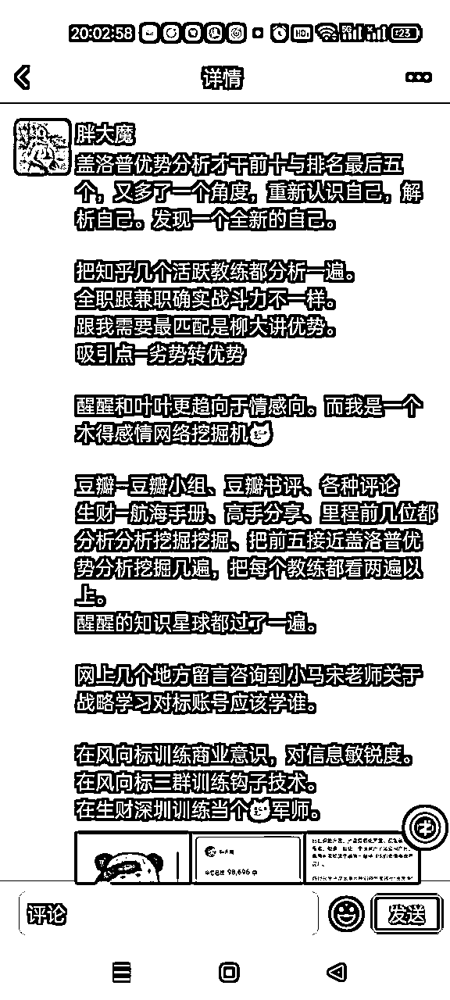

上面这段，就是我当时刚分析完盖洛普的记录

## 03 死磕养老赛道之后，命运的齿轮也跟着转了起来

从决定做养老知识星球那一刻起，我就有种“心想事成”的直觉，好像这件事是命运替我选的。为什么这么讲？

起因是我外公摔了一跤，送去医院，人家直接说不收了，只能回家躺养。家里人对科学养老几乎没概念，很多照护知识都很缺。那时我已经很想做点什么，但一直拖着没动手，眼睁睁看着那段日子变成全家人的煎熬。

后来我姨父查出认知症，同样没有得到好的养老照护。

真正让我下定决心的是：身边这种例子越来越多。我开始焦虑父母老了怎么办，也焦虑自己老了怎么办。

我就想着，像我们这种普通家庭出身的人，如果能学到正确的养老认知，遇到问题及时处理，就能少花钱、亲人少受苦。晚年过得舒坦一点，能通过互联网找到好医生，能得到临终关怀，能少一点痛苦地告别——这些就是我愿意一直扑上去做的事。我也想让我爸妈因为我现在做的事而受益。

2023年4月，我立了一个目标：用爱发电。之后这一年多，我经历了很多拷问，认知也在不断迭代，但初心一直没变。

也是这个过程中，我认识了一位在北京开养老院的大哥，开始真正接触正经养老圈子，还拿到了一些靠谱资源。

我从零开始挖养老信息。去年5月，我跑去北京参加了一场协和老年医学与医养结合的专业大会，现场收获大量优质信息，也链接到不少靠谱的医生资源。

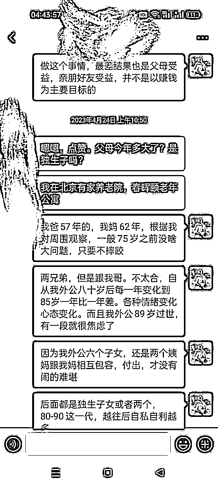

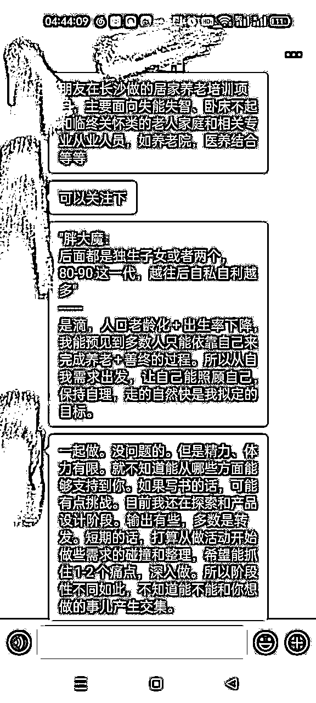

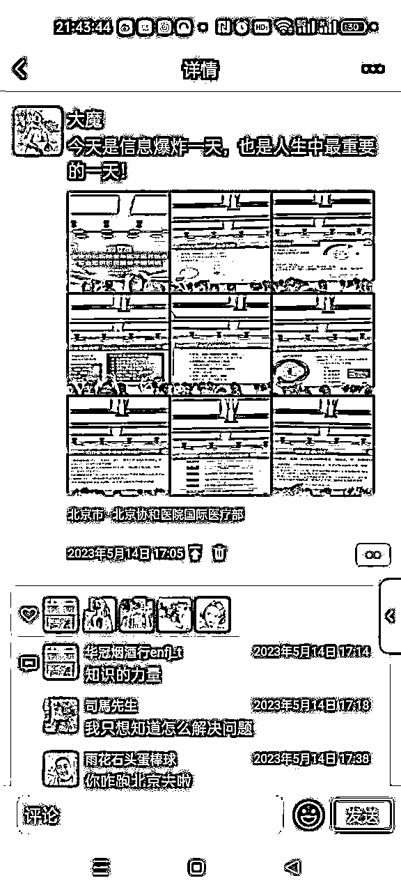

再后来，我开始全网搜集养老相关内容，开出了自己的知识星球，做养老信息整合、变现模式和创业方向的交流。目前星球里已经沉淀了养老政策风向标合集、适老化科普一百篇合集等等。我也在养老、大健康、银发经济、医院、医疗这些圈子里来回串，找人聊痛点、挖需求，慢慢确定自己的路径。

豆瓣那边，我开了一个健康养老小组，现在有5600多位成员，还认识了好几位热门小组的组长。我经常在几个小组里收集问题、回答问题，顺便整理了一份《父母养老百问百答》。

# 2024年，我把内容做成了知识库，连续迭代两个大版本

## 那是2024年熬夜肝出来的东西

## 2025年，我要拍100条口播视频

靠着铁粉式的混群能力，我又挤进一批精准养老社群，里面全是行业资源。以后想做养老的朋友，想打破信息差，我这边可以帮忙对接资源。

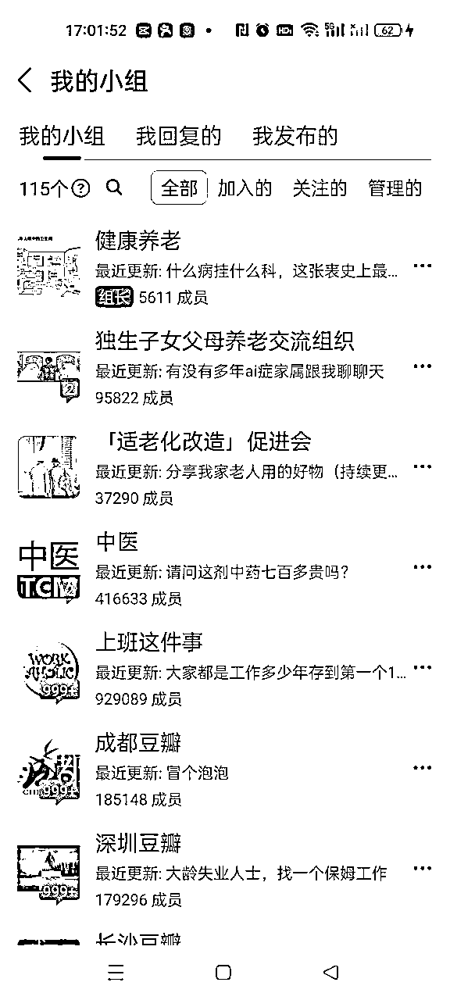

最后说点实在话。普通人向上走，从来都不容易。每一个拿到结果的人，都是踩着坑、咬着牙一路闯过来的。我复盘下来，大多数人缺的其实是五样东西：

一缺看穿商业底层逻辑的认知；
二缺能把信息变成机会的判断力；
三缺真正下场流汗的勇气；
四缺解决具体问题的经验和技能；
五缺同频、真诚、还能互相托底的战友。

只有找到自己最擅长的那件事，持续用“传播＋链接＋私域”的方式去迭代，路才会越来越宽。我也祝每位圈友，都能在赚钱里找到属于自己的方向。

2024年，我重新给自己贴了标签，从水军升级成“赚钱百事通”。链接了各路牛人之后，我更相信：大家一起共建、共生、共成长，才能共赢。

我这些年混过健身圈、跑马圈、吃瓜圈，也挤进过AI圈、养老圈、跨境圈、知识付费圈、电商圈、私域圈、WEB3圈。一路走一路跨，慢慢就把圈层打破了。2023年期间，我帮4位圈友拿到龙珠，鼓励4位圈友当上教练，还和一部分人建立了更深的关系。到了2025年，我已经撺掇4位圈友单独开航海项目了。

同时，从建社群、组研学社、助推圈友拿龙珠和教练，到自己成为教练。这一路的成长，让我折算下来的变现大约是门票的20倍。

线下实体那边，靠着认知提升，我跟家里协作谈下了一个大单。具体数字多大？牛皮先按下不表。

进赚钱，绝对是我去年做过最正确的决定之一。它不光是让我的认知翻了几倍，更让我看到人生还有那么多扇门可以推开。

最后，我特别想谢谢龙哥盟，感谢龙哥老板搭了这么好的场子。

这条路上从来不是一个人，而是一群人互相成全。

任何人的上升，都需要资源支撑，包括思维、渠道、产品、流量、技能、人脉。这些，也正是我们这群赚钱圈友在一起共创出来的东西。

一个人也许跑得很快，一群人才能跑得足够远。

雄熊，那个2023年5月27日出现的00后，是我破圈路上的第一个贵人！！！

刀姐，风向标指明灯、六边形战士、话痨和水群双料冠军，是我一直想对标的榜样！！！

JC，一路同行，互相鼓劲！

赚钱研学社的伙伴们：老侃、云舒、罗卜、小竹、小萝卜、费曼、九歌、笑笑、段子手、鞭炮 super黄，咱们一起跑了两个小项目，速度飞起！！！我还认识了9位优秀的产品经理，学到不少产品思维。

村长，从2023年6月23日就和我一起搭城市群，又在湖南同城组局20多次，你的真诚利他、无私建议，给了我很大帮助！

第一位为我的星球付费，还给了我正反馈的姐姐，那是一种难得的认可！

谢谢母亲大人，陪我挺过漫长的低谷期。

谢谢非白、相柳，这篇东西能发出来，离不开你们推了一把。

谢谢柳大、比浪、艾小飞，还有好多没列出来的朋友。

谢谢华冠大家庭八年的陪伴，玉姐、毛子、章鱼、地主，这些名字我记在心里了。

## 2025年，我是出海汇社群负责人