# 📕投放没效果？保姆级📕获客方案

别再问“📕投放为什么没效果”了，问题多半出在玩法上。

这两年📕的流量红利肉眼可见地变少——别只看它上了春晚，月活也就3亿左右，盘子就那么大。商家一窝蜂涌进来，流量成本必然水涨船高。想继续靠单一投流吃红利，只会越来越难。

我们团队在服务客户的过程中，把原来的「BKFS组合营销」做了一次全面升级，让它更适合预算有限、行业敏感度高的商家。整个玩法一个人就能跑通，我们有个运营靠这套打法，单账号单月拿下1100+客资、70万营收；做境外游的客户，月GMV能做到700万以上。

之前我们复盘过境外游的案例，这次拿婚纱摄影行业当样板，把完整玩法拆开揉碎讲清楚。

## 一、先搞清楚：BKFS到底是什么？

简单说，就是四件事的组合：

- B：品牌/官号矩阵
- K：KOS主理人 + KOL
- F：信息流投放
- S：搜索投放

核心逻辑是：用品牌号持续输出产品内容，再靠聚光的搜索和信息流广告拿客资，同时搭建KOS矩阵解决信任问题。适合客单价高、决策链路长的行业。

## 二、动手之前，先摸清两件事

我们做策略前，通常先做一轮市场摸底，方向就两个：同行怎么玩、用户怎么买。

### 同行都在做什么？

翻了一圈竞品，发现大家基本逃不出这几种：

1. 靠聚光硬投，旺季淡季跟着流量波动
2. 少数品牌做KOS矩阵，但内容平平
3. 跑到同行笔记评论区截流
4. 投了几个KOL，互动数据惨淡
5. 素人铺量一多，品牌词直接被限流
6. 等等

大部分人只押其中一两招，效果有好有坏。

### 用户下单前会做哪些动作？

我们也把用户从种草到下单的路径捋了一遍：

1. 有需求后先看风格
2. 发帖或评论求推荐
3. 锁定了几个风格对味的品牌
4. 然后开始对比、咨询、到店
5. 比环境、比套餐、比客片
6. 看品牌舆论和信任度
7. 最后选一个综合分最高的下单

完成服务后，还可能发推荐笔记、写测评、安利给朋友。

### 竞争策略怎么定？

把用户路径拆开看，前三步是“被看到”，后三步是“被信任”。

同行大多在抢“被看到”，少数在做“被信任”，还有人想靠素人铺量两头通吃，结果品牌词被封了。

所以我们的策略很清晰：既要被看到，也要被信任，还得避开品牌词封禁的风险。婚摄行业恰好适合这套打法。

## 三、婚摄行业的BKFS怎么做？

### 企业号 + 聚光：负责“被看到”

企业号主攻品牌宣传和产品展示，把婚纱照风格铺出去，再配合聚光广告投放，用最低成本拿精准客资。

### 矩阵号：负责“被信任”

我们搭建了三种矩阵：

- **主理人矩阵**：让摄影师、化妆师当IP，按岗位和人设定选题
- **客户好评矩阵**：服务好客人，引导他们在平台上发真实好评
- **伪素人矩阵**：模拟普通人从备婚到拍完照的全过程，发日常、发花絮、发成片

这三种内容最容易拉近距离，最终把流量引到品牌号做咨询。

### KOL投放：扩大曝光、分摊风险

主要两种玩法：

- **达人探店**：真人到店，出镜讲体验
- **素材代发**：不用到店，运营做好素材让达人发

（说明：下面所有配图均为网上找的相似案例，不是真实客户后台，留意分辨）

## 四、品牌账号怎么运营？

先定好企业号的定位：

1. 品牌宣传和产品推广
2. 广告投放承接
3. 活动入口
4. 流量中转站（投流号可以挂🛰️）
5. KOL邀约
6. ……

本质上就是提高“被看到”的概率。

### 账号装修

基础设置照常理来就行：

- 头像用logo
- 昵称用“品牌名+地区+关键词”（比如“深圳XX婚纱摄影”）
- 简介放广告语+门店地址
- 背景图放好看的客片
- 瞬间引导用户私信

这些不难，有点运营基础的人都会。

重点是**置顶笔记**，下面几个选题转化不错：

1. 引导交易型：告诉用户怎么咨询、怎么下单
2. 实力展示型：介绍品牌、门店、环境、团队
3. 产品合集型：热门风格一次性放全
4. 爆款主打型：主推最受欢迎的那套

置顶笔记同时也是投放笔记，尤其是高客单价行业，公司实力这块一定要重点写。

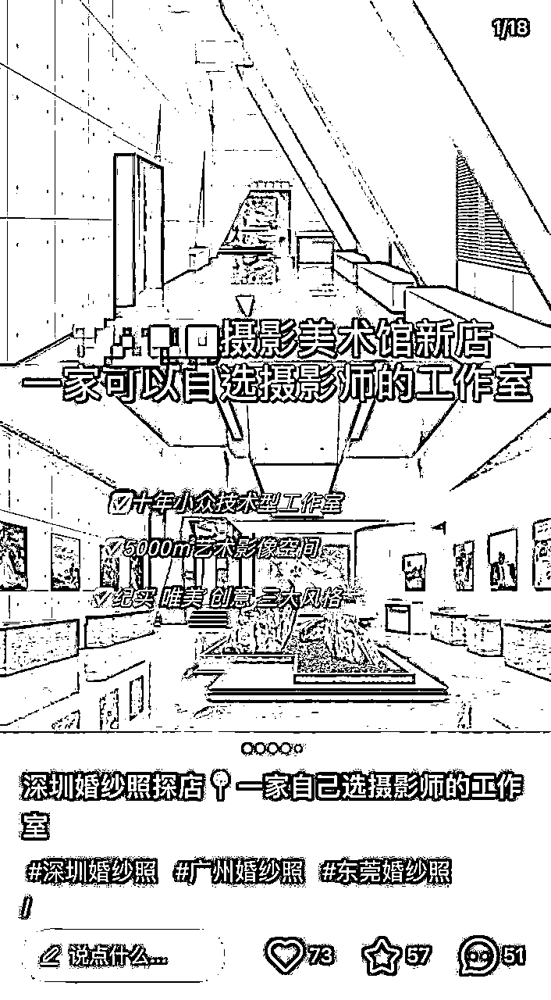

### 高转化内容怎么做？

#### 选题

企业号的内容基本都会拿去做投放，所以选题可以放心往“硬广”方向写。

几个能出单的选题类型：

**1. 基于产品做选题**

直接讲自家风格、套系、套餐内容。

参考：

- 2024全新/热门婚纱照风格
- 客户成片合集
- 婚纱照改造、拍摄花絮
- ……

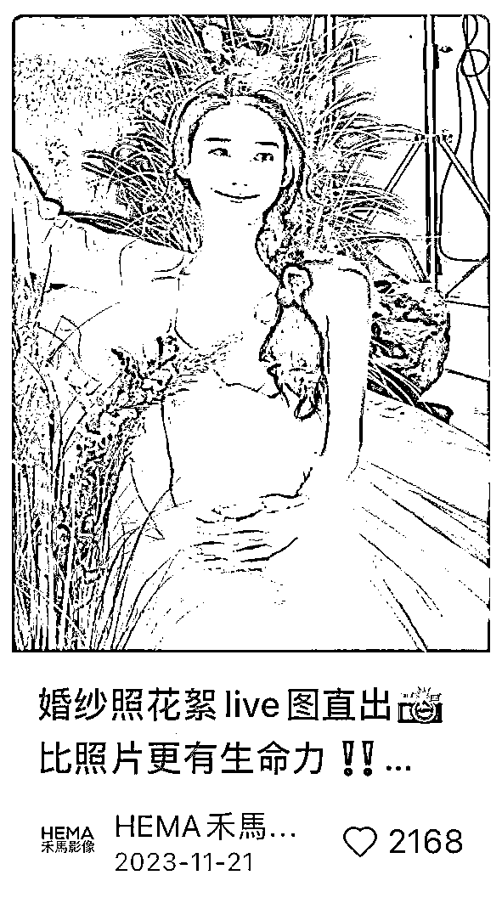

**2. 基于公司实力做选题**

突出门店环境、品牌调性、到店引导、咨询路径。

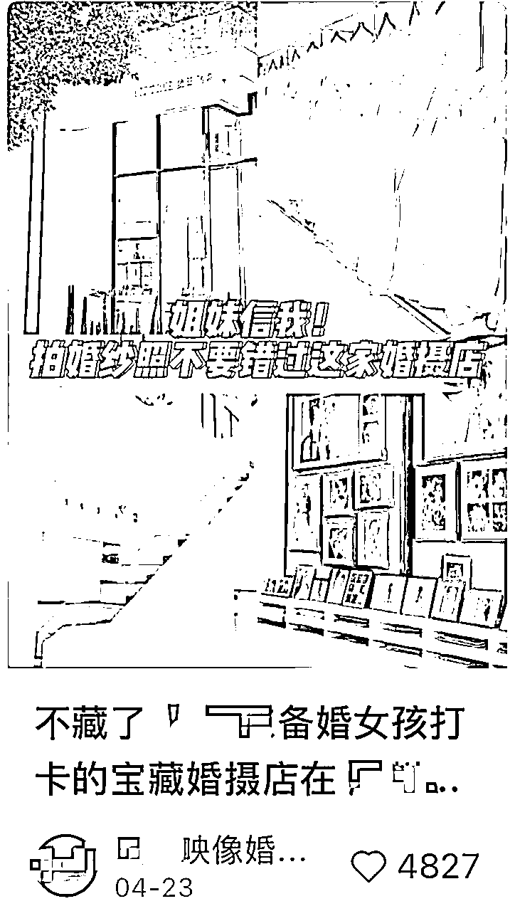

**3. 大合集选题**

把报价、风格、服务项目整理成合集，适合长期投放。

参考：

- 婚纱照风格怎么选？
- 2024热门风格合集
- 多少张照片、什么价位
- 9组中式风格合集
- ……

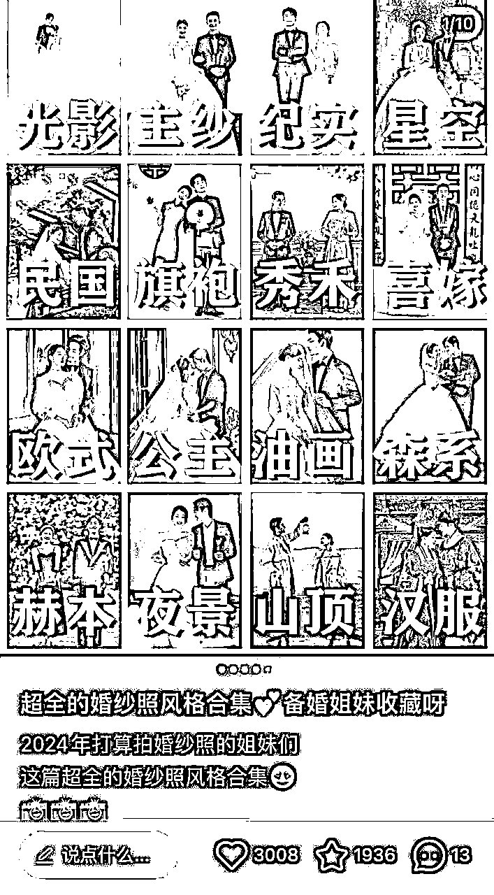

#### 标题

标题里尽量埋关键词，方便被搜索到。常用词有几类：

1. **地区词**：如“上海婚纱照”“惠州婚纱摄影”。有地区属性的行业，这个一定要加。

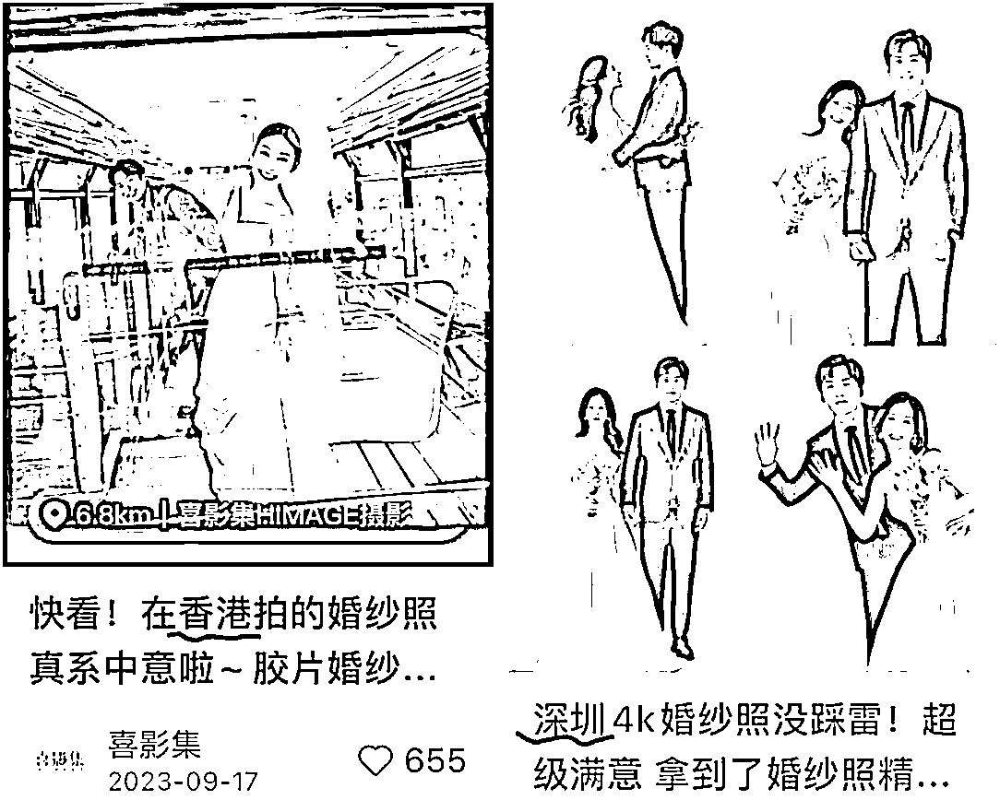

2. **风格词**：如“中式婚纱照”“喜嫁婚纱照”。

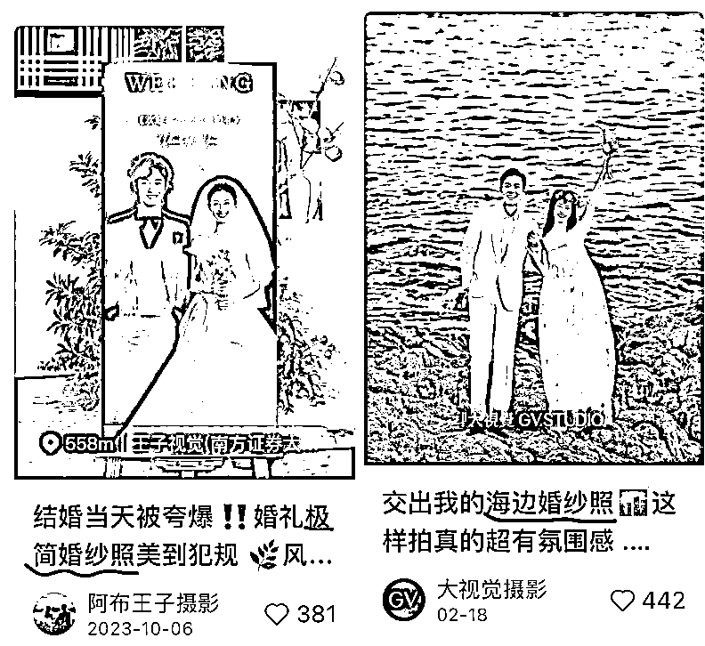

这些都是用户高频搜索词，能加尽量加。如果要投流，聚光后台还可以做标题优化，能省不少事。

#### 封面

婚纱照封面，突出最大亮点就够了。

比如：

- 单人女生照，挑氛围感强、好看的做首图

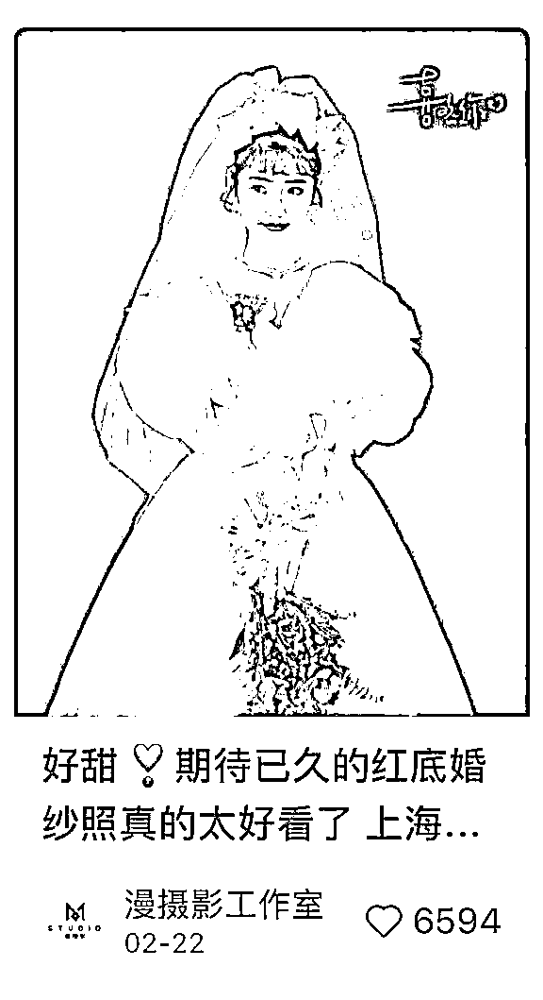

- 两人半身图，选互动性强、幸福感明显的，还能看清妆造

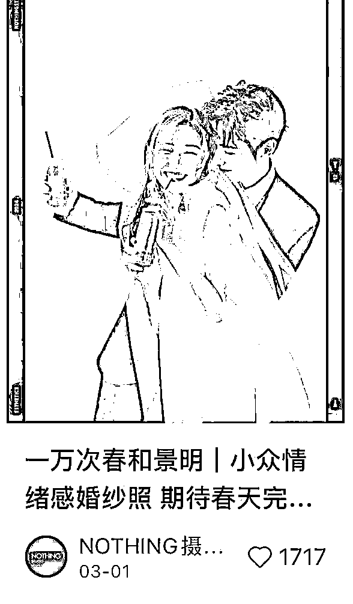

- 两人全身图，背景要干净，画面要有整体氛围感

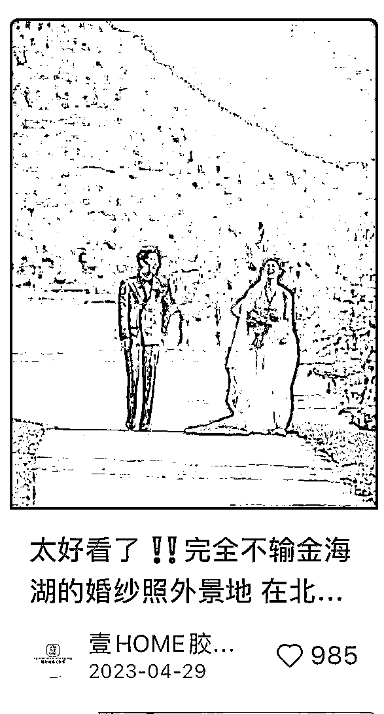

聚光也有封面优化功能，但如果封面本身很精致、其他图一般，就别开了。封面优化更适合封面和内页图差别不大的情况。

#### 文案

每个行业写法有差异，但有些通用路子：

1. 从品牌角度讲研发思路：为什么这么拍？
2. 从产品角度讲风格意境：给用户选择的理由
3. 从客户角度讲适合人群：什么人适合拍？
4. 从故事角度讲定制能力：能为客人做到什么程度？
5. 从引流角度留钩子：主推热门套餐

## 五、聚光 + 达人投放怎么做？

广告投放我们只做聚光和达人种草，不碰薯条。预算大致这样切：

- 全站智投：50%
- 信息流：30%
- 搜索：10%
- 达人：10%

不是固定的，随时调整。逻辑说一下：

1. 测来测去，只有全站智投成本最低、效果最好
2. 搜索流量精准，但量有限，竞争还大
3. 数据一般的笔记，先投产品种草拉互动
4. 达人只是分摊风险，不是重点

### 全站智投怎么搭？

先筛选笔记，符合这几点才放进计划：

- 不投流也有点击和互动
- 评论区有人在认真讨论产品
- 不投流也有人来咨询
- ……

把符合要求的笔记ID都收集起来（笔记ID就是每篇笔记链接后面那串数字）。

新账号不用筛，直接建计划就行。

建一个全站计划：

1. 选“客资收集”，目标可以设“私信开口量”或“私信咨询量”“私信留资量”
2. 把所有笔记放进去一起赛跑，跑3～5天
3. 消耗快但没效果的，关掉
4. 效果好、成本低的，单独拉出来加预算再投
5. 定向太窄导致成本高，就放宽人群年龄

### 信息流怎么投？

把全站跑出来的优质笔记，重新建信息流计划。前面操作差不多，重点在人群圈选。

如果产品适合所有人，就通投。没经验就选智能定向。想要更精准，就高级定向。

我们一般选高级定向，圈这几类：

1. 平台精选人群（比如瘦身人群、520送礼人群）
2. 婚摄相关兴趣人群（可以加上家居家装、婚嫁服务、酒店旅游）
3. 关键词行为：婚纱摄影、风格套餐、高点击词、同行品牌、地区定位等
4. 按市级投，结合实际逐步测试年龄、性别、地区

最后打开“智能扩量”。

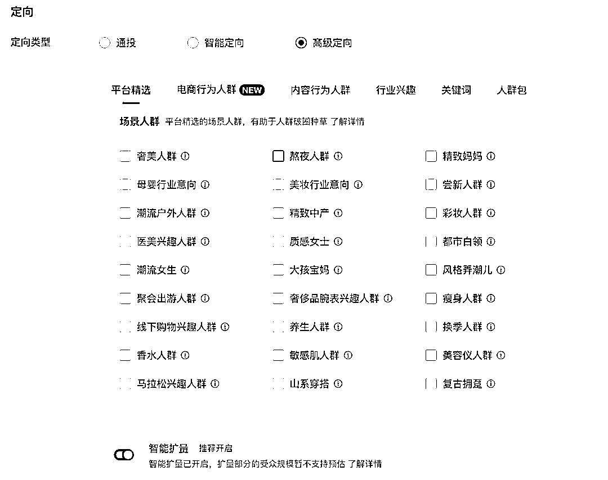

信息流人群按行业调整，核心人群+相关人群全选上，跑不出去再放宽加边缘人群。

### 搜索广告怎么投？

按理说搜索流量比信息流精准，但我们投婚摄行业时，搜索成本反而更高，用户比价也厉害，所以没把它当重点。

不过思路可以分享：

关键词选1000个左右，别太少也别太多。太少投不出去，太多人群容易跑偏。

一般只选“主关键词+相关词”。

主关键词包括：

- 品牌词：如“惠州婚纱照”“婚纱照”
- 品类词：如“惠州备婚”“深圳备婚攻略”
- 竞品词：如“旅拍婚纱照”“铂爵旅拍”（随便举例）等

再搭配相关词：

- 需求词：如“惠州婚纱照哪家好”
- 长尾词：如“惠州婚纱照风格”
- 间接相关：如“婚纱照前攻略”
- ……

旺季预算充足想冲声量，可以追加“抢占赛道”，把笔记送到关键词搜索前排第一或前三。这个很烧钱，关键词一定要少而精准。

### 达人投放怎么做？

婚摄行业一般是找本地达人探店，这部分不是核心，简单讲讲：

1. 每月约3～5个达人
2. 提前沟通好素材和肖像使用权，一定要确保能商用
3. 投放数据好就追加效果广告加热
4. 达人素材拿来官号转载或二创
5. 投放时设置好私信组件，方便引导咨询
6. 除了KOL，也会投一些KOC，创作能力一般的就合作素材代发

## 六、KOS + 内容矩阵：弯道超车的关键

前面这些常规操作大家都懂，真正拉开差距的是矩阵。

主要三类：

- KOS主理人+员工号矩阵
- 伪素人矩阵
- 客户好评种草

### 主理人矩阵怎么运营？

本质就是打造IP，突出专业身份和业务范围。一个企业号可以关联3个主理人，如果有“员工账号”功能，还能关联更多。

人设方向参考：

- **员工人设**：从员工视角切入产品，比如“在XX公司上班是什么体验”
- **品牌虚拟IP**：像旺仔、雪王那样，虚构一个品牌形象
- **创始人设**：分享创业经历、品牌故事、愿景，让用户既认可人又认可产品
- **小编人设**：最常见，以小编口吻写营销内容
- **岗位人设**：摄影师、化妆师、设计师、客服、旅行体验师等

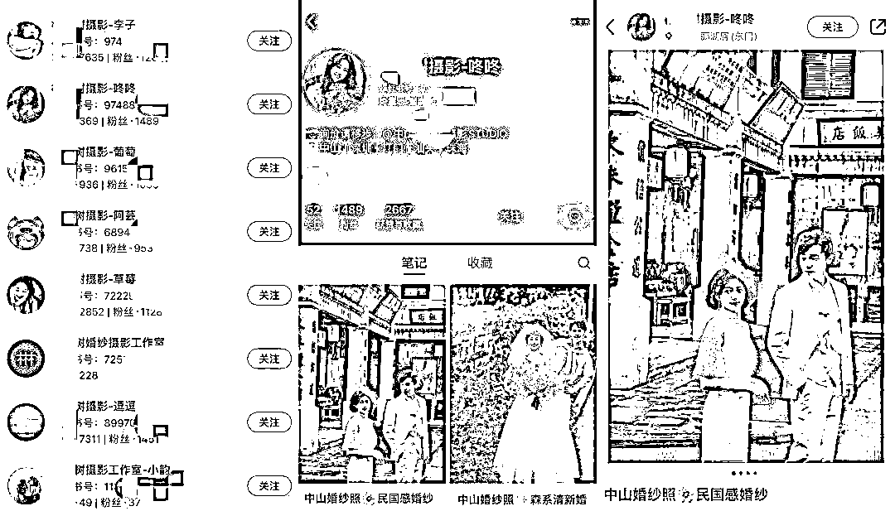

人设形象这样搭：

- 头像：突出专业身份或服务，真人头像更有说服力
- 昵称：品牌名+职责，比如“XX婚纱摄影主理人”
- 简介：@官号联动，写清楚账号价值和内容方向
- 内容：结合工作日常，突出品牌优势，可以更新专业知识、测评、品牌故事、实力证明
- 定位：笔记定位到门店地址
- 标题：同样带上搜索关键词，比如“XX地标+婚纱照”

### 伪素人矩阵怎么做？

前面调研过用户的消费路径，很多人在下单前都会刷“真实推荐”和“测评”，尤其喜欢看评论区里别人怎么评价。

所以我们就做了素人号矩阵，内容主线是这样的：

1. 先发日常吃喝玩乐，蹭热点涨正常权重
2. 发一些备婚相关笔记（可省略）
3. 发“求推荐婚纱照”的笔记，可以顺便求推荐其他备婚内容，显得更真
4. 让同行在评论区留言，先不处理，保持自然
5. 发布探店笔记，说最后选了某某家，包括环境、试纱、花絮
6. 最后安全下车，发成片，表示没踩雷

发完这最后一篇，素人号的任务基本就结束了，后面继续发点日常和问答就行，不用太用心。

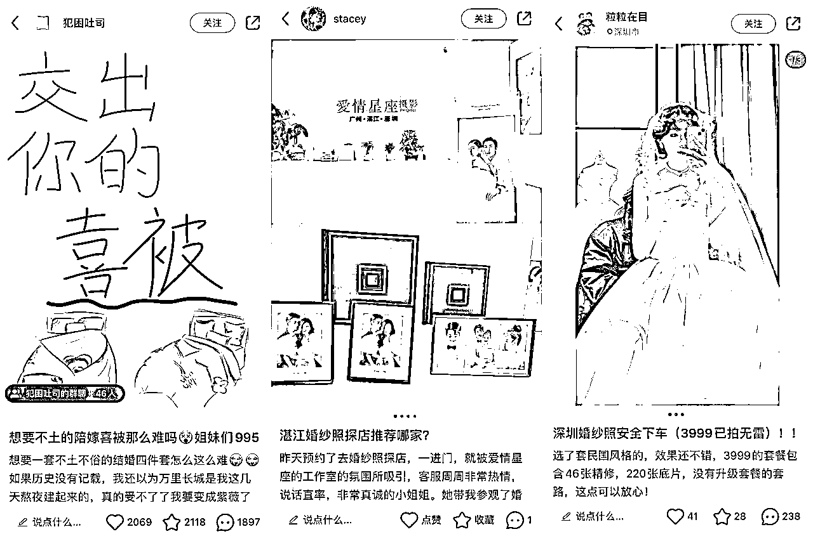

运营重点：

1. **账号数量**：不低于3个，太少没效果
2. **起号**：保证账号浏览正常、没违规限流就行
3. **内容铺垫**：前期可以发些容易引发讨论的笔记，比如各类求推荐、夸张话题
4. **婚纱照内容节奏**：前期发妆造、妆后自拍、拍摄花絮；中期发成片合集和好评感想；后期按风格分享成片，讲为什么选这套
5. **建立信任**：全程站在真实客人的角度，人设要热心、有共鸣。就算最后推荐，也只说“可以对比了解”，把选择权交给用户
6. **引流方式**：笔记@官号（量大有风险）、建员工号@客服、评论置顶引导（比如“不一一回复啦，我是@XX定的，想了解的姐妹可以去看看”）、有人咨询就推荐官号名片

### 客户好评种草怎么玩？

服务好所有渠道来的客户，引导他们发真实笔记，这比伪素人号更有说服力。

分享主题参考：

- 第一篇：门店环境、服务态度、试纱体验
- 第二篇：妆造效果、拍摄花絮
- 第三篇：成片分享、安全下车、引流到品牌

数据好（比如点赞收藏达标、有真实用户咨询），可以给点费用帮他们投薯条，增加曝光。

当然，用户不会白写，适当给费用就行，具体金额看行业行情。

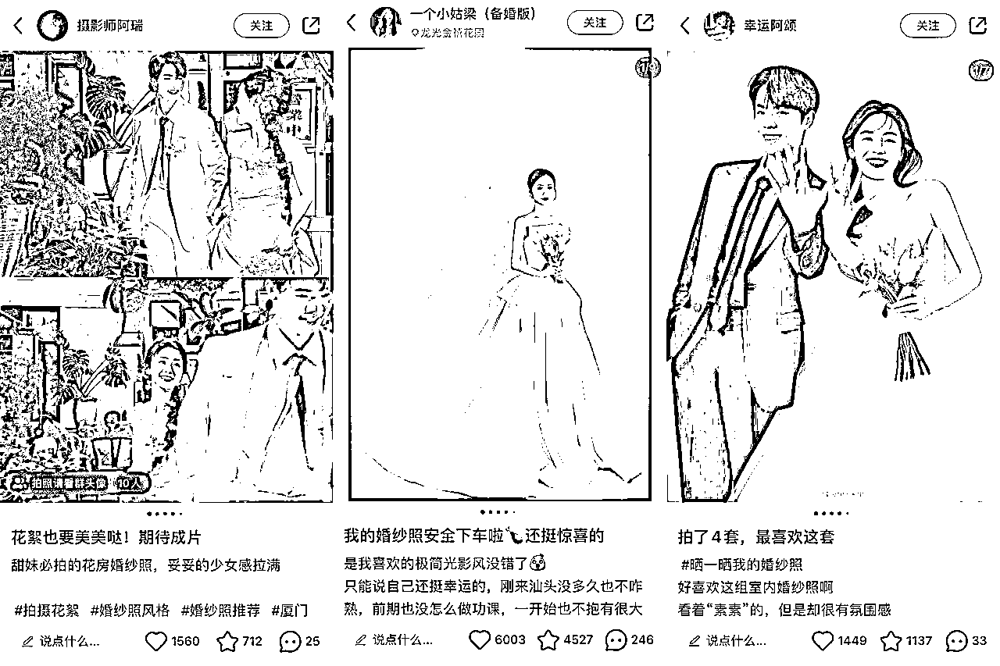

大部分用户其实不会写内容，所以如果做客户好评种草，有两个建议：

1. 做一套完整SOP，教他们怎么拍、怎么修、怎么写标题和文案
2. 直接写好文案和笔记，让用户代发

这套玩法几乎是无保留分享，适合绝大多数决策成本高的行业。拿来就能用，跨行业也通用。

-END-