# 航海教练亲述：TikTok美区卖货千万后，我整理了一套轻资产入局玩法

嗨，我是龙哥。当初靠一台手机起步，先做服务商，再切到店群铺货，半年时间在TikTok美区累计卖出上千万；上一期TikTok美国小店航海营，我是教练。在赚钱的线下聚会上，听到Serena的分享，回到公司后发了3篇📕笔记，直接成交了10万。过去半年我发过两篇帖子：一篇聊线下聚会带来10万+变现的经历，一篇讲跨境小白怎么入行TikTok赚到100万。今天这篇，专门拆解“TikTok轻资产入局”，相信对准备出海的老板也有用。

## 一、先看清这波趋势

先说美区。资料店模式已经彻底走进死胡同。入驻商家越来越多，平台接连封店封号，不合规的玩法基本被清理干净。下一波机会，大概率在即将开放的墨西哥、巴西、德国、西班牙等42个新市场。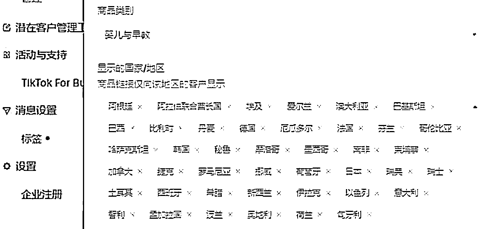

把时间拉回几个月前，铺货模式最舒服的窗口期是10月份之前。那时候只要选好品、第二天上架，就能出单；不违规，仿牌也能卖；几百万粉丝的网红愿意免费带或低佣金接单；从国内直接发货，大学生拿1万块都敢进场。可惜这个红利期已经过去。现在门槛变高了，反倒对两种人更友好：一种能搞定美国身份资源，一种亚马逊单店做到200万美金。这类人正好赶上合规入场窗口。

那现在到底是谁在赚钱？去年那种刚毕业、不会选品、不会英语的运营，靠无脑上架就能日出几千美金的日子，已经翻篇。年后我们自己的TikTok业务一度停滞，店群和矩阵账号被封，几百台手机闲置，流动资金冻住了一部分。后来我走访了一批TOP卖家，美妆、家居、3C类全都在扩张团队。总结下来，核心就一句：基于供应链做深度的广告投放，也就是达人、短视频和素材。

自营团队要走向合规，配置可不低：租一个美国身份真实店铺，2-3万租金加3-5%销售额抽点；测品阶段做3-5种短视频脚本，买100美金广告折扣户直接投放；测试几款后，空运、海运各备一批到美国；还要给达人寄样，预留平台周转资金；人员上至少3-5人，运营、投手、达人BD、仓储，有的公司还配主播和短视频团队。一套跑下来，二三十万是起步价。如果是投资人来做，账面没有100万别轻易碰；自己干的话，得想想哪些环节能省。

费用大头就两块：人员工资和物流备货。如果只卖供应链现成货盘，有店铺加短视频素材投放就行，但利润极低。我们为了让新店出新手村，卖亚马逊大卖海外仓的灯，一单只赚2美金，对接发货还各种问题，对方美国海外仓配合度很低。

## 二、轻资产切口藏在达人建联里

当航海教练以后，很多圈友来问我，都是想低成本先看看。美国听证会结束后，我早前卖店铺时写的📕、抖音视频虽然是老内容，却持续带来流量，又涌进一批新人。于是我开始琢磨：怎么让大家低门槛入场？去年我分享的模式，现在显然不行了——资料店被限制，真实店铺成本2.3万，还不算其他支出。

正是在找网红推广时，我看到了一个轻资产切口：不少达人开口就要上万费用，还要抽点。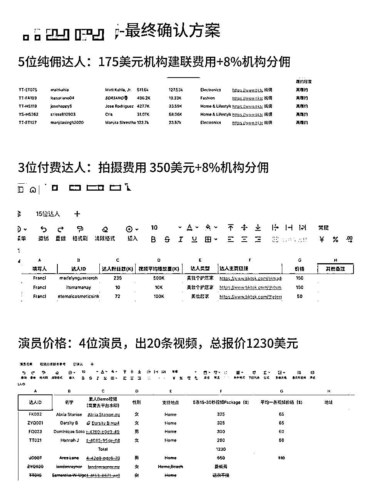

后来我去BOSS直聘上看，达人建联岗的薪资普遍开到上万，小店运营也要求会达人建联——这说明该岗位创造的价值远高于工资。市场调研后，我看清了三种合作形态：

1. 自己本身就是卖家，在卖货中沉淀了达人资源，然后服务新卖家，收建联费和佣金；
2. TAP机构，把签约网红挂在自己旗下服务第三方，佣金先进机构，再用联盟定向给达人，省掉很多结账麻烦；
3. 从亚马逊、独立站时代走过来的代运营公司，因为独立站没自然流量，本来就要找网红推广来产素材带动销售，手头有一批耐心的品牌方，现在直接加上TikTok服务板块。

## 三、实操：从手工到自动化

第一步是手工试跑。我招了个员工，后来发现是个水货，直接开掉。于是自己下场走了一遍：先到TikTok数据后台一个一个找邮箱，第一天3小时发了131封，但因为没有管理数据，达人回复后我都不知道谁是谁。邀约话术是找几个卖家要来的模板，再用GPT改了几个版本。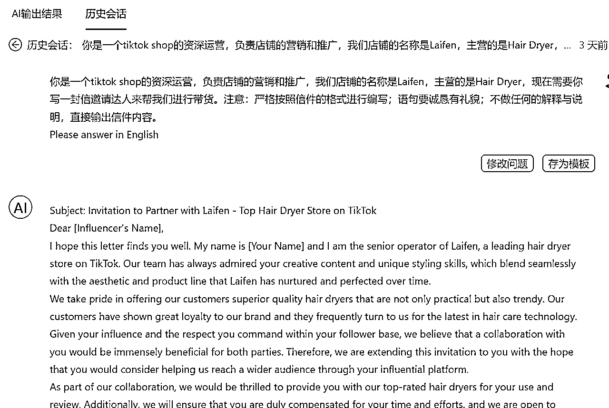 提示词就用AI模板生成，有了思路后让GPT反复改十几版就行。美国达人特别热情，正反馈来得很快！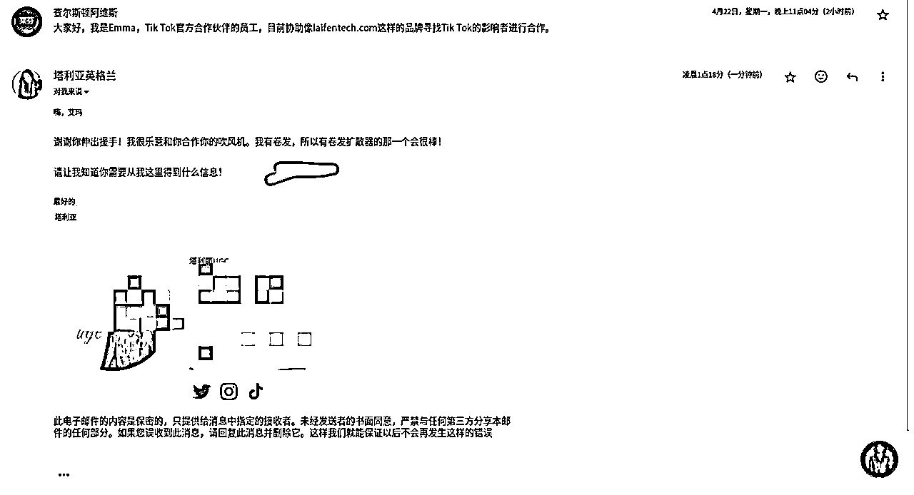 很多几十万粉的达人，只要一个吹风机样品就愿意合作。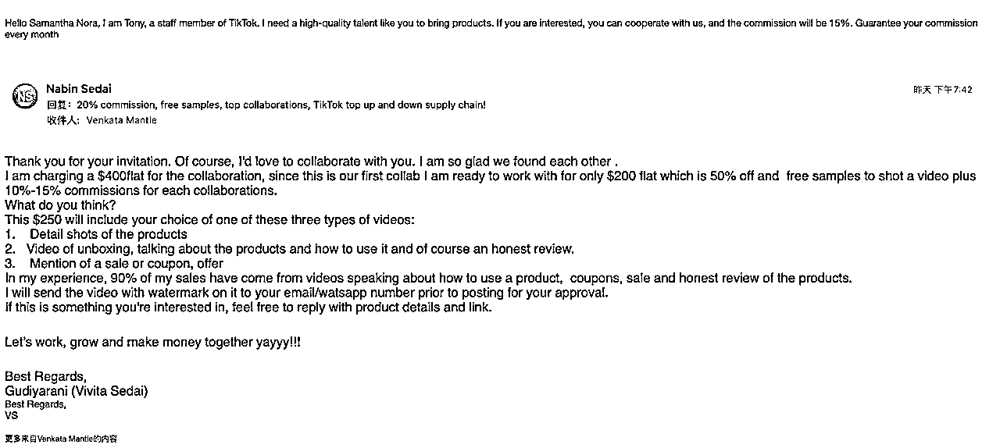

第二步上工具。我把达秘、花漾、达卖这些市面工具都买来测，发现都要绑定店铺才能用。后来买了邮箱建联模式的MossCreator，效率确实高了，但价格不低：试用版399元发2000封，续费从几千到大几万。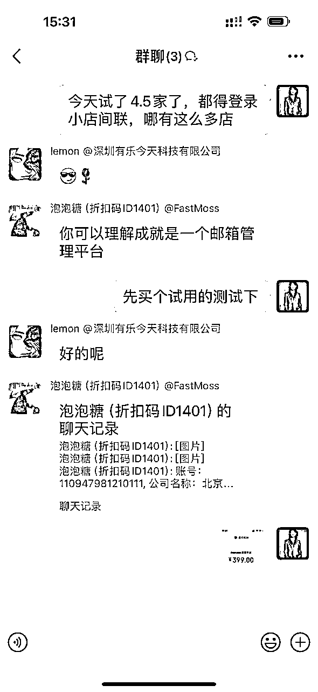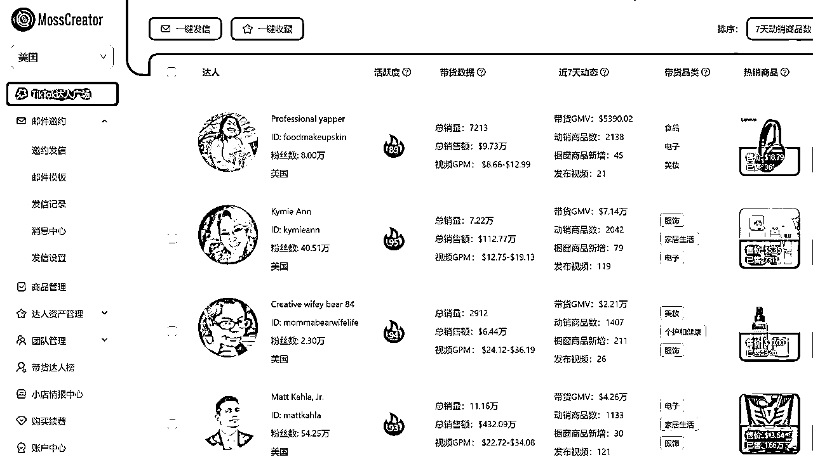 这时候📕粉丝量帮了大忙——EohoTik选品平台来找我推广，本想给150块广告费，我没要，换了个价值1500的最高级会员，直接导出了1万个达人邮箱。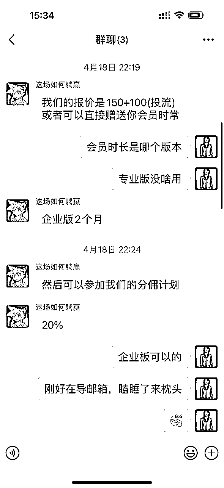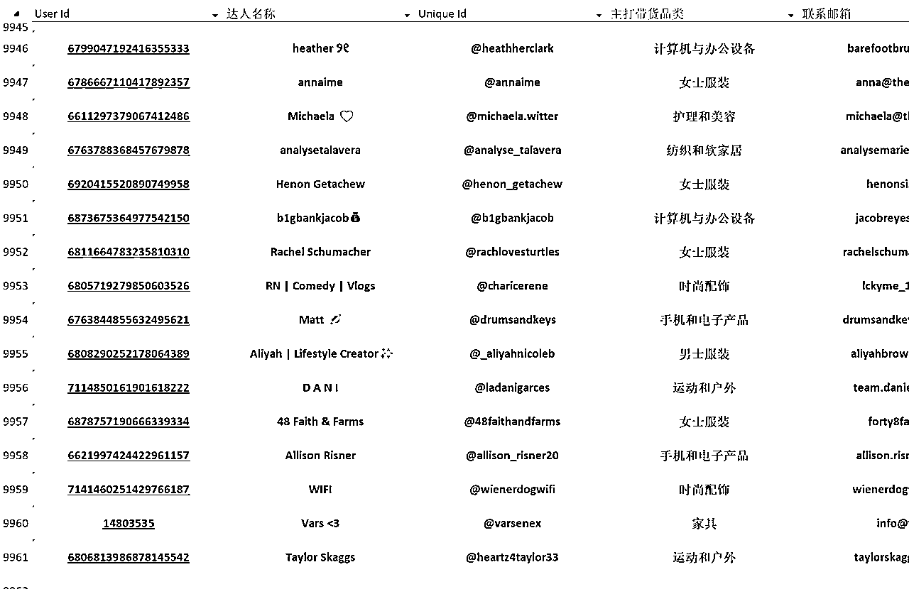 不过导出1万条后，再想拿更多信息就要额外付费了。

第三步搭自动化。数据量上来后，我就想怎么提效。找到赚钱圈友、海外工具站教练良辰美，跟他一起设计了一套工具方案。他之前在赚钱发过精华帖，讲1000个以上真实收入产品的核心，就是做出让龙哥愿意付费的产品和服务。我们隔天就冲到东莞，聊到深夜，写满了一沓打印纸，才把方案定下来。凌晨开始搭RPA，2点成型；吃饭的功夫，用无线网卡加笔记本自动发了200封邮件，第二天回复率10%。接下来我们只需要回复第二封邮件，把需求导入WhatsApp聊对接样品就行。有了这套RPA，后面只需要一个聊单跟进的人；话术库建好后，还可以结合GPT持续优化。多组局、多聚会真的有用，圈友给一个思路，项目就进入成熟期了。良辰美去年9月参加我的线下组局，当时就聊过开发拆件和自动化工具怎么和TikTok结合，后来我们又单独聚了几次。

第四步，把自动化搬进小店。0到1跑通后，我很喜欢这种把琐碎重复交给机器人的感觉。真心建议老板们自己搭一次RPA，我去年店群模式成熟时是找技术搭的，体感完全不够。平台导出的邮箱一天就发完了，数据量跟不上；闲鱼买的数据精准度未知。于是我们把原来的资料店重新激活，围绕小店做数据采集、小店触达，省下几万块软件费。

第五步，跑通业务闭环。达人库初步成型后，我开始找外部合作，也想看看有没有更优玩法，结果谈合作时又拿到新思路。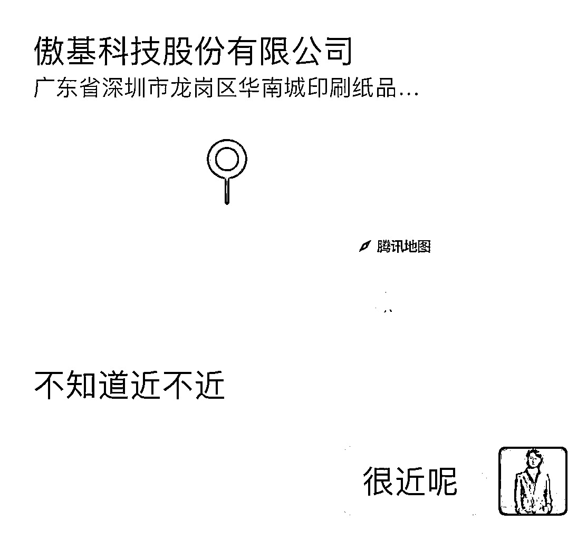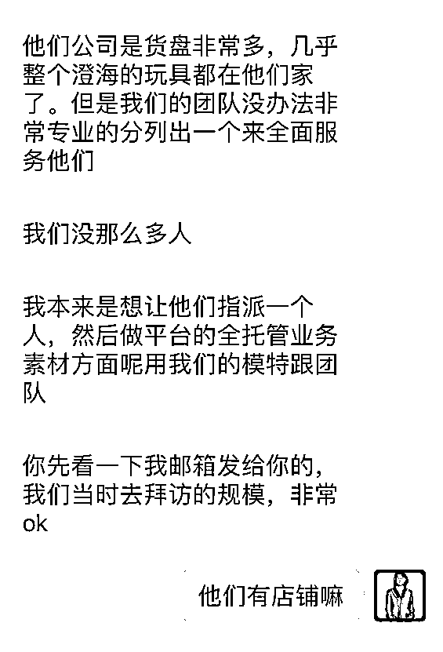 有家没店铺的玩具头部供应链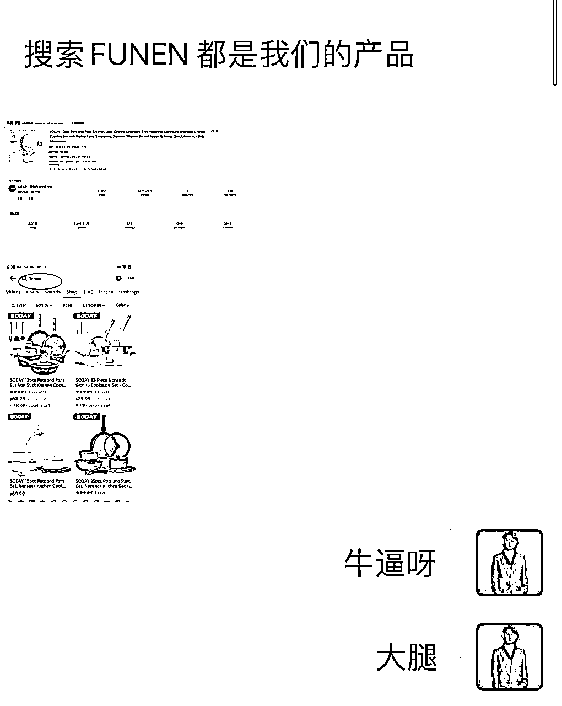；还有一个20亿体量的大卖，在寻求TK小店合作。一家独立站代运营头部公司，分享了他们内部在用的邮箱触达工具，只要配好域名、定时发布，有足够精准的人群邮箱，理论上一天发1000万封都没问题。另一个品牌商则是在Meta、YouTube上抓取关键词数据，其中邮箱能占到90%，WhatsApp约30%，专门做TOB订单，没碰过电商平台。两套东西一碰撞，我意识到它们能完全结合！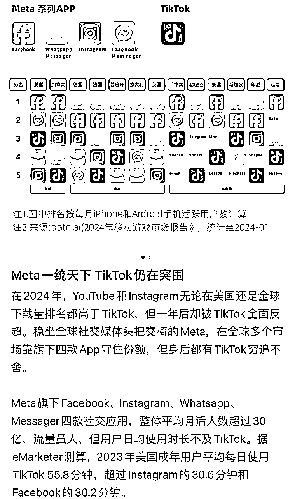 当场拉了圈友，隔天采集4200个邮箱，引流独立站，客单价1000块，成交20多单。做完这些，真有任督二脉打通的感觉：获客渠道和触达方式都齐了，外贸获客、独立站引流、小店达人推广全都能做，服务商业务也有了更大的想象空间，可以真正给卖家提供价值。

第六步，一张价值10万的达人建联流程图。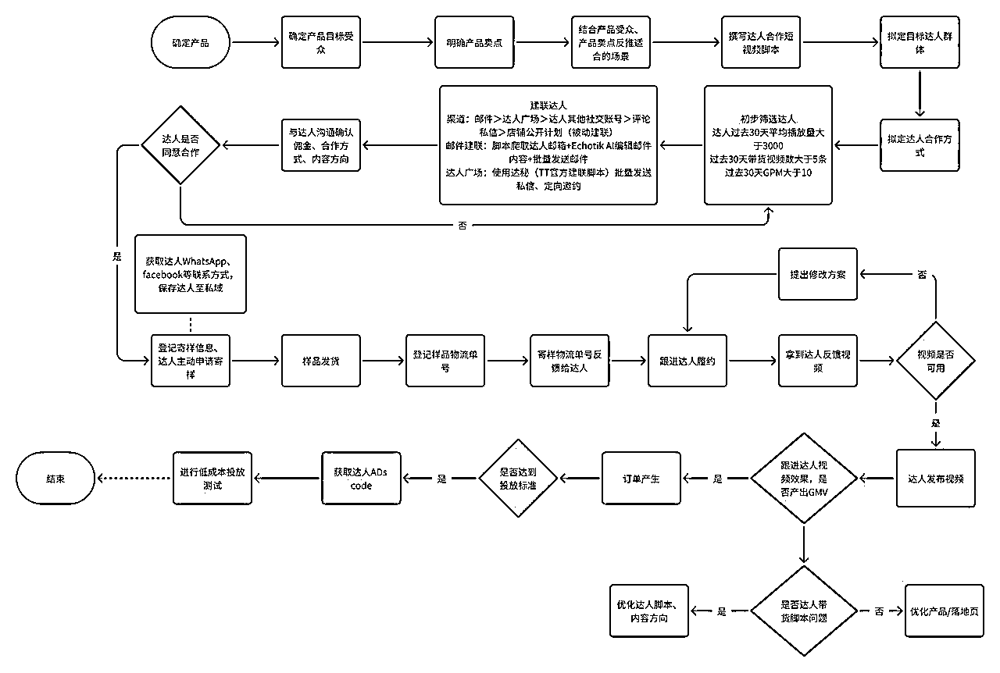

## 四、几个值得反复思考的点

先说国内外差别。通讯上，国内都在🛰️里，邮箱基本不看；海外普遍用WhatsApp，只要采集到账号，企业版就能直接联系，邮箱使用率也很高。达人心态上，美国达人以及马上开放的5个新市场的达人，很多百万粉只要喜欢你的样品就很开心，没什么前置费用。利润上，国内抖音生态其实有对标，像热度、艾美、尚博这些，只做达人模式就能发展成几百人公司，再延伸出达人私域、培训、品牌方前置服务费等等。但海外的利润率比国内高几倍，一来汇率有优势，二来品牌方为了做市场，主动提50%分佣的比比皆是。

再谈合作。项目合作上，我报过很多课，但赚钱算是最好的老师——遇到问题就把它当百度搜；线上找不到答案就组个局，线下链接，集体智慧很神奇。圈友也是最好的合伙人，没有沟通成本，思路比钱重要。品牌合作上，达人建联业务不排他，我自己也是商家，找了好几个达人机构合作，大多数机构既要收单达人的建联费，又要佣金，还要前置费用，单个达人收费几十上百美金。我这边选了纯佣模式，先帮企业创造价值，赚增量市场的钱。分销模式上，从去年一起干店群的合伙人里挑几个，跟着我们同步迭代。目前是3个工作室加自营团队一起跑核心技术；我们负责技术迭代和品牌方合作，看大家能不能都拿结果。后续如果跑通，考虑用知识付费的方式做招商代理。

跨行业找思路也很重要。TikTok太新，跨境又太大，在TK同行里找不到方向时，不妨看看Meta、独立站、国内抖音，那里有很多成熟玩法，最低成本试错就行。比如美区航海时，0播放、低播放怎么破？同样的内容发到ins、YouTube就能轻松过万播放。所以有人干脆建独立站，一台手机登录3个平台6个账号引流，不再被单一平台绑架。比如美区真实店铺成本高、资料店又活不长，谈好的店铺迟迟搞不定，有人转去申请MCN机构，做到月销几百万美金，且平台机构还有不少报白机制。比如美国区的橱窗功能容易掉，有人跑去测试25国卖家，把引流卖虚拟产品、私域卖复刻的路径跑通了，再杀回美国市场。

最后是持续迭代。上次聚会听圈友说，他把公司300多个流程梳理出来，用RPA能减少一半人工，让人去做更高价值的思考。我们也在学习这一点，不断挖掘能结合的技术。下一步准备把我们团队在跑的开店、短视频也自动化，比如店铺注册、矩阵短视频剪辑这些重复劳动，全部梳理出来一一完善。流量获客上，要把网红营销公司放大。去年我们有30个小号在📕、10来个号在抖音获客，店群卖货后发得断断续续，现在要把流量捡回来。落地清单：买了赚钱SEO航海工具，批量导出口播文案，然后用GPT去重，把人设号的流量拉起来；五一假期学了GPT航海，已经实操了一些，再结合工具做内容；同时研究7秒视频号流量体，打算做矩阵放大模型。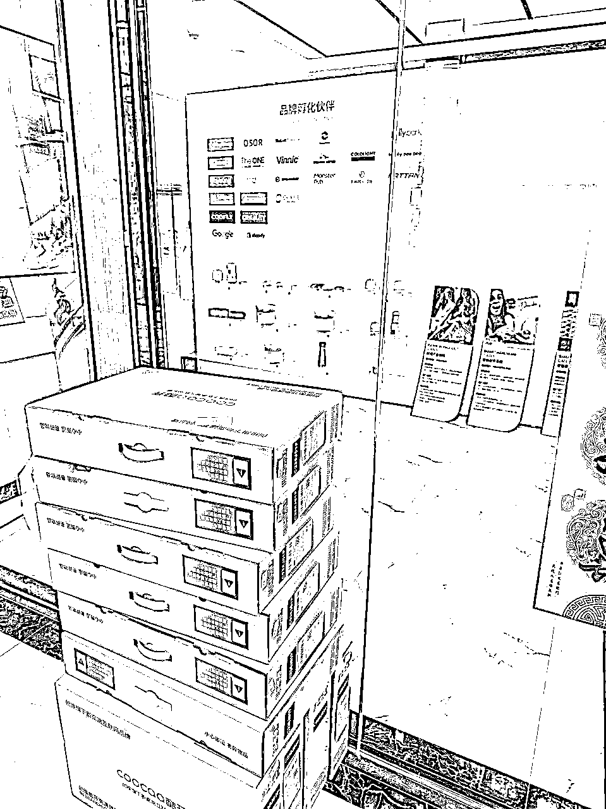 五一假期我还加了工位，10台电脑、50台手机都在跑。

有了自动化意识，公司几个核心环节我需要再走一遍，找到能优化的点。希望每个人都能在龙哥盟找到适合自己的项目！我会持续更新TikTok出海的最新玩法。