# 👸号爆文自动化，7个月赚了37万（全复盘）

大家好，我是毛韩，龙哥盟第5期圈友，编号21985。之前发过两篇精华帖，今天想借这个场合，和朋友们完整复盘一下我的👸号爆文项目。写这篇文章有几个原因：一是这个项目对我来说已经暂时告一段落，二是受到好友@阿泽复盘帖的触动，三是想把自己的得失总结一下，也看看有没有合作机会。

下面我会分三部分来讲：项目各阶段的思考、踩过的坑和错过的机会、以及后续打算。

## 一、从几百块到月入13万，我经历了什么

### 2023年9月：只赚了几百块

当时我上一个项目有点灰色，一直想找一个正规项目踏踏实实做，顺便验证自己的方法论。正好8月航海报名了👸号爆文，结果第一个月只赚了几百块钱，具体数字都记不清了。我心里很不服气：别人能跑出来，凭什么我不能？

### 2023年10月：赚到第一个五千

一次偶然听到雷军演讲，他说“99%的人都有解决方案，找个懂得人问问”。这句话点醒了我。于是我报名了教练妞妞的训练营，更系统地学了GPT的使用。也是误打误撞，我做的法律领域赚到了第一个5000元。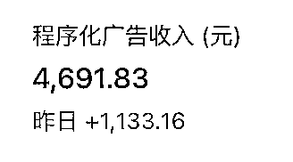

但好景不长，这笔钱到账后账号就半死不活了。当时我手里已经增加到5个号，几乎都没产出。我一直觉得是AI生成的内容质量不行，天天调指令，结果越调越离谱，不但没达到之前的爆文标准，反而连一篇爆文都出不来了。我知道肯定有问题，但就是找不到关键。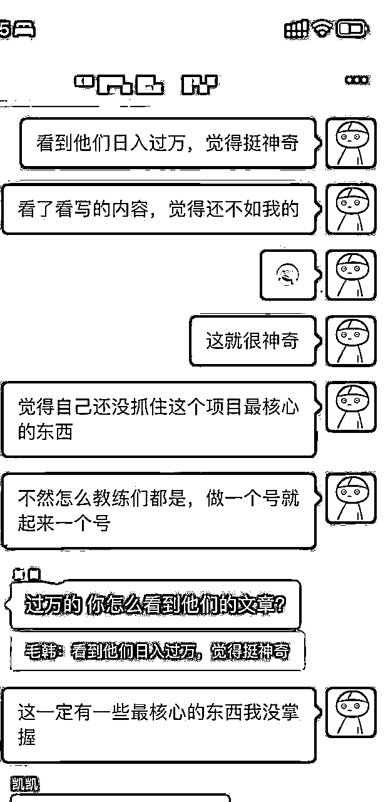

既然自己不懂，那就再找人问。

### 2023年11月：第一次过万

因为流量主业务，我联系上了圈友@不二，一聊天才发现5年前我们就交易过。在知道他也做这个项目后，我直接付费请教。这次咨询让我真正明白：领域比内容重要得多。道理听过很多次，什么蓝海、什么少竞争，但真正执行时就忘了。

之后我模仿不二做小众领域（具体领域暂时保密），一共注册了10个号，其中一个号单月赚了5000多，加上原来法律号的收入，第一次过了1万块。

### 2023年11月：自动化的开始

单号问题解决后，我的账号已经超过30个，继续手动做太浪费精力。因为我有3个月程序员背景，第一反应是用Python来生成文章。但熬了两天一夜，乱码和字数不够的问题始终搞不定，只能先放一放。

后来我了解到RPA，直接用RPA+GPT网页版做了自动生成脚本，又找了个兼职来发布。这样算是半自动了，但兼职成本不低。当时月收益保持在1万+。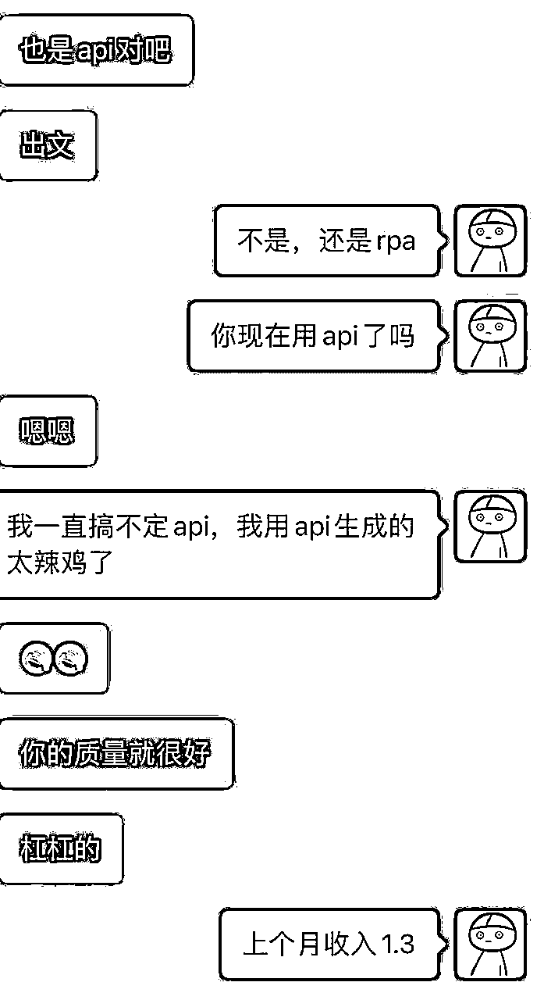

### 2023年11月：把发布也自动化

赚钱说到底就是两件事：提高收益、降低成本。当时用的是GPT网页版，它总爱多输出一些解释性文字，而且每篇都不一样，兼职只能逐篇润色、添加图片，这笔成本省不了。所以我就先把发布环节做成RPA，把兼职成本压到每篇0.5元。

这条流程大概是：先通过极致了API监控对标账号，把素材导入飞书；再用RPA从飞书取链接生成；然后百度网盘同步到兼职电脑，润色后保存；最后用另一台电脑RPA发布。我还额外写了个RPA，把👸号发布的文章同步到头条和百家，一份内容吃多份红利，这操作帮我赚了3000块，但也为后来埋了雷。

### 2023年12月：全自动化跑通

账号到了100个左右，兼职成本越来越高，GPT网页版还限每小时45次对话，RPA一故障当天就完不成任务。我又想起了用Python直连OpenAI API。这次我发了一圈红包，也找了淘宝、闲鱼的程序员，全都没搞定。直到有一次偶然调了一下“温度”参数，乱码竟然消失了，还一次成文。我又通宵了几天，终于把生成脚本跑通。

这期间@阿泽在群里问能不能自动插入原文图片，我试了一下，还真行。就这样，兼职彻底被解放，全自动化流程成立：极致了API采集→Python+OpenAI生成→Selenium自动抓图、裁剪、去水印→RPA自动发布。而且所有参数都支持在飞书里实时修改。

### 2024年1月：素材源从易撰转到头条

账号超过150个后，易撰素材库明显不够用，它收录的数据太有限。我又去请教@不二，转战头条找对标账号。因为以前做用户增长，我有习惯在前端就把数据体系搭好。分析之后发现：80%的爆文都来自头条，而不是易撰或👸号。于是我把易撰和👸号素材直接砍掉，自己手动在头条上挑了500多个对标账号，用Python实时盯发文，满足条件就进池子。

### 2024年2月：发现真正的优势是“快”

那阵子我反复想自己的优势，但从人生维度想不通。后来和几个做👸号矩阵的人交流，发现我的生成和发布速度是别人比不了的。我的流程是：Python抓头条→筛选入库→生成→另一台电脑影刀RPA不间断发布。而很多同行要么手动导入易撰链接，要么生成后还要人工润色，速度根本跟不上。

再做数据分析时我更确定了：我的10w+、100w+大多是社会热点类。热点类极度依赖时效，手动导入的慢了就废了，实时监控+人工润色的又发布太慢。我就这样用自动化钻了空子。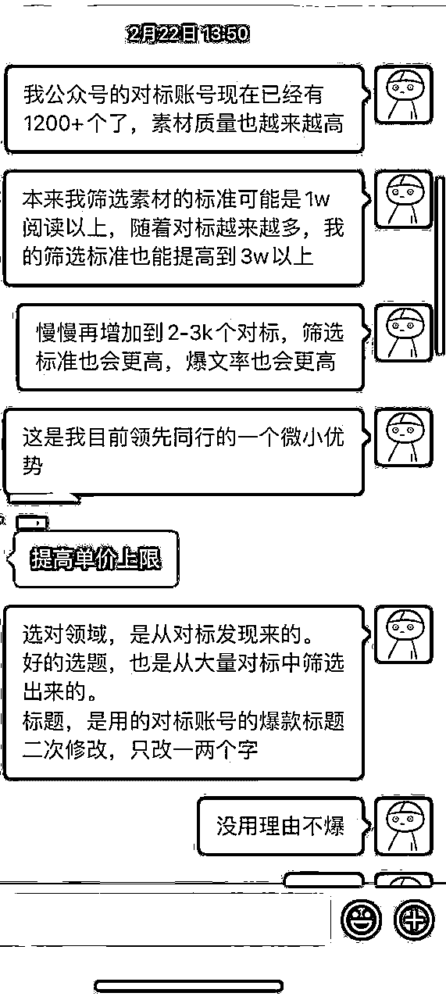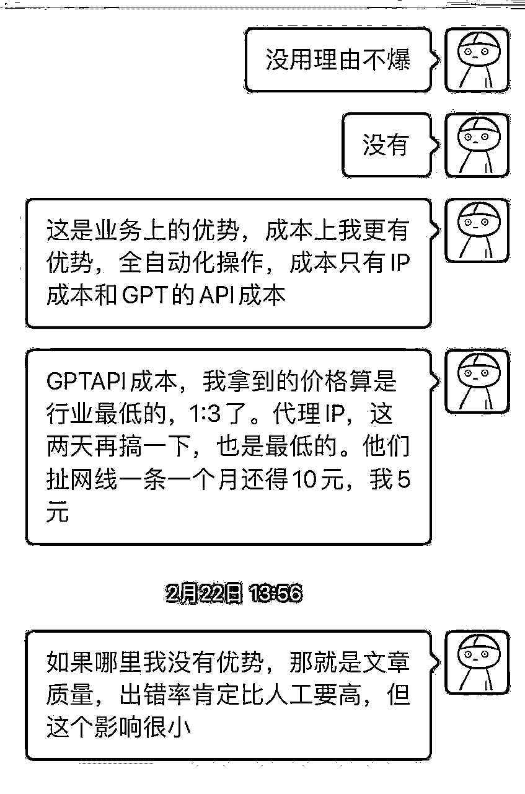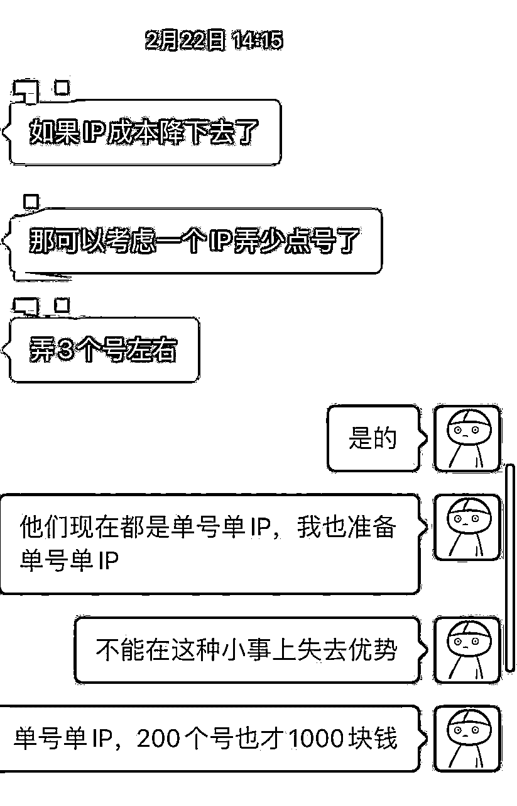

于是我把优势放大：筛选标准从“12小时内阅读量2000”直接提到“3小时内阅读量1万”。标准一高，素材量就不够了，我只好手动在头条加关注，一口气加了3000多个对标账号，现在已经是4000多个。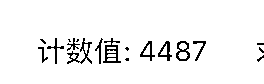 我的账号领域也从偏非实时，转向社会热点、科技、汽车、体育这些强时效方向。

### 2024年2月：两个爆发点

第一个爆发点：我观察到有些对标账号同一天发好几次，文章还能篇篇爆。于是我在代码里加了自动多发功能，最高单号一天发了120篇，还会根据前一天的收益自动调整当天的发布次数和篇数。这个功能上线后，当月收益直接冲到13万+。

第二个爆发点：有次RPA出Bug，同一篇文章在同一个账号上发了7次。第二天我看数据，发现7篇里有3篇破了10万阅读，当天这个号赚了1.1万。我连夜做了爆文重发功能，这个功能后来帮我多赚了约5万。

### 2024年4月：按下了暂停键

从2月开始，我没有再迭代项目。4月因为搬家，大半个月没管👸号，收益明显下滑。和一些朋友聊，发现大家也都在跌。到了5月，收益已经只能覆盖成本，在没有新玩法之前，我决定先暂停。

从去年航海到现在，项目整体毛利37万，去掉各项成本，净利大约30万。我平时不爱晒截图，只找到几张当时发给朋友的。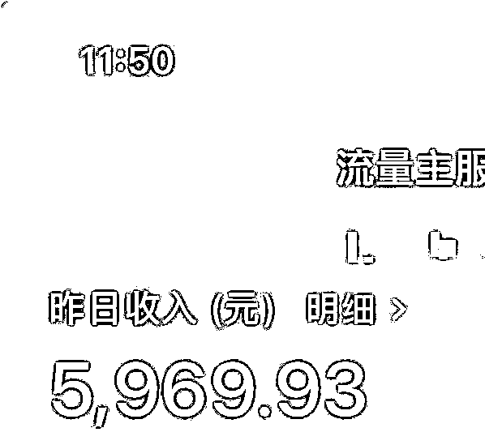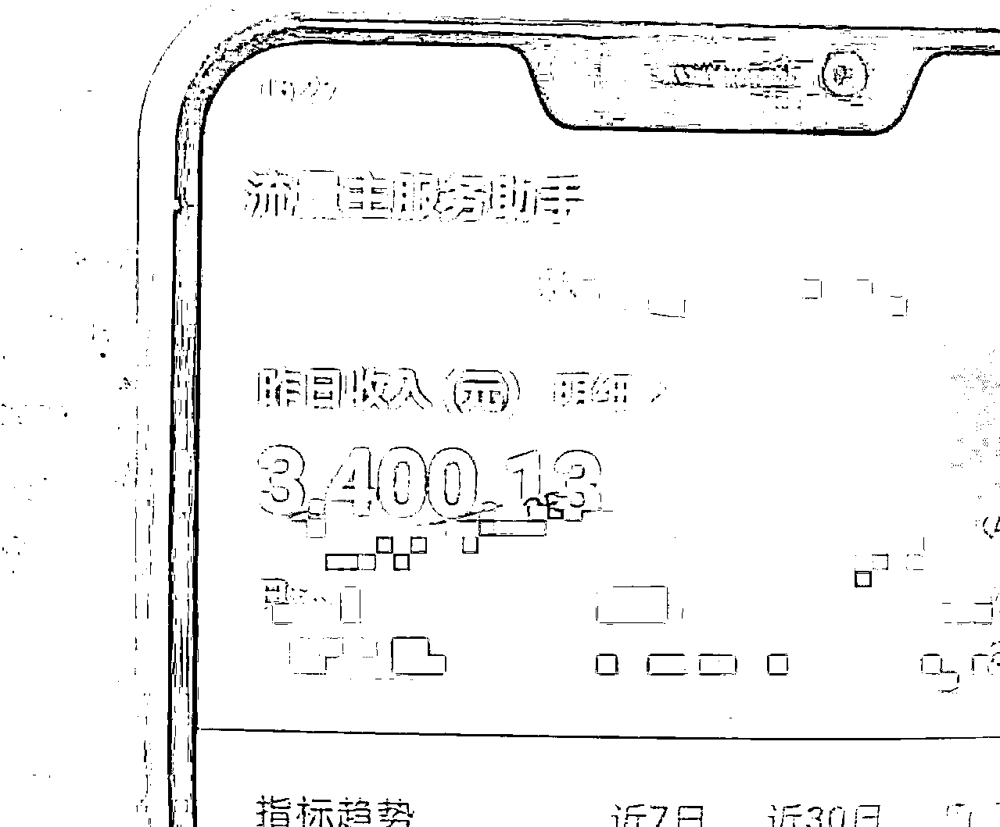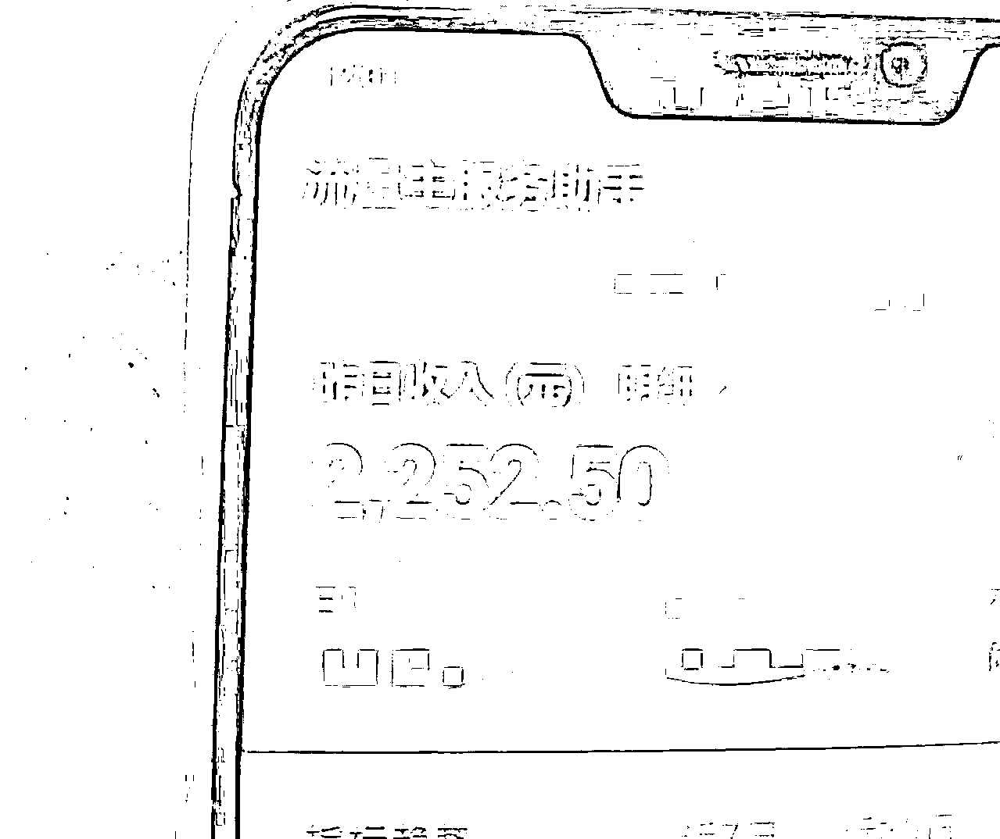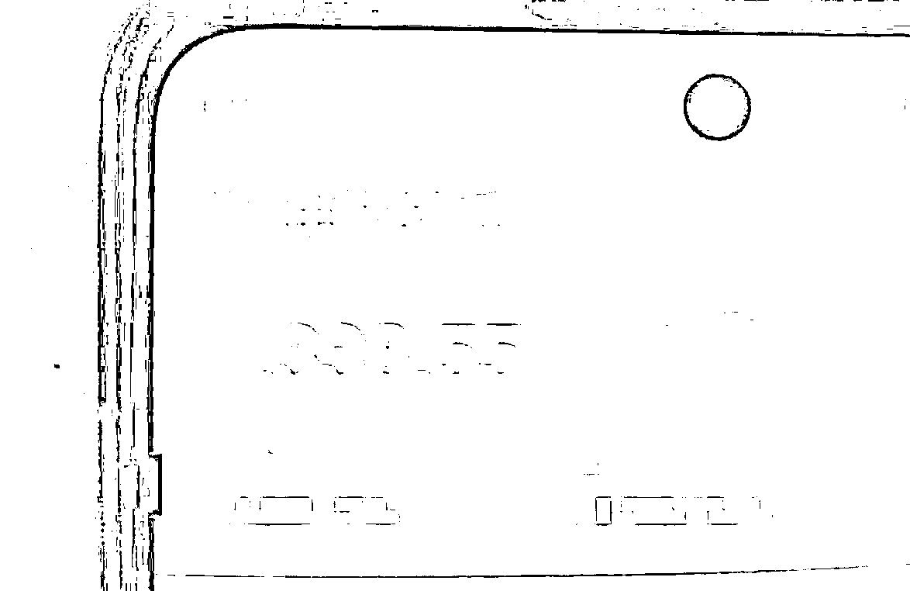

## 二、你可能会关心的问题

### 1. 那么多账号怎么来？

我和@阿泽的情况一样，账号全部来自公司和个体户。每个公司可以注册50个号，每个个体户2个。如果你想注册100个号，用公司+个体户的组合，只需要：
- 🛰️号：5个自己实名 + 6个不同人实名
- 手机号：7个自己实名

具体规则是：
- 公司号：绑定🛰️号的实名人下不超过50个👸号；绑定手机号不超过50个👸号；
- 个体第一号：🛰️号下不超过5个👸号（不要求实名）；手机号不超过50个👸号；
- 个体第二号：🛰️号实名人下不超过5个👸号；手机号不超过5个👸号。

### 2. 指纹浏览器和代理IP怎么解决？

指纹浏览器我用的是免费的“悦互联浏览器”，其他要么贵，要么限制多。代理IP一开始用悦互联自带，48元/月，后来请教@猫哥，换成天翼云多IP搭建，单IP成本降到了2块钱。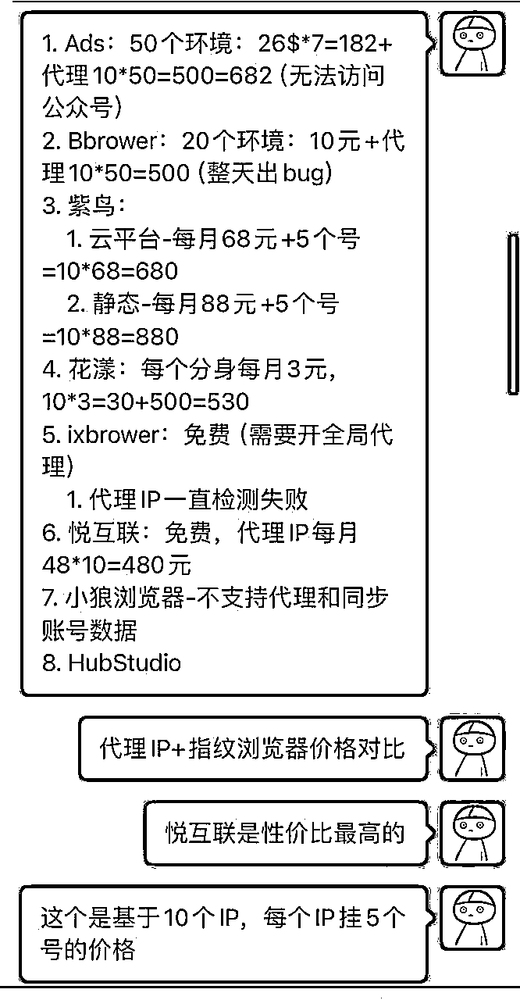

### 3. 自动化脚本都有什么功能？能分享吗？

我的系统由三部分组成：Python、影刀RPA、飞书。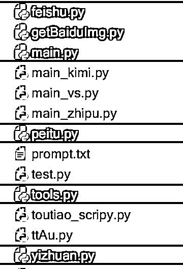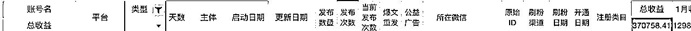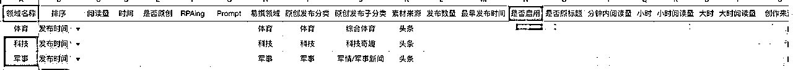

核心功能包括：
- 多线程生成，一分钟能出几百篇文章（取决于电脑配置和网络）；
- 自动根据账号注册天数决定单次发布篇数；
- 自动根据前一日收益调整发布篇数和发布总量；
- 每天自动查询所有账号收益并写入飞书；
- 自动关闭公益广告，提高ecpm；
- 飞书表格里改参数，脚本里实时生效；
- 自动爆文重发，每个领域可独立设置检测时间。

不过，这套脚本是写给我自己用的，很多参数直接绑定了我的飞书文档，还没解耦。如果需求多，我会整理后分享出来。

## 三、复盘得失：我错过的四个机会

做这个项目确实赚了钱，但回头看，我有好几次机会没有把握好。

**第一，领域跑通时，没有集中资源打透。** 科技数码、体育、汽车这些领域，我刚开始做的时候基本一周就能起飞，新号半个月赚3000是正常水平。但我总喜欢拿二三十个号去试新领域，旧领域还能赚小钱，又舍不得注销换号，结果少赚了很多。现在我的原则是：一旦跑通切口，必须深入进去把红利吃透。

**第二，收益稳定时，没有坚持多平台分发。** 我当时把👸号文章同步到头条和百家，一个月赚了3000，后来5个头条号因为违规全被封。我又用公司号注册了MCN，想靠买号放大收益，但MCN要开通统一提现，需要“头条首发”且单周阅读量超几百万。那时👸号收益正高，我没把头条当回事，现在想想挺后悔。

**第三，流量爆量时，没有坚持引流到私域。** 去年刚做👸号时，我就在群里和朋友说要把流量引到🛰️做二次变现。但一直到今年2月才真正去做，而且做得随意。只引了20来个创业粉，我收费带别人做👸号，结果没带起来，钱也退了；还引了100多个汽车粉，做了9.9元进交流群，一个人都没付费。引流方式其实没问题，是我的变现设计有问题，再加上没足够重视，自然没有持续。

**第四，放大时因为恐惧，没去找高校合作。** 当时听圈友说，找学生帮忙注册个人号不仅成本低，权重还比企业号高。我认识几个做校园业务的圈友，也想过谈合作，但因为我本人对社交和谈合作有恐惧，最后只用了个体户号。成本更高，收益还更低，也失去了一次链接校园团队的机会。

## 四、接下来的打算

对👸号，我心里还是不甘心。龙哥说过，平台红利会持续很久，只是玩法过时了，需要找出符合新规则的新玩法。我也想一直留在牌桌上，穿越整个红利周期，这对以后做别的项目也有好处。

以现在的情况看，平台更看重内容质量，纯靠AI写文章的机会不大；但完全不用AI、纯人工更新，又不太适合我们这种玩家。所以，👸号方面我打算把手上的资源和优势继续变现：

- 用近200个号做关键词霸屏，吃SEO流量。如果单个关键词能跑通，再找圈友一起霸屏更大的流量词；
- 用这些号配合自动发布脚本做带货推广。哪怕推荐流量很少，每天发2000篇带货文章，怎么也有1万+的阅读。

不过这两个方向我都只是试过水：带货发得少、没出单；SEO测试了一个👸号，开了付费文章，发布两天有10个人付费。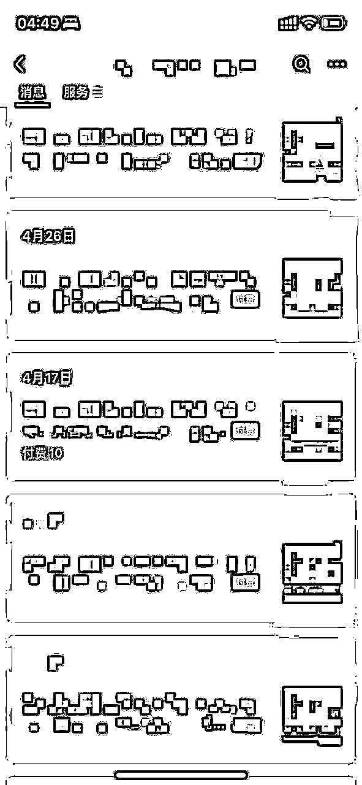 虽然看起来有点意思，但我现在比较缺现金，在没有成熟方案之前，先不在这上面发力。

再说说现在做的事。4月底我开始做教育类知识付费的📕投放。做这个有两个原因：一是付费流量的能力未来一定用得上；二是以前的每个项目都不是我完全从0挖出来的。这一次，从挖掘、调研、验证到跑通闭环，全靠我自己，成就感特别强。目前已经做到日盈利500-1000，照这个趋势，3个月内有望单月5万-10万。

欢迎做📕投放、教育类知识付费的圈友们来找我聊。

最后，感谢@妞妞老师带我入门，感谢@不二大哥的指导，感谢所有一直交流支持的小伙伴。还要感谢刘小排、盗坤、铭尘、龙哥等老师的精神加持。特别感谢@阿泽，本来我不打算写这篇分享，但他说“每个人分享的点总有有价值的地方”，我想了想，是该给过去这段时间一个交代，于是动了笔。也感谢龙哥盟团队，三年的收获无法用几句话说完，下一年争取进航海家，和更多优秀的人并肩。

原文链接：https://tjhy5ng53f.feishu.cn/docx/IwGtdlp73ou55txP0qIcyJytnRg