# AI陪伴是“精神多巴胺”，不是“情感催产素”

最近和几个做AI陪伴的朋友深度聊了几轮，发现一个很有意思的现象：几乎所有人都在用“社交”的逻辑来设计产品，认为用户只要肯每天打开对话框，就能和AI发展出稳定的亲密关系。但真实的数据和体验反馈，正在狠狠打脸。

上个月，Super黄组织了一帮产品人线下碰面，大家围坐一圈，把行业里那些坑和心得聊了个遍。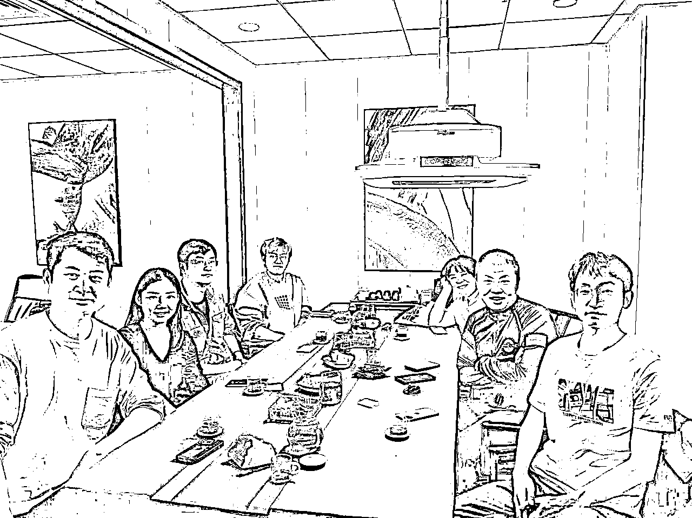 交流下来，我们的看法逐渐收敛：以目前大模型的实力和成本账，情感陪伴类产品根本撑不起“社交”的预期，更别谈什么短期商业价值。趁早把它看作内容消费，反而更接近真相。

回顾一下时间轴，ChatGPT还没火的时候，Character.ai和MiniMax的Glow就已经上线了。它们起跑很早，早早立住了标杆，也让一大波后来者顺着路径冲了进来。到了今年3月，A16Z发布的全球AI Web产品Top 50里，有8个属于陪伴赛道，看上去确实像一股新浪潮。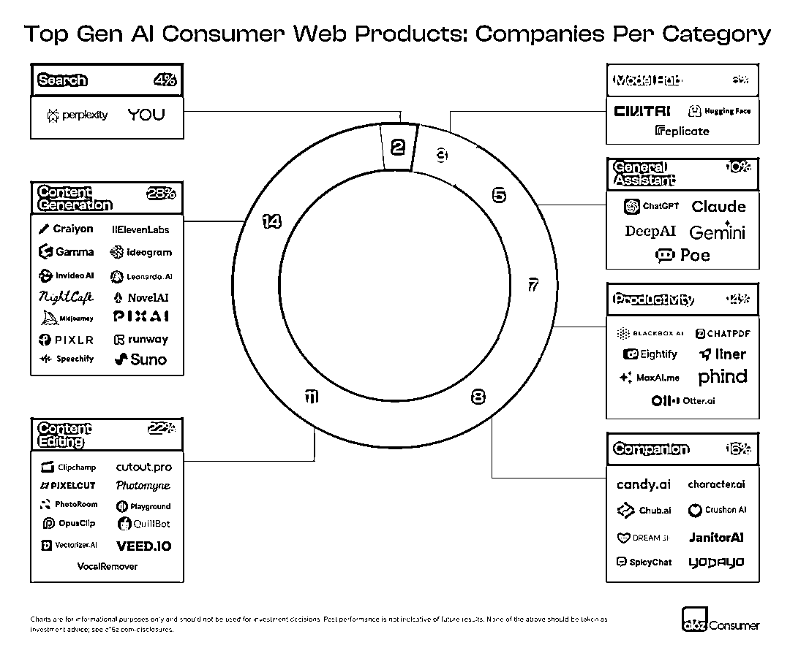

但浪潮底下，藏着非共识。

我最初也相信AI可以重塑社交网络，想象一个中心化的世界：所有人直接与AI建立关系，创作者被架空。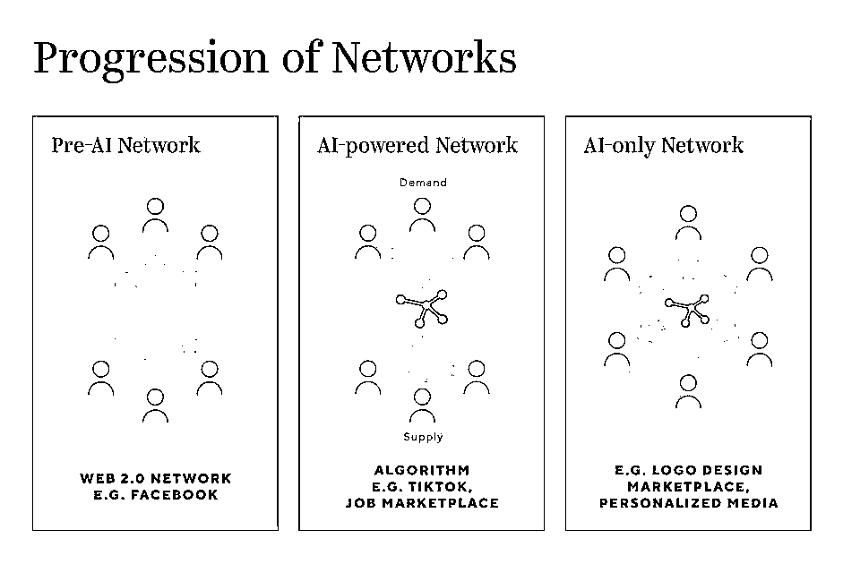 在我的设想里，用户和AI交互就够了，内容也由AI生成，内容创作者的价值被大幅稀释。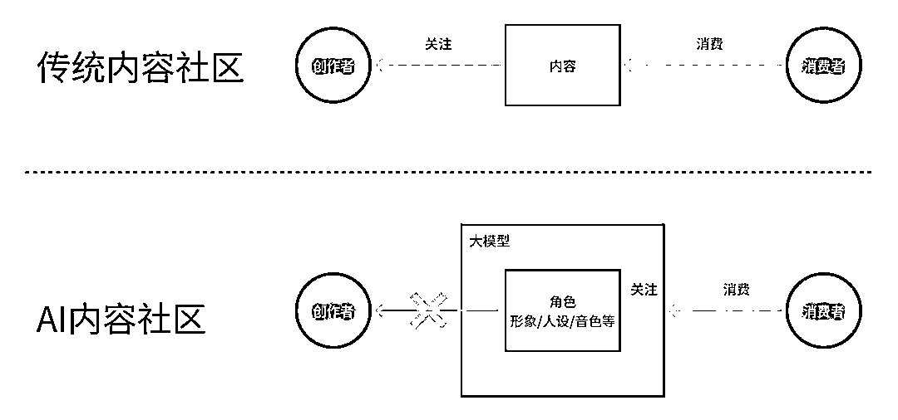 然而，一次次的实践告诉我们：这个假设，在当下的技术条件下不成立。

为什么？先看看亲密关系的定义。罗兰·米勒在《亲密关系》中提到六个要素：了解、关心、相互依赖、相互一致、信任、承诺。拿这六把尺子去量AI和用户的关系，哪一把能量出来？

先不说承诺，AI连基本的“了解”都做不到。它可以扮演倾听者、引导者、支持者，靠NLP、情绪分析、知识图谱和角色扮演来模拟心理咨询师。但人类的情感是生理反应、心理状态、环境因素杂糅出来的，文字和语音一传递，信息已经丢了一节；模型能力再一限制，深度理解更是奢望。未来就算用“MoE”混合专家模型把日常闲聊、心理辅导、角色扮演分开精修，也仍然隔着鸿沟。

第二个大问题是：AI没有实体。人与人之间，除了语言，还有温度、气味、触觉、眼神。哪怕你只是安静地坐在我旁边，我都感觉得到你的陪伴。哺乳动物的大脑边缘系统会产生共振，一个拥抱、一次握手，都能让下丘脑分泌多巴胺和催产素，让杏仁核安静下来。AI连身体都没有，这一层天然缺位，你不可能跟一团数据产生边缘系统共振。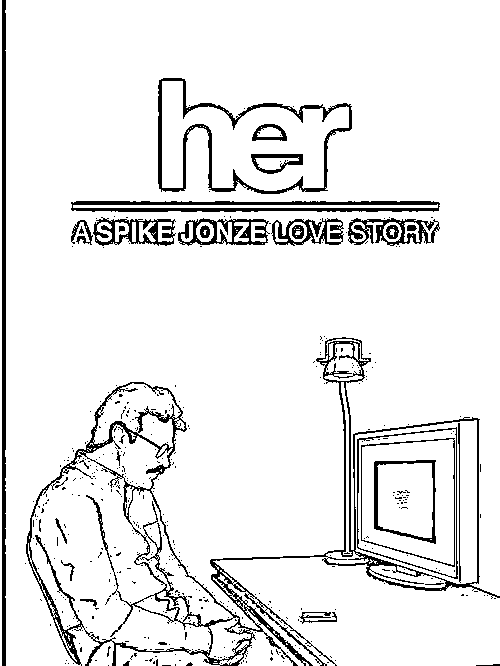

还有记忆和逻辑。现在的产品普遍“聊着聊着就忘了”，就算加了记忆提取，还是会前后矛盾。你的朋友如果忘了你反复强调的重要细节，你一定会失望，情感联结又如何生长？更别说长对话中的逻辑断裂，用户本来沉浸其中，突然被一句莫名其妙的话打断，所有情绪都散了。

交互成本更是高得吓人。我们观察多个产品的数据后发现，只有5%左右的用户能重度使用对话框，而这5%的人消耗了超过50%的Token。为什么比例这么少？因为能用文字在脑海里搭建幻想世界的人，本身就是少数，这属于精神层面的高门槛消费。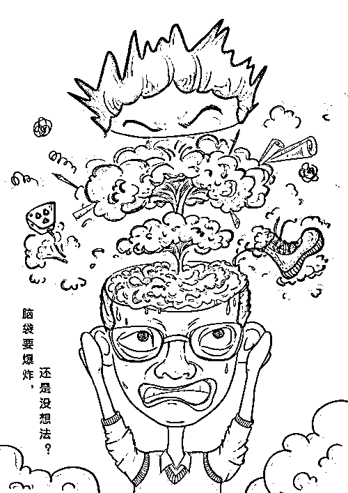 人脑对图像的驱动远比对文字敏感，短视频之所以让人停不下来，就是因为视觉刺激来得又快又直接。这也是为什么，一旦多模态技术成熟，陪伴产品的可行性才会真正提高。

这些短板叠加，让我重新思考：AI陪伴到底提供的是什么？答案不是关系，而是情绪价值。

用户使用霸总剧情、NSFW内容，本质上都是在获取即时的快乐和满足。大家心底清楚，AI有求必应、任人索取，不会伤害自己，也不会真的闯进生活里制造麻烦。 即使AI没法跟大多数人建立稳定关系，但它在单轮或少量对话上的表现，甚至可能超过你现实里遇到的普通人。于是，情绪价值被稳稳地接住了。

所以我说：AI陪伴给的是多巴胺，不是催产素。催产素关系长期信任，多巴胺负责即时奖励。前者像细水长流的亲密关系，后者像是你刷到一条搞笑视频、打赢一局游戏、吃下一口甜食时的“爽”。

这种爽，很像《完蛋，我被美女包围了》的体验。游戏里那个“我”被各种美女主动包围、嘘寒问暖，玩家心里清楚是假的，但那种被捧在手心的感觉，还是让人忍不住心动。评论区那句“我就是个臭屌丝，难得有游戏对我这么好”被顶上热门，一万多人点赞——大家买的就是这一刻的情绪代偿。

可是，靠这种多巴胺做商业模式，太难了。

首先，只有重度用户会掏钱。基础功能免费的情况下，轻度用户不可能付费。而有团队透露，内测阶段的重度用户每人每天Token消耗成本超过10元。其次，市面上的产品越来越像，背后甚至可能共享同一个模型，迁移成本几乎为零。大量“崽妈”们同时在好几个平台养崽，这边收费，转身就去隔壁，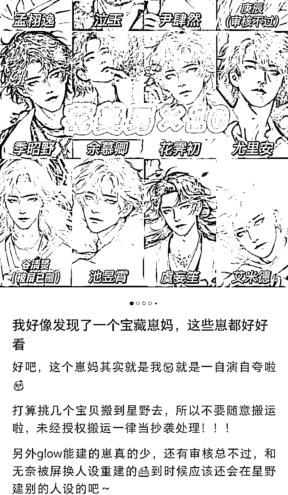 付费意愿自然被稀释。再加上能长期用文字跟AI交流的用户规模本身就小，没有群众基础，规模效应根本无从谈起。除非交互成本再降一个量级，或者多模态足够成熟，否则商业账很难算平。

那为什么还有那么多人争先恐后往坑里跳？闭门会上有位朋友一针见血：大家被ChatGPT和Character.ai骗了。

ChatGPT的走红，让很多人误以为“对话式交互”就是下一代产品范式。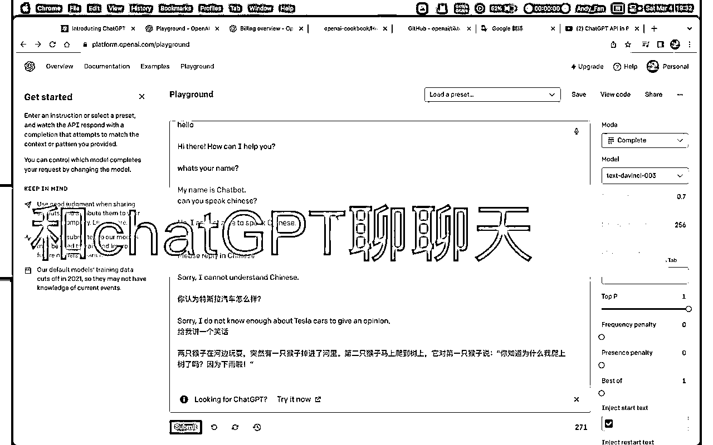 但别忘了一个事实：聊天只是NLP领域中极其微小的一部分。多邻国在访谈里也说过，大多数学习者更喜欢被动接收，而不是主动创造。开放式闲聊反而成了ChatGPT通往更高日活的阻碍。更耐人寻味的是，Character.ai内部其实并不看好自己的故事，他们对外讲的是“平台”，结果融资处处碰壁，只能拼命压缩模型成本。最近甚至传出卖身消息。你看，连鼻祖心里都在打鼓。

另一层残酷的真相是：人类并不享受和AI聊天。斯坦福分享会上有句话说得直白：就算AI下棋能碾压人类，观众还是更愿意看人类下棋。青少年可能愿意跟AI聊而不去看心理医生，但这属于少数。一位创业者尝试用AI帮主播维系粉丝感情，结果男性粉丝一发现对面是AI，立刻切断对话。人只会对有趣、有共鸣的对象持续付出，一旦知道对方是个程序，就会瞬间失去兴趣。

有人可能会说：当年大家用QQ网恋不是也很上头吗？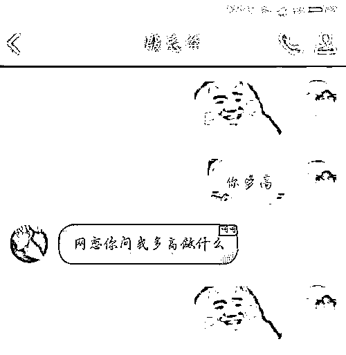 注意，网恋对面是个活生生的人，你的付出有可能获得真实回应；而AI给不了对等付出。当你意识到自己只是在跟一段程序对话，这个session基本就结束了。

当然，以上结论是有阶段性的。如果模型能力再上一个台阶，能稳定交流50轮甚至100轮，让人分不清对面到底是真人还是AI，那么“不存在人机社交”的判断也许会被推翻。但至少在今天，产品团队应该清醒一点：情感陪伴不是社交，它是一门多巴胺生意。

想清楚这点，再去做产品，路才不会走偏。

## 情绪陪伴，卖的是情绪消耗品

之前我们抛过一个观点：情绪陪伴类应用，本质上是在销售“情绪消耗品”。这个结论值得再推一步。若人与AI之间真的能形成稳定、持续的社交纽带，按理说用户会获得源源不断的情绪收益；但在现有技术下，这种关系根本建立不起来。于是现实中的陪伴产品，只能提供一轮对话里的短暂欢愉。

换一种方式解释：人在和AI聊天时，不会真的进入一段“双向关系”，但应用仍然能让人感到放松、开心。这份开心不是来自“我和它已经熟了”，而是来自“我发出去的东西，得到了我想要的那种回应”。

它发生的过程大致是：某个情境给出提示，用户主动输入一段内容，模型再给出有针对性的反馈，几个回合下来，情绪被充分照顾。

情境本身其实就是一种内容形态。它有吸引力，能让人一头扎进去，跟着情节走，体验不同的角色和世界。

一旦把这套流程视作“共创式体验”，问题就清楚了：用户付出参与，换取短暂的愉悦。产品接下来要做的事，是把这种体验的深度和广度不断撑大，而不是执着于模拟一段关系。

## 一、有剧情的互动产品，更让人放不下

前面已经亮过数据：大约只有5%的重度用户会持续消耗Token。想靠这批人撑起商业模式，几乎不可能，除非流量价格和Token成本都低到离谱。

那哪种形态更有机会？一种可行的方向，是带有探险和解谜元素的互动故事。这种产品已经明显偏向“内容”，而不是“聊天”。

“哄哄模拟器”可以当作一个例子。

更早我们也提过：媒介即内容。新的媒介会长出新平台，新平台又催生新的内容创作者。

为什么这种互动故事，反而比纯陪聊更成立？Super的洞察是：低门槛操作 + 高密度代入。

大多数人在刷短视频时，上下滑动就能获得新鲜感。互动剧情产品比陪聊还要“轻”：使用者不用写一大段话，只要在设置好的情境里选方向、做决定，就能体验由自己推动的情节。

可以把这理解成：需要陪伴本身也是无聊的一种，是在打发时间。泛用户不想动脑，所以“滑一下”“点一下”远比“打一行字”更通用、更省钱。

但除了轻，还要有重。剧情加重了代入感；NPC负责给情绪反馈，留人、拉时长都不成问题。用户不用纠结该说什么，也不用担心对话在什么时候终结。

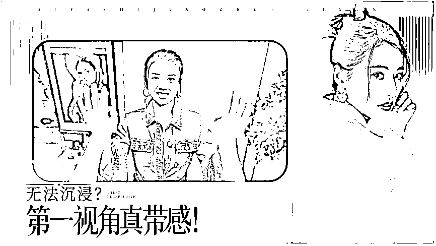

这种玩法我在PICO的VR里感受过，效果更强。现在有些直播间也在用这招，主播会刻意制造亲近感，比如用手轻轻撩一下，确实有真实感。《完蛋》只能在大屏玩，代入感比VR弱，但也很够。

浩浩妈的火辣身材就是很直观的冲击——

她睁着一双可怜巴巴的大眼睛，问我是不是真的把她儿子当成了自己儿子，这种请求谁能拒绝呢？

短视频和游戏，其实都踩中了“轻操作+强代入”这两条。

## 二、好情节要长在UGC生态里

一旦产品走剧情路线，故事质量就成了命门。

好故事从哪里来？更多要靠用户自己生产。有人会反问：专业团队难道不更强？可现实是，几乎没有团队能长期供养一批专业小说作者，让他们坐在写字楼里写出大众爱看的故事。

冷启动阶段，官方可以先做点内容；但长期来看，得靠产品和社区吸引种子用户、搭好创作模版、做好引导，让喜欢写故事的人自然聚集。

这中间需要少量专业人士参与，但主要生产力来自普通用户。

很多产品恰恰忽略了：创作者生态才是真正的护城河。

创作者要觉得自己被看见、有收益、有归属感，才会持续留在这里。

Poe的创作者收益计划已经打了个样：

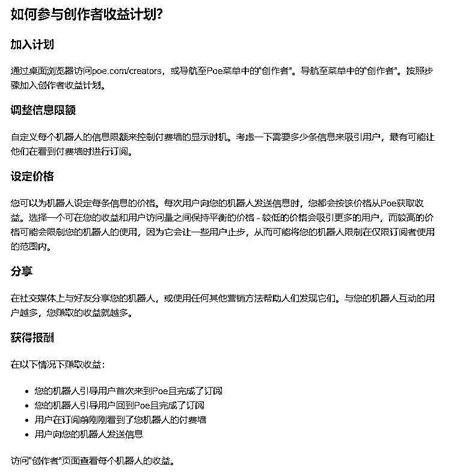

这个机制鼓励大家做出更好的Bot，并且愿意多分发。

平台只要负责基建、培训和方向引导，剩下的好内容好情境，都可以从社区里长出来。深层原因很简单：坐在办公室里的人，很难凭空捏造出鲜活的场景。

## 三、叙事类产品的极致，可以看乙女向作品

乙女向恋爱模拟是一个值得参照的样本。它用画面、声音、文字共同制造一个可供幻想的空间。

它之所以成立，靠两点：

1. 男主角的人设足够完整。先靠外貌引起好感，再用性格、能力和经历形成深层魅力。
2. 感情世界不需要厚重的世界观，而是靠共同经历的事件来升温。

具体操作也很有意思：约会场境会刻意留白，让女生去想象未尽之言；短信互动同样把最动心的部分隐去，给她留出脑补空间。

这就是艺术感。

但现在的AI模型做不到这份克制。留白需要对语境有极强的判断力和分寸感，刚好在AI能力之外。

做不到这一点，AI能提供的就只有零星的一点内容娱乐，难以和乙女产品的情感浓度相比。

## 四、继续延伸：AI游戏把对话变玩法

之前聊过《病娇AI女友》：

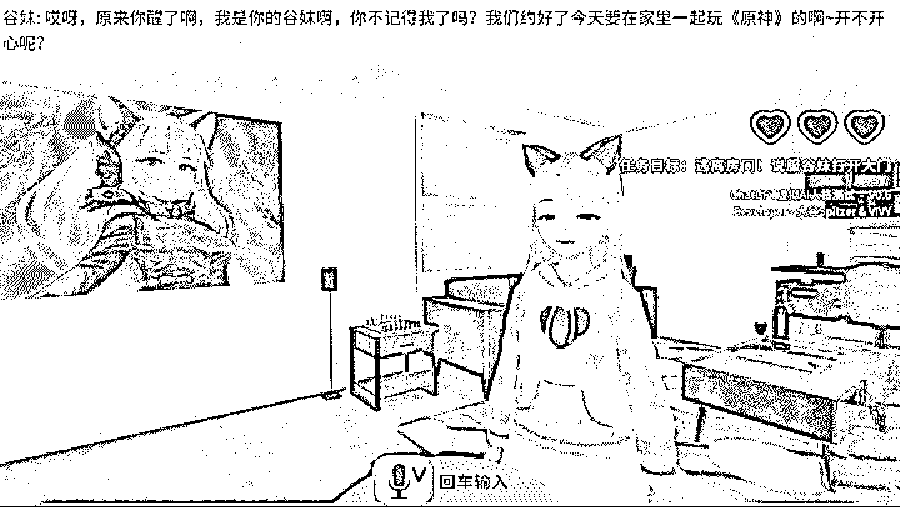

《病娇AI猫娘女友》是一个结合ChatGPT的密室逃脱游戏：你被困在一间房里，一个自称你女友的猫娘跟在身边；目标是通过和她聊天、和房间里的物品互动，想办法逃出去。

这套设计聪明在：先用扎实的游戏框架兜底，再用语言模型提供自由度和变量。

再比如《Suck Up! 》：

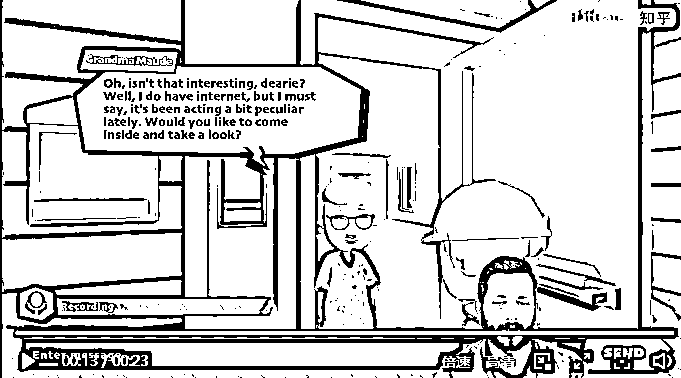

核心玩法很像“小兔子乖乖把门开开”：玩家扮演一只吸血鬼，靠换装和与NPC对话来消除对方戒心，最终目标是完成吸血31人的任务。

每次对话只有十秒，玩家必须快速给理由，卖惨也好、讲段子也好，甚至唱段Rap，只要能说服对方开门，就算成功。

这是典型的扬长避短：不跟模型拼长程记忆，只拼短促创意。

还有《言灵计划》，借用了“言出法随”的设定：

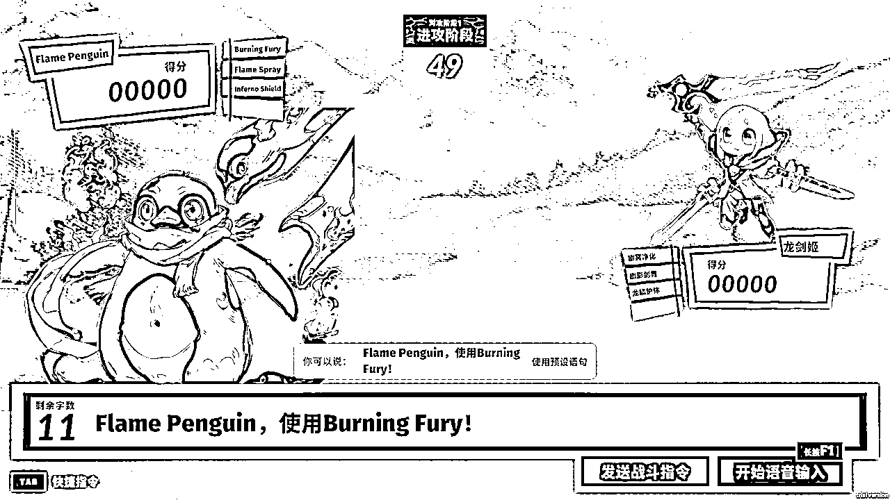

玩家输入招式的文字描述，模型理解后转化为攻防动作，系统给出评分，总分定输赢。

这种玩法，本质上还是在考“你能否给出最合适的Prompt”。

这几个作品有一些共同特征：

1. 不过分依赖复杂系统，开发成本不高；
2. 模型是玩法中的关键部件，但占比不高，符合“少操作、多参与”的思路；
3. 成败更取决于玩法设计怎么和模型结合。

为什么它们会让人觉得巧妙？

因为它们把模型用在了最不可替代的位置。

过去做陪聊产品，总想让用户通过大量输入获得好体验；但表达门槛太高，多数人不习惯、也不愿意用自然语言讲清自己。

游戏改用了画面这种人人能懂的媒介来交代情境，只把最核心的互动反馈交给模型处理。

结果就是：使用者只需很小的操作量，就能获得很完整的体验。

## 五、这些产品，本质都是AI内容消费

把《病娇AI猫娘女友》《Suck Up!》《言灵计划》放在一起看，它们其实是一个个互动故事，只是从文字升级成了多模态体验。

不管是剧情类还是AI游戏类，都能被归入一个更大的筐：AI内容消费品。

站在用户视角，大家期待的是“完成一场有规则、有主题的互动”。密室逃脱有目标，骗吸血鬼进门有目标，言灵对战有目标，哄女友开心也有目标。

只不过这些目标的达成方式，借由模型来支撑。与传统游戏相比，AI游戏更像开放剧本：选择是开放的，结果是发散的；只要主线明确，记忆和推理逻辑是不是完美，并没那么关键。

所以，用户真正在消费的是剧情，是故事，是内容本身。

## 六、IP是内容的放大器

既然是内容生意，IP的作用就不能不提。

Character.ai上活跃着大量《原神》角色，这些角色本身就带来了海量用户。平台如何强化IP的吸引力？

一个常见思路是：把IP经营成网红。

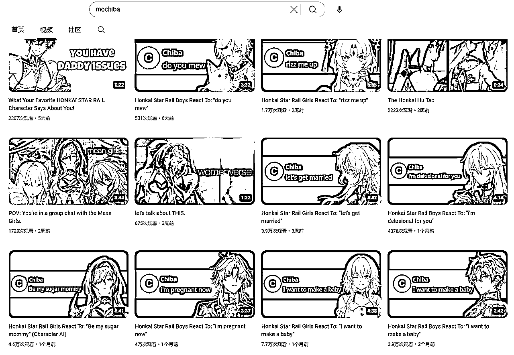

在YouTube上搜Character.ai，你能看到很多素人博主把角色做成视频故事，吸引观众去平台体验。Instagram、TikTok上也一样。用社交媒体运营角色形象，再把人导回产品，就是IP对内容消费的放大。

国内出海产品里，不少也在用这招。

但IP需要区分：已有名气的成名片，和原创角色。

成名IP适合拉新。它认知度高，可消费价值强，在海外社媒容易获得流量。短板是缺乏忠诚度——《原神》的魈、雷电将军每个平台都有，用户哪家聊得好哪家便宜，就去哪家。

所以平台还要培养原创角色来做留存。每个人的偏好都很垂直，大IP很难精准命中所有小众趣味；原创角色则要靠PUGC/UGC生态慢慢养。

原创角色的“原创性”本身就是壁垒。就像《小王子》里那朵玫瑰，因为人投入了时间，它才变得无可替代。如果产品能记住你们之间的互动细节，这种独占感会直接转化为平台忠诚度。

总结下来：从剧情互动，到AI游戏，到IP经营，所有路径都指向同一个结论——AI情感陪伴，本质上是在做内容生意。

## 补一句：即时疗愈也是情绪生意

除了以上方向，还有一类产品明确提供即时情绪安慰，代表是“林间疗愈室”。

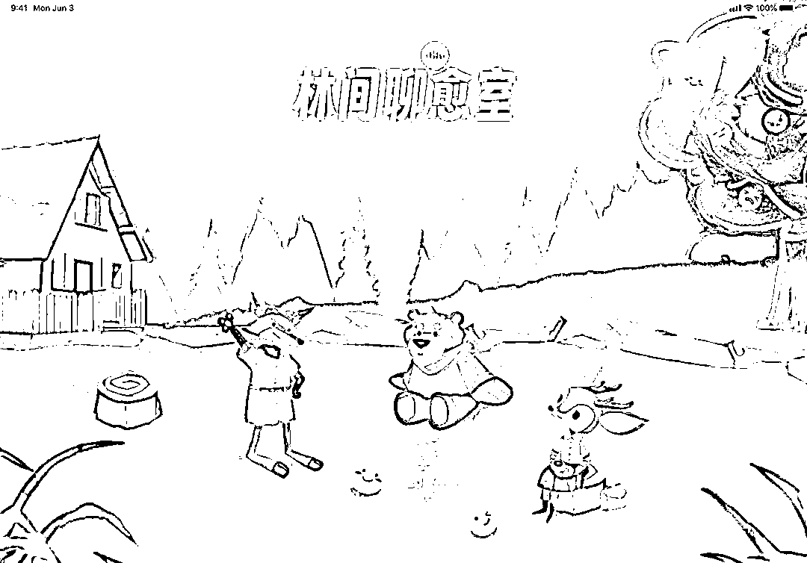

「林间聊愈室」是一款面向年轻世代的AI心理疗愈应用，它设计了三只AI伙伴：小狐狸、小熊、小鹿，用轻松的方式给使用者提供“情绪补给”。产品不只是处理一时的情绪波动，也想通过长期陪伴和轻互动，帮人表达自我、探索自我。

它的主流程是：选一个伙伴，快速解决当下的心理困扰，获得疗愈。短连接高效处理具体问题，长连接会保留一点记忆。

这带给人的，更像是“即时兴奋”，而不是“深层依恋”。

还有之前的“心光App”：

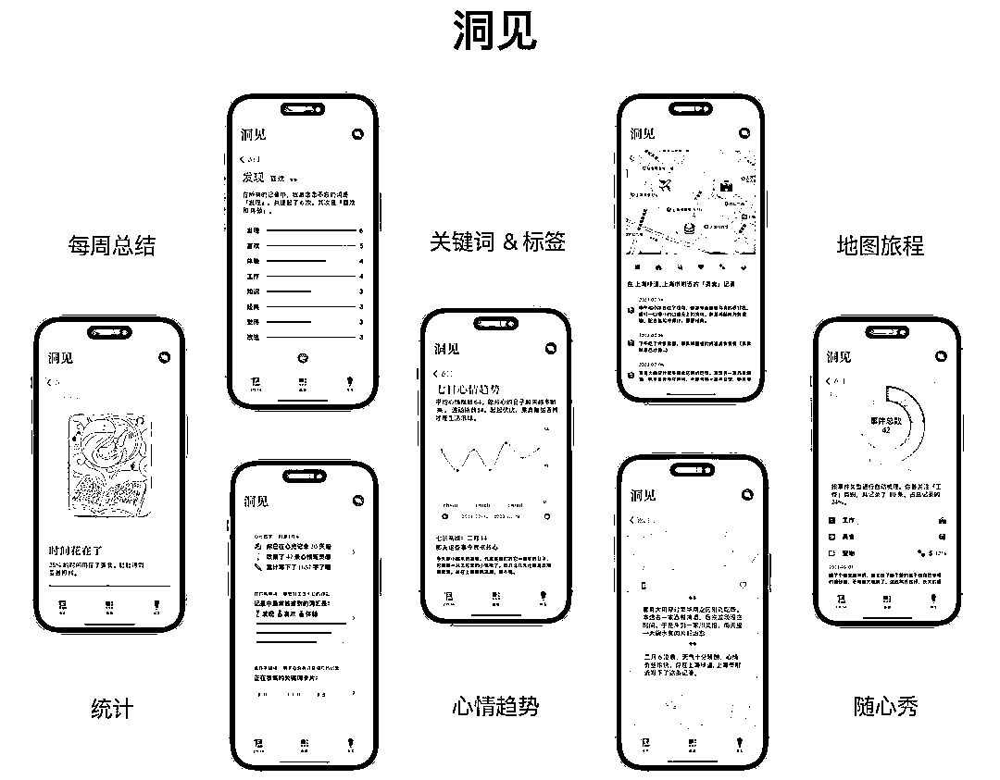

心光通过“记录—AI回应—统计洞察”的闭环，让人更了解自己，定位是“AI生活记录伴侣”。一旦定位成记录工具，它天然不会往社交方向走。

## 最后

内容消费和社交互动，满足的其实是两种不同的心理机制。内容消费诱发即时奖赏式的快感；真实社交带来深层联结式的满足。有人用一句话概括：内容消费喂给大脑的是多巴胺，真实社交喂的是催产素。

当一个人去寻求社交，他未必只想获得短暂快感，更可能想被理解、被接纳。这种需要，内容产品很难真正满足。这也解释了为什么AI陪伴应用虽然能提供安慰，却始终替代不了真实人际互动。

AI情感陪伴，是GPT时代才生长出来的交互形态。大家不约而同去做聊天机器人，很大程度上是受ChatGPT和Character.ai的启发，并没有深究它是否合理，便匆忙把LUI总结成下一代交互。

但我们需要认真看待聊天形态带来的“诱导”，以及它在用户习惯、成本、营收上的短期难题；还有记忆、推理等技术门槛。

说到底，聊天只是大语言模型落地的一种产品样式。

而今天，已经有人跑出了别的路子：把模型塞进游戏、故事、疗愈工具里。这些探索都在提醒我们——在很多场景下，聊天并不是最理想的产品形态。

这篇思考来自一次闭门交流。感谢愿意公开分享的朋友：Yijia（👸号“嘉儿的移动城堡”）、理想汽车刘金鑫、AI风向标黄小刀、木水酱（👸号“银河系降落伞”）、琳（想做AI社交产品）、喂猫（努力成为builder和creator的人类研究者）。