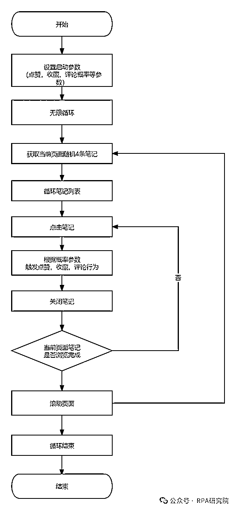
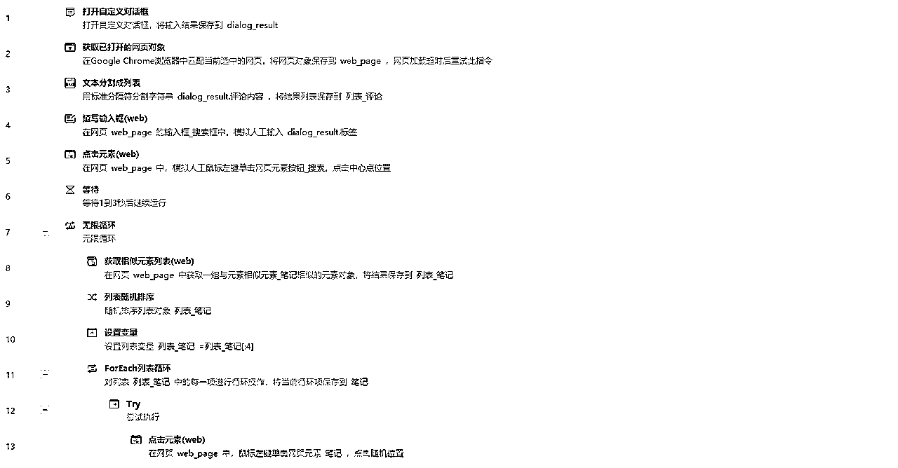
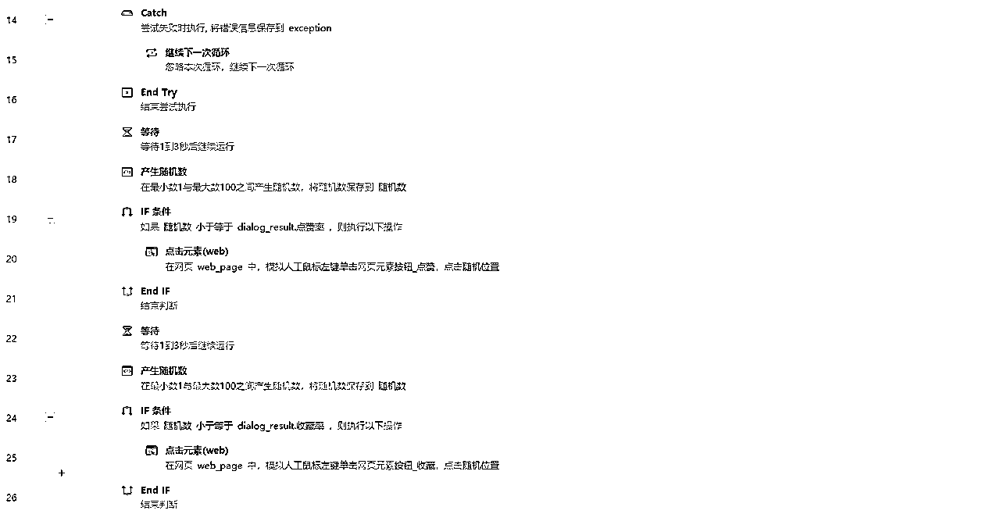
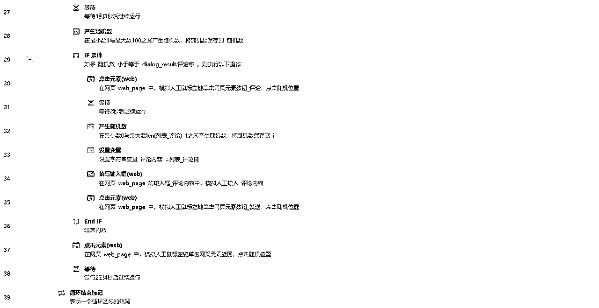
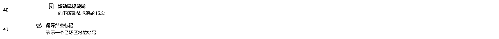

# 用41条指令搞定📕养号，7天让账号权重悄悄起飞
作者：龙哥

😁嗨，各位朋友，我是RPA研究院的商叁。今天这期内容，专门拆解一套面向📕的自动化养号RPA方案，从零到一教你如何搭建。

整套流程只需要41条指令就能跑通，真正做到双手解放，把时间腾出来做更值钱的事。

# 🚀 这套工具在做什么

📕自动养号RPA，简单说就是一套为📕账号定制的机器人流程自动化工具。依托RPA技术，它能自动完成刷笔记、点赞、评论、收藏等日常操作，从而系统性地提升账号活跃度、互动权重等核心指标。仅作技术交流与学习参考，严禁用于违规操作。

# 🎟 核心能力拆解

1.自动逛笔记：程序会模仿真人浏览习惯，自动进入📕不同垂类内容流，比如美妆、穿搭、旅游、美食等。关键词可以自由设定，浏览范围由你掌控。
2.智能化互动：依据你预先设定的概率阈值，系统会自动触发点赞、评论或收藏动作。所有互动都遵循内置规则和算法，力求行为自然、不易察觉。
3.高度可定制：互动频率、评论话术、浏览时长等参数都支持自定义，让每位用户的养号策略都能做到千人千面。

# 🛠 整体流程概览

# 📟 影刀 RPA 实操代码

🥂RPA研究院院长-商叁，驻地：广州

一位深耕互联网12年的老将，现任职于一家年营收约8亿的电商企业，担任RPA技术负责人。

现阶段主要负责推动抖音、快手、视频号、拼多多、唯品会等多个平台的RPA自动化项目落地。

如果你也在关注自动化技术，欢迎来聊聊。