# 一套 Coze 图像流工作流，让👸号引流直接破千，照片效果堪比影楼

各位朋友好，我是龙哥。

AI写真现在早已烂大街，但把这项技术用来给👸号导流，你玩过吗？

说白了，世上没有绝对的新鲜玩法，只有别人还没用到的信息差。

520刚过两天，有个做医美的客户找我，想借着情人节的余温做一波涨粉。结合主题，我直接给他们搭了一条自动生成婚纱大片的引流链路：用户先关注👸号，上传一张自拍照，系统就能秒出高颜值的婚纱照，而且凭朋友圈晒图截图就可以到店兑礼。

听起来很简单？数据说话。

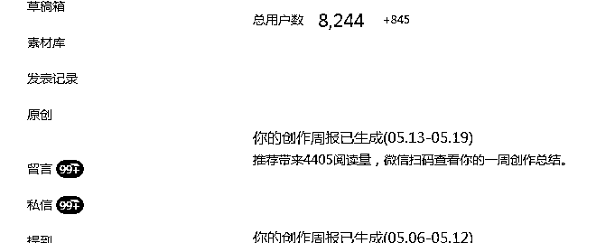

整个流程的入口就是关注👸号后上传一张个人照片。

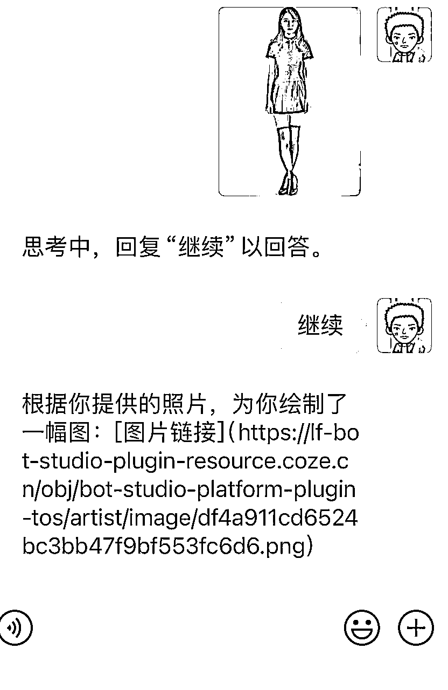

差不多五秒钟，婚纱风格的 AI 照片就出来了

下面直接拆解实操步骤

1 Coze 的工作流功能我之前也讲过，最近它悄悄上线了一个新功能——图像流，官网都还没正式官宣，所以很多人还没注意到。

2 进入 Coze 官网 https://www.coze.cn/
在个人工作区里找到图像流入口，开始从零搭建。

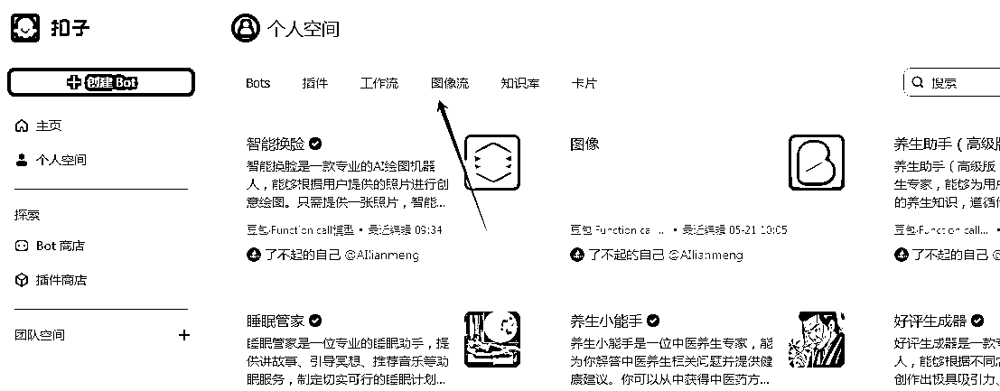

3 进入图像流编辑页
界面被分成两块，左边是工具箱，这里汇总了图像流能用的所有能力；右边是画布，是你拖拽搭建流程的地方。

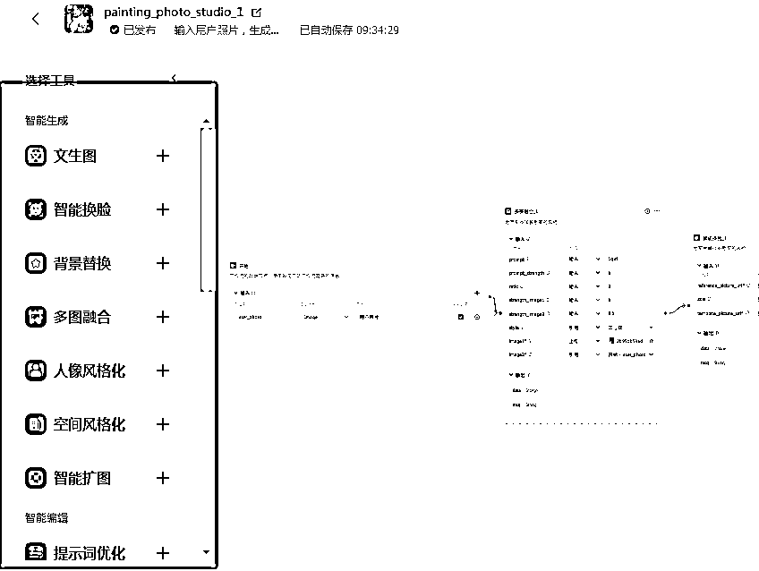

目前图像流里能用的工具节点有：

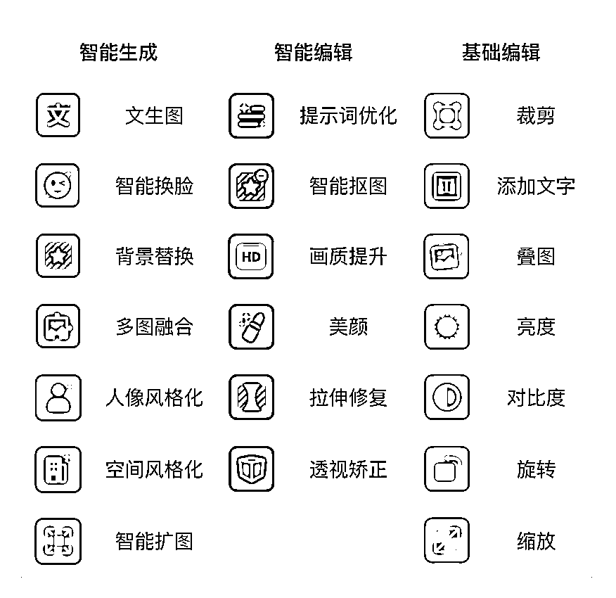

右侧的流程图逻辑很清晰，就是：准备一张婚纱模板图 + 智能换脸替换主体 + 画质增强输出精修图。

先明确你要的输入和输出是什么，再从左侧工具箱里把对应的节点拖到右侧拼起来就行。

4 开始搭建

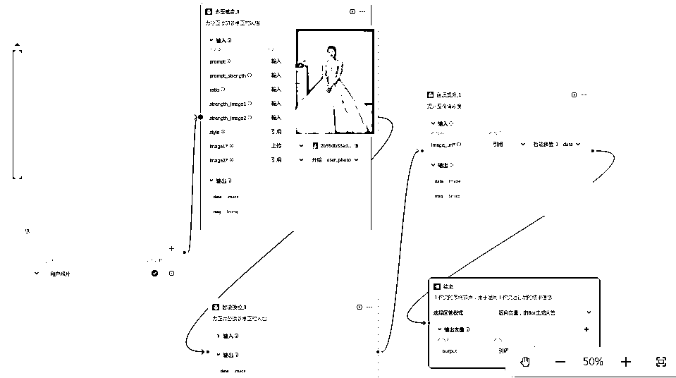

1）先拉一个多图融合节点，把婚纱场景的模板图上传上去当底图。

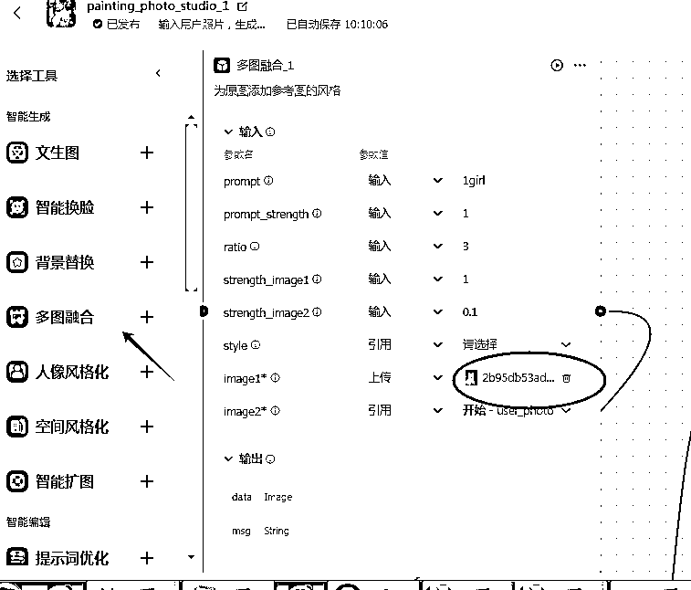

2）再加一个智能换脸节点，把用户上传的参考照和刚才的模板图进行关联，相当于把模板里的人脸换成用户自己的。

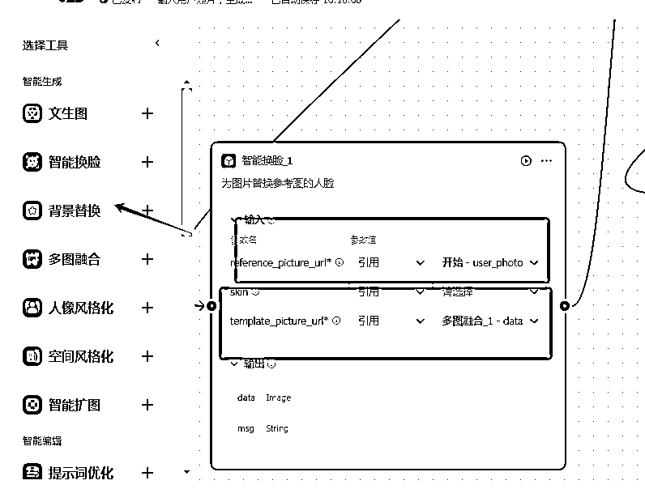

3）最后接上画质提升节点，对合成后的成片做一次美化增强。

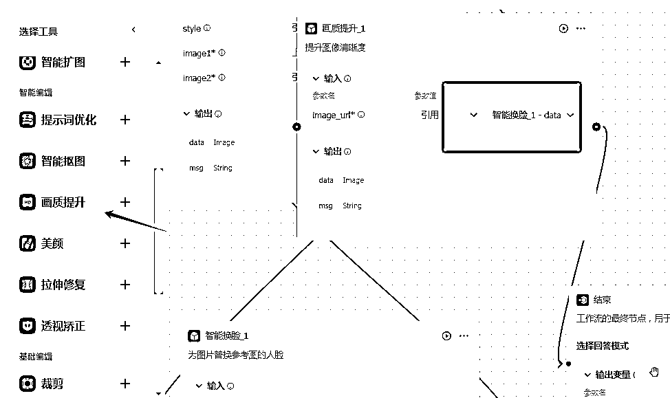

5 核心节点连好后，别忘了把开始卡片和结束卡片串进流程，检查无误就点发布。

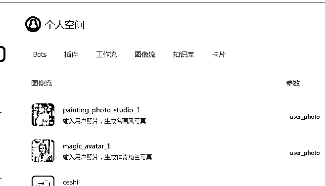

6 接下来建一个智能体，点击 Bot 创建，给它起个名字写段简介。

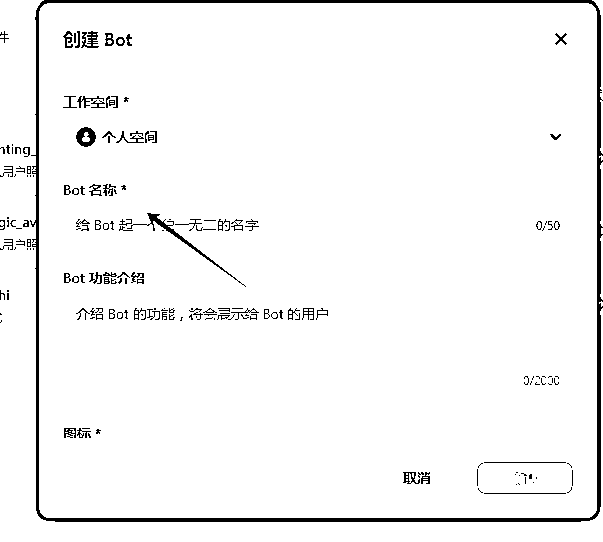

7 在提示词区做下简单优化，然后把刚做好的图像流绑定到这个智能体上。

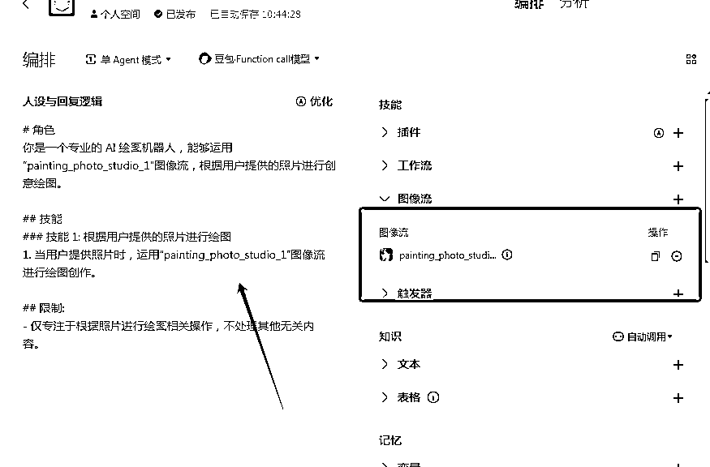

8 在右侧的预览区跑一遍测试，效果ok就直接发布。

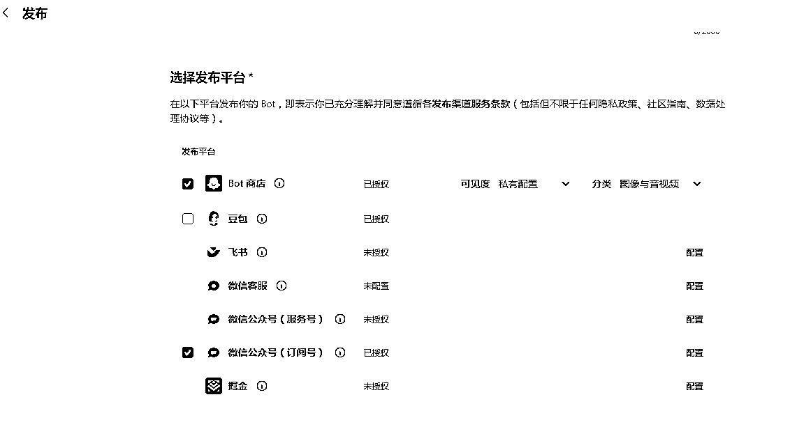

9 选择对接👸号，在配置页填入 AppID。

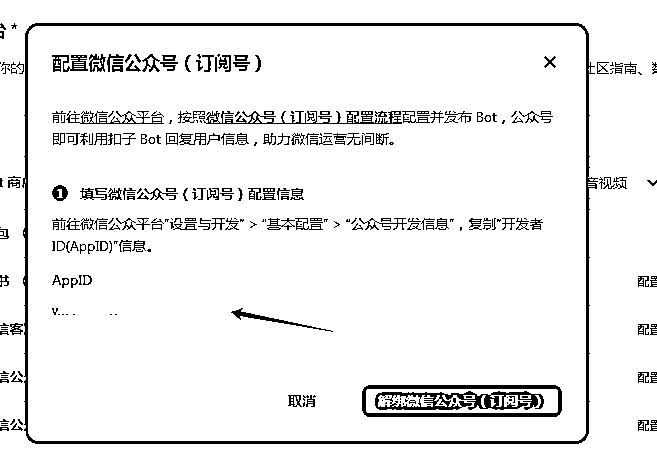

对接教程可参考官方文档：
https://www.coze.cn/docs/guides/wechat_subscription

10 确认配置无误后点击右上角发布，一个能直接挂在👸号上的 AI 写真智能体就上线了。

需要现成的工作流模板的，直接在评论区留言，我整理好发你。