# 小红书精细化运营怎么做？

大家好，我是李校长，校长会创始人，也是小红书头部MCN的操盘人，高客单项目一直是我在带队做的。最近私信里反复被问到一个问题：小红书内容怎么搭建才算专业？今天就把我对小红书精细化打法的理解，整理成一篇实操干货发出来。

事情是这样的，前不久跟一位做医美的创业者聊，她的账号流量已经起来了，数据漂亮得离谱，但就是没法变现。我一翻她的笔记，全是干科普。那种类型的笔记一旦爆了，必须立刻跟进人设贴和强转化贴，不然就是白白浪费流量。我粗略算了一下，就因为少了一类笔记，她每月至少少赚上百万。说实话我当时只能默默帮她调整思路，怕她知道了这个缺口会更难受。

那强转化笔记到底是什么？怎么去写？今天我就把框架拆开讲清楚。

# 工欲善其事必先利其器

做小红书，90%的人用好4个工具就够了。

剪辑就用剪映专业版，够用且高效。
做图用稿定设计、美图秀秀就行，模板多。
写文案用文心一言。

这里要提醒一下：现在市面上的ChatGPT、文心一言，写出来的东西普遍正确的废话偏多。就算你会调教，套路感还是会露出来。所以AI只能当助手，文案不能全靠它。

另外一个经验，如果你的赛道在知乎上曾经很火，那好内容基本都还躺在知乎上。
稿定设计里的小红书模板非常丰富，直接套用就能省很多时间。

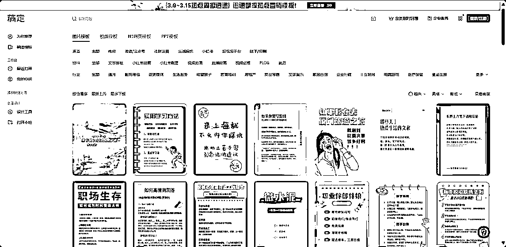

文心一言在批量生产文案上确实很有用：

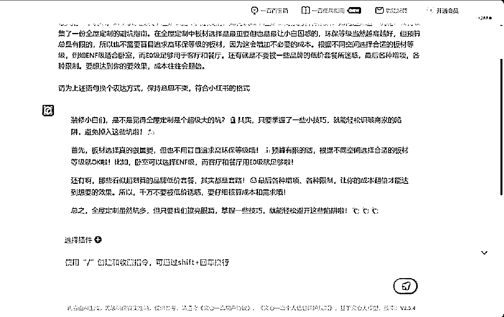

# 账号精细化运营：从主页到内容搭建

## 新手博主的主页怎么设计才专业？

主页就是账号的门面，要做到清晰好看、辨识度高，同时把人设和定位讲明白，让人一眼记住。

头像要统一整体调性，最好能体现身份或职业，比如品牌logo、人设形象等。核心就是好看、好认。

昵称要简短好记，方便搜索和传播，最好能让人一下子明白你是做什么的。有辨识度才是关键，别起那种让人看不懂的名字。

做本地项目更要讲究，比如武汉的月子会所，名字直接叫“武汉XX月子会所”，这样才能把流量精准圈在本地，不被分流到全国。

简介要回答三个问题：你是谁、你有什么不一样、能给用户带来什么价值。要和用户需求对上。

简介里不要放任何联系方式，一放就违规。邮箱可以放，但实际转化效果很差。

背景图可以补充简介的价值感，展示专业度。注意背景图比例是5:4，和尺寸不一致会被系统自动裁剪，重要信息就没了。而且系统会把背景图压暗，所以尽量选亮一点的底色。

举个例子：

反面案例：

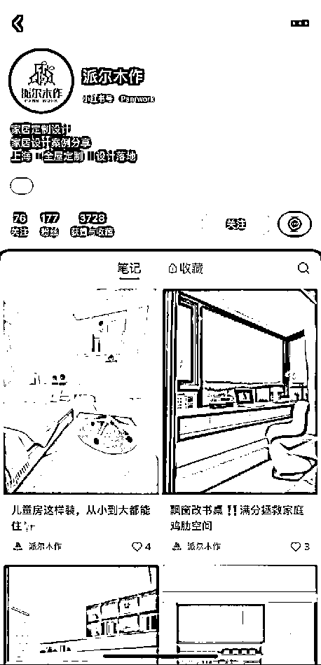

正面案例：

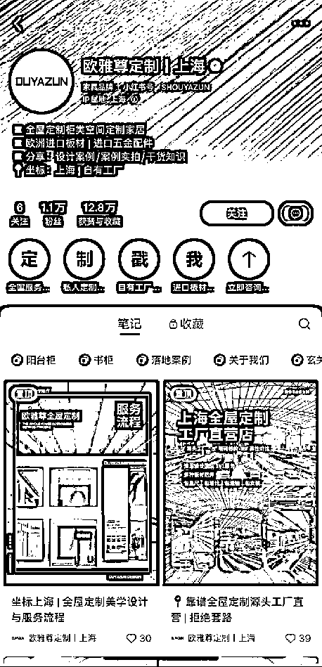

一看就能感受到差距，第一张四件套的排布很平庸，第二张的主页风格更抓人，专业感直接拉满。

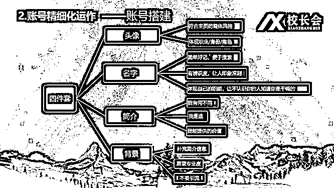

账号搭好之后，下一步就是找对标。

## 对标账号要看齐三点

1. 人群相近
比如轻医美和美妆的受众本身就是同一个人群，可以跨赛道找对标。
2. 话题相近
比如二手奢包和二手手表的选题逻辑就能互相借鉴。
3. 变现路径相近
比如川藏线的民宿和川藏线的租车，变现方式相似，方法可以直接迁移。

对标定了，再做内容。

## 内容制作的四大核心

1. 痛点与卖点
要用差异化、优势化的卖点，直击用户最在意的痛点。

①行业客户的真实痛点：成交时客户最纠结的点
②产品的核心卖点：为什么客户要选你
③营销的本质是解决供需：供是你的产品，需是用户的需求
④做内容就是把供需双方的需求无限放大

不懂就去看销售和客户的聊天记录。用户一上来就问价格的占6成，问位置的占2成，其它2成。那内容就该围绕价格去写。

以我带的头部驾校为例：
用户痛点很清晰：价格、学车地点、拿证周期、怎么避坑。

我们的卖点是：
①收费透明，一科付一科，服务不好可拒付尾款
②覆盖全上海的学车点，都能安排
③不同人群的拿证时间：周末党、学生党都能给出明确周期
④给出一份50页的PDF《上海避坑指南》作为钩子

记住，钩子必须是免费且有价值的。大家都送一样的东西，用户就很难为你的钩子来找你。

价格：

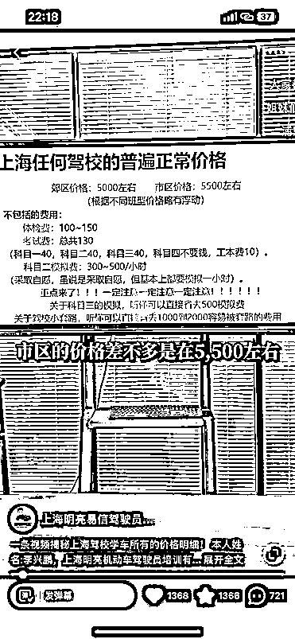

基地：

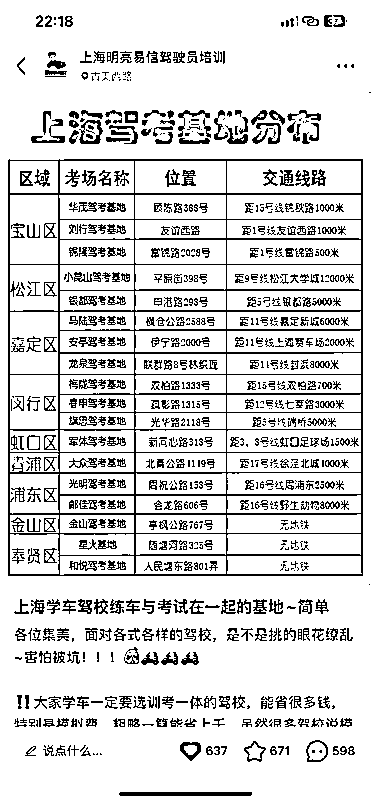

时间：

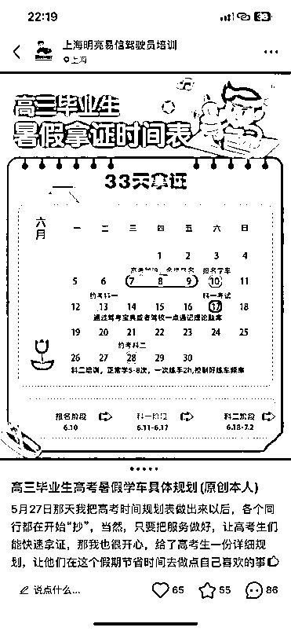

避坑：

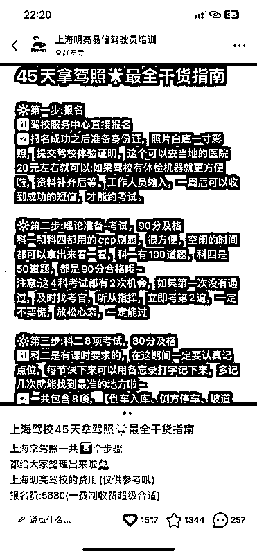

谁最懂客户痛点？肯定是销售。
怎么找痛点和卖点最快？
1. 让销售把客户常见问题做数据统计，问得最多的就是痛点。
2. 把痛点拆解，结合自身优势整理成差异化卖点，必要时可以适度放大。

用户第一次加微信问什么，就是他的痛点。线下沟通的所有记录，都能梳理出行业的核心痒点，通常就三五个核心问题。

爆款文章

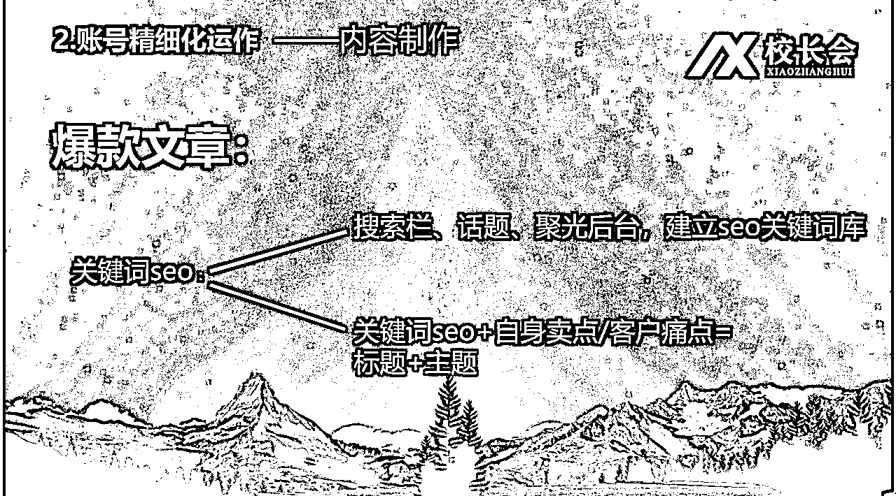

2. 关键词SEO

1. 从搜索栏、话题、聚光后台建立关键词库
2. 关键词SEO + 卖点/痛点 = 标题 + 主题

搜索栏里要分层：
一级关键词是泛流量
二级关键词是偏精准
三级关键词是转化核心

话题和聚光后台都能验证。

举例说明：
一级词“留学”

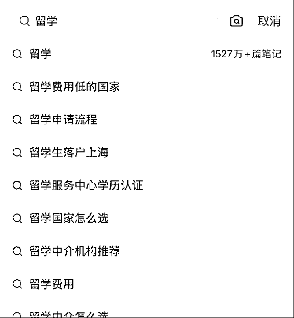

二级词“留学美国”

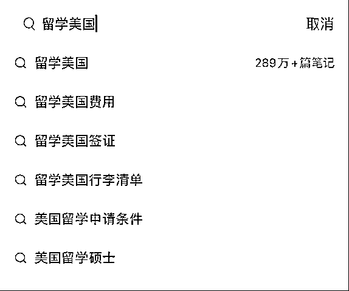

三级词“留学美国需要多少钱”

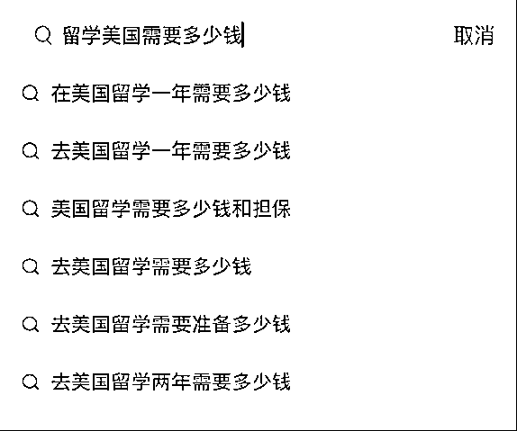

一级是泛词，二级是精准词，三级是成交词。用户搜得越具体，成交意图越强。所以二级和三级词必须重点做，三级词虽然搜索量小，但转化率极高，而且通常包含了上层词。

## 怎么拆解爆款文章？

想做爆款，先去抄作业。找到同行的爆款，一层层拆：

①拆封面
风格是什么？拼图、大字报、颜值图、对比图？
排版如何？有几个字？字体颜色怎么搭配？
第一眼是什么吸引你点进去？

②拆标题
是蹭热点、干货型还是情绪型？
关键词选了人群、功能、场景还是热词？

③拆配图
形式是备忘录、思维导图、实拍还是模板美化？

④拆文案
开头是揭秘、劝告、痛点还是共鸣？
结构是清单体、痛点+方案，还是故事+感悟？
有没有金句？有没有人设植入？有没有情感共鸣和互动引导？

⑤拆钩子
钩子放在什么位置？是图、文案还是评论区？
针对哪个痛点下钩子？这个钩子够不够力？

把每一层都拆清楚，复制爆款就有了。

3. 羊群效应

做爆款离不开人工干预，制造笔记的羊群效应。
核心逻辑是CES机制：
点赞1分，收藏1分，评论4分，关注8分

很多专业玩家都说，能做人工干预的平台才值得玩。一旦可控，效率和确定性完全不一样。

4. 置顶笔记

## 封面决定生死

封面只占整个流程10%，却决定了90%的点击。
常用的封面形式：

1. 生活感分享型：买家秀、KOC同频感

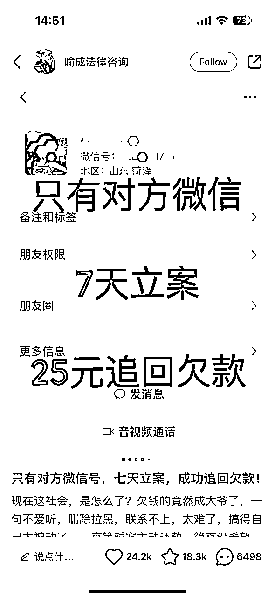

2. 视觉冲击美好型：纯视觉享受

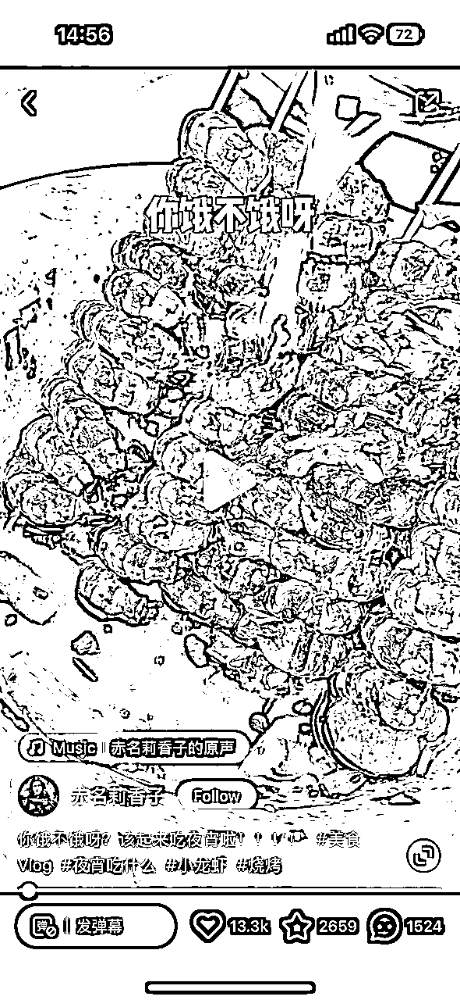

3. 提供价值信息型：学习感、知识感

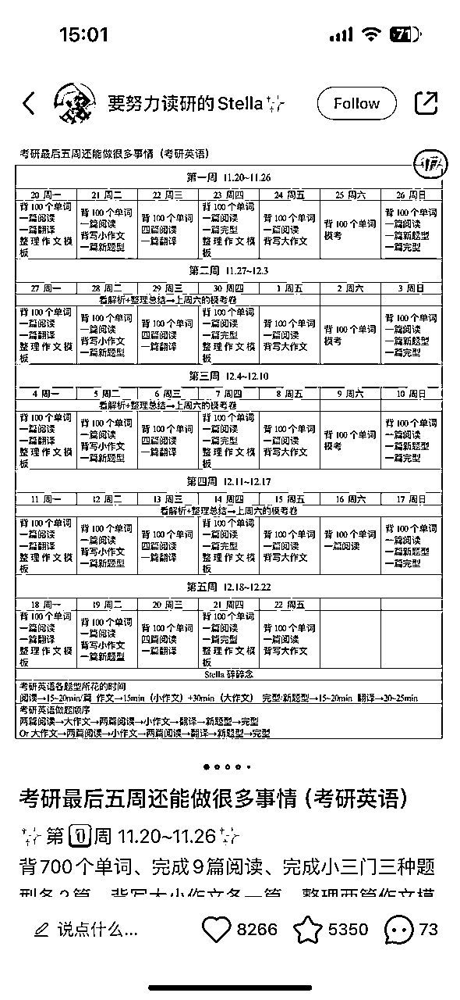

5种常用爆款封面：

1. 图文并茂法
背景图+标题呼应，突出选题，适合营销号和教程类。

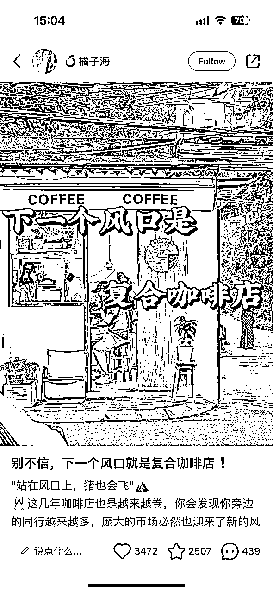

2. 单张大图法
适合高客单、美好生活赛道，如花艺、旅游、民宿。

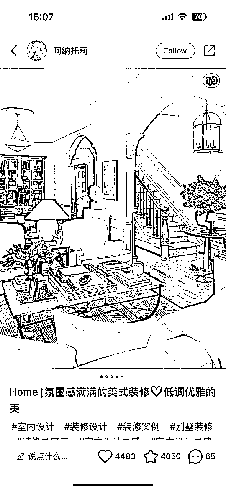

3. 多图合集法
多张图拼接，信息更饱满，适合矩阵复用。适合种草、摄影、家居。

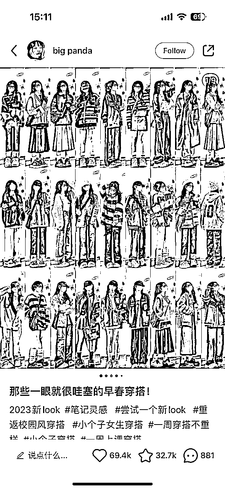

4. 对比冲击法
前后对比反差越大，点击越高。以结果为导向。适合美妆、减脂、种草。

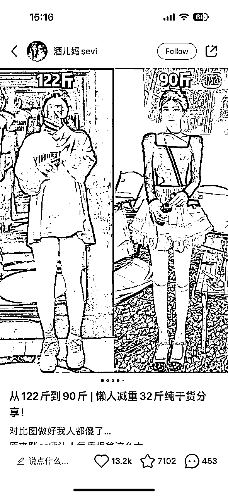

5. 纯文字大字报法
适合干货和互动起号，简单直接，跨行业通用。

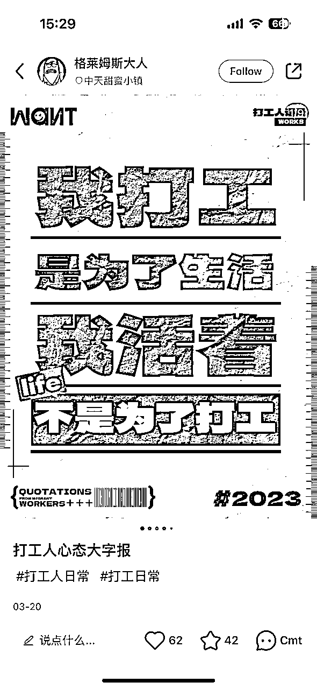

我做小红书这么多年，有个核心观点：别追求完美，先粗糙上线，在迭代中解决问题。有任何问题可以直接来聊，评论区我会回复。

下一篇我会讲如何快速产出高质量文案。