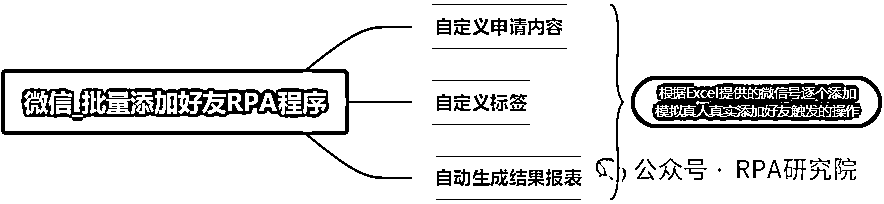
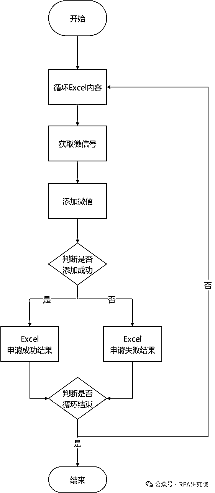
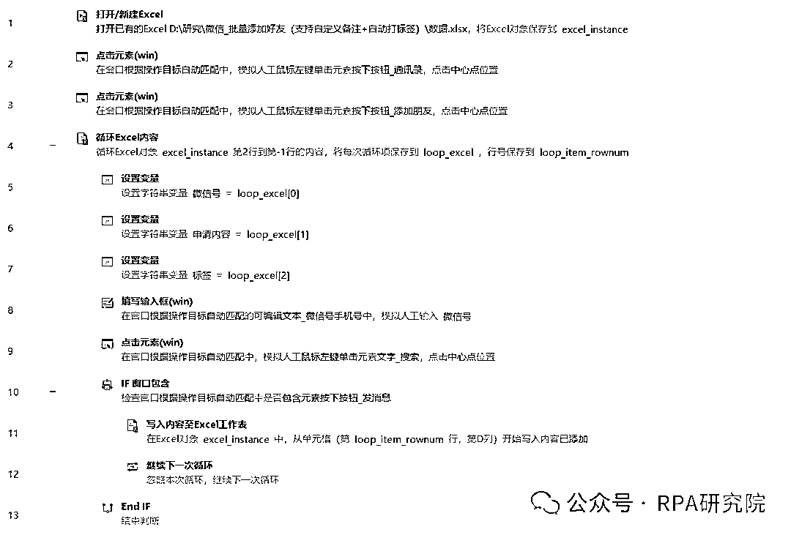
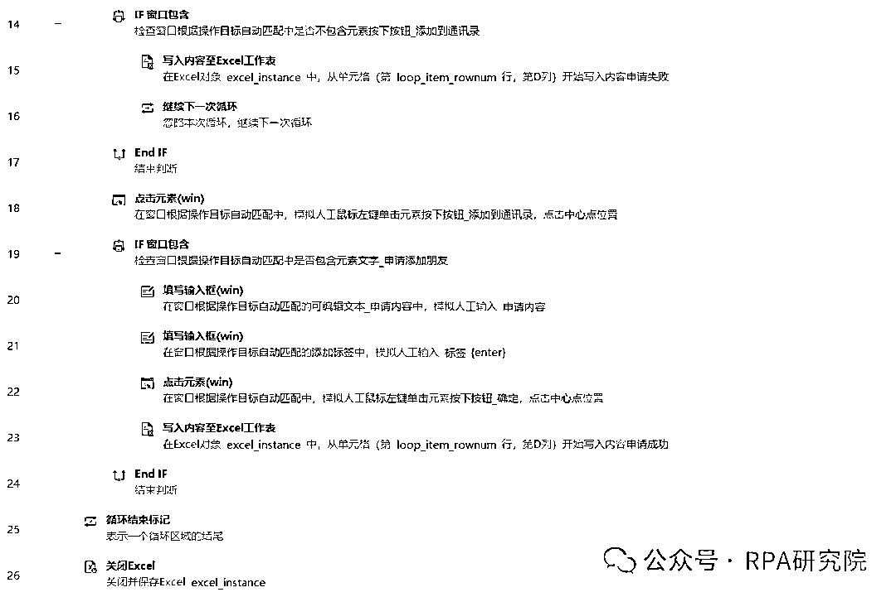

# 微信-自动添加好友RPA程序（支持自定义申请内容+自动打标签）

嘿，朋友们！我是RPA研究院的院长商叁，今天想跟大家分享一个特别实用的微信自动化小工具。

相信很多人都有过这样的烦恼：好友添加请求太耗时，重复操作让人疲惫。别担心，这次带来的RPA流程设计，只需要26条指令，就能搭建出一款自动添加好友的程序，让你从繁琐操作中彻底解放出来，把精力留给真正重要的事。

🚀 这个程序是做什么的？

简单说，这是一款专门为微信用户打造的自动化助手。借助RPA（机器人流程自动化）技术，它可以高效打理好友关系，支持批量发出好友申请，同时还能自定义申请文案、自动给好友归类打标签、自动输出结果报告。当然，仅作为学习交流用途，千万别拿去做违规的事情哦。

（这是达人商务场景下的实际应用）

🎟 它能帮你实现什么？

1️⃣ 申请内容随心定制：你可以按照自己的风格，设定独一无二的加好友话术——一句有趣的问候、一段简洁的自我介绍，或者说明来意。这样一来，每条申请都更有针对性，也更容易被对方接受。

2️⃣ 好友标签自动分配：程序会按照你预设的规则或条件，在成功添加后自动为好友打上对应的标签。比如根据对方所在城市、行业、兴趣等维度归类，方便以后做精准沟通和管理。

3️⃣ 结果报表自动生成：批量操作结束后，系统会为你整理出清晰的报表，包含申请失败、申请成功、已添加三种状态，所有结果一目了然。

🛠 业务流程怎么走？

📟 核心代码（基于影刀RPA）

🥂 关于我

我是RPA研究院院长商叁，坐标广州。作为一名拥有12年经验的互联网老兵，目前在一家年产值8亿的电商公司担任RPA技术负责人，重点推动抖音、快手、视频号、拼多多、唯品会等多个平台的RPA业务程序开发。

如果你也对RPA技术感兴趣，非常欢迎一起交流探讨！