# Temu半托管，下一波红利窗口已经打开

各位朋友大家好，见字如面，我是七喜。今天跟大家聊点干货。

过去一年我们一直在Temu上做小规模测试，虽说成绩不算大，但也积累了一些实操经验，也曾在这边输出过分享，被置顶后不少朋友来找我交流，甚至被赚钱官方邀请做过实战对谈，还担任过两期航海的教练，和大家一起摸索一起赚钱，在此感谢赚钱官方的认可。

现在Temu在全力推半托管，平台的买手团队也非常积极在邀约商家入驻、上链接，动静之大，仿佛要把亚马逊的商家一网打尽。

这篇文章，我想重点聊聊Temu当下的整体态势，以及半托管模式里藏着的机会。

## 全托管当下的体感

Temu一年左右的高速发展是有目共睹的，全托管现在已覆盖50多个国家，用户规模达到2.263亿，类目渗透几乎无死角，不少朋友已经在上面赚到可观利润。

门槛很低，试错成本也低。只需要个人身份证加一张银行卡就能快速开店，之后就是重复的上新、核价，靠铺货量来对冲低价。

此刻，全托管的人力资源正明显向半托管倾斜，像买手、核价师、图审等岗位的响应都在变慢，处理问题也拖了不少时间。

这并不代表全托管就此没戏。就在刚结束的3月航海里，上岸率依然很高，大家反馈的正向信息也很多。

所以现阶段，只要精细化运营，找准有壁垒的好品，全托管依然有得做。

入驻细节可以看我之前的帖子，或在赚钱内搜索Temu即可。

另外，关于Temu被吐槽罚款、强迫降价的声音一直很多，这事见仁见智吧。平台要盈利，商家要活下去，本来就是互相博弈。

全托管的内容赚钱里已经很多了，这里就不展开，下面进入半托管的主题。

## 半托管的机会与风险

### 模式介绍

Temu半托管到底是什么？

简单来说，就是商品放在境外本土，商家自己接入消费者订单并负责履约发货。

发展节奏如何？

2024年3月15日率先在美国站上线，后续站点也在持续放开。

商家要做什么？

开设半托管店铺，负责商品上架和库存维护，可以省去寄样、审版、图片制作这些流程。

平台要做什么？

把商品推上美、欧站点进行售卖，并承担客服等工作。

### 全托管 vs 半托管

半托管主要瞄准的是货在境外的亚马逊卖家、独立站卖家，核心诉求是帮他们消化库存。

和全托管不同，半托管由商家自行发货，没有寄样审版的环节，而且商家对商品定价有一定自主权，但上限不能超过亚马逊。Temu目前对半托管商品的定价规则大致是亚马逊同款前台价的85折。也就是说，相比全托管，半托管到手利润要高出不少。

有种直觉很明显：Temu确实在把亚马逊的卖家往自己这边引。

### 半托管现状观察

半托管目前还处于起步期。已有海外仓的商家已经开始出单了，反馈流量非常猛。没有海外仓的第一批商家，首批货还在海上漂着没入库。

最近买手几乎在疯狂催商家入驻、上链接，晚上十点还在打电话催。这种强烈的求货状态，上一次出现还是全托管刚上线那会儿。彼时买手求着卖家入驻，类目补全后他们就基本不搭理新小卖了。

从买手如此着急催上链接来看，半托管现在仍处在极度缺品的阶段。

### 需要警惕的风险

讲机会不讲风险就是不负责任。我认为主要风险有这几项：

1. 囤货与仓租风险：半托管必须自建或租赁海外仓把货发过去，销售中一旦出问题处理起来很麻烦。做过亚马逊的都懂。
2. 平台跟价：大概率会复制全托管的打法，等品类数据积累够了，就要求商家之间竞价。
3. 被跟卖：全托管卖家深有体会，好不容易养起来的爆品，很快被跟卖，而且价格更低，平台为了利润自然会把流量给低价款。你的货还在海上，流量位已经被顶掉了。
4. 罚款：Temu=罚款的代名词，外界都这么调侃。主要是侵权和质量问题。把控好合规就能大幅降低风险。
5. 断货：海运到美国约25天，入库再算上5天左右，基本要30天。没有30天的安全库存，很容易断货，断货后流量就会被替代。要么压资金囤货，要么承受流量流失。

## 半托管实操流程

### 入驻

入驻路径和全托管基本一致，开店时在店铺类型里选择【半托管店铺】即可。

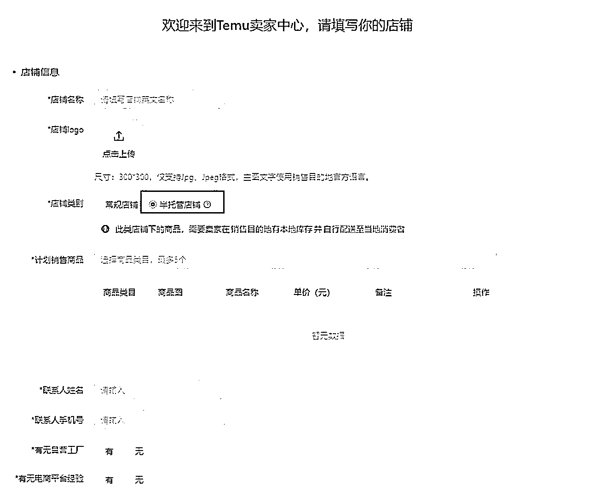

### 商品发布SOP

#### 1：半托管店铺的商品新建流程可以参考普通店铺的新建流程。
#### 2：务必区分好经营站点。
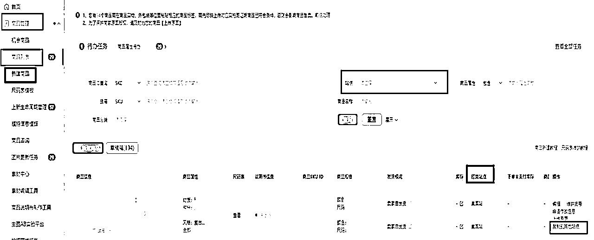
#### 3：新建商品时需要选择【承诺发货时效】和【运费模板】，具体参数在新建商品页面可以看到；
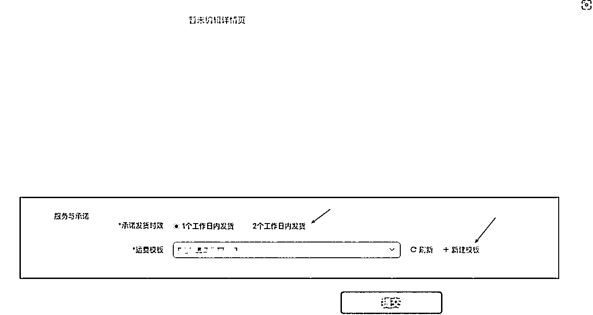
#### 4：配置运费模板
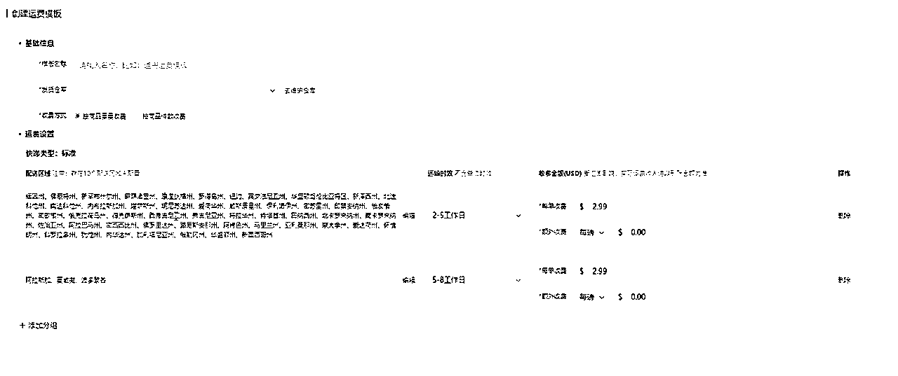
#### 5：设置库存：卖家中心-商品管理-商品列表-库存；
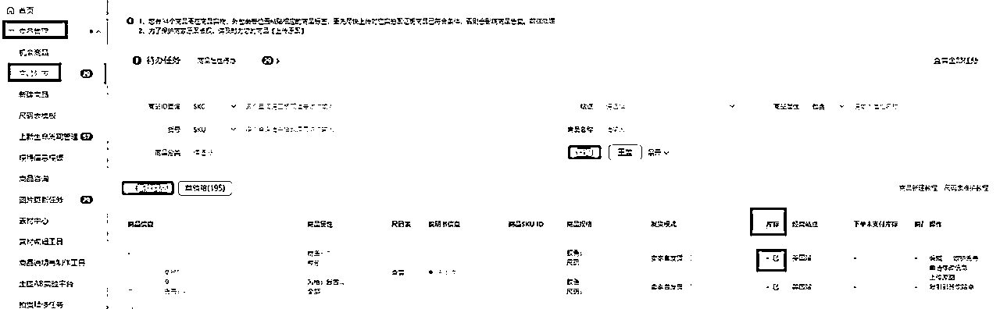

以上就是上品的标准动作。

### 订单发货SOP

#### 1：查看订单：登录商家后台，进入半托管店铺，首页点击【配送管理】-【仓库地址管理】即可进入订单管理。
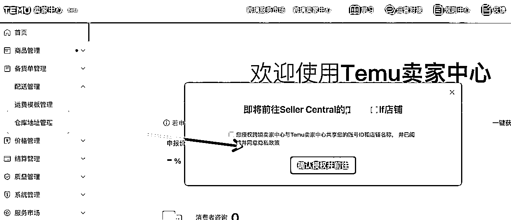
#### 2：创建发货仓库：进入“配送管理”-“仓库地址管理”，可查看发货仓库列表信息；
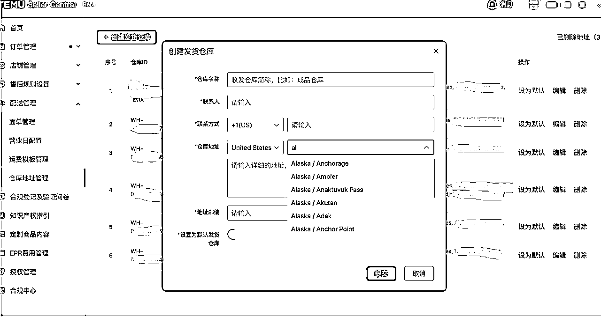
#### 3：商家自发货

##### 1：发货步骤：在订单列表点击“导入运单发货”，展开发货抽屉。每个包裹对应一个运单号。按线下打包情况选择“单个运单发货”或“拆成多个运单发货”。
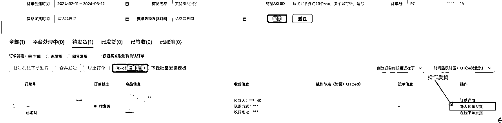
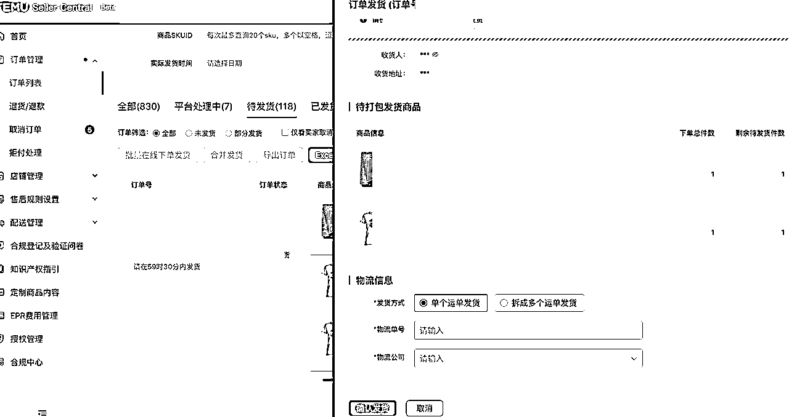
##### 2：批量发货
1.勾选待发货订单，点击“导出订单”下载信息，再下载“批量发货模板”，手工填入运单号和物流公司。
2.点击“Excel批量发货”上传文件，完成发货。
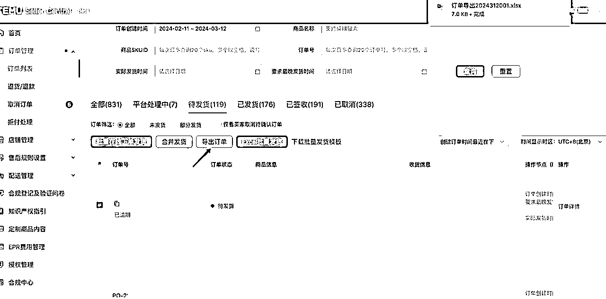

#### 4：在线下单发货，使用平台合作物流

适合在美国本土没有发货渠道、想在后台直接下单发货的商家

##### 发货步骤：点击订单列表“在线下单发货”，跳转到下单页。
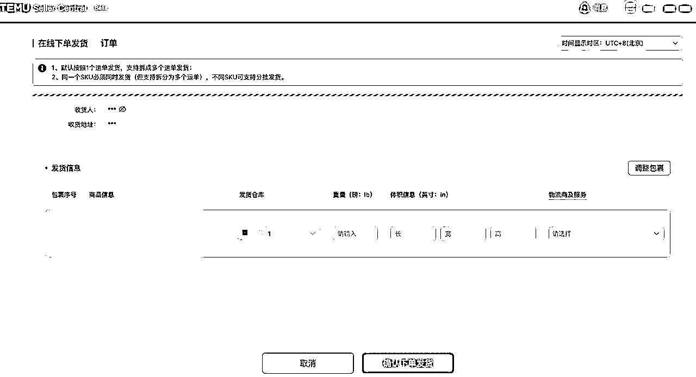
##### 点击“编辑包裹”，按实际打包勾选商品，拆分包裹。
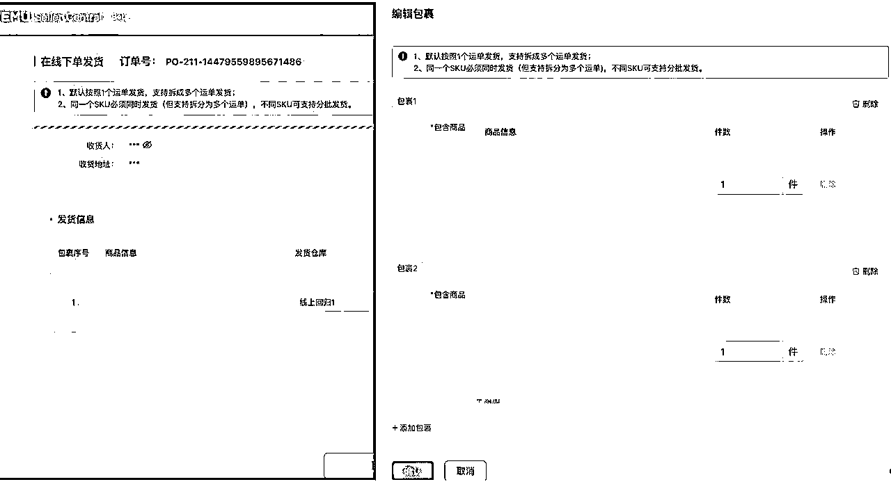
##### 下拉选择实际发货仓库，并根据实称填写包裹重量【单位：磅】和长宽高【单位：英寸】。
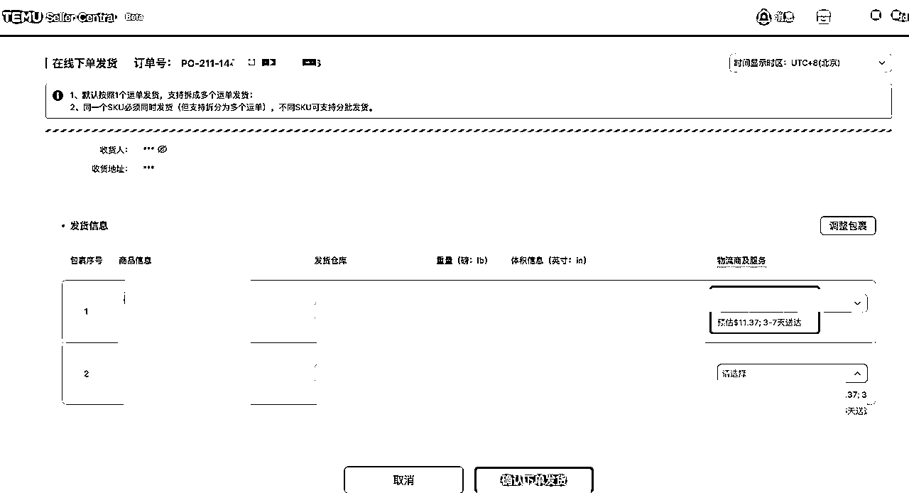
##### 根据系统推荐的物流服务、预估运费和时效选择最合适的方案，确认后点击“确认下单发货”。提示：页面数据为预估，最终运费以账单为准，时效以物流商为准。
##### 等待约10秒后返回运单号，下单成功后无需再上传运单号。
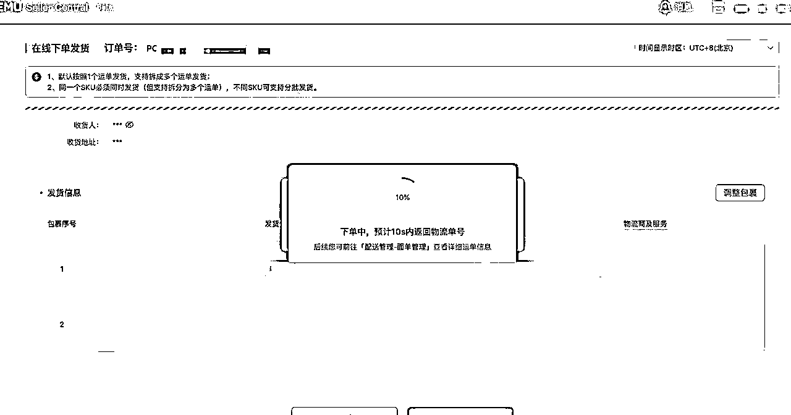
##### 打印面单：在线下单成功后，进入“配送管理-面单管理”查看包裹、订单和运单信息，点击“打印物流面单”获取面单打印贴包。
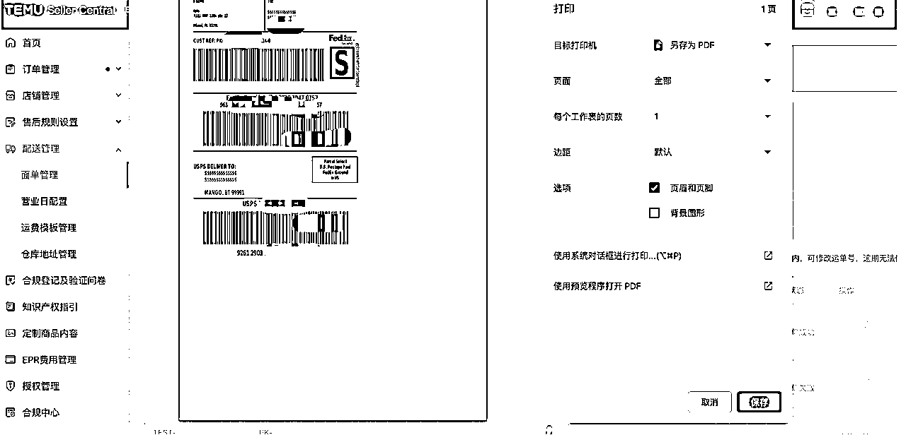
##### 预约取件：下单成功后，商家可前往官网预约“快递员上门取件”或“自行送至网点”。
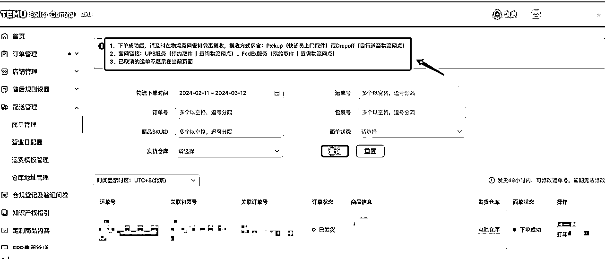

以上是自发货的标准流程。

另外也可以接入Temu的对接仓，平台以线上对接方式把订单推送至商家入驻的对接仓，对接仓完成拣配发货后，运单明细再通过线上回传至Temu平台。

## 结语

读到这里，大家对Temu半托管应该有了初步认知。按现在这套逻辑，海外卖家想在Temu上卖货，只需要找一个国内主体信息注册店铺即可，货和发货都在当地，在国外的华人更是可以直接用自己的身份信息操作，门槛极低。

半托管目前仍处在早期，有海外仓资源的伙伴可以重点关注。

希望这篇分享对你有帮助。

另外，手上有海外货盘资源的圈友，欢迎私我发链接！

祝大家2024年持续暴富，扬帆正当时，一起龙哥盟！

以上部分图片来源于Temu卖家课堂。