# 一套RPA流水线，把“职场柠檬”式爆款量产出来

大家好，我是龙哥，来自智能武器研究所。我们团队的日常，就是把AI和RPA焊成能赚钱的生产工具，并且定期把工具和背后的运营思路放出来。这期聊的是👸号爆文自动化，也是我第二次实战任务的完整复盘。

新版资料已经放出来了，想看最新内容的可以直接去新地址。

上一轮任务结束后，我写过一份“纯数据流打法”，最近被官方加了精华。
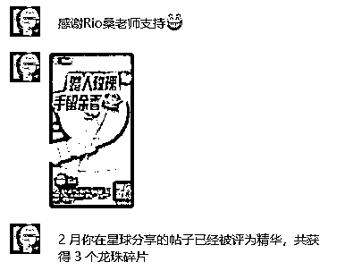

开心归开心，我也看到旧方法的局限：那篇东西太炫技，像一堆散落的零件，不够聚焦。这次我干脆把零件拧成一条完整流水线，直奔变现而去。实战中反复打磨，也确实演化出一套更凶猛的玩法。

航海教练当时推荐了好几个潜力方向，其中点名“职场关系学”赛道，说“职场柠檬”这类账号特别吃流量。还提到了模板化结构、内容重组、AI分段扩写。我听完觉得：这事我能干。
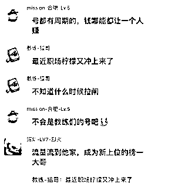
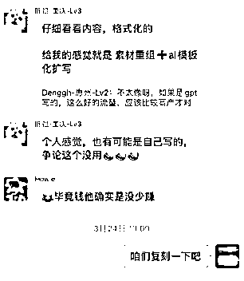

于是说干就干。我给自己定的目标是：把“柠檬号”做一次深度复刻。注意，这不是洗稿，而是拆解内容骨架，再用同一种风格重新长出血肉。有点像大厨在外头吃了一口招牌菜，回来就能用相同火候复刻出那个味道。高强度干了一个月，终于拿到入场门票。

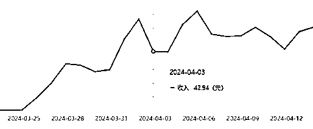

很多人一聊到日更，就喜欢谈“坚持”。在我看来，根本没有坚持这回事。公号真正拼的，是原创续航能力。所以要么不做，要做就做一辈子。一辈子意味着：退休也好，出差也好，休假也好，哪怕生病住院，都不能断更。不断更，就不能让写文章变成一件太累的事。不累，就不能全靠手工。同时，想干到老，内容就得有收益；有收益，质量得过关；质量过关，素材链就得源源不断；素材不断且安全，就不能靠搬。所以我的方案很简单：大模型+RPA全自动写作流水线。

机器负责定向采集、批量成稿、格式化排版、批量入库草稿箱。人只需要在订阅号App里设定发布时间。当然，文章的灵魂还是得人来给。

只要电脑开着、素材源没挂、脑子还在转，这套系统就能一直站撸。所以才叫“站撸式量产”。单篇质量可能打不过手写玩家，但论持久度和产出量，手写根本不是对手。

最近圈内有个“燕子职场30”，一天更新500篇，一分钟一篇，该爆照样爆，平台也拿他没办法。大概率就是同一套打法。但他那种反复洗同一篇的路子，未必长久。真正值得研究的，是既不搬稿，也能持续爆，还能扛住平台AI识别的方法。
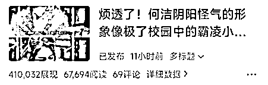
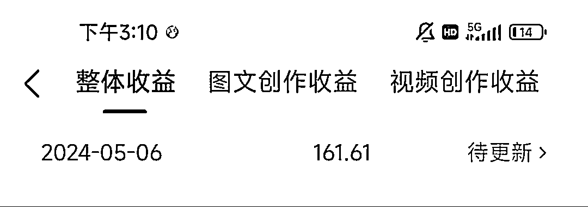

开始吧。

## Part 1：选题定位

我把方向直接锁死在“职场关系学”上。🛰️搜一搜里，类似“柠檬”的小号密密麻麻。其中“薄识君君”流量不比本尊差，又最接近普通人的真实起号路径，所以拿它来拆解。

用分析工具给它做体检。先看更新频率，基本日更，雷打不动每天一篇。再看收入预估：估算逻辑约等于阅读量乘eCPM，拉出最近三十天数据，这个号至少赚5000。接着看标题热词分布：单位出现78次、领导61次、同事18次、体制17次、永远11次、明白10次。“单位”和“领导”几乎是每篇标题的标配，这就是平台给这个赛道打上的内置标签。

再翻到它最早的文章：1月29号开始发职场内容，之后坚持日更，直到2月26号才出第一个10W+。也就是说，他足足硬扛了一个月才开始有收益，后面才进入起飞通道。如果你用同类文章入局，起号节奏大概率也是一样。按常理判断，这赛道从2023年11月火到现在，玩家已经挤到爆，现在进场，没有50篇以上打底恐怕很难冒头，甚至要更多。

要不是之前放话要复刻，我绝不会选这个时间点进场。进场太晚了。

点开它的文章链接：https://mp.weixin.qq.com/s/u68MR8SFRO7wx0iewZnSHA 拆开结构看，几乎每篇都是固定的“总—分—总”骨架。
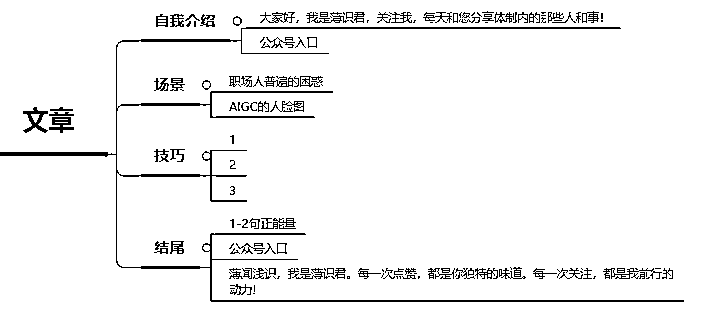

对比本尊和一堆复制者之后，结论很清楚：

- 开头自我介绍和结尾收场，都是固定模版；
- AIGC配图和正文没有直接关联；
- 场景全部挑常见的职场困惑；
- 技巧内容则和场景强绑定；
- 标题全部是“单位里”开头，配一个场景，再加123技巧小标题。

我刷了无数篇10W+爆文，总结出两条铁律：一是场景要能引发共情，二是技巧要真材实料。而且场景的分量更重。因为场景就是话题，话题足够勾人，读者才愿意点进来；人进来了，技巧才有机会被看到。所以找到好场景，基本等于写完了一半。

接下来，就是找场景。

## Part 2：素材采集

最珍贵的食材，只需要最简单的烹饪。素材同样分等级：采集门槛越高，素材越稀缺。采集的人越少，使用的人越少，稀缺度就越高。如果一类素材没人能让它“出土”，那你第一个用，你就是原创本人。所以我的策略很直接：专挑高门槛素材下手。

哪些算高门槛？第一类是封闭付费社区，比如航海手册。只有会员能打开，就算你付费了，管理员也不让你带走。
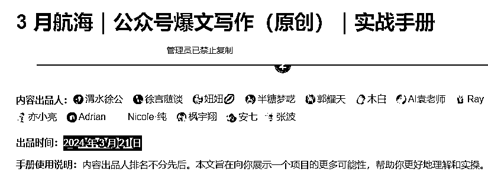
但，照样能拿到。

第二类是付费内容平台，像飞书、小报童。它们默认禁止复制，想拷贝会弹“无权限”。
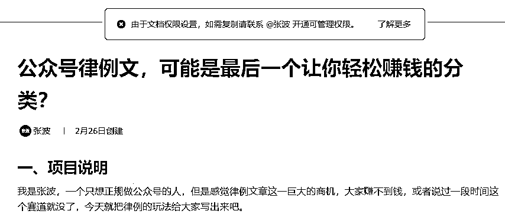
但，照样能拿到。

第三类是只有手机端才有的信息流，比如脉脉热搜榜。没有网页端，只有手机上能刷。
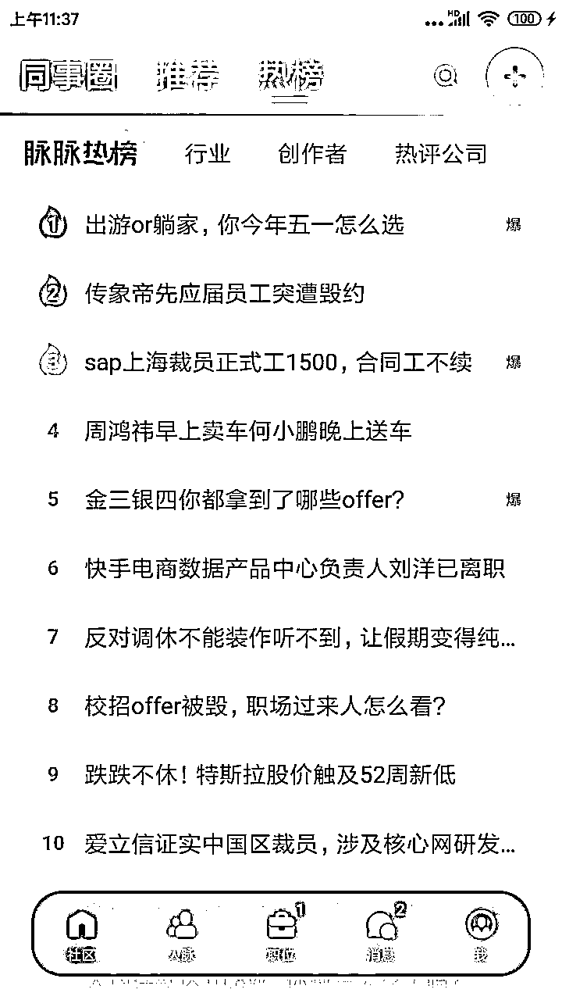
但，照样能拿到。

看见没？只要屏幕上能渲染出来，技术上就没有抓不到的东西。万一真抓不到，欢迎丢给我挑战。所以素材从来都不缺，缺的是发现素材的眼睛。

当素材多到爆炸时，怎么判断哪条会爆？我只看两个指标。

一是展示流速：展示量除以发布时长。流速越高，说明平台正在给量，选题方向正确；但热度窗口一过，流速就会往下掉。二是阅读率：阅读量除以展示量。阅读率高，说明标题够吸引人，也就是点击率好。在海量素材里，两个指标同时满足的，大概率流量不会差。

我写了个脚本，专门捞这类文章。回到“柠檬号”的需求上，我要的素材必须可持续、够垂直。最后锁定一个头条号，每天稳定更新4-5篇职场故事。脚本定时轮询它的主页，只取前一天数据最好的那几篇。小技巧：先让文章在头条上做一轮自然筛选，再收回来用。

## Part 3：AI加工

素材收回来，进入AI加工环节。先问个问题：写一篇完整文章，最少要发几次请求？

答案是3次。

第一次：把采集的素材和“职场困惑创作者”角色合并成第一条Prompt，发出一次，生成章节①。第二次：把刚生成的①和“职场技巧创作者”角色合并成第二条Prompt，发出一次，生成章节②。第三次：把①+②的内容交给“职场标题创作者”角色，发出一次，生成最终标题。

群里很多学员做“伪原创”被平台摘掉原创标，原因都一样：表达换了，但逻辑链没换。所以这里分享一个能绕过查重的思路。看仔细，能看懂说明你很有天赋。

写完后，可以到文丕丕的相似度检测页做复验。文本相似度可用于原创检测、抄袭鉴定、论文查重等场景。相似度越大，抄袭嫌疑越高；数值范围是-100%到100%。法律上的尺度大致是：表达元素、人物设定、人物关系、情节事件等内容，相似处达到5个点或10%以上，可算轻微抄袭；达到30%，就是严重剽窃。

上述手法，至少能做到下面这个效果：
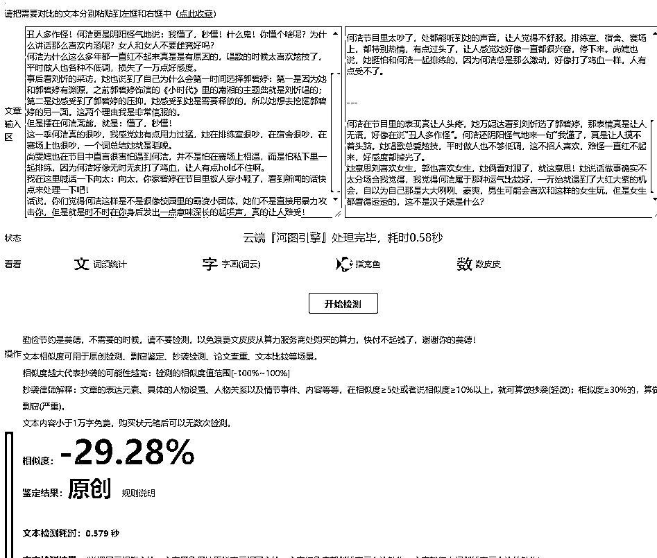

有人会问：一次生成100篇，要发300次请求，KIMI每小时只有100次额度，怎么破？研究所有个土办法：同时挂多个KIMI对话窗口，每发一条就切一个窗口，等于无限连。还有人问，某个用途的提示词怎么写？答案很简单：不懂就问KIMI。当然，KIMI给你的初稿通常很水，只能当0.1版本。之后的版本，得靠你自己的脑子去磨。
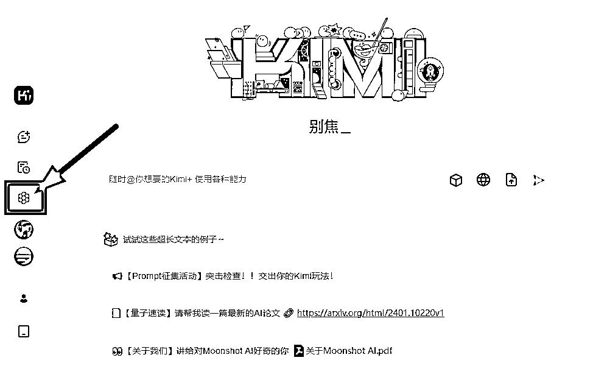
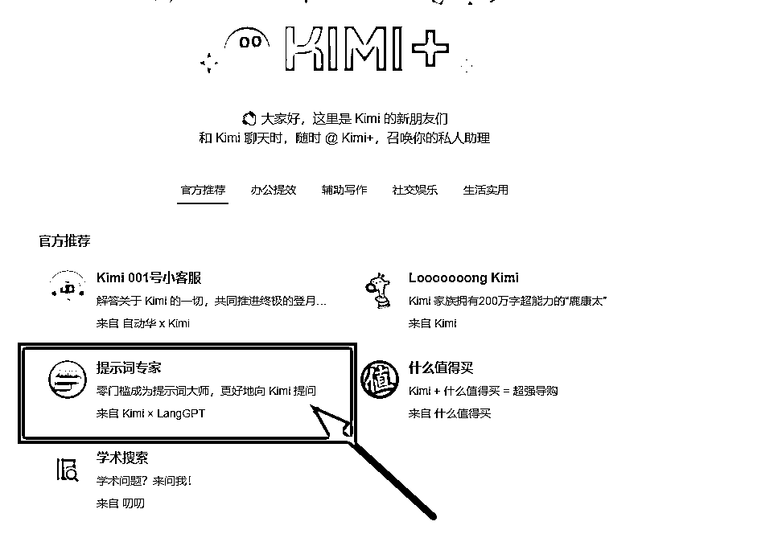

图片部分，我选了“云界AI”平台。主打免费，出图速度快，良心。生图指令就一句话：50岁亚洲男性领导，面向镜头，西装，严肃表情，办证中心内，背后阳光照射，大头照。一条指令能出4张风格近似的图，批量生成，存到本地备用。AI生图最大的优点就是高清且没有版权纠纷。
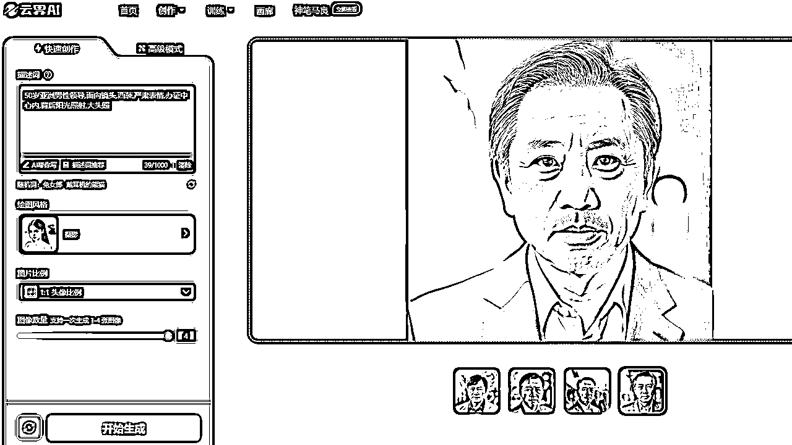

## Part 4：编辑润色

菜洗好切好，接下来是下锅。先去掉难消化的部分。
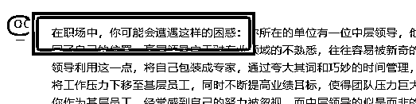
然后在文章里配图：随机抽一张AI图，上传图床，拿到图片链接。

接着，在①的随机行插入图片代码，用换行符把①和②拼接到一起。
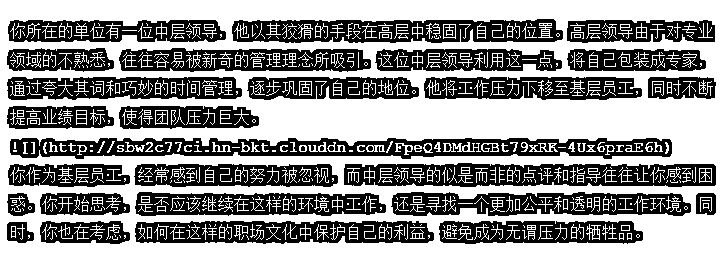
想突出金句，就直接随机抽句加粗，省事又够用。

写完把稿子丢到5118查违禁词，发现违禁词就用拼音替代。
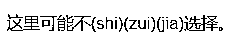

但核心中的核心，是去AI味。

现在各大平台都上了AI创作识别算法，无论你是原创还是洗稿，只要被打上“AI生成”标签，曝光量就会很难看。

市面上去AI味基本靠手改，累得不行。有没有自动化办法？有。

原理稍微有点绕，我尽量通俗讲。机器学习的底层是神经网络理论，它会给每个语言元素分配一个向量，也就是多维数组。计算机通过计算向量和向量之间的数值关系，找到其中隐藏的规律。识别AI文本，并不是抓固定词组，而是总结出AI写作用词之间的统计关联。只要符合这种关联，就判定为AI创作。所以去AI味算法要做的，就是尽量不影响阅读，同时打断这些关联。

做个示范。随便找一篇爆文，让KIMI做一层简单改写，复制到AIGC-X检测器（http://aigcx.people.cn/AIGC-X）测试，判定为机器生成。然后稿子丢进去AI算法跑一遍，再测，结果显示为人工生成。不信？继续挑战5118的AI内容检测器。随便找篇爆文，让KIMI简单洗一遍，放到 https://www.5118.com/act/aidetect 去测，AI撰写率85%。然后稿子再过一遍算法，再测，AI撰写率直接归零，系统判定为人工撰写。

最后还有一个细节。我一直用Markdown格式写作，而👸号正文是原生兼容这种格式的。用md.aclickall.com这个渲染站，把CSS样式调好，文章一贴进去就是好看的排版，而且免费。
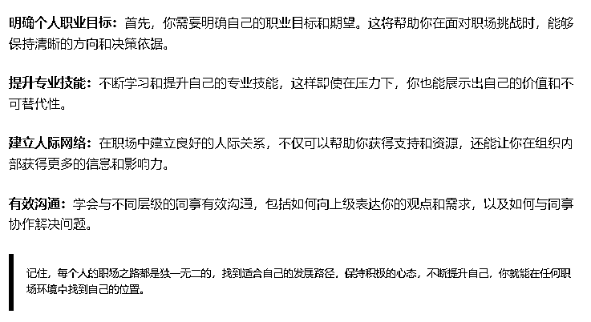

## Part 5：发布

菜已经做好，该端上桌了。写一个脚本，直接驱动创作者后台，自动完成所有步骤：配置标题、封面、摘要、合集、原创声明、创作来源，最后统一保存为草稿。然后你打开订阅号App，翻到草稿，做最后的人工润色。

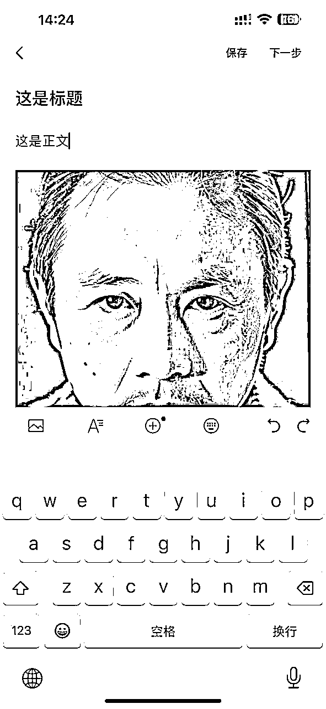

强烈建议手动重写一遍标题。标题是文章的灵魂，机器永远琢磨不透人心。有些事只有人懂。可能只改一两个字，流量就是天壤之别。再花一分钟通读整篇，选一个良辰吉时，提交，收工。

## 结尾

整套系统一共390行代码。我在阿里云租了台低配电脑，每天跑50篇文章，全流程大约1.5小时。按每小时约0.1元算，合计成本不到两毛钱。如果你手头有闲置电脑，成本直接归零。
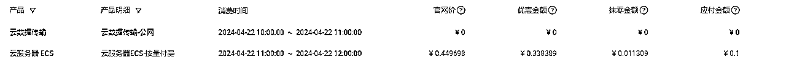

全过程自动化，不需要人盯着。想睡觉睡觉，想出门出门。目前我还没跑出10W+，流量分成不稳定，少的时候一天几块钱，多的时候有一百多。但已经知足了，毕竟就一个号。真想多赚，就多开几个号，这套系统完全支持。同一批素材，每次跑出来的文章都不一样。做到极致，可以24小时不停地产出。甚至可以把成稿分发出去，交给其他人去发布。

这就像快递行业：机器完成绝大部分重复劳动，人完成最后一公里配送。一个生态就出来了。

有人会问：这么搞，还有写作乐趣吗？

第一，我原本可以让机器直接发布，但还是特意保留了最后的人工修订环节。这一步表面上去AI味，实际是在做风险隔离。以后平台对AI捏造内容只会越抓越严，保不齐哪一天就秋后算账。保持一个手写作者的原创人设，对将来可能的人工审核非常有利。

第二，写作乐趣并没有消失，它被留在了编辑环节，也是最耗时间的一个环节。先讲什么、后讲什么、段落之间怎么过渡，这些都需要精心策划。必须把写作大纲固定下来，才能保证每批出品口味一致。就像一台印钞机，你的精力应该花在校准参数上，而不是一张一张地手绘。

第三，我们做流量分成，真的是为了享受写作吗？这是在商业社区，又不是文艺社区。回归商业本质，投入产出比才是坚持日更的唯一动力。

复刻“职场柠檬”只是一个引子。我想说的是，这套打法完全可以平移去其他赛道：发现缺口，快速占位，把流量吸光。用《三体》里那句话：“毁灭你，与你无关。”所以，黑暗森林里不要随便发声，真正赚钱的大佬都在闷声干大事，哪有时间陪你从0到1。

看到这里，你应该已经明白这套打法的内核，也大概知道我们研究所是干什么的：一个把AI和RPA焊在一起，专门研发“能搞钱工具”的地方。

我们欢迎三类人：

1. 凡事优先想到用机器的人；
2. 搞钱直接考虑矩阵的人；
3. 决定要干就干一辈子的人。

想深入了解，找我要链接。但基础教学不负责，太LOW的问题一律不回。

PS：最近我计划开一个小报童，一边做项目一边更新笔记。每天都会遇到新问题，找新解法，写代码，做测试，做复盘，最后把沉淀下来的代码同步存到那个专栏里。