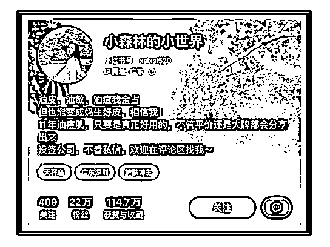
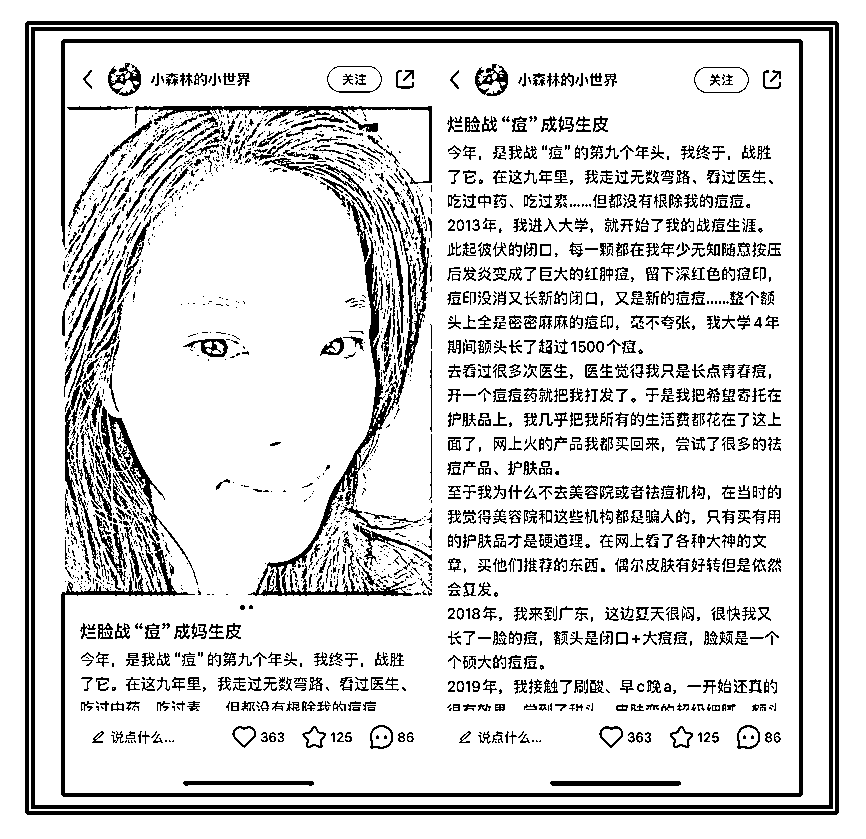
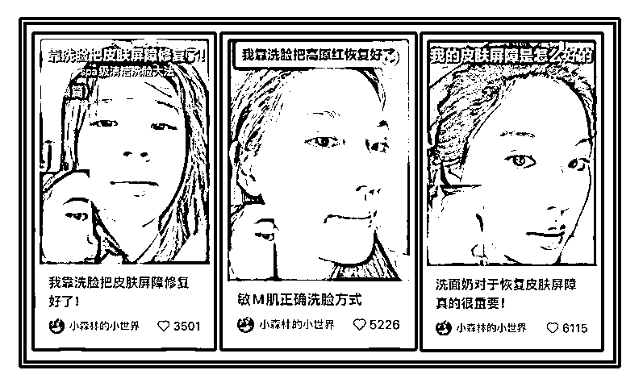
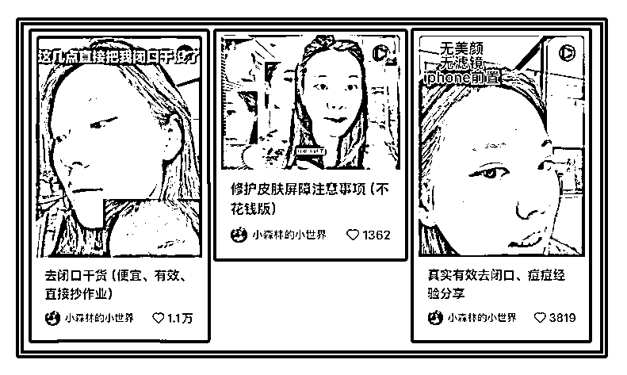
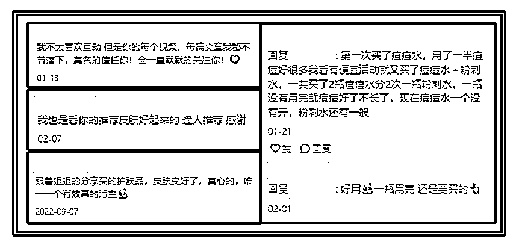

最近小红书公布了一份“成长突破买手”榜单，护肤类目只选出了两位，其中一位就是账号“小森林”——粉丝量不过21万，笔记也才发了205篇，却稳稳拿下了一个名额。

在这么一个竞争激烈、转化门槛又高的领域里，她靠什么突围？子木把她的账号从头到尾翻了一遍，发现她的打法，很适合想做买手IP的新手参考。

.

先说赛道：她选的是“油皮护肤”，同时叠加了敏感肌、痘痘肌的标签，属于护肤里更细分的垂类。

这个“敏感肌”设定很聪明——现在大家越来越认同一个观念：敏感肌能用的产品，往往更温和、更安全、更天然。再加上敏感肌、痘痘肌人群本来就在不断扩大，所以虽然是细分方向，潜在受众却不少，而且只会越来越多。

.

再看简介：小森林的自我介绍，一眼看过去就很有说服力。

“11年油痘肌”——说明她的经验是真实踩坑踩出来的；“平价、大牌都用”——意味着学生党和上班族，只要你是油皮，都能找到参考；“没签公司”——这一句太加分了，瞬间让人觉得她不会被资本绑架，推荐的东西更可信。

.

关于IP故事，很多小伙伴都在问：到底该怎么写？

子木想说的核心逻辑是：IP故事的存在，就是为了告诉别人“我在这个领域里很懂，你可以相信我”。

那还有什么比“曾经满脸痘，后来靠自己调理成妈生好皮”更有说服力？这本身就是活招牌。

所以，这里有个公式可以直接套用：

我原本是什么状态 + 当时的痛苦感受 + 我做了什么努力 + 现在变成什么样 + 现在的感受 + 以后会持续分享经验

不管你做护肤、教英语还是做其他领域，只要把这个故事讲清楚，大家就会认定你是行家，自然更愿意看你的干货、跟你下单。

.

再说选题：很多人的困扰是“不知道发什么”，但实际上，选题往往藏在自己的亲身经历里。

比如，认真护肤的油皮、痘肌姐妹，一定经历过闭口、祛痘、修护屏障、防晒这些难题——这些东西你痛苦过，其他姐妹也同样痛苦过，拿出来就是天然好选题。

所以做选题，可以多翻翻自己的“困难清单”：

上班族会遇到怎么向上沟通、怎么不背锅的问题；

宝妈会遇到孩子写作业拖拉、有心事不跟爸妈说的问题；

只要这些难题后来被你用有效方式解决了，那么“难题+解决方案”的组合，就是一篇很真实、很圈粉的内容。

.

封面和标题方面，小森林特别会用“对比”。

文字上，她用“烂脸变身妈生皮”制造反差；视觉上，她晒出护肤前后的照片，一眼就让人看到变化；还有类似“反向给Tony老师安利洗护产品”这种人物反差，也特别抓眼球。

这些对比，一方面强化了她“护肤高手”的形象，另一方面让人忍不住点进去看“到底怎么做到的”，点击率和信任感都上来了。

另外，小森林挑标题关键词也非常准，这些词完全可以收藏下来，以后写笔记随时能用：

① 便宜、有效、真实
比如：真实有效瘦小腿经验分享；冷白皮养成干货（便宜、有效）

② 直接抄作业
比如：练成流利口语（不花钱，直接抄作业）；北欧风装修干货（直接抄作业）

③ 不花钱版
比如：马甲线练成注意事项（不花钱版）；三天入门PS（不花钱版）

.

最后说点实在的。

小森林能靠20多万粉就冲进护肤买手榜，技巧和方法是一方面，但真正核心的，是她的护肤方案真的有用、推荐的东西真的靠谱。用户一次一次跟着买、愿意把她推荐给别人，这才是她立足的根本。

子木常跟学员讲：做个人IP，不只是做流量、搞噱头。前提是产品足够好、足够有价值，再借助自媒体和平台的流量，让更多人看见。流量只是放大器，产品才是一切的根基。

细看会发现，有些博主一阵子就消失了。原因无非两种：产品没打磨好，慢慢没声音了；或者自己动摇，换了方向。

想赚长期的钱、吃到复利，还是得回到最笨也最稳的路——把产品打磨好，把价值给到位。