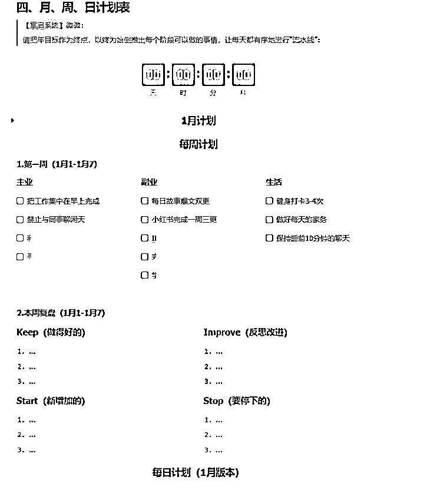

# 30岁没房没车，我用一年让赚钱门票翻了35倍：普通人的破局复盘

我是微微，一个刚向恋爱11年的女友求完婚的30岁男人。按世俗标准，我曾经“要什么没什么”：没房没车，没有天赋异禀，也没资源背景。但过去一年，我却在赚钱里走出一条半年前想都不敢想的路——不仅赚回了门票钱，还在近半年内，把门票的“回报倍数”做到了35倍。

这一路，要感谢理白老师那篇《从3000元到300万的10个赚钱思维》给我的启发，也要感谢靠谱姐那句“没有人不辛苦，只是有人不喊疼”。它让我真正明白：普通人缺的不是能力，而是心态。从0到1的过程，注定是不断自我怀疑、反复拉扯的；你会在努力-放弃-再努力之间转圈，觉得看不到光。可一旦迈过那道坎，1到10的速度会快到连自己都吃惊。前提是，你敢不敢信自己。

我是典型的INFJ，盖洛普前五落在沟通、交往、个别、体谅、成就。放在以前，我会觉得这些标签是“我不行”的理由；现在我知道，它们只是起点。下面这些“术”，算不上多高深，但每一招我都真金白银地试过。

## 一、消失术：先让自己离开烂圈子

曾经的我，和很多人一样，上班摸鱼、下班酒局、周末闲聊。身边朋友总在抱怨钱难赚、社会不公、怀才不遇。直到某个雨夜，我听着他们侃侃而谈，突然惊醒：我脑子里想的，嘴里说的，手里做的，原来都被这个圈子限定了。一个人整天泡在这样的环境里，凭什么指望人生突然变好？

那晚之后，我开始执行“自我消失”：拒绝无效饭局，不刷没营养的群聊，把时间全砸在写作上。我好歹有十年写作、五年阅读的老底子，可刚开始投稿照样被拒成筛子。前两个月，我连续投出32篇两千字以上的稿子，全部石沉大海。但当我彻底从旧圈子里“隐身”，停止讨好和合群，专注研究👸号的调性、结构和选题后，第38篇稿子开始，100元以内的征稿号我基本十投十中，月入也稳过千元。

所谓消失术，核心不是玩消失，而是把注意力从“他人评价”收回到“自我成长”。做到这几点就够了：学会独处，给大脑留白；每次赴约前问问自己这顿饭值不值；对不相干的事敏感度降低；勇敢说“不”，不讨好任何人。你愿意沉淀多久，愿意忍多久的寂寞，决定了你能走多远。

## 二、冥想术：盘清底牌再出手

投稿稳定后，我反而更焦虑了。因为写一篇拿一篇稿费，本质还是“一份时间卖一次”。我不想继续给平台当“高级打工仔”，想把同一份时间卖很多次。但跳出去之前，我深吸一口气，用正念给自己做了个“资产盘点”：手上有写作拆书、改稿技巧，有👸号课程，有几百个号主和助理人脉；天赋上，我擅长沟通和体谅他人。然后冥想清空杂念，只留下几个关键词：👸号、写作、号主圈。答案顺理成章地浮现：与其一直给别人供稿，不如自己成为一个号主，把能力沉淀成可变现的资产。

这个步骤帮我避开了“盲目跟风”的坑。别急着问自己缺什么，先看看手里有什么。把焦虑写下来只会更焦虑，倒不如坦然承认“我是小白”，再从缝隙里找突破口。

## 三、守心术：长期主义需要“定海神针”

做👸号后，我的生活变成一台高强度的机器：日更365天，日均输出3000多字，一年写了100多万字；无偿改稿562篇，改稿建议写了87万字，带了100多个学员。然而，收获远比想象中来得慢，质疑和攻击倒是先到了：免费分享时没少被夸，一收费就有人骂；凌晨三点改稿到眼睛发酸，对象泡的热茶凉成一杯冰水，我也顾不上喝。

后来我看到靠谱姐分享的帖子里有句话：“如果你做的事情所有人都理解，那你得多平庸啊。”心一下就定了。我开始给自己定三条铁律：

第一，信吸引力法则。每天晨读那些“你关注什么，就会吸引什么”的句子，给自己心理暗示：我要做到，我能做到，我会做到。

第二，给项目保鲜。做任何事超过三个月就会倦怠，所以我每三个月定一个大计划，再拆成月目标、周任务、日清单，以终为始倒推。 把每天变成一条简单流水线，不用带脑子就能执行，看似不起眼，却能把精力全留给行动。每天做的事不一样，新鲜感也就一直都在。

第三，只操当下该操的心。别没事就去看别人跑到哪了，也别拿自己的起步去对标别人的爆发。每个人都有自己的节奏，风口再热，不适合你就是噪音。用唯物主义的态度干活，用唯心主义的信念托底，加起来才是王炸。

## 四、听话术：个人英雄主义走不远

👸号做到万粉以后，我明显感觉卡住了。一个人闷头研究，效率极低，还总拿“社恐”“内向”当遮羞布，逃避向上社交。说白了，再努力，圈子不破，认知就破不了。

这期间，坏脾气的小可爱老师跟我说：犹豫就会败北，别内耗了，去赚钱里挖宝。我听话照做，加入赚钱后半个月刷了60多篇精华帖。一开始被各种大佬和项目冲击得怀疑人生，但很快，我把那些焦虑全部转化成了执行力：付费进更多高质量社群，沿着成功案例模仿，学完立刻输出。几个月后，我写出了20多篇平均5000字的精华帖，被多个社群邀请分享，靠内容被动链接了200多个精准好友，其中60多个转化为私域用户，直接变现7000多。

这段经历让我彻底信了四个字：听话照做。在已经走过这条路的人面前，别急着质疑，先执行，再优化。他们能让你少走一半弯路，少踩一半坑。

## 五、拼图术：别做知识的貔貅

赚钱里遍地都是机会，尤其是风向标，信息差领先互联网小半年。我刚进去时，看到什么都想收藏，👸号、写作、认知、项目……收藏了一堆，真要拼成画面时，却发现每块碎片之间毫无联系。

碎片不是标签相同的“同色块”，而是拼图里互相咬合的“异形块”。真正让我开窍的，是理白老师提到“系统思维”：不要囫囵吞枣，要搭建一个稳定的变现闭环。自那以后，我每看一篇文章、搜一个资料，都会先问自己：它能补全我整幅图的哪一块？能用的才留下，不能用的再吸引人也只是噪音。

写到最后，我想对一年前的自己说声谢谢。谢谢你熬过了那些不被理解的夜，谢谢你在无数个想放弃的瞬间选了“再试一次”。普通人这一生，能抓住的机会本就不多，但不用担心，赚钱这条路上，你从来不是一个人。未来，我想把35倍变成100倍。

也算在2024年，和你立个约：躬身入局，把手弄脏，龙哥盟，乐活创富。

这是我第五次顿悟：别先去捡地上的碎片再拼路，先搞清楚这条路到底通向哪里，再回头去找铺路用的砖。

## 1. 先和自己把话说清楚

到这一步我才看明白，之前我一直活在自我设定的小圈子里。我以为做👸号的变现只有接广告、开课、做咨询这三条路，再也没有别的可能。

更关键的是，我把手上的所有动作都当成了整体，实际上它们只是拼图里的一小块。

人的状态要跟着认知升级而升级，手上的事也得定期换血，不能用一套旧眼光去重复做自己以为的“终点”。

意识到这点后，我拿出一张A4纸把现状摊开：

左边写下我当时能变现和积累的东西：

*   粉丝过万，每月靠广告收入大概五百到一千；
*   写过几篇软广，带来了几十个付费学员；
*   在主编圈子里有了【写作】的标签。

右边写下别人都在做的运营打法：

*   借👸号爆文的热度，建矩阵号做流量主，一个月赚五六位数；
*   把👸号当成流量入口，导到微信做私域，再卖高客单产品；
*   用免费群或低价轻交付社群先把人收进来，再在群里推升级产品和深度服务。

...

把自己的认知和市场的打法放一起对比，瞬间就能看清，我到底是只捡到了散落的碎片，还是真正拼上了有用的拼图。

## 2. 换个角度看分水岭

这里其实是个态度分岔口。

第一反应无所谓的人，说明当下做的就是他的主拼图，可以继续加固守住基本盘。

像我这种被冲击到的人，会猛然意识到自己只走了几步路，那现在的项目就只是碎片，需要先看清这块碎片能拼成什么图，再去找适配的其他碎片。

举例来说：

*   想把👸号当做中枢，就得把朋友圈运营、公域钩子、一篇清晰的介绍文都搭好；
*   想把👸号当成流量承接口，就得补上销售能力、资料包准备、各种产品的分销话术；
*   想把👸号当成交付起点，就得设计好引流品、利润品、爆品，同时有配套的交付能力。

...

站位搞明白了，走多远才算数。

我随后用写作、认知、阅读、自媒体这四个低客单季度的学习社群做了实验。有人进群学，也有人直接买资料包。

我把它当引流品，在陪伴交付的过程中推利润课写作课。社群结束时，虽然没能完美拼出👸号→社群→私域→产品的完整闭环，但也变现了8000+，并开始接触👸号爆文，尝试多点开花去收集更多碎片，看能不能拼出更适合自己的图。

# 六、时间倍化术

在一次次受挫后，我发现最大的短板是没给自己划时间区，总想用所有时间死磕一件事，结果把其他可能性都堵死了。

专注是一回事，用旧经验反复做同一件事是另一回事。

做低价社群时，转化上不去、爆品做不起来，根源就是【没时间】。我不懂营销逻辑，不懂爆品要素，也没时间去学。

下班后每天要为四个季度社群日更，时间全耗在打卡和学员交付上。要想有新输入，只能压缩睡眠。

走投无路时，我刷到理白老师的帖子《考试第一、保送读研、写作出书、创业有果、恋爱甜蜜|自律10年，送给赚钱圈友，人人可复制的时间和精力管理心法》。

我第一反应是，主业这么忙的人下班后几个小时是怎么撬动百万营收的。冷静后我进了他的社群近距离围观学习。

在那种氛围和知识密度里，我有了第六次开窍：把时间切成三块，能做的事情立刻翻倍。

## 1.整块时间

不管你是上班族还是自由职业，一天总有1-3小时，甚至3-5小时的空档。如果没有，那你可能不适合副业。

这些空档藏在打游戏、睡懒觉、喝酒聚会、沙发上刷视频里。

只要连续1小时以上没工作安排、没生活琐事、没人指派你做什么，就归类为整块时间。把一天里最烧脑、最核心、最必须的事放在这里。

对我来说是：

*   日更👸号2000+字；
*   日更📕发文，并按对标账号做图；
*   日更三个社群的感悟分享。

这类事不用太多沟通，不会被外界打断，完全靠自身能力就能闭环，其他时间别碰。

## 2.碎片时间

这是人人都有的时间，却常被误判成整块时间。

比如上班摸鱼追剧，看似能一整天顺畅，但随时可能被打断，所以记住：不确定+不专注+不用心=碎片时间。

公交地铁、吃饭、上厕所、午休、出差路上都可以用：

*   刷精华帖、看风向标；
*   学社群运营、写作文案、产品营销；
*   写朋友圈、逛社群信息，觉得有用的直接整理到flomo。

状态不允许深度专注时，被动输入反而效率更高，能在短时间内捕捉有效信息，不会反复纠结。

## 3.零散时间

除了以上，还有几分钟的发呆、喝水、闲聊空档，用来处理对接和回复。

提前把常用话术复制到剪贴板，一对多回复，或把要点提炼后简短回应即可。

零散时间不需要思考，只要快准稳，戳中重点。

设置好时间管理模式后，我基本不会在错误的时段硬做错误的事。短短两个多月，我读了近百篇龙哥盟的精华帖，认知、见识、眼界大幅提升，👸号爆文也做起来了，月入过万。

引用理白老师的话：不要计划如何花时间，要知道时间花在哪。

# 七、分身增值术

越是精细化管理时间，越能感受到时间成本的重量。

当👸号爆文有了起色，📕也开始有流量时，我启动了自己的年度社群。那一刻的忙碌又给我第七次开窍。

爬到新阶段，就不能一个人爬了。

如果一直做高重复、低增量的事，如果精力始终被琐碎消耗，那就是增长的信号。

月入过万后，本该把更多精力释放出来去做更高收益的事，而不是把所有事都攥在手里，最后两手空空。

我发现每日工作从4-6小时涨到7-9小时，甚至要牺牲睡眠时，才意识到几百块就能解决的事，没必要自己扛。

一个懂电脑、懂一点自媒体、愿意耐心整理资料的小助理，就能帮我做：

*   把过往的内容、思考、案例分类整理成资料包；
*   找📕近一周爆款选题并做封面；
*   在社群里沉淀分享内容并定期转发旧内容提醒学员复盘提问。

...

到这个阶段，助理能把我的时间和精力释放出来，我还能把已跑通的闭环无偿交付给她，让她成为我的“分身”。

她通过分销、做项目、带学员实现变现，我能拿到CPS分佣，同时她的学员裂变也在帮我扩大曝光。看似花钱，实则赚得更多。

# 八、感恩相遇术

越感恩，越走运。

回头看一路遇到的人和事，如果我当时抱着抱怨、抗拒、不解的态度，结果会完全不一样。

那些散发负能量、只怪外界、不曾自省的人，成绩要么平平，要么昙花一现。

【真诚】、【利他】是赚钱的核心，也是自媒体人的基本素养。越计较，反馈越少。道理都懂，真正做到时往往缺的是信念。

懂得感恩、懂得取舍、懂得相信，才能跳出自私和负反馈。感恩不是做戏，而是在某个概率事件发生时，正好降临在你身上。

感谢一路的人和事，让我一次次开窍。回头看也会发现很多失误，但正因如此，我才知道答案。

刚进龙哥盟的新人如果没头绪，不妨先照着微微经历的八个赚钱之术去试错、攒经验、再精进、最后改变。

# 九、结语

我已经告别了过去的那一套，踏入了全新的赛道，开始了新的故事。

至今我都记得每一位对我有恩的贵人，也忘了那些曾经不好的人。因为只留下快乐，日子才会精彩。

做自媒体一年多、加入龙哥盟一年多，感谢一路同行的人：带我进赚钱的小可爱、让我越来越自信的宇宙姐、给我追梦方向的理白哥和靠谱姐。

这一切始于第八期龙哥盟的起点。万字难述从0到1的事业、生活、人生的变化，不如一句真诚回应：

2024，扬帆正当时。

最后，今天是结束情侣关系的日子，也是恋爱11周年纪念日，更是未婚夫妻关系的开始。微微，新阶段的旅程，祝你幸福快乐。

微微

2024.4.30