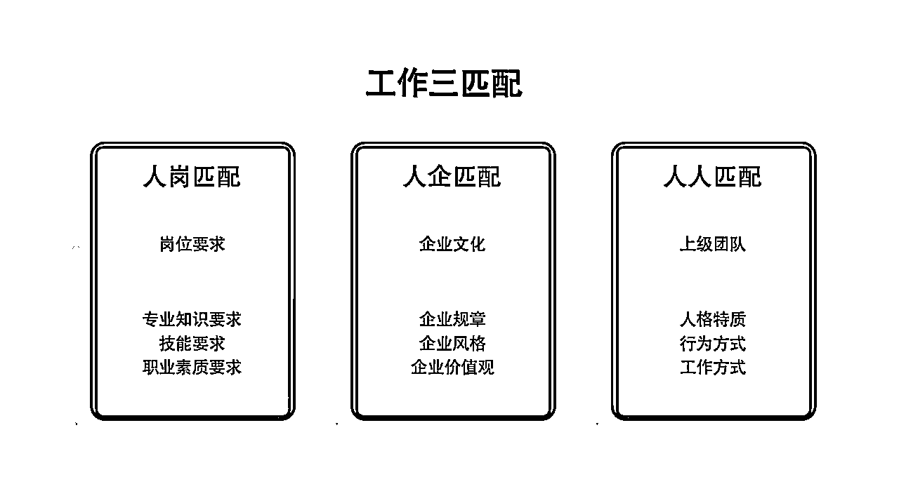
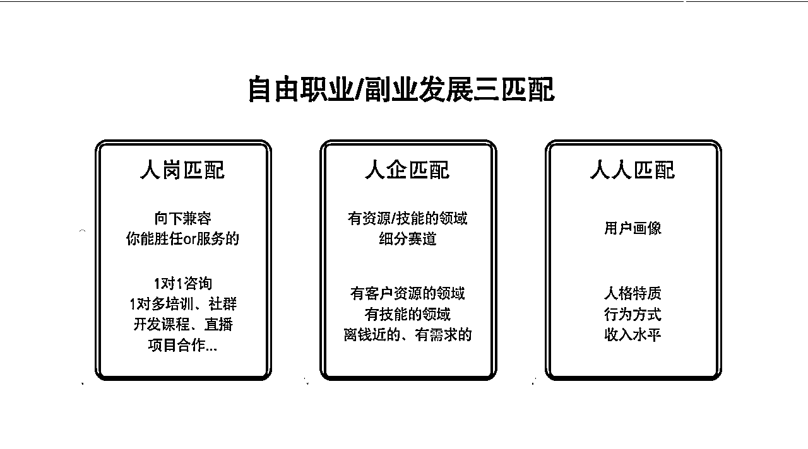
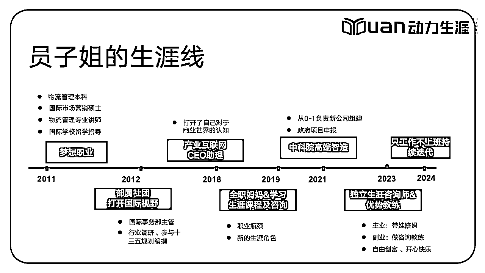
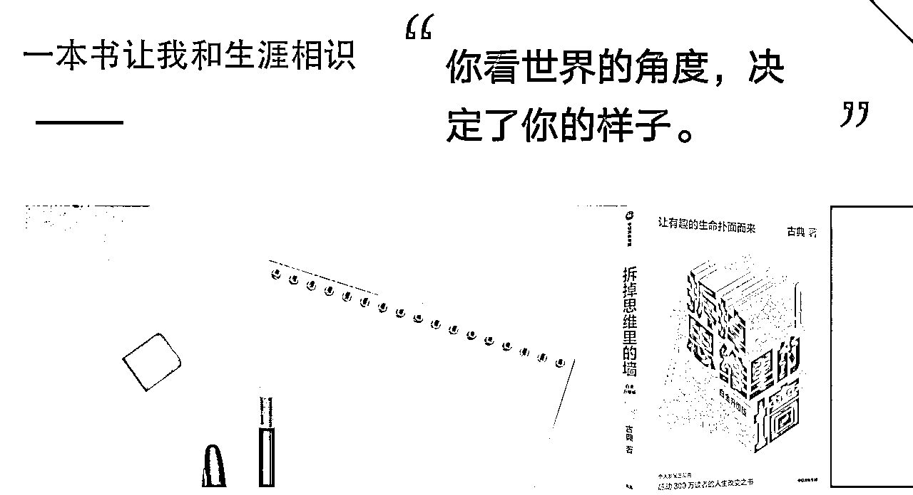
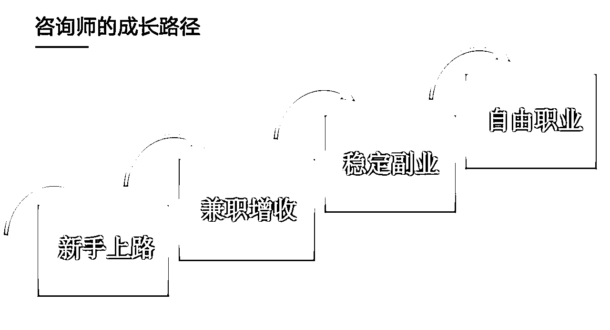
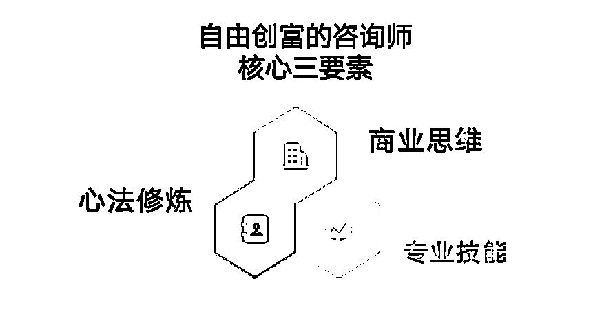
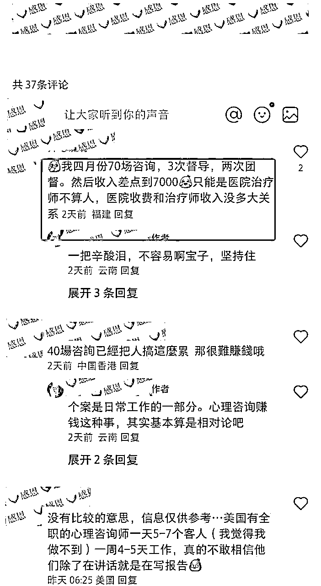
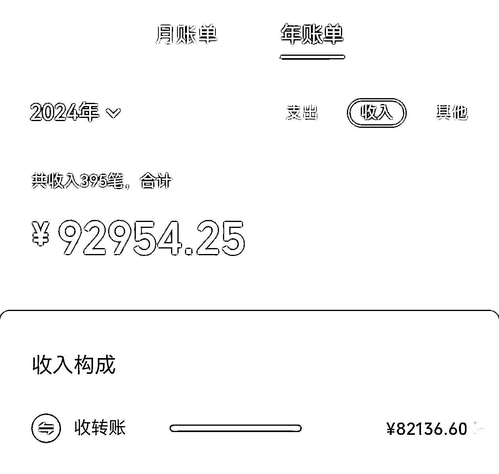

# ('自由变现的咨询师成长路径大揭秘', (2, 17))

咨询师如何实现自由变现？这份成长路径解析请收好

大家好，我是员子姐，一名生涯规划师，也是盖洛普全球认证的优势教练，同时还是咨询师IP经纪人。

最近总有人来问我：对生涯咨询、优势教练、高考志愿填报、家庭教育这些方向感兴趣，但就是不知道从哪里起步，怎样才算走上了正轨？

今天，我就用生涯咨询师这个方向来拆解一下，一个能稳定变现的咨询师，到底是怎么一步步成长起来的。无论你是想进入这个赛道，还是只想了解如何从0到1掌握一门新技能、把它变成副业再慢慢转成主业，这篇文章的逻辑同样可以借鉴。

先抛一个互动话题：在个人创业者心中，最受欢迎的变现方向是什么？

生财有术曾针对“新个体创业”做过调研，结果显示，知识/服务IP、咨询师/教练/顾问、自媒体博主是大家最青睐的三个独立变现方向。

也有不少朋友分不清顾问、咨询师、教练和培训师有什么区别。简单来分：

- 顾问：在自己擅长的领域直接给建议、开方案；
- 咨询师：和客户一起挖掘问题、解决问题，比如生涯咨询；
- 教练：激发客户潜能，明确方向，推动出结果；
- 培训师：一对多讲课，把认知快速对齐。

清楚了这四类角色，再看“你适合做咨询师吗”就更有方向了。

先说一组数据：某头部生涯规划师培训机构每年报名的学员中，约有80%来自人力资源背景。而我，恰好属于为数不多的非人力、非心理咨询背景的那一类。

一般来说，有四类人特别适合做生涯咨询师：人力资源从业者、教育培训行业、心理咨询行业、企业管理者。

为什么是他们？

第一，他们天然离客户最近。比如HR、招聘、猎头，每天接触的都是求职、跳槽、做职业规划的人。心理咨询其实也包含职业咨询分支，很多人需要“心理+生涯”双管齐下才能解决职业困惑。教育培训行业里的大学辅导员、高校老师、教培老师，同样天天面对有职业规划需求的学生。至于企业管理者，自己就在职场里摸爬滚打多年，既能体察需求，也能给解决方案，很多人没上过认证课，但凭经验就已经是很好的咨询师了。

而且他们的主业和生涯咨询这个副业能互相赋能，客户群也高度重合。

第二，技能相近的人更容易上手。咨询师除了提问、倾听、总结这三大基本功，还需要人际沟通、信息收集整理、资源对接等能力。如果你之前干的就是和人打交道、帮人提升或对接资源的工作，比如心理咨询师、教练、猎头、老师、培训师，做起来会轻松很多。

第三，自己在困惑中走过并成功走出来的人。我本人就是这个类型。你能想到的职业困惑，我基本都经历过，当初就是为了解决自己的问题才去学生涯规划。这类人有点像“久病成良医”——你的感受我懂，你踩过的坑我踩过，所以我更知道你要什么。

想清楚自己是否适合之后，下一个问题就是：怎么确定自己的咨询领域？

参考求职时的“三匹配原则”，自由职业/副业发展也可以有一套适合自己的三匹配原则。  

第一条：优先选择自己有资源的领域。

很多人之所以纠结，要么是选择太多，觉得自己什么都能干，什么都想干；要么是选择太少，觉得自己这不行那也不行，没有出路。最简单的做法：选一个你能“稳赢”的领域。

稳赢有两个层面：一是你有初始流量或资源，二是有初始技能，能跑赢大部分人。

比如大学辅导员、高校老师如果做生涯规划师，我一般建议聚焦大学生群体，因为平时接触的就是潜在客户。企业高管则适合做高管教练、企业顾问，既有能力交付，也不缺客户。

我三月份带过一位学员，之前在大健康行业做销讲师，辞职后想做自由职业。她喜欢狗，也在养狗，于是先在抖音做宠物赛道，但发了几条视频都没什么水花，整个人很焦虑。

问题就在于没利用好自己的优势资源。她其实非常擅长销售，光是在别人直播间听直播，就能马上发现很多可以优化的转化话术点。后来我帮她调整方向，做“销转咨询师”，她一下子就像换了个人，每天工作动力都高了不止一倍。

所以，选择领域时，千万别忽略自己身边的“金山银山”，非要去开辟全新的赛道。

第二条：选择有支付能力的人群。

这一点极其重要。

前期可以做一些公益咨询，但不能一辈子为爱发电，迟早要开启收费。培训也好，咨询也好，本质上都是满足基本生存之外的服务。如果对方连温饱都成问题，你再怎么辅导，他也是“无米之炊”。与其这样，不如先建议他找份能力范围内的工作，有收入了再谈发展。

所以，目标用户必须同时满足两个条件：有痛点，也有支付能力。

做咨询久了你会发现，高客单用户反而更好交付。他们认知起点高，一点就透，辅导起来轻松；虽然咨询费听起来贵，但占他们收入的比例很低。

我上个月引荐的一个学员，一个电话就直接成交了近两万的课程，相当爽快。后来才知道，对方的年薪是90万。而且这个学员成长极快，吸收知识快，行动力也强，一个月就开单收到了第一笔咨询费。

第三条：向下兼容，选择自己能胜任的方式和岗位。

这也是我观察到的很多新手咨询师最大的卡点：总觉得自己学得不够，知识技能还不足。但每个人身上都有自己的闪光点或天赋优势。

哪怕你现在的水平只有20分、30分，也可以去辅导那些10分、15分的人。只要能向下兼容，就一定能找到机会。

另外，一定要用自己擅长的形式去工作。你可以做一对一，也可以做一对多培训、社群答疑。只要这个形式你能胜任、能持续做下去，就可以。千万别一看别人直播赚钱就去播，一看公众号有红利就去写文章，你得根据自己的能力和天赋做判断。

说完了定位，再来看成长路径。

先讲讲我的成长线：从探索，到副业，再逐步过渡到主业，就是一条普通人的路径。 

这个起点，是职业瓶颈。当时我面临多个生涯角色的冲突——多了妻子、母亲的身份，也一脚踩进30+的职业中年危机。主业停滞，整个人浑浑噩噩，想跳槽转型，却不知道能做什么。

有没有小伙伴正在经历这些？ 

那时候我没想到要发展副业。是《拆掉思维里的墙》让我第一次认识到生涯规划，然后我去报名学习了生涯规划师的课程，初衷就是想解决自己的问题。

后来我在学习中发现，自己很享受做咨询、帮人解决问题的过程，就这样慢慢站上了生涯咨询师这条路。

咨询师的成长路径，通常会经历四个阶段。这套逻辑不只适合咨询师，也适合大部分想发展副业、成为自由职业者的人。 

至于大家关心的周期，我的看法是：因人而异，关键看前期积累，以及你到底有多想把这件事做成。

如果只说专业知识，一般1到3个月就能学完。但请注意，这只是开始。

真正的挑战，全在后面。想成为自由变现的咨询师，专业知识反而是最不重要的那一环。 

为什么这么说？因为咨询师的核心，不在于会多少理论，而在于三件事：心法、商业思维和技法。

我把心法放在第一位，技法放在最后。

1、咨询师心法修炼

成熟咨询师之间的技法差距其实并不大。真正让新手能跑通0到1，再从1做到10、10做到100的，是心法。

心法一：你要同时把自己当成咨询师和销售。好的销售，往往也是好的教练。

我看到过不少新手咨询师，天真地以为客户会主动找上门来送钱，不需要做任何销售和转化动作。但现实往往会狠狠打脸，很多人连公益咨询、免费咨询都约不到人，最后只能灰心放弃。

所以，想变现，就必须承担一定比例的销售工作。

心法二：把注意力放在做事上，而不是放在人际和情绪上。

多去思考“如何解决问题”“哪些动作能让我实现自由变现”，内耗自然就少了。努力只是标配，每天该做的动作没做到位，量不够，就别急着谈变现。

心法三：从职场思维切换到自媒体、创业者思维。

不要等着客户来找你，要学会自己给自己布置任务，主动展示自己，主动去找客户聊。

心法四：你缺的不是专业知识，而是开始实战的勇气。

不要等完全想明白了再出发，最好的做法是边做边调。等你想明白，黄花菜都凉了。

2、咨询师的商业思维

如果说心法是地基，那商业思维就是决定你收费上限的关键。 

我在小红书上见过一位心理咨询师，4月份做了70场咨询，收入还不到7000元。没有商业思维，不懂商业模式，只能按次收费，赚的是辛苦钱。

很多人好奇我的工作量。说实话，我属于比较会“用巧劲”的人：每个月服务的新学员不超过10个，每天只工作三四个小时，月均收入在2万左右，状态好能到3万+，差一些也有1.5万左右。

我之所以能打破一对一咨询的天花板，让一小时的咨询卖出5000元的价值，靠的就是商业模式。

举个例子：上个月，我成交了一单粥左罗顶峰会。对方之所以愿意通过我来加入，是因为她自己做咨询师，却不懂商业、不会变现，想让我指导她，也想和我长期绑定。我给她做了一次深度辅导后，她接下来6个月左右的行动计划就清晰落地了。

这不就是一个典型的商业模式吗？ 

你可以回到最初问自己：选择做咨询师、做自由职业，初衷是什么？不就是为了时间和金钱上更自由吗？

那么，持续低客单、大量交付，是不是就违背了初衷？

咨询师的商业模式，本质上是从“卖时间”变成“卖结果”。客户付钱，买的不只是你的一小时，而是你的陪伴、你的解决方案，以及你能帮他拿到的结果。

就像上面的那位小伙伴，她为什么愿意选择我？因为她看到了我拿到过的结果，她想要跟着我拿到一样的结果。

3、咨询师的专业技能

最后是技法。它的提升方式只有四个字：持续练习。

没有捷径，就是不断地做咨询、做练习，再找专业教练做督导。

好了，以上就是我今天想分享的全部内容。如果你也有心成为一名咨询师，希望这份路径图能帮你少走一些弯路。