# 抖音半真人直播：新手小白7天GMV破10w，单日单号佣金破万！
作者：龙哥

最近圈子里都在聊抖音半真人直播，我也来分享一段真实经历。不是炫富，就是记录一下：一个纯小白，从零起步，真正操作也就两个月，做到了7天销售额破十万，单日单号佣金过万，而且连续两个月带组总业绩霸榜第一——第一个月46万，第二个月直接冲到138万。

先放几张截图证明一下，免得有人说我吹牛。

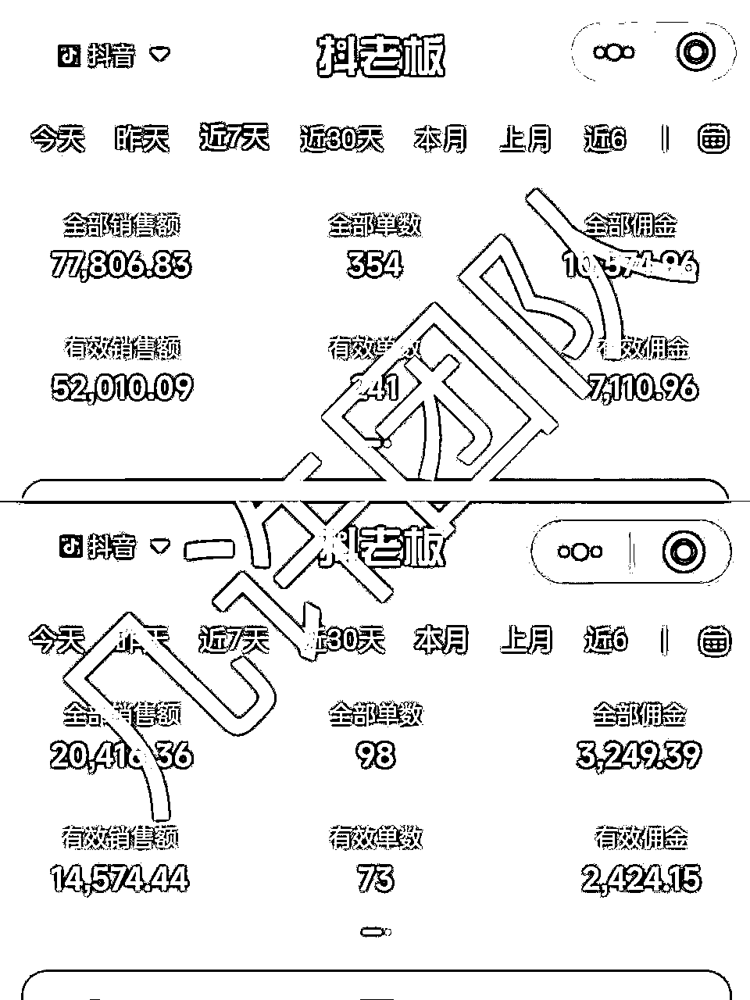
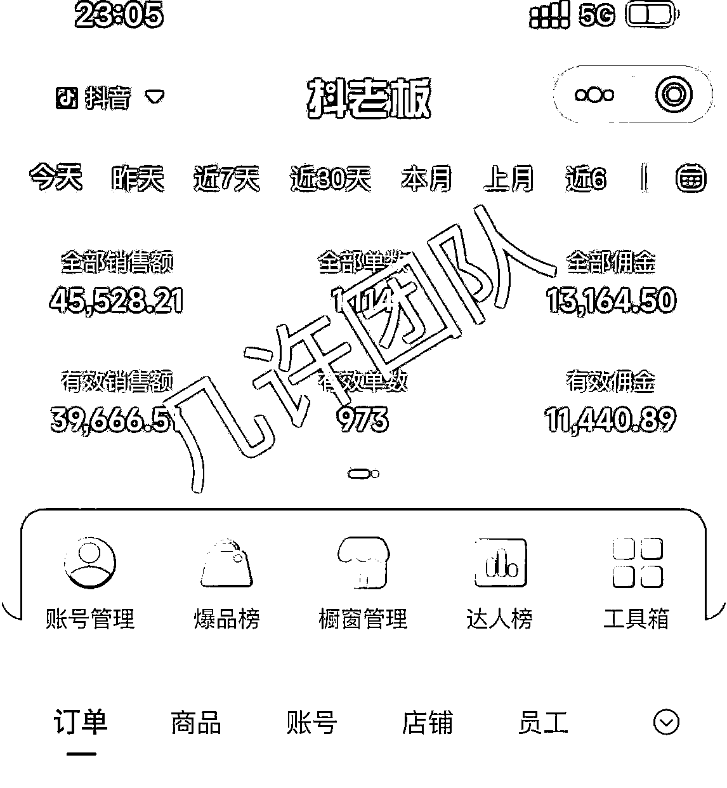

说个搞笑的插曲：当时学这个项目交了1980学费，结果团队老大几许特别喜欢发红包，激励红包最少1000起步，加上各种小组赛奖励，前前后后单独给我转账七千多，等于反向“赚”了回来。第一次碰到这种交付团队，我笑了好久。

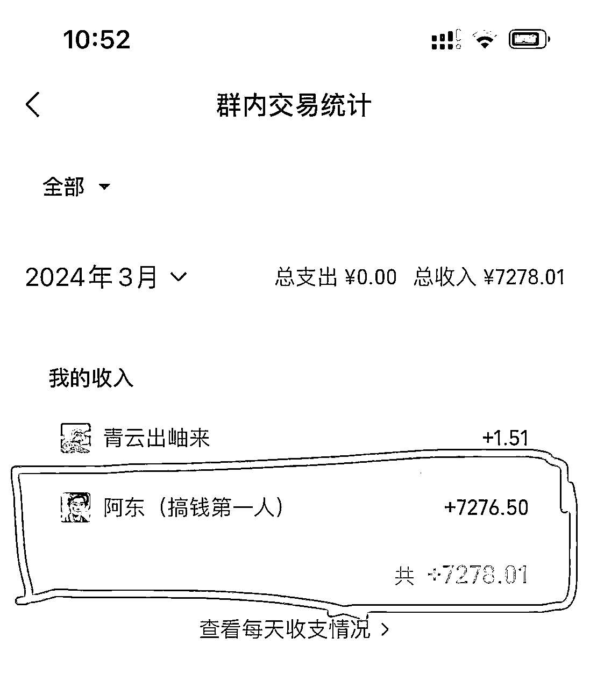

很多人以为我要灌鸡汤，其实不是。想清楚自己适合什么、真正想做什么，比盲目努力更重要。赚钱圈子里项目多的是，随便哪个认真钻研都能赚到钱，差别只是赚多赚少。我之前也付费试过📕、图文带货、AI虚拟、私域，都没坚持下来。不是我笨，是我懒——一想到要作图、追热点、回消息、做后端，头都大了，那不就是又干回主业的老路了吗？发货、运营、推广、销售、售后一条龙，想想都抗拒。所以没做成，活该。

直到看到几许那篇讲AI无人直播的文章，瞬间心动。无人挂机直播最吸引我的点，就是可以偷懒：挂机卖货，不用上架、不用发货、不用当客服，还没有品类限制，赚佣金就行。以前我也觉得跟平台对抗的项目活不长，后来才知道他们团队合伙人雨润和可乐都做了好几年了，做得风生水起。那一刻我意识到，自己就是一叶障目，以后得谦卑点。

重点来了。

# 第一次开播，13分钟出单

从拿到教程到装软件再跑通全流程，总共花了三天。交付很给力，新号开播可以远程帮忙检查设置和软件，手把手教到你会挂链接。我当时连链接都不会挂，就跟着群里边学边记，还自己手写了笔记。这是小伙伴根据笔记整理的流程图，给大家参考：

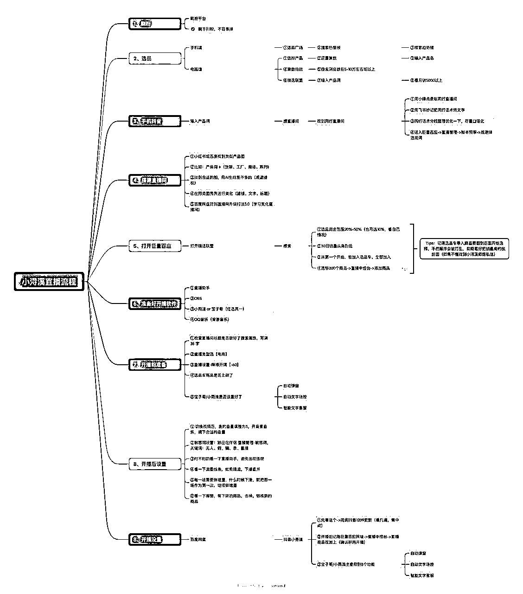

摸摸索索跑通全流程后，第一次开播，13分钟就出单了，客单价150+。后面持续爆单，第二天GMV破三万，佣金4000多。为啥佣金这么低？因为我当时太小白，卖的品佣金才10%，现在这种品我直接pass。

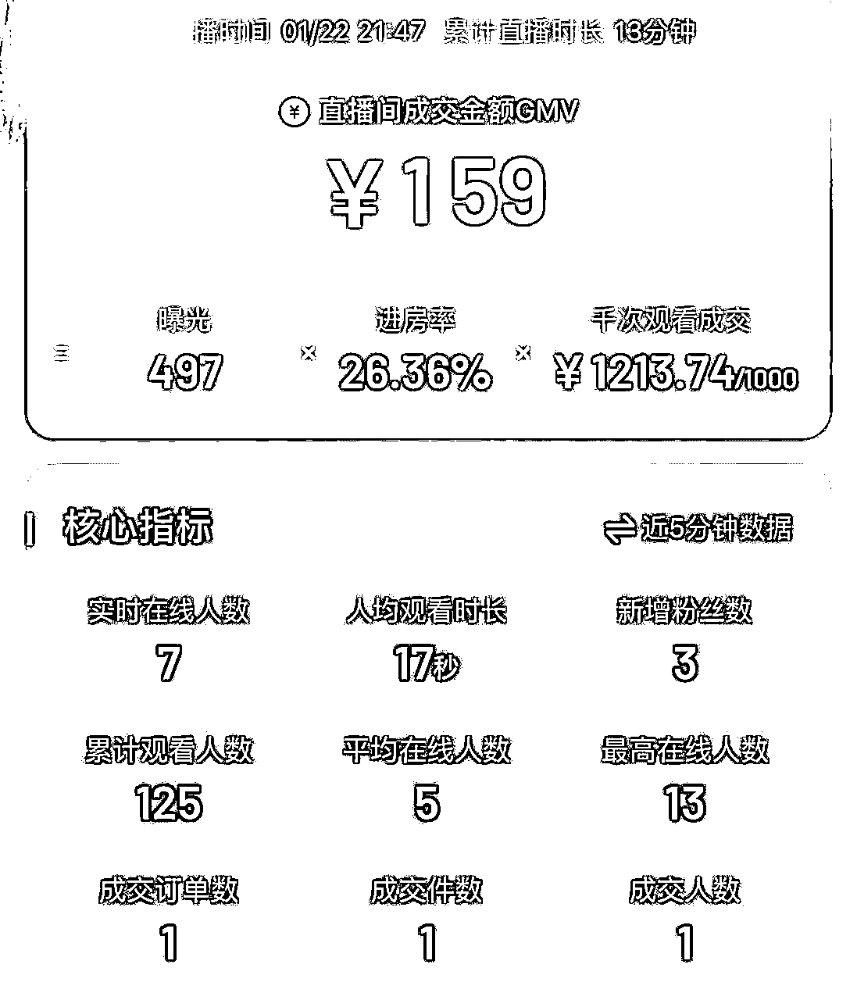
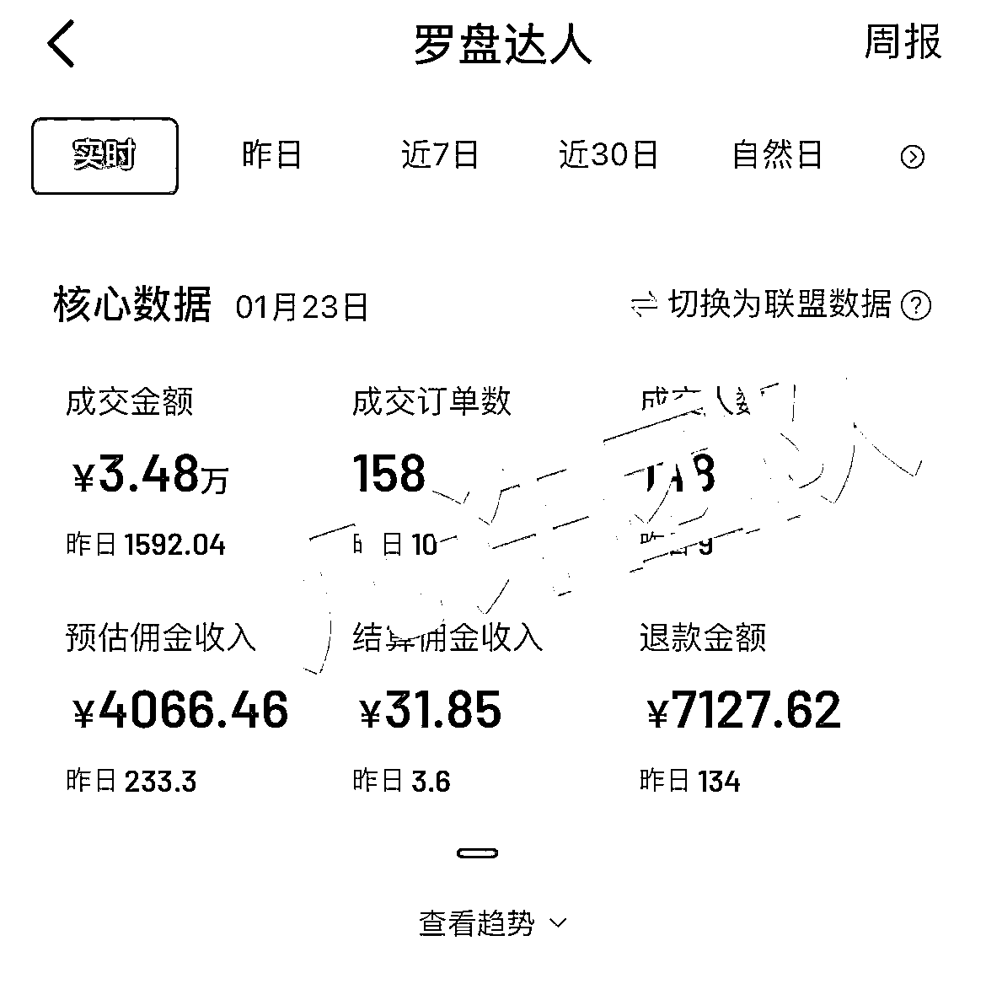

靠这个品拿了当月宗门第一，几许还寄了礼物和大红包给我。

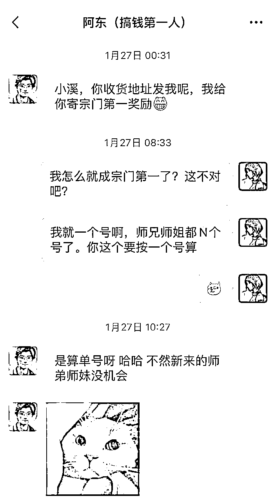

正反馈来得太快，彻底坚定了我要做好这件事的决心。更离谱的是，直播搭建好后，是我婆婆真人出镜——我写好稿子，她照着念就行。我本人线下社牛线上社恐，本来只是测试玩玩。这下我总算明白为啥几许敢宣传100%出单了，这也太夸张了。要不是亲眼验证过，我铁定把他当割韭菜的。

看到这里是不是很激动想入场？别急，看完最后你会发现，这更像一篇劝退贴（笑）。

# 选品就是选人群，5个方法快速测试迭代

第一次爆单可以靠运气，连续爆就是方法对了。选品占7分，技术占2分，勤奋占1分，80%的时间都该花在选品上。

**方法1：从身边人的兴趣爱好入手**

选品就是选人群。我的第一个爆品是厨房电器类，因为婆婆爱做美食、爱买小家电。第二个爆品是服装——有天婆婆说刷到一个卖衣服的直播间看到凌晨，我就试着做服装。服装GMV好看，但佣金只有10-20%，退货率还高，谁不怕卷谁上。

刚开始测试就用一台小破笔记本，加拼多多19.9包邮的绿幕，再加上勇于出镜的婆婆：

**方法2：红海大类目看着卷，其实成功率更高**

冬天卖棉袄，夏天卖蒲扇，这种常识反而容易忽略。别总想着找小众蓝海，觉得人无我有才能赢。现实是：无人直播靠在线时长和搜索流量吃饭，场景、主播、话术、优惠都比不过真人直播间，用户凭什么买你的？

前期没经验，千万别碰小众类目。就是服装、美妆、鞋包、个护、食品饮料这些红海大类目，市场和流量才足够大，随便细分一个产品就能铺200个链接，每一条链接都有稳定需求。你只要占住流量位置，做好基本功，等着用户上门成交就行。这是拿账号实测出来的教训。

商品分类这一栏，密密麻麻全是大类目：

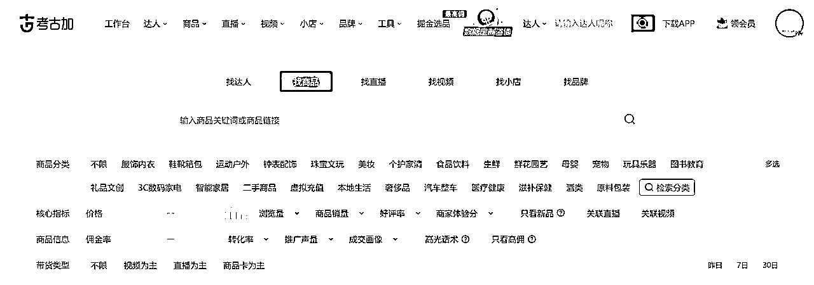

**方法3：熬夜蹲同行直播间，再用考古加看数据**

哪有什么天选之子，都是深夜不睡觉的默默努力。只有无人直播才会凌晨还在播，真人主播这个点早休息了（不放心可以在评论区提问，看主播回不回）。搞个小号去刷各种无人直播间，灵感会源源不断。看到自己能抄到80分的，就保存抖音号。

比如这种👇

然后去考古加（付费软件，自己斟酌）盯四个数据：

1. 近7天销量——决定要不要跟
2. 品类平均佣金率——决定值不值得做
3. 直播时长——超过100小时不下播的，妥妥真同行
4. 流量渠道——搞清楚是推荐、搜索还是付费，别对着付费直播间傻乎乎地学

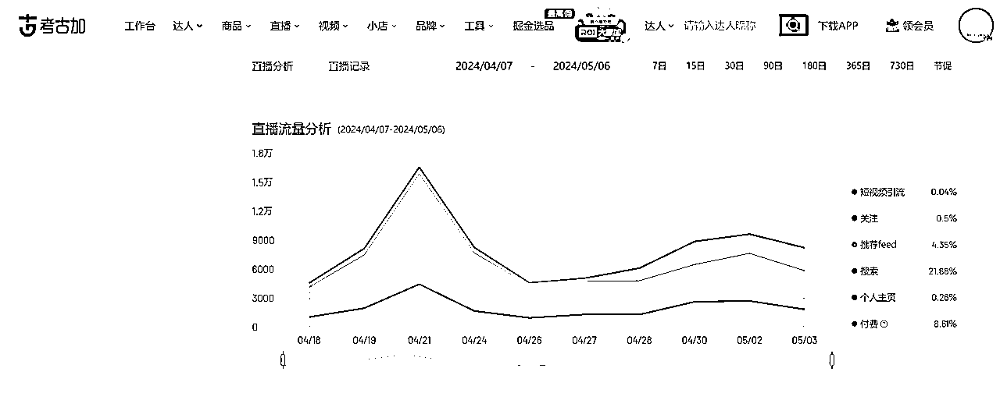

条件都满足就直接抄，像素级地抄。标题、场控、话术、商品链接顺序、头像、简介、有没有发产品视频，全抄下来。别人能起来一定有原因。注意，像素级模仿不是让你把人家背景抄得一模一样，那会被判违规。

**方法4：找付费为主的单品直播间选品**

做到这才慢慢想明白：无人直播场景比起真人挺简陋的，我当时心里也嘀咕，这都有人买？可仔细一想，每个人信息茧房不一样，你觉得假，中老年群体不一定觉得。他们对这些不敏感，下单还爽快，所以后续选品都围绕这个人群。

大家应该刷过那种一个直播间只卖一把梳子，不停讲解逼单的。这种玩法客单价普遍9.9-29.9，也有上百的，付费流量占比80-90%以上。

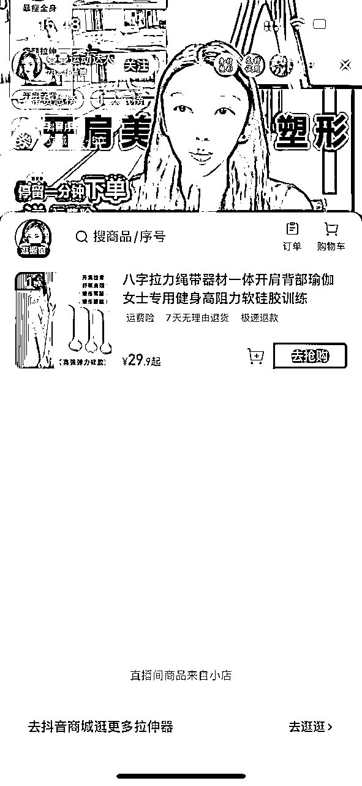

这种直播间起量快、下单猛。我还没学会他们的玩法，但找到了选品思路：同行愿意付费主打的品，一定有需求。那我就卖同需求的品，或者主推她的品和类似品。比如同行卖锅，我1号链接讲锅，剩下199个链接挂锅碗瓢盆、厨房用具，或者199种不同的锅。懂了评论区扣个1。

**方法5：用测出来的爆品继续拓展**

测出一个爆品，就围绕这个品的人群需求继续发散。我做过一个皮草外套，过年期间天冷刚需，新手不懂上去就干服装，结果起量飞快，单日GMV轻轻松松破万。

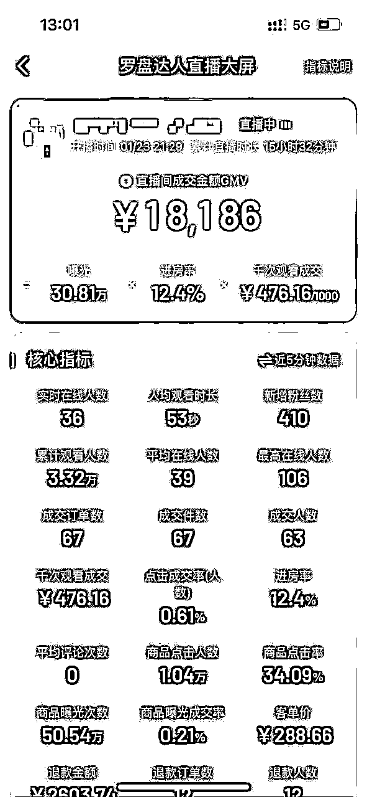

从皮草人群延伸出羽绒服、男士夹克、皮毛一体外套……后来因为服装佣金低、退货高就没继续测。其实很多品都能这样拓展：锅分章丘铁锅、不粘锅、涂层锅、小奶锅、辅食锅……我们手上的号根本做不完一个小小的细分品类，记得发散思维。

有了一定选品经验，就可以追求更高的客单价、佣金率、店铺评分、商家配合度了。

选品方法千千万，适合自己的最好。几许团队也有核心方法，赚钱航海还有选品手册，都值得借力。

# 单日佣金破万，捷径都藏在细节里

那天单日佣金破万，我特意让几许打马赛克，想低调点。结果头像太扎眼，打了码都被大家认出来，尴尬死了。

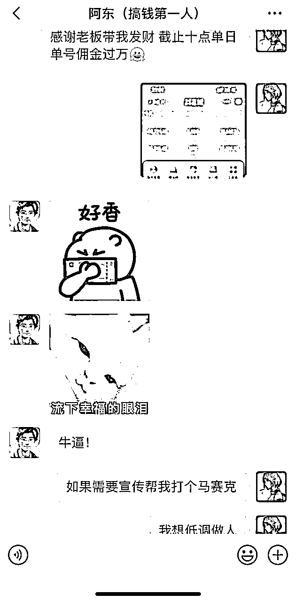

然后一堆人来问我秘籍。哪有什么秘籍，全是细节。

**1. 直播背景怎么优化？**

团队内部有详细的课程，教搭建直播间和优化链接。但审美这东西没法速成，比如可乐教的把产品扣出来做成“阿飘”在画面里滚动，要多练。我现在的办法还是抄优质同行：背景颜色、字体、有没有视频展示、产品滚动、文字滚动，全都1:1复制。跑量起来后再根据客户需求创新。

做图主要用📕找参考图，AI以图生图，或者稿定设计直接套模版。抖音巨量引擎的“即创”也能AI生成直播间背景和脚本，功能很强。

AI做图：https://www.vegaai.net/

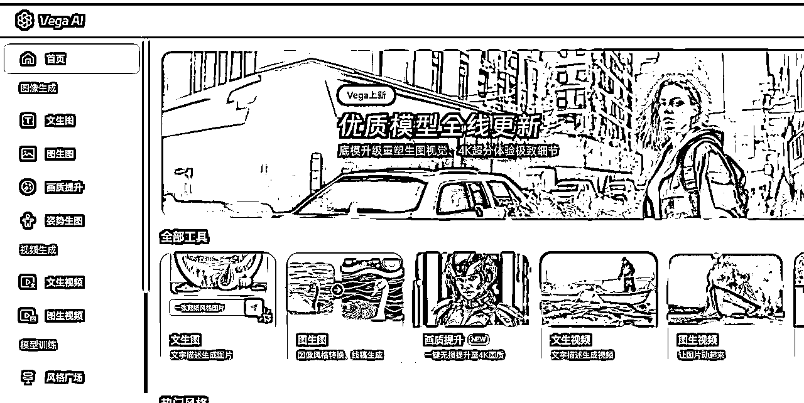

稿定设计：https://www.gaoding.com/

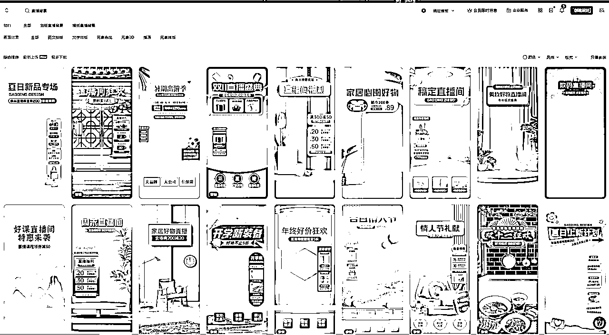

即创：https://aic.oceanengine.com/tools/live_scripts?source=jlcc&bpId=1763312072409160

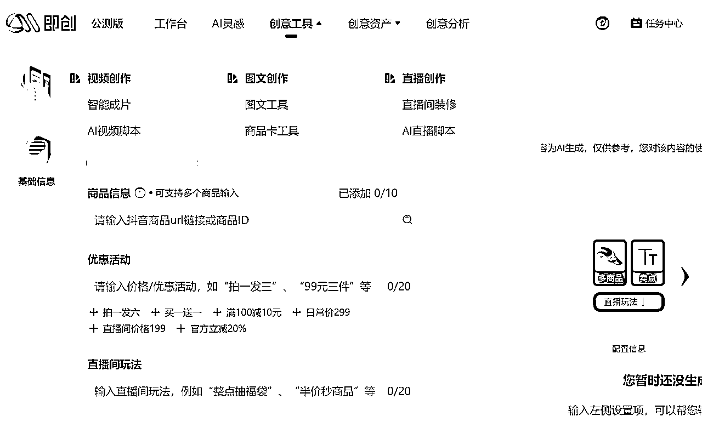

**2. 直播间BGM怎么选？**

抄要抄到位，背景音乐也尽量一模一样。同行不注重的话，就去找热门爆款BGM，尤其是短视频卖货的爆款，大主播直播间也可以去蹲一蹲。抖音直接搜“直播间背景音乐”，一抓一把。

月销百万的直播间，从背景到话术到不同环节的音乐全是设计过的。学几招够我们琢磨很久了。千万别嫌我啰嗦——我带组时很多小伙伴放着轻音乐念稿子，这就是细节差距。

所有方法都只是参考，要结合自己的产品，找到最合适的音乐。

**3. 自动回复话术和场控话术怎么优化？**

用一个叫“小不点”的软件当在线客服，主要用三个功能：

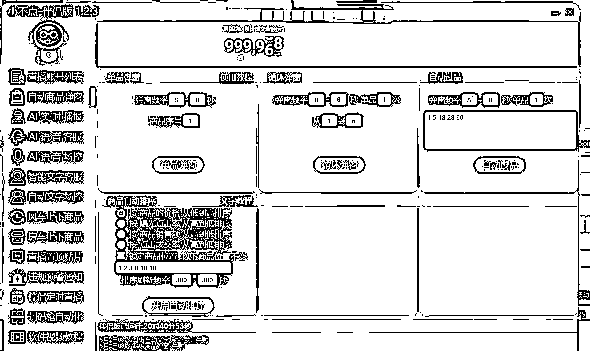

- 自动弹窗：把商品一个个弹到直播间，增加曝光
- 自动回复：设置关键词触发回复。比如客户问“什么时候发货”，你设好“发货”关键词，回复“下单24小时内发货哦”。挂机也能自动@用户回复
- 场控话术：在弹幕下循环弹出的5-6句话，讲产品优势、运费险、工厂直销等

自动弹窗和场控话术都好办，重点是自动回复话术！

你问我怎么做到单日佣金破万？我问你，你的自动回复话术准备了多少条？如果只有10-20条，那我来告诉你：我那个爆品直播间，自动回复话术整整准备了100多条！

怎么来的？去问商家客服、看详情页、翻评论区、去拼多多淘宝“问大家”、看同行直播间，想尽一切办法总结出来。100条是有点极端，但大力出奇迹。客户说啥都能接上，你还愁不出单？我们挂了整整200个链接，瞎猫碰上死耗子都能出单。

逻辑很简单：你去买东西，咨询客服没人理，会买吗？

吾亦无他，唯手熟尔。知道的人多，做到的人少。钱没那么好赚。

**4. 主播话术稿子怎么弄？**

前期测试品，直接抄同行就行。用江小二软件录制同行直播视频大概30分钟，保存后用飞书妙计把字幕提取出来，自己改一下语句和错别字，再放到巨量百应的预审工具里查违规词就搞定。

江小二软件：

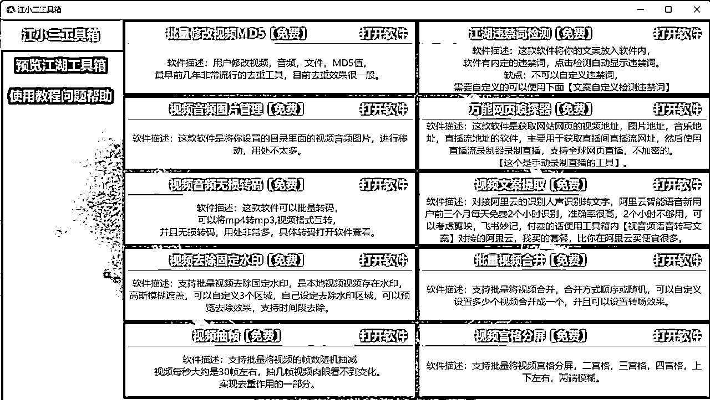

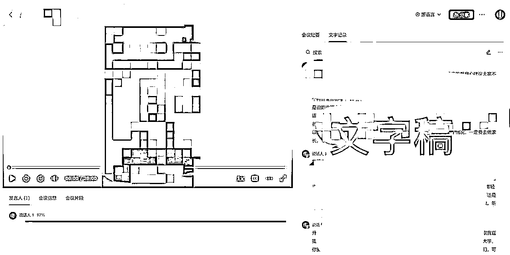

巨量百应-预审工具：https://buyin.jinritemai.com/dashboard/regulation/pre-audit

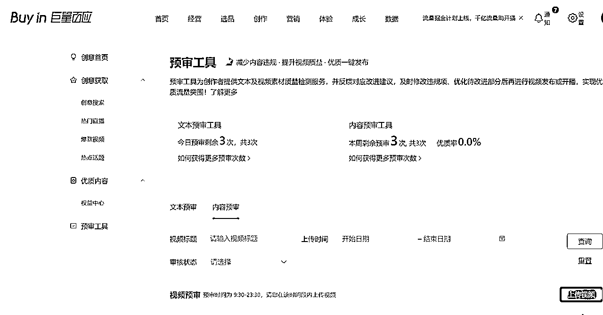

最后说一句：项目好不好，亲自试了才知道。但想偷懒是真的，懒到极致就会琢磨怎么更高效。如果看完全篇你还想入局，欢迎来卷——我们群里见。

很多人问我，无人直播是不是把号挂在那就能躺赚？我会直接说：真想多了。尤其看到市面上那些把“轻松”“躺赚”“有手就行”挂在嘴边的宣传，小白更要警惕——如果真有手就行，凭什么轮到我赚？

先交代一个短板：目前我“根据产品自己写话术”这个能力还是0，正在赚钱里翻资料向圈友请教。如果哪位在这方面有经验，欢迎带带我。

开播只是第一步，真正拉开收入差距的，是每天开播之后那些琐碎的调整。同样一个项目、同一套课程，有人一个月赚千把块，有人做到几十万、上百万，差别不在运气，而在有没有把“优化”这两个字执行到每一天。

我今天就把一个账号从日佣金几十块做到日佣过千的那些动作，完整拆给你们看。不是炫成绩，是想让准备进场的朋友少走几段弯路。

软件维护，每天都要做
小不点里的自动回复话术，要常更常新。弹幕里用户经常问的问题，随手补充进去；小雨滴掉没掉线，必须定时检查。评论区最好用考古家定时爬取，把高频问题一波波填进话术库。

推广数据每天看，ROI和消耗截图发群里，判断要不要加预算、要不要换品。直播大屏也不能落下，流量曲线一旦出现断崖，马上找原因。手机端后台的违规管理和抖音灵机的举报记录也要常翻，别等问题累积到封号才反应过来。

电脑别舍不得重启。我这边是每6天重启一次，不然直播伴侣挂久了会卡。重启时提前保存画面，尽量5分钟内开机，直播画面能很快恢复。每天再派小号去自己直播间走一圈，如果黑屏、无声、无画面，立即处理，不行就下播。

跟商家谈佣金，脸皮要厚
佣金不是平台给的固定数，是谈出来的。我用抖老板小程序把所有账号都绑在一起，哪个号哪个品出了10单以上，立刻顺着精选联盟、选品车、商家客服、营业执照这些线索找到源头商家，直接谈提佣。

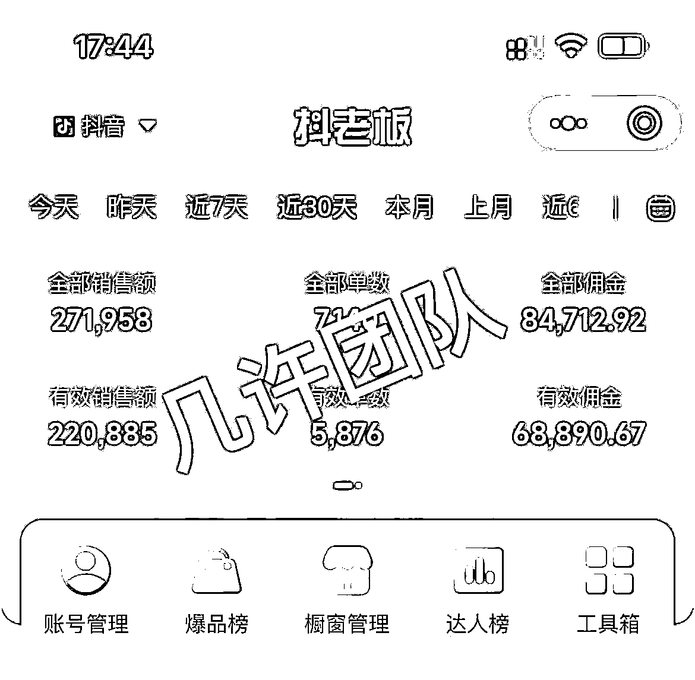

有次一个品公开佣金50%，我卖出几十单后去找商家聊，硬是提到了60%。知道消息那天我还有点后悔，怎么不早点开口。

已经出单且有销量的商家，我会想办法把联系方式都加到🛰️里。情商在线一点，时不时的聊一聊，问问最近有没有新爆品。商家推品前都会花真金白银做测试和调研，比起自己盲选品，这算是一条捷径。别学我，40%佣金了还去要，但话说回来，谁会嫌钱多呢？

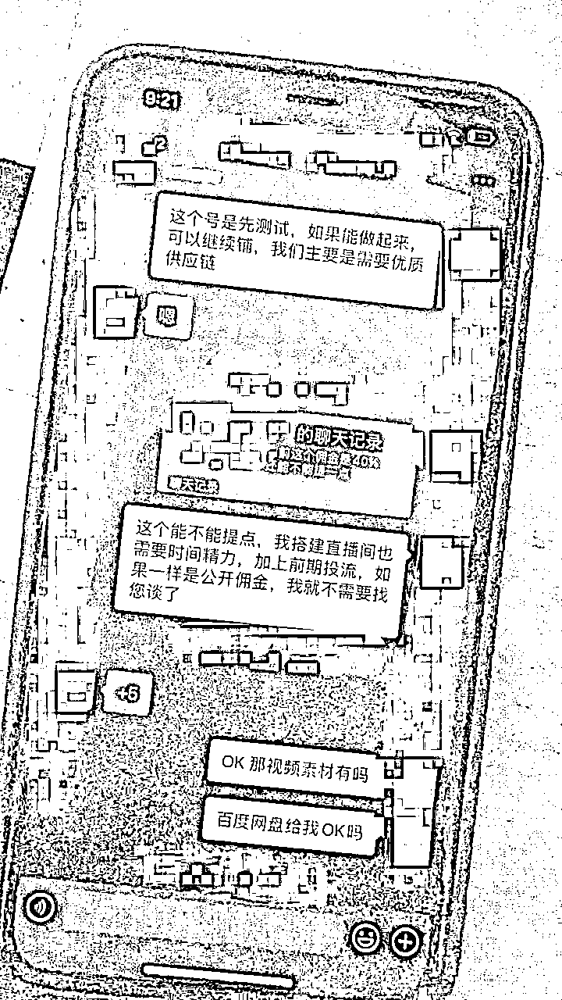

主播管理，规矩要立在前面
主播在BOSS直聘这类平台招，试播80元一小时，通过后100元一小时。我会先让对方发一段直播切片，确认状态没问题再邀约线下，一般一次排3到4个直播间。

主播来之前，有些规矩必须先说清：近视就自己戴隐形或眼镜；到场后不要碰电脑上任何东西，下播、软件操作全交给运营，因为真遇到过手滑下播的倒霉事；话术稿是逐字审核过的，照稿念，不擅自加词，一旦因为乱加话术违规，时薪直接减半；直播间会24小时循环播放录制内容，要接受录像使用权。

现在还在测绿幕录制，主播不用到现场，在家录1小时视频发我就行。这个方向一旦跑通，主播问题能轻松不少，但目前还没跑出稳定效果，先不展开。

那些用钱踩出来的坑，记住能省钱
标题、文案、封面、口播里，清仓、加关注、扣评论+优先、加急发货、现货、7天无理由这类词都别碰，踩中就是信用分扣0.5。同一家店同一个产品，有时会挂两个链接、两个价格，比如同一个锅一个129一个229，如果都被拖进直播间，就会被判低价引流误导消费者，又是0.5分没了。200个链接我都是去选品车里一遍遍核出来的。

评论区回复客户就别用绝对词。有人问有没有运费险，答“大部分都有”，别把话说死。发货时间、材质、尺码这种问题，拿不准就让对方点小黄车找客服，自由发挥就是给违规送人头。另外没事多看看“全部工具-体验-违规管理”，别被警告了好几次还浑然不觉。

最气人的是那种缺德商家，看你出单了，悄咪咪把佣金调成1%。应对方式很简单：用抖老板盯着佣金变动，一发现就下架他的品，半夜也得爬起来下；同时把不乱调佣的优质店铺名记下来，专搜他们的店上更多品；如果优质商家的品不够，就回精选联盟选高佣产品无脑上架，循环往复，直到缺德商家淘汰出局。

小不点软件里那一堆自动场控和自动回复话术，也别忘了定期导出备份。我有一次积累了近100条话术，软件一更新全清空，只剩心痛。

写口播稿的时候，别只顾卖货，记得埋几句互动话术。比如“欢迎XX来到直播间”“感谢XX下单1号链接”，昵称可以现编，隔几段就出现一次，这样能避免无互动违规。巨量百应的预审工具只能查出常见违规词，更深层的风险还得靠人工过一遍，拿不准就去咨询客服。

信用分和店铺评分也要盯紧。一旦低于80分，限流不说，投放都花不出去，号基本半瘫。有些商家佣金给得特别高，但评分很低，这种诱惑要抵抗，低于80分的商家一律清退。评分每天都会变，今天85明天可能80，所以选品车里的分数要天天看。

还有，背景音乐别乱用中文歌。歌词有点问题，系统识别出来一样判违规。之前那些莫名其妙的违规，总算找到源头了。

矩阵账号，才是放大的开始
别把身家押在几个号上，一个号违规或限流会很憋屈。我从亲戚朋友那里借了十几个号，又请宽带师傅用分光器拉了十几根网线，电脑目前是租的，10台租两个月，等模式彻底跑顺就买断。

这篇文章我拖了十几天才写完，期间账号陆陆续续开播，还测了很多品。矩阵号最大的价值是测品效率高，想法一出来马上能验证。也别太把单个账号当回事，这个项目最严厉也就是封30天，一个月后又是一条好汉，但一旦测出爆品，爆发力非常猛。我手里有个品过年到现在一直出单，日佣金稳定在300到500，偶尔冲上1000。最猛的一次，单号单日佣金过万，就是同一个号。可惜挂机时间太长，电脑带不动被强下播，又撞上315严打期，号被封了30天，申诉后改成停播7天。顺便说一句，我们这边不少账号稳定挂机几百个小时都没事。

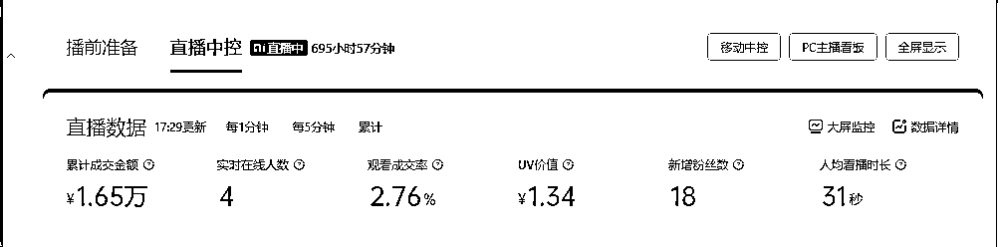

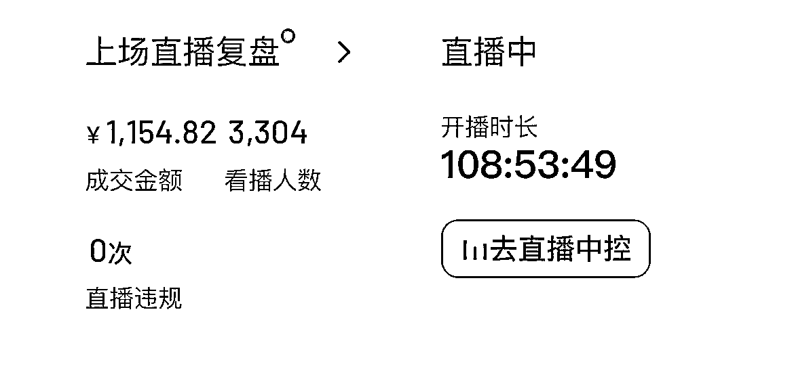

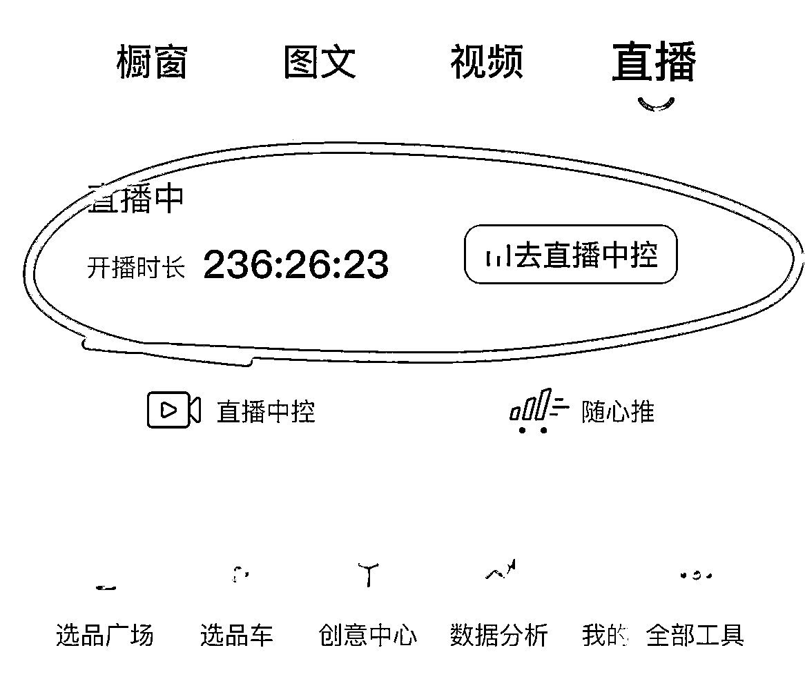

停播也不能闲着。我马上重新开了一个直播间，同品、同话术、同主播，依然有成交。所以别被账号绑住，有条件就多备几个号。

关于用他人实名账号绑定自己的收款账户，可以看这个思路：

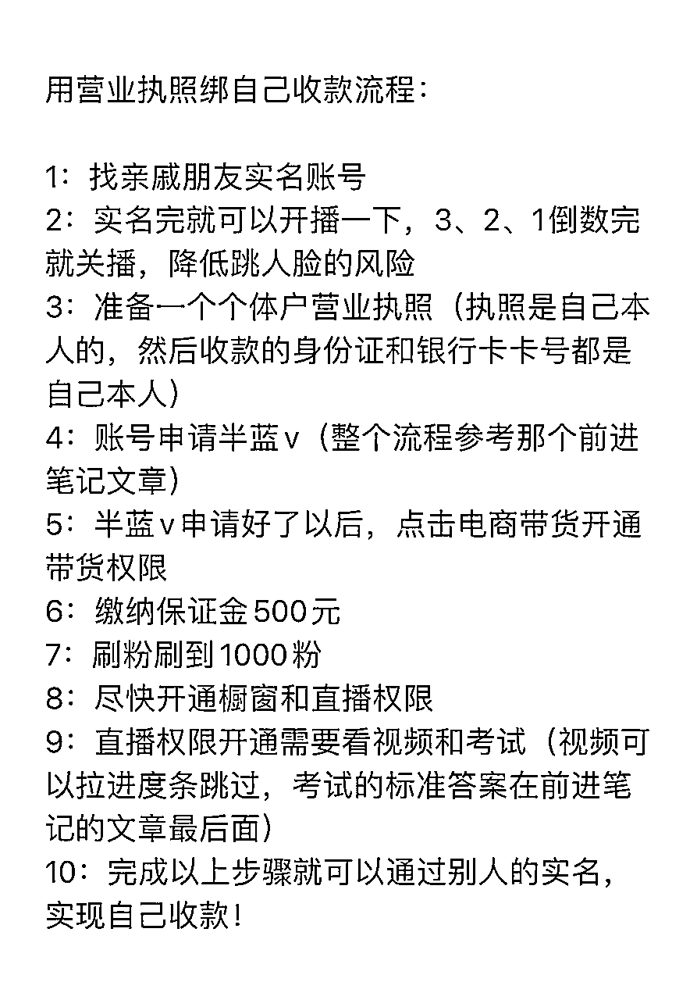
前进笔记文章链接：https://mp.weixin.qq.com/s/kfGHHSaBRYk3cLnIJ5NTCA

投放，是放大器不是救命稻草
抖音把投流工具做得足够简单，说白了就是对自己的算法有信心。现在主流就两个：手机端的随心推，电脑端的千川。

真要是操作不当，随心推也能变成“随心亏”。说实话我也不是专业玩家，玩法太多，还要继续研究、付费学习。我现在用它来验证主播状态和话术能不能留住人，每次开播花100元，时长1小时，智能推荐+成交目标，拉一波人群看数据。能留住付费流量、有成交就继续播，拉长时长；留不住就关掉复盘。这就是我目前浅尝则止的玩法，给大家做个参考。至于翻车损失，直接上图：

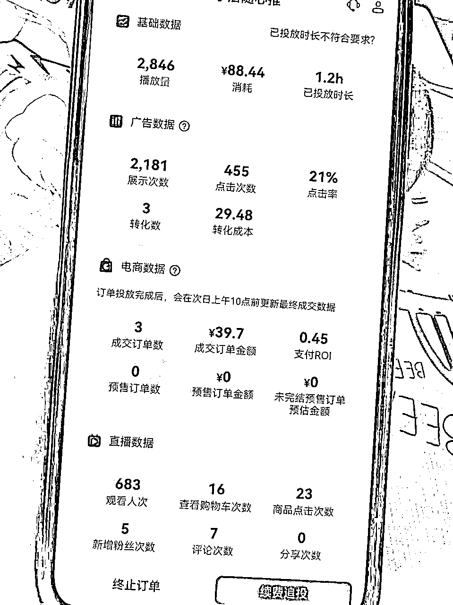

千川这边，跟着几许团队学了一套适合小白的打法，目前还在测试，有几个号拿到了一点成绩，但没形成完整方法论，我就不细说，免得误导人。赚钱里也有不少投流高手分享千川玩法，可以自己去搜，但不懂就不要乱投。

记住，投放是锦上添花的动作。你的直播间本身是垃圾场，花再多钱也飞不起来。只有自然流量已经跑得不错的时候，再花钱推一把，才是正确姿势。别把投流当成能解决一切的救命稻草。

最后说点体感
认真听执行，一个月赚几千块真不难。难的是从0到1之后，怎么从1到10。我现在能做到日佣稳定过千，但想稳定日佣过万，还需要很多功课：矩阵扩号、优化直播间质量、测试新玩法，一件一件去解锁。

这篇文章是五一假期里写的，顺手放一张抖老板的7天和30天实时销量截图：

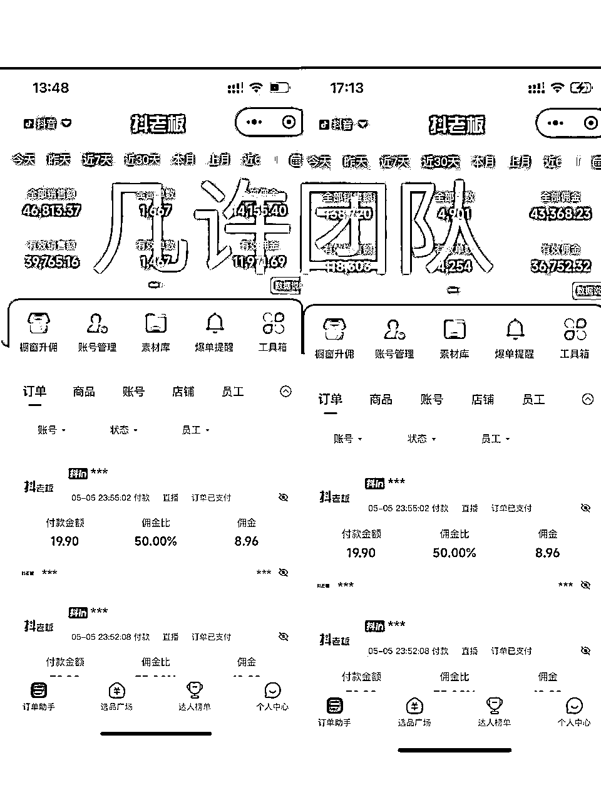

我真正看好无人直播的，不是“躺赚”这个概念，而是它能嫁接出各种玩法——卖货只是其一，品牌自播、本地生活团购、虚拟课程都能做。技术底层是相通的，抖音之外还有视频号、快手、📕。就算以后不做无人直播，用这套技术去给本地商家做自播引流，也是信息差带来的机会。发财的想象力，别自己框死了。

这些经验，一部分来自我自己踩坑，更多来自项目里师兄师姐师弟师妹们毫无保留的分享。搞钱路上能遇到一群同频的人，一起解决问题，是很幸运的事。特别感谢赚钱圈友，大家的真诚和利他，我记在心里。赚钱确实也在带着更多圈友走向财务自由和精神自由。

最后，祝福大家在搞钱这条路上，一路狂奔。