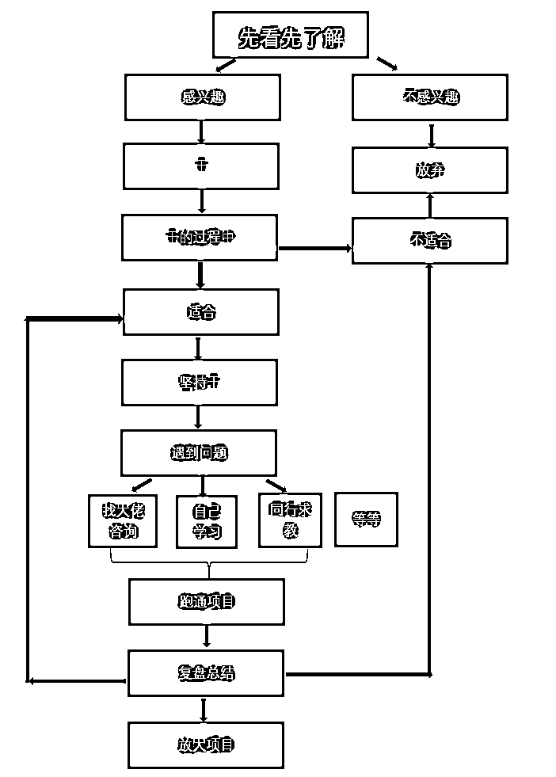
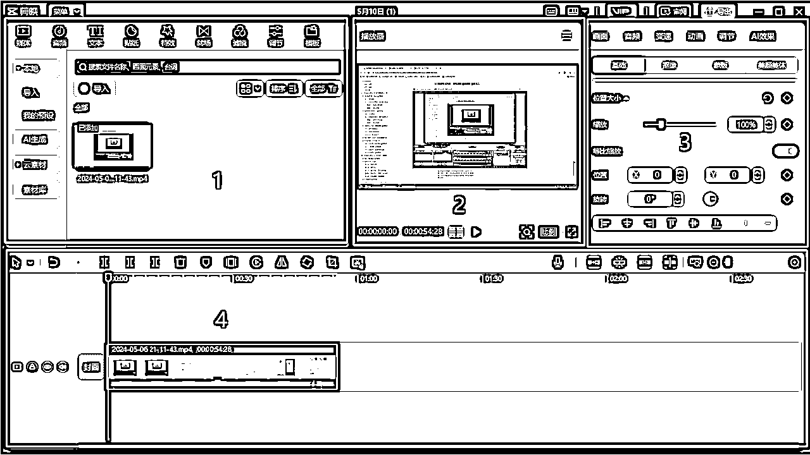
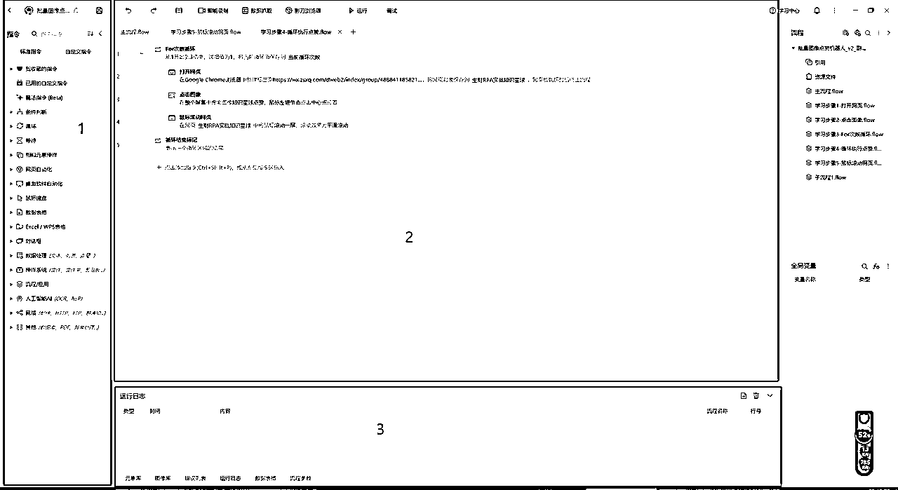

# 初进生财，怎样快速锁定自己的方向？

> 来源：[https://f0ym6s15nt1.feishu.cn/docx/QKaddBn5yozBEbxlcN4cdCj6nwh](https://f0ym6s15nt1.feishu.cn/docx/QKaddBn5yozBEbxlcN4cdCj6nwh)

# 一、写在前面

本文一共包含8个视频、3份教程，总字数差不多6900，读完预计15分钟。

各位好，我叫泰来，生财第八期的圈友。主业是培训轮滑和滑雪，坐标保定。进圈才一个多月，我已经跑通了剪辑（ip直播切片）和RPA两个小方向，同时还有好几个项目在同步推进。

写这篇文章，是想给和我一样刚进圈子、还在犹豫和焦虑的伙伴一点参考，帮你更轻松地锁定适合自己的项目。

顺带也把剪辑、直播切片和RPA的入门经验整理了出来。

内容导览：

4.7 给新人的建议
5.1 剪辑速成经验
5.2 直播切片方法论
5.3 RPA上手指南

# 二、关于我自己

## 2.1 基本盘

我叫泰来，ENTP（话痨版），狮子座，目标是要当生财最酷的女生。

主业是轮滑/滑雪教培，会一点剪辑、PS、RPA。学新东西比较快，知道怎么抓重点。空闲时间多，做点志愿者的事情也完全OK。

## 2.2 来时的路

- 小时候也算“别人家的孩子”，成绩一直不错。后来家里遭了变故，欠了30多万，大一没读完就退学了。
- 能选的工作很少，又要还债又要活命。最后只能捡回小时候的兴趣——轮滑幼儿培训。可这个行当看季节吃饭，冬天没进账，只能靠打零工撑着。
- 线上客服、送外卖、快递分拣、驿站兼职，我都体验过。好在近两年开了滑雪课，冬天也能有收入了。只是工资时高时低，谈不上什么保障。
- 工作一眼望到头，每天像拧螺丝一样重复。很想努力，却找不到施力点，只能原地打转。
- 这两年幼教培训越来越走下坡路，我开始慌了。没学历、没技术、没人脉，标准的“三无人员”，万一连眼前这份工都保不住，还能去做什么？
- 就算先随便找份工作凑合着，5年后、10年后、20年后，又该怎么办？

## 2.3 做过的作品

### 2.3.1 航海家见面会演讲切片

说明：这个作品被生财有术官方看中，发在了官方视频号上。

### 2.3.2 靠谱姐直播切片

说明：全部被靠谱姐本人采用，已发布在她的视频号。

# 三、我是怎么遇见生财的

## 3.1 故事的起点

第一次听到这个圈子，要往回倒好几年。当时在一个App上帮一位视障朋友念了两行代码。我正好也在学Python，挺好奇他怎么入门的，就多聊了几句，从而知道了生财。

再后来，陈雪🦉碎碎念老师的播客《搞钱女孩》里也专门提过生财，我就顺势把鱼丸加上了。

现在回头想，对我帮助最大的是“利他”。要不是当初乐意帮人，我可能到今天都不知道生财，更不可能走进这么好的一个圈子。

## 3.2 错过的那几年

加上鱼丸后，我几乎没聊过天。偶尔刷到她朋友圈，心里还犯过嘀咕：真有这么神吗？转身就忙活自己的事去了。

（现在想想，真是亏大了。不过以当时的认知，就算早早加入，也未必会像今天这样打心底认可。）

那段时间家里债务重，工资又不稳，整天想找点赚得多的路子。可我不知道自己能干什么，手头也没钱报课、不敢瞎投资，更不敢辞掉唯一的收入。于是只能持续“打工→还钱”的循环，日子过得没什么盼头。

中途试过做团购群，也没做起来。整个人一直陷在负债压力和无尽焦虑里。

## 3.3 被一束光照到

4月，鱼丸告诉我可以参加一堂公益课。我抱着“听听也不亏”的心态报了名。

开课当晚，我正好有个工作会要开，错过了开头。鱼丸说，等会开完了直接进来就行。

那时已经挺晚了，本来打算第二天再补。但心里有个声音冒出来：既然报名了，就按课程节奏一步步走完。于是我强撑着睡意进了直播间。

听完纪钟老师的第一节直播课，又领到3天的星球体验卡，我突然激动得不行——这不就是我一直想找的方向吗？

最前沿的消息 + 手把手的实战 + 高质量的圈层

那天夜里，我一整晚没合眼，翻来覆去地看好帖、看趋势、看手册里各种玩法。

也很感谢当时的自己没有拖延。要是第一天偷懒了，后面大概率就不会再打开了。

## 3.4 没有犹豫，直接上车

体验营那三天，我像掉进米缸的老鼠，看什么都新鲜，认知一次次被刷新。

原来项目还能这么玩，原来那些我以前觉得毫无意义的小事，人家早就拿来变钱了。

雪姨播客里也反复推荐，而它恰恰就是我最需要的东西。最后一节课讲完，我毫不犹豫买了正式会员。

# 四、从找方向到下场干活

## 4.1 越看越焦虑的一段日子

鱼丸告诉我，航海实战要到5月底才启动。那这将近两个月，我总不能干等着吧？

我开始猛刷各种精华内容，越刷心里越发慌。比我年长的，早做出一番成绩；比我小的，也已经锁定赛道持续深耕。人人都有方向、有动态、有结果。

我呢？天天都在“学”——每篇帖子都研究，每个项目都去查，好像都很有意思，又好像都得从头补课。然后就陷进了“刷帖→学习→更焦虑”的死循环。

圈里的干货实在太多了。照我这种学法，感觉一辈子也嚼不完。

## 4.2 把自己拽出泥潭

虽然这么想，我还是每天一有空就打开生财硬啃。差不多持续了十来天。

有一天我问自己：难道真要一直躺到开船吗？

也是在那个节骨眼，我刷到了柯总@张柯Ker 写的短剧CPS项目拆解，赶紧主动链接了他。

特别想感谢柯总，他就给了我一句话：大胆试错，拿着手册直接跑。是啊，我得先动起来。

于是我先把航海手册快速翻了一遍，再挑自己感兴趣的项目精读，然后照着课件一步步落地。

（再多的建议，最终也得自己迈出那一步。）

关于“怎么启动”，我的方法是：
先从最小的动作切进去。比如闲鱼，第一步就是养号：旧号改个名、换个头像、重新写简介——这本来就是我闲着没事也会干的事——做完立刻奖励自己一包零食或者一把游戏。
尝到正反馈的甜头，就更有劲去做下一步，做完再奖励。
就这样边做边给自己发糖，不到一个月我已经试了5个项目。效果很香，你们真的可以试试。

## 4.3 先下水，再谈适不适合

一个项目，看懂不重要，先做起来才重要。

到目前为止，我试过闲鱼高客单无货源、短剧CPS、IP直播切片、RPA、小红书达人、中视频计划。

每碰一个新项目，我都会从零开始写流程，按步骤推进，逐个解决卡点，最后认真总结复盘，判断它到底跟不跟我合拍。

合拍的就长期干，不合拍的果断放下。

## 4.4 混进剪辑志愿者团队

有一天刷帖子，随便点开了@牛顿273 发的一篇：

【爆肝48小时，一天播放破万，大型纪录片《生财有术S8赛季》的制作全过程复盘！（含5k字图文超详细剪辑教学）】

https://wx.zsxq.com/dweb2/index/topic_detail/5122188488818844

文末写着招募剪辑志愿者。我看完他们做的视频，直接惊叹：这也太强了。

转念想到，以后不管做什么项目，剪辑都是绕不开的基本功，于是私聊牛顿进了群。

头几天我完全是个“小透明”，只敢在群里默默观察。

## 4.5 从零开始，剪出第一支片

### 4.5.1 耗时8小时

后来，牛顿丢来一段靠谱姐的直播回放，还给了我一个标杆——老虎剪好、靠谱姐已经发到视频号的作品，让我照着那个水准试。

我就对着教程一步步来，哪里卡住就百度，搜不到就回头问牛顿。边学边剪，磨了整整8小时（甚至更久），终于剪出了自己的第一支直播切片。

靠谱姐直接把它发到了视频号上。那一刻我激动坏了——第一次动手就被看见，这种正反馈太顶了。

### 4.5.2 越剪越有感觉

被认可之后，我继续死磕剪辑的决心更坚定了。剪得多了，每次剪完都会复盘，改到满意为止。速度越来越快，质量也跟着往上走。

那段时间，我给生财官方供过1条切片，给靠谱姐的视频号投过好几条，还给群里的伙伴们出了N个视频教程。

一开始剪一条要8小时，现在1小时就能拿下。

从“完全摸不着门”进化到“可以教别人”，前前后后不到半个月，全靠下班后碎片时间硬肝。

## 4.6 顺手拿下RPA

我逐渐发现，工作里很多环节是重复的、没有意义的，这时想起了RPA。

对着航海手册一步一步做，卡在了uibot注册那一步。正好看到沐之发了一个RPA零基础入门课，趁工作间隙花了3天学完。因为有一点编程底子，上手很快，顺利掌握了RPA的基础搭建。

课后又按自己的实际需要，用影刀做出了第一个“切片前端批量处理机器人”。

## 4.7 一个月小结

进圈这一个月，我像一块干海绵丢进大海，每时每刻都在吸水、在长大。

我拿下了剪辑和RPA，试了多个项目，也锁定了可以长期深耕的方向。

接下来要做什么，心里已经有了草稿。

还链接到好几位大佬和一大批优秀的圈友。

## 4.8 给新人的建议

如果你也和我一样，刚进生财还在观望，或者还没找到自己的赛道，下面这些是我踩过坑之后攒下的实在话：

#### 4.8.1 怎么判断方向合不合适

我自己的做法：

#### 4.8.2 精华好帖先啃100篇

这是最基本的动作（引用七小的话）。
保持思想开放，见识够多了，方向才会自然浮出来。
我到现在还没达成这个目标，但已经养成了每天看好帖的习惯。

#### 4.8.3 航海手册要翻起来

没有方向又想动手？那就先挑航海手册里你最感兴趣的一本，照着执行就行。里面都是保姆级教程。
前期建议从那种能很快拿到正反馈的简单项目开始，先把心气儿养起来（引用柯总的话）。

#### 4.8.4 实践出真知

光看不做没有任何意义。项目适不适合自己，只有下水才知道。
执行力排第一，看会了但不执行，等于零。

#### 4.8.5 敢止损，也敢死磕

不适合的项目，果断放手。硬撑下去既痛苦，也很难做出好结果。
适合的项目，就一定要咬牙挺住。
最怕的是：该放的放不下，该扛的又放弃。

#### 4.8.6 利他，是钥匙也是护城河

利他思维就是打开生财这扇门的那把钥匙。以后我也继续这么做，帮别人，本质上就是在帮自己。

#### 4.8.7 靠近拿过结果的人

大佬的一句话，很可能就解开你卡了一个月的疑惑。别关起门来瞎琢磨，更别钻牛角尖。

#### 4.8.8 输出是最好的二次学习

要把一样东西讲出来，你就必须真懂，还得会总结，更要让别人也听明白。
自己会用不算会，能把别人教到会用，才是真的会。

#### 4.8.9 放心开口问

刚开始学剪辑时，我问过很多“小白问题”，牛顿都一条条耐心回答了。要是当时抹不开面子，我估计到现在还卡在门口。
后来我们还聊过不少别的话题，每次交流都能带来新启发。

#### 4.8.10 稳住心态

你现在看的、学的、做的每一件事，都是在为将来起飞囤燃料。别急着立刻看到结果，稳住，把该准备的都备好，风自然会来。

#### 4.8.11 复盘永远不能省

很多事做完就丢在一边，不总结不复盘，你怎么知道过程里哪些能优化？下一次又怎么提效？

# 五、教程部分

## 5.1 剪辑速成经验

这方法不一定适合所有人，只是分享一下我自己走过的路。

我始终觉得，像看网课那样一步一步跟着学，其实是效率最低的方式。我更习惯直接上手：碰到不会的现查，查不到就找人问。这套打法学任何技能都通用。

### 5.1.1 先把剪映界面摸熟

我以前没用过电脑版剪映，下载后的第一步是完整过一遍界面。

我把它分成4个区域：

1. 工具区
最常用：
1.1 文本——智能字幕：自动生成字幕；或者按已有文稿快速定位到对应画面。
1.2 音频——音乐素材、音效素材：加BGM和音效。
1.3 特效
1.4 转场
2. 预览区
可以调预览画面的比例，检查有没有掉帧、卡顿、音画不同步，以及字幕是不是变成了两行。
3. 调整区
最常用：
3.1 音频——音量大小调节
3.2 文本——字号、字体样式、花字、动画
3.3 字幕——抓错别字、长句换行
4. 轨道区
顶部一排工具可以快速分割视频、调比例、镜像、智能剪口播。
拖动下面的小长条（我也不确定那玩意叫什么），可以快速预览内容。

### 5.1.2 上手剪起来

界面熟了，就可以正式开干。

先把视频拖进轨道，调好比例，（用智能剪口播），简单分割，删掉多余部分，再加字幕、特效、转场。

接着调整字幕的字体和样式，加花字、动画。

最后加上音频，把音量调到合适的位置，再补点音效。

一条简单的片子就出来了。

### 5.1.3 说点心得

剪辑入门真的不难，难点只在“开始”。

之后再往深学，关键看你剪的是哪类内容。比如去重、混剪，我也是后来才补的。
只要基础通了，剩下的就是熟悉操作节奏 + 遇事解决问题。

## 5.2 直播切片方法论

IP直播切片是个需要耐心的细致活儿。

### 5.2.1 切片前的准备

先把视频转成音频，上传到AI生成文字稿（我用的是通义听悟）。

一场直播通常1-N小时，如果硬着头皮把每一条都看完再剪，效率低到没法看；直接丢进剪映自动生成智能字幕，等待时间也很长。

所以更聪明的做法是：先跑出文稿，快速扫一遍内容重点，锁定值得剪的片段，记下时间码。

### 5.2.2 粗剪

把视频导进剪映，按时间码切掉多余部分，只保留我们想要的片段。

用智能剪口播，把所有气口、语气词、重复、停顿以及不需要的内容一键清掉。

再处理字幕：先定好字号和样式，然后在右侧字幕栏里把所有长句拆成短行，保证画面里始终只有一行字幕。

接着查错别字，数字、英文保持统一格式，敏感词全部换掉。

### 5.2.3 精剪

这一步最费时，也最考验耐心。

从头一点点看，逐句分析：去掉停顿，补全没说完的字，让前后两句衔接自然（也不能太快），字幕出现的时间要和说话内容对齐，同时把关键词、金句挑出来。

给关键词和金句配上合适的花字、动画、音效。

再选一首合适的BGM，把音量压下去，设置好淡出时长。

（封面也要做好，放在视频最前面。）

全部弄完后再整体看一遍，没问题就可以出片；有瑕疵就倒回去继续磨。

### 5.2.4 总结一下

切片本身不难，但相当耗时间。

因为你要去粗取精、逐句校对。对内容取舍和节奏的掌控，只能靠一次次练习喂出来。

前端那些重复且机械的流程，我后来直接交给了RPA，省下不少精力。

## 5.3 RPA上手指南

同样先说明：这只是我个人的学习路径，未必适合所有人。

### 5.3.1 先跟影刀混个脸熟

我之前从没碰过影刀，装好之后先把界面溜了一遍。

1. 指令区
需要的指令都在左边。拖一条到流程区里，填好参数，它就能执行对应动作。
2. 流程区
一个机器人要跑的所有指令都按顺序排在这里，设置好先后顺序和相关数据。
3. 运行日志
哪条指令报错了、错误代码是什么，在这里都能看到。

界面熟悉完之后，再去看常用指令：元素、循环，以及最常用的网页类、系统类指令。

### 5.3.2 把自己当“机器人”，先走一遍流程

RPA的本质是模拟真人操作电脑。所以你得先亲手把步骤做一遍，然后把流程图写出来。

照着流程图去指令区找对应指令，拖进流程区，设好参数，一步步把自己的动作“翻译”给RPA。

举个例子：

人工流程：打开浏览器→进入百度→点击输入框→输入搜索词→点击搜索

对应的RPA指令是：
- 打开浏览器并访问百度网址
- 输入文本（填入要搜索的词）
- 点击元素（点搜索按钮）
- 再按顺序把它们排好

按下运行，电脑就会自动把整套动作跑完。

### 5.3.3 报错怎么办

脚本简单的话，可能一次就能跑通。
但如果脚本复杂、涉及多个软件联动调用，就很容易报错，或者RPA执行的结果跟预期不一致。

我的排查方式：
1. 先自查：是不是某条指令的参数填错了，或者定义得不够清楚？
2. 再搜索：去影刀学习中心找找，大概率有人踩过类似的坑。
3. 必要时补课：实在搞不定，就去学习这个指令的运行逻辑，知道它底层是怎么跑的。

### 5.3.4 持续迭代

RPA适合这样的场景：任务重复且没营养、以后会在工作里高频出现、不需要人工做精细判断。

如果你有一点编程基础，上手会特别快——可以自己设变量，参数调整也一目了然。
没有编程基础也不用慌，你不需要把每条指令的底层原理都研究透。

目标是借RPA提效，把自己从重复劳动里捞出来，而不是一头扎进去研究RPA本身。

后来我通过自己写脚本、和圈友交流，慢慢也学会了优化RPA流程，让它可以跑得更快、更稳。

### 5.3.5 效果演示

我的脚本比较长，解释起来太啰嗦了，直接放一个演示视频更直观。

（程序目的：用剪映批量完成视频转音频，再上传到通义，从而把直播切片的前端工作自动化。）

（工作流程：打开导入文件夹→新建Excel填入视频名→逐个导入视频→在剪映里批量导出音频→关闭剪映→打开通义→逐个上传音频→开始传输）

比如我需要手动把30个视频转成音频，再传到听悟，人工操作估计得1小时，中途还可能失去耐心。

但交给RPA之后，它半小时就能不休息地干完，而且完全不需要我盯着。

我只要把脚本设好，电脑就自动开工。这段时间我打游戏、追剧、吃饭都行。

一句话总结：RPA可以替代人工，效率更高，而且它干活的时候我还能忙别的，实在太香了。

强烈建议大家都去学一点RPA，把重复的活交给机器，把时间和精力留给真正需要思考的事情。

有需要的话，可以随时找我拿脚本。

# 六、最后想说的话

## 6.1 致谢

感谢@鱼丸 把我拉进新人营，还一直鼓励我：任何时候开始学，都不算晚。

感谢@七小 愿意带大家入门剪辑，这趟我不仅学到很多技能，还认识了一帮靠谱伙伴。

感谢@张柯Ker 柯总在我最迷茫的时候指点方向，让我不再空转，直接下场干活。

感谢@梁靠谱 靠谱姐一路上的夸奖和鼓励。在剪她直播内容的那段日子里，我也吸收到了特别多宝贵的知识。

这一路走来，能走到现在，真的要感谢身边这些一路陪着、推着我往前走的人。

先说靠谱姐，之前给了我非常关键的帖子修改建议，思路一下子就打开了，靠谱姐真的是个很厉害也很温暖的人，有了她的指点之后，我写东西终于有了抓手和方向。

然后是@陈雪🦉碎碎念，雪姨的播客给了我太多启发，重新点燃了我对生财的向往，也是听了她的分享我才下定决心入局。入群之后雪姨更是持续在群里输出高质量干货，身边一群执行力爆表的小伙伴每天都在卷，每天都在吸收新东西，干劲完全被带动起来。

@牛顿273 要特别感谢，他把我拉进了志愿者群。剪辑卡壳的时候他总是不厌其烦地帮我解答，各种鼓励和复盘陪着我熬到深夜。现在碰到难题第一个想到的还是他，每次都能给我很实用的建议和踩坑经验。

@大铭 大铭哥也是贵人，给我介绍了中视频计划，还在RPA搭建过程中遇到实际难题时手把手给了我解决方案，让我少走了很多弯路。

@沐之 感谢你分享的RPA入门课程，带我完成了从零到一的入门，后续在群里遇到问题也都耐心解答。

## 6.2 结束语

到今年为止，我靠着打工终于把家里的负债基本还清了。偶尔也会想，如果更早接触生财，我的这几年会不会不一样。

不过转念一想，人赚不到超出认知的钱，靠运气赚到也会靠运气亏掉。这段时间的奔波虽然焦虑，但认知确实在一点点往上走，直到遇见生财。

这或许就是应对当下时代焦虑的答案，正如Max Guo大佬所说。

我是泰来，很高兴认识各位，希望我们能多交流、共同成长，一起把生财有术变成现实。