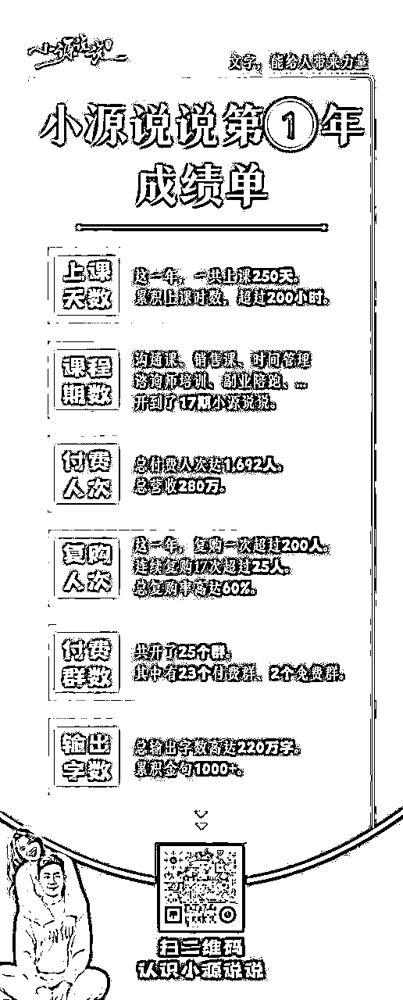
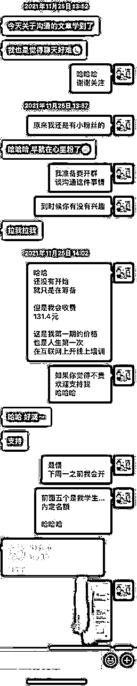
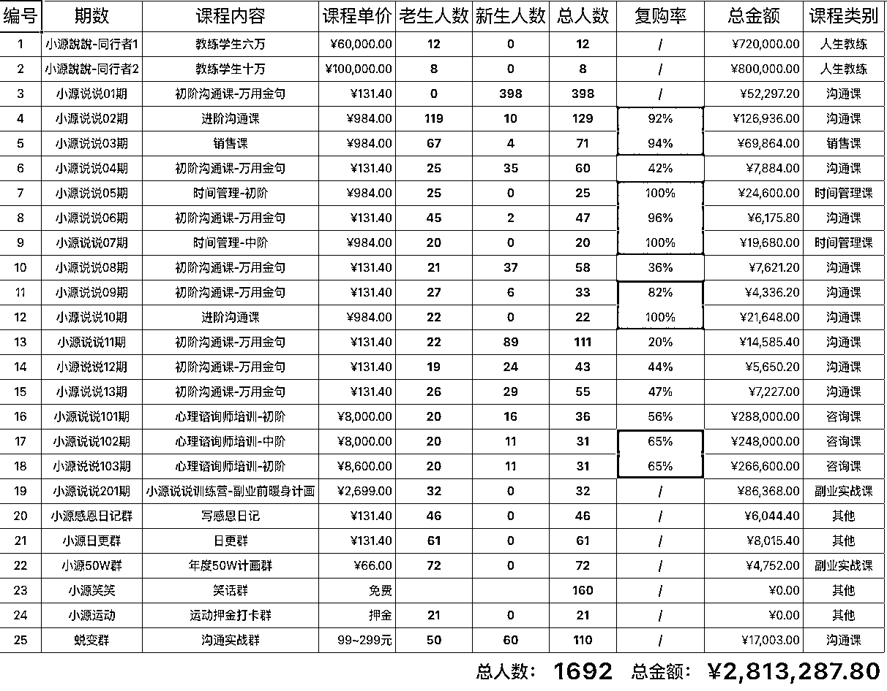
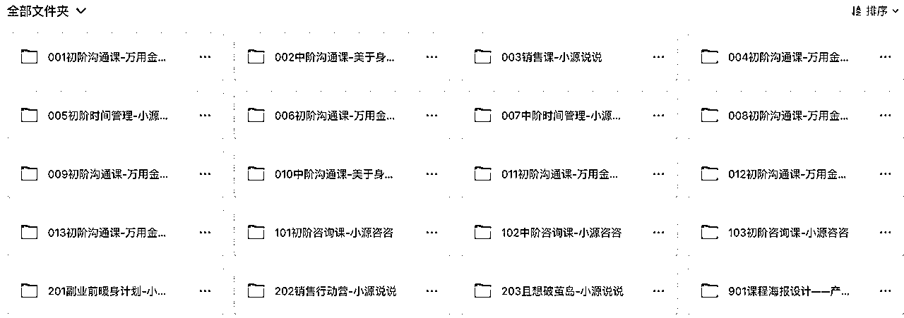
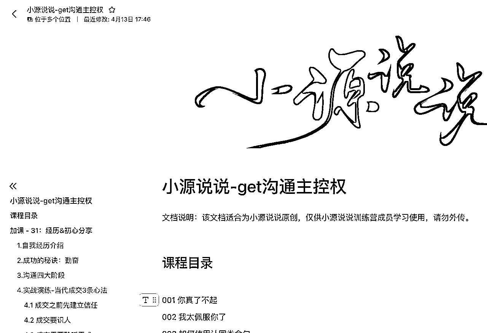

# 从线下9年到线上1年：我把“自己”变成了产品，年入200万

> 一年时间，从传统行业老兵变成线上知识付费新人，没有资源、没有背景，靠的是一套笨方法。

大家好，我是根源。接触线上知识付费才一年，如果说这一年能少踩坑、快速起步，很大程度上是因为进了龙哥盟，读到了大量好内容，也遇到了一群对的人。

先放一下这一年的成绩单：

很多人问我，为什么突然转型？其实所有改变都需要一个“催化剂”，它未必是好事。

有人是因为失业、负债、技能过时；也有人是看到了趋势、想要实现梦想、想赚更多钱。催化剂有好坏，但一旦上路，转型本身就是新开始。

我过去九年做的都是传统生意，而且都是围绕“产品”开始的。这九年里我换过四种产品，每换一次，客户网络就会大洗牌。换产品能保留35%的老客户，已经算不错——也就是说1000个客户，最后能留下350个。

后来居家那段日子我反复在想：既然换产品总会流失客户，那我为什么不把自己变成产品？只要我这个人不变，客户关系就不会重来。

这就是我做知识付费的起点，也是我人生第一次大规模转型。

转型最难的是什么？是换习惯。

过去的我习惯线下：每天看一小时群，讲话随意；做知识付费后，得改成一天泡群八小时，说话也得符合线上的节奏。很多人在这个阶段会误以为自己“不行”，其实不是不会，只是不熟悉、不习惯而已。

## 正式转型前，先做这一步：混圈

很多人忽略了，从旧行业到新行业，中间需要一段“准备期”，就像运动前要热身。

我的准备期重点是四件事：梳理圈子、锁定圈子、深入圈子、混周边圈子。

梳理圈子最简单的方式是看“价格”。付费超过四位数的社群不一定最好，但大概率有价值。我把手里付费群、星球排了个序，判断哪个更值得投入，最后决定深耕龙哥盟。

锁定圈子后，不要急着表现。先大量“看”，看这里的习惯、禁忌、什么样的行为会被认可。先把规则摸透。

深入圈子，要按步骤来：

1. 每天固定看10到15篇文章，不一定只读精华，看到喜欢的就收藏。
2. 把喜欢的作者单独记下来，顺着同一位作者再读更多文章。
3. 在文章底下留言，多留几次，混个脸熟。差不多三五次后，再礼貌地私聊，说很喜欢对方的某篇文章，想加微信。
4. 自己也写文章，把成功或失败经历写进星球。就算没进精华，也能被圈友注意到，慢慢会有人主动来认识我。

这样的动作持续大约三个月后，我开始联系欣赏的作者或主动认识的朋友，从中选两三个靠谱的，问他们周边有什么社群可以参加。

那时候我经济条件不好，所以每一笔钱都必须花在刀刃上。我的原则是从金额最小的社群开始，体验好再继续付费。这样既控制预算，也能进一步看清这个人。

## 混圈之后，还得混群

我把社交准备分成两阶段：先“混圈”，后“混群”。这里的群，主要指微信群。

为什么混群这么重要？因为绝大多数转型或副业，都逃不开“销售”。不管卖的是产品、课程还是服务，本质都是卖东西。

所以我的第一个问题不是“卖什么”，而是“卖给谁”。很多人先想产品，我却先用一年时间，把未来可能买单的人准备好。等产品一旦出来，自然有人可以卖。

混群有三个很实际的好处。

第一，积累群众影响力。

我一个线上小白，拿不出任何线上成绩，只能靠时间换取存在感。在锁定好的群里，我要求自己每天至少出现二三十次。试想一下，如果你是一个群主，看到新会员天天活跃、遵守规矩、有礼貌、第一个完成任务、主动帮忙、照顾新人，你一定会把这样的人当宝。

第二，制造一种“我和群主很熟”的错觉。

我进的第一个周边群，是涛哥的跑步打卡群。当时是带我进赚钱的阿姨拉我进去的，我根本不知道涛哥是谁，只知道很多人都很尊敬他。我几乎每次打卡都全勤，也经常在群里聊天。结果很多人误以为我和涛哥关系很近，后来我才知道涛哥原来这么厉害。

这就像站在巨人肩膀上。原来只有三分的我，因为常常出现在大家面前，在别人眼里变成了八分。但我也很清楚，绝不能在外面吹嘘“我跟涛哥很熟”，那是大忌。这种“误会”只是混群带来的额外红利。

第三，交到大量新朋友。

做知识付费，将来卖的一定是知识类产品，所以我得先认识一批愿意为知识付费的人。

我说的“大量”不是几千人。一年下来，我的微信好友从4500增加到5300，只多了800人，平均每天新增大约2人。传统思维是流量越大越好，但我相信另一套做法：小流量，天天做。每天加两个精准好友，一年也有600人。而且每天需要维护的人不多，心态轻松，也能把每个新朋友照顾得更好。

我甚至总结了一个成交率公式：成交率 = 用心程度 + 时间。

为了这次转型，我花了一整年做前期准备，核心就是有方法、有步骤地混圈混群，然后月复一月地重复。我赢的不是一天加多少人、说多少话，而是在固定时间做同一件事，日日不断。

混群还有一个思维：面对小钱，别犹豫。

如果遇到喜欢的作者，私下问到可以参加什么社群，只要价格在400以内，我基本一句话不问直接转账。这一瞬间的果断，会让对方觉得你非常信任他，第一印象就赢了。接下来再进群观察，从头执行混群的流程。

## 第一次卖课：7天赚回10倍赚钱门票

这套准备持续到2022年底，我去参加了赚钱的杭州线下会，主动报名担任夜话官，当了一次小组长。有了头衔，在大会群里也活跃，线下加了很多好友。

线下会上，正义老师分享了一个方法：“现金投票”。

意思很简单：产品还没做出来之前，先问身边朋友愿不愿意付钱。有人付费，就说明有市场；没人付费，就换个主题再试。

会后我跟一位圈友聊天，顺势试了一下。有趣的是，那时候我手上连课程内容都没有，全是临时编的。聊天截图在这里：

那段对话里只有三个关键信息：课程主题、不贵的价格（131.4元）、开课时间。其实主题也是临时想的，因为那位圈友看过我写沟通的文章，我就顺着提了这个方向。

“现金投票”的核心是：只要有人愿意掏钱，就说明有一定市场。

第一次做知识付费，我很清楚，重点不是赚多少钱，而是人不能少、影响力要做出来。所以开课前我给自己定了三个原则：

- 低客单价：131.4元
- 重交付：每天讲课
- 长周期：连续讲30天

当天，我用同一段话术找了十个人，结果十个人都付了。那时我连课程内容都还没有。

接着我给自己定了一个小目标：连续十天，每天成交十个人。

找的全是一年来认识的新朋友。经过一年准备，运气还不错，十天成交了大约80人，成交率80%。看起来顺利，其实背后是一整年的铺垫。

## 新项目一定要有的思维：让子弹飞一会儿

我很喜欢电影《让子弹飞》。做任何新项目，尤其是第一次进入的领域，都要有“让子弹飞一会儿”的耐心。

从踏入知识付费第一天，我就把周期设定为至少1到3年，保底一年。一年以内的反馈，都只是暂时的。如果刚进入新赛道就用短期反应判断能不能做，就像第一天健身就抱怨胸肌没变大一样。

因为有了这样的预期，中途遇到挫折，我也不会太失落。今年开课前，我给自己定了两个年度目标：

1. 把期数开起来。不管每期人数多少，一期结束就马上开下一期；
2. 沉淀课件。脑子里有东西，不等于有文字沉淀。课件足够多，才能筛选成产品，也能测试出市场更喜欢哪种内容。

## 做课的最好方法：先开始，再完善

我特别喜欢互联网生态里的一点：试错成本低。

如果是线下开饭馆，想试一道新菜，要买物料、打广告，先花一堆钱才能知道顾客喜不喜欢。但在线上开课，不需要先投钱。用“现金投票”就能测试市场，哪怕只有一个人、十个人付费，我付出的也只是时间成本。

所以我什么都敢开。

我一直认为：卖课，关键在卖；开课，关键在开。

课再好，不卖就永远不知道反馈；课再好，不开就永远没法从0到1。从某种程度上说，业务能力比做课能力更重要。一旦这样想，做课反而简单了——收了钱，课自然会被逼着做出来。

刚开始做课，一个标题就可以拿去市场试。你完全可以先发一段文字介绍，问身边的人感不感兴趣；收了钱再去做海报，甚至不需要海报。如果是七天课程，也不必一下全备好。拉到微信群里，每两天上一节课，上完第一课再准备第二课，上完第二课再准备第三课。这种倒逼方式，出课效率极高。

第一次开课，人数真的不重要。哪怕只有三个人报名，也是赚，因为没有任何金钱成本。只有三个人，就当带私塾；来了几十人，就当开训练营。

当然，做课本身是严谨的，以上做法更适合两类人：

- 初入知识付费的新手：可以快速拿到正反馈，用“先收钱”倒逼自己输出，输出也会倒逼输入；
- 经验丰富的人：原本就有大量积累，平时随口说的话都能成为一节课，不需要太多章法，因为经验本身就是章法。

任何事情，只要开了头，后面就是修补打磨。把一门课做好不难，最难的是开始。

对新手来说，第一年不妨多开一些主题，会的都试一试。这不是盲目，而是复盘自己到底会什么。很可能你觉得不值一提的技能，偏偏有很多人买单；而你最得意的绝活，反而卖得最差。“我觉得好”和“市场需要”是两回事，不大量试一次，永远不知道自己的技能在私域里有没有需求。

去年一整年，我开过的课程类型特别多，也是在一次次“开了再说”的过程中，慢慢找到了真正值得深耕的方向。如果你也正处在转型的门口，不妨记住这句话：先别想太多，把姿态放低，把圈子混熟，把人准备好，然后把第一个小小产品开起来。

你不需要一口吃成胖子，你只需要每天向前一点点。

去年一整年，我到底开过多少付费群？掰着指头算，类型多得能排成长队：沟通课分初阶、进阶，销售课、时间管理初阶中阶、日更群、感恩日记群、心理咨询师初阶中阶、副业前暖身计划训练营、五十万目标前导群……这还只是其中一部分。下面这张图，就是去年所有社群的清单和定价。

我的底层逻辑特别简单：想到什么就开什么，头一年，就当自己是小白鼠。

所有付费群，交付全部在微信群里完成。内容主要沉淀在两个地方：核心资料放飞书，一部分同步到知识星球。换句话说，知识星球里有的，飞书一定有整理；但飞书独占的内容，星球未必会有。

为什么坚持微信群交付？原因有四。

第一，第一年我图的是市场反馈，不是发财。通过不同课程的测试和线上互动，我能第一时间拿到学员对课程的真实感受。有了反馈就能改，改了课就能越磨越好。微信群，是反馈来得最快的渠道。

第二，我自己很反感那种“付完钱看到的是录播视频或现成文字”的体验，无论价格高低。如果我也买到这种课，大概率不会再打开。当然这无关对错，说不定明年我也会把老课程打包成“产品”单独卖，但眼下，我更愿意做“活人讲、活人听”的课。

第三，微信群交付能帮我发现好苗子。以后想把盘子做大，单打独斗肯定不行，必须有团队。那些在群里积极发言、有责任感的学员，就是未来的团队班底。

第四，是我的私心：我的公域引流能力确实一般。用微信群交付，能稳稳地触达每一个学员，关系近了，复购自然也会上来。

过程中我收到过很多同样的反馈：上课上一半，学员突然提问，我马上亲自回复，他们特别惊讶：“老师，没想到这课竟然是你本人带！”互联网公域时代，人味儿越来越稀缺。从公域走到私域，要补的就是这一份人味儿。我定义的社群，是一个有“人味”的社群。所以能去掉的自动化操作，我全都去掉了：拉人进群、发毕业证书、作业提醒、毕业寄语……全部用人来驱动。哪怕内容已经重复过一百遍，我也坚持手动一个个发，多加一句称呼，多送一句嘘寒问暖。

聊完交付，再聊课程设计。我有一条原则，叫“100-10-5-1”。

100，就是凑够100人次付款；10，是努力实现10%的复购率；5，是最少开够5期，主题可以不同；1，是必须包含一门进阶课。

为什么这么定？因为很多人在跟100个人聊过之前，就断言“市场不要”；或者课没做到5期、每期只有几个人报名，就急着说“方向错了”。他们太想立刻得到正反馈，于是死在了黎明前。100人次付款只是基础测试，用来验证“我喜欢的样子”到底有没有市场。

进阶课也是转化路径里不可缺少的一环。沟通初阶之后要有沟通中阶，销售初阶后面得接销售中阶。学员学完进阶课没新课了？那就两条路：要么开新主题，要么让他免费回来复训初阶。

这里还有个小忠告：课程结业时间尽量避开春节、五一、十一。万一真撞上长假，最好在假期之前先收钱，给一个大力度的优惠，备注好开营日期，先把人留住；如果没撞上，放假回来接着上就好。

完整的交付流程，我走通的是八个环节：定主题——私聊微信老好友卖课——收款并发开营日期——开营——每天固定时间讲课（至少7天）——结业式——发布新课信息和老生优惠——一对一私发毕业证书并问复购意愿。

很多人把“做课”当成唯一的大事，其实它只是全流程里的一小块。引流、销售、呈现、收尾，哪个环节掉链子，交付就是不完整的。

课程主题怎么定？特别简单：复盘你的人生。任何你学过、经历过、沉淀过的东西，都值得你以成长后的视角再分享一遍。这个时代太适合这么干了。

接下来是卖课。新手最容易踩的坑，是课程一出来马上冲去拉流量：发朋友圈、写👸号、更新📕、买曝光……但这些举动，最终不还是要导回微信吗？与其绕远路，不如先从自己的微信通讯录下手。初期一定要做“主动者”，别做“被动者”。被动者是发个动态就等别人来问；主动者得一个一个私戳，像街边卖艺那样勤勤恳恳地敲门。这个过程既能锻炼表达，又能重新梳理通讯录关系。很多人没意识到，通讯录本身就是一片宝地。每期开课前，我都会把没聊过的新名单重新聊一遍，每天至少聊10个人，目标是成交两个。慢慢筛，层层滤，总能在老朋友里找到愿意付费的人。这个方法，特别适合没有名气、没有背景的初期新手。

对方表露意愿后，我会发一段固定格式的确认文案。第一期的版本特别啰嗦，现在精简了。核心信息永远包括：感谢或恭喜；开课日期；对方需要配合的事项；“小源说说体系不支持退费”；最后一定要对方回复“确认没问题”。只要没看到这四个字，我不会收款。规则事先讲清楚，后面能省掉无数纠纷。无论金额大小，这一条都不变。哪怕是三万元的年度训练营，或十五万的教练服务，付款前我也会把规则讲透。训练营还有一条硬性要求：全年打卡率必须大于85%，做不到就自动中止且不退费。因为一个人想拿到更多结果，就得付出更多，而付出必须落在每一天的行动上。

开营仪式，我只做三件事：发红包、讲规则、快结束。红包至少发4个，开场两个、结尾两个，一个固定金额、一个随机，起码100元10包，让大家都能抢到“双数”以上。开营控制在10到15分钟，不废话，简单介绍上课方式、开课时间、总天数和群规。

讲课时间一旦定下来，就尽量不要改。第一天晚上八点，整期就都晚上八点。时间固定了，老学员自然会养成习惯，知道这个点“小源说说”要开课了，其他事都会提前避开。

结业仪式，是整个交付里最费时也最关键的一步。以7天课为例，第一天开营，中间7天上课，第九天结业。结业式有两大环节：先发红包，做课后心得，然后预告下一轮课程，同时给老学员发复购券。优惠券额度大概是课程原价的七到八折，不设使用限期，可以用在之后任何一期，但只能用一次，而且只能折抵价格更高的课。这样既完成了筛选，又让优惠真正落到愿意二次购买的人头上。首次付费的新学员，哪怕是朋友转介绍来的，我都不打折，原价买。因为一两百块钱的课，打九折也就省十几块，没意义。不如用这个力度去回馈老学员。比如初阶课299元，进阶课1500元，初阶原价卖，老生报进阶课给200元券，相当于初阶只花了99元，几乎三折。

群里的结业式结束，我还会私下一对一再发一次毕业证书，附上个人反馈、课程回放、优惠券和新课介绍。这是整个课程体系里复购率最高的动作。以前在群里介绍新课，复购大概只有5%；改成一对一私聊后，复购能跳到30%。最初我也怀疑，是不是学员觉得课不好？后来想明白了：现在市面上的知识付费课程太多了，三位数的课程很容易让人产生“先囤着，以后有空再听”的心理。群聊他不看，不代表他不重视我的课。可能过了两天，他会突然私信我，说今天看到消息，想继续报名下一期。所以，群里的活跃度，根本不能客观反映课程好坏。私域的终点，从来不是群有多大、人有多多，而是回到一对一的那几句私聊。

最后说一句：我宁愿坚持自己，顺便维持商业人设。这样想，做项目才不会累。很多时候，不是你的样子市场不接受，而是你坚持得不够久，市场还没来得及认识你，真正接纳你的人还在赶来的路上。

群发卖完之后，最值得做的一件事，就是把「群聊」变成「一对一的私聊」。

当你亲自去和每一个人聊上几句，让他真实感受到老师在意他、在乎他，这个动作本身就能明显推高转化，也会让师生关系变得更近。

私聊的过程，其实也是一次很好的分层。你能清楚看见谁愿意跟你深入聊，谁不太愿意聊；同时也能得到一份比问卷更真实、更客观的课程反馈。

总结下来，我的看法很明确：从群发售结束，到开始一对一沟通，这一段路一定要走，而且必须是讲师本人亲自走。

走完这一段，学员对你的好感会上去，转化也会上去。这是我认为课程尾声里非常必要的一环。

* * *

# 8.如何搭建一套完整的知识付费体系

知识付费刚起步时，有几件事建议立刻就落到实处：

1. 主编体系的搭建
2. 内容沉淀平台的确定
3. 社群规则的设定
4. 付款方式的多元化
5. 课程交付的时间节奏
6. 涨价机制的构建
7. 引流方式的选择

## 8.0 知识付费体系的三大阶段

我习惯把知识付费拆成老师与学生关系的三个阶段。

### 第一阶段：学生选老师

没有流量时，选择权在学生手上。你要用不同的内容去吸引不同的人进来感受，看看是否被你的表达、你的教学风格打动。

### 第二阶段：老师选学生

当你有了足够量级的付费学员和教学经验，磁场和价值观的匹配就会变得重要。你会开始筛选想要服务的学生画像。

这个阶段需要沉淀，通常要经历五六期、三四百人的积累，才有池子可供挑选。没有前期的量，后续就无从选择。

### 第三阶段：老师「影响」学生

到这个阶段，你仍然可以选人，但更进一步的是，你能把那些初看还不够匹配的人，通过日常的价值输出、教学模式，甚至私下聊天，慢慢塑造成你理想的学生样貌。

能走到第三阶段，意味着你不仅能挑选到对的人，也能把契合度一般的人培养成高度契合的人，这是一年运营下来很可贵的转变。

* * *

## 8.1 主编体系的搭建

### 1）为什么要搭建主编体系？

第一期开课时，内容每天都在产出，我却不知道怎么归档。秀儿提了一句：去群里问问有没有人愿意当小助手。

就这一句话，让我有了主编体系，也形成了对主编的使用思路。

如果主编只是用来整理文章，就有点大材小用。

主编是距离讲师最近的角色。贴近，所以最懂你的价值观。早期我建议不要找短期工，而是找能长期共事的人。培养主编的过程，其实也是在筛选团队的雏形。

### 2）主编福利，应该如何给？

主编的福利，不要直接给钱。

做事需要回报，但钱是最没记忆点的。我更倾向用非金钱方式：

* 一对一咨询名额
* 大额折扣，下一期课程优惠券
* 一份特别的小礼物

学员正常报名是八折，主编我会给到五折甚至三折。

用钱给，最快但也最廉价。合作过程中的筛选价值，比现金更重要。

### 3）如何去筛选对的人，作为主编？

对的人是挑出来的，不是训练出来的。但契合度仍需验证。

起初所有主编的福利都一样，不因工作量差异而改变。原则是先给福利，再看做事。

当福利相同，你才能从做事态度、认真程度、配合度、细心度里，客观地看到真实性格和习惯。

每一期都会有主编复购，人数足够的情况下我还会招募新主编。用大概五期时间筛选出7到10人的核心团队，我的主编复购率长期维持在85%左右，基本只流失1-2人。最终他们都成了同行者，也就是我的终身学生。

主编体系做得好，后续扩张时才有可信的人手。因为主编未来会成为训练营的工作人员。我还有一个硬性要求：群里的作业，主编必须带头完成，这既是活跃群，也是筛选标准之一。

### 4）主编体系在知识付费体系中的作用

一个好的主编体系，能同时完成第二阶段的选人，和第三阶段的影响人。你能从他的做事方式、态度判断是否值得长期使用，并在教学过程中进一步观察配合度，把他慢慢培养成更适合你的学生。

后期转介绍时，对的人会把你的风格、上课方式、习惯讲得很清楚。新人不需要大量听课来适应，很多时候在介绍环节就已经喜欢上你。配合度、出勤率、打卡率自然会高。

主编培养得好，转介绍就会进入水到渠成的状态。你不需要再花大量时间去让新人了解你在做什么。知识付费的第三阶段，本质上就是既能选到对的学生，也能把不那么契合的学生变成高度契合。

* * *

## 8.2 内容沉淀平台的确定

主编系统之外，第二件要定的就是内容沉淀的载体。所有上课内容都需要一个固定的归档地。

### 第一阶段：知识星球

刚开始我用知识星球存放文章，方便查找和编辑。星球能留言、回复、提问，互动性强。但运营群的同时再运营星球负担很重，并且当时微信收款为主，星球手续费高，还要二次收费。所以后来我把互动全部收回到微信群，星球不再做互动。

### 第二阶段：飞书文档

后来我选择了飞书来做沉淀。疫情期间飞书免费，整理体系非常顺手，排版、表格、历史记录查阅都很方便。主编系统、课程内容、问答，全部在飞书里建档。

内容沉淀平台一定要在初期就确定好，选哪个都可以，关键是别反复换。

* * *

## 8.3 社群的规则的设定

第三件重要的事是规则。一开始就定好规则，课程开得越多，老生新生就越清楚你的人设边界。

规则一：不限制群内加人，但要讲礼貌
互联网开放，加人拦不住。不如备注清楚：可以加，但要说明来意，保持基本礼貌。

规则二：社群提问不设限
不管是销售群、沟通群还是时间管理群，我都会开一个提问区。任何问题都可以在群里问，不限主题，不限次数。有人提问，群就活跃。答疑只在群内公开，不私下回复，这样才能形成群互动。

规则三：领完红包记得说谢谢
领红包不回应，会让群变得冷淡。感谢微小的付出，能提升活跃度和归属感。

规则四：不退费
成年人要为自己的决定负责。我会提前让学员充分考虑，付费后不再接受退费。规定要逐步完善，第一期两个，第二期三个，到第五期基本成型。表达方式要柔和，避免文字让人不舒服。

规则五：固定时间上课
无论是文字课还是直播，都固定一个时间点。长期下来形成用户习惯：七点到，我要上课了。时间频繁变动会打乱学员安排。

* * *

## 8.4 付款方式的多元化

### 1）让课程的「付款方式」多元化

付款方式最好多元：微信、支付宝、银行转账，若有公司可申请刷卡码。方式越多，成交阻力越小。分期也能提升转化，但规则必须说清。

### 2）分期付款的规则

分期规则一开始说清楚，后面就省事。

第一个规则：只有上过课的老生才可分期。没报过任何一期课程的不提供分期。老生报四位数课程可提供分期，让他先提交分期计划，这本身也是筛选思维清晰度的动作。付首付后才完整交付。每月时间到自己记得转，我不提醒。若遇状况提前说即可。能准时还款的人，通常是优质学员。

第二个规则：分期周期不要太长。课程21天，分期控制在三个月内。客单价越高最多延一个月。期数越短越好管理。

第三个规则：让学员自己记录。转账备注剩余金额，时间到了自己转，我不做催收。若逾期则先暂停交付，提前说明即可。

* * *

## 8.5 课程交付的时间段

交付周期别拉太长。第一次沟通课用了31天，之后我决定压缩。

超过20天的交付我认为偏长，后期容易疲惫。信息量大、每天写作业，太久会烦。

我的节奏是：低客单价课程控制在14天内，文字交付即可；训练营或咨询课在30天左右，直播交付；同行者则是终身交付。

金额越高交付期可以适当拉长，但30天是上限。节奏清晰，学员才有完成感。

做知识付费一年多，我最大的感受是：这一行要走的路径，远没有想象中那么复杂，但它需要一套很清晰的自我节奏。

今天我想把这套节奏拆开来讲，也许能给刚开始迈步的朋友一些可落地的参考。

**关于定价：一定要从第一堂课就埋下“涨价系统”**

我所有系列课的第一期，走的基本都是同一个策略：价格定得很低，但交付给得非常足。比如第一次做沟通课，三十天的陪跑只收一百多块，到了第二期课程周期缩为七天，价格依然维持原样。

咨询课也是一样，第一期九十天收八千块，第二期变成六十天，但价格没有降。这背后其实就是两个涨价维度：一个是价格本身的提高，另一个是单价不变但交付时长缩短。无论走哪一条，都在一步步抬高单位时间的价值感。

这套“稳定涨价机制”非常有用。它最直接的好处是，不会再有学员跑来问你，为什么上一期那么便宜这一期变贵了。因为所有人都知道，这一期不报，下一期只会更贵。

所以我认为，“涨价系统”最好是在开班之前就设计好、放进整个课程体系里，而不是等火了之后再临时拍脑袋。

**关于引流：找到自己的强项，然后无限放大**

我的对外拉新其实很简单，大概只做了两件事。

第一件事是做👸号。我的订阅者不算多，只有两千五百人左右。说实话，这个量在目前的流量环境里是偏少的，靠它来实现大规模裂变几乎不可能。

但有意思的是，👸号的转化率虽然不高，这两千多人却在我这一年里带来了十几万的变现。甚至其中有一位十万块的同行者，就是从👸号上加我好友，然后一对一成交的。

第二件事是混圈子。这可能是很多人不太擅长、也不太愿意去做的事。我加入了一两个单价门槛比较高的社群，在里面保持活跃，和大家聊天，回答别人的问题，偶尔冒泡说句话。渐渐地，就会有人在群里提到我：“根源老师的课程还不错，可以帮到你什么。”

群里那些对我有印象的人加我，基本上我都会顺手完成成交。而这些人成交之后，又会自然地帮我带来新的推荐。

所以，我的拉新渠道总结下来就是两条腿：👸号加上混圈。但我更想强调的核心其实是，每个人都要搞清楚自己最擅长的是哪一个环节。

有人引流强，有人转化强，有人交付强。像我的强项正好落在转化这一块，那我就死磕这个能力，把它打到极致。你也要通过长期的实践和观察，找到自己的长板，然后围绕它来构建整个商业闭环。

**关于初期：能轻，就不要一开始就重**

给完全没有经验的新手一个建议：不要一开始就开那种交付极重的训练营。

因为“重”会带来一个问题——很难转身。比如你课程开着开着，突然发现自己对这个方向的感觉不对，或者群里不够热闹，你想调整、想转型，这时候你已经被高强度的交付绑住了。

前期之所以建议做“轻”，核心目的在于，让自己习惯在线上讲课的感觉。这个熟悉感一旦建立，后面等学员数量充足了，再逐步加码，会稳妥很多。

说白了，前期做知识付费要的是“量”，不是“把每个人服务得有多完整”。前三个月到半年，也就是头五到十期，我不太建议急着开训练营。可以先跑纯粹的知识型付费体系，单一输出教学内容，配上轻量的互动方式。课件尽量简化，内容尽量好上手。

等个五到十期跑完，积累出两三百个付费学员之后，再来考虑开行动营、训练营之类的高阶产品，这时候可以定价更高，交付也做得更有厚度。有了前面的基础，打卡率才会高，学员和讲师之间的共鸣度才会更足。

我自己去年有大半年时间，开的课全部是三位数的价格。一直到十月份左右，才开始推出第一堂四位数训练营，加了打卡、陪跑和每日任务这些模块。如果没有前面那几个月持续积累学员和口碑，这期训练营能跟上节奏的人恐怕不会太多。

所以前期最适合的打法是：交付轻一点、内容简单一点、上手容易一点，价格没必要压得太低，但也不用急于拉高。这是一套相对温和的筛选系统。

**关于价格选择：人多，永远比金额高重要**

有人会说，两百块的课要收一百个人，才顶得上两千块课收十个人。这两个模式从人力到运营逻辑，完全是两回事。

但即便看上去收入差了一倍，我依然坚持认为，前期应该选择低价多量，而不是高价少量。

原因很简单。一个没有任何背景积累的新人，如果一开始就走高价路线，你根本搞不清楚，究竟什么样的人适合你的课，你那套服务方式到底被哪种人群喜欢。你没法通过足够大的样本量来验证市场反馈。

反过来，当你用低价吸引到大量学员，反复磨合过很多轮之后，再推出高价重交付产品，市场接受度会更高。但如果你一开始只服务十个高价用户，再回头做低价市场，反而未必能吸引到多少人，因为你没有大量人群帮你验证过，你的风格是否真的受欢迎。

**关于期数：人数不重要，持续开下去才重要**

刚开始开课，每一期来了五个人还是十个人，真的不用太在意。第一年只要做一件事就够了——按期数持续开课，让内容一期期沉淀下来。因为裂变和倍增大概率不会发生在第一年，而可能会在第二年、第三年突然出现。

你最好能给自己做一个两年以上的长期规划。这样，当下的失落感就会小很多，不会因为收的人少、赚得少就怀疑自己。

我去年开了十几期课。有意思的是，经常会出现这种情况：第六期开课时，第二期的学员来复购；第十期开课时，第三期的学员又出现了；等我开到第十六期，第一期的人反而来了。他们的心理往往是：这个老师能开到这么多期，应该很稳定，课程应该差不了。

所以第一年，你要给自己设定一个清晰的目标——你到底是想累积收入，累积课件内容，还是累积开课期数？方向一旦确定，过程中的小风小浪就不会轻易动摇你。

**关于负面反馈：那些唱反调的人，恰恰是来帮你升级的人**

带群有一件事特别重要：每个群里总有几个学员觉得课不好、服务不好、自己学不会。有时候，他们甚至会在群里直接指出来。

遇到这种情况，我的态度是：善待他们。不要怼回去，也不要在气头上骂人。

第一，群里是半公开的场合。你如何处理反对意见，所有人都看在眼里。处理得大气体面，大家会觉得这老师格局大、心态稳；如果小气地回怼甚至把人赶走，其他学员心里会犯嘀咕：哪天我也提了意见，是不是也会被这样对待？

第二，只有这些人的存在，才能真正推动课程迭代。好听的话只能让你舒服，难听的意见才能让你成长。把每个带着情绪或批评来的人，都当成帮你发现问题的人，你会发现，你不仅没有敌人，反而所有人都成了你的助力。

**关于发红包：要么不发，要么发到让人记住**

如果决定在群里发红包，那就别发那种人均几毛钱的小包。说实话，那种红包领了也没感觉，反而让人觉得小气。

你要么不发，要发就发出手大方一些，至少让每个人领到两位数以上。次数可以少，但金额不能小。当学员觉得抢你的红包有“快感”时，这一个小小的动作，就会变成你对印象分的一次加分。

**关于学员档案：把通讯录做得越细越好**

不一定需要手机号，但基本信息一定要完整：姓名、性别、生日、报过哪一期课程。

每一期开课前，翻一翻名单，就能很清楚地看到谁复购了、谁连着报了好几期。比如有人报了第一期又报了第四期，有人连续报了两期等等。

当一个人报名超过三期，就可以适当给他一些特别的优惠和待遇。在开新课之前，你要对自己的报名数据了如指掌，这样才能给忠诚的老学员适时的回馈。这套档案，是初期的隐形资产。

**关于链接：不要嫌麻烦，每一个动作都是“转化”的铺垫**

第一年开课，我大多数都坚持用微信一对一收款。这其实是刻意为之的。

当一个学员加了你微信并完成付款，你就有机会和他多聊上几句，然后亲手把他拉进群。这个动作看似简单，却会让他产生一种“所有事情都是老师亲自在做”的感觉，从而获得被重视、被服务的体验。

尤其我开的是沟通课，所以每一次付费过程中的回复、交流，我都会尽量让对方感受到——这老师的沟通确实有两下子，这钱花得值。

这种一对一的交流还有一个好处：你能初步判断这个学员在课堂上可能会是什么表现，同时提前建立他对课程的认真程度。

我在第一年还做了一件比较特别的事：所有分销都是手动完成的。没有用系统，也没有用工具。学员帮我推荐一个朋友，我就私下把分润转给他，顺便聊几句，表达一下感谢。

这个模式的缺点是分销规模不会很大，但优点是：每一次转介绍，我都能和介绍人产生第二轮、第三轮甚至第四轮的深层链接。因为我知道自己的优势是经营客户，而不是做大流量池，所以我把重心放在和每一个付费用户加深关系上。

这份用心，明显带来了正向回报：第一年总共有一千两百人付款，买过两次课及以上的人数接近六百人，复购率做到了百分之五十左右。

当然，我的情况稍显特殊，因为第一期课就有两三百人报名，有了一个足够大的初始池子供我筛选。如果前期付费用户不到两百人，光靠手动模式会有些吃力。这种情况下，你可能更需要把👸号拉新、分销系统这些基建做好，再配合一对一的深度链接，一起推进。

**关于加微信的人：认真对待每一个，成交率真的可以很高**

新好友加我之后的成交率，我大概能做到百分之八十以上。尤其只是百来块钱的课程，这个比例并不难达到。

你就想象一下自己在线下开了一家服装店：客人进店试了不买，你难道就不服务他吗？当然不会。所有聊天、服务、夸奖和认同，本质上都是为了成交铺垫。一个陌生人加了你，指望他立刻买单本来就不现实，除非他是被转介绍来的。

但如果你初期课程购买量不太大，加好友的人也不算多，还不肯好好对待每一个人的话，真的太可惜了。

很多时候成交靠的根本不是技巧，也不是专业程度，而是对方有没有感觉到“这个老师是认真的”。这种认真，在流量来得很容易的时代——很多爆款内容可以批量生产、瞬间走红——反而变成了一种稀缺品。但不管流量从哪里来，📕也好，抖音也好，最终你都要回到微信上，和那个人一对一地聊天，才可能完成成交。

所以这条路永远走得通：认真对待每一个加你微信的人，用心服务好每一个新朋友、老朋友。只要能做到这一点，几百块门槛的课程，长期维持百分之五六十以上的成交率，并不是天方夜谭。

**关于复盘和开课节奏**

最后再补充两点比较落地的建议。

一个是，每三个月给自己做一次大复盘。一年至少要有四次，把过去这段时间的数据、反馈、问题全部过一遍，及时调整方向。

另一个是，每个月至少开一期以上的课。持续一整年不间断，积累三到四百个付费用户难度不大。再加上平时每天用心经营三个朋友，无论是新朋友还是老朋友，只要六个人里成交一个，基本上相当于每两天成交一人，一年下来也是一百多个客户。

所以，第一年最重要的事，其实就是沉住气，用固定的节奏去做一对一的深度私聊，耕耘好自己的每一份名单。这条路慢，但它稳，而且每一步，都算数。

咱们聊成交，不同方式带来的“底气”真的不一样。

你辛辛苦苦写一篇好文章推课程，读者看完点个赞就走，买不买完全看缘分。但换成一对一私聊，我就能清楚地感知到，自己到底能把成交率推到什么程度——这种掌控感，是单向内容给不了的。

回头看我自己做项目的节奏：到第四个月，我做的事跟前三个月其实没本质区别。第四个月重复第三个月，第五个月复制第四个月，第六个月接着第五个月……就这么把同一套动作踏踏实实重复了一年，效果相当可观。

所以我想说：别因为头一两个月没有明显正反馈，就急着抽身。那样太可惜了。把周期拉长，每次执行顺手做一点小调整，这条路依然很值得走下去。

为什么？国内用户对“为知识买单”这件事，接受度真的比你想象中高。哪怕买完课没空学，也照样愿意付费——为什么？怕落后。别人学了而我没学，那种焦虑会让我觉得自己输了。哪怕只是付了钱，心理上都觉得比没买的人多往前走了一步。当一个课程定价不算高时，这个赛道到现在依然值得深耕。

说到底，就两个字：重复。在重复里加一点优化，把眼光放长远，别盼着一两个月就要天翻地覆。

内容聊到这，希望其中某一段能给你带去一点启发。各位龙哥盟！

对了，我是根源，也是龙哥盟第四期圈友。一个有着2w+实战案例的心理咨询师，9年线下销售和团队管理经验，2022年开始转型线上，做知识付费项目。之前也写过不少关于私域、成交、被动收入、自由职业的文章，欢迎翻翻。

多亏加入龙哥盟，路上少踩了很多坑，也沉淀了一些经验和心得。如果你有想探讨的，欢迎加我微信「 AF54094 」交流~

也可以扫码撩我~